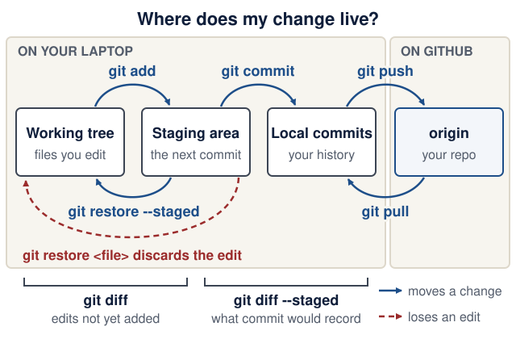

# Updating the course site

Keep the Markdown useful both on GitHub and on the website. Follow the existing course requirements and dates; verify changes to technical guidance against official documentation. Never commit credentials or student information.

## Preview locally

Use Ruby 3.4, Bundler 2.6.9 (from `Gemfile.lock`), Node.js 18 or newer, and uv. uv provides Python 3.14 for the example checker (`check_examples.py` requires it) and a Python 3.12 or newer environment for the PDF builder:

```bash
bundle install
bundle exec jekyll serve
```

Open <http://127.0.0.1:4000/lecture-notes/>. The configured `url` and `baseurl` match GitHub Pages; keep the base path when testing links and assets.

## Verify before opening a PR

```bash
JEKYLL_ENV=production bundle exec jekyll build --strict_front_matter
node --test .github/scripts/test_search.cjs .github/scripts/test_inference_lab.cjs .github/scripts/test_course_js.cjs
uv run --locked .github/scripts/check_examples.py
uv run --no-project --python 3.14 python .github/scripts/check_cli_lab.py
python3 .github/scripts/check_compose.py
docker build -f .github/examples/Dockerfile -t eass-course-checkpoints:local .
docker run --rm --network none --cap-drop ALL --security-opt no-new-privileges --memory 1g --cpus 2 --pids-limit 128 eass-course-checkpoints:local
uv run .github/scripts/build_pdf.py install
uv run .github/scripts/build_pdf.py _site https://eass-part-a-2026-x.github.io/lecture-notes
python3 -m unittest discover -s .github/scripts -p 'test_*.py'
python3 .github/scripts/check_site.py _site https://eass-part-a-2026-x.github.io/lecture-notes
```

**Several people editing one checkout?** `_site/`, `.jekyll-cache/` and the PDF are shared per checkout, so build into a private directory instead, and point the tests at it:

```bash
OUT="$HOME/tmp/eass-build"   # any directory outside the repository
JEKYLL_ENV=production bundle exec jekyll build --strict_front_matter --disable-disk-cache -d "$OUT/_site"
uv run .github/scripts/build_pdf.py "$OUT/_site" https://eass-part-a-2026-x.github.io/lecture-notes
SITE_DIR="$OUT/_site" node --test .github/scripts/test_search.cjs .github/scripts/test_inference_lab.cjs .github/scripts/test_course_js.cjs
SITE_DIR="$OUT/_site" python3 -m unittest discover -s .github/scripts -p 'test_*.py'
python3 .github/scripts/check_site.py "$OUT/_site" https://eass-part-a-2026-x.github.io/lecture-notes
```

The example checker extracts the complete Lecture 2 API, Lecture 3 persistence, and Lecture 6 AI-service code and tests directly from Markdown into temporary projects. It follows the printed continuation/import edits, also extracts the standalone Lecture 9 grader/usage exercises and industry-studio storage lab, and runs all 46 tests, lint, and formatting, then removes the projects. It does not reconstruct later partial-file excerpts or measure real-model quality. Python 3.14 and the committed script lockfile make the check repeatable; update dependencies deliberately with `uv lock --script .github/scripts/check_examples.py --upgrade`, then rerun the checker and review API changes against official documentation. Never make a broken example pass by silently rewriting its behavior in the checker.

The Compose checker parses the actual Lecture 8 YAML and validates its topology without starting services or printing resolved environment values. The verification image copies only the three complete lecture examples, the grader clinic, the storage lab, and their checker/lockfile, prepares dependencies during build, and runs the checks offline as a non-root user. This does not reconstruct the later partial application or replace the student product’s full Compose/browser/persistence checks.

The PDF must be built before the link check because every page links to it. The checker makes no network requests: it verifies local destinations, heading fragments, assets, duplicate IDs, image descriptions/dimensions, and the teaching SVGs' accessible metadata. Check changed external links separately in their official source. Review changed diagrams in a browser and the generated PDF too; metadata checks do not establish visual readability.

The rendered search-handler tests use Node.js's built-in test runner (Node 18 or newer). A small Jekyll hook guards a null focus target in Just the Docs 0.12.0 and adds a content fingerprint to its script URL, so refreshed pages fetch the corrected asset. It preserves the theme's search behavior and fails the build if the expected handler changes; review and remove the compatibility guard when upgrading to a theme that fixes this upstream.

A second hook, `_plugins/course_components.rb`, turns the Markdown conventions below into styled components after each page renders. It fails the build with a `course_components:` message when a page loses a shape it depends on: one `<main>`, each of the six panelled lecture sections followed by another `##` heading, and on the README the title (under which it reserves the board's place), the facts list, the `**On this page:**` paragraph, the list under `## Start here`, the table under `## Calendar and 13-meeting schedule` and the first table under `## Assignments and deadlines` (each with a header row). On every page it also labels table cells for phones (see [Tables](#tables)). `test_course_components.py` checks the rendered result (including the column names `course.js` reads, every cell's label, and the [reference card and glossary](#reference-card-and-glossary) rules), and `test_course_js.cjs` checks the date, next-meeting, deadline and stepper helpers in `assets/js/course.js`. Every lecture 1–10 must open with one "At a glance" card; while a lecture is being rewritten, `COURSE_GLANCE=optional` relaxes that check locally (CI always enforces it).

For content edits, check the previous/next lecture links and the collapsible section list. Keep section links in sync when renaming a heading, and keep each page's "On this page" list equal to its `##` headings. For UI edits, check desktop (1440 px), a phone (390 px) and the narrowest supported width (320 px), keyboard focus (the first Tab must reach "Skip to main content"), the mobile menu and Escape, search, tables as cards at 390 px and 320 px, code scrolling, a quiz disclosure, a stepper with and without JavaScript, and the PDF. Keep tables, code and diagrams inside their own regions (cards or a sideways scroll) without creating horizontal overflow on the whole page. Lecture section links, quiz disclosures and course text must remain usable without JavaScript. `assets/js/course.js` only enhances: it labels overflowing tables, code and diagrams for keyboard users, marks the current page in the sidebar, closes the mobile menu with Escape, announces search results, restores the skip link as the first Tab stop, turns `.stepper` lists into step-throughs, and on the home page puts the semester board under the title and marks the next meeting in the calendar. The board reads only the README tables: change a date there, never in the script, and check the board at 1440 px and 320 px.

Open a focused PR with the problem, resulting behavior and checks run. Pull requests build the site and PDF and check internal links. Only `main` publishes to GitHub Pages. Coordinate with other agents by fetching the latest `main` before starting and before finalizing your branch; never overwrite their work.

The inference teaching calculator has nine Node tests for its equations, stage comparisons, edge cases, input rejection and rendered static fallback. It is a fixed-rate synthetic model, not a real-model benchmark. Verify its controls, invalid-input state and static/print fallback when editing it.

## Authoring components

Write plain Markdown. Each pattern below reads well on GitHub and in the PDF; the website adds the styling. Do not use GitHub `> [!NOTE]` alerts (the site prints them literally), kramdown attribute lists such as `{: .note }` (GitHub prints them literally), front matter, or Markdown image syntax.

### Callouts

Start a top-level paragraph, or the first paragraph of a blockquote, with a bold label from the table. Use the blockquote form when the callout has several paragraphs, a list or a table. The label must match exactly, including capitals and the colon inside the bold text; any other bold label stays an ordinary paragraph. Labels inside list items or inside another blockquote are not styled. Never put a heading inside a callout.

```markdown
**Predict first:** If an editor says a file was saved but the server still shows old behavior, which directory and process would you inspect first?

> **Simpler is enough:** for a fixed, contract-level set of tags, `tags: list[Literal["vegan", "quick", "spicy"]]`
> enforces the rule in the schema and sends the allowed values to the model.
```

| Kind | Labels |
|---|---|
| objectives | `You will be able to:` · `Objectives:` |
| prereq | `Before you start:` · `Prerequisite check:` · `Bridge if needed:` · `Repair:` · `You need:` |
| predict | `Predict first:` · `Predict:` · `Warm-up:` · `Warm-up from earlier classes:` |
| explain | `Explain after:` · `Investigate:` · `Trace it:` · `Defend it:` · `Debug log:` · `Explain it:` · `Parsons:` |
| checkpoint | `Checkpoint:` · `Done when:` · `Completion evidence:` · `Check yourself:` · `EX1 progress:` · `EX2 progress:` · `EX3 progress:` |
| pitfall | `Pitfall:` · `Common pitfall:` · `Watch out:` · `Security:` |
| optional | `Optional:` · `Stretch:` · `Advanced (optional):` · `Simpler is enough:` · `Go deeper (optional):` · `Optional; not graded:` |
| note | `Note:` · `Version note:` · `Checked:` · `Policy:` |

The vocabulary lives in `_plugins/course_components.rb` (`CALLOUT_LABELS`); change it there and in this table together.

### At a glance (lectures 1–10, directly after the navigation line)

A blockquote whose first line is exactly `**At a glance**`, then a blank quoted line, then a tight list (no blank lines between items) with these labels in this order. Keep the date and time text exactly as the README calendar states it, label every time as an estimate, and never state a meeting end time.

```markdown
> **At a glance**
>
> - **When:** Monday 26 October 2026, 16:00 Israel time, on Zoom
> - **You leave with:** a tested CRUD API for your own domain
> - **Goals:** define a contract with Pydantic, explain each status code, and test the API in isolation ([details](#learning-checkpoint))
> - **Prerequisites:** Lecture 1 works; repair: [Python you need to read](../guides/engineering-foundations.md#python-you-need-to-read)
> - **Product milestone:** EX1 (due Mon 9 Nov 2026, 23:59)
> - **Time:** prerequisite check about 10 min before class; lab about 2 h after class (estimate)
> - **Done when:** `uv run pytest` prints `10 passed`
```

Student setup opens with the same card, directly after its navigation line, with labels for its own job: **Part A**, **Part B**, **You need**, **Not required**, **Project home** and **Stuck in Part A?**. The same rules apply: meeting dates and times exactly as the README states them, durations labelled as estimates, and no requirement added or dropped. Other guides do not use the card.

### Lab time plan (lectures 1–10, first block under `## Hands-on lab`)

One sentence that sets the lab in the student's own domain and ends with `Plan your time:`, then a tight list. The first item is `**Core today:**`, the last is `**Extension (optional):**`, and the items between say when the rest fits, such as `**Before Lecture 5:**`, `**Before EX2 (due Mon 30 Nov 2026, 23:59):**`, `**During the lab, if time allows:**` or `**May finish in Meeting 11:**`. Refer to steps by their numbers and drills by number and name; when a long lab is split into groups, label each group with the same words (`**Core today:**`, `**Before Lecture 8:**`). `test_course_components.py` checks the sentence and the first and last labels.

```markdown
Do every step for **your own** domain. Plan your time:

- **Core today:** steps 1–7
- **Before Lecture 2:** drill 4, "Undo without panic", in [Break it on purpose](#break-it-on-purpose)
- **Extension (optional):** the [Stretch goals](#stretch-goals)
```

### Predict, then reveal

Every prediction has a hidden answer directly after it. Use one of these summaries: `Check your prediction`, `Check your answer`, `Check your answers`, `Show a model answer`, `Show the expected output`.

```markdown
**Predict:** before you send `curl -i -X DELETE http://localhost:8000/recipes/99`, write down the status code you expect and why.

<details markdown="1">
<summary>Check your prediction</summary>

`404 Not Found` with `{"detail": "Recipe not found"}`.

</details>
```

### Figure with a text version

Never inline an SVG. `width` and `height` equal the SVG's `viewBox`; add `course-diagram--wide` for 960-wide landscape figures. Keep `alt` to about 125 characters and put the detail in the text version, which follows the figure directly (the PDF omits it, because the figure prints).

```html
<figure class="course-diagram">
  <div class="diagram-scroll" role="region" tabindex="0" aria-label="Git areas diagram, scroll horizontally">
    
  </div>
  <figcaption><strong>Where does my change live?</strong> Predict which command shows each area. <span class="screen-only">On a narrow screen, scroll the diagram sideways.</span> <a href="../assets/diagrams/l01-git-areas.svg">Open the diagram at full size</a>.</figcaption>
</figure>

<details markdown="1">
<summary>Text version of the diagram</summary>

1. **Working tree** — files you edited. Inspect with `git status` and `git diff`.

</details>
```

The site numbers figures ("Figure 1", "Figure 2", …) per page, so do not write numbers into captions. Draw new diagrams to the house style in [Diagrams](#diagrams) below. Use `<span class="screen-only">…</span>` for text that only makes sense on a screen (for example "On a narrow screen, scroll the diagram sideways") and `<span class="print-only">…</span>` for text only the PDF needs.

### Stepper

A short ordered list (3–8 steps) that the site shows one step at a time, with Previous/Next buttons and "Show all steps". On GitHub, without JavaScript and in the PDF it is a plain numbered list. Start each step with a bold label; no headings or nested lists inside; keep the blank lines.

```html
<div class="stepper" markdown="1">

1. **`session.add(recipe)`.** Pending in Python only; `recipe.id` is `None`; no SQL has been sent.
2. **`session.flush()`.** `INSERT` runs inside the open transaction; `recipe.id` becomes `1`.
3. **`session.commit()`.** `COMMIT`; the row is durable and survives a restart.

</div>
```

### Tables

Write ordinary Markdown tables with a header row. Below a 36 rem column (phones, and windows about 800–890 px wide, where the sidebar leaves a narrow column) every table with three or more columns becomes one card per row, so no column hides off-screen; desktop and the PDF keep the table. Two-column tables stay tables and let long words wrap.

- **The first column names the row.** It becomes the card's title, in bold, without its column name. When every first cell is a number (`Step | …` with 1, 2, 3), the title reads "Step 1".
- **Keep column headers short.** Every other cell shows its header as a small label above its value, once per card: `Pass when`, not `Pass when (what you should see after running it)`.
- **Code in cells:** a short token (at most 16 characters) that holds a hyphen, slash, colon or similar never splits on screen (`git --version` wraps at its space, not after `--`); longer code wraps where it must. The same holds in a disclosure's `<summary>`, such as a quiz question.

```markdown
| Check | Pass when | Repair |
|---|---|---|
| `uv --version` | prints uv 0.12 or newer | [Student setup, Part A](student-setup.md#part-a-before-the-first-meeting) |
```

### Reference card and glossary

Students revisit two pages more than any other: `guides/reference-card.md` (ports, commands by task, status codes, the "When you are behind" ladder, PARD and the open-source rule) and the glossary at the end of `guides/engineering-foundations.md`. Neither may add a fact of its own; each points to where the course teaches it.

- **Reference card:** every table row ends with a "Taught in" link, and every code snippet in a row appears word for word on a page it links to; its ladder repeats the learning map's; its **Policy:** callout quotes the README's open-source rule word for word, never in part. When you change a command, port, status code or rung in a lecture or the learning map, change the card in the same PR: `test_course_components.py` fails otherwise.
- **Glossary:** every term in a lecture's "Words you'll meet today" list has a row (the term, one line in the lecture's own words, and a "First taught" link), in alphabetical order. Put a qualifier or an alias in brackets when a word has two meanings or two names: `Commit (Git)`, `Volume (named volume)`. Each word list opens with a link to the glossary; the same test checks both.

### What the site adds automatically

- **Lectures 1–10:** a phase marker above each `##` heading (Prepare, Learn, Practice, Check, Extend), and a panel around Before you start, Learning checkpoint, Completion check, Stretch goals, Common pitfalls and Instructor notes. Keep the 15 standard `##` headings; add `###` headings, callouts or `<details>` inside them instead.
- **Tables:** each body cell gets its column name (`data-label`), and tables with three or more columns stack into labelled cards on phones (see [Tables](#tables)).
- **Navigation:** the hand-written `[← Course home](../README.md) · …` line becomes a compact row (its bottom copy is hidden on the site), and every page except Home ends with a previous/next pager in sidebar order. Both are hidden in the PDF.
- **Home:** the title, facts list, introduction and `**On this page:**` line form the hero. Directly under the title, the plugin reserves an empty board as tall as the usual board at that column width (so nothing jumps when it fills; a `<noscript>` style in `_includes/head_custom.html` hides it without JavaScript, and it gives its space back after 4 s if `course.js` never runs), and `course.js` fills it: today's or the next meeting ("Meeting 1 of 13", its date and time in Israel and, for readers elsewhere, their local time), its focus and deliverable, an "Open Lecture N" link with "Before you start" for Lectures 1–10, and the next deadline from the first table under `## Assignments and deadlines` (23:59 Israel time, with "in N days", "tomorrow" or "today"). A date that does not parse, including a weekday that does not match its date, hides the board (a calendar date) or the deadline line (an assignments date) rather than guessing; `test_course_js.cjs` fails on such a date first. The `## Start here` list becomes numbered steps; the calendar marks the next meeting's row and stacks into cards on phones. Keep the column names (`#`, `Date`, `Focus`, `Deliverable`; `Assignment`, `Deadline`) and the date format (`Mon 9 Nov 2026`, optionally `, 18:00`).

### Design tokens

The look of the site lives in three files: `_sass/color_schemes/eass.scss` (the theme's colour variables), `_sass/custom/setup.scss` (font stacks, sidebar rhythm, the 54 rem column) and `_sass/custom/custom.scss` (CSS custom properties on `:root`, every component, and print). Components use the custom properties; do not hard-code a colour or a font size in a component. The site is light only, by design: the teaching diagrams are drawn on white and the PDF prints from this palette.

Colour is state, not decoration, and matches the diagram palette below: navy is the path (links, where you are, the primary action, focus), green is checked or done, oxblood is a deadline, a pitfall or a failure; each callout kind keeps its own ink (below). Headings, bullets, rules and other labels stay ink, grey or paper: give a new component a colour only when it carries one of these meanings, and say it in words too.

| Token | Value | Use | On white |
|---|---|---|---|
| `--ed-ink` | `#0f1e3a` | headings, strong rules, primary button | 16.6:1 |
| `--ed-text` | `#232b38` | reading text | 14.3:1 |
| `--ed-text-2` | `#384152` | secondary reading text (the home-page promise) | 10.3:1 |
| `--ed-term` | `#4a5363` | labels (`ed-label`: phase markers, sidebar groups, pager directions, card and code-tab labels), glance and fact terms | 7.8:1 (7.1:1 on paper) |
| `--ed-muted` | `#535c6b` | captions, dates, list bullets and numerals | 6.8:1 |
| `--ed-link`, `--ed-focus` | `#1d4e89` | links (always underlined), disclosure chevrons, and the 3 px focus ring, 2 px clear of the element | 8.4:1 |
| `--ed-accent` | `#9b2c2c` | deadline tags, pitfalls and failures only (never decoration) | 7.5:1 (6.9:1 on its tint) |
| `--ed-current` | `var(--ed-link)` (`#1d4e89`) | where you are: the active sidebar item, the home board's rule and label, the next meeting's calendar row | 8.4:1 (7.7:1 on paper) |
| `--ed-rule`, `--ed-rule-strong` | `#ddd7ca`, `#b9b1a1` | hairlines, spines and rails (decorative) | — |
| `--ed-rule-ui` | `#8a8070` | borders of form controls (WCAG 1.4.11) | 3.9:1 |
| `--ed-paper`, `--ed-paper-deep` | `#f7f5ef`, `#efebe1` | sidebar, figure panels, contents box; hover, code tab, next-meeting row | — |
| `--ed-code-bg` | `#f6f4ee` | inline code and code blocks; every syntax colour is at least 5.4:1 on it | — |

Each callout kind has one ink (label, left rule and icon) and one tint (background). Body text is at least 12.9:1 and links at least 7.6:1 on every tint, and every label is real text, so meaning never depends on colour.

| Kind | Ink | Tint | Ink on tint | Shape |
|---|---|---|---|---|
| objectives | navy `#1d4e89` | `#f3f6fa` | 7.7:1 | target icon |
| prereq | slate `#465161` | `#f6f6f3` | 7.4:1 | boxed, book icon |
| predict | plum `#5f3b85` | `#f7f3fa` | 7.8:1 | question icon |
| explain | ochre `#7d4f0b` | `#fbf6ec` | 6.5:1 | speech icon |
| checkpoint | green `#2a6a47` | `#f1f7f3` | 6.0:1 | check icon |
| pitfall | oxblood `#9b2c2c` | `#fbf3f2` | 6.9:1 | warning icon |
| optional | umber `#5c574d` | none | 7.2:1 on white | dashed outline, dashed plus icon |
| note | ink `#0f1e3a` | paper `#f7f5ef` | 15.2:1 | info icon |

Type uses system fonts only (no downloads) and two families. The system sans (`--ed-sans`: each platform's own interface face, Liberation Sans in the PDF) sets structure: headings, the wordmark, labels, navigation, tables, the glance card and every control. A serif (`--ed-serif`: Charter, then Iowan Old Style, Cambria, Georgia, Liberation Serif) sets running text, including the home page's lead paragraph. `--ed-mono` is for code only. Headings are bold and slightly tightened: h1 34 px (44 px once the column is 40 rem wide; 40/48 px on Home), h2 24/28 px, h3 20 px. Sizes come from the scale `--fs-13` … `--fs-48` (whole pixels at a 16 px root): reading text 17 px on phones and 18 px from 50 rem, tables 15 px, code blocks 13–14 px, labels 14 px and status tags 13 px (the floor). Labels (the `ed-label` mixin: phase markers, figure numbers, pager directions, sidebar groups, card and code-tab labels) are semibold words in sentence case, never tracked capitals; the source text is the label, so write it the way it should read. Prose, lists, callouts and quizzes stop at the reading measure (`--ed-measure`, 40.5 rem, about 70 characters); tables, code, figures and the structural components use the whole column. Corners are 2–3 px (round step markers aside), and the only soft shadows are under diagram plates and the open search panel.

### Component classes

Authors never type these classes, except on figures and steppers. They are listed so CSS and tests stay in step with `_plugins/course_components.rb` and `assets/js/course.js`.

| Component | Classes | Produced by |
|---|---|---|
| Callout | `callout callout--{objectives,prereq,predict,explain,checkpoint,pitfall,optional,note}` on the `p` or `blockquote`; `callout-label` on its first `strong` | plugin, from a bold label |
| At a glance | `blockquote.glance`, first paragraph `p.glance-title` | plugin |
| Lecture scope and phases | `main.lecture-page`; the Prepare/Learn/Practice/Check/Extend marker is CSS on `h2#…::before` | plugin (lectures 1–10) |
| Section panel | `div.section-panel.section-panel--{prereq,objectives,checkpoint,optional,pitfall,instructor}` | plugin (lectures 1–10) |
| Page navigation | `p.page-nav` (top), `p.page-nav.page-nav--bottom` (hidden on the site) | plugin |
| Pager | `nav.pager` with `a.pager-prev`, `a.pager-next` | `_includes/footer_custom.html` |
| Table | `td[data-label]` on every body cell; `table.stack` (three or more columns: cards below a 36 rem column, screen only), `table.stack--numbered` (first cells are numbers); `span.nobr` around short code tokens in cells and in `<summary>` | plugin (every page) |
| Home | `div.home-hero`, `ul.home-facts`, `p.home-actions`, `ol.start-path`, `table.schedule` (also `stack`; keeps its own calendar cards), `table.deadlines` (also `stack`), `tr.is-next`; `aside.this-week` (inside `div.home-hero`, right after the `h1`; the plugin writes it empty with `data-pending`, `course.js` replaces it with the filled board or removes it) with `this-week-label`, `-when`, `-focus`, `-deliverable`, `-actions` (`a.this-week-open` is the primary link) and `-deadline` | plugin (README) and `course.js` |
| Figure | `figure.course-diagram` (`--wide` for 960-wide images), `div.diagram-scroll`; the text version is the `details` right after the figure | author HTML |
| Stepper | `div.stepper` around one `ol`; `course.js` adds `is-enhanced`, `is-current`, `is-all` and the `stepper-controls` | author HTML and `course.js` |
| Screen or print only | `span.screen-only`, `span.print-only` | author HTML |
| Sidebar groups | CSS labels Start here (the two required guides), Reference (Reference card, Submission evidence, Engineering foundations, Models and AI literacy), Lectures and Optional depth, matched on page URLs with `:has()` | CSS |
| Existing blocks | `lecture-toc`, `learning-practice`, `walkthrough-command`, `walkthrough-quiz`, `studio-quiz`, `factory-milestones`, `factory-check`, `factory-command`, `factory-delivery-map`, `inference-lab`, `reliability-lab` (the two labs share one frame, sans controls and button style) | author HTML (unchanged; restyled with the tokens) |

### Diagrams

Teaching SVGs live in `assets/diagrams/` and are named with your area's prefix (for example `l03-…`). They are embedded with `` (never inlined) and must explain behaviour, ownership, state, failure or recovery, not decorate. `check_site.py` validates the metadata; the rest is checked by eye at 1440 px, 390 px and in the PDF.

- **Canvas:** `viewBox` 640 wide (or 960 wide for `course-diagram--wide`), height at most 1.4 × width, an opaque white background rectangle, and the same integer `width` and `height` on the `` as in the `viewBox`.
- **Metadata:** root `xmlns="http://www.w3.org/2000/svg"`, `role="img"`, `aria-labelledby` naming the ids of a direct-child `<title>` and `<desc>`, a space-separated `viewBox`. No `&nbsp;` or other HTML entities (escape `&` as `&amp;`); no external fonts, CSS, images or scripts.
- **Type:** `font-family="Helvetica, Arial, 'Liberation Sans', sans-serif"`; labels at least 16 units at 640 wide (18 or more preferred); label text `#0f1e3a`; secondary text `#535c6b`, only at 16 units or more.
- **Lines:** strokes `#3b4453` at 2 px or more; rounded rectangles `rx="6"`; every arrow labelled with a verb or a command; a legend whenever shape or dash carries meaning. Colour repeats what the words say; it never carries meaning alone.
- **Palette** (stroke or text colour, then the fill tint):

| Meaning | Colour | Tint |
|---|---|---|
| primary flow, the request path | navy `#1d4e89` | `#f3f6fa` |
| success, committed, healthy | green `#2a6a47` | `#f1f7f3` |
| failure, danger, irreversible | oxblood `#9b2c2c` | `#fbf3f2` |
| pending, warning, predict | ochre `#84540c` | `#fbf6ec` |
| AI, model, agent | teal `#22616b` | `#eff6f6` |
| neutral panel or boundary | rule `#ddd7ca` | paper `#f7f5ef` |

A minimal diagram that passes `check_site.py` (verified):

```xml
<svg xmlns="http://www.w3.org/2000/svg" viewBox="0 0 640 300" role="img" aria-labelledby="t d">
  <title id="t">One request crosses one boundary</title>
  <desc id="d">The browser sends POST /recipes to the backend. The backend validates the body: a valid body is stored and answered with 201 Created; an invalid body is answered with 422 and nothing is stored. Text and arrows carry the meaning; colour repeats it.</desc>
  <defs>
    <marker id="a" markerWidth="10" markerHeight="10" refX="8" refY="5" orient="auto" markerUnits="userSpaceOnUse"><path d="M1 1 L9 5 L1 9 Z" fill="#3b4453"/></marker>
  </defs>
  <rect width="640" height="300" fill="#ffffff"/>
  <g font-family="Helvetica, Arial, 'Liberation Sans', sans-serif" fill="#0f1e3a" text-anchor="middle">
    <text x="320" y="38" font-size="22" font-weight="700">One request, one boundary</text>
    <rect x="40" y="96" width="190" height="96" rx="6" fill="#f3f6fa" stroke="#1d4e89" stroke-width="2"/>
    <text x="135" y="140" font-size="20" font-weight="700">Browser</text>
    <text x="135" y="166" font-size="16" fill="#535c6b">sends JSON</text>
    <rect x="410" y="96" width="190" height="96" rx="6" fill="#f3f6fa" stroke="#1d4e89" stroke-width="2"/>
    <text x="505" y="140" font-size="20" font-weight="700">Backend</text>
    <text x="505" y="166" font-size="16" fill="#535c6b">validates, stores</text>
    <path d="M234 124 H402" fill="none" stroke="#3b4453" stroke-width="2.5" marker-end="url(#a)"/>
    <text x="318" y="114" font-size="18">POST /recipes</text>
    <path d="M406 168 H238" fill="none" stroke="#3b4453" stroke-width="2.5" marker-end="url(#a)"/>
    <text x="322" y="192" font-size="18">201 Created</text>
    <rect x="160" y="226" width="320" height="50" rx="6" fill="#fbf3f2" stroke="#9b2c2c" stroke-width="2"/>
    <text x="320" y="257" font-size="18" fill="#9b2c2c">Invalid body: 422, nothing stored</text>
  </g>
</svg>
```

### Print and the course PDF

`build_pdf.py` prints every sidebar page on A4 with backgrounds, after opening every `<details>`; the print rules live at the end of `custom.scss`. When you add a component, decide what it does in print and check the PDF.

- Body text is 10.5 pt and code 8.75 pt; code wraps instead of scrolling, and tables lose their scroll regions. Tables never turn into cards in print (the cards and the unbreakable code tokens are screen-only).
- Hidden in print: the sidebar, header, search, "On this page", heading anchors, copy buttons, the page navigation line, the pager, the home board and the next meeting's row marker, stepper buttons, `.screen-only` text, and the text version after a figure (the figure itself prints). `.print-only` text appears.
- Every answer prints open without its disclosure chrome; every stepper step prints; a figure is at most 60 % of the page height, and an in-flow (640-wide) figure at most 28 rem wide.
- Kept whole on one page where possible: one-paragraph callouts, the first paragraph of a blockquote callout (its label stays with its content), the glance card, code blocks, table rows, figures, start-path steps, stepper steps and the existing course blocks. Keep such blocks shorter than about half a page; a longer block leaves a gap before it.
- Callout tints and inks print, so a printed page keeps the same cues as the screen; links in the PDF point to the public site.
- Browser printing (Ctrl+P) opens closed answers too and closes them again afterwards.

### Accessible exercises and widgets

Before adding anything interactive, check that it:

- works with a keyboard alone, with a visible focus ring, and needs no dragging or path-based gesture (WCAG 2.5.7); give a button or text alternative instead;
- has targets of at least 24 × 24 CSS pixels (2.5.8), and controls at least 44 px tall;
- announces changes that happen without a page load (a step, a result count, an error) in a `role="status"` region (4.1.3);
- never uses colour alone to carry meaning (1.4.1): label states with text, pattern or shape too;
- keeps any animation inside `@media (prefers-reduced-motion: no-preference)`;
- has a static fallback that is readable on GitHub, without JavaScript and in the PDF, and a text version (long description) for every complex figure or chart;
- puts its script in `assets/js/course.js` (or a page-specific script loaded from `_includes/footer_custom.html`) with a Node test listed in `pages.yml` and above.

## Integrated Lecture 9 reference

`.github/scripts/assemble_stack.py NEW_DIRECTORY` reconstructs the printed examples through Lecture 9. It uses exact snippet headers and explicit continuation/function edits; it refuses an existing destination and fails if an edit target is ambiguous. Do not repair teaching mistakes only in the assembler. Change the lecture and verify both the checkpoint and assembled paths. `.github/reference/*` holds only the three dependency manifests and universal lockfiles, never a second maintained copy of the application.

Run `python3 .github/scripts/check_stack.py NEW_DIRECTORY` after assembly. It runs 25 backend, 11 AI-service and 9 frontend tests, then builds the printed Dockerfiles/Compose file and exercises eight HTTP/lifecycle checks using `AI_MODEL=test`. It uses dedicated `eass-check-…` Compose projects and loopback ports 18000/18501 (overridable flags). It refuses `.env`, removes inherited model credentials and Compose overrides, and removes its disposable containers/volume on exit. `--keep` retains them for the separate manual browser review; clean up with the printed project name. Never run this against a student product or production data.

The `integrated-stack` CI job must pass before Pages deploys. These checks cover the Lecture 9 wiring, not real-model extraction quality, every Lecture 10 extension, or an automated browser journey. Review the published walkthrough's browser steps with CUA and record the distinction. Update the manifests and locks together when deliberately changing dependencies, then rerun on Linux and check the full browser journey.

## Systems reasoning clinic

`uv run --no-project --python 3.14 python .github/scripts/check_reasoning_labs.py` extracts the two complete delivery-lab fences and executes their eight standard-library SQLite tests in a temporary directory. It models exception rollback, lost acknowledgement and concurrent retries; it is not a broker or power-loss test. Do not maintain a second copy of its code. `node --test .github/scripts/test_reliability_lab.cjs` checks the independent-branch arithmetic and rendered default/fallback/asset. The guide, original diagrams and live controls must remain clear without JavaScript, by keyboard at 320 px, and in the PDF. All figures and result matrices here are synthetic teaching material.

## CLI interface lab

`uv run --no-project --python 3.14 python .github/scripts/check_cli_lab.py` extracts the command and the two ordered test-file fences in `guides/cli-first-agents.md` and runs eight tests through the command's process interface. They cover help, human/JSON output, missing records, invalid identifiers, unsupported flags/operations and hostile text treated as data. No SDK, model or service is needed. These checks do not establish live-agent behavior or sandbox arbitrary processes. The teaching skill remains a Markdown example, never an automatically installed instruction file.

### File examples and repository maps

When a fence is file content, make its destination explicit with a `figure.file-example` (`markdown="1"`). Its real `figcaption` contains a `.file-example-action` span (Create file / Add to file / Update file / Partial file / Optional example / Worked example / File example) and a `.file-example-path` span. Use the `file-example--long` modifier for longer examples that may need to continue across printed pages; short file panels stay together in the PDF. Keep only actual file contents inside the fenced block; the copy button must copy those contents without the caption. See Lecture 1's `.gitignore` example and Lecture 8's `.env.example`. Use ordinary shell fences for commands to execute.

`figure.repo-map` supports a text-based two-column comparison that stacks on phones and remains visible in print without JavaScript. Use headings and explanatory words as well as color. Keep the local/committed distinction accurate: ignore patterns affect untracked paths; they do not remove tracked files or erase history.

The `stylesheet_cache.rb` hook versions the two generated theme stylesheet URLs from the Sass sources, site configuration and Gemfile lock. This lets returning browsers fetch a visual release without changing the static asset paths. The rendered component checks verify those versioned links.

Use a neutral **File example** caption when the surrounding instructions decide whether to create or edit. Preserve first-line filename comments and qualifiers inside code: an excerpt, continuation, scratch demo or optional network request must not be presented as a complete required file. Do not wrap terminal output or infer filenames from imports.
