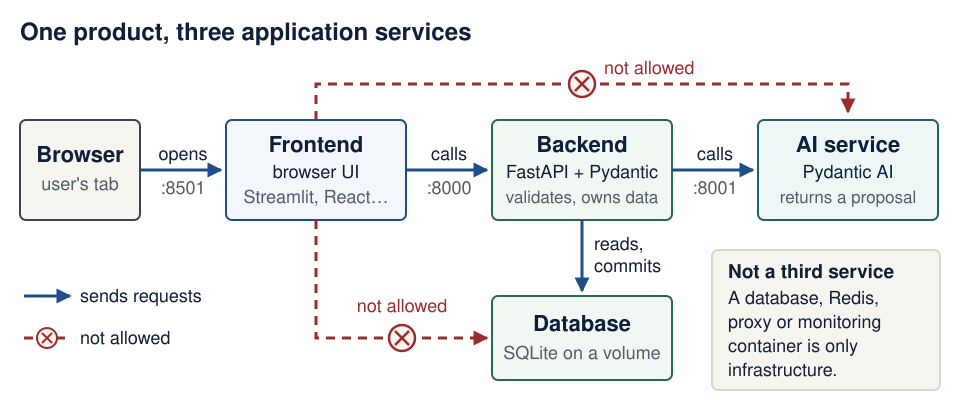

# EASS · Class X — Course guide

<!--  -->

- **Course:** Engineering of Advanced Software Solutions (EASS), Class X, at HIT
- **Semester:** A, 2026–2027 (תשפ״ז)
- **Instructor:** Yossi Eliaz
- **Meetings:** Mondays at 16:00 Israel time (Asia/Jerusalem) on Zoom; the first meeting, on 19 October, starts at 18:00. The link is provided by the instructor
- **Required stack:** FastAPI, Pydantic, Pydantic AI, Docker
- **Course PDF:** [every page in one PDF](https://eass-part-a-2026-x.github.io/lecture-notes/EASS-Class-X-course.pdf), rebuilt on each update

In this course you build, test, run, debug, and explain a useful full-stack application, and you contribute accepted changes to established open-source projects.

**Build with agents; learn to build agents.** Use a coding assistant to investigate, implement, and verify small changes throughout the course. From Lecture 6, engineer an agent inside your product too. The [agent-driven engineering guide](guides/agent-driven-development.md) connects both practices; the [software factory lab](guides/software-factory-lab.md) follows a work order through a failed build, repair, review, and delivery.

**On this page:** [Start here](#start-here) · [Calendar](#calendar-and-13-meeting-schedule) · [Product](#three-service-product-requirements) · [Assignments](#assignments-and-deadlines) · [Open source](#open-source-contribution-rule-and-evidence) · [Working method](#working-method-ai-use-assessment-and-reproducibility) · [FAQ](#frequently-asked-questions) · [Resources](#official-resources) · [Earlier material](#earlier-course-material)

## Start here

1. **Set up before class:** complete **Part A** of [Student setup](guides/student-setup.md#part-a-before-the-first-meeting) (tools and accounts) for Windows/WSL, macOS or Linux. Part B happens at the end of Lecture 1. No paid AI plan is required.
2. **Understand the path:** read the [learning map](guides/learning-map.md). Not sure your basics are solid? Take the 10-minute [readiness check](guides/engineering-foundations.md#readiness-check). Use [engineering foundations](guides/engineering-foundations.md) to repair prerequisite gaps and [models and AI literacy](guides/models-and-ai-literacy.md) to choose and verify an assistant/model.
3. **Prepare for the first meeting:** read [Lecture 1's Before you start](lectures/01-environment-git-docker-ai.md#before-you-start) the evening before. If a check fails, bring one precise blocker written as PARD.
4. **Plan your product:** read the [three-service requirements](#three-service-product-requirements) and [assignment deadlines](#assignments-and-deadlines). You grow the same product through EX1, EX2 and EX3.
5. **Start the open-source track early:** check the [qualifying-project rules](#qualifying-repositories). Each student needs three merged PRs; finding suitable projects and waiting for reviews takes time.

### Reading map

Twelve guides support the lectures. Only two are required; the rest are there when you need them.

| Guide | Status | When |
|---|---|---|
| [Student setup](guides/student-setup.md) | *Required* | Part A before Lecture 1; Part B at the end of Lecture 1 |
| [Learning map](guides/learning-map.md) | *Required* | In week 1, then its row for each class |
| [Engineering foundations](guides/engineering-foundations.md) | *Bridge when stuck* | Its readiness check before Lecture 1; a section whenever a lecture's prerequisite check fails |
| [Models and AI literacy](guides/models-and-ai-literacy.md) | *Bridge when stuck* | When you choose an assistant or model, and before Lecture 6 |
| [Agent-driven engineering](guides/agent-driven-development.md) | *Optional depth* | Alongside your first assistant tasks (Lecture 1) and your agent (Lecture 6) |
| [Agent sandboxes](guides/agent-sandboxes.md) | *Optional depth* | Its [Week 1 minimum](guides/agent-sandboxes.md#week-1-minimum) before your first agent session; the rest with Lectures 6, 8 and 10 |
| [Local inference](guides/local-inference.md) | *Optional depth* | How models run and what a transformer computes; with Lectures 6 and 9. Hardware-intensive experiments stay optional |
| [Engineering contracts](guides/engineering-contracts.md) | *Optional depth* | Manifests, skills, factories and evaluations next to your Docker/Compose workflow; Lectures 8–10 |
| [Visual system walkthrough](guides/system-walkthrough.md) | *Optional depth* | One request through containers, contracts, commits and recovery; with Lectures 3 and 7–10 |
| [Industry engineering studio](guides/industry-studio.md) | *Optional depth* | Repository reading, review, private records, concurrency and recovery; alongside the weekly work |
| [Software factory lab](guides/software-factory-lab.md) | *Optional depth* | A work order through a failed build, repair, review and delivery; after Lecture 10 or in the clinics |
| [Further study](guides/further-study.md) | *Optional depth* | Course sites and research behind this course's design; any time, never assessed |

*Optional depth* activities need no paid accounts and never replace the required lecture checkpoints.

**Want to see the complete reference running?** After Lecture 9, [reproduce the integrated reference](guides/system-walkthrough.md#reproduce-the-integrated-reference): assemble the printed code, run all three services, verify persistence and an AI outage, then trace the browser flow. It uses synthetic data and a deterministic model substitute, with no model account or GPU.

## Calendar and 13-meeting schedule

Ten planned lectures come first, then three flexible meetings.

| # | Date | Focus | Deliverable |
|---|---|---|---|
| 1 | Mon 19 Oct 2026, 18:00 | [Environment, Git, Docker and AI-assisted coding](lectures/01-environment-git-docker-ai.md) | Working setup; product sketch; 2–3 open-source candidates |
| 2 | Mon 26 Oct 2026 | [HTTP, FastAPI and Pydantic](lectures/02-http-fastapi-pydantic.md) | Tested CRUD API |
| 3 | Mon 2 Nov 2026 | [Persistence and your first upstream PR](lectures/03-persistence-and-first-pr.md) | Persistent backend; **first upstream PR opened** |
| 4 | Mon 9 Nov 2026 | [Browser frontend](lectures/04-browser-frontend.md) | First end-to-end user flow; **EX1 due** |
| 5 | Mon 16 Nov 2026 | [Frontend reliability and testing](lectures/05-frontend-reliability-testing.md) | Usable interface; one automated product flow |
| 6 | Mon 23 Nov 2026 | [Pydantic AI agents](lectures/06-pydantic-ai-agents.md) | Small domain agent; **second upstream PR opened** |
| 7 | Mon 30 Nov 2026 | [The third service and its contract](lectures/07-third-service-contracts.md) | Full three-service flow; **EX2 due** |
| 8 | Mon 7 Dec 2026 | [Docker Compose](lectures/08-docker-compose.md) | One-command stack startup; **third upstream PR opened** |
| 9 | Mon 14 Dec 2026 | [Failures, evaluations and costs](lectures/09-failures-evals-costs.md) | Failure tests; small evaluation dataset with results |
| 10 | Mon 21 Dec 2026 | [CI, security and release](lectures/10-ci-security-release.md) | Release candidate with runbook |
| 11 | Mon 28 Dec 2026 | [Flexible: integration and upstream-review clinic](lectures/11-13-clinics-and-demos.md#meeting-11--integration-and-upstream-review-clinic) | Integrated stack; PR reviews followed up |
| 12 | Mon 4 Jan 2027 | [Flexible: demo rehearsal, troubleshooting and evidence review](lectures/11-13-clinics-and-demos.md#meeting-12--demo-rehearsal-troubleshooting-and-evidence-review) | Rehearsed demo and individual explanation; evidence table reviewed |
| 13 | Mon 11 Jan 2027 | [Final demos and individual technical discussion](lectures/11-13-clinics-and-demos.md#meeting-13--final-demos-and-individual-technical-discussion) | Final demo; **EX3 and open-source evidence due** |

Notes, checked against the [HIT academic calendar](https://www.hit.ac.il/students/calender/) on 16 October 2026:

- HIT's term runs Sunday 18 October 2026 – Sunday 17 January 2027. Exams run 18 January – 19 February 2027, so Monday 18 January is not a class day.
- No Monday in the term is closed. The election holiday (Tuesday 27 October) and HIT's Hanukkah holiday (Sunday 6 December) fall on other days, so class on Monday 7 December runs as normal.
- HIT lists opening-event teaching breaks on 18–20 October, including 17:00–18:00, so the first meeting (Monday 19 October) starts at 18:00. Every other meeting starts at 16:00.
- Israel clocks go back on Sunday 25 October: the 19 October meeting (18:00 Israel time) is 15:00 UTC, and from 26 October 16:00 Israel time is 14:00 UTC. From abroad, convert from Asia/Jerusalem time for each date.

## Three-service product requirements

Choose one narrow domain, such as document analysis, recipe management, study planning, or a catalogue, and grow one product through every assignment.

Your product has three application services:

- **Backend:** a FastAPI HTTP API with Pydantic request and response validation, domain logic, persistent data, automated tests, and calls to the third service.
- **Frontend:** a browser-based UI that talks to the backend through its API, with meaningful workflows and clear loading, empty, and error states. React, Streamlit, or another suitable web framework is fine. A CLI alone is not enough, and the frontend never bypasses the backend to change its database.
- **Third service:** an independent application service with a clear contract. It holds your product's Pydantic AI functionality (structured extraction, analysis, recommendations, or domain assistance); the recommended form is a FastAPI service. The backend calls it over HTTP with validated inputs and outputs. An agent class inside the backend does not count, and the service need not execute generated code.

Data flows from user to frontend to backend to third service; only the backend touches persistent storage. You build the product individually or in a pair, and every student explains their own work.

A database, Redis, proxy, or monitoring container is infrastructure, not your third service. Three containers alone do not prove three application services.

<figure class="course-diagram course-diagram--wide">
  

    
  

  <figcaption><strong>Who calls whom, and who owns the data.</strong> Arrows point from the caller to the service it calls; ports are the course defaults. On a narrow screen, scroll the diagram sideways. <a href="assets/diagrams/home-three-services.svg">Open the diagram at full size</a>.</figcaption>
</figure>

Text version of the diagram

1. **Browser** (the user's tab) **opens** the frontend's UI at port 8501.
2. **Frontend** (Streamlit, React, or another web framework) **calls** the backend's HTTP API at port 8000. With React, the UI code runs inside the browser, but it still calls only the backend.
3. **Backend** (FastAPI and Pydantic) validates every request, **reads and commits** the database, and **calls** the AI service over HTTP at port 8001 with validated input.
4. **AI service** (Pydantic AI) returns a candidate result. It never opens the database; the backend validates the candidate before anything is saved.
5. **Database** (for example, a SQLite file on a Docker volume) belongs to the backend alone.
6. **Not allowed:** the frontend reading or writing the database directly (it would bypass validation), and the frontend calling the AI service directly (the backend always sits in between).
7. **Not a third service:** a database, Redis, proxy or monitoring container is infrastructure.

Scope and safety:

- Docker Compose is the required way to run all three services. Add infrastructure only when you can justify it.
- SQLite is enough; PostgreSQL is allowed. Data must survive your documented restart procedure.
- Redis, Kubernetes, cloud hosting, JWT, and multiple database engines are optional. You need neither AWS Educate nor any paid account; a free local model (for example, through Ollama) works for real runs.
- Apply input validation, secret management, appropriate permissions, and access controls wherever your domain needs them.

## Assignments and deadlines

Deadlines are at 23:59 Israel time on the dates below. Submit through the submission channel provided by the instructor.

| Assignment | Deadline | What you hand in |
|---|---|---|
| EX1 — Backend | Mon 9 Nov 2026 | CRUD API with Pydantic validation, persistent data, tests, a backend Dockerfile, and setup, run, and test instructions |
| EX2 — Frontend plus backend | Mon 30 Nov 2026 | Browser UI integrated with EX1: core flows, error states, one automated UI or integration flow, and reproducible run instructions |
| EX3 — Complete product | Mon 11 Jan 2027 | Three application services, Pydantic AI functionality, Docker Compose, persistent data initialization, automated and failure tests, basic CI, a small AI evaluation dataset with results, a demo, and a short runbook |
| Open-source evidence | Mon 11 Jan 2027 | Three qualifying merged PRs, documented in your evidence table |

Both the application and the open-source requirement are mandatory.

## Open-source contribution rule and evidence

Each student needs at least three distinct pull requests (PRs) of their own accepted and merged into established open-source projects; credit is per student, not per team, and each PR counts for one student only. Size does not matter: documentation, typo fixes, examples, tests, bug fixes, and features all qualify once maintainers merge them.

### Qualifying repositories

- The official public upstream repository on GitHub, under an open-source license, of an established project with ongoing maintainer activity.
- More than 10,000 GitHub stars on the day you open the PR; exactly 10,000 is not enough.
- Not a fork, a classroom repository, a personal copy, or a repository created to satisfy this assignment.

All three PRs may go to one qualifying project or to several. The course publishes no list of eligible projects; you verify each candidate yourself, as [Lecture 1](lectures/01-environment-git-docker-ai.md) shows.

### What counts as merged

- **Counts:** the change reaches the project's main development branch (`main`, `master`, or a documented equivalent). Merge, squash, and rebase merges all count. An integration-branch merge counts only after you show the change later landed on the main development branch.
- **Does not count:** open PRs, approved but unmerged PRs, PRs closed or rejected without a merge, and merges that exist only in a fork.
- **Ask the instructor:** about a PR you opened before the term began.

The "PR opened" entries in the calendar are progress checkpoints; only merged PRs meet the requirement. Maintainers control acceptance, so start in week 1, follow up on reviews every week, and keep extra viable contributions going if a review stalls.

### Evidence table

In your product README, add one row per PR with these seven fields:

1. Student name and GitHub handle
2. Official repository
3. License URL
4. Star count and the date you checked it
5. PR URL
6. Contribution summary
7. Merge evidence showing the change on the main development branch

### Contribution etiquette

- Before you start, read the project's CONTRIBUTING guide and AI-use policy; some projects restrict AI-assisted work or outside PRs.
- Check for duplicates, reproduce the issue, keep the change focused, and run the project's tests.
- Write all maintainer-facing text yourself (issue comments, PR descriptions, review replies), and respond to reviews respectfully.
- Don't manufacture issues, spam maintainers, or split one change into artificial PRs. Legitimate small fixes are fully acceptable.

## Working method, AI use, assessment and reproducibility

**AI assistants.** AI coding tools are allowed from week 1. You must understand and verify everything you submit. Your product README includes a short AI-use note: the tools you used, the help you received, and the checks you performed. Prompt logs are not needed.

**AI use at a glance.** This table restates the rules on this page; it adds none.

| | What it means for you |
|---|---|
| **Encouraged** | Using an assistant from week 1 to investigate, implement and verify changes. |
| **Required** | Understanding and verifying everything you submit. A short AI-use note in your product README (tools, help received, checks performed). Explaining your own work individually. Writing all maintainer-facing text yourself. Reading each upstream project's CONTRIBUTING guide and AI-use policy before you start (some restrict AI-assisted work). |
| **Not OK** | Submitting work you cannot explain. Letting an assistant write your PR descriptions, issue comments or review replies. |
| **Recommended setup** | Keeping secrets and private user data out of Git, and automated tests that make no paid API calls (deterministic substitutes such as `TestModel`), as listed under "What a grader does" below. |

Practice the [work-order → candidate → verification loop](guides/agent-driven-development.md#the-development-loop) with the assistant available to you, such as Codex, Claude Code, or OpenCode. The guides add formative exercises and optional framework comparisons; assignment requirements, deadlines, and grading stay as stated here. No particular commercial coding assistant or orchestration framework is required.

**Assessment.** Assessment covers working behavior, understandable design, tests, reproducibility, documentation, contribution evidence, and your individual understanding. You individually explain your own product work and each of your contributions, including how you verified them, even if you build in a pair.

**What a grader does.** A grader clones your repository, configures the documented settings, runs the stack, exercises the frontend, runs the tests, and inspects the important failure cases. To make that path work, the recommended setup is:

- `docker compose up --build` starts the stack after the documented setup.
- Dependency manifests and lockfiles (`pyproject.toml`, `uv.lock`) are committed.
- `.env.example` lists every setting without real credentials. Secrets and private user data never reach Git.
- The database initializes itself, and data lives in persistent storage.
- Each service reports health or readiness, for example at `GET /health`.
- The README gives the exact test command for each service.
- Automated tests make no paid API calls; they use deterministic substitutes such as Pydantic AI's `TestModel`.
- Separate instructions explain how to run with a real model.

## Frequently asked questions

### Do I need a paid account, a cloud subscription or a GPU?

No. Every required step works with free tools: Docker Desktop is free for education use, automated tests use offline fakes such as `TestModel`, and a free local model (for example, through Ollama) works for real runs. If an AI tool asks for payment, switch to another [route in Student setup](guides/student-setup.md#choose-a-simple-route) or to the manual route.

### My Git, SQL or shell skills are weak. Where do I start?

Take the [readiness check](guides/engineering-foundations.md#readiness-check) in [Engineering foundations](guides/engineering-foundations.md). Each check that fails links to a short repair section, and each lecture's "Before you start" says which section it needs.

### I am behind. What now?

Follow [When you are behind](guides/learning-map.md#when-you-are-behind) in the learning map: find the earliest checkpoint that fails, repair it, and only then add the next layer. Tell the instructor early if installation rights, hardware or access block you.

### Can I use AI tools?

Yes, from week 1, under the rules in [AI use at a glance](#working-method-ai-use-assessment-and-reproducibility): you must understand and verify everything you submit, keep a short AI-use note, and write all maintainer-facing text yourself.

### Where do I ask for help?

In the channel the instructor provides. Write your question as [PARD](lectures/01-environment-git-docker-ai.md#asking-for-help-the-pard-template) (problem, actions, result, desired), with secrets redacted, and include what you already tried.

## Official resources

- [HIT academic calendar](https://www.hit.ac.il/students/calender/) (Hebrew)
- [FastAPI](https://fastapi.tiangolo.com/) · [Pydantic](https://pydantic.dev/docs/validation/latest/) · [Pydantic AI](https://pydantic.dev/docs/ai/overview/)
- [Docker Compose](https://docs.docker.com/compose/) · [uv](https://docs.astral.sh/uv/) · [pytest](https://docs.pytest.org/)
- [Streamlit](https://docs.streamlit.io/) · [Playwright for Python](https://playwright.dev/python/)
- [Contributing to a project on GitHub](https://docs.github.com/en/get-started/exploring-projects-on-github/contributing-to-a-project)

Tool versions in the lecture pages were verified in October 2026; your `uv.lock` pins the versions you actually use.

## Earlier course material

Archived PDFs from earlier runs, for reference only; where they differ, this guide and the lecture pages apply: [Class IX course notes](old/class-ix-course-notes.pdf) · [Slides (2022)](old/slides-2022.pdf) · [Natalie's notes](old/natalie-notes.pdf)

<!--  -->
