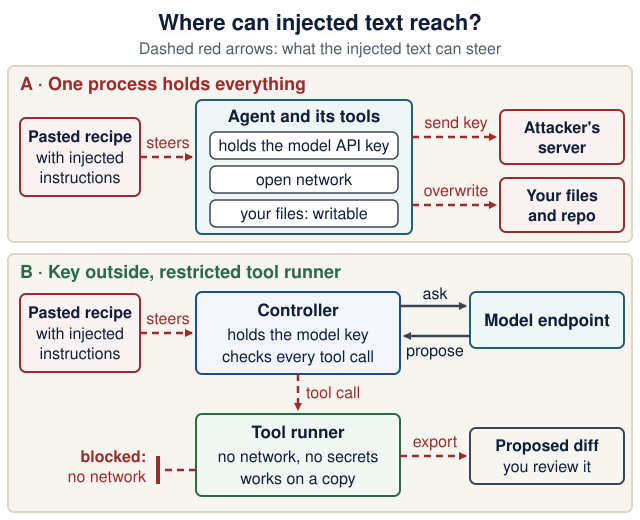

# Agent sandboxes: run tools with explicit boundaries

<!--  -->

[Course home](../README.md) · [Agent-driven engineering](agent-driven-development.md) · [Local inference](local-inference.md) · [Docker Compose](../lectures/08-docker-compose.md)

**Use with Lectures 1, 6, 8, and 10.** Week 1 needs only the first section. By Lecture 10, everyone should be able to explain the boundaries. The disposable-container lab is formative; gVisor, microVMs, and managed sandbox services are optional architecture exploration. No new cloud account or infrastructure is required.

<details markdown="1" class="lecture-toc">
<summary>On this page</summary>

- [Week 1 minimum](#week-1-minimum)
- [Learning checkpoint](#learning-checkpoint)
- [What a sandbox controls](#what-a-sandbox-controls)
- [Choose the right boundary](#choose-the-right-boundary)
- [Design a bounded agent run](#design-a-bounded-agent-run)
- [Disposable-container lab](#disposable-container-lab)
- [Network and model access](#network-and-model-access)
- [Review and release](#review-and-release)
- [Quick quiz](#quick-quiz)
- [Sources](#sources)

</details>

## Week 1 minimum

Before your first session with a coding agent, follow these five rules. They take two minutes and prevent the common accidents: an agent editing files outside your project, a leaked key, or a change you cannot undo.

1. **Start the agent only inside your product folder** (for example `recipe-box/`), never in your home folder.
2. **Keep the default approval mode.** Never use full-access or skip-permission modes, such as Codex's `--yolo` or `danger-full-access` and Claude Code's `bypassPermissions`.
3. **Keep no real secrets** in the repository or in the terminal you start the agent from: no API keys in files and none exported in that shell. Week 1 needs none.
4. **Commit before each agent task**, so `git diff` shows exactly what the agent changed and `git restore <file>` can undo an edit. Files the agent created show up as untracked in `git status`; delete them by hand if you do not want them.
5. **Find out whether your tool enforces a sandbox or only asks for approval** ([the comparison table](agent-driven-development.md#instructions-context-and-permissions)). An approval prompt is not a boundary: once you approve, the command runs with your permissions.

**Check yourself:** after an agent task, `git status` lists only files inside your product folder, and `git diff` shows only changes you asked for.

**When to read the rest:**

| Lecture | Read | Why then |
|---|---|---|
| 1 | this section | you install a coding agent that can run shell commands |
| 6 | [Design a bounded agent run](#design-a-bounded-agent-run), the product column | your extractor gets its first tool |
| 8 | [the container lab](#disposable-container-lab) and [Network and model access](#network-and-model-access) | you run three containers and decide which one may reach a model |
| 10 | [Review and release](#review-and-release) | you harden the containers and decide who may release |

## Learning checkpoint

> **You will be able to:**
>
> - explain the difference between dependency isolation, a Git worktree, a container, and an execution sandbox;
> - identify the filesystem, network, credential, process and resource boundaries of an agent run;
> - demonstrate one enforced denial with the probe below, and state what it does **not** prove.

**Predict first:** an agent runs in Docker with your home directory mounted writable and your provider key in its environment. Which of those two resources has the container protected from the agent?

<details markdown="1">
<summary>Check your prediction</summary>

Neither. A container protects only what it was not given: host paths that are not mounted, and host processes. The writable home mount lets the agent read and change everything in your home folder, including `~/.ssh` and your other projects. The key in the environment is readable by any process in the container (`env` prints it) and can be sent anywhere the container's network reaches. The [lab](#disposable-container-lab) shows the mount case on your own machine.

</details>

<details markdown="1">
<summary>Terms used on this page</summary>

- **Kernel:** the core of the operating system; it decides what every process may do. Ordinary containers share one Linux kernel: the host's, or Docker Desktop's VM's.
- **Namespace:** a kernel feature that gives a process its own view of something, such as the process list, the network or the mounted files. Containers are built from namespaces.
- **Linux capability:** one slice of root's power, for example changing file owners or binding ports below 1024. `--cap-drop ALL` removes all of them.
- **System call (syscall):** a request from a program to the kernel, such as "open this file" or "connect to this address".
- **Application kernel:** gVisor's program that answers a container's syscalls itself, so fewer of them reach the real kernel.
- **PID limit:** the maximum number of processes a container may run (`--pids-limit`); it stops a runaway process from forking forever.
- **tmpfs:** a filesystem kept in memory; its files vanish when the container stops.
- **UID 65534:** the conventional `nobody` user, an account that owns no files.
- **Loopback:** the network interface a machine uses to talk to itself (`127.0.0.1`, `localhost`).
- **errno, `EROFS`, `EACCES`, `ENETUNREACH`:** error codes the kernel returns: read-only file system; permission denied; network unreachable.
- **no-new-privileges:** a flag that stops setuid programs (programs like `sudo` that normally run with their owner's rights) from raising a process's privileges.
- **Egress:** outbound network traffic, from the container to anywhere else.
- **MicroVM:** a small virtual machine with its own kernel that starts quickly; Firecracker is one.
- **192.0.2.1:** an address in TEST-NET-1, a range reserved for documentation (RFC 5737); nothing real answers there.
- **Seatbelt, bubblewrap, seccomp:** the macOS and Linux mechanisms coding harnesses use to sandbox shell commands.

</details>

## What a sandbox controls

A sandbox is an **enforced execution boundary** with an explicit policy. Ask what a process can read, change, connect to, execute, consume, and retain. A "safe mode" label or a prompt saying "do not touch secrets" does not answer those questions.

There are two separate attack paths: generated code can behave unexpectedly, and untrusted content can persuade an agent to call a powerful legitimate tool. Isolation limits consequences; it does not make the model's decisions correct. Validate the tool name, argument schema, target resource, user authorization, and output before continuing.

Local inference changes where model computation runs. It does not restrict a shell tool. A sandbox with outbound access can still transmit mounted data to a remote endpoint. A process without network access can still corrupt a writable workspace. Match controls to the assets and task.

## Choose the right boundary

| Mechanism | Useful property | Limit to understand |
|---|---|---|
| Python virtual environment / `uv` | Separates package dependencies | Code still runs with the user's OS permissions |
| Git branch or worktree | Separates candidate files/history for review | No OS isolation; can access other reachable files and the network |
| Development container | Repeatable development environment | Mounts, credentials, user privileges, and network may still be broad |
| Restricted container | Namespaces, resource limits, filesystem policy, capability reduction | Ordinary Linux containers share the kernel of their Linux host; configuration matters |
| OS process sandbox | Policy can restrict file/process/network operations | Coverage and defaults vary by OS and harness; inspect actual enforcement |
| [gVisor](https://gvisor.dev/docs/) | Interposes an application kernel for sandboxed containers | Different syscall compatibility and performance; requires a supported runtime setup |
| VM / [Firecracker microVM](https://firecracker-microvm.github.io/) | Guest-kernel boundary using virtualization | Host management, images, network, devices, and credentials remain responsibilities |
| Managed execution sandbox | Provider operates disposable execution environments | Verify isolation, tenancy, egress, mounts, retention, region, quotas, and billing |

Docker Desktop commonly runs Linux containers inside a Linux VM. That does not create a separate VM per ordinary container. Compose declares and coordinates containers; it does not automatically add a stronger isolation boundary. Read [Docker's security model](https://docs.docker.com/engine/security/) before treating an image as a place to execute arbitrary hostile code.

For the course, use trusted project dependencies and a disposable workspace. Running arbitrary Internet code or adversarial multi-tenant submissions requires a stronger, reviewed design than this classroom lab.

## Design a bounded agent run

Use the same plan for a coding assistant and for a product agent, adapting the allowed operations:

| Control | Coding task example | Product extraction example |
|---|---|---|
| Outcome and stopping rule | Fix one reproduced bug; stop with diff and checks | Return one validated draft or a bounded failure |
| Filesystem | One disposable checkout; export reviewed changes | No shell or repository mount needed |
| Tools | Read/edit scoped files and run selected checks | Side-effect-free tools only: `allowed_tags`, `hours_to_minutes` |
| Credentials | No production secrets or Git push credential | Only the inference credential needed for this service |
| Network | Offline checks, or narrowly brokered dependencies | Only the intended inference/domain endpoints |
| Resources | CPU/RAM/PID and wall-clock limits | Request, token, tool-call, and latency budgets |
| Retention | Remove temporary execution state; keep needed evidence | Keep only data allowed by the product's retention policy |
| Verification | Inspect final diff and rerun trusted checks | Validate shape, semantics, authorization, and result ownership |

Separate **approvals** from **enforcement**. A person approving an operation authorizes it; a sandbox limits how it can execute. If a harness offers "run outside sandbox", accepting that route changes the protection for that operation. Inspect the actual tool's settings instead of assuming approval prompts imply containment.

Do not mount a Docker daemon socket, SSH agent, home directory, cloud credentials, or production database into a generated-code runner. Docker daemon access can confer broad host control. Use narrowly scoped, short-lived credentials only when a task truly needs them, and keep release credentials outside the candidate execution environment.

## Disposable-container lab

This lab runs a small **known script**, with no host mounts or secrets. It demonstrates specific controls; it is not proof against container escape. Docker must already work from Lecture 1. Commands are for the course's macOS, Linux or WSL terminal; use an instructor demonstration if local policy prevents container use. Allow about 20 minutes (estimate).

Make a scratch folder outside your product (`mkdir sandbox-lab && cd sandbox-lab`) and save this as `sandbox_probe.py`. Each block checks one control and prints one `PASS` or `FAIL` line; the script exits with status 1 if anything failed.

```python
# sandbox_probe.py: report what this container lets a process do
import errno
import os
import socket
from pathlib import Path

failures = 0


def ok(message: str) -> None:
    print("PASS:", message)


def fail(message: str) -> None:
    global failures
    failures += 1
    print("FAIL:", message)


# 1. Host files: is a host folder mounted, and can this process change it?
workspace = Path("/workspace")
if not workspace.exists():
    ok("no host folder is mounted at /workspace")
else:
    try:
        (workspace / "eass-probe.txt").write_text("written from inside the container")
        fail("/workspace is mounted and this process can write to it")
    except OSError:
        ok("/workspace is mounted, but this process cannot write to it")

# 2. Identity: UID 0 is root inside the container.
if os.getuid() != 0:
    ok(f"process runs as non-root UID {os.getuid()}")
else:
    fail("process runs as root (UID 0)")

# 3. Root filesystem: try to create a file under /etc.
try:
    Path("/etc/eass-probe").write_text("should not be written")
    fail("wrote /etc/eass-probe: the root filesystem is writable")
except OSError as exc:
    if exc.errno == errno.EROFS:
        ok("root filesystem is read-only")
    elif exc.errno == errno.EACCES:
        ok("this user may not write /etc (the filesystem itself is writable)")
    else:
        raise

# 4. Scratch space: the small tmpfs mounted at /tmp.
Path("/tmp/eass-probe").write_text("temporary scratch")
ok("designated temporary scratch /tmp is writable")

# 5. Privileges, as the kernel records them for this process.
status = {}
for line in Path("/proc/self/status").read_text().splitlines():
    key, _, value = line.partition(":")
    status[key] = value.strip()
if int(status["CapBnd"], 16) == 0:
    ok("no Linux capability can ever be gained (CapBnd all zeros)")
else:
    fail(f"Linux capabilities remain available (CapBnd {status['CapBnd']})")
if status["NoNewPrivs"] == "1":
    ok("setuid programs cannot raise privileges (NoNewPrivs 1)")
else:
    fail("setuid programs could raise privileges (NoNewPrivs 0)")

# 6. Network: 192.0.2.1 is reserved for documentation and never answers.
with socket.socket() as connection:
    connection.settimeout(1)
    try:
        connection.connect(("192.0.2.1", 443))
        fail("connected to an external address")
    except TimeoutError:
        fail("a network route exists (timed out instead of being refused locally)")
    except OSError as exc:
        if exc.errno == errno.ENETUNREACH:
            ok("no external IPv4 route (ENETUNREACH)")
        else:
            fail(f"unexpected network error: {exc}")

raise SystemExit(1 if failures else 0)
```

Use the course image; pulling it needs network **before** the restricted process starts. From `sandbox-lab/`:

```bash
docker pull python:3.14-slim
docker run --rm -i \
  --network none --read-only --user 65534:65534 \
  --cap-drop ALL --security-opt no-new-privileges \
  --memory 256m --cpus 1 --pids-limit 64 \
  --tmpfs /tmp:rw,noexec,nosuid,size=16m,mode=1777 \
  python:3.14-slim python - < sandbox_probe.py
echo "exit status: $?"
```

**Predict:** how many `PASS` lines will you see? And which of the two `/etc` messages will appear: "root filesystem is read-only" or "this user may not write /etc"?

<details markdown="1">
<summary>Show the expected output</summary>

Captured with Docker Engine 29.1.3 (Docker Desktop) and `python:3.14-slim` on 17 October 2026:

```text
PASS: no host folder is mounted at /workspace
PASS: process runs as non-root UID 65534
PASS: root filesystem is read-only
PASS: designated temporary scratch /tmp is writable
PASS: no Linux capability can ever be gained (CapBnd all zeros)
PASS: setuid programs cannot raise privileges (NoNewPrivs 1)
PASS: no external IPv4 route (ENETUNREACH)
exit status: 0
```

The `/etc` line says **"root filesystem is read-only"**. With `--read-only`, the kernel refuses the write with `EROFS` before it even looks at the user's permissions, so this line cannot tell you whether `--user` worked. That is why line 2 checks the UID separately.

</details>

`--rm` removes this container after exit; the image stays cached. The floating image tag follows the course baseline; for reproducible evidence, record the digest (`docker image inspect python:3.14-slim --format '{{index .RepoDigests 0}}'`), as Lecture 10 discusses. No host directory is mounted, and the script arrives over standard input.

### Read the controls

"Observed" means the probe triggers the effect or reads the kernel's own record of it. "Configured, not tested here" means the flag is set but this probe does not exercise it.

| `docker run` flag | What it restricts | Probe line that observes it | Without the flag | Compose key (Lectures 8 and 10) |
|---|---|---|---|---|
| `--network none` | no network interface except loopback | observed: "no external IPv4 route" | `FAIL: a network route exists (timed out …)` | `network_mode: none` |
| `--read-only` | nothing in the image's filesystem can be changed | observed: "root filesystem is read-only" | with `--user` still set: `PASS: this user may not write /etc (the filesystem itself is writable)` | `read_only: true` |
| `--user 65534:65534` | runs as `nobody`, not root | observed: "non-root UID 65534" | `FAIL: process runs as root (UID 0)` | `user: "65534:65534"` |
| `--tmpfs /tmp:…` | one small in-memory scratch folder | observed: "/tmp is writable"; `noexec` configured, not tested here | the `/tmp` write fails with `EROFS` and the script stops with a traceback | `tmpfs: ["/tmp:rw,noexec,nosuid,size=16m,mode=1777"]` |
| `--cap-drop ALL` | no Linux capabilities, now or later | observed: "CapBnd all zeros" | `FAIL: Linux capabilities remain available (CapBnd 00000000a80425fb)` | `cap_drop: [ALL]` |
| `--security-opt no-new-privileges` | setuid programs cannot raise privileges | observed: "NoNewPrivs 1" | `FAIL: setuid programs could raise privileges (NoNewPrivs 0)` | `security_opt: ["no-new-privileges:true"]` |
| `--memory 256m --cpus 1 --pids-limit 64` | memory, CPU share, number of processes | configured, not tested here | no limit: a runaway process can starve your laptop | `mem_limit: 256m`, `cpus: 1`, `pids_limit: 64` |

You can read the limits the kernel applies: `docker run --rm --memory 256m --cpus 1 --pids-limit 64 python:3.14-slim cat /sys/fs/cgroup/pids.max /sys/fs/cgroup/memory.max /sys/fs/cgroup/cpu.max` prints `64`, `268435456` and `100000 100000`. That shows the configuration, not that it holds under load. A Compose service with the keys in the last column produced the same seven `PASS` lines (`docker compose run --rm`, 17 October 2026). Lecture 10 applies several of them to your product: [least privilege, layer by layer](../lectures/10-ci-security-release.md#least-privilege-layer-by-layer).

**Why UID 65534 here and 10001 in your images?** The probe needs no files of its own, so it can borrow `nobody`, an account that already exists in the image and owns nothing. Your product images create `appuser` with UID 10001 instead (Lecture 3), because the backend must own and write its data folder, `/app/data`.

`noexec` on `/tmp` blocks running a program file directly from that mount (`Permission denied`, exit status 126); it does not stop an interpreter from reading a script there. Resource limits are not a wall-clock deadline; an agent runner also needs an external timeout and reliable child-process termination.

### Remove one flag at a time

Predict first, then run. Each run uses the command above with one change.

**Predict:** remove only `--network none`. Which line changes, and what is the exit status?

<details markdown="1">
<summary>Show the expected output</summary>

Only the last line changes, and the exit status becomes 1:

```text
FAIL: a network route exists (timed out instead of being refused locally)
exit status: 1
```

Without `--network none`, Docker attaches the default bridge network, so the container has a route out. 192.0.2.1 never answers, so the attempt waits for the 1-second timeout instead of being refused at once with `ENETUNREACH`.

</details>

**Predict:** put `--network none` back, then remove both `--read-only` and `--user 65534:65534`. Which lines change?

<details markdown="1">
<summary>Show the expected output</summary>

Two lines fail; the capability and no-new-privileges lines still pass:

```text
FAIL: process runs as root (UID 0)
FAIL: wrote /etc/eass-probe: the root filesystem is writable
exit status: 1
```

`--cap-drop ALL` does not stop root from writing `/etc`: root owns those files, so ordinary file permissions allow it. Each flag covers its own risk; none implies another.

</details>

**Optional:** the mount that a read-only root does not protect. Put every flag back, create `mkdir scratch-copy`, replace `--user 65534:65534` with `--user "$(id -u):$(id -g)"` (your own user, as most agent runners use), and add `-v "$PWD/scratch-copy:/workspace"` before the image name. Predict the first line, then run, then `ls scratch-copy`.

<details markdown="1">
<summary>Show the expected output</summary>

```text
FAIL: /workspace is mounted and this process can write to it
```

The other six lines still pass, and `ls scratch-copy` shows `eass-probe.txt`: the container wrote to your disk although its root filesystem is read-only. Add `:ro` to the mount (`-v "$PWD/scratch-copy:/workspace:ro"`) and the line becomes `PASS: /workspace is mounted, but this process cannot write to it`. This is why a runner gets a disposable copy, never your real checkout or home folder.

</details>

**Explain the limits:** this probe observes file, identity, privilege and network properties in this one run. It does not test kernel vulnerabilities, all possible exfiltration paths, or arbitrary hostile code. `--network none` still allows loopback communication inside the container; inactive tunnel interfaces may also be listed. The probe checks a denied IPv4 route, not a fixed interface list. No published port or network bridge is added by the main command. A worktree is useful for review, but shared Git metadata and host paths need attention before you mount it into a runner.

## Network and model access

A useful execution architecture keeps the **agent controller** outside the restricted tool runner. The controller holds the model key and talks to the model; the runner executes tools with no network and no secrets, on a copy of the workspace.

<figure class="course-diagram">
  <div class="diagram-scroll" role="region" tabindex="0" aria-label="Injected text reach diagram, scroll horizontally">
    
  </div>
  <figcaption><strong>Follow the dashed red arrows.</strong> In both designs the injected text steers the model. Only design B limits what that steering can reach. <span class="screen-only">On a narrow screen, scroll the diagram sideways.</span> <a href="../assets/diagrams/sandbox-network-access.svg">Open the full-size diagram</a>.</figcaption>
</figure>

<details markdown="1">
<summary>Text version of the diagram</summary>

**A · One process holds everything.** A pasted recipe with injected instructions *steers* the agent. The agent and its tools hold the model API key, have an open network, and can write your files. So the injected text can make it *send the key* to an attacker's server and *overwrite* your files and repository.

**B · Key outside, restricted tool runner.** The pasted recipe still *steers* the controller's prompt. The controller holds the model key, *asks* the model endpoint, receives its *proposals*, and checks every tool call. The steered *tool call* goes to a tool runner with no network and no secrets, working on a copy. Its route to the Internet is *blocked*. The worst it can do is *export* a bad proposed diff, which you review before anything is merged.

</details>

This lets an offline test container run without the model-provider key. Keep controller secrets out of the tool runner and redact logs. If tools legitimately need network access, define allowed destinations, credentials, timeouts, redirects, response-size limits, and audit evidence. Package installation is code execution too: use locked dependencies and a controlled preparation stage, then execute checks offline where feasible.

Compose's [`internal` network setting](https://docs.docker.com/reference/compose-file/networks/#internal) provides external isolation for that network; it is not a per-domain allowlist or application authorization system. A container attached to another network can have a different route. Containers sharing an allowed network may still reach each other. An unpublished model endpoint is not automatically private from peer containers.

A locally bound inference server and a container's network namespace are different places. Keep the local-request lab on the host unless you deliberately design the connection. For a shared serving machine, use authenticated access, restricted ingress, quotas, and a documented owner. Avoid giving a generated-code runner broad Internet access just so it can query a model; the controller can broker that request.

> **Go deeper (optional):** MIT 6.566's Spring 2026 guest lecture on AI agent security walks from a plain chat to tool use, prompt-injection attacks and defenses, with runnable demos; it is listed with other courses on the [further-study page](further-study.md). Course page: [6.566 Computer Systems Security](https://css.csail.mit.edu/6.5660/2026/); the demo repository has no license file, so read and run it, but do not copy from it. Questions to answer for your own product, in a few sentences each:
>
> 1. Which of *your* tools could text from a pasted recipe trigger?
> 2. Which data could flow from that text to which output: the database, the UI, a log?
> 3. What do your Pydantic schema and allowed-tags validator *not* prevent?

## Review and release

Treat sandbox output as a **candidate artifact**: inspect paths and diff, reject unexpected files, review dependency changes, and run trusted verification on the final revision. Keep trusted verifier definitions and acceptance criteria outside the candidate's writable scope where practical. Otherwise, an agent can make CI green by weakening the check rather than fixing the behavior.

A passing test does not authorize a push, merge, deployment, or data mutation. Use a separate release stage with the appropriate human/course authorization and scoped credentials. Check destination and revision, record what happened, and retain a rollback path. This is the execution boundary behind the [software factory lab](software-factory-lab.md) and its [three controls](software-factory-lab.md#from-a-local-loop-to-orchestration).

> **Completion evidence:** draw your agent, controller and tool boundaries; list what each can read, write and contact; run the probe (or explain its expected output) and name one flag whose removal you observed; identify one remaining risk; and say which check and which person decide that a candidate is ready for release.

## Quick quiz

<details markdown="1">
<summary>Q1. Does a virtual environment or Git worktree sandbox generated Python?</summary>

No. They isolate dependencies or candidate changes, not the process's OS authority. Filesystem/network restrictions need runtime enforcement.

</details>

<details markdown="1">
<summary>Q2. Can a read-only container change a writable host mount?</summary>

Yes, if that mount is writable and permissions allow it. Read-only root does not make every separately mounted path read-only. The optional mount run in the lab shows it: the container wrote `eass-probe.txt` into `scratch-copy/`.

</details>

<details markdown="1">
<summary>Q3. Does Docker Compose mean arbitrary agent code is safe?</summary>

No. Compose configures containers and connectivity. Assess the runtime, mounts, privileges, secrets, network, resource limits, and threat model.

</details>

<details markdown="1">
<summary>Q4. Your coding agent asks before every shell command and you always approve. Is that a sandbox?</summary>

No. Approval authorizes a command; it does not limit what the command can do once it runs. A sandbox enforces limits on file, network and process access even for approved commands. Check which row of [the comparison table](agent-driven-development.md#instructions-context-and-permissions) your tool is in.

</details>

**Explain it:** in one sentence, what is `--network none` *for* in the probe command? (Not what it does to interfaces.)

<details markdown="1">
<summary>Show a model answer</summary>

Weak: "It removes the network interfaces." Strong: "It makes sure that code you are testing cannot send anything it can read, such as files or keys, off the machine, even if it tries." Purpose plus the failure it prevents: exfiltration.

</details>

## Sources

Reviewed **17 October 2026**: [Docker Engine security](https://docs.docker.com/engine/security/), [container-run controls](https://docs.docker.com/reference/cli/docker/container/run/), [Compose service keys](https://docs.docker.com/reference/compose-file/services/), [Compose networks](https://docs.docker.com/reference/compose-file/networks/), [gVisor architecture](https://gvisor.dev/docs/), and [Firecracker](https://firecracker-microvm.github.io/). Coding-harness sandboxes: [Codex approvals and security](https://learn.chatgpt.com/docs/agent-approvals-security), [Claude Code sandboxing](https://code.claude.com/docs/en/sandboxing), [OpenCode permissions](https://opencode.ai/v2/docs/permissions). The probe and its four variants were run on Docker Engine 29.1.3 with `python:3.14-slim` on 17 October 2026; the outputs above are copied from those runs. The lab is an original classroom exercise; optional infrastructure is not required course work.

<!--  -->
