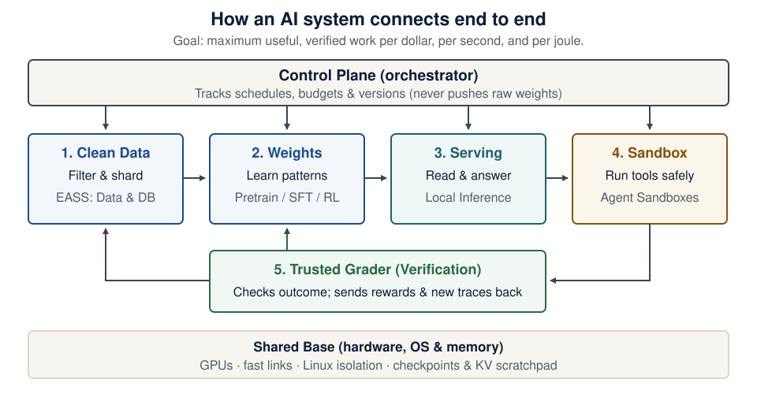

# Part 1 · Building and serving models: the big picture

<!--  -->

[Course home](../README.md) · [Learning map](learning-map.md) · [Local inference](local-inference.md) · [Visual inference engineering](inference-engineering.md) · [Part 2 · RL and rollouts](ai-systems-02-rl-and-rollouts.md)

> **Optional; not graded:** This three-part mini-series sits **outside** the EASS Class X syllabus. It adds zero deadlines, assignments, GPUs, or paid accounts. Finish your Recipe Box milestones first, then read these three sessions as a simple map of how real-world AI systems work from end to end.

**You will be able to:** trace the five-node knowledge graph that connects data, weights, serving, sandboxes, and grading; explain all 13 lifecycle stages without jargon; compute a tiny toy training budget by hand; spot why adding GPUs fails when sandboxes are slow; and see how *Plato's Key* and *Speculative Encoding* let different models share reading work.

**Predict first:** Imagine your Recipe Box backend can save `15` recipes per minute, while your fast frontend can click `40` times per minute. If you add a second identical frontend server (`80` clicks/min), how many more recipes get saved per minute?

Check your prediction

Zero more: you still save `15` recipes per minute. The system as a whole can never move faster than its slowest link. In AI systems, the exact same rule holds across four machine pools: `goodput <= min(inference, sandboxes, graders, learner)`. Adding inference GPUs while sandboxes are the bottleneck leaves GPUs sitting idle.

Terms used on this page (plain English)

- **Weights:** the millions or billions of saved numbers inside a trained model—like its permanent recipe book.
- **Token:** one chunk of text (roughly three-quarters of an English word) that a model reads or writes.
- **Prefill and decode:** *prefill* is reading your prompt once to prepare a scratchpad; *decode* is writing the reply one token at a time.
- **KV cache (scratchpad):** temporary attention notes a model builds while reading a prompt so it does not re-read the whole prompt on every output word.
- **Hidden state:** the internal list of numbers representing what the model "understands" at a given token.
- **Inference:** running an already-trained model to get an answer (weights stay frozen).
- **MoE (Mixture of Experts):** a model split into specialist sub-networks so each token wakes up only a small fraction of the weights.
- **Procrustes rotation:** turning and scaling one coordinate map until its directions line up with another map—like rotating a tourist map until North points straight up.

On this page

- [The knowledge graph: five connected parts](#the-knowledge-graph-five-connected-parts)
- [How Recipe Box maps to a frontier AI system](#how-recipe-box-maps-to-a-frontier-ai-system)
- [All 13 lifecycle stages in four simple phases](#all-13-lifecycle-stages-in-four-simple-phases)
- [Explore how the field progressed](#explore-how-the-field-progressed)
- [How the 16-layer stack fits underneath](#how-the-16-layer-stack-fits-underneath)
- [Deep dive: building vs. serving a model](#deep-dive-building-vs-serving-a-model)
- [Sharing reading work across different models](#sharing-reading-work-across-different-models)
- [Lab: find the bottleneck and check multi-hop drift](#lab-find-the-bottleneck-and-check-multi-hop-drift)
- [Quick quiz](#quick-quiz)
- [Sources](#sources)

## The knowledge graph: five connected parts

Modern AI infrastructure has evolved through three waves: first systems that **learn** intelligence (distributed training), second systems that **serve** intelligence quickly (distributed inference), and now systems that **experiment and verify** on their own (autonomous execution).

Instead of memorizing forty buzzwords, picture one **five-node loop** controlled by an orchestrator (`Control Plane`):

1. **Clean Data** trains **Model Weights**.
2. **Model Weights** load into **Fast Serving** so the model can read and propose actions.
3. **Fast Serving** sends code or tool calls into a **Sandbox** to try them safely.
4. A **Trusted Grader** checks whether the sandbox work actually passed hidden tests.
5. Passing traces and rewards flow back to improve **Clean Data** and **Model Weights**.

Every engineering goal across all three sessions aims at one metric: **maximum useful, verified work per dollar, per second, and per unit of energy**.

<figure class="course-diagram course-diagram--wide">
  

    
  

  <figcaption><strong>One connected knowledge graph.</strong> Every box depends on the box before it; the Control Plane passes small job IDs and rules, never huge model weight files. On a narrow screen, scroll sideways. <a href="../assets/diagrams/aisys-lifecycle-and-stack.svg">Open the diagram at full size</a>.</figcaption>
</figure>

Text version of the diagram

The Control Plane coordinates five connected nodes over a shared base (GPUs, fast network links, Linux isolation, and storage for checkpoints and KV scratchpads): `1. Clean Data` trains `2. Weights`, which load into `3. Serving`, which runs tool calls in `4. Sandbox`, which is checked by `5. Trusted Grader`, which feeds rewards and new traces back to Data and Weights.

## How Recipe Box maps to a frontier AI system

You already built the small-scale version of this graph in EASS:

| Everyday Recipe Box idea | Frontier AI systems equivalent | Why the edge exists |
|---|---|---|
| Your SQLite database + seed data | **Clean Data &amp; Shards** (Stage 1) | Bad or duplicate input teaches bad habits |
| `AI_MODEL` in `.env` | **Model Weights** (Stages 2–7) | Saved knowledge; frozen while serving users |
| `ai-service` calling Ollama | **Fast Serving** (Stages 9–10) | Turns prompts + scratchpad into tokens fast |
| `sandbox_probe.py` container | **Sandbox Execution** (Stage 11) | Runs untrusted generated code safely |
| FastAPI Pydantic check + `pytest` | **Trusted Grader** (Stage 8) | Never trust the model's claim of "done" |
| Docker Compose + CI | **Control Plane** (`L11` Orchestrator) | Starts, stops, budgets, and records versions |

## All 13 lifecycle stages in four simple phases

Real AI labs do not run these 13 stages strictly one-by-one; they run them in parallel loops. Notice that every stage follows the same story: **what it does → why it broke → how engineers fixed it → where it stands today**.

### Phase A · Build the model (Stages 0–4 and 7)

| Stage | Simple core steps | Key innovation &amp; main problem | How it was addressed &amp; status |
|---|---|---|---|
| **0. Infrastructure** | Wire GPUs, CPUs, fast links, and disks | Topology-aware clusters; **problem:** idle GPUs waiting on slow network | Managed via Ray, Slurm, Kubernetes + NVLink/RDMA (**Mature core**) |
| **1. Data engineering** | Crawl, clean, remove duplicates, filter privacy, convert to token files | Content-hashed manifests (DataTrove, Dolma); **problem:** crashed runs lose track of which rows were read | Checkpointable data loaders save exact file + row cursor (**Standard; synthetic curation active**) |
| **2. Pretraining** | Predict the next token on billions of examples | Splitting one giant model across many GPUs (6D parallelism + mixed precision); **problem:** out-of-memory crashes &amp; silent math errors | Shard parameters/optimizer state (FSDP/ZeRO) + periodic parity checks (**Mature dense; MoE active**) |
| **3. Mid-training** | Continue training on math, code, long docs, and tool formats | Context parallelism for huge inputs; **problem:** forgetting earlier skills | Mix replay data with domain curricula (**Standard practice**) |
| **4. SFT (imitation)** | Show input → expert tool call → expert answer examples | Loss masking so gradients only score assistant turns, not user/tool text; **problem:** model only imitates | Pair SFT with RL exploration in Part 2 (**Standard: TRL, TorchTune, TorchTitan**) |
| **7. Distillation** | Teach a small fast model from a large smart teacher | *On-policy* distillation grades the student's own answers; **problem:** student drifts on multi-step tasks | Teacher grades student rollouts rather than static essays (**Widely used for efficiency**) |

### Phase B · Serve it fast (Stages 9–10)

| Stage | Simple core steps | Key innovation &amp; main problem | How it was addressed &amp; status |
|---|---|---|---|
| **9. Deployment opt.** | Shrink weight precision (16-bit → 8/4-bit) &amp; compile GPU kernels | Kernel fusion &amp; quantization; **problem:** shrinking numbers can break accuracy | Re-run held-out quality tests on every quantized build (**Mature; FP4 active**) |
| **10. Inference** | Read prompt once (prefill), then emit 1 token per step (decode) | Paged KV memory (vLLM), continuous batching (Orca), prefix reuse (SGLang); **problem:** KV scratchpad fills GPU memory | Virtualized KV blocks + optional prefill/decode splitting (**Mature single-model; cross-model new**) |

### Phase C &amp; D · Practice, grade, and improve (Stages 5, 6, 8, 11, 12 — covered in Parts 2 &amp; 3)

- **Stage 5 (Preference tuning / DPO)** &amp; **Stage 6 (RL &amp; rollouts):** model tries problems itself and learns from graded rewards (**Part 2**).
- **Stage 11 (Agentic execution)** &amp; **Stage 8 (Evaluation)** &amp; **Stage 12 (Feedback):** sandboxes run untrusted code safely, hidden graders separate broken sandboxes from wrong answers, and verified traces feed future training (**Part 3**).

## Explore how the field progressed

Pick any of the five core themes below and step from the **early problem**, through the **breakthrough**, to **today's open gaps**.

<strong>Interactive explorer: concepts, problems, and field progress</strong>

**Worked example without JavaScript:** On **Cross-model context**, prefix caching breaks whenever two agents use different model families, forcing Model B to re-read all 64k raw tokens (`1. Early problem`). **Plato's Key** solved the geometry question using a zero-training Procrustes rotation + scale (`2. Breakthrough`: `~99%` relative chaining), and **Speculative Encoding** pushed serving speed with a 2.35B MoE translator (`3. Today's status`: reported `96.9%` retention and up to `7.5×` prefill speedup, while leaving multi-hop drift and tenant isolation as open engineering checks).

## How the 16-layer stack fits underneath

Engineers split the stack into layers (`L0`–`L15`) so you can upgrade one layer (like swapping vLLM for SGLang) without rewriting everything else:

- **`L0`–`L3` (Machines &amp; OS):** GPUs/CPUs, fast links (NVLink, RDMA), Linux containers/sandboxes (`cgroups`), and cluster schedulers (Ray, Kubernetes, Slurm).
- **`L4`–`L7` (Speed &amp; Storage):** fast GPU math kernels (FlashAttention, CUTLASS), compilers (Triton), multi-GPU communication (NCCL, FSDP), and storage for datasets, checkpoints, and KV caches (S3, Mooncake, LMCache).
- **`L8`–`L10` (Three Runtimes):** Training (TorchTitan, Megatron-LM), Inference (vLLM, SGLang, Dynamo), and Sandboxes (Firecracker, gVisor).
- **`L11`–`L15` (Brains &amp; Grading):** Orchestrators (Ray, Monarch), RL engines (verl, AReaL, Prime-RL, slime), Environments (Harbor, OpenEnv), Graders (Inspect AI), and user apps.

## Deep dive: building vs. serving a model

### Worked-by-hand: how much math does pretraining do?
For a standard dense model, total training math operations follow a simple rule of thumb: `C ≈ 6 · N · D` (`N` = number of weights, `D` = number of training tokens; forward pass is `~2ND`, backward pass is `~4ND`).

Try a tiny toy example on paper: `N = 1,000,000` weights (`10^6`) trained on `D = 10,000,000` tokens (`10^7`).
- `C ≈ 6 × 10^6 × 10^7 = 6 × 10^13` operations.
- Now scale `N` to `70B` and `D` to `15T`—that is why pretraining needs thousands of GPUs, **checkpointable data loaders** (saving both weights *and* exact dataset position so a crash never re-trains on the same rows), and corruption detectors for faulty GPUs.

### Worked-by-hand: why serving slows down as conversations grow
When serving a user, [Visual inference engineering](inference-engineering.md) shows that **prefill** is compute-limited while **decode** is limited by how fast bytes move out of GPU memory (`P <= min(P_peak, B_memory × I)`). Each user keeps a KV scratchpad of size `M_KV = 2 · L · T · H_KV · d_h · s`. Double the prompt length `T` and your scratchpad memory doubles too!

> **Simpler is enough:** Keep prefill and decode on the same GPU workers when starting out. Only split them onto separate pools (disaggregation) when profiling proves long prompts are stalling live user typing enough to justify copying KV caches over the network.

## Sharing reading work across different models

In [Visual inference engineering](inference-engineering.md), **prefix caching** saves work when two prompts start identically on the *same* model. What if an agent team uses *two different models*—say, Model A (a fast reader) reads a `64,000`-token codebase and hands off to Model B (a deeper coder)?

Normally, Model B cannot read Model A's KV scratchpad at all—its hidden-state vectors point in different directions. So Model B has to re-read all `64,000` tokens from raw text. Two breakthroughs published on **25 November 2026** tackle this edge directly:

1. **Plato's Key ([Stanford Hazy Research](https://hazyresearch.stanford.edu/blog/2026-11-25-platos-key)) — the geometric "why":**
   Researchers tested 12 open models (8 families, 1.5B–27B) and discovered you can map Model A's hidden states straight into Model B's space using **one closed-form rotation and one global scale**—with *zero* gradient training! Across factual swaps, it hit `41%` median accuracy (vs. `55%` swapping a model's own state), retained `~99%` relative accuracy across `A → B → C` chains, and even unlocked "dark memories" stored inside weights.
2. **Speculative Encoding ([Ramp Labs](https://github.com/RampPublic/speculative-encoding)) — the serving "how":**
   While a raw linear rotation proves geometry aligns, production serving wants near-native accuracy. Ramp Labs trained a single **2.35B MoE translator** plugged into vLLM that converts hidden states/KV directly across 7 model families—reporting **96.9% baseline accuracy**, **4×–7.5× faster prefill** on 32K–128K documents, and up to **128×** query-conditioned compression.

<figure class="course-diagram">
  

    
  

  <figcaption><strong>From geometry to fast serving.</strong> <em>Plato's Key</em> proves different models share rotated maps; <em>Speculative Encoding</em> trains a small translator to skip re-reading long text. On a narrow screen, scroll sideways. <a href="../assets/diagrams/aisys-cross-model-kv.svg">Open the diagram at full size</a>.</figcaption>
</figure>

Text version of the diagram

Row 1 (Raw text): Model A reads 64k tokens, sends text, and Model B reads all 64k tokens again (100% baseline accuracy, double reading work). Row 2 (Plato's Key): a tilted coordinate frame in Model A rotates and scales with zero training into Model B's upright frame (~99% relative A→B→C chaining). Row 3 (Speculative Encoding): Model A reads once, passes hidden states through a 2.35B MoE translator, and Model B starts almost immediately (up to 7.5× prefill speedup reported, ~3.1% per-hop accuracy gap).

**Worked-by-hand catch (multi-hop drift):** Suppose one translation keeps `96.9%` (`0.969`) of native accuracy. Across `2` hops, `0.969 × 0.969 = 0.939` (`93.9%`). Across `6` chained hops without re-reading raw text, `0.969^6 ≈ 0.828` (`82.8%`). Fast prefill is a great win—as long as your grader checks the final answer!

> **Checked:** Figures for *Plato's Key* and *Speculative Encoding* are author-reported results (25 November 2026), not independently benchmarked in this course.

## Lab: find the bottleneck and check multi-hop drift

Remember the pipeline law: `goodput <= min(inference, sandboxes, graders, learner)`. Use the visual bars below to see which pool caps the cluster, and test what happens when you scale the wrong pool or chain too many cross-model hops.

<strong>Visual cluster bottleneck &amp; cross-model prefill explorer</strong>

**Worked example without JavaScript:** An RL cluster runs `40`/min inference GPUs, `15`/min sandboxes, `50`/min trusted graders, and `35`/min learner updates. Steady-state goodput is **`15`/min** (bottleneck: **sandboxes**). Adding `+20`/min GPUs leaves goodput stuck at `15`/min; adding `+20`/min sandboxes raises goodput to **`35`/min**. Separately, on a `64k`-token doc across `5` models (`94%` native accuracy), Speculative Encoding cuts synthetic prefill time from `5,760 ms` to `823 ms` (`7.0×` faster) with `88.3%` 2-hop accuracy (`0.969^2 × 94%`), whereas `6` chained hops decay to `77.8%`, triggering a drift warning.

## Quick quiz

Q1. Why must a crashed pretraining job restore its data-loader cursor alongside its weights?

If you restore only the weights, the training job loses track of which batches it already read—re-reading old examples or skipping new ones silently.

Q2. In plain words, how do Plato's Key and Speculative Encoding complement each other?

*Plato's Key* shows the geometry works (different models' spaces line up via a closed-form rotation + scale with zero training). *Speculative Encoding* trains a small 2.35B MoE translator to make that cross-model transfer accurate and fast enough for real serving engines.

Q3. Your sandboxes finish 15 tasks/min and GPUs finish 40/min. Should you buy more GPUs?

No. By the steady-state capacity law, completed work cannot exceed `15`/min until you speed up sandboxes (for example with warm pools or snapshots in Part 3).

## Sources

Checked **27 November 2026**: [Stanford Hazy Research — Plato's Key](https://hazyresearch.stanford.edu/blog/2026-11-25-platos-key), [Ramp Labs — Speculative Encoding](https://github.com/RampPublic/speculative-encoding), [TorchTitan](https://github.com/pytorch/torchtitan), [Megatron-LM](https://github.com/NVIDIA/Megatron-LM), [vLLM](https://github.com/vllm-project/vllm), [SGLang](https://github.com/sgl-project/sglang), [Dynamo](https://github.com/ai-dynamo/dynamo), [Mooncake](https://github.com/kvcache-ai/Mooncake), and [DataTrove](https://github.com/huggingface/datatrove).

<!--  -->
