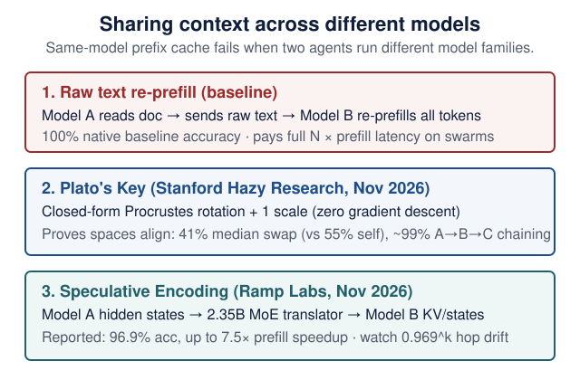

# Part 1 · Building and serving models: from data to cross-model context

<!--  -->

[Course home](../README.md) · [Learning map](learning-map.md) · [Local inference](local-inference.md) · [Visual inference engineering](inference-engineering.md) · [Part 2 · RL and rollouts](ai-systems-02-rl-and-rollouts.md)

> **Optional; not graded:** This three-part mini-series sits **outside** the EASS Class X syllabus. It adds zero deadlines, assignments, GPUs, or paid accounts. Finish your Recipe Box milestones first, then use these three lessons to see how modern AI systems combine training, serving, reinforcement learning, sandboxes, and verification at scale.

**You will be able to:** trace the 13-stage AI lifecycle and 16-layer stack, explain how data pipelines, pretraining, SFT, and inference solve their core bottlenecks, apply the steady-state pipeline capacity law, and compare raw text re-prefill against *Plato's Key* and *Speculative Encoding* for sharing context across models.

**Predict first:** Suppose an AI agent cluster spends too much time waiting for slow tool sandboxes (`15` rollouts/min) while its GPU inference fleet handles `40` rollouts/min. If you double the number of inference GPUs to `80` rollouts/min, how much faster do completed RL rollouts arrive?

Check your prediction

Zero percent faster: goodput stays stuck at `15` rollouts/min. In a steady-state multi-fleet pipeline, total throughput cannot exceed the slowest stage: `λ_rollouts <= min(λ_inference, λ_environment, λ_verification, λ_learner)`. Adding GPUs without unblocking environments or verifiers just creates idle hardware or larger queues.

On this page

- [The three generations and four engines](#the-three-generations-and-four-engines)
- [The 13-stage AI lifecycle](#the-13-stage-ai-lifecycle)
- [The 16-layer composable stack](#the-16-layer-composable-stack)
- [Stages 0–4 and 7: building the model](#stages-04-and-7-building-the-model)
- [Stages 9–10: serving the model](#stages-910-serving-the-model)
- [Cross-model context sharing: Plato's Key and Speculative Encoding](#cross-model-context-sharing-platos-key-and-speculative-encoding)
- [Lab: steady-state capacity and cross-model prefill](#lab-steady-state-capacity-and-cross-model-prefill)
- [Quick quiz](#quick-quiz)
- [Sources](#sources)

## The three generations and four engines

AI infrastructure has evolved through three generations, each building on the one before it:

1. **Distributed training:** systems built to *learn* intelligence from static datasets (`L0`–`L8`).
2. **Distributed inference:** systems built to *serve* intelligence under latency, memory, and cost budgets (`L9`).
3. **Distributed autonomous experimentation:** systems built so intelligence can *reason, act, experiment, verify, and improve* continuously (`L10`–`L15`).

The third generation requires four engines working together beneath one distributed control plane:

- **Training engine:** updates model parameters.
- **Inference engine:** generates tokens, reasoning, and tool proposals.
- **Execution engine:** runs code, browsers, shells, and simulations inside isolated environments.
- **Verification engine:** checks outcomes, assigns grounded rewards, and separates agent errors from infrastructure failures.

The real engineering objective is not raw GPU utilization or tokens per second. It is **maximum useful, verified work per dollar, per second, and per joule**.

<figure class="course-diagram course-diagram--wide">
  

    
  

  <figcaption><strong>Four engines, one control plane, shared foundations.</strong> The control plane exchanges lightweight leases and policy versions; heavy weights, KV tensors, and snapshots stay on dedicated data and state planes. On a narrow screen, scroll sideways. <a href="../assets/diagrams/aisys-lifecycle-and-stack.svg">Open the diagram at full size</a>.</figcaption>
</figure>

Text version of the diagram

A distributed control plane (`L11`–`L14`) tracks schedules, budgets, policy versions, and rollout state. Below it sit four engines: Training (Stages 1–7, TorchTitan/Megatron), Inference (Stages 9–10, vLLM/SGLang/Dynamo), Execution (Stage 11, sandboxes/OpenEnv), and Verification (Stages 8 and 12, test suites/Harbor/Inspect AI). Underneath all four sit shared physical, kernel, collective, and storage layers (`L0`–`L7`).

## The 13-stage AI lifecycle

Modern AI labs do not run these 13 stages strictly one after another. Training, evaluation, serving, agent execution, and trace curation often run concurrently in a continuous loop. Notice how every stage has a simple core flow, a defining problem, and a practical engineering fix.

| Stage | Core steps | Key innovation | Main problem &amp; fix | Status &amp; session |
|---|---|---|---|---|
| **0. Infrastructure** | Provision GPUs, CPUs, NVLink/RDMA, disks | Topology-aware clusters &amp; cloud-native schedulers | Hardware stalls &amp; heterogeneous fleets → Ray, Slurm, Kubernetes | Mature core; multi-fleet elasticity active (**Part 1**) |
| **1. Data engineering** | Acquire, parse, filter, deduplicate, tokenize, shard | Reproducible content-addressed manifests &amp; Ray/DataTrove | Contamination, duplicates, lost resume state → checkpointable loaders | Mature pipelines; synthetic-data curation active (**Part 1**) |
| **2. Pretraining** | Forward/backward pass over token batches (`C ≈ 6ND`) | 6D parallelism + mixed precision + FlashAttention | OOM, collective stalls, silent NaNs → FSDP/ZeRO, topology placement, corruption checks | Mature dense; MoE load balance &amp; FP8/FP4 active (**Part 1**) |
| **3. Mid-training** | Continue training on math, code, long context, tool traces | Long-context &amp; domain curriculum mixing | Context degradation &amp; forgetting → context parallelism + replay mixes | Standard frontier practice (**Part 1**) |
| **4. SFT** | Imitate expert multi-turn &amp; tool demonstrations | Token-level loss masks over user/tool turns | Imitation stops at known demonstrations → pair with RL exploration | Standard; TRL, TorchTune, TorchTitan (**Part 1**) |
| **5. Preference opt.** | Rank chosen vs. rejected responses (DPO / reward model) | Direct optimization without an online critic | Off-policy distribution drift → iterative DPO / online RL | Standard lightweight alignment (**Part 2**) |
| **6. RL &amp; rollouts** | Sample trajectories, run tools, verify, update policy | GRPO, RLVR, async bounded off-policy rollouts | Stragglers, policy staleness, KV drift → async queues, staleness bounds, weight sync | Rapidly evolving frontier (**Part 2**) |
| **7. Distillation** | Transfer teacher logits or trajectories to smaller student | On-policy student rollouts graded by teacher | Student–teacher mismatch on multi-step errors → on-policy distillation | Widely used for serving efficiency (**Part 1 &amp; 2**) |
| **8. Evaluation** | Run held-out benchmarks, slices, and trusted verifiers | Isolated graders + repeated trials + leakage guards | Reward hacking &amp; flaky infra → signed receipts + outcome taxonomy | Active standardization (**Part 3**) |
| **9. Deployment opt.** | Quantize, compile, and shard validated checkpoints | PTQ/QAT, CUDA graphs, kernel fusion | Accuracy regressions under low precision → re-eval every quantized artifact | Mature tooling; FP4/MoE kernels active (**Part 1**) |
| **10. Inference** | Prefill prompt KV state, then decode tokens iteratively | PagedAttention, continuous batching, disaggregation | KV memory blow-up &amp; decode bandwidth limits → vLLM, SGLang, Dynamo, Mooncake | Mature single-model; cross-model KV emerging (**Part 1**) |
| **11. Agentic exec.** | Model emits tool calls; sandboxes execute and return obs | Warm microVMs, CoW snapshots, OpenEnv/Harbor | Slow cold starts, security escape, side effects → Firecracker/gVisor, outboxes | Active frontier (**Part 3**) |
| **12. Feedback** | Capture verified traces, failures, and human reviews | Failure-driven curricula &amp; regression eval suites | Selection bias &amp; tainted infra traces → strict provenance &amp; schema parity | Core frontier loop (**Part 3**) |

## The 16-layer composable stack

Rather than building one monolithic AI platform, production teams compose layers (`L0`–`L15`) so each concern can scale or fail independently:

| Band | Layers | Leading technologies | Where EASS connects |
|---|---|---|---|
| **Hardware &amp; OS** | `L0` Physical · `L1` Interconnect · `L2` OS · `L3` Cluster | GPUs/TPUs, NVLink/RDMA, Linux/cgroups/eBPF, K8s/Slurm/Ray | [Agent sandboxes](agent-sandboxes.md) (`cgroups`, namespaces) |
| **Kernels &amp; Scale** | `L4` Kernels · `L5` Compilers · `L6` Collectives · `L7` Storage | FlashAttention, CUTLASS, Triton, NCCL, FSDP, S3/3FS, Mooncake | [Visual inference engineering](inference-engineering.md) (roofline, fusion) |
| **Execution Runtimes** | `L8` Training · `L9` Inference · `L10` Sandboxes | TorchTitan, Megatron-LM, vLLM, SGLang, Dynamo, Firecracker, gVisor | [Local inference](local-inference.md) &amp; [Docker Compose](../lectures/08-docker-compose.md) |
| **Control &amp; Learning** | `L11` Orchestration · `L12` RL · `L13` Envs · `L14` Evals · `L15` Apps | Ray, Monarch, AReaL, verl, slime, Prime-RL, Harbor, OpenEnv, Inspect AI | [FactoryOps](factoryops-metamachine.md) &amp; [Systems reasoning](systems-reasoning.md) |

## Stages 0–4 and 7: building the model

### Stage 1: Data engineering
- **Core steps:** Raw crawl or code → parse → normalize → quality filter → deduplicate → privacy/safety filter → tokenize → mix domains → write Parquet/Arrow/binary token shards → stream via checkpointable loaders.
- **Innovation &amp; main challenge:** Versioned dataset manifests with content hashes (DataTrove, Dolma, Ray Data). The subtle failure is **resume drift**: if a training run crashes at step 40,000, restoring weights alone is wrong unless the data loader also restores the exact shard and offset consumed—otherwise the model over-trains on repeated batches or skips unseen data.
- **Current status:** Reproducible sharding and decontamination pipelines are standard; active work focuses on dynamic curriculum mixing and filtering agent-generated traces.

### Stage 2: Pretraining
- **Core steps:** Load token batch → forward pass → cross-entropy loss (`L(θ) = -Σ log p_θ(x_t | x_<t)`) → backward pass → synchronize gradients → optimizer step → checkpoint periodically. Dense compute scales roughly as `C ≈ 6 · N · D` (`N` parameters, `D` tokens).
- **Innovations:** **6D parallelism** splits work along orthogonal axes: *Data* (examples), *Tensor* (matrix slices inside layers), *Pipeline* (consecutive layers), *Expert* (Mixture-of-Experts subnetworks), *Context* (long sequence chunks), and *FSDP/ZeRO* (sharding parameters, gradients, and optimizer states across GPUs).
- **Problems &amp; fixes:** Memory OOMs are fixed via FSDP + activation recomputation + mixed precision; network stalls are reduced by topology-aware placement and overlapping collectives with compute; **silent numerical corruption** (a faulty GPU producing subtle NaNs or wrong reductions) is caught by periodic deterministic validation checks and automatic elastic node replacement.
- **Current status:** Native PyTorch + **TorchTitan** is the cleanest starting point (especially because TitanRL reuses the exact model definitions for RL); **Megatron-LM** remains standard for specialized mega-scale configs.

### Stages 3, 4, and 7: Mid-training, SFT, and distillation
- **Core steps:** Mid-training extends the base model on high-signal math, code, long contexts, and tool schemas. Supervised fine-tuning (SFT, e.g., TRL or TorchTune) masks loss on prompt/tool-observation tokens so gradients only train assistant actions. Distillation transfers capability from a larger teacher to a smaller student, increasingly *on-policy* (grading student rollouts rather than static teacher text).
- **Key limit:** SFT teaches the model to *imitate* known demonstrations. To explore new solution paths and optimize against real execution outcomes, you need reinforcement learning (**Part 2**).

## Stages 9–10: serving the model

As covered in [Local inference](local-inference.md) and [Visual inference engineering](inference-engineering.md), inference is a **dynamic scheduling and memory-bandwidth problem**, not a single forward pass:

- **Prefill vs. decode:** Prefill computes attention over the prompt and builds the KV cache (usually compute-bound); decode emits one token per step while streaming weights and KV state from HBM (usually memory-bandwidth-bound at small batch sizes, bounded by the roofline `P <= min(P_peak, B_memory × I)`).
- **KV cache growth:** For a grouped-query-attention (GQA) transformer with `L` layers, sequence length `T`, `H_KV` KV heads, head dim `d_h`, and `s` bytes per element, KV memory per sequence is `M_KV = 2 · L · T · H_KV · d_h · s`.
- **Key serving innovations:** **Orca** introduced iteration-level (continuous) batching; **FlashAttention** cut HBM round-trips; **vLLM / PagedAttention** stopped KV fragmentation via virtual memory blocks; **SGLang** added radix prefix reuse; **Sarathi-Serve** introduced chunked prefill; **DistServe / Splitwise / Dynamo / Mooncake / LMCache** separated prefill and decode pools and tiered KV across GPU/RAM/RDMA storage.

> **Simpler is enough:** Co-locate prefill and decode on the same workers first. Only disaggregate prefill and decode (and pay the KV network transfer cost) after profiling proves that interference between long prefills and decode tail latency outweighs transfer overhead.

## Cross-model context sharing: Plato's Key and Speculative Encoding

Exact prefix caching in vLLM or SGLang works only when two requests share the **same model, weights, and tokenizer**. What happens in a multi-agent swarm where Model A (say, a 7B reader) reads a 64,000-token repository and hands off to Model B (say, a different 32B reasoner)?

Historically, every downstream model had to **re-prefill the raw text from scratch**—paying `N ×` prefill cost. Two complementary breakthroughs published on **25 November 2026** tackle this problem from opposite ends:

| Approach | Core mechanism | Headline claims (vendor / research) | Limits &amp; systems trade-offs |
|---|---|---|---|
| **Raw text re-prefill** | Send raw text; target runs full prefill | 100% native model baseline accuracy | Pays full `N ×` prefill compute &amp; TTFT on long documents |
| **Plato's Key** ([Stanford Hazy Research](https://hazyresearch.stanford.edu/blog/2026-11-25-platos-key)) | Zero-gradient closed-form **orthogonal Procrustes rotation + 1 global scale** mapping donor hidden states into recipient space | Across 12 base LLMs / 8 families (1.5B–27B): `41%` median factual transfer (vs. `55%` self-swap); `A → B → C` chaining retains `~99%` of direct `A → C`; top-256 PCs retain `~74%`; unlocks "dark memories" | Proves linear geometric alignment exists without training, yet raw closed-form transfer still trails native inference accuracy |
| **Speculative Encoding** ([Ramp Labs](https://github.com/RampPublic/speculative-encoding)) | A learned **2.35B MoE encoder-decoder** translates internal hidden states / KV caches directly across heterogeneous models (e.g., Llama, Gemma, Qwen) with vLLM integration | Reported across 7 models: **96.9%** of native baseline accuracy (`~3.1%` gap), **4×–7.5×** prefill speedup on 32K–128K docs, and up to **128×** query-conditioned compression | Approximate representation: multi-hop chains compound accuracy gaps (`0.969^k` in a synthetic independence model), and cross-tenant translated caches need strict isolation |

<figure class="course-diagram">
  

    
  

  <figcaption><strong>Theory meets serving systems.</strong> <em>Plato's Key</em> shows cross-model latent spaces share a rotated low-dimensional geometry; <em>Speculative Encoding</em> turns that insight into a learned 2.35B MoE bridge inside serving engines. On a narrow screen, scroll sideways. <a href="../assets/diagrams/aisys-cross-model-kv.svg">Open the diagram at full size</a>.</figcaption>
</figure>

Text version of the diagram

1. **Raw text re-prefill:** Model A reads the document and passes text to Model B, which re-prefills every token (`100%` baseline accuracy, `N×` prefill latency).
2. **Plato's Key:** Closed-form orthogonal Procrustes rotation plus global scale aligns donor and recipient hidden states with zero training, demonstrating geometric interchangeability across 12 LLMs.
3. **Speculative Encoding:** A trained 2.35B MoE translator converts Model A's hidden states into Model B's KV/hidden state directly, trading a reported ~3.1% single-hop accuracy gap for up to 7.5× prefill speedup on long documents.

> **Checked:** The figures for *Plato's Key* and *Speculative Encoding* are reported by their respective authors on 25 November 2026 (not independently benchmarked here). In Part 2 and Part 3 we examine what this ~3.1% approximation costs inside RL importance ratios (`ρ_t`) and multi-hop verifier gates.

## Lab: steady-state capacity and cross-model prefill

In any multi-fleet system, steady-state throughput obeys `λ_rollouts <= min(λ_inference, λ_environment, λ_verification, λ_learner)`. Use the interactive lab below to see why adding GPUs fails when sandboxes or verifiers are the bottleneck, and how multi-hop latent translation trades latency for compounding accuracy drift.

<strong>Synthetic cluster capacity &amp; cross-model prefill explorer</strong>

**Worked example without JavaScript:** An RL cluster runs `40`/min inference, `15`/min sandboxes, `50`/min verifiers, and `35`/min learner steps. Goodput is capped at **`15`/min** (bottleneck: **environments**). Adding `+20`/min inference GPUs leaves goodput unchanged at `15`/min; adding `+20`/min sandboxes raises goodput to **`35`/min**. Separately, in a 5-model `64k`-token swarm (`94%` native accuracy), Speculative Encoding cuts synthetic prefill time from `5,760 ms` to `823 ms` (`7.0×` faster) with `88.3%` 2-hop accuracy (`0.969^2 × 94%`), whereas `6` chained hops decay to `77.8%` (`0.969^6 × 94%`), triggering a verification alert.

## Quick quiz

Q1. Why must a pretraining checkpoint restore the exact data-loader offset alongside model weights?

Without the data-loader offset, a restarted run either repeats recent batches (overfitting and wasting compute) or skips shards entirely, breaking reproducibility and biasing the learned distribution.

Q2. How do Plato's Key and Speculative Encoding relate to each other?

*Plato's Key* establishes the geometric foundation—different LLMs' hidden spaces align closely enough that a closed-form Procrustes rotation + scale transfers facts without gradients. *Speculative Encoding* builds a learned 2.35B MoE translator to achieve higher serving accuracy (96.9% reported) and long-document prefill speedups inside vLLM.

Q3. When you add more inference GPUs to an environment-bound RL cluster, what improves?

Only idle inference slack grows; completed rollouts per minute stay flat because `λ_rollouts <= min(λ_inf, λ_env, λ_ver, λ_learn)`. Scale the bottleneck fleet (`λ_env`) first.

## Sources

Checked **27 November 2026**: [Stanford Hazy Research — Plato's Key](https://hazyresearch.stanford.edu/blog/2026-11-25-platos-key), [Ramp Labs — Speculative Encoding](https://github.com/RampPublic/speculative-encoding), [TorchTitan](https://github.com/pytorch/torchtitan), [Megatron-LM](https://github.com/NVIDIA/Megatron-LM), [vLLM](https://github.com/vllm-project/vllm), [SGLang](https://github.com/sgl-project/sglang), [Dynamo](https://github.com/ai-dynamo/dynamo), [Mooncake](https://github.com/kvcache-ai/Mooncake), and [DataTrove](https://github.com/huggingface/datatrove).

<!--  -->
