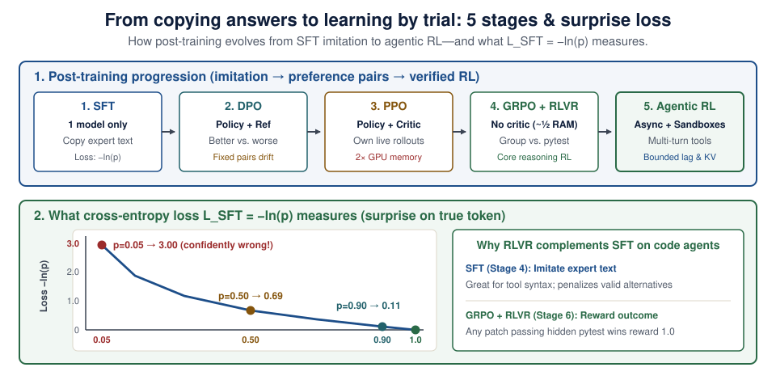
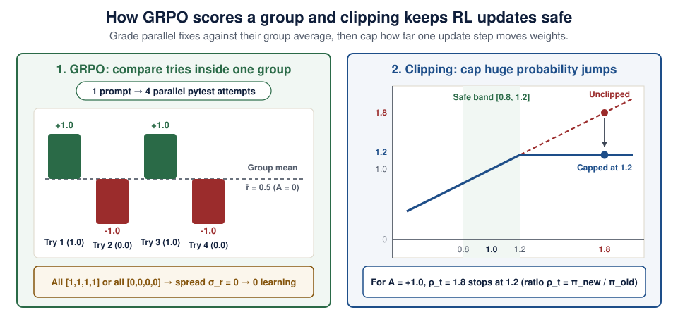
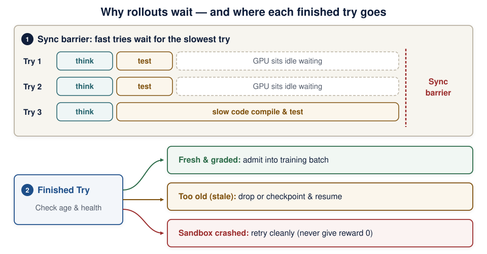
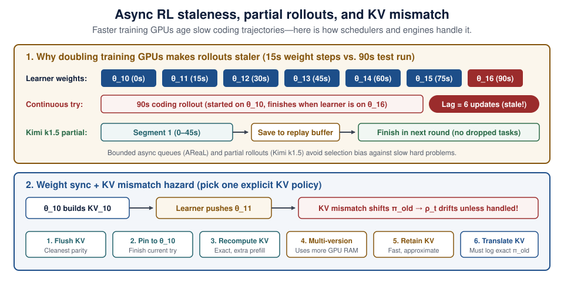

# Part 2 · Reinforcement learning, rollouts, and policy staleness

<!--  -->

[Course home](../README.md) · [Part 1 · Building and serving models](ai-systems-01-model-and-serving.md) · [Part 3 · Environments, state and roadmap](ai-systems-03-environments-state-roadmap.md)

> **Optional; not graded:** This bonus lesson sits outside the EASS Class X syllabus and requires zero GPUs, cloud clusters, or paid accounts. Every interactive lab and Python 3.14 exercise runs locally on your own computer.

**You will be able to:** compute GRPO group scores by hand, trace an agent rollout through its safety state machine, explain why faster learner updates can make training trajectories *staler*, compare 6 KV-cache rules across weight updates, and run and break a zero-GPU Python rollout state machine.

**Predict first:** Suppose your learner updates the model's weights every `30` seconds, while each coding agent takes `90` seconds to edit files and run `pytest`. If you double your training GPUs so the learner updates every `15` seconds, do finished rollouts arrive fresher or *more stale*?

<details markdown="1">
<summary>Check your prediction</summary>

**More stale!** Think of it like cooking while the recipe book is rewritten on the wall: `staleness ≈ lag + rollout_time / learner_step_time`. While one `90`-second rollout is still running tests, a `30`-second learner changes the weights `3` times—but a `15`-second learner changes them `6` times!

</details>

<details markdown="1">
<summary>Terms used on this page (plain English)</summary>

- **Policy (`θ_v`):** the current version `v` of the model's weights making decisions.
- **Rollout:** one complete multi-step attempt at a task (think → call tool → read test output → repeat → grade).
- **Reward:** the grader's final score on a rollout (for example, `1.0` if tests pass, `0.0` if they fail).
- **Advantage:** how much *better or worse* one try did compared to other tries on the same problem.
- **Policy staleness:** how many weight updates happened between when a rollout started and when it reached the trainer.
- **Logprob (`π`):** the model's exact probability score for each token it chose during a rollout.
- **Importance ratio (`ρ_t`):** `new_prob / old_prob`—measures how much the current model differs from the older version that generated the rollout.
- **`SFT`, `DPO`, `PPO`, `GRPO`, and `RLVR`:** five post-training methods—copying expert examples (*Supervised Fine-Tuning*, `SFT`), learning from better/worse pairs (*Direct Preference Optimization*, `DPO`), trial-and-error with a separate value critic (*Proximal Policy Optimization*, `PPO`), critic-free group scoring (*Group Relative Policy Optimization*, `GRPO`), and grading with deterministic code/math checks (*Reinforcement Learning with Verifiable Rewards*, `RLVR`).
- **`KV` cache (scratchpad):** temporary attention notes built while reading a prompt so the model does not re-read everything on each generated token (from Part 1).
- **`MoE` (Mixture of Experts):** a model split into specialist sub-networks so each token wakes up only a small fraction of the weights.
- **`FSDP` vs. tensor parallelism:** two different ways clusters slice weights across GPUs—training typically shards parameters across GPUs (*Fully Sharded Data Parallel*, `FSDP`), while serving slices individual matrix multiplies across GPUs (tensor parallelism).
- **`OOM` (Out-of-Memory):** a crash caused by a container or GPU running out of RAM—an infrastructure fault, never a model reasoning error.
- **Cross-entropy loss (`L_SFT`):** measures how surprised a model is by the expert's true next token (`−ln(p)`): `0` when certain (`p = 1.0`), larger when guessing blindly.
- **Clipping (`ε_clip`):** a safety guardrail (such as `[0.8, 1.2]`) capping how far `ρ_t` can move weights in a single update step so one lucky rollout cannot wreck training.
- **Partial rollouts (`Kimi k1.5`):** pausing a slow multi-step rollout at the iteration step budget, saving its progress, and finishing it in the next batch instead of dropping hard tasks.
- **Gradient, optimizer, &amp; logits:** the *gradient* tells each weight how to change, the *optimizer* applies those updates cleanly, and *logits* are the raw scores before converting to probabilities.
- **On-policy vs. off-policy &amp; replay buffer:** *on-policy* trains strictly on fresh rollouts from the *current* weights; *off-policy* reuses slightly older trajectories stored in a *replay buffer*.
- **Straggler, resharding, &amp; nondeterminism:** a *straggler* is one slow rollout holding up a group; *resharding* rearranges weights when moving from training GPUs (`FSDP`) to serving GPUs (tensor parallelism); *nondeterminism* means tiny floating-point rounding differences across batch sizes.
- **Checkpoint, distillation (`long2short`), &amp; harness:** a *checkpoint* saves rollout or sandbox state mid-run; *distillation* (`long2short`) transfers long reasoning gains into shorter answers; a *harness* is the loop connecting model turns, tools, and environment state.

</details>

<details markdown="1" class="lecture-toc">
<summary>On this page</summary>

- [Stages 5–6: learning by trying instead of copying](#stages-56-learning-by-trying-instead-of-copying)
- [Worked-by-hand: GRPO group scoring](#worked-by-hand-grpo-group-scoring)
- [The four RL equations in plain English](#the-four-rl-equations-in-plain-english)
- [Why rollouts wait and the three-exit safety gate](#why-rollouts-wait-and-the-three-exit-safety-gate)
- [Sync vs. async RL and policy staleness](#sync-vs-async-rl-and-policy-staleness)
- [Causal chain: weight updates, six KV policies, and logprob drift](#causal-chain-weight-updates-six-kv-policies-and-logprob-drift)
- [Leading RL frameworks](#leading-rl-frameworks)
- [NeMo Gym: where rollouts meet environments](#nemo-gym-where-rollouts-meet-environments)
- [Lab: diagnose rollout receipts](#lab-diagnose-rollout-receipts)
- [Python 3.14 lab: rollout state machine and GRPO](#python-314-lab-rollout-state-machine-and-grpo)
- [Quick quiz](#quick-quiz)
- [Sources](#sources)

</details>

## Stages 5–6: learning by trying instead of copying

In Part 1, SFT (Stage 4) gave our `64,000`-token coding agent weights that copy expert patches. Now, in **Stage 5 (Preference optimization)** and **Stage 6 (Reinforcement learning)**, the agent launches `4` candidate bug-fix patches in parallel, runs `pytest` inside sandboxes, and updates its weights from real test passes and failures:

| Method | Simple core steps | Key innovation &amp; main problem | How addressed &amp; status |
|---|---|---|---|
| **DPO (Stage 5)** | Show pairs `(better_answer, worse_answer)` and push probability toward the better one | Skips training a separate critic model; **problem:** fixed dataset drifts off-policy | Use iterative/online DPO when answers shift (**Standard lightweight alignment**) |
| **PPO** | Generate answers, score with reward + value critic, clip big updates | Stable updates; **problem:** value critic uses as much GPU memory as the main model | Replace critic with group averages (**Mature; heavier than GRPO**) |
| **GRPO** | Generate `k` tries per problem and compare each try against the group's own average | Cuts memory in half (no critic); **problem:** fast tries sit idle waiting for slow ones | Bounded async queues &amp; group-aware scheduling (**Core reasoning RL method**) |
| **RLVR** | Grade answers with deterministic checks (unit tests, math solvers, proofs) | Hard to trick compared to LLM judges; **problem:** sandbox crashes mimic wrong answers | Separate `FAILED_INFRASTRUCTURE` from reward `0` (**Standard for code &amp; math**) |
| **Agentic RL** | Loop over thinking, editing files, running tools, and grading | Learns multi-turn debugging; **problem:** long variable times &amp; irreversible actions | Durable state machine + snapshots (**Active frontier**) |
| **On-policy distillation** | Small student generates tries; smart teacher grades or guides them live | Better than static teacher essays; **problem:** needs teacher compute during training | Run alongside verifiable graders (**Growing efficiency method**) |

Step through how post-training evolved from copying static answers to bounded async RL:

<div class="stepper" markdown="1">

1. **SFT (Imitation only).** The model copies expert answers line by line—great for format, weak at recovering when a tool fails.
2. **DPO (Preference pairs).** Compare chosen vs. rejected answers without a critic model, though fixed datasets drift as the model changes.
3. **PPO (Online RL with a critic).** Let the model generate its own tries and score them live, at the cost of holding a second critic model in GPU memory.
4. **GRPO + RLVR (Group scoring + unit tests).** Drop the critic and compare `k` tries on the same task against deterministic tests—creating sync waiting barriers.
5. **Bounded Async RL (AReaL, Prime-RL, slime).** Keep GPUs and sandboxes busy concurrently while tracking policy staleness, `FAILED_INFRASTRUCTURE`, and KV consistency.

</div>

<figure class="course-diagram course-diagram--wide">
  <div class="diagram-scroll" role="region" tabindex="0" aria-label="Five post-training stages and cross-entropy surprise curve diagram, scroll horizontally">
    
  </div>
  <figcaption><strong>Post-training stages and what surprise loss measures.</strong> Moving from <code>SFT</code> imitation to verified <code>GRPO + RLVR</code> halves critic memory while rewarding any multi-turn patch that passes hidden tests. <span class="screen-only">On a narrow screen, scroll sideways.</span> <a href="../assets/diagrams/aisys-posttraining-and-loss.svg">Open the diagram at full size</a>.</figcaption>
</figure>

<details markdown="1">
<summary>Text version of the diagram</summary>

Top (`1. Post-training progression`): moves from `1. SFT` (single model, `-ln(p)` loss), to `2. DPO` (policy + reference pairs), to `3. PPO` (policy + critic, `2×` GPU RAM), to `4. GRPO + RLVR` (critic-free group scoring with `pytest`), to `5. Agentic RL` (multi-turn sandboxes with bounded lag and KV rules). Bottom (`2. Cross-entropy curve`): `L_SFT = -ln(p)` jumps to `3.00` when the model assigns only `p = 0.05` to the true token, drops to `0.69` at `0.50`, `0.11` at `0.90`, and `0` at `1.00`.

</details>

## Worked-by-hand: GRPO group scoring

Before looking at any formula, grade four tries at the *same* coding prompt by hand. Suppose the unit tests return rewards `[1.0, 0.0, 1.0, 0.0]`:

1. **Group average (`r̄`):** `(1 + 0 + 1 + 0) / 4 = 0.5`.
2. **Group spread (`σ_r`):** each try is `0.5` away from the average (`σ_r = 0.5`).
3. **Relative advantage (`A_i = (r_i − r̄) / (σ_r + ε)`):** here `ε` (`1e-8`) is just a tiny safety number so we never divide by zero when `σ_r = 0`.
   - Passing tries (`1.0`): `(1.0 − 0.5) / 0.5 = +1.0` (reinforce!).
   - Failing tries (`0.0`): `(0.0 − 0.5) / 0.5 = -1.0` (discourage!).

What if *all four* tries pass (`[1, 1, 1, 1]`) or *all four* fail (`[0, 0, 0, 0]`)? Then `σ_r = 0`: every advantage becomes `0.0`, and that group teaches the model nothing!

### The four RL equations in plain English

| Stage | Equation (plain text) | Plain-English meaning | Concrete toy example |
|---|---|---|---|
| **1. Imitation (`SFT`)** | `L_SFT = −(1/N) · Σ ln π_θ(y_t | s_t)` | Cross-entropy surprise on expert tokens | Assigning `p = 0.50` gives loss `0.69`; assigning `p = 0.90` drops loss to `0.11` |
| **2. Group score (`GRPO`)** | `A_i = (r_i − r̄) / (σ_r + ε)` | Subtract group mean `r̄`, divide by spread `σ_r` | Rewards `[1, 0, 1, 0]` give advantages `[+1.0, −1.0, +1.0, −1.0]` |
| **3. Clipped update (`PPO`/`GRPO`)** | `min(ρ_t · A_i, clip(ρ_t, 1 − ε_clip, 1 + ε_clip) · A_i)` | Cap how far `ρ_t = π_new / π_old` can move in one update | With `A_i = +1.0` and `ε_clip = 0.2`, `ρ_t = 1.8` is capped at `1.2` |
| **4. Async staleness** | `staleness ≈ sampler_lag + T_rollout / T_step` | How many weight updates happened while a rollout ran | `0 + 90s / 15s = 6` policy versions behind |

<figure class="course-diagram course-diagram--wide">
  <div class="diagram-scroll" role="region" tabindex="0" aria-label="GRPO group scoring and clipped policy ratio diagram, scroll horizontally">
    
  </div>
  <figcaption><strong>Zero-critic scoring plus safe update steps.</strong> Comparing parallel tries cancels the need for a value critic model, while clipping stops one outlier rollout from overtaking weights. <span class="screen-only">On a narrow screen, scroll sideways.</span> <a href="../assets/diagrams/aisys-grpo-and-clipping.svg">Open the diagram at full size</a>.</figcaption>
</figure>

<details markdown="1">
<summary>Text version of the diagram</summary>

Left (`1. GRPO group scoring`): four parallel tries on one prompt yield rewards `[1.0, 0.0, 1.0, 0.0]` around group mean `r̄ = 0.5`; passes get `+1.0` and failures get `-1.0`, whereas `[1,1,1,1]` or `[0,0,0,0]` produces spread `σ_r = 0` and zero gradient. Right (`2. Clipped ratio`): inside trust band `[0.8, 1.2]` the update scales linearly with `ρ_t = π_new / π_old`, then flattens at `1.2` so `ρ_t = 1.8` is capped instead of overshooting along the unclipped dashed line.

</details>

## Why rollouts wait and the three-exit safety gate

Unlike a single chat reply, an agent rollout moves through a durable state machine across inference GPUs, sandboxes, and graders:

`CREATED → ADMITTED → ENVIRONMENT_READY → SAMPLING ⇄ EXECUTING_TOOL → VERIFYING → COMPLETED → ACCEPTED_FOR_TRAINING → CONSUMED`

Three critical side exits prevent corrupted training data:
- **`FAILED_INFRASTRUCTURE`:** Docker or disk crashed. **Never** pass this to GRPO with reward `0.0`—retry it in a healthy sandbox.
- **`REJECTED_AS_STALE`:** Too many weight updates happened while the rollout was running.
- **`CHECKPOINTED` / `RESUMING`:** Save the sandbox state mid-run so an older rollout can switch cleanly to newer weights.

<figure class="course-diagram course-diagram--wide">
  <div class="diagram-scroll" role="region" tabindex="0" aria-label="GRPO sync barrier and three-exit rollout gate diagram, scroll horizontally">
    
  </div>
  <figcaption><strong>Two core ideas in one picture.</strong> Top: why synchronous groups waste GPU time waiting on the slowest try. Bottom: why a crashed sandbox must never become a negative training example. <span class="screen-only">On a narrow screen, scroll sideways.</span> <a href="../assets/diagrams/aisys-rollout-lifecycle.svg">Open the diagram at full size</a>.</figcaption>
</figure>

<details markdown="1">
<summary>Text version of the diagram</summary>

Top (Sync barrier): Three parallel tries start together. Try 1 and Try 2 finish thinking and testing quickly, then sit idle waiting for Try 3's slow code compile and test before the group can move past the sync barrier. Bottom (Safety gate): Every finished try checks age and health and routes to one of three exits—green `Fresh & graded` admits into the training batch, ochre `Too old (stale)` drops or checkpoints and resumes, and red `Sandbox crashed` retries cleanly without assigning reward `0`.

</details>

## Sync vs. async RL and policy staleness

- **Synchronous RL:** Wait for all tries in a batch → grade → train → copy new weights → repeat. Easy to debug, zero staleness, but GPUs sit idle at barriers.
- **Asynchronous RL:** Inference samplers keep generating while the learner keeps training and pushing new weights `θ_v → θ_{v+1}`. GPUs stay busy, **but** finished trajectories come from older weight versions.

The learner corrects for age using the **importance ratio** `ρ_t = π_new(a_t | s_t) / π_old(a_t | s_t)`, where `a_t` is the token the model chose at step `t` and `s_t` is the prompt plus tool outputs seen up to that point. If trajectories are too old (`staleness ≈ sampler_lag + T_sample_to_train / T_learner_step`), `ρ_t` explodes or collapses and training destabilizes.

> **Pitfall:** Never "fix" stragglers by silently dropping slow rollouts or only picking the fastest tasks first. As Microsoft's Rocket engineering report highlights, dropping slow tries biases the model away from hard, multi-step problems. **AReaL** keeps training stable with explicit staleness bounds and bounded off-policy clipping.

Two frontier systems tackle the same straggler and scale trade-off directly:
- **Partial rollouts ([Kimi k1.5](https://arxiv.org/abs/2501.12599)):** Instead of cancelling slow agent trajectories or stalling fast GPUs, pause unfinished trajectories at the token/step budget, save them into a replay buffer, and finish them cleanly in the next step—paired with *long2short* distillation so the model solves problems in fewer reasoning tokens.
- **Scaled verifiable RL ([DeepSeek-V3.2](https://arxiv.org/abs/2512.02556)):** Automated tool-use synthesis environments let engineers scale post-training RL compute above `10%` of pretraining budget while keeping strict verification boundaries.

<figure class="course-diagram course-diagram--wide">
  <div class="diagram-scroll" role="region" tabindex="0" aria-label="Async RL staleness, Kimi k1.5 partial rollouts, and KV mismatch diagram, scroll horizontally">
    
  </div>
  <figcaption><strong>Managing policy lag and KV state together.</strong> Faster learner steps make slow coding rollouts staler unless you bound staleness, use partial rollouts, and pick an explicit KV consistency rule whenever weights update. <span class="screen-only">On a narrow screen, scroll sideways.</span> <a href="../assets/diagrams/aisys-staleness-and-kv-policies.svg">Open the diagram at full size</a>.</figcaption>
</figure>

<details markdown="1">
<summary>Text version of the diagram</summary>

Top (`1. Staleness and partial rollouts`): learner weights step every `15s` (`θ_10` to `θ_16`), putting a `90s` continuous rollout `6` updates behind (`stale`). Below it, a `Kimi k1.5` partial rollout pauses at `45s`, saves progress in a replay buffer, and finishes cleanly in the next round without dropping hard tasks. Bottom (`2. Weight sync and KV hazard`): `θ_10` builds `KV_10`, then the learner pushes `θ_11`, shifting `π_old` unless the engine picks one of six explicit rules: `1. Flush KV`, `2. Pin to θ_10`, `3. Recompute KV`, `4. Multi-version`, `5. Retain KV`, or `6. Translate KV + log exact π_old`.

</details>

## Causal chain: weight updates, six KV policies, and logprob drift

Notice how three parts of the knowledge graph connect in a chain:

1. **Weight sync (`θ_v → θ_{v+1}`):** Training shards weights one way (for example FSDP); inference shards them another way (tensor parallelism). Moving weights requires resharding and integrity checks—and as Thinking Machines showed in *Defeating Nondeterminism in LLM Inference*, even changing batch sizes slightly shifts floating-point outputs.
2. **KV scratchpad mismatch:** A KV cache built under old weights `θ_v` does not match `θ_{v+1}`. You must pick one explicit consistency rule:
   - **Flush** KV on every update (cleanest parity, extra prefill cost).
   - **Pin** active rollouts to `θ_v` until they finish (clean inside one try, raises lag).
   - **Recompute** KV under `θ_{v+1}` (exact parity, extra compute).
   - **Multi-version pool** serving `θ_v` and `θ_{v+1}` briefly (uses more GPU memory).
   - **Retain deliberately** across tiny updates (e.g., `slime` option; faster, approximate).
   - **Cross-model / cross-version translation** (*Plato's Key* linear baseline vs. *Speculative Encoding* 2.35B MoE): skips re-prefill across heterogeneous samplers, **but** its ~3.1% single-hop gap shifts `π_old` unless you record exact emitted logprobs or recompute before training!
3. **Importance ratio `ρ_t` drift:** If KV state or floating-point precision differs between sampler and learner without logging exact behavior `logprobs`, `ρ_t` becomes inaccurate.

## Leading RL frameworks

- **[AReaL](https://github.com/areal-project/AReaL):** Asynchronous RL built around explicit staleness bounds and off-policy safety.
- **[verl](https://github.com/verl-project/verl):** Modular HybridFlow dataflows for PPO, GRPO, and multi-turn agents.
- **[slime](https://github.com/THUDM/slime):** Tight Megatron-LM + SGLang integration with fast weight sync and explicit KV policies.
- **[Prime-RL](https://github.com/PrimeIntellect-ai/prime-rl):** Clean three-way split (inference server, orchestrator, trainer) with small multi-GPU starters.
- **[TorchTitan](https://github.com/pytorch/torchtitan) / [TRL](https://github.com/huggingface/trl):** Unified PyTorch model definitions (`TitanRL`) and approachable post-training experimentation.

## NeMo Gym: where rollouts meet environments

[NeMo Gym](https://github.com/NVIDIA-NeMo/Gym) provides environments for evaluating and improving models and agents. Its environment combines **tasks, an agent harness, a verifier, and per-task state**. It supports running evaluation and training interactions at scale with an RL framework of your choice.

For our four-patch story, map the responsibilities like this:

1. The environment supplies the bug-fix task and its starting state.
2. The harness runs each model's edit → tool → observation loop.
3. The verifier scores task completion.
4. The learner uses admitted trajectories to update weights.

Use this as an architecture reading exercise: identify who owns each responsibility and where failures are recorded. Our course contract still requires exact token IDs, behavior logprobs, policy versions, action masks, and verifier versions; check the chosen integration before assuming it supplies every field or enforces our staleness rules.

[Part 3's TimeTravelContainer case study](ai-systems-03-environments-state-roadmap.md#case-study-timetravelcontainer-and-openshell) shows a runtime primitive that could share sandbox preparation across attempts. The combination is an architectural possibility to validate, not a ready-made integration demonstrated by this course. Forking one prepared environment also does not guarantee four independent samples: record the shared prefix and each branch's sampling configuration.

## Lab: diagnose rollout receipts

Pick the safe scheduler decision for each synthetic rollout receipt. Remember the priority order: **exclude cluster crashes first → check active checkpoints → check KV parity → check staleness limit → check GRPO group**.

<div class="sim" id="sim-aisys-rl" role="group" aria-label="RL rollout receipt decision lab" markdown="1">

<p class="sim-title"><strong>Decision lab: handle this RL rollout receipt</strong></p>

<div class="sim-fallback" markdown="1">

**Worked example without JavaScript:** A rollout reports `status = "failed_infra"`, `outcome = "infra_failure"`, and `policyLag = 1 <= 2`. **Exclude infra failure &amp; retry** next—never assign reward `0`, because a Docker or disk crash is not a model mistake. When `kvConsistent = false` (after a weight update or unverified cross-model translation), **flush KV or recompute logits** so `ρ_t` stays accurate.

</div>
</div>

## Python 3.14 lab: rollout state machine and GRPO

Read the plain-English rules before the code:
1. A rollout starts in `CREATED` and can only move along valid edges (`ALLOWED_TRANSITIONS`).
2. Once a rollout reaches a terminal state (`CONSUMED`, `FAILED_INFRASTRUCTURE`, `REJECTED_AS_STALE`, etc.), it cannot re-enter training.
3. Completed rollouts older than `max_staleness` become `REJECTED_AS_STALE`.
4. `grpo_advantages` scores *only* `ACCEPTED_FOR_TRAINING` rollouts (never crashed sandboxes) and returns `0.0` when every passing/failing score is identical (`std == 0`).

<details markdown="1">
<summary>New Python syntax used here</summary>

- `@dataclass`: automatically writes `__init__` for a plain data-holding class.
- `float | None`: type hint meaning "either a decimal number or `None`".
- `unittest.TestCase`: Python's built-in test runner (`python3 -m unittest -v`), zero `pip install` needed.

</details>

Save both files in a new folder and run `python3 rollout_fsm.py` first to see the live story, then `python3 -m unittest -v` to run all eight checks.

<figure class="file-example file-example--long" markdown="1">
<figcaption><span class="file-example-action">File example</span> <span class="file-example-path">rollout_fsm.py</span></figcaption>

```python
# rollout_fsm.py
"""Zero-dependency Rollout State Machine and GRPO advantage rules."""

from dataclasses import dataclass, field

# Valid next steps from each state (prevents skipped verification or zombie retries)
ALLOWED_TRANSITIONS = {
    "CREATED": {"ADMITTED", "CANCELLED"},
    "ADMITTED": {"ENVIRONMENT_READY", "FAILED_INFRASTRUCTURE", "CANCELLED"},
    "ENVIRONMENT_READY": {"SAMPLING", "FAILED_INFRASTRUCTURE", "TIMED_OUT"},
    "SAMPLING": {"EXECUTING_TOOL", "VERIFYING", "CHECKPOINTED", "FAILED_INFRASTRUCTURE", "TIMED_OUT"},
    "EXECUTING_TOOL": {"SAMPLING", "VERIFYING", "CHECKPOINTED", "FAILED_INFRASTRUCTURE", "TIMED_OUT"},
    "CHECKPOINTED": {"RESUMING", "CANCELLED"},
    "RESUMING": {"SAMPLING", "FAILED_INFRASTRUCTURE"},
    "VERIFYING": {"COMPLETED", "FAILED_INFRASTRUCTURE"},
    "COMPLETED": {"ACCEPTED_FOR_TRAINING", "REJECTED_AS_STALE"},
    "ACCEPTED_FOR_TRAINING": {"CONSUMED"},
}

TERMINAL_STATES = {"CONSUMED", "FAILED_INFRASTRUCTURE", "CANCELLED", "TIMED_OUT", "REJECTED_AS_STALE"}


class InvalidTransitionError(ValueError):
    pass


@dataclass
class RolloutRecord:
    rollout_id: str
    policy_version: int
    status: str = "CREATED"
    reward: float | None = None
    history: list[str] = field(default_factory=lambda: ["CREATED"])

    def transition(self, next_state: str) -> None:
        if next_state == self.status:
            return  # Safe retry if the same network message arrives twice
        if self.status in TERMINAL_STATES:
            raise InvalidTransitionError(f"Cannot leave terminal state {self.status}")
        if next_state not in ALLOWED_TRANSITIONS.get(self.status, set()):
            raise InvalidTransitionError(f"Illegal transition: {self.status} -> {next_state}")
        self.status = next_state
        self.history.append(next_state)


def admit_completed_rollout(record: RolloutRecord, current_policy: int, max_staleness: int) -> str:
    if record.status != "COMPLETED":
        raise InvalidTransitionError("Only COMPLETED rollouts can be judged for training")
    lag = current_policy - record.policy_version
    if lag < 0:
        raise ValueError("Rollout policy version cannot exceed current learner policy")
    if lag > max_staleness:
        record.transition("REJECTED_AS_STALE")
    else:
        record.transition("ACCEPTED_FOR_TRAINING")
    return record.status


def grpo_advantages(records: list[RolloutRecord], eps: float = 1e-8) -> list[float]:
    # Only train on verified, non-stale attempts — never crashed sandboxes
    trainable = [r for r in records if r.status == "ACCEPTED_FOR_TRAINING" and r.reward is not None]
    if not trainable:
        return []
    mean = sum(r.reward for r in trainable) / len(trainable)
    var = sum((r.reward - mean) ** 2 for r in trainable) / len(trainable)
    std = var ** 0.5
    if std == 0.0:
        return [0.0 for _ in trainable]
    return [(r.reward - mean) / (std + eps) for r in trainable]


if __name__ == "__main__":
    # Worked story: 2 valid tries (1 pass, 1 fail) + 1 crashed sandbox
    pass_try = RolloutRecord("try-1", policy_version=10, reward=1.0)
    fail_try = RolloutRecord("try-2", policy_version=10, reward=0.0)
    crash_try = RolloutRecord("try-3", policy_version=10, reward=0.0)
    for rec in (pass_try, fail_try):
        for s in ("ADMITTED", "ENVIRONMENT_READY", "SAMPLING", "VERIFYING", "COMPLETED"):
            rec.transition(s)
        admit_completed_rollout(rec, current_policy=11, max_staleness=2)
    crash_try.transition("ADMITTED")
    crash_try.transition("FAILED_INFRASTRUCTURE")
    scores = grpo_advantages([pass_try, fail_try, crash_try])
    print("Admitted statuses:", [pass_try.status, fail_try.status, crash_try.status])
    print("GRPO advantages (crash excluded):", [round(x, 3) for x in scores])
```

</figure>

<figure class="file-example file-example--long" markdown="1">
<figcaption><span class="file-example-action">File example</span> <span class="file-example-path">test_rollout_fsm.py</span></figcaption>

```python
# test_rollout_fsm.py
"""Eight stdlib tests for the Rollout State Machine and GRPO advantages."""

import unittest
from rollout_fsm import (
    InvalidTransitionError,
    RolloutRecord,
    admit_completed_rollout,
    grpo_advantages,
)


class RolloutFsmTests(unittest.TestCase):
    def test_happy_path_to_consumed(self):
        r = RolloutRecord("r1", policy_version=10, reward=1.0)
        for state in ("ADMITTED", "ENVIRONMENT_READY", "SAMPLING", "EXECUTING_TOOL", "SAMPLING", "VERIFYING", "COMPLETED"):
            r.transition(state)
        self.assertEqual(admit_completed_rollout(r, current_policy=11, max_staleness=2), "ACCEPTED_FOR_TRAINING")
        r.transition("CONSUMED")
        self.assertEqual(r.status, "CONSUMED")

    def test_illegal_transition_rejected(self):
        r = RolloutRecord("r2", policy_version=10)
        with self.assertRaises(InvalidTransitionError):
            r.transition("CONSUMED")

    def test_terminal_state_blocks_further_transitions(self):
        r = RolloutRecord("r3", policy_version=10)
        r.transition("ADMITTED")
        r.transition("FAILED_INFRASTRUCTURE")
        with self.assertRaises(InvalidTransitionError):
            r.transition("COMPLETED")

    def test_idempotent_same_state_transition(self):
        r = RolloutRecord("r4", policy_version=10)
        r.transition("ADMITTED")
        r.transition("ADMITTED")
        self.assertEqual(r.history, ["CREATED", "ADMITTED"])

    def test_stale_rollout_rejected_above_threshold(self):
        r = RolloutRecord("r5", policy_version=4, reward=1.0)
        for state in ("ADMITTED", "ENVIRONMENT_READY", "SAMPLING", "VERIFYING", "COMPLETED"):
            r.transition(state)
        self.assertEqual(admit_completed_rollout(r, current_policy=8, max_staleness=2), "REJECTED_AS_STALE")

    def test_infra_failure_excluded_from_grpo_advantages(self):
        good = RolloutRecord("g1", policy_version=5, reward=1.0)
        bad = RolloutRecord("g2", policy_version=5, reward=0.0)
        crashed = RolloutRecord("g3", policy_version=5, reward=0.0)
        for rec in (good, bad):
            for state in ("ADMITTED", "ENVIRONMENT_READY", "SAMPLING", "VERIFYING", "COMPLETED"):
                rec.transition(state)
            admit_completed_rollout(rec, current_policy=5, max_staleness=2)
        crashed.transition("ADMITTED")
        crashed.transition("FAILED_INFRASTRUCTURE")
        adv = grpo_advantages([good, bad, crashed])
        self.assertEqual(len(adv), 2)
        self.assertGreater(adv[0], 0.0)
        self.assertLess(adv[1], 0.0)

    def test_zero_variance_group_returns_zero_advantages(self):
        recs = []
        for idx in range(3):
            r = RolloutRecord(f"z{idx}", policy_version=5, reward=1.0)
            for state in ("ADMITTED", "ENVIRONMENT_READY", "SAMPLING", "VERIFYING", "COMPLETED"):
                r.transition(state)
            admit_completed_rollout(r, current_policy=5, max_staleness=2)
            recs.append(r)
        self.assertEqual(grpo_advantages(recs), [0.0, 0.0, 0.0])

    def test_checkpoint_and_resume_round_trip(self):
        r = RolloutRecord("r6", policy_version=5)
        for state in ("ADMITTED", "ENVIRONMENT_READY", "SAMPLING", "EXECUTING_TOOL", "CHECKPOINTED", "RESUMING", "SAMPLING"):
            r.transition(state)
        self.assertEqual(r.status, "SAMPLING")


if __name__ == "__main__":
    unittest.main()
```

</figure>

<details markdown="1">
<summary>Show the expected demo and test output</summary>

Captured with Python 3.14 (stdlib only, no GPU):

```text
$ python3 rollout_fsm.py
Admitted statuses: ['ACCEPTED_FOR_TRAINING', 'ACCEPTED_FOR_TRAINING', 'FAILED_INFRASTRUCTURE']
GRPO advantages (crash excluded): [1.0, -1.0]

$ python3 -m unittest -v
...
Ran 8 tests in 0.000s

OK
```

Notice why `GRPO advantages` prints `[1.0, -1.0]` (two values, not three): `try-3` crashed in `FAILED_INFRASTRUCTURE`, so it was excluded before computing the group mean (`0.5`) and spread (`0.5`).

</details>

**Break it on purpose:** In `rollout_fsm.py`, temporarily change the `grpo_advantages` filter to include `"FAILED_INFRASTRUCTURE"` alongside `"ACCEPTED_FOR_TRAINING"`, then rerun `python3 rollout_fsm.py` and `python3 -m unittest -v`. Restore it afterwards!

<details markdown="1">
<summary>Show what breaks</summary>

With `crashed` (`reward=0.0`) included, the group rewards become `[1.0, 0.0, 0.0]` instead of `[1.0, 0.0]`: `mean` drops from `0.5` to `0.333`, shifting the valid failing try's penalty and teaching the model about a cluster crash. `test_infra_failure_excluded_from_grpo_advantages` immediately fails (`3 != 2`).

</details>

## Quick quiz

<details markdown="1">
<summary>Q1. Why is silently dropping slow trajectories harmful in async RL?</summary>

Slow trajectories are often harder multi-turn problems. Dropping them teaches the model only on short, easy tasks.

</details>

<details markdown="1">
<summary>Q2. What happens if a sandbox OOM (Out-of-Memory) is logged as reward 0 instead of FAILED_INFRASTRUCTURE?</summary>

The optimizer punishes the model's reasoning for an infrastructure crash and skews GRPO group scores.

</details>

<details markdown="1">
<summary>Q3. What extra rule applies if you reuse Speculative Encoding across RL rollouts?</summary>

Save the exact behavior `logprobs` emitted at generation time (or recompute under native weights) so approximate KV translation never silently corrupts `ρ_t`.

</details>

**Next step in the story:** Now that you know how GRPO and staleness bounds steer learning, [Part 3](ai-systems-03-environments-state-roadmap.md) zooms inside the `pytest` sandbox to show what snapshots can and cannot rewind ("The Rewind Wall"), how hidden verifiers stop cheating, and how every trajectory is logged for training.

## Sources

Environment architecture: [NeMo Gym README](https://github.com/NVIDIA-NeMo/Gym#readme). Related runtime: [TimeTravelContainer README](https://github.com/NVlabs/TimeTravelContainer#readme). Checked **27 November 2026**; no GPU experiment or combined-stack benchmark was run for this lesson.

Checked **27 November 2026**: [Kimi k1.5](https://arxiv.org/abs/2501.12599), [DeepSeek-R1](https://arxiv.org/abs/2501.12948), [DeepSeek-V3.2](https://arxiv.org/abs/2512.02556), [AReaL](https://github.com/areal-project/AReaL), [verl](https://github.com/verl-project/verl), [slime](https://github.com/THUDM/slime), [Prime-RL](https://github.com/PrimeIntellect-ai/prime-rl), [Defeating Nondeterminism in LLM Inference](https://thinkingmachines.ai/blog/defeating-nondeterminism-in-llm-inference/), [Microsoft Rocket RL Infrastructure](https://microsoft.ai/news/rl-infrastructure-at-microsoft-ai/), [Stanford Plato's Key](https://hazyresearch.stanford.edu/blog/2026-11-25-platos-key), and [Speculative Encoding (code)](https://github.com/b10-tv/speculative-encoding).

<!--  -->
