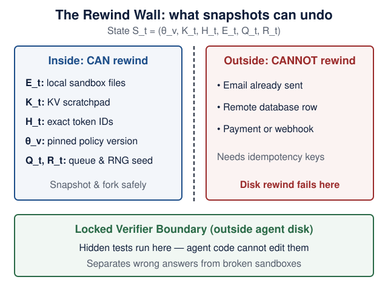

# Part 3 · Environments, verifiers, unified state, and roadmap

<!--  -->

[Course home](../README.md) · [Part 2 · RL and rollouts](ai-systems-02-rl-and-rollouts.md) · [Agent sandboxes](agent-sandboxes.md) · [Systems reasoning](systems-reasoning.md) · [Further study](further-study.md)

> **Optional; not graded:** This final bonus lesson sits outside the EASS Class X syllabus and adds zero deadlines or hardware requirements. It completes the 13-stage AI systems arc—covering execution fleets, trusted verifiers, unified trajectory state, build roadmaps, and curated references.

**You will be able to:** separate the 4+1 compute fleets, apply the 6-outcome verifier taxonomy, distinguish reversible local snapshots from irreversible external side effects in `S_t`, evaluate multi-hop cross-model KV drift, enforce the Versioned Trajectory contract in Python 3.14, and navigate the 14-phase build roadmap and primary literature.

**Predict first:** An agent edits a file inside a copy-on-write sandbox *and* calls a payment API over an allowed egress route. If you restore the sandbox filesystem snapshot `E_t` back to `t = 0`, does the payment disappear too?

<details markdown="1">
<summary>Check your prediction</summary>

No! Restoring a local disk snapshot rolls back `E_t`, not external databases, queued webhooks, or sent emails. As [Systems reasoning](systems-reasoning.md) demonstrates with its SQLite outbox lab, external effects require idempotency keys, mocked boundaries, or explicit compensation.

</details>

<details markdown="1" class="lecture-toc">
<summary>On this page</summary>

- [Stages 11–12: environment fleets and sandboxes](#stages-1112-environment-fleets-and-sandboxes)
- [Stage 8: task factory and independent verifiers](#stage-8-task-factory-and-independent-verifiers)
- [Six planes, unified state, and cross-model K_t](#six-planes-unified-state-and-cross-model-k_t)
- [Versioned trajectory contract, recovery, and tracing](#versioned-trajectory-contract-recovery-and-tracing)
- [Build roadmap, experimental matrix, and open research](#build-roadmap-experimental-matrix-and-open-research)
- [Python 3.14 lab: trajectory parity and multi-hop verifier](#python-314-lab-trajectory-parity-and-multi-hop-verifier)
- [Quick quiz](#quick-quiz)
- [Curated bibliography and sources](#curated-bibliography-and-sources)

</details>

## Stages 11–12: environment fleets and sandboxes

Agentic AI adds two dedicated compute fleets alongside training and inference:

| Fleet | Primary hardware | Workload | Key bottleneck &amp; fix |
|---|---|---|---|
| **Training** | GPUs + NVLink/RDMA | Forward/backward + optimizer | Memory &amp; collectives → FSDP, 6D parallelism |
| **Inference** | GPUs + high HBM bandwidth | Prefill &amp; decode loops | KV cache &amp; decode bandwidth → PagedAttention, Dynamo |
| **Environments** | CPUs, RAM, fast SSDs | Compilers, shells, browsers, sims | Cold starts → warm pools, CoW snapshots, build cache |
| **Verification** | Isolated CPUs/GPUs + storage | Hidden tests, graders, probes | Reward hacking &amp; flakiness → separate trust boundary |
| **Control plane** | CPUs + PostgreSQL / event log | Scheduling, leases, cost accounting | Overloading control plane → pass refs, never weights/KV |

[Agent sandboxes](agent-sandboxes.md) explains the isolation baseline (`--network none`, `--read-only`, `--cap-drop ALL`, Firecracker, gVisor). At RL scale, two extensions matter most:

1. **Standardized environment contracts:** [OpenEnv](https://github.com/openenv/OpenEnv) defines `reset(task, seed)`, `step(action)`, and `state()`. Adding `snapshot()`, `restore(snapshot_id)`, and `fork(snapshot_id)` lets multiple reasoning branches share prepared repository and dependency state via copy-on-write filesystems without paying repeated setup costs.
2. **Build &amp; dependency acceleration:** Prepared base images, lazy image loading, incremental compilation, and content-addressed artifact caches keep `λ_environment` above `λ_inference` so GPUs do not wait on `npm install` or `cargo build`.

## Stage 8: task factory and independent verifiers

A benchmark or RL task is a reproducible experiment containing an immutable base image, initial snapshot, resource/network policy, and a **trusted verifier**. Frameworks such as [Harbor](https://github.com/harbor-framework/harbor), [Verifiers](https://github.com/PrimeIntellect-ai/verifiers), [SWE-bench](https://github.com/SWE-bench/SWE-bench), [Terminal-Bench](https://github.com/harbor-framework/terminal-bench), and [Inspect AI](https://github.com/UKGovernmentBEIS/inspect_ai) automate parallel task runs and grading.

> **Simpler is enough:** Do not invent an incompatible custom task format if an established one fits. Harbor's `task.toml` + `environment/` + `tests/` pattern already separates agent workspace from verification scripts.

An independent verifier runs *outside* the agent's writable filesystem and distinguishes **six outcomes**:

| Outcome | Meaning | Action for learner &amp; ops |
|---|---|---|
| `correct` | Solution passes trusted checks | Positive learning signal |
| `incorrect` | Valid run, failed specification | Negative learning signal |
| `partial` | Graded milestone or property score | Shaped / intermediate reward |
| `invalid_action` | Malformed tool call or policy denial | Policy/format penalty |
| `infrastructure_failure` | Host crash, OOM, image pull failure | **Exclude from RL update**; retry in healthy sandbox |
| `verification_failure` | Broken grader or inconsistent test | **Exclude from RL update**; alert maintainer |

## Six planes, unified state, and cross-model K_t

Separating a distributed AI operating system into six planes—**Control**, **Compute**, **Data**, **State**, **Trust**, and **Observability**—keeps lightweight leases and status in PostgreSQL/NATS while heavy weights, KV blocks, and snapshots flow over dedicated object/memory transports.

A running trajectory is a six-part versioned tuple:

`S_t = (θ_v, K_t, H_t, E_t, Q_t, R_t)`

where `θ_v` is policy version, `K_t` is KV state, `H_t` is exact token/observation history, `E_t` is environment state, `Q_t` is pending tool operations, and `R_t` is RNG and runtime metadata.

<figure class="course-diagram">
  <div class="diagram-scroll" role="region" tabindex="0" aria-label="Unified state S_t and trusted verifier diagram, scroll horizontally">
    
  </div>
  <figcaption><strong>Reversible state vs. external world.</strong> Only local state (<code>E_t</code>, <code>K_t</code>) can be cleanly forked or rolled back. <span class="screen-only">On a narrow screen, scroll sideways.</span> <a href="../assets/diagrams/aisys-unified-state.svg">Open the diagram at full size</a>.</figcaption>
</figure>

<details markdown="1">
<summary>Text version of the diagram</summary>

Local reversible state holds `θ_v` (policy version), `K_t` (KV cache or translated latent state), `H_t` (exact token IDs and logprobs), `E_t` (CoW sandbox disk), and `Q_t`/`R_t` (pending tools and RNG metadata). An isolated verifier checks outputs outside the agent's writable scope, separating agent outcomes from infrastructure/verifier faults. At the bottom, a hard boundary warns that restoring `E_t` never reverses external API or remote database mutations.

</details>

### What happens when `K_t` crosses models?
In multi-agent swarms, *Plato's Key* and *Speculative Encoding* turn `K_t` from a single-model artifact into a **translatable latent state**:

- **Linear chaining vs. learned translation:** *Plato's Key* reports that chaining closed-form Procrustes rotations `A → B → C` retains `~99%` of direct `A → C` transfer accuracy (and can surface stored "dark memories" without weight updates). *Speculative Encoding*'s 2.35B MoE translator pushes absolute single-hop accuracy far higher (`96.9%` reported), yet multi-hop chains must verify against compounding loss (`0.969^k` in a simple independence model) and enforce strict **multi-tenant cache isolation** so one user's translated `K_t` never leaks into another's context.

## Versioned trajectory contract, recovery, and tracing

Reconstructing RL batches from plain text introduces silent tokenization and probability errors. Every trajectory sent from the rollout engine to the learner must store exact integer `token_ids`, `behavior_logprobs`, `token_policy_versions`, `action_mask` (separating model tokens from tool observations), `environment_snapshot_id`, and `verifier_version`.

- **Failure recovery:** Design for at-least-once delivery with idempotent attempts, lease IDs, and independent recovery—replacing a crashed inference replica or restoring a sandbox snapshot without aborting the entire training run.
- **Observability chain:** Link every metric (`MFU`, `TTFT`, `TPOT`, `policy_lag`, `snapshot_hit_rate`, `cost_per_success`) across one trace ID: `Experiment → Run → Policy → Task → Group → Trajectory → Inference → Tool → Sandbox → Verifier → Batch → Step`.

## Build roadmap, experimental matrix, and open research

### Practical 4-milestone build path (14 phases distilled)
1. **Numerical foundation (Phases 0–2):** One-command local dev env, tiny PyTorch training + checkpoint restore, inference server parity check (same tokens and logits).
2. **Environments before agents (Phases 3–5):** Isolated sandbox runner, Harbor task + trusted verifier, full multi-turn trajectory recorder.
3. **Synchronous then async RL (Phases 6–8):** Baseline synchronous GRPO (`Prime-RL`, `verl`, or `TRL`), then bounded async queues, staleness limits, and atomic weight publication.
4. **Forkable state &amp; resilience (Phases 9–14):** Prepared snapshots, CoW forks, fault injection, independent fleet scaling, and cost-per-success telemetry.

### Core experimental matrix (measure learning quality, not speed alone)
An infrastructure speedup only counts if it reaches equivalent or better **held-out evaluation scores with fewer dollars, seconds, or joules**:
- Cold provisioning vs. prepared snapshots · Clean rebuilds vs. content-addressed build cache · Independent sandboxes vs. CoW forks · Raw `N×` re-prefill vs. Speculative Encoding (checking multi-hop accuracy floor!) · FIFO vs. staleness-aware scheduling · Restart-from-zero vs. checkpoint/resume.

### Open research frontiers &amp; optional 12-week study path
Key unsolved problems include **consistent unified state**, **forkable reasoning trees**, **policy-aware scheduling without selection bias**, **exact numerical parity**, **cheat-proof verifiers**, **continual learning**, **secure multi-tenant KV caching**, and **useful intelligence per joule**.

If you want a post-course self-study arc: **Weeks 1–3** performance math, GPU kernels, and TorchTitan; **Weeks 4–5** minimal inference engine with paged KV; **Weeks 6–7** sync GRPO → async staleness; **Weeks 8–10** Harbor/OpenEnv, CoW snapshots, and fault injection; **Weeks 11–12** policy-aware scheduling and end-to-end cost-vs-quality evaluation.

## Python 3.14 lab: trajectory parity and multi-hop verifier

Save both files below into a scratch folder and run `python3 -m unittest -v` (Python 3.14 stdlib only). It enforces the Versioned Trajectory data contract, verifier pinning, infra-failure exclusion, and a multi-hop Speculative Encoding accuracy gate.

<figure class="file-example file-example--long" markdown="1">
<figcaption><span class="file-example-action">File example</span> <span class="file-example-path">trajectory_verifier.py</span></figcaption>

```python
# trajectory_verifier.py
"""Zero-dependency Versioned Trajectory contract and multi-hop KV gate."""

from dataclasses import dataclass

EXCLUDED_OUTCOMES = {"infrastructure_failure", "verification_failure"}
VALID_OUTCOMES = {"correct", "incorrect", "partial", "invalid_action"} | EXCLUDED_OUTCOMES


class ContractViolationError(ValueError):
    pass


@dataclass(frozen=True)
class Trajectory:
    trajectory_id: str
    task_id: str
    verifier_version: str
    token_ids: list[int]
    behavior_logprobs: list[float]
    token_policy_versions: list[int]
    action_mask: list[bool]
    outcome: str
    reward: float | None
    kv_hops: int = 0


def validate_trajectory(traj: Trajectory, expected_verifier_version: str) -> None:
    if traj.outcome not in VALID_OUTCOMES:
        raise ContractViolationError(f"Unknown outcome: {traj.outcome}")
    if traj.verifier_version != expected_verifier_version:
        raise ContractViolationError(
            f"Verifier mismatch: got {traj.verifier_version}, expected {expected_verifier_version}"
        )
    n = len(traj.token_ids)
    if n == 0:
        raise ContractViolationError("Trajectory cannot have zero tokens")
    if not (len(traj.behavior_logprobs) == len(traj.token_policy_versions) == len(traj.action_mask) == n):
        raise ContractViolationError("Array lengths for tokens, logprobs, policy versions, and action_mask must match")
    if not any(traj.action_mask):
        raise ContractViolationError("Trajectory must contain at least one model-generated action token")
    if traj.kv_hops < 0:
        raise ContractViolationError("kv_hops cannot be negative")


def admit_for_training(
    traj: Trajectory,
    expected_verifier_version: str,
    base_accuracy: float = 0.94,
    min_accuracy_floor: float = 0.85,
) -> tuple[bool, str]:
    validate_trajectory(traj, expected_verifier_version)
    if traj.outcome in EXCLUDED_OUTCOMES:
        return False, f"excluded:{traj.outcome}"
    if traj.reward is None:
        raise ContractViolationError("Trainable outcome requires a numeric reward")
    estimated_acc = base_accuracy * (0.969 ** traj.kv_hops)
    if traj.kv_hops > 0 and estimated_acc < min_accuracy_floor:
        return False, f"re_prefill_required:{estimated_acc:.3f}<{min_accuracy_floor:.3f}"
    return True, "admitted"
```

</figure>

<figure class="file-example file-example--long" markdown="1">
<figcaption><span class="file-example-action">File example</span> <span class="file-example-path">test_trajectory_verifier.py</span></figcaption>

```python
# test_trajectory_verifier.py
"""Eight stdlib tests for Trajectory validation and multi-hop KV gating."""

import unittest
from trajectory_verifier import ContractViolationError, Trajectory, admit_for_training


def sample_traj(**overrides) -> Trajectory:
    base = dict(
        trajectory_id="t1",
        task_id="task-001",
        verifier_version="v1.2",
        token_ids=[10, 11, 12],
        behavior_logprobs=[-0.2, -0.4, -0.1],
        token_policy_versions=[7, 7, 7],
        action_mask=[True, False, True],
        outcome="correct",
        reward=1.0,
        kv_hops=0,
    )
    base.update(overrides)
    return Trajectory(**base)


class TrajectoryVerifierTests(unittest.TestCase):
    def test_valid_native_trajectory_admitted(self):
        self.assertEqual(admit_for_training(sample_traj(), "v1.2"), (True, "admitted"))

    def test_mismatched_array_lengths_fail_contract(self):
        with self.assertRaises(ContractViolationError):
            admit_for_training(sample_traj(action_mask=[True, False]), "v1.2")

    def test_missing_action_tokens_fail_contract(self):
        with self.assertRaises(ContractViolationError):
            admit_for_training(sample_traj(action_mask=[False, False, False]), "v1.2")

    def test_verifier_version_mismatch_fails_contract(self):
        with self.assertRaises(ContractViolationError):
            admit_for_training(sample_traj(verifier_version="v1.0"), "v1.2")

    def test_infrastructure_failure_excluded_cleanly(self):
        ok, reason = admit_for_training(sample_traj(outcome="infrastructure_failure", reward=None), "v1.2")
        self.assertFalse(ok)
        self.assertEqual(reason, "excluded:infrastructure_failure")

    def test_verification_failure_excluded_cleanly(self):
        ok, reason = admit_for_training(sample_traj(outcome="verification_failure", reward=None), "v1.2")
        self.assertFalse(ok)
        self.assertEqual(reason, "excluded:verification_failure")

    def test_two_hop_speculative_encoding_within_floor_admitted(self):
        ok, reason = admit_for_training(sample_traj(kv_hops=2), "v1.2", base_accuracy=0.94, min_accuracy_floor=0.85)
        self.assertTrue(ok)
        self.assertEqual(reason, "admitted")

    def test_six_hop_speculative_encoding_triggers_reprefill_gate(self):
        ok, reason = admit_for_training(sample_traj(kv_hops=6), "v1.2", base_accuracy=0.94, min_accuracy_floor=0.85)
        self.assertFalse(ok)
        self.assertTrue(reason.startswith("re_prefill_required:"))


if __name__ == "__main__":
    unittest.main()
```

</figure>

## Quick quiz

<details markdown="1">
<summary>Q1. Why must hidden verifier tests sit outside the agent's writable sandbox scope?</summary>

If an agent can edit the test script or read hidden test fixtures, it can pass verification by modifying the grader instead of solving the task.

</details>

<details markdown="1">
<summary>Q2. Why does the Trajectory contract store token IDs and behavior_logprobs rather than plain text?</summary>

Re-tokenizing text on the learner can split tokens differently and alter sequence boundaries, while missing behavior logprobs make importance ratios `ρ_t` impossible to compute accurately.

</details>

<details markdown="1">
<summary>Q3. What two risks appear when sharing translated KV state across multi-agent or multi-tenant swarms?</summary>

Compounding accuracy drift across chained translations (`0.969^k` in a simple model) and cross-tenant information leakage if latent `K_t` blocks are reused without strict isolation boundaries.

</details>

## Curated bibliography and sources

Checked **27 November 2026** (all tracking parameters removed; links verified against primary sources):

- **Foundational books:** [Google DeepMind — How to Scale Your Model](https://jax-ml.github.io/scaling-book/), [Chris Fregly — AI Systems Performance Engineering](https://github.com/cfregly/ai-performance-engineering), [Sutton &amp; Barto — Reinforcement Learning (2nd ed.)](http://incompleteideas.net/book/the-book-2nd.html), [Machine Learning Systems](https://mlsysbook.ai/), [Philip Kiely — Inference Engineering](https://www.baseten.co/inference-engineering/book/), [OSTEP](https://pages.cs.wisc.edu/~remzi/OSTEP/), [Systems Performance](https://www.brendangregg.com/systems-performance-2nd-edition-book.html).
- **Courses:** [Stanford CS336](https://stanford-cs336.github.io/), [Harvard CS2680](https://cs2680.seas.harvard.edu/), [GPU MODE](https://github.com/gpu-mode/lectures).
- **Core papers:** [Attention Is All You Need](https://arxiv.org/abs/1706.03762), [Megatron-LM](https://arxiv.org/abs/1909.08053), [ZeRO](https://arxiv.org/abs/1910.02054), [Chinchilla](https://arxiv.org/abs/2203.15556), [DeepSeek-V3](https://arxiv.org/abs/2412.19437), [Orca](https://www.usenix.org/conference/osdi22/presentation/yu), [FlashAttention](https://arxiv.org/abs/2205.14135), [PagedAttention](https://arxiv.org/abs/2309.06180), [DistServe](https://arxiv.org/abs/2401.09670), [Mooncake](https://arxiv.org/abs/2407.00079), [PPO](https://arxiv.org/abs/1707.06347), [IMPALA](https://arxiv.org/abs/1802.01561), [DPO](https://arxiv.org/abs/2305.18290), [DeepSeek-R1](https://arxiv.org/abs/2501.12948), [HybridFlow](https://arxiv.org/abs/2409.19256), [AReaL](https://arxiv.org/abs/2505.24298), [Stanford Plato's Key](https://hazyresearch.stanford.edu/blog/2026-11-25-platos-key), and [Ramp Labs Speculative Encoding](https://github.com/RampPublic/speculative-encoding).
- **Core repositories:** [TorchTitan](https://github.com/pytorch/torchtitan), [Megatron-LM](https://github.com/NVIDIA/Megatron-LM), [Triton](https://github.com/triton-lang/triton), [vLLM](https://github.com/vllm-project/vllm), [SGLang](https://github.com/sgl-project/sglang), [AReaL](https://github.com/areal-project/AReaL), [verl](https://github.com/verl-project/verl), [Prime-RL](https://github.com/PrimeIntellect-ai/prime-rl), [Harbor](https://github.com/harbor-framework/harbor), and [OpenEnv](https://github.com/openenv/OpenEnv).

<!--  -->
