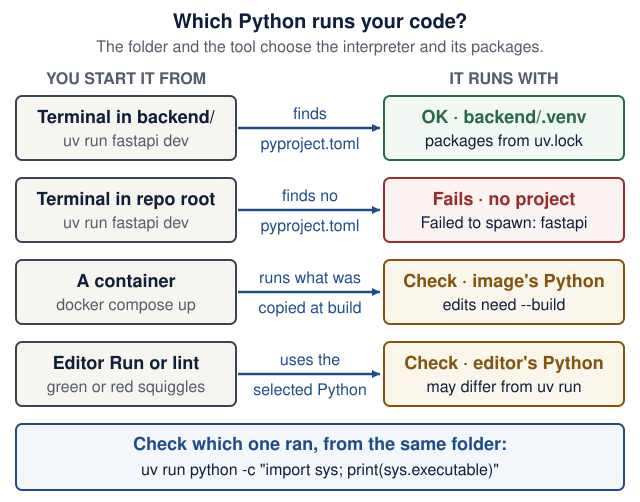
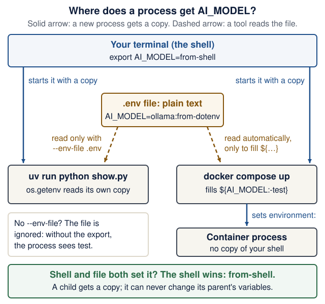
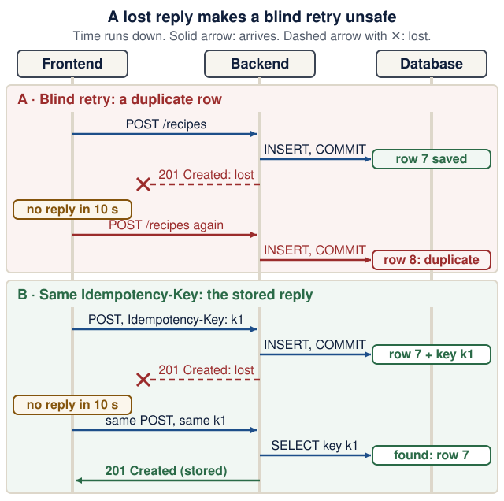

# Engineering foundations: follow one request through the system

<!--  -->

[Course home](../README.md) · [Student setup](student-setup.md) · [Learning map](learning-map.md)

**Use as a bridge, not a second textbook.** The course assumes basic Python. If a lecture's Predict-first question or the [readiness check](#readiness-check) exposes a gap, open the matching section, work its example and its short drill, and return to the lecture. The target is a system you can explain and debug.

<details markdown="1" class="lecture-toc">
<summary>On this page</summary>

- [Readiness check](#readiness-check)
- [Files, environments, and processes](#files-environments-and-processes)
- [Git you need to operate](#git-you-need-to-operate)
- [Python you need to read](#python-you-need-to-read)
- [HTTP, JSON, and contracts](#http-json-and-contracts)
- [Configuration and environment variables](#configuration-and-environment-variables)
- [Containers in one page](#containers-in-one-page)
- [Tables, rows, and SQL](#tables-rows-and-sql)
- [State, transactions, and ownership](#state-transactions-and-ownership)
- [Monoliths, services, and microservices](#monoliths-services-and-microservices)
- [Failure, retries, and asynchronous work](#failure-retries-and-asynchronous-work)
- [Security boundaries](#security-boundaries)
- [Tests with pytest](#tests-with-pytest)
- [Tests, evaluations, and observability](#tests-evaluations-and-observability)
- [Debug with a hypothesis](#debug-with-a-hypothesis)
- [A release has a data lifecycle](#a-release-has-a-data-lifecycle)
- [Glossary](#glossary)

</details>

> **You will be able to:**
>
> - find your own gaps in about 10 minutes with the readiness check, and know which lecture first needs each skill;
> - repair one gap at a time: read a worked example, predict, run, and compare your prediction with real output;
> - write down a hypothesis before you ask a person or an assistant for help.

**Predict first:** You click **Save** in the frontend, nothing happens for 10 seconds, and the page says the backend did not answer in time. Was the recipe saved?

<details markdown="1">
<summary>Check your prediction</summary>

You cannot tell from the frontend. A timeout only says the caller stopped waiting. The backend may have committed the row before its reply was lost. Reload the list (a safe `GET`) before you save again. [Failure, retries, and asynchronous work](#failure-retries-and-asynchronous-work) draws this case step by step.

</details>

**How to use this page.** Everything here is ungraded. Start with the readiness check (about 10 minutes); the sections and drills are for the gaps it finds. Each skill section (shell, Git, Python, HTTP, configuration, containers, SQL, pytest, debugging) has an explanation, a worked example, a collapsed drill of 10–15 minutes with hidden answers, and a "ready for Lecture N" checkpoint. The shorter concept sections end with a question and the same kind of checkpoint. Run the drills in a scratch folder such as `~/eass-scratch`, never inside your product repository, unless a drill says otherwise.

| Before | Make these solid first |
|---|---|
| Lecture 1 | [Files, environments, and processes](#files-environments-and-processes) · [Git you need to operate](#git-you-need-to-operate) · [Containers in one page](#containers-in-one-page) |
| Lecture 2 | [HTTP, JSON, and contracts](#http-json-and-contracts) · [Python you need to read](#python-you-need-to-read) · [Tests with pytest](#tests-with-pytest) |
| Lecture 3 | [Tables, rows, and SQL](#tables-rows-and-sql) · [State, transactions, and ownership](#state-transactions-and-ownership) |
| Lectures 4–5 | [HTTP, JSON, and contracts](#http-json-and-contracts) · [Tests with pytest](#tests-with-pytest) |
| Lectures 6–7 | [Configuration and environment variables](#configuration-and-environment-variables) · [Monoliths, services, and microservices](#monoliths-services-and-microservices) · the `async` part of [Python you need to read](#python-you-need-to-read) |
| Lecture 8 | [Configuration and environment variables](#configuration-and-environment-variables) · [Containers in one page](#containers-in-one-page) · [Failure, retries, and asynchronous work](#failure-retries-and-asynchronous-work) |
| Lecture 9 | [Failure, retries, and asynchronous work](#failure-retries-and-asynchronous-work) · [Tests, evaluations, and observability](#tests-evaluations-and-observability) |
| Lecture 10 | [A release has a data lifecycle](#a-release-has-a-data-lifecycle) · [Security boundaries](#security-boundaries) |
| Any week | [Debug with a hypothesis](#debug-with-a-hypothesis) · [Glossary](#glossary) |

Use the [visual system walkthrough](system-walkthrough.md) to connect service boundaries, validation, database commits, deadlines, and failure recovery to one user journey.

## Readiness check

Eight quick checks, about 10 minutes, mostly on paper. Write your answer before you open each reveal. Nobody sees your score; it only tells you where to start.

| # | Skill | First needed | If you miss it, repair here |
|---|---|---|---|
| 1 | Shell paths | Lecture 1 | [Files, environments, and processes](#files-environments-and-processes) |
| 2 | Git states | Lecture 1 | [Git you need to operate](#git-you-need-to-operate) |
| 3 | HTTP status codes | Lecture 2 | [HTTP, JSON, and contracts](#http-json-and-contracts) |
| 4 | Type hints and `None` | Lecture 2 | [Python you need to read](#python-you-need-to-read) |
| 5 | Reading a pytest failure | Lecture 2 | [Tests with pytest](#tests-with-pytest) |
| 6 | SQL `SELECT` and `INSERT` | Lecture 3 | [Tables, rows, and SQL](#tables-rows-and-sql) |
| 7 | Image, container, and port | Lecture 1, again in 3 and 8 | [Containers in one page](#containers-in-one-page) |
| 8 | Environment variables | Lecture 6, again in 8 | [Configuration and environment variables](#configuration-and-environment-variables) |

**1 · Shell paths.** Your terminal is in `~/eass/recipe-box/backend`, which contains `app/main.py`. You run `cd ..` and then `cat app/main.py`. What happens, and why?

<details markdown="1">
<summary>Check your answer</summary>

`cat` prints `cat: app/main.py: No such file or directory`. After `cd ..` the working directory is `~/eass/recipe-box`, so the relative path means `~/eass/recipe-box/app/main.py`, which does not exist. From there the file is `backend/app/main.py`.

**Pass when** you named the folder you were in after `cd ..`.

</details>

**2 · Git states.** You edit `README.md`, run `git add README.md`, then edit `README.md` again. (a) What does `git status --short` print? (b) Which edits does `git commit -m "Docs"` record?

<details markdown="1">
<summary>Check your answer</summary>

(a) `MM README.md`. The left column is the staging area (modified and staged), the right column is the working tree (modified again since). (b) Only the first edit: a commit records what you staged. The second edit stays in the working tree; `git diff` shows it, while `git diff --staged` shows what the commit will contain.

**Pass when** you said "only the staged version".

</details>

**3 · HTTP status codes.** Recipe Box (the Lecture 2 contract) holds recipes 1 and 2. Predict the status code of: (a) `GET /recipes/7`; (b) `POST /recipes` with the body `{"title": "Soup"}`; (c) `DELETE /recipes/1`, sent twice. What does the second `DELETE` return?

<details markdown="1">
<summary>Check your answer</summary>

(a) `404` with `{"detail":"Recipe not found"}`. (b) `422`: `minutes` is required, so the body says `"type":"missing"` at `"loc":["body","minutes"]`. (c) The first returns `204`, the second `404`. The end state is the same (no recipe 1), which is why `DELETE` is still idempotent although the status differs.

**Pass when** all three are right and you can name the missing field in (b).

</details>

**4 · Type hints and `None`.** What happens when this runs?

```python
def find(rows: dict[int, str], key: int) -> str | None:
    return rows.get(key)


title = find({1: "Soup"}, 2)
print(title.upper())
```

<details markdown="1">
<summary>Check your answer</summary>

It crashes with `AttributeError: 'NoneType' object has no attribute 'upper'`. `rows.get(2)` returns `None` because key 2 is missing. The hint `str | None` warns you, but Python does not enforce type hints when the program runs: you must check `if title is None:` yourself.

**Pass when** you predicted the `AttributeError` and said why the hint did not prevent it.

</details>

**5 · Reading a pytest failure.** Which number came from the app, and is the bug in the app or in the test?

```text
    def test_create_soup(client):
        r = client.post("/recipes", json={"title": "Soup"})
>       assert r.status_code == 201
E       assert 422 == 201
E        +  where 422 = <Response [422 Unprocessable Content]>.status_code

tests/test_readiness.py:3: AssertionError
```

<details markdown="1">
<summary>Check your answer</summary>

`422` came from the app: it is the value of `r.status_code`, the left side of the assertion. `201` is what the test expected. The test sends `{"title": "Soup"}` without the required `minutes`, so the app is right to answer `422`. Fix the test, not the app.

**Pass when** you said which side is the actual value and spotted the missing field.

</details>

**6 · SQL.** The table `recipe(id INTEGER PRIMARY KEY, title TEXT NOT NULL UNIQUE, minutes INTEGER NOT NULL)` holds the rows `(1, 'Soup', 40)` and `(2, 'Salad', 10)`. Predict the result of (a) `SELECT title FROM recipe WHERE minutes < 30;` and (b) `INSERT INTO recipe (title, minutes) VALUES ('Soup', 5);`.

<details markdown="1">
<summary>Check your answer</summary>

(a) One row: `Salad`. (b) An error, `UNIQUE constraint failed: recipe.title`, and no row is added: the `UNIQUE` constraint allows only one `Soup`.

**Pass when** both are right.

</details>

**7 · Image, container, and port.** You run `docker run -d --name web -p 127.0.0.1:8080:8000 recipe-box-backend`. (a) Which name is the image and which is the container? (b) Which URL reaches the app from your laptop's browser: `http://localhost:8000` or `http://localhost:8080`? (c) After `docker rm -f web`, can you start a new container without rebuilding?

<details markdown="1">
<summary>Check your answer</summary>

(a) `recipe-box-backend` is the image; `web` is the container. (b) `http://localhost:8080`: in `HOST:CONTAINER` the left number is your laptop's port. (c) Yes. `docker rm` deletes the container, not the image (`docker images` still lists it). Anything the container wrote outside a volume is gone.

**Pass when** all three are right.

</details>

**8 · Environment variables.** The AI service reads `os.getenv("AI_MODEL", "test")`. The repository root has a `.env` file containing `AI_MODEL=openai:not-a-real-model`. In a fresh terminal where you never set `AI_MODEL`, you run `uv run fastapi dev --port 8001` in `ai-service/`. Which value does the service see?

<details markdown="1">
<summary>Check your answer</summary>

`test`. Nothing reads `.env` unless it is told to. `os.getenv` sees only the process's environment, which this command inherits from your shell. `uv run --env-file ../.env fastapi dev --port 8001` ([Lecture 6](../lectures/06-pydantic-ai-agents.md#hands-on-lab)) or Docker Compose ([Lecture 8](../lectures/08-docker-compose.md#configuration-interpolation-environment-and-env_file)) loads the file.

**Pass when** you answered `test` and named one way to load the file.

</details>

**Done when:** You have written all eight answers and checked them. If you missed one, work the section in the "repair here" column before the lecture in the "First needed" column, then retake only the checks you missed.

## Files, environments, and processes

The terminal's **working directory** determines relative paths. `pwd` shows it; `cd backend` changes it; `ls` lists files. A path such as `app/main.py` is relative to where you are. Commands in a lecture are run from the named service folder unless stated otherwise. Do not type a terminal's `$` prompt as part of a command.

A **process** is a running program. The backend and frontend need separate terminals during local development because each server keeps running. Use another terminal to send a request; `Ctrl+C` stops the foreground server. Saving a file does not necessarily update a running process: a development reloader may restart it, while a container often needs rebuilding.

An **environment** supplies an interpreter, dependencies, and configuration. Each course service has its own uv project and lockfile. `uv run` selects that project's environment. A global Python installation, the editor's selected interpreter, and a container's Python can differ. Check the command that actually runs, rather than assuming an editor's green underline proves the service works.

**Worked example: one repository, two interpreters.** A real run on macOS on 17 October 2026 (paths shortened to `/Users/you/…`). Lines starting with `$` are commands; the rest is output.

```text
$ cd ~/eass/recipe-box/backend
$ uv run python -c "import sys; print(sys.executable)"
/Users/you/eass/recipe-box/backend/.venv/bin/python3
$ cd ..
$ uv run python -c "import sys; print(sys.executable)"
/Users/you/.local/share/uv/python/cpython-3.15-macos-aarch64-none/bin/python3.15
$ uv run fastapi dev
error: Failed to spawn: `fastapi`
  Caused by: No such file or directory (os error 2)
```

In `backend/`, `uv run` finds `backend/pyproject.toml` and uses that project's `.venv`, where the lockfile installed FastAPI. In the repository root there is no `pyproject.toml`, so `uv run` falls back to some other Python (here even a different version), which has no FastAPI installed. Same command, different folder, different program.

<figure class="course-diagram">
  <div class="diagram-scroll" role="region" tabindex="0" aria-label="Which Python runs your code diagram, scroll horizontally">
    
  </div>
  <figcaption><strong>Which Python runs your code?</strong> Find the row that explains "it works in the editor but fails in the terminal", then check with the command in the bottom box. <span class="screen-only">On a narrow screen, scroll the diagram sideways.</span> <a href="../assets/diagrams/found-which-python.svg">Open the diagram at full size</a>.</figcaption>
</figure>

<details markdown="1">
<summary>Text version of the diagram</summary>

1. **Terminal in `backend/`, `uv run fastapi dev`:** uv finds `backend/pyproject.toml` and runs `backend/.venv` with the packages pinned in `uv.lock`. This is the expected case.
2. **Terminal in the repository root, same command:** uv finds no `pyproject.toml`, so no FastAPI is installed for it: `Failed to spawn: fastapi`. Fix: `cd backend`.
3. **A container (`docker compose up`):** runs the Python, packages and code copied into the image at build time. Your edits appear only after `docker compose up --build`.
4. **The editor's Run button and its squiggles:** use whichever interpreter the editor selected, which may differ from `uv run`. Fix: select `backend/.venv` in the editor, or trust the terminal.
5. **Check which one ran:** from the same folder, `uv run python -c "import sys; print(sys.executable)"`.

</details>

On Windows, most course commands run inside WSL, not PowerShell: see [Where each command runs](student-setup.md#where-each-command-runs).

<details markdown="1">
<summary>Repair drill: eight terminal predictions (10 minutes)</summary>

Make a scratch folder and go into it:

```bash
mkdir -p ~/eass-scratch/shell/inner
cd ~/eass-scratch/shell/inner
```

For each step, write your prediction first, then run the commands.

1. `pwd`, then `ls ..`. What does each print?
2. `which uv`, then `echo $PATH`. Is the folder that `which` printed one of the entries in `$PATH`?
3. `false && echo yes || echo no`. What is printed?
4. `ls nosuchfile`, then `echo $?`, then `echo $?` again. Which numbers appear?
5. `ls nosuchfile 2> err.txt`, then `cat err.txt`. Where does the error message appear?
6. Create a file whose name contains a space, then read it without quotes:

   ```bash
   printf 'soup\nsalad\nsoup stock\ntea\n' > "my notes.txt"
   cat my notes.txt
   ```

7. `cat "my notes.txt" | grep soup`. Which lines are printed?
8. In a **second** terminal, start a small server: `cd ~/eass-scratch/shell && uv run python -m http.server 8000 --bind 127.0.0.1`. Back in the first terminal, run `lsof -nP -iTCP:8000 -sTCP:LISTEN`. What does it show? Stop the server with `Ctrl+C` and run `lsof` again. (On Ubuntu without `lsof`: `sudo apt install lsof`, or use `ss -ltnp` and look for `:8000`.)

<details markdown="1">
<summary>Check your answers</summary>

1. `pwd` prints the full path ending in `/eass-scratch/shell/inner`. `ls ..` lists the **parent** folder, so it prints `inner`.
2. `which uv` prints one path, such as `/Users/you/.local/bin/uv`. `echo $PATH` prints a colon-separated list of folders that the shell searches in order; the folder of `uv` is one of them. "command not found" means no folder in `$PATH` contains that program.
3. `no`. `false` fails, so `&& echo yes` is skipped and `|| echo no` runs. In course commands, `a && b` means "run `b` only if `a` succeeded".
4. A non-zero number first: `1` on macOS, `2` on Linux. Every command sets an **exit status**, and `0` means success. The second `echo $?` prints `0`, because the first `echo` succeeded.
5. Nothing appears on screen. `2>` sends **standard error** (stream 2) into `err.txt`, so `cat err.txt` shows the message. `>` alone redirects standard output only.
6. Two errors: `cat: my: No such file or directory` and `cat: notes.txt: No such file or directory`. The space split the name into two arguments. Quote it (`"my notes.txt"`) or escape it (`my\ notes.txt`).
7. `soup` and `soup stock`. The pipe `|` feeds one command's output into the next command's input.
8. One or two lines with columns `COMMAND PID USER … NAME`, for example `python3.1 … TCP 127.0.0.1:8000 (LISTEN)`; the PID tells you which process holds the port. After `Ctrl+C`, `lsof` prints nothing: the port is free. This is how you find the forgotten `fastapi dev` behind `address already in use`.

**Failure case to recognise:** `uv run fastapi dev` in the wrong folder prints `error: Failed to spawn: fastapi`, as in the worked example. The fix is `cd`, not reinstalling anything.

</details>

**Done when:** All eight predictions are written down and run, and each mismatch is explained in one line.

</details>

> **Checkpoint:** You are ready for Lecture 1 when you can
>
> - say which folder a command will run in before you press Enter, and fix `No such file or directory` by changing the folder or the path;
> - find which process holds a port, and stop it;
> - show which Python `uv run` uses in `backend/`.

## Git you need to operate

Git keeps your work in four places. Most "I lost my work" moments are a change sitting in a different place from where you think it is. [Lecture 1](../lectures/01-environment-git-docker-ai.md#git-and-github-commits-branches-pull-requests) introduces commits, branches and pull requests and draws the four places as a figure; this section is about moving between the places and undoing safely.

| Place | What is there | See it with | Move it forward with |
|---|---|---|---|
| Working tree | the files on disk, including edits Git has not stored | `git status`, `git diff` | `git add <file>` |
| Staging area (index) | the exact snapshot your next commit will record | `git diff --staged` | `git commit -m "…"` |
| Local commits | history on your laptop only | `git log --oneline` | `git push` |
| Remote (GitHub) | commits other people can see and review | the branch or PR page on GitHub | merging the pull request |

**Worked example: predict `git status --short`.** A real run in a scratch repository (Git 2.50). Cover the output lines and predict each one first. The two columns are *staged* (left) and *working tree* (right); `??` means untracked, `A` added, `M` modified, and an empty output means nothing to commit.

```text
$ printf 'port = 8000\ntimeout = 5\n' > settings.txt
$ git status --short
?? settings.txt
$ git add settings.txt
$ git status --short
A  settings.txt
$ git commit -q -m "Add settings"
$ git status --short
$ echo 'debug = true' >> settings.txt
$ git status --short
 M settings.txt
$ git add settings.txt
$ echo 'retries = 3' >> settings.txt
$ git status --short
MM settings.txt
```

### Undo safely

Pick the undo by where the mistake lives.

| I want to… | Safe command | What changes | Careful |
|---|---|---|---|
| throw away an edit I have not staged | `git restore <file>` | the file returns to its staged version, or to the last commit | the edit is gone for good: Git never stored it |
| unstage a file but keep the edit | `git restore --staged <file>` | the staging area returns to the last commit; the file keeps your edit | nothing is lost |
| fix the last commit's message before pushing | `git commit --amend -m "Better message"` | the last commit is replaced by a new one with a new id | do not amend commits you already pushed |
| undo a commit that is already pushed | `git revert <sha>` | a **new** commit reverses the old one; history stays | safe on shared branches |
| abandon an experiment branch | `git switch main`, then `git branch -D try-x` | the branch label is deleted; its commits are no longer on any branch | unmerged work disappears from view |
| get out of a merge you do not understand | `git merge --abort` | everything returns to before `git merge` | works only while the merge is unfinished |

**Never rewrite pushed `main`.** `git push --force` and `git reset --hard` on commits that others have pulled replace history under their feet. If a bad commit reached GitHub, `git revert` it and push the new commit.

**A detached HEAD is expected** when you check out a commit instead of a branch, for example `git checkout <sha>` to test an older version. Git prints `You are in 'detached HEAD' state` and explains your options. Look around freely; `git switch main` takes you back. If you made commits there that you want to keep, run `git switch -c rescue-branch` first.

**Parsons:** A merge stopped with a conflict in `settings.txt`. Put these lines in a working order. One line does not belong.

```text
A  git add settings.txt
B  git merge slow-network
C  git push --force origin main
D  grep -n '<<<<<<<' settings.txt
E  git status --short
F  edit settings.txt: keep one timeout line, delete the three marker lines
G  git commit --no-edit
```

<details markdown="1">
<summary>Check your answer</summary>

B, E, F, D, A, G. `git status --short` shows `UU settings.txt` (unmerged) after the merge stops; you edit, prove no marker is left (`grep` prints nothing), stage, then commit the merge. **C does not belong:** it overwrites `main` on GitHub with your local history and resolves nothing.

</details>

<details markdown="1">
<summary>Repair drill: undo and resolve a conflict in a scratch repository (10 minutes)</summary>

```bash
mkdir -p ~/eass-scratch/git-drill && cd ~/eass-scratch/git-drill
git init -b main
printf 'port = 8000\ntimeout = 5\n' > settings.txt
git add settings.txt && git commit -m "Add settings"
```

If Git asks who you are, run the `git config --global` commands from [Student setup](student-setup.md) first. Predict before each step.

1. **Discard an edit.** Run `echo 'debug = true' >> settings.txt`. Predict `git status --short`. Run `git restore settings.txt`. Predict `cat settings.txt`.
2. **Revert a commit.** Run `echo 'debug = true' >> settings.txt && git commit -am "Turn on debug"`. Predict what `git revert --no-edit HEAD` does to `git log --oneline` and to `settings.txt`.
3. **Make and resolve a conflict.** Two branches change the same line:

   ```bash
   git switch -c slow-network
   printf 'port = 8000\ntimeout = 30\n' > settings.txt
   git commit -am "Raise timeout for slow networks"
   git switch main
   printf 'port = 8000\ntimeout = 10\n' > settings.txt
   git commit -am "Raise timeout to 10"
   git merge slow-network
   ```

   Predict: does the merge succeed? What is in `settings.txt` now? Then resolve it as in the Parsons answer above, keeping `timeout = 30`.

<details markdown="1">
<summary>Check your answers</summary>

1. ` M settings.txt`, then the file shows only `port = 8000` and `timeout = 5`: the `debug` line is gone, and no Git command can bring it back.
2. `git log --oneline` gains a third commit, `Revert "Turn on debug"`, on top of `Turn on debug` and `Add settings`. The file loses the `debug` line, but both commits stay in history: that is why revert is safe after a push.
3. The merge stops:

   ```text
   Auto-merging settings.txt
   CONFLICT (content): Merge conflict in settings.txt
   Automatic merge failed; fix conflicts and then commit the result.
   ```

   `settings.txt` now contains both versions between markers:

   ```text
   port = 8000
   <<<<<<< HEAD
   timeout = 10
   =======
   timeout = 30
   >>>>>>> slow-network
   ```

   `HEAD` is your current branch (`main`); the part after `=======` comes from `slow-network`. After you keep one line, `grep -n '<<<<<<<' settings.txt` prints nothing, `git add settings.txt` and `git commit --no-edit` finish the merge, and `git log --oneline --graph` shows the two branches joining.

</details>

**Done when:** `git log --oneline --graph` shows the revert and the merge, `grep -n '<<<<<<<' settings.txt` prints nothing, and you can say what `git restore` lost and what `git revert` kept.

</details>

> **Checkpoint:** You are ready for Lecture 1 when you can
>
> - name where a change lives from `git status --short`;
> - choose the right undo for an unstaged edit, an unpushed message, and a pushed commit;
> - resolve a conflict and prove that no marker is left.

**Go deeper (optional):** [Pro Git: Undoing Things](https://git-scm.com/book/en/v2/Git-Basics-Undoing-Things). This drill is inspired by the recovery practice in MIT's [6.102 "Git 2: disaster recovery"](https://web.mit.edu/6.102/www/sp26/tools/git-2-disaster-recovery/) and [Missing Semester 2026: Version control](https://missing.csail.mit.edu/2026/version-control/); the scenario is original to this course.

## Python you need to read

Before Lecture 2, be able to explain functions, parameters, return values, imports, lists/dicts, loops, exceptions, and basic classes. The [Python 3.14 tutorial](https://docs.python.org/3.14/tutorial/) is a reference for gaps: sections 4.8–4.9 ([functions](https://docs.python.org/3.14/tutorial/controlflow.html#defining-functions)), 5 ([data structures](https://docs.python.org/3.14/tutorial/datastructures.html)), 8 ([errors](https://docs.python.org/3.14/tutorial/errors.html)) and 9 ([classes](https://docs.python.org/3.14/tutorial/classes.html)).

| Syntax in the lectures | Meaning | First seen |
|---|---|---|
| `def health() -> dict[str, str]:` | A function with a return-type annotation | Lecture 1 |
| `from app.models import RecipeCreate` | Import a named object from a module | Lecture 2 |
| <code>value: int &#124; None = None</code> | An annotation permitting an integer or `None`, with a default | Lecture 2 |
| `list[RecipePublic]`, `Iterator[TestClient]` | Generic types: a list of recipes, an iterator that yields clients | Lecture 2 |
| `@app.get("/health")` above a function | A decorator that **registers** the function as a route; FastAPI calls it for you | Lecture 1 |
| `@agent.tool` above a function | Registers a function the model may ask the agent loop to call | Lecture 6 |
| `@dataclass` with `rows: dict = field(default_factory=dict)` | Generates `__init__`; every new object gets its own new dict | Lecture 2 |
| `Annotated[RecipeStore, Depends(get_store)]` | A type plus extra information: FastAPI reads `Depends` and supplies the value | Lecture 2 |
| `RecipePublic(id=1, **body.model_dump())` | `**` unpacks a dict into keyword arguments | Lecture 2 |
| `raise ValueError(...)` | Stop this path by raising an exception | Lecture 2 (`raise HTTPException`) |
| `raise BackendError(...) from exc` | Raise a new exception and keep the original as its cause in the traceback | Lecture 5 |
| `with ...:` | Enter a context that manages setup/cleanup | Lecture 3 |
| `yield` in a dependency or fixture | Supply a resource, then clean it up when control returns | Lecture 2 |
| `match response.status_code:` with `case 422:` and `case code:` | Compare a value with patterns in order; a bare name such as `code` matches anything and captures it | Lecture 5 |
| `if notice := st.session_state.pop("notice", None):` | The walrus operator `:=` assigns and tests in one expression | Lecture 4 |
| `async def` / `await` | A coroutine that can cooperate while awaiting supported operations | Lecture 3 |

Python type hints alone do not enforce input types at runtime. Pydantic/FastAPI actively perform validation. A `TypedDict` describes a dictionary for static checking; it does not validate an HTTP response at runtime. Choose the appropriate check at each boundary.

### Blocking inside `async def`

`async` does not make blocking work disappear. An `async def` route runs on FastAPI's **event loop**: one thread that switches between waiting requests whenever the current one reaches an `await`. A call that blocks without `await` (`time.sleep`, a synchronous HTTP client, a slow file read) stops that switching, so every other request waits too. Use the framework's supported async client or execution model. Do not add `async` keywords to code you cannot explain.

<figure class="file-example file-example--long" markdown="1">
<figcaption><span class="file-example-action">Worked example</span> <span class="file-example-path">demo_async.py</span></figcaption>

```python
# demo_async.py (a scratch demo, not part of Recipe Box)
import asyncio
import time

from fastapi import FastAPI

app = FastAPI()


@app.get("/blocking")
async def blocking() -> dict[str, str]:
    time.sleep(2)  # blocks the event loop: nothing else runs
    return {"route": "blocking"}


@app.get("/cooperative")
async def cooperative() -> dict[str, str]:
    await asyncio.sleep(2)  # pauses this request; the loop serves others
    return {"route": "cooperative"}


@app.get("/threaded")
def threaded() -> dict[str, str]:
    time.sleep(2)  # plain def: FastAPI runs it in a worker thread
    return {"route": "threaded"}
```

</figure>

**Predict:** Two browser tabs request `/blocking` at the same moment. When does the second one finish? Answer the same for `/cooperative` and `/threaded`.

<details markdown="1">
<summary>Check your prediction</summary>

Measured on 17 October 2026 (FastAPI 0.143.3, two simultaneous requests each):

| Route | First reply | Second reply | Why |
|---|---|---|---|
| `/blocking` | 2.0 s | 4.0 s | `time.sleep` holds the event loop, so the requests run one after the other |
| `/cooperative` | 2.0 s | 2.0 s | `await` hands the loop to the other request while this one waits |
| `/threaded` | 2.1 s | 2.1 s | a plain `def` route runs in FastAPI's threadpool, so a blocking call blocks only its own thread |

FastAPI's documented rule of thumb is "If you just don't know, use normal `def`" ([FastAPI: Concurrency and async / await](https://fastapi.tiangolo.com/async/), checked 17 October 2026). Use `async def` only when everything slow inside it is awaited, such as `httpx.AsyncClient` calls or `await agent.run(...)` in Lecture 6.

To reproduce it, save the file in a scratch folder, run `uv run --with "fastapi[standard]" fastapi dev demo_async.py`, and in another terminal `time (curl -s localhost:8000/blocking & curl -s localhost:8000/blocking & wait)`.

</details>

Before asking an assistant to repair an import, identify the current directory, module path, and interpreter. Before accepting a generated exception handler, name the failure it catches and the behavior it preserves.

<details markdown="1">
<summary>Self-check: read six snippets (10 minutes)</summary>

Predict each output on paper, then run the snippet with `uv run python snippet.py` in a scratch folder.

1. Dictionary lookups:

   ```python
   prices = {"soup": 12, "salad": 9}
   print(prices.get("tea"), prices.get("tea", 0), prices["soup"])
   print(prices["tea"])
   ```

2. The path through `try`, `except` and `finally`:

   ```python
   def parse_minutes(text: str) -> int:
       try:
           return int(text)
       except ValueError:
           print("not a number:", text)
           return 0
       finally:
           print("checked", text)


   print(parse_minutes("40"))
   print(parse_minutes("forty"))
   ```

3. An optional parameter:

   ```python
   def label(minutes: int | None = None) -> str:
       if minutes is None:
           return "time unknown"
       return f"{minutes} min"


   print(label(), "|", label(0), "|", label(25))
   ```

4. A list comprehension with a condition:

   ```python
   recipes = [{"title": "Soup", "minutes": 40}, {"title": "Salad", "minutes": 10}]
   quick = [r["title"] for r in recipes if r["minutes"] <= 30]
   print(quick)
   ```

5. A class attribute:

   ```python
   class Store:
       rows = []  # a class attribute: one list shared by every Store


   a, b = Store(), Store()
   a.rows.append("Soup")
   print(b.rows)
   ```

6. In `~/eass/recipe-box` (the repository root, not `backend/`), you run `uv run python -c "from app.main import app"`. What happens?

<details markdown="1">
<summary>Check your answers</summary>

1. `None 0 12`, then `KeyError: 'tea'`. `.get` returns `None` (or your default) for a missing key; square brackets raise.
2. `checked 40`, `40`, then `not a number: forty`, `checked forty`, `0`. `finally` runs on every path, even after `return`.
3. `time unknown | 0 min | 25 min`. Testing `is None` keeps `0` as a real value; `if not minutes:` would wrongly treat `0` as unknown.
4. `['Salad']`.
5. `['Soup']`: both objects share one list. This is why Lecture 2's `RecipeStore` uses `field(default_factory=dict)`, and why `@dataclass` refuses a plain list default with `ValueError: mutable default <class 'list'> for field rows is not allowed: use default_factory`.
6. `ModuleNotFoundError: No module named 'app'`. The package `app` lives in `backend/`; Python looks in the current folder. `cd backend` fixes it.

</details>

</details>

> **Checkpoint:** You are ready for Lecture 2 when you can
>
> - read every row of the syntax table aloud in plain words;
> - predict when a value can be `None` and test it with `is None`;
> - say why `time.sleep` inside `async def` slows down other users.

## HTTP, JSON, and contracts

An HTTP request contains a method, target, headers, and sometimes a body. The response contains a status, headers, and sometimes a body. A JSON document is a serialized representation; a Python dict is an in-memory object. `null` in JSON maps to `None` in Python; an absent field is different from a field explicitly set to `null`.

The API contract includes meaning as well as shape: what a field represents, which values are legal, and what happens on failure. A schema cannot by itself explain whether a `minutes` field is preparation time or total time. Document the domain decision.

HTTP is stateless at the protocol level. Applications can still store records, authenticate users, and look up server-side state. A **safe** method does not ask for a business-state mutation; logging can still occur. **Idempotency** concerns the intended effect of repetition, not identical response bytes or status codes. See [RFC 9110](https://www.rfc-editor.org/rfc/rfc9110.html#section-9.2).

An HTTP call is not a local function call. It can fail after the remote operation completed but before the reply reaches you. That uncertainty matters when repeating a save.

| Method | Safe? | Idempotent? | In Recipe Box | Repeat it after a timeout? |
|---|---|---|---|---|
| `GET`, `HEAD` | yes | yes | read one recipe or a list | yes |
| `PUT` | no | yes | not used | yes: the same body gives the same end state |
| `DELETE` | no | yes | delete a recipe | yes: a repeat returns 404, but the end state is the same |
| `POST` | no | no | create a recipe | **no**, unless the server removes duplicates (see [idempotency keys](#failure-retries-and-asynchronous-work)) |
| `PATCH` | no | not by default ([RFC 5789](https://www.rfc-editor.org/rfc/rfc5789.html)) | change some fields | only when the API says so; Recipe Box's `PATCH` only sets values, so it is idempotent |

**Worked example: read a 422.** A real response from the Lecture 2 backend:

```text
$ curl -i --json '{"title": "Soup"}' localhost:8000/recipes
HTTP/1.1 422 Unprocessable Content
date: Sat, 17 Oct 2026 22:51:31 GMT
server: uvicorn
content-length: 104
content-type: application/json

{"detail":[{"type":"missing","loc":["body","minutes"],"msg":"Field required","input":{"title":"Soup"}}]}
```

Read it outside in: the status line says the contract was broken; `loc` says where (`body`, field `minutes`); `type` and `msg` say what (`missing`, `Field required`); `input` echoes what the server received. `--json` sends the body with `Content-Type: application/json` and `Accept: application/json` headers ([curl manual](https://curl.se/docs/manpage.html), added in curl 7.82.0, checked 17 October 2026).

**Absent, `null` and a value are three different messages.** Lecture 2's `PATCH` keeps only the fields the client sent (`exclude_unset=True`) and treats `null` as "leave unchanged" (`exclude_none=True`). Output of a real run against a recipe with `minutes` 40:

| Body sent | `model_dump(exclude_unset=True)` | adding `exclude_none=True` | `minutes` afterwards |
|---|---|---|---|
| `{}` | `{}` | `{}` | 40 |
| `{"minutes": null}` | `{'minutes': None}` | `{}` | 40 |
| `{"minutes": 30}` | `{'minutes': 30}` | `{'minutes': 30}` | 30 |

That `null` rule is a contract decision, not a law: JSON Merge Patch ([RFC 7396](https://www.rfc-editor.org/rfc/rfc7396.html)) uses `null` to delete a field instead. Write your decision down and test it, as [Lecture 2's break-it drill 2](../lectures/02-http-fastapi-pydantic.md#break-it-on-purpose) does.

Four words you will need in Lectures 7–9:

- **Timeout:** how long one attempt waits (to connect, or for a reply) before giving up.
- **Retry:** sending the same request again after a failure that is probably temporary.
- **Backoff:** waiting longer before each retry (Recipe Box: 0.5 s, then 1 s), so a struggling service gets room to recover.
- **Deadline:** the total time the caller can spend across all attempts; every attempt's timeout must fit inside what is left. Lecture 9 [budgets it outside in](../lectures/09-failures-evals-costs.md#timeout-budgets-outside-in).

<details markdown="1">
<summary>Repair drill: predict three responses (10 minutes)</summary>

Start your Lecture 2 backend (`uv run fastapi dev` in `backend/`). In a second terminal, predict the status code and the `detail` of each request, then run it:

```bash
curl -i --json '{"title": "Soup"}' localhost:8000/recipes
curl -i localhost:8000/recipe
curl -i -X PUT localhost:8000/recipes/1
```

If curl says `option --json: is unknown`, your curl is older than 7.82 (for example on Ubuntu 22.04). Use the long form instead:

```bash
curl -i -X POST -H 'Content-Type: application/json' -d '{"title": "Soup"}' localhost:8000/recipes
```

<details markdown="1">
<summary>Check your answers</summary>

1. `422 Unprocessable Content` with `"loc":["body","minutes"]` and `"type":"missing"`, as in the worked example.
2. `404 Not Found` with `{"detail":"Not Found"}`. No route matches `/recipe` (singular), so FastAPI's router answers before any of your code runs. Compare it with `{"detail":"Recipe not found"}`, which your handler sends for a missing id.
3. `405 Method Not Allowed`: the path `/recipes/1` exists, but not with `PUT`.

Now look at the server terminal: each request left one access-log line, such as `"POST /recipes HTTP/1.1" 422 Unprocessable Content`. Reading that log is the first step when a client and server disagree.

</details>

**Done when:** Three predictions are checked and you can say which of the three responses your own code produced (only the 422 came from validation of your model; the 404 and 405 came from the router).

</details>

> **Checkpoint:** You are ready for Lecture 2 when you can
>
> - read a `422` body and name the field and the rule it broke;
> - say which methods are safe to repeat after a timeout, and why `POST` is not;
> - explain how `{}`, `{"minutes": null}` and `{"minutes": 30}` differ in a `PATCH`.

## Configuration and environment variables

An **environment variable** is a name and a text value that a process receives when it starts. A child process gets a **copy** of its parent's variables; it cannot change its parent's. Python reads one with `os.getenv("AI_MODEL", "test")`, where the second argument is the default when the variable is unset. The same code can then run on your laptop, in CI and in Compose with different settings and secrets, without editing the code.

| You write | Who sees the value | For how long |
|---|---|---|
| `export AI_MODEL=test` | this shell and every command you start from it afterwards | until you close the terminal or run `unset AI_MODEL` |
| `AI_MODEL=test uv run …` | that one command | one command |
| a line in a `.env` file | **nobody**, until a tool is told to read the file | — |
| `uv run --env-file ../.env …` | that command; a variable already set in your shell wins | one command |
| a `.env` file next to `compose.yaml` | Docker Compose, to fill `${AI_MODEL:-test}` while reading the file; your shell wins again | each `docker compose` command |
| `environment:` or `env_file:` in `compose.yaml` | that one container | the container's lifetime |

The Compose rules are from Docker's [interpolation documentation](https://docs.docker.com/compose/how-tos/environment-variables/variable-interpolation/) and the `--env-file` behaviour is from a real run with uv 0.13.1 (both checked 17 October 2026); [Lecture 8](../lectures/08-docker-compose.md#configuration-interpolation-environment-and-env_file) applies them to the three services.

<figure class="course-diagram">
  <div class="diagram-scroll" role="region" tabindex="0" aria-label="Where a process gets AI_MODEL diagram, scroll horizontally">
    
  </div>
  <figcaption><strong>Where does a process get <code>AI_MODEL</code>?</strong> Follow the arrows into the box for the command you ran; a value that has no arrow into that box does not reach it. <span class="screen-only">On a narrow screen, scroll the diagram sideways.</span> <a href="../assets/diagrams/found-env-flow.svg">Open the diagram at full size</a>.</figcaption>
</figure>

<details markdown="1">
<summary>Text version of the diagram</summary>

1. **Your terminal (the shell)** holds `AI_MODEL=from-shell` after `export AI_MODEL=from-shell`.
2. **The shell starts each command with a copy of its variables:** both `uv run python show.py` and `docker compose up` receive `AI_MODEL=from-shell`.
3. **A `.env` file is plain text.** `uv run` reads it only when the command includes `--env-file .env`. Docker Compose reads the `.env` file next to `compose.yaml` automatically, but only to fill placeholders such as `${AI_MODEL:-test}` in `compose.yaml`.
4. **Inside `uv run`,** `os.getenv` reads the process's own copy. Without `--env-file` the file is ignored, and without the `export` the process sees the default, `test`.
5. **Compose sets the container's environment** from `environment:` and `env_file:`. The container process gets no copy of your shell's other variables.
6. **Rules:** when the shell and the file both set a variable, the shell wins (`from-shell`). A child process gets a copy and can never change its parent's variables.

</details>

Rules for every product in this course:

- `.env` holds your real values and keys. It is git-ignored: `git check-ignore -v .env` prints the `.gitignore` line that ignores it, for example `.gitignore:1:.env	.env`.
- `.env.example` lists every variable with a safe placeholder and **is** committed, so a clean checkout shows what to set.
- Never commit `.env`, paste it into chat or an issue, or print a key in a log. To check that a key arrived without printing it: `uv run --env-file ../.env python -c "import os; print('OPENAI_API_KEY' in os.environ)"` prints `True` or `False`.
- Use defaults (`os.getenv("AI_MODEL", "test")`) only for values that are safe without configuration; never give a secret a default.

<details markdown="1">
<summary>Repair drill: which value wins? (10 minutes)</summary>

```bash
mkdir -p ~/eass-scratch/config && cd ~/eass-scratch/config
printf 'import os\n\nprint(os.getenv("AI_MODEL", "test"))\n' > show.py
```

Predict the line each command prints, then run them in order in one terminal:

```bash
uv run --python 3.14 python show.py
AI_MODEL=openai:not-a-real-model uv run --python 3.14 python show.py
uv run --python 3.14 python show.py
echo 'AI_MODEL=ollama:from-dotenv' > .env
uv run --python 3.14 python show.py
uv run --python 3.14 --env-file .env python show.py
export AI_MODEL=from-shell
uv run --python 3.14 --env-file .env python show.py
unset AI_MODEL
```

<details markdown="1">
<summary>Check your answers</summary>

Real output with uv 0.13.1:

```text
test
openai:not-a-real-model
test
test
ollama:from-dotenv
from-shell
```

1. Unset, so the default `test`.
2. Set for that one command only.
3. Unset again: the previous assignment did not outlive its command.
4. Still `test`: the `.env` file exists, but nothing read it.
5. `--env-file` loads it.
6. The shell's `export` wins over the file.

**Failure case to recognise:** "I put my key in `.env` and the provider still says it is missing" usually means the process never loaded the file. Check with the `True`/`False` command above, never by printing the key.

</details>

**Done when:** Your six predictions are checked and you can explain why the fourth command printed `test`.

</details>

> **Checkpoint:** You are ready for Lectures 6 and 8 when you can
>
> - set a variable for one command, and for a whole terminal session;
> - say which tools read `.env` and which value wins when the shell and the file disagree;
> - keep a key out of Git, out of images and out of logs.

## Containers in one page

- An **image** is a read-only template: a filesystem plus a default command, such as `python:3.14-slim` or your `recipe-box-backend`. `docker build` makes one; `docker images` lists them.
- A **container** is one running (or stopped) instance of an image, with its own processes, its own writable files and its own network, including its own `localhost`. `docker ps` lists running containers; `docker ps -a` also lists stopped ones. `docker rm` deletes a container; the image stays.
- A **volume** is storage that Docker keeps outside every container and mounts at a path, for example `-v backend-data:/app/data`. It survives `docker rm`; deleting it takes an explicit command such as `docker volume rm` or `docker compose down -v`. A volume is persistence, not a backup.
- **Publishing a port**, `-p 127.0.0.1:8080:8000`, forwards port 8080 on your laptop's loopback address to port 8000 in the container (`HOST:CONTAINER`). Without the `127.0.0.1:` part, Docker publishes on all of the host's addresses, so other machines on your network can connect ([Docker: port publishing](https://docs.docker.com/engine/network/port-publishing/), checked 17 October 2026).
- **`localhost` inside a container is the container itself**, not your laptop and not another container. Compose services reach each other by service name ([Lecture 8](../lectures/08-docker-compose.md#networking-where-is-localhost)).
- **A server in a container must listen on `0.0.0.0`** to accept connections arriving through a published port or from other containers. Listening on `127.0.0.1` inside the container accepts only connections from inside that same container. `fastapi dev` listens on `127.0.0.1` and `fastapi run` on `0.0.0.0` by default ([FastAPI CLI](https://fastapi.tiangolo.com/fastapi-cli/), checked 17 October 2026); the course Dockerfile passes `--host 0.0.0.0` explicitly.
- **`EXPOSE` in a Dockerfile documents a port; it does not publish it.** Only `-p` (or `ports:` in Compose) publishes ([Dockerfile reference](https://docs.docker.com/reference/dockerfile/#expose)).

```text
your laptop (host)                               container "drill"
------------------                               -----------------
curl localhost:8080  -->  127.0.0.1:8080  --->   0.0.0.0:8000   python -m http.server
curl localhost:8000  -->  nothing listens there  (inside, localhost means the container)
```

[Lecture 1's port-mapping figure](../lectures/01-environment-git-docker-ai.md#docker-images-and-containers) draws the same path, including the Linux virtual machine that Docker Desktop runs between your laptop and the container on macOS and Windows.

| Command | What it answers |
|---|---|
| `docker images` | Which images exist on this machine? |
| `docker ps`, `docker ps -a` | Which containers are running? Which exited? |
| `docker logs drill` | What did the container's process print? Read this first when a container exits. |
| `docker exec drill <command>` | What does the world look like from **inside** the running container? |
| `docker rm -f drill` | Delete the container. Its image and its volumes stay. |

<details markdown="1">
<summary>Repair drill: where does each request land? (10 minutes)</summary>

Docker must be running. Start two containers from the same small image. The first server listens on `0.0.0.0` (the default of `http.server`), the second only on `127.0.0.1` inside its container:

```bash
docker run -d --name drill -p 127.0.0.1:8080:8000 python:3.14-slim python -m http.server 8000
docker run -d --name drill-local -p 127.0.0.1:8081:8000 python:3.14-slim python -m http.server 8000 --bind 127.0.0.1
```

Predict each result, then run:

1. `curl -sI localhost:8080 | head -1`
2. `curl -sS localhost:8081`
3. `docker exec drill-local python -c "import urllib.request; print(urllib.request.urlopen('http://localhost:8000').status)"`
4. `docker logs drill`
5. `docker rm -f drill drill-local`, then `docker ps -a --filter name=drill` and `docker images python:3.14-slim`

<details markdown="1">
<summary>Check your answers</summary>

Real output with Docker Desktop 29.1 on 17 October 2026:

1. `HTTP/1.0 200 OK`: the published port reaches a server listening on `0.0.0.0`.
2. An error such as `curl: (52) Empty reply from server`: the port is published, but nothing inside the container listens on the container's external address. The exact message varies by platform.
3. `200`: from inside the container, `localhost:8000` reaches the server that listens on the container's own `127.0.0.1`.
4. One access-log line such as `172.17.0.1 - - [17/Oct/2026 22:55:11] "HEAD / HTTP/1.1" 200 -`. The client address is Docker's gateway, not `127.0.0.1`: the request arrived from outside the container.
5. The `ps -a` list is empty, while the image `python:3.14-slim` is still listed: removing containers never removes their image.

**Failure case to recognise:** if 8080 is already taken on your laptop, `docker run` fails with `Bind for 127.0.0.1:8080 failed: port is already allocated` and leaves a container that never started. Run `docker rm drill`, then choose another host port such as `-p 127.0.0.1:8090:8000`.

</details>

**Done when:** You can explain results 2 and 3 using the words *published port* and *bind address*.

</details>

> **Checkpoint:** You are ready for Lectures 1, 3 and 8 when you can
>
> - point at an image, a container and a volume in `docker images`, `docker ps -a` and `docker volume ls`;
> - read `-p 127.0.0.1:8080:8000` aloud as "host port 8080 on loopback forwards to container port 8000";
> - say why the Dockerfile's server uses `--host 0.0.0.0`, and why `EXPOSE` alone publishes nothing.

## Tables, rows, and SQL

A **table** stores **rows** that share named, typed **columns**. A **primary key** such as `id INTEGER PRIMARY KEY` identifies each row; SQLite fills it in when you leave it out. **Constraints** reject bad rows before they are stored: `NOT NULL` requires a value and `UNIQUE` forbids two rows with the same value. SQL statements read and change rows: `CREATE TABLE`, `INSERT`, `SELECT` (with `WHERE`, `ORDER BY` and `LIMIT`), `UPDATE` and `DELETE`. In SQL, text values use single quotes (`'Soup'`).

A **transaction** groups statements so that either all of them take effect (`COMMIT`) or none of them do (`ROLLBACK`). Other connections see the changes only after `COMMIT`. Lecture 3's SQLModel code does exactly this for you; the ladder below shows it with nothing in between.

You need nothing new to install: Python 3.12 and newer include a small SQLite shell ([sqlite3 command-line interface](https://docs.python.org/3.14/library/sqlite3.html#command-line-interface), checked 17 October 2026). It prints rows as Python tuples and does not support dot-commands such as `.schema`; use `SELECT sql FROM sqlite_schema WHERE name = 'recipe';` instead.

```bash
mkdir -p ~/eass-scratch/sql && cd ~/eass-scratch/sql
uv run --python 3.14 python -m sqlite3 scratch.db
```

**Worked example (rung 1).** Type these at the `sqlite>` prompt. A real run:

```text
sqlite> CREATE TABLE recipe (id INTEGER PRIMARY KEY, title TEXT NOT NULL UNIQUE, minutes INTEGER NOT NULL);
sqlite> INSERT INTO recipe (title, minutes) VALUES ('Soup', 40), ('Salad', 10), ('Shakshuka', 25);
sqlite> SELECT * FROM recipe;
(1, 'Soup', 40)
(2, 'Salad', 10)
(3, 'Shakshuka', 25)
```

<details markdown="1">
<summary>Repair drill: climb the ladder (15 minutes; rungs 2–5)</summary>

Keep the shell from rung 1 open. Predict, then run.

**Rung 2: filter, sort and limit.** `SELECT title, minutes FROM recipe WHERE minutes < 30 ORDER BY minutes DESC LIMIT 1;`

**Rung 2b: fill the blanks yourself.** Complete `SELECT ____ FROM recipe ORDER BY ____ LIMIT ____;` so that it prints only the titles of the two quickest recipes, quickest first. Run it before you open the answers.

**Rung 3: let the constraints say no.** Predict which of these fail, and with which message:

```sql
INSERT INTO recipe (title, minutes) VALUES ('Soup', 5);
INSERT INTO recipe (title) VALUES ('Tea');
INSERT INTO recipe (title, minutes) VALUES ('Tea', 3);
```

**Rung 4: change your mind.**

```sql
BEGIN;
UPDATE recipe SET minutes = 1;
SELECT title, minutes FROM recipe;
ROLLBACK;
SELECT title, minutes FROM recipe;
```

What do the two `SELECT`s print?

**Rung 5: two connections.** Open a **second** terminal, `cd ~/eass-scratch/sql`, and start a second shell on the same file. Call the first shell A and the second B. You will use these statements:

```sql
-- "read": run in B
SELECT minutes FROM recipe WHERE title = 'Soup';
-- "change to 45": run in A, inside a transaction
BEGIN;
UPDATE recipe SET minutes = 45 WHERE title = 'Soup';
-- "change to 50": run in B while A's transaction is still open
UPDATE recipe SET minutes = 50 WHERE title = 'Soup';
-- "finish": run in A
COMMIT;
```

Fill in the last column before you run anything.

| Step | Terminal A | Terminal B | What does B see? |
|---|---|---|---|
| 1 | — | read | ? |
| 2 | `BEGIN;` and change to 45 | read | ? |
| 3 | — | change to 50 | ? |
| 4 | finish (`COMMIT;`) | read | ? |

<details markdown="1">
<summary>Check your answers</summary>

Real output, Python 3.14 with SQLite 3.50:

- **Rung 2:** `('Shakshuka', 25)`.
- **Rung 2b:** `SELECT title FROM recipe ORDER BY minutes LIMIT 2;` prints `('Salad',)` and `('Shakshuka',)`. `ORDER BY` sorts ascending unless you add `DESC`; the one-element tuples are how the Python shell prints a row with one column.
- **Rung 3:** the first fails with `IntegrityError (SQLITE_CONSTRAINT_UNIQUE): UNIQUE constraint failed: recipe.title`; the second with `IntegrityError (SQLITE_CONSTRAINT_NOTNULL): NOT NULL constraint failed: recipe.minutes`; the third succeeds and gets `id` 4. A failed statement stores nothing.
- **Rung 4:** inside the transaction every recipe shows `1`; after `ROLLBACK` they show `40`, `10`, `25` and `3` again.
- **Rung 5:**
  1. `(40,)`.
  2. Still `(40,)`, although A's own `SELECT` would show `(45,)`. Uncommitted changes are visible only inside their transaction.
  3. After about five seconds: `OperationalError (SQLITE_BUSY): database is locked`. A holds SQLite's write lock until it commits or rolls back, and the Python shell waits five seconds by default before giving up.
  4. `(45,)`: after `COMMIT`, every connection sees the change.

</details>

**Done when:** Rungs 2–5 are predicted and checked, and you can explain step 2 of rung 5 in one sentence.

</details>

**From SQL to SQLModel.** Lecture 3 writes Python, and SQLAlchemy (under SQLModel) sends the SQL. A traced run with `sqlmodel` 0.0.48 printed:

| Python in Lecture 3 | SQL the database receives |
|---|---|
| `session.add(recipe)` | nothing yet: the object waits in the session |
| `session.flush()` | a transaction opens (`BEGIN`), then `INSERT INTO recipe …`; `recipe.id` is now set |
| `session.commit()` | any pending `INSERT`, `UPDATE` or `DELETE`, then `COMMIT` |
| `session.rollback()` | `ROLLBACK` |
| `session.get(Recipe, 1)` | `SELECT … WHERE recipe.id = ?` |
| `session.exec(select(Recipe).where(…).limit(5))` | `SELECT … WHERE … LIMIT ? OFFSET ?` |
| `session.delete(recipe)`, then `session.commit()` | `DELETE … WHERE recipe.id = ?`, then `COMMIT` |

The `?` marks are **bound parameters**: values travel separately from the SQL text, which is what keeps a title like `'); DROP TABLE recipe; --` harmless.

> **Checkpoint:** You are ready for Lecture 3 when you can
>
> - write a `SELECT` with `WHERE`, `ORDER BY` and `LIMIT`, and predict a `UNIQUE` or `NOT NULL` failure;
> - explain why terminal B saw the old value until A committed;
> - answer [Lecture 3's Predict-first question](../lectures/03-persistence-and-first-pr.md#learning-checkpoint) with the words *flush*, *transaction* and *commit*.

**Go deeper (optional):** The [SQLite SQL reference](https://sqlite.org/lang.html). The ladder is inspired by the "Storage Tier" lecture of Stanford's [CS142 Web Applications](https://web.stanford.edu/class/cs142/) (Spring 2023, its latest public offering); the exercises are original to this course.

## State, transactions, and ownership

Distinguish three places data can live:

- **Process memory:** a dict disappears when its process restarts.
- **Persistent application storage:** committed database rows survive the documented restart procedure.
- **UI/session state:** information about this interaction, such as an unsent form or success message.

A database **transaction** groups related changes into a commit or rollback. `add()` stages a change in the session; `flush()` sends its SQL to the database inside the still-open transaction; only `commit()` ends the transaction so the change survives a restart. A response can look right after `flush()` and still vanish on restart ([Lecture 3's mutation drill](../lectures/03-persistence-and-first-pr.md#hands-on-lab)). Tests need isolated state so their order does not affect results.

**Predict:** You create a recipe, then restart the server. Does the recipe survive (a) in Lecture 2's version, where the store is a dict, and (b) in Lecture 3's version, where `save()` calls `session.commit()`? (c) What if Lecture 3's `save()` called `session.flush()` instead?

<details markdown="1">
<summary>Check your prediction</summary>

(a) No: the dict lived in process memory, so a restart (or a reload after saving a file) empties it. (b) Yes: the committed row is in `data/app.db`, which outlives the process. (c) No: the `INSERT` ran inside a transaction that never committed, so SQLAlchemy rolled it back when the request's session closed. The response still showed the new `id`, which is exactly why Lecture 3 adds a restart test.

</details>

In the course architecture, the backend owns the product database. The frontend calls the backend's API. The backend calls the AI service with validated input and receives a candidate; the AI service never opens SQLite or calls back to save. Only the backend validates and commits. This keeps validation, business rules, and state changes in one authoritative place. The AI service is stateless for extraction; it does not need its own database merely to qualify as a service.

**Check yourself:** In the Lecture 4 Streamlit frontend, a user saved one recipe earlier and is now halfway through typing the title of a second one, without clicking **Save**. Then (a) the backend restarts, and later (b) the user reloads the browser tab. After each event, is the saved recipe still there, and is the half-typed title still there?

<details markdown="1">
<summary>Check your answer</summary>

(a) The saved recipe survives if the backend committed it (Lecture 3 and later); in Lecture 2's dict version it is gone. The half-typed title is unaffected: it lives in the frontend's session state, and a backend restart does not touch the frontend. (b) The saved recipe is still there, because the page reads it again from the backend. The half-typed title is gone: reloading the tab starts a new Streamlit session, and UI state lives only as long as its session. Each kind of state has its own lifetime, so ask *where* a value lives before you ask whether it is saved.

</details>

> **Checkpoint:** You are ready for Lecture 3 when you can
>
> - place a value in process memory, the database or UI state, and say which event erases each;
> - say what `add()`, `flush()` and `commit()` each do, and which one makes a row survive a restart;
> - name the one service that writes the product database.

## Monoliths, services, and microservices

A **modular monolith** keeps well-separated modules within one deployable application. A service boundary adds a process/network/deployment boundary. Microservices organize autonomous services around cohesive responsibilities and explicit contracts. More containers do not automatically produce useful autonomy.

| Choice | What it can simplify | What you must handle |
|---|---|---|
| One modular application | Local calls, transactions, deployment, and debugging | Module boundaries and coupled releases |
| Separate services | Independent changes, scaling, and responsibility boundaries | Network failures, compatibility, observability, and operations |

The course deliberately uses three application services to teach those boundaries. It is a small service-based system, not a requirement to split every function into a microservice. Its domain data has one owner. A larger design with multiple stateful services must define ownership and cross-service consistency; it cannot assume one database transaction covers a network of services. Microsoft's [microservices architecture guide](https://learn.microsoft.com/en-us/azure/architecture/guide/architecture-styles/microservices) details the tradeoffs.

In Recipe Box, every request starts at the browser and flows one way: frontend → backend → AI service. Replies travel back along the same path, and only the backend writes the database. Lecture 8's [service map](../lectures/08-docker-compose.md#networking-where-is-localhost) shows the same flow inside Compose.

Split a component when you can explain its cohesive responsibility and the benefit of independent operation. If every change needs simultaneous edits and deployment everywhere, investigate coupling before adding more services.

**Check yourself:** Which service starts the HTTP call to the AI service, and which services may open `data/app.db`?

<details markdown="1">
<summary>Check your answer</summary>

The backend calls the AI service; the AI service never calls the backend. Only the backend opens `data/app.db`. A frontend or AI service that reads the database directly bypasses the validation and business rules the backend enforces, which the [course requirements](../README.md#three-service-product-requirements) rule out.

</details>

> **Checkpoint:** You are ready for Lectures 7 and 8 when you can
>
> - draw the three services with arrows in the direction each request starts, and mark the one that writes the database;
> - give one thing a separate service makes easier and one thing it makes harder;
> - say why "an agent class inside the backend" does not count as the third service.

## Failure, retries, and asynchronous work

Three common outcomes are **success**, **definite failure**, and **unknown completion**. A timeout often means the caller stopped waiting; it does not prove the callee did nothing. Retrying may duplicate a mutation or repeat a model charge.

**Predict:** The frontend sends `POST /recipes`. The backend commits the row, but the `201` reply never arrives, and after 10 seconds the frontend gives up. The user clicks **Save** again. How many recipes exist now?

<details markdown="1">
<summary>Check your prediction</summary>

Two identical recipes. The first `POST` did its whole job (insert and commit); only the reply was lost. The backend has no way to know that the second `POST` is a repeat, so it inserts again. Panel A of the figure below draws this; panel B shows one way a server can make the repeat safe.

</details>

<figure class="course-diagram">
  <div class="diagram-scroll" role="region" tabindex="0" aria-label="Lost reply sequence diagram, scroll horizontally">
    
  </div>
  <figcaption><strong>A lost reply makes a blind retry unsafe.</strong> Panel A answers the prediction; panel B shows one way a server can make the retry safe. <span class="screen-only">On a narrow screen, scroll the diagram sideways.</span> <a href="../assets/diagrams/found-lost-reply.svg">Open the diagram at full size</a>.</figcaption>
</figure>

<details markdown="1">
<summary>Text version of the diagram</summary>

Three lanes: frontend, backend, database. Time runs downward.

**Panel A, blind retry: a duplicate row.**

1. The frontend sends `POST /recipes`.
2. The backend runs `INSERT` and `COMMIT`; row 7 is saved.
3. The backend's `201 Created` reply is lost on the way back.
4. The frontend receives no reply within 10 seconds and times out. It cannot tell whether step 2 happened.
5. The same `POST /recipes` is sent again.
6. The backend inserts and commits again: row 8 is a duplicate.

**Panel B, the same `Idempotency-Key`: the stored reply.**

1. The frontend sends `POST /recipes` with the header `Idempotency-Key: k1`.
2. The backend inserts row 7 and records key `k1` with its reply in the same transaction, then commits.
3. The `201 Created` reply is lost; the frontend times out.
4. The frontend repeats the same `POST` with the same key `k1`.
5. The backend looks up `k1`, finds row 7, and inserts nothing.
6. The backend returns the stored `201 Created` reply. There is still one row.

</details>

Recipe Box's frontend does not retry writes automatically. When a write times out, it says the change *may* have been saved and asks the user to reload and check before trying again; [Lecture 5](../lectures/05-frontend-reliability-testing.md#translating-failures-into-words) builds that message. Reading is always safe to repeat; writing needs a plan.

Use a deadline, a selective retry policy, a small attempt limit, and backoff ([definitions](#http-json-and-contracts)). The status-to-retry policy in Lecture 9 is specific to Recipe Box's contract; another API's 429 may mean a different rate-limit policy. Read its documentation rather than copying the table blindly.

For a write that must tolerate repeats, an optional **idempotency key** needs server-side semantics: bind it to a request, atomically retain the outcome, and return that outcome for a matching retry. Adding a header alone does not implement deduplication. The `Idempotency-Key` header is a widely used convention (Stripe's API, for example, returns the saved status and body for a repeated key) and an expired IETF Internet-Draft, not a finished standard ([draft status](https://datatracker.ietf.org/doc/draft-ietf-httpapi-idempotency-key-header/) and [Stripe: idempotent requests](https://docs.stripe.com/api/idempotent_requests), both checked 17 October 2026). It is not required in this course.

A queue can decouple a long task from an HTTP request, but then the product needs job identity, status, durable state, cancellation/recovery rules, and duplicate handling. Queues, circuit breakers, and durable workflows are optional extensions after the synchronous flow works. An agent loop is another bounded computation inside this architecture, subject to the same failure questions.

<details markdown="1">
<summary>Go deeper (optional): the end-to-end argument, with three self-check questions</summary>

Read Saltzer, Reed and Clark, [*End-to-End Arguments in System Design*](https://web.mit.edu/Saltzer/www/publications/endtoend/endtoend.pdf) (ACM Transactions on Computer Systems, 1984). Its claim, in one line: a guarantee such as "this recipe was saved exactly once" can only be fully checked by the endpoints that care about it, so lower layers can help but cannot replace that check. The guiding-question format is inspired by MIT 6.1800's [reading page for this paper](https://web.mit.edu/6.1800/www/readings/07-e2e.shtml); the questions are original. More readings are in [Further study](further-study.md).

1. In `POST /recipes/from-text` (Lecture 7), which component can confirm that a recipe was saved, and how?
2. Why does the backend, not the AI service, decide whether an extracted recipe is accepted?
3. If the frontend retried `POST /recipes/from-text` after a timeout, where would a duplicate appear, and what would it cost besides an extra row?

<details markdown="1">
<summary>Show a model answer</summary>

1. Only the backend, through its own database commit: it can return the stored row, and a later `GET /recipes` can show it. A reply that never arrived proves nothing either way.
2. The backend owns the contract and the data. The AI service's output is an untrusted candidate, so the backend validates it like any other input before it commits, as in the [walkthrough's commit boundary](system-walkthrough.md#follow-the-commit-boundary).
3. In the backend's database, as a second recipe. It would also repeat the model calls, which cost time and possibly money: the reason [Lecture 9](../lectures/09-failures-evals-costs.md#is-it-safe-to-repeat) forbids that retry.

</details>

</details>

> **Checkpoint:** You are ready for Lectures 8 and 9 when you can
>
> - say what a timeout proves (the caller stopped waiting) and what it does not prove (that nothing happened);
> - sort `GET /recipes`, `DELETE /recipes/3` and `POST /recipes` into "safe to repeat after a timeout" and "needs a plan";
> - explain panel B of the figure: why the key must be stored in the same transaction as the row.

## Security boundaries

**Authentication** identifies a caller. **Authorization** decides which operation that caller may perform on which resource. A validly shaped request can still be forbidden. User accounts are optional in this course, but a product handling real private records needs an access-control design before public exposure.

**CORS** controls particular browser cross-origin access; it does not authenticate clients or stop `curl`. **No published Docker port** reduces host exposure but does not identify the caller. Containers on the same network can communicate with a listening service. See [Docker's port-publishing documentation](https://docs.docker.com/engine/network/port-publishing/).

Keep provider keys in the AI service, validate outside model control, and expose only the tools the task needs. Prompts and repository instructions guide behavior; application code and execution controls enforce permissions. Local classroom HTTP is a development setup; publicly deployed sensitive traffic needs an appropriate HTTPS and identity/access configuration.

Before you let a coding agent run commands on your machine, set up the [Week 1 minimum](agent-sandboxes.md#week-1-minimum) from the sandboxes guide.

For a runnable counterexample, the [industry studio](industry-studio.md#lab-private-records-and-concurrent-edits) checks per-record ownership and uses an atomic version predicate to reject stale saves. Its identity is a trusted test fixture, not a login implementation.

**Check yourself:** Your backend's CORS settings allow only `http://localhost:5173`, a React development server ([Lecture 4](../lectures/04-browser-frontend.md#other-frameworks-and-cors)). A script on your laptop runs `curl -X DELETE localhost:8000/recipes/1`. Does CORS stop the delete?

<details markdown="1">
<summary>Check your answer</summary>

No. CORS is enforced by browsers, for pages from other origins; `curl` is not a browser and ignores it, so the backend deletes the recipe. Only authentication plus an authorization check in the backend could refuse that request. Binding the port to `127.0.0.1` limits *which machines* can connect, not *who* the caller is.

</details>

> **Checkpoint:** You are ready for Lecture 10 when you can
>
> - tell authentication (who is calling) from authorization (what they may do);
> - say what CORS and an unpublished port each protect, and what they do not;
> - name where provider keys live in your product, and why never in the frontend or a prompt.

## Tests with pytest

pytest collects files named `test_*.py`, runs every function named `test_*` inside them, and reports each one as passed or failed. A test fails when an `assert` is false or an exception escapes. A **fixture** is a function pytest runs to prepare something a test asks for by naming it as a parameter; Lecture 2's `client` fixture gives every test a fresh, empty store.

Every useful test has three parts, **Arrange, Act, Assert**: build the input, perform one action, then check what the caller relies on. The ladder below runs against your Lecture 2 `backend/`.

**Rung 1, a complete test (worked example):**

```python
def test_create_then_read(client):
    # Arrange: a valid body, built from the contract
    soup = {"title": "Soup", "minutes": 40}

    # Act: create it, then read it back
    created = client.post("/recipes", json=soup)
    fetched = client.get(f"/recipes/{created.json()['id']}")

    # Assert: status codes AND the body the client will rely on
    assert created.status_code == 201
    assert fetched.status_code == 200
    assert fetched.json()["title"] == "Soup"
    assert fetched.json()["minutes"] == 40
```

**Rung 2, a test without an assertion.** What would this test let through?

```python
def test_create_without_assert(client):
    client.post("/recipes", json={"title": "Soup", "minutes": 40})
```

<details markdown="1">
<summary>Check your answer</summary>

Almost everything. It fails only if the app raises an exception. In a real run, deleting the line `store.rows[recipe.id] = recipe` from `create_recipe` (so nothing is saved) left this test green, while rung 1 failed with `assert 404 == 200`. **A test counts only if it fails when the code breaks.**

</details>

**Rung 3, your turn.** Write `test_health_says_ok` for `GET /health` with Arrange, Act and Assert.

<details markdown="1">
<summary>Show a model answer</summary>

```python
def test_health_says_ok(client):
    r = client.get("/health")
    assert r.status_code == 200
    assert r.json() == {"status": "ok"}
```

There is nothing to arrange beyond the fixture. Checking the body, not only the status, is what makes it fail if someone returns `{"status": "OK"}`.

</details>

To run the ladder, put the three tests in `backend/tests/test_ladder.py`, run `uv run pytest tests/test_ladder.py` (expected: `3 passed`), then delete the file so the lecture's `10 passed` still matches your suite.

**Read an assertion failure.** This is the real output of [Lecture 2's break-it drill 1](../lectures/02-http-fastapi-pydantic.md#break-it-on-purpose), after removing `extra="forbid"`:

```text
________________________ test_unknown_field_is_rejected ________________________

client = <starlette.testclient.TestClient object at 0x10ac3cf50>

    def test_unknown_field_is_rejected(client):
        r = client.post("/recipes", json={**SOUP, "chef": "me"})
>       assert r.status_code == 422
E       assert 201 == 422
E        +  where 201 = <Response [201 Created]>.status_code

tests/test_recipes.py:19: AssertionError
=========================== short test summary info ============================
FAILED tests/test_recipes.py::test_unknown_field_is_rejected - assert 201 == 422
1 failed, 9 passed in 0.09s
```

Read it from the `>` line: that is the assertion that failed. The `E` lines replace each expression with its value in the order you wrote it, so `r.status_code == 422` became `201 == 422`: the app answered `201`, the test expected `422`. The `+ where` line says where `201` came from. The last lines give the file and line number, and the count.

**Fixtures with `yield`.** Code before `yield` runs before the test; code after it runs after the test, even when the test fails. A real run with `uv run pytest -q -s` (`-s` shows `print` output):

```python
import pytest


@pytest.fixture
def numbers():
    print("setup: make a fresh list")
    data = [1, 2]
    yield data  # the test runs here
    print("teardown: after the test, even if it failed")


def test_append(numbers):
    numbers.append(3)
    print("test body:", numbers)
    assert numbers == [1, 2, 3]


def test_fresh(numbers):
    print("test body:", numbers)
    assert numbers == [1, 2]
```

```text
setup: make a fresh list
test body: [1, 2, 3]
.teardown: after the test, even if it failed
setup: make a fresh list
test body: [1, 2]
.teardown: after the test, even if it failed

2 passed in 0.01s
```

`test_fresh` sees `[1, 2]`, not `[1, 2, 3]`: each test gets its own fixture value. Lecture 2's `client` fixture uses the same shape to install a fresh store and clear the override afterwards.

| Command (from `backend/`) | Use it when |
|---|---|
| `uv run pytest -x` | you want to stop at the first failure |
| `uv run pytest -k patch` | you want only tests whose names contain `patch` |
| `uv run pytest --lf` | you want to rerun only the tests that failed last time |
| `uv run pytest -s` | you want to see `print` output |
| `uv run pytest -x --pdb` | you want a debugger at the failing line ([next section](#debug-with-a-hypothesis)) |

> **Checkpoint:** You are ready for Lectures 2 and 5 when you can
>
> - label the Arrange, Act and Assert lines of any course test;
> - say which side of `assert 201 == 422` came from the app;
> - break the code a test protects and watch that test go red.

## Tests, evaluations, and observability

Ask what each check can establish:

- **Unit/contract tests:** defined code behavior and interface rules on chosen inputs.
- **Integration/browser tests:** the tested path works across real components.
- **Model evaluations:** observed task quality under a recorded model/configuration and dataset.
- **Failure drills:** the system behaves as intended when a selected dependency or assumption fails.

A mock is a controlled substitute, not proof the external service behaves that way. Add the appropriate integration check for the real boundary. When fixing a bug, first observe a relevant failure, then change the implementation and see the check pass.

Logs describe events; metrics summarize quantities; traces connect work across a request's stages. Correlate requests with an identifier when investigating a multi-service problem. Record useful status, duration, and usage rather than secrets or raw user text. Observability supports diagnosis; it does not replace tests or access control.

A structured log line is one JSON object per event, so a program can filter it as easily as you can read it. The [system walkthrough](system-walkthrough.md#diagnose-one-failure-at-a-time) uses this one:

```text
{"request_id":"demo-001","service":"backend","event":"extract_unavailable","status":503,"duration_ms":27}
```

`request_id` is the same in every service that handled the request, so you can search all logs for `demo-001`. `service` and `event` say who did what; `status` and `duration_ms` say how it ended and how long it took. Nothing in the line is a key or the user's recipe text. Generating and forwarding an `X-Request-ID` is a [Lecture 7 stretch goal](../lectures/07-third-service-contracts.md#stretch-goals).

**Check yourself:** Match each question to the check that can answer it: a unit or contract test, a model evaluation, a failure drill, or a structured log line.

1. Does `POST /recipes` return `422` when `minutes` is missing?
2. How often does the extraction agent get `minutes` right on 30 real recipe texts with the model you will demo?
3. What does the frontend show when the AI service is stopped?
4. Why was yesterday's demo request slow, and in which service?

<details markdown="1">
<summary>Check your answers</summary>

1. A contract test: a fixed input with one correct answer, run on every change.
2. A model evaluation: a score for one recorded model and dataset, which can change when either changes ([Lecture 9's clinic](../lectures/09-failures-evals-costs.md#evaluation-clinic-audit-the-score)).
3. A failure drill: stop the dependency on purpose and watch what the user sees.
4. Structured log lines: search for the request's `request_id` and compare `duration_ms` per service. A test cannot answer it, because the event already happened.

</details>

> **Checkpoint:** You are ready for Lecture 9 when you can
>
> - say what a passing test proves, and what a mock cannot prove about the real service;
> - say why an evaluation score must be recorded with its model and dataset;
> - read a structured log line and say which fields you would search and compare.

## Debug with a hypothesis

When something breaks, the fastest path is a small experiment, not a bigger prompt. Keep a **debug log** for any bug that survives your first look. The rule that goes with it: **write the hypothesis before asking a person or an assistant.** An assistant can produce plausible changes that feel like progress without testing any idea ([Prather et al. 2024](https://doi.org/10.1145/3632620.3671116) observed this "illusion of progress" in novices); a written hypothesis keeps you the one deciding.

```text
1. Symptom:      exact output or error line
2. Reproduce:    the smallest command that shows it
3. Hypothesis:   one sentence, written before asking anyone or any assistant
4. Experiment:   change one thing (or add one print / breakpoint())
5. Result:       confirmed or refuted?
6. Fix + check:  the change, and the test or command that now passes
7. Cause:        one plain-English sentence
```

If the result refutes your hypothesis, that is progress: write the next hypothesis and run the next experiment. When you do ask for help, paste the log into your [PARD message](../lectures/01-environment-git-docker-ai.md#asking-for-help-the-pard-template).

**Read a traceback from the bottom up.** A real run:

```python
def per_serving(minutes: int, servings: int) -> float:
    return minutes / servings


def describe(recipe: dict) -> str:
    share = per_serving(recipe["minutes"], recipe["servings"])
    return f"{recipe['title']}: {share:.1f} min per serving"


print(describe({"title": "Soup", "minutes": 40, "servings": 4}))
print(describe({"title": "Tea", "minutes": 3, "servings": 0}))
```

```text
Soup: 10.0 min per serving
Traceback (most recent call last):
  File "/Users/you/eass-scratch/scale.py", line 11, in <module>
    print(describe({"title": "Tea", "minutes": 3, "servings": 0}))
          ~~~~~~~~^^^^^^^^^^^^^^^^^^^^^^^^^^^^^^^^^^^^^^^^^^^^^^^
  File "/Users/you/eass-scratch/scale.py", line 6, in describe
    share = per_serving(recipe["minutes"], recipe["servings"])
  File "/Users/you/eass-scratch/scale.py", line 2, in per_serving
    return minutes / servings
           ~~~~~~~~^~~~~~~~~~
ZeroDivisionError: division by zero
```

1. **Last line: what happened.** `ZeroDivisionError: division by zero`.
2. **The frame above it: where.** Line 2, in `per_serving`.
3. **Walk up: who called it with that value.** `describe` passed `recipe["servings"]`, and line 11 passed a recipe with `"servings": 0`.
4. **Hypothesis:** the bug is the bad input, not the division. Catching `ZeroDivisionError` in `per_serving` would hide it; in Recipe Box the contract already prevents it (`servings: int = Field(ge=1, …)`), so a request like this gets a 422 before any route code runs.

In a web app, most frames belong to libraries (FastAPI, Starlette, SQLAlchemy). Skip them and look for the lowest frame in **your** files; that is usually where the useful question starts.

<details markdown="1">
<summary>Repair drill: debug "the bug the tests miss" with pdb (10 minutes)</summary>

Use your Lecture 2 `backend/`, after its tests pass. Recreate [break-it drill 2](../lectures/02-http-fastapi-pydantic.md#break-it-on-purpose): change the `PATCH` line to `changes = body.model_dump(exclude_unset=True)` and add its `tests/test_patch_null.py`.

1. **Reproduce.** `uv run pytest -x --pdb tests/test_patch_null.py`. Predict: where does the debugger stop?
2. **Inspect.** At the `(Pdb)` prompt type `p rid`, then `p client.get(f"/recipes/{rid}").json()`, then `ll` to list the test. Write a one-sentence hypothesis about which line in `app/main.py` lets `title` become `None`.
3. **Experiment in the server.** Quit with `q`. Put `breakpoint()` on the line after `changes = …` in `update_recipe`, start `uv run fastapi dev`, and in a second terminal create a recipe and send `curl -X PATCH --json '{"title": null}' localhost:8000/recipes/1`. The **server** terminal shows `(Pdb)`; curl waits. Type `p changes`, then `p body`, then `c` to continue.
4. **Fix and check.** Remove `breakpoint()`, restore `exclude_none=True`, and rerun `uv run pytest`.

<details markdown="1">
<summary>Check your answers</summary>

Real output, pytest 9.1.1 on Python 3.14 (paths shortened):

```text
>       assert client.get(f"/recipes/{rid}").json()["title"] == "Soup"
E       AssertionError: assert None == 'Soup'

tests/test_patch_null.py:4: AssertionError
>>>>>>>>>>>>>>>>>>>>>>>>>>>>>>>>> entering PDB >>>>>>>>>>>>>>>>>>>>>>>>>>>>>>>>>

>>>>>>>>>>>>>>>>>> PDB post_mortem (IO-capturing turned off) >>>>>>>>>>>>>>>>>>>
> …/backend/tests/test_patch_null.py(4)test_patch_null_keeps_the_old_value()
-> assert client.get(f"/recipes/{rid}").json()["title"] == "Soup"
(Pdb) p rid
1
(Pdb) p client.get(f"/recipes/{rid}").json()
{'title': None, 'minutes': 40, 'servings': 2, 'ingredients': '', 'tags': '', 'id': 1}
```

1. It stops at the failing assertion, with the test's variables available.
2. The stored recipe really has `'title': None`, so the bug is in the write, not in the test.
3. In the server, `p changes` prints `{'title': None}` and `p body` prints `RecipeUpdate(title=None, minutes=None, servings=None, ingredients=None, tags=None)`. Both `title` and the unsent fields look like `None` on the model; only `changes` shows that `title` was *sent* as `null`, and `model_copy(update=changes)` copies it without validation.
4. `11 passed` with the extra test file, `10 passed` once you delete it. A model debug log:

```text
1. Symptom:      PATCH {"title": null} stores "title": null; GET shows None
2. Reproduce:    uv run pytest -x --pdb tests/test_patch_null.py
3. Hypothesis:   update_recipe copies a sent null into the stored recipe
4. Experiment:   breakpoint() after `changes = …`; p changes
5. Result:       confirmed: changes == {'title': None}
6. Fix + check:  exclude_none=True; uv run pytest -> all pass
7. Cause:        model_copy does not validate, so a null the client sent overwrote the title
```

</details>

`breakpoint()` works under `uv run fastapi dev` in a terminal: the reloader passes your keyboard input to the server process. In a detached container (`docker compose up -d`) there is nothing to type into: in a test on 17 October 2026, pdb read end-of-input and quit, and the process exited with code 1. Remove every `breakpoint()` before you commit; `PYTHONBREAKPOINT=0` disables them all for one run.

**Done when:** You have a seven-line debug log for this bug, written in your own words.

</details>

> **Checkpoint:** You can debug on your own when you can
>
> - name the exception, the line, and the lowest frame in your own code from any traceback;
> - stop at a failing test with `--pdb` and print the values involved;
> - write a hypothesis and an experiment before asking for help.

**Go deeper (optional):** The [Python debugger `pdb`](https://docs.python.org/3.14/library/pdb.html). The debug log is inspired by the scientific debugging method in Stanford CS107's [debugging guide](https://web.stanford.edu/class/archive/cs/cs107/cs107.1272/resources/debugging.html), MIT 6.102's [reading on debugging](https://web.mit.edu/6.102/www/sp26/classes/13-debugging/) and [Missing Semester 2026: Debugging and profiling](https://missing.csail.mit.edu/2026/debugging-profiling/); the card and drill are original to this course.

## A release has a data lifecycle

A release includes code, dependency/configuration versions, a startup procedure, tests, operational checks, and a way to recover. A successful build is one part of that evidence.

- A migration changes an existing database schema. Creating missing tables is not a migration strategy for populated data.
- A volume is persistence, not a backup. A backup needs a tested restoration procedure appropriate to the database.
- Rolling back code can be incompatible with a newer schema. Plan the two together.
- A health/readiness check reports a defined condition. Compose startup ordering does not continuously repair every dependency failure.
- Image tags can move; lockfiles and image digests solve different parts of reproducibility. Update dependencies deliberately and rerun checks.

Three words from that list, in one line each:

| Term | Meaning | Where the course uses it |
|---|---|---|
| Migration | A versioned script that changes an existing database's tables (adds a column, say) without losing its rows | [Lecture 3: tables, migrations and seeds](../lectures/03-persistence-and-first-pr.md#tables-migrations-and-seeds) |
| Image digest | `python:3.14-slim@sha256:…` names exactly one image build; a tag such as `3.14-slim` can later point to a different build | [Lecture 10: reproducible means pinned](../lectures/10-ci-security-release.md#reproducible-means-pinned) |
| Readiness | A check that a service can do its job now, such as `/health` answering; Compose starts dependants only after `service_healthy` | [Lecture 8: health and readiness](../lectures/08-docker-compose.md#health-and-readiness) |

Use synthetic data for learning. Preserve real data before a migration or recovery exercise. Lecture 10's runbook and the clinics turn these ideas into a product demonstration you can repeat from a clean checkout.

**Check yourself:** Your Dockerfile says `FROM python:3.14-slim`, CI passed in November, and the same commit fails to build in January with no change of yours. Name two things that may have moved, and the pin that holds each still.

<details markdown="1">
<summary>Check your answer</summary>

The base image: the tag `3.14-slim` now points to a newer build; pin it with a digest (`python:3.14-slim@sha256:…`). Your dependencies, if anything installs them without the lockfile: `uv sync --locked` installs exactly what `uv.lock` lists, or fails if the lockfile no longer matches `pyproject.toml`. Tools such as uv itself are a third candidate, which is why Lecture 10 pins its version in each Dockerfile and in CI.

</details>

> **Checkpoint:** You are ready for Lecture 10 when you can
>
> - say why a volume is not a backup and why `create_all` is not a migration;
> - tell a tag from a digest, and a lockfile from an image digest;
> - say what a health check reports and what Compose's startup ordering does not repair.

## Glossary

One line per term, with a link to where the course first teaches it. Every term from the lectures' "Words you'll meet today" lists is here; the [reference card](reference-card.md) collects the commands, ports and status codes.

| Term | Meaning | First taught |
|---|---|---|
| 422 Unprocessable Content | The request broke the contract: a missing field, a value out of range, an unknown field | [Lecture 2](../lectures/02-http-fastapi-pydantic.md#status-codes-you-must-own) |
| 502 Bad Gateway | "The service behind me answered with something I cannot use" | [Lecture 7](../lectures/07-third-service-contracts.md#service-errors-without-leaking-internals) |
| 503 Service Unavailable | "A service I depend on is not available right now; try later" | [Lecture 7](../lectures/07-third-service-contracts.md#service-errors-without-leaking-internals) |
| Adapter | Code that translates one service's shapes into another's, such as lists into the backend's comma-separated `tags` | [Lecture 7](../lectures/07-third-service-contracts.md#live-demo) |
| Advisory | A published record of a known vulnerability in a package version, with an ID such as `GHSA-…`, `PYSEC-…` or `CVE-…` | [Lecture 10](../lectures/10-ci-security-release.md#dependency-hygiene) |
| Agent (Pydantic AI) | A model plus instructions, tools, an output type and dependencies, run as a loop | [Lecture 6](../lectures/06-pydantic-ai-agents.md#an-agent-is-a-loop-around-a-model) |
| API contract | The paths, bodies, status codes and meanings that callers may rely on | [Lecture 2](../lectures/02-http-fastapi-pydantic.md#rest-nouns-in-paths-verbs-in-methods) |
| Application agent (product agent) | Your own agent inside `ai-service`, such as Recipe Box's `extract_agent`: it runs at request time, and your code decides its tools, validators and retries | [Lecture 6](../lectures/06-pydantic-ai-agents.md#model-provider-coding-harness-application-agent) |
| Application framework | A library your code uses to build agent runs, tools, validation and state, such as Pydantic AI or Mastra | [Models and AI literacy](models-and-ai-literacy.md#six-things-to-distinguish) |
| `AppTest` | Streamlit's test runner: it runs `streamlit_app.py` in-process, with no server and no browser, and lets a test read and click widgets | [Lecture 5](../lectures/05-frontend-reliability-testing.md#testing-a-ui-in-layers) |
| ARIA role | A label such as `button`, `tab` or `alert` that tells screen readers (and Playwright) what an element is | [Lecture 5](../lectures/05-frontend-reliability-testing.md#four-states-every-screen-needs) |
| Assertion versus score | An evaluator that returns pass or fail (`bool`) versus one that returns a number between 0 and 1 (`float`) | [Lecture 9](../lectures/09-failures-evals-costs.md#task-evaluations) |
| Backoff | Waiting longer before each retry | [Lecture 9](../lectures/09-failures-evals-costs.md#retry-at-one-layer-only) |
| Baseline | A simple, cheap system whose score a real model has to beat | [Lecture 9](../lectures/09-failures-evals-costs.md#task-evaluations) |
| Bind address | The address a server listens on: `127.0.0.1` (this machine or container only) or `0.0.0.0` (all addresses) | [Containers in one page](#containers-in-one-page) |
| Branch | A movable label on a line of commits | [Lecture 1](../lectures/01-environment-git-docker-ai.md#git-and-github-commits-branches-pull-requests) |
| Chat product | An interface for asking a model questions, such as ChatGPT or Gemini; a chat subscription does not automatically grant API credits | [Student setup](student-setup.md#choose-a-simple-route) |
| Check run | One row in a pull request's Checks list, one per job, green or red | [Lecture 10](../lectures/10-ci-security-release.md#ci-the-same-checks-on-every-push) |
| CI | Running the same checks automatically on every push | [Lecture 10](../lectures/10-ci-security-release.md#ci-the-same-checks-on-every-push) |
| Coding harness (coding agent) | A harness you use while you develop, such as Codex, Claude Code or OpenCode: it reads your workspace and runs the commands you permit | [Models and AI literacy](models-and-ai-literacy.md#six-things-to-distinguish) |
| Commit (database) | Ends a transaction so its changes become durable and visible to others | [Lecture 3](../lectures/03-persistence-and-first-pr.md#engine-session-and-the-session-dependency) |
| Commit (Git) | A snapshot of the staged files plus a message saying why | [Lecture 1](../lectures/01-environment-git-docker-ai.md#git-and-github-commits-branches-pull-requests) |
| Consumer | The side that calls an API and depends on its contract; the backend consumes the AI service's `POST /extract` | [Lecture 7](../lectures/07-third-service-contracts.md#http-contracts) |
| Container | A running or stopped instance of an image, with its own files, processes and `localhost` | [Lecture 1](../lectures/01-environment-git-docker-ai.md#docker-images-and-containers) |
| CORS | Browser rules for which other origins a page may call; not authentication | [Lecture 4](../lectures/04-browser-frontend.md#other-frameworks-and-cors) |
| Daemon | A background program that waits for work; the Docker daemon runs containers, and the `docker` command only sends it requests | [Lecture 1](../lectures/01-environment-git-docker-ai.md#before-you-start) |
| Deadline | The total time a caller may spend across all attempts | [Lecture 9](../lectures/09-failures-evals-costs.md#timeout-budgets-outside-in) |
| Dependencies (`deps`) | Data or clients your code hands to tools and validators for one agent run | [Lecture 6](../lectures/06-pydantic-ai-agents.md#tools-and-dependencies) |
| Dependency (FastAPI) | A function that `Depends(...)` runs to hand a route a shared object, such as a session | [Lecture 2](../lectures/02-http-fastapi-pydantic.md#fastapi-type-hints-do-the-work) |
| Dependency injection | The framework hands a route what it needs (`store: StoreDep`) instead of the route creating it, so a test can hand in a different one | [Lecture 2](../lectures/02-http-fastapi-pydantic.md#fastapi-type-hints-do-the-work) |
| Deprecation warning | A library telling you a feature still works but will be removed; the course's tests turn warnings into failures | [Lecture 2](../lectures/02-http-fastapi-pydantic.md#live-demo) |
| End-to-end (e2e) test | A test that drives the real browser, the real frontend, the real backend and the real database together | [Lecture 5](../lectures/05-frontend-reliability-testing.md#testing-a-ui-in-layers) |
| Environment variable | A name and text value a process receives when it starts | [Configuration and environment variables](#configuration-and-environment-variables) |
| Escaping | Marking special characters so they are shown as text instead of being interpreted: `\*` shows a star instead of starting bold text | [Lecture 4](../lectures/04-browser-frontend.md#show-user-text-as-text) |
| Eval slice | A labelled group of evaluation cases, such as "injection" or "missing field", scored separately | [Lecture 9](../lectures/09-failures-evals-costs.md#a-higher-average-can-hide-a-worse-system) |
| Evaluation (eval) | Scoring realistic inputs against expected outputs that you wrote, to measure quality rather than control flow | [Lecture 9](../lectures/09-failures-evals-costs.md#task-evaluations) |
| Event loop | The thread that runs `async def` code and switches requests at each `await` | [Python you need to read](#python-you-need-to-read) |
| Exit status | The number a command returns: `0` for success, anything else for failure (`echo $?`) | [Files, environments, and processes](#files-environments-and-processes) |
| Factory fixture | A pytest fixture that returns a function, so each test decides how the fake behaves | [Lecture 7](../lectures/07-third-service-contracts.md#live-demo) |
| Fixture | A function pytest runs to prepare what a test names as a parameter | [Lecture 2](../lectures/02-http-fastapi-pydantic.md#live-demo) |
| Flush | Sends pending SQL to the database inside the open transaction, without committing | [Lecture 3](../lectures/03-persistence-and-first-pr.md#learning-checkpoint) |
| Fork | Your own copy of someone else's GitHub repository; upstream PRs usually go from a branch in your fork to the original project | [Lecture 1](../lectures/01-environment-git-docker-ai.md#before-you-start) |
| Form (Streamlit) | `st.form`: a group of inputs that is sent only when its submit button is pressed | [Lecture 4](../lectures/04-browser-frontend.md#forms-and-keys) |
| Frontend server | The Streamlit process (port 8501): it runs your Python and sends the page to the browser | [Lecture 4](../lectures/04-browser-frontend.md#where-the-frontend-sits) |
| `FunctionModel` | Pydantic AI's fake model whose replies you script in a function | [Lecture 6](../lectures/06-pydantic-ai-agents.md#deterministic-model-substitutes) |
| Harness | The controller code around a model that builds context, exposes tools, runs tool calls and enforces limits; a coding harness and an application agent are both harnesses | [Models and AI literacy](models-and-ai-literacy.md#six-things-to-distinguish) |
| Health check | An endpoint or command that reports whether a service can do its job | [Lecture 8](../lectures/08-docker-compose.md#health-and-readiness) |
| Healthcheck (Compose) | A command Docker runs inside the container every few seconds; its result is the container's health: `starting`, `healthy` or `unhealthy` | [Lecture 8](../lectures/08-docker-compose.md#health-and-readiness) |
| `httpx.MockTransport` | A fake network: each request goes to a Python function you write, and nothing leaves your machine | [Lecture 7](../lectures/07-third-service-contracts.md#http-contracts) |
| Idempotent | Repeating the request has the same intended effect as sending it once | [Lecture 2](../lectures/02-http-fastapi-pydantic.md#rest-nouns-in-paths-verbs-in-methods) |
| Image | A read-only template (files plus a default command) that containers start from | [Lecture 1](../lectures/01-environment-git-docker-ai.md#docker-images-and-containers) |
| Image digest | A `sha256:` identifier that names exactly one image build | [Lecture 10](../lectures/10-ci-security-release.md#reproducible-means-pinned) |
| Import string | `app.main:app`: import the module `app/main.py` and use the object named `app` in it | [Lecture 1](../lectures/01-environment-git-docker-ai.md#live-demo) |
| In-process | Inside the test's own Python process, with no server, no network and no port, as `TestClient` calls your app | [Lecture 2](../lectures/02-http-fastapi-pydantic.md#live-demo) |
| Interface (network) | One way into a machine: Wi-Fi, a cable, a virtual network | [Lecture 1](../lectures/01-environment-git-docker-ai.md#docker-images-and-containers) |
| Interpolation (Compose) | Compose replacing `${NAME:-default}` in `compose.yaml` while reading the file, before any container exists | [Lecture 8](../lectures/08-docker-compose.md#configuration-interpolation-environment-and-env_file) |
| Job (CI) | A named group of steps that runs on one runner; jobs run in parallel unless one `needs` another | [Lecture 10](../lectures/10-ci-security-release.md#ci-the-same-checks-on-every-push) |
| Lax versus strict (Pydantic) | Lax mode, the default, converts obvious cases (`"40"` to `40`); strict mode rejects any value of the wrong type | [Lecture 2](../lectures/02-http-fastapi-pydantic.md#before-you-start) |
| Lifespan | Code that runs once when the app starts and once when it stops | [Lecture 3](../lectures/03-persistence-and-first-pr.md#tables-migrations-and-seeds) |
| Lint and format | `ruff check` flags suspicious or outdated code; `ruff format` rewrites layout (quotes, spacing) the same way for everyone | [Lecture 2](../lectures/02-http-fastapi-pydantic.md#live-demo) |
| Linux capability | One slice of root's power, such as changing file owners or opening raw network sockets | [Lecture 10](../lectures/10-ci-security-release.md#least-privilege-layer-by-layer) |
| Locator | Playwright's description of how to find an element, such as "the button named Add recipe" | [Lecture 5](../lectures/05-frontend-reliability-testing.md#testing-a-ui-in-layers) |
| Lockfile | `uv.lock`: the exact version of every installed package | [Lecture 1](../lectures/01-environment-git-docker-ai.md#uv-one-tool-for-python-and-dependencies) |
| Loopback | The interface that reaches only the same machine: `127.0.0.1`, also called `localhost` | [Lecture 1](../lectures/01-environment-git-docker-ai.md#docker-images-and-containers) |
| Migration | A versioned change to an existing database schema that keeps its rows | [Lecture 3](../lectures/03-persistence-and-first-pr.md#tables-migrations-and-seeds) |
| Mock | A controlled stand-in for a real dependency in a test; it proves nothing about the real one | [Lecture 5](../lectures/05-frontend-reliability-testing.md#testing-a-ui-in-layers) |
| Model | The trained weights that turn input tokens into output tokens; it runs nothing itself | [Lecture 6](../lectures/06-pydantic-ai-agents.md#model-provider-coding-harness-application-agent) |
| `ModelRetry` | An exception that sends a message back to the model for another try | [Lecture 6](../lectures/06-pydantic-ai-agents.md#output-validators-and-modelretry) |
| Origin | Scheme, host and port, such as `http://localhost:5173`; browsers compare origins before letting JavaScript read another server's reply | [Lecture 4](../lectures/04-browser-frontend.md#where-the-frontend-sits) |
| Outcome unknown | The request was sent but no reply arrived, so you cannot tell whether the backend did the work | [Lecture 5](../lectures/05-frontend-reliability-testing.md#translating-failures-into-words) |
| Output tool | The "function" (`final_result`) whose arguments are your typed result | [Lecture 6](../lectures/06-pydantic-ai-agents.md#structured-output) |
| Port publishing (published port) | `-p HOST:CONTAINER`, or `ports:` in Compose: forwards a host port to a container port | [Lecture 1](../lectures/01-environment-git-docker-ai.md#docker-images-and-containers) |
| Primary key | The column that identifies each row, such as `id` | [Tables, rows, and SQL](#tables-rows-and-sql) |
| Project (Compose) | Everything Compose creates for one `compose.yaml` (containers, a network and volumes), all prefixed with the project name | [Lecture 8](../lectures/08-docker-compose.md#one-file-instead-of-three-terminals) |
| Provider | The service that answers model requests: a hosted API, or Ollama on your laptop | [Lecture 6](../lectures/06-pydantic-ai-agents.md#model-provider-coding-harness-application-agent) |
| Pull request | A request to merge one branch into another, with the diff for review | [Lecture 1](../lectures/01-environment-git-docker-ai.md#git-and-github-commits-branches-pull-requests) |
| Rebase | Replaying commits on top of another branch, which rewrites their ids; a rebase merge still counts as merged | [README](../README.md#what-counts-as-merged) |
| Regression test | A test added for a bug you fixed, so it cannot silently return | [Lecture 2](../lectures/02-http-fastapi-pydantic.md#break-it-on-purpose) |
| Release candidate (RC) | A version you believe is final, published so others can try it, such as `v1.0.0-rc.1` | [Lecture 10](../lectures/10-ci-security-release.md#releases) |
| Rerun | Streamlit runs your whole script again, top to bottom, after every interaction | [Lecture 4](../lectures/04-browser-frontend.md#the-rerun-model) |
| respx route | One faked URL, such as `backend.post("/recipes")`; it records every request it answered, so a test can read what was sent | [Lecture 5](../lectures/05-frontend-reliability-testing.md#testing-a-ui-in-layers) |
| Retry budget | The most attempts (and time) one layer may spend retrying | [Lecture 9](../lectures/09-failures-evals-costs.md#retry-at-one-layer-only) |
| Retry predicate | The function that decides which errors are worth another attempt (`_is_transient`) | [Lecture 9](../lectures/09-failures-evals-costs.md#retry-at-one-layer-only) |
| Runner | The fresh virtual machine GitHub starts for one job and throws away afterwards | [Lecture 10](../lectures/10-ci-security-release.md#ci-the-same-checks-on-every-push) |
| Safe method | A method that does not ask the server to change business state, such as `GET` | [Lecture 2](../lectures/02-http-fastapi-pydantic.md#rest-nouns-in-paths-verbs-in-methods) |
| Schema | The declared shape and rules of data: a Pydantic model, or a table's columns | [Lecture 2](../lectures/02-http-fastapi-pydantic.md#pydantic-the-contract-as-code) |
| Schema snapshot | A copy of another service's published OpenAPI schema, saved in your repository so a test can compare against it | [Lecture 7](../lectures/07-third-service-contracts.md#http-contracts) |
| Seed | Demo rows inserted into an empty database; running it twice must insert nothing new | [Lecture 3](../lectures/03-persistence-and-first-pr.md#tables-migrations-and-seeds) |
| Service (Compose) | One entry under `services:` in `compose.yaml`; Compose runs one container for it (or more, if scaled) | [Lecture 8](../lectures/08-docker-compose.md#one-file-instead-of-three-terminals) |
| Service DNS name | Inside a Compose project's network, each service name (`backend`, `ai-service`) resolves to that service's container | [Lecture 8](../lectures/08-docker-compose.md#networking-where-is-localhost) |
| Session (database) | One unit of work with the database: add objects, then commit or roll back | [Lecture 3](../lectures/03-persistence-and-first-pr.md#engine-session-and-the-session-dependency) |
| Session state | `st.session_state`: a dictionary the frontend server keeps for one browser tab | [Lecture 4](../lectures/04-browser-frontend.md#the-rerun-model) |
| SHA | The 40-character hash that names exactly one commit, such as `3d3c42e5…` | [Lecture 10](../lectures/10-ci-security-release.md#ci-the-same-checks-on-every-push) |
| Slim image | A smaller variant of an image, such as `python:3.14-slim`, with fewer system tools; it has no `curl` | [Lecture 1](../lectures/01-environment-git-docker-ai.md#live-demo) |
| Squash merge | Merging a PR as one new commit that contains all of its changes | [Lecture 1](../lectures/01-environment-git-docker-ai.md#live-demo) |
| Staging area | The snapshot Git will record in your next commit (`git add` puts changes there) | [Git you need to operate](#git-you-need-to-operate) |
| Step and action (CI) | One command (`run:`) or one published, reusable piece of workflow code (`uses:`) | [Lecture 10](../lectures/10-ci-security-release.md#ci-the-same-checks-on-every-push) |
| Strict mode (Playwright) | Playwright refuses to act when a locator matches more than one element | [Lecture 5](../lectures/05-frontend-reliability-testing.md#testing-a-ui-in-layers) |
| Structured output | Model output validated against a declared type, such as a Pydantic model | [Lecture 6](../lectures/06-pydantic-ai-agents.md#structured-output) |
| Tag (image) | A movable name such as `3.14-slim` that can point to a newer build tomorrow; a digest names one exact build | [Lecture 1](../lectures/01-environment-git-docker-ai.md#before-you-start) |
| `TestModel` | Pydantic AI's built-in fake model for tests: no key, no network, no cost | [Lecture 6](../lectures/06-pydantic-ai-agents.md#deterministic-model-substitutes) |
| Timeout | How long one attempt waits before giving up | [Lecture 7](../lectures/07-third-service-contracts.md#explicit-timeouts) |
| Timeout budget | How long each layer may wait; an outer layer must wait longer than the worst case inside it | [Lecture 9](../lectures/09-failures-evals-costs.md#timeout-budgets-outside-in) |
| Timeout phase | One of httpx's four separate limits: connect, write, read and pool | [Lecture 7](../lectures/07-third-service-contracts.md#explicit-timeouts) |
| Token | A model-specific unit of text; requests are measured and billed in tokens | [Models and AI literacy](models-and-ai-literacy.md#tokens-context-memory-and-retrieval) |
| Tool (agent) | A function the model may ask the agent loop to run | [Lecture 6](../lectures/06-pydantic-ai-agents.md#tools-and-dependencies) |
| Traceback | Python's report of an uncaught exception: the chain of calls, newest last | [Debug with a hypothesis](#debug-with-a-hypothesis) |
| Transaction | A group of database changes that are committed together or rolled back together | [Tables, rows, and SQL](#tables-rows-and-sql) |
| Transient failure | A failure that may succeed if you try again, such as a timeout or a busy server; a bug or a spent budget is not transient | [Lecture 9](../lectures/09-failures-evals-costs.md#the-main-ways-the-ai-path-fails) |
| Usage limit | A stopping rule for one agent run: requests, tool calls, tokens or cost (`UsageLimits`) | [Lecture 9](../lectures/09-failures-evals-costs.md#malformed-output-and-cost-limits) |
| Virtual environment | `.venv/`: a project-private folder of installed packages, so projects do not share or break each other's libraries | [Lecture 1](../lectures/01-environment-git-docker-ai.md#uv-one-tool-for-python-and-dependencies) |
| Volume (named volume) | Docker-managed storage that outlives containers, mounted at a path; `docker compose down` keeps it, `down -v` deletes it | [Lecture 3](../lectures/03-persistence-and-first-pr.md#where-data-lives) |
| Web-first assertion | An `expect(...)` check that retries until it passes or a timeout runs out, instead of checking once | [Lecture 5](../lectures/05-frontend-reliability-testing.md#testing-a-ui-in-layers) |
| Websocket | A long-lived, two-way connection; Streamlit's page uses one to send clicks to the frontend server and receive the updated page | [Lecture 4](../lectures/04-browser-frontend.md#where-the-frontend-sits) |
| Widget key | The name Streamlit uses to remember a widget's value between reruns; derive it from the record's id, never the loop position | [Lecture 4](../lectures/04-browser-frontend.md#forms-and-keys) |
| Worker thread | FastAPI runs each plain `def` route in a thread from a fixed-size pool; a stuck request keeps its thread | [Lecture 7](../lectures/07-third-service-contracts.md#why-a-separate-process) |
| Workflow (CI) | A YAML file in `.github/workflows/` that tells GitHub what to run and when | [Lecture 10](../lectures/10-ci-security-release.md#ci-the-same-checks-on-every-push) |
| Working tree | The files on disk, including edits Git has not stored yet | [Git you need to operate](#git-you-need-to-operate) |

**Check yourself:** Before each lecture, cover the Meaning column, pick five terms from lectures you have already had, and say each meaning aloud in one sentence; then uncover and compare. After you repair a section, retake its item in the [readiness check](#readiness-check).

<!--  -->
