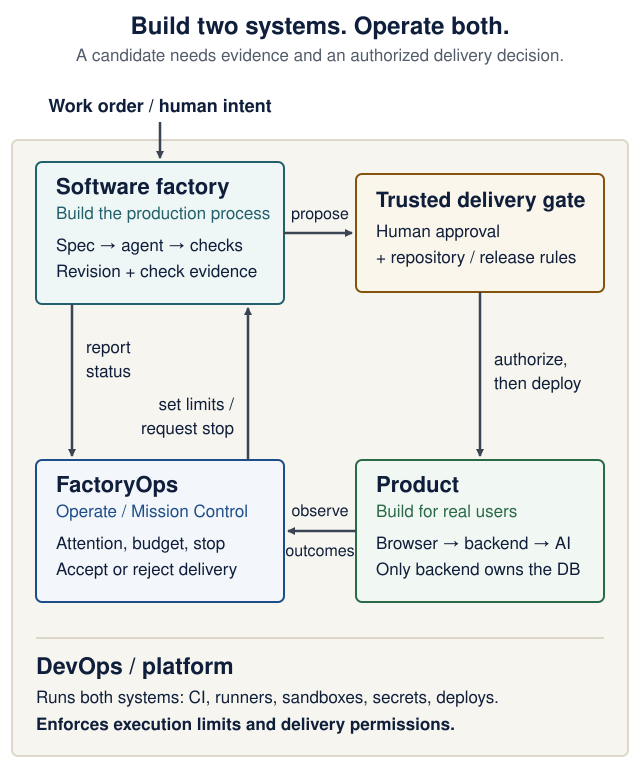

# FactoryOps: build the product, build the factory, operate both

<!--  -->

[Course guide](../README.md) · [Software factory lab](software-factory-lab.md) · [Agent-driven engineering](agent-driven-development.md) · [Submission evidence](submission-evidence.md)

**Optional depth, not an extra EX3 requirement.** Study this after the three-service product works. You do **not** need a particular assistant, three agents, Airflow, a dashboard, cloud hosting, or a paid model. The required EX3 product and its [English-narrated demo recording](../README.md#ex3-recorded-demo-in-english-required) remain unchanged by this optional extension.

A coding agent can change a file. A software factory must also identify the candidate, check its behavior, keep the evidence and respect the person's delivery decision. This guide follows that whole path.

**You will be able to:** separate the four responsibilities, follow one work order through a failed check and a repair, and decide what evidence permits the next step. Allow about 20 minutes to read and try the decision lab (estimate); the optional project challenge takes longer.

<details markdown="1" class="lecture-toc">
<summary>On this page</summary>

- [The engineering shift](#the-engineering-shift)
- [Follow one work order end to end](#follow-one-work-order-end-to-end)
- [Make the next delivery decision](#make-the-next-delivery-decision)
- [Three different questions: production, knowledge, authority](#three-different-questions-production-knowledge-authority)
- [Learn from real tools](#learn-from-real-tools)
- [The mathematics: four non-equivalences](#the-mathematics-four-non-equivalences)
- [The Solar System Machine: an honest case study](#the-solar-system-machine-an-honest-case-study)
- [Optional EX3 FactoryOps challenge](#optional-ex3-factoryops-challenge)
- [Check your understanding](#check-your-understanding)
- [References and boundaries](#references-and-boundaries)

</details>

## The engineering shift

A traditional team designs a product and operates the infrastructure that builds, tests and deploys it. Coding agents add a new system worth engineering: the *software-producing process itself*. A useful slogan is:

> **Build the product. Build the factory. Run the factory. Run the platform.**

This describes **two systems to build** and **two operational responsibilities**, not four additional microservices or four compulsory deliverables.

### Map of the four concerns

<figure class="course-diagram">
  <div class="diagram-scroll" role="region" tabindex="0" aria-label="Four concerns and the trusted delivery boundary">
    <picture>
      <source media="(max-width: 31.25rem)" srcset="../assets/diagrams/factoryops-four-concerns-mobile.svg">
      
    </picture>
  </div>
  <figcaption><strong>Two systems to build; two responsibilities to operate.</strong> Follow the candidate through the trusted delivery gate, then follow observed results back to FactoryOps. The platform supports both systems. <a href="../assets/diagrams/factoryops-four-concerns.svg">Open the full-size map</a>.</figcaption>
</figure>

<details markdown="1">
<summary>Text version of the diagram</summary>

1. A person defines a work order and its limits. The **software factory** produces one candidate revision and evidence from checks and review.
2. A **trusted delivery gate** checks the evidence and the authorized person's decision. A proposed change has no automatic right to merge or deploy.
3. The **product** delivers behavior to users. In EX3 it is the browser frontend, FastAPI backend and separate AI service; only the backend owns persistent data.
4. **FactoryOps / Mission Control** sets policy and budgets, handles attention and stop requests, and reads both factory status and observed product outcomes.
5. **DevOps / platform** provides CI, runners, sandboxing, credentials, deployments and monitoring for the product and the factory. Trusted runtime and repository controls enforce the actual permissions.

</details>

**Read the arrows carefully:** a factory proposes a candidate. Checks produce evidence **about that candidate revision**. A separate trusted decision authorizes promotion. Mission Control may *display* an approval button, but the actual permission must be enforced by the platform, repository rules or a trusted controller.

| Concern | Its job | Evidence to inspect |
|---|---|---|
| **Product** — build | Solve the user's problem with the three application services | A real browser flow, persisted data and observable failure/recovery |
| **Software factory** — build | Turn a work order into a checked candidate | The work order, exact revision, diff, test results and review findings |
| **FactoryOps / Mission Control** — operate | Manage attention, limits, stopping and delivery decisions | Budget remaining, failed checks, actual worker state and an identified decision maker |
| **DevOps / platform** — operate | Execute, isolate, verify and deploy both systems | Effective permissions, runner/environment identity, exit status and deployment revision |

The product and the factory are both software: each can have its own source history, tests, dependencies and releases. In a small student project all four concerns may share one repository or terminal. Their **responsibilities and trust boundaries** still need names: who proposes, who checks, who decides, and what enforces the decision?

## Follow one work order end to end

Suppose your recipe product accepts an empty title and saves a useless row. The work order is **"reject an empty title with HTTP 422 and leave the database unchanged."** This is an illustrative walkthrough, not a recorded run. `c1` and `c2` name two different commits; a real receipt keeps their full SHAs.

<div class="stepper" markdown="1">

1. **Specify the change.** Record the failing request, expected response and unchanged row count. Permit only the backend validation and its tests; exclude schema migrations and unrelated UI work. Set a two-repair limit and a time limit, with an identified person authorizing delivery.
2. **Prepare execution.** Start from a named baseline in a separate worktree or sandbox. Give the worker only the files, network access and credentials it needs. Record the environment identity and which supervisor can actually terminate it. The worker does not receive merge or release credentials.
3. **Create candidate `c1`.** The agent proposes validation and a regression test. Inspect the diff; run the new test, a valid-title test and the relevant existing suite against `c1`. The response check passes, but the row-count check fails: the implementation saves before it validates.
4. **Repair into candidate `c2`.** Use one of the two repair attempts. Move validation before persistence, commit `c2`, and rerun all acceptance and regression checks. Keep the failed `c1` receipt as well as the new `c2` results. A green check for `c1` could never verify `c2`.
5. **Review and decide.** A reviewer examines the diff, behavior and evidence for `c2`. A new finding sends a new candidate through checks again. If the evidence is adequate, the authorized person accepts this revision for the named destination; a trusted repository or release controller enforces that scope.
6. **Observe delivery.** A PR is a proposal, a merge changes a branch, and a deployment changes a running environment. Record only the milestone observed. After deployment, exercise the empty-title and valid-title flows against the live revision. Preserve the recovery procedure and confirm any stopped worker has actually exited.

</div>

**Checkpoint:** point to the artifact produced at every step. If you cannot identify the candidate revision, failed result, new result, decision or delivered revision, the trace is incomplete.

## Make the next delivery decision

Read a small evidence receipt and choose the next step. A passed test, permission to deliver and an observed deployment are three separate facts.

<div class="sim" id="sim-factoryops" role="group" aria-label="Decision lab: what may happen next?" markdown="1">

<p class="sim-title"><strong>Decision lab: what may happen next?</strong></p>

<div class="sim-fallback" markdown="1">

**Worked example without JavaScript:** the current candidate is `c2`; checks passed for `c1`; review is clear; one repair remains; nobody approved delivery and no deployment was observed. **Run checks on `c2` next.** The successful result belongs to another revision. Approval cannot fill that evidence gap.

If checks then fail, repair within the remaining budget and verify the new revision. If the budget is exhausted, keep the run blocked and preserve the failure. Matching checks and review permit a human decision; matching approval permits delivery; only an observed deployment of that revision permits reporting it as released.

</div>
</div>

This lab evaluates fixed, synthetic receipts in your browser. It runs no agent, command, merge or deployment. Its conservative teaching policy simplifies real release controls; it does not establish a security boundary.

## Three different questions: production, knowledge, authority

1. **Production:** Can an agent generate a candidate? Capture the work order, scope, tools, changed files and revision.
2. **Knowledge:** Why should anyone trust that candidate? Run checks that can fail, inspect counterexamples, use independent measurements, and retain the tested SHA, command, environment and results.
3. **Authority:** Who is allowed to stop, accept, publish or roll back? Identify which rule is advisory, which is enforced by the runtime, and which is enforced by repository or release controls.

These questions should not collapse into one unchecked actor. Generation may be exploratory and parallel; acceptance should be deterministic where possible and governed by evidence and explicit authority.

### Guidance is not enforcement

- `AGENTS.md`, role assignments and natural-language orders guide agents; **they do not restrict their filesystem, network or credentials**.
- Distinct Git worktrees prevent edits from landing in the same checkout; **they do not isolate processes or secrets**. A sandbox or runtime permission boundary must enforce those restrictions.
- Tests, review findings and CI provide evidence about a candidate; **they do not give the model authority to merge**.
- A STOP message is a request. To guarantee interruption of execution, a supervisor must be able to terminate the task or revoke capabilities, while preserving any needed recovery evidence.

The important operational distinction is **observability vs control vs enforcement**. A UI can show a STOP button; only the component that can reliably stop the worker enforces it.

## Learn from real tools

Cognition, Modal, boat.dev and Tessl expose different parts of this picture. The mapping below is our course interpretation of their official documentation, checked on **3 November 2026**; it is not a vendor-defined architecture, an endorsement, or a requirement to sign up. Tools overlap, and a particular configuration still needs verification.

| Tool and official reading | Mechanism worth understanding | Question to carry into your own factory |
|---|---|---|
| **Cognition / Devin** — [SDLC integration](https://docs.devin.ai/essential-guidelines/sdlc-integration) and [security profiles](https://docs.devin.ai/product-guides/security-profiles) | Agent sessions fit into issue, implementation, testing and review workflows. Mandatory security profiles constrain lower-level settings; recommended profiles can be overridden. Profile changes do not immediately update existing sessions. | Which policy is effective **for this worker now**? Inspect the actual boundary rather than treating instructions or a new setting as proof it applies. |
| **Modal** — [Sandboxes](https://modal.com/docs/guide/sandboxes) and [networking](https://modal.com/docs/guide/sandbox-networking) | An execution environment has its own lifecycle and limits. Public outbound networking is allowed by default. A readiness timeout does not automatically terminate the Sandbox. | Which destinations and credentials are allowed? If startup fails, who terminates the worker, checks its exit and retains the failure receipt? |
| **boat.dev** — [parallel agents](https://docs.boat.dev/recipes/parallel-agents), [access](https://docs.boat.dev/environments/access) and [stopping](https://docs.boat.dev/snapshots/stop) | Forked VM sandboxes separate disk, processes and IP; credential provisioning is configured separately. A stop request can first return `stopping`, before terminal `stopped` (API: `archived`). | What does the sandbox actually isolate, and what can its credentials reach? Can you show a **confirmed stop**, rather than only a request to stop? |
| **Tessl** — [first factory](https://docs.tessl.io/introduction-to-tessl/build-your-first-factory), [test variants](https://docs.tessl.io/improving-your-skills/comparing-with-test-variants) and [public-repository controls](https://docs.tessl.io/automations/factory-on-public-repositories) | Skills supply context; loops connect work and feedback; a factory coordinates them. Compare context or agent variants on common scenarios and a rubric. Trusted triggers and human merge approval are separate controls. | Did a change to the factory's instructions improve results against the **same baseline**, and who may trigger work or authorize a merge? |

**Do a documentation-only audit:** choose one row and identify five things without creating an account: its work input, execution boundary, evidence output, stop mechanism and delivery authority. Mark any unanswered question **unknown**, then find the exact source that would resolve it.

### Three mechanisms to borrow

1. **Effective policy, not a policy-shaped document.** Cognition documents an important deployment distinction: Devin-managed machines enforce their network policy, while self-hosted Outposts require the infrastructure operator to enforce it. Name that operator and test one forbidden operation in an authorized sandbox. ([Security profiles](https://docs.devin.ai/product-guides/security-profiles))
2. **A stop receipt and a recovery plan.** Record requested, stopping and confirmed exit as different states. A saved environment is also narrower than a replay: [boat snapshots](https://docs.boat.dev/snapshots) retain disk state, not RAM or running processes. [Modal filesystem snapshots](https://modal.com/docs/guide/sandbox-snapshots) omit mounted Volumes and expire by default unless configured otherwise; check the retention for each snapshot type. Keep the candidate, check results and durable logs separately; write down what will expire.
3. **Evaluate the factory as well as its product.** Pin a skill or context revision, run the same small task set with and without it, use the same acceptance rubric and repeat trials. Report accepted outcomes, failures, duration and cost. Tessl's [test variants](https://docs.tessl.io/improving-your-skills/comparing-with-test-variants) illustrate the comparison; the course's [systems reasoning clinic](systems-reasoning.md#evaluate-consistency-across-trials) explains why one good run is insufficient. Keep model, tool and environment changes explicit so they do not silently confound the result.

## The mathematics: four non-equivalences

### 1. State convergence is not agreement on meaning

A CRDT such as Yjs is designed to make collaborating replicas converge under its synchronization assumptions when updates are delivered. Informally, the replicas can eventually display the same shared document. This does **not** imply the text is accurate, agents share the same interpretation, or a software change satisfies its specification.

**Counterexample:** three agents all read the same incorrect orbit radius. Their documents agree perfectly; the product is still wrong.

### 2. A green validation gate is not a theorem

A check samples some inputs or properties. A failed test gives a concrete counterexample to the tested claim. Passing a finite suite means **those checks observed no failure under those conditions**. It does not establish correctness over every viewport size, animation frame, concurrent interleaving, or future revision.

If you sample a moving object's location at a few times, you may miss an extreme between samples. More samples improve coverage; a continuous guarantee would need additional reasoning such as a proven bound, a suitable invariant, or exhaustive analysis under explicit assumptions.

### 3. Instrumentation is not automatically an independent oracle

A product can expose its own layout measurements to a validator. That is useful instrumentation, but if an agent controls both the thing being measured and the values reported, a bug or deceptive implementation may satisfy the reported measurement without satisfying the real user goal.

**Design response:** where practical, corroborate self-reported state with a browser geometry read, a screenshot inspected by a human, an independent integration test, or a check over external observable behavior. State exactly which measurement is independent and which is self-reported.

### 4. Review-and-repair is not proof of convergence

A repeated sequence `candidate -> critique -> repair -> critique` need not approach a fixed point. An agent can oscillate between two bugs, regress a previous requirement, or exhaust the available time. A maximum number of retries ensures a **bounded process**, not a correct final result. To claim convergence you would need a justified progress measure and a process that preserves it; an LLM's confidence is not that proof.

**Engineering response:** cap attempts, time and spend; preserve failed evidence; rerun regressions on the *new* SHA; and stop without publication when a gate remains red.

## The Solar System Machine: an honest case study

The course organization's [Solar System Machine](https://github.com/EASS-PART-A-2026-X/solar-system-machine/tree/a81083e) is a small **illustration**, not a mandated stack and not a replacement for EX3's three application services. At commit `a81083e` it separates:

- **Product:** the 3D solar-system page.
- **Factory:** roles A (scene), B (editorial), C (review), instructions, shared document, ownership contract and recorded run.
- **Mission Control:** human orders, visible agent status, a STOP-all command and a validation display.
- **Platform:** the sync server, tests and CI supporting that demonstration.

Use it to identify what the implementation actually enforces:

| Claim | Inspectable mechanism | Limitation to name out loud |
|---|---|---|
| Shared state | Hocuspocus/Yjs synchronizes and persists document updates | Shared text does not prove semantic agreement |
| Write access | The sync server checks a write token | A shared token is not independent proof of the speaker's agent role |
| File ownership | A/B/C have documented file scopes; the run checker reviews recorded edits | Ownership is mostly an agreement checked *after* the edit, not OS-level isolation |
| Order completion | A textual order is followed by `ack` and `done` messages | A text match is not evidence the requested work is correct |
| Stop | Mission Control posts an `ALL: STOP` order | The message is advisory without an enforced task termination path |
| Validation | Product, Mission Control and machine checks run in CI | Checks can miss unsampled geometry; some geometry comes from product instrumentation |

Do not infer that the system has formal safe interruptibility, cryptographically authenticated roles, independent oracles for every property, or deterministic replays. Its `run.json` lets us inspect a recorded trajectory; running the same prompts again may take another path.

**One useful history analogy:** cybernetics studies regulation through feedback, and von Neumann's universal constructor explores formally described construction. This factory resembles a description-plus-builder architecture, **not** a demonstrated universal constructor, self-reproducing machine or formal proof of safe interruptibility.

## Optional EX3 FactoryOps challenge

Only attempt this *after* your required three-service product works. One small, honest work-order loop is more educational than an elaborate multi-agent animation.

1. **Baseline:** choose one real, narrow defect or feature in your EX3 product and capture its original behavior and failing or missing check.
2. **Work order:** write goal, allowed files/tools, non-goals, acceptance check, attempt/time budget, and who may authorize a PR or merge.
3. **Candidate:** use one bounded agent or scripted loop in a branch/worktree; keep the exact resulting SHA. Extra agents are optional and must have distinct roles or evidence of benefit.
4. **Verification:** execute an independent test against that SHA; include a negative/failure case. Record commands, status, and relevant logs with secrets redacted.
5. **FactoryOps:** show where a person can see progress, the budget remaining, a failed check and the reason, and how the process actually stops. A simple CLI is enough.
6. **Decision:** demonstrate human acceptance or rejection. No model gets unattended merge/release credentials. If the final check fails, your factory must report `blocked`, not `shipped`.
7. **Comparison:** report at least one useful baseline: elapsed time, verification attempts, compute or API cost, or correctly accepted changes. Explain the trade-off and measurement limitations rather than declaring all automation faster.

An optional trace can be small:

```text
work_order: change-17
candidate: <full Git commit SHA>
context: <instructions/skill revision; model and tool versions>
environment: <image/snapshot ID; network and credential scope>
check: cd backend && uv run pytest tests/test_feature.py
observed: FAILED first, PASSED after repair (include actual exit codes)
review: one identified finding resolved, or one finding still open
budget: 1 of 2 repair attempts used
control: <supervisor>; stop requested -> confirmed exit, with timestamp/status
decision: <authorized person, candidate SHA, destination and allowed action>
delivery: local candidate | PR opened | merged | released (report ONLY the actual state)
retention: <durable evidence location; snapshot/log expiry; recovery procedure>
```

This challenge carries **no new deadline, required framework, mandatory fourth service, or substitute for the open-source upstream PR rule**. If you demonstrate it in your [required English-narrated EX3 video](../README.md#ex3-recorded-demo-in-english-required), show it *after* the real product flow and keep the product, failure and verification coverage intact.

## Check your understanding

Before reading the answers, explain these three situations:

1. Three Yjs clients show identical messages. Is their program correct?
2. All tests pass, but an agent edited the reported coordinates and rendered coordinates differently. Has the validator established the intended geometry?
3. A dashboard says STOP and the agent continues calling tools. Did Mission Control enforce interruption?

<details markdown="1">
<summary>Compare your answers</summary>

1. No. Replica convergence concerns state consistency, not semantic correctness.
2. No. Correlated measurement can invalidate the inference. Observe the actual rendering independently and describe coverage limits.
3. No. The STOP order was advisory; identify a trusted runtime with revocation or termination authority, and record its observed response.

</details>

## References and boundaries

- [Course software factory lab](software-factory-lab.md), especially the [three controls](software-factory-lab.md#from-a-local-loop-to-orchestration): guidance, execution, promotion.
- [Solar System Machine](https://github.com/EASS-PART-A-2026-X/solar-system-machine/tree/a81083e), commit-specific teaching example. Inspect its `crew/`, `mission-control/`, `logbook/`, and validator; do not mistake a green CI run for universal proof.
- [Yjs documentation](https://docs.yjs.dev/): synchronized shared data and its consistency model.
- [Safely Interruptible Agents](https://intelligence.org/files/Interruptibility.pdf): a research goal, not a property established by a chat STOP command.
- [Stanford Encyclopedia of Philosophy: Cellular Automata](https://plato.stanford.edu/entries/cellular-automata/): historical context for von Neumann's constructive-machine models, not evidence of universality here.

<!--  -->
