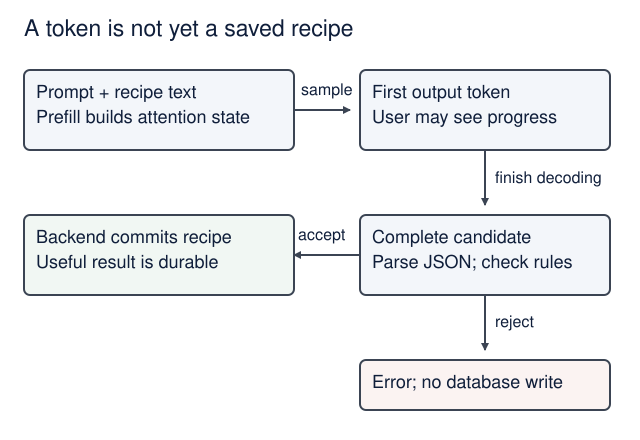
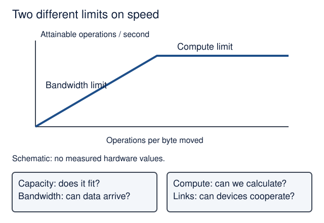
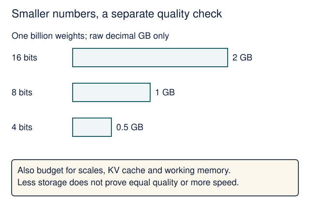
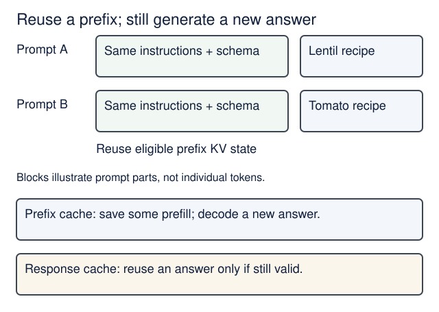
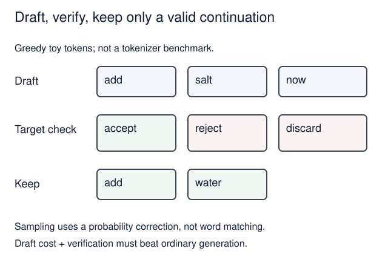
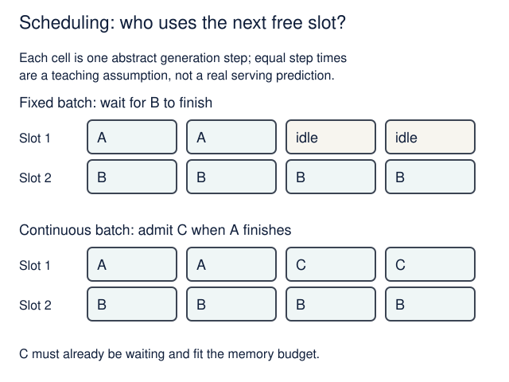
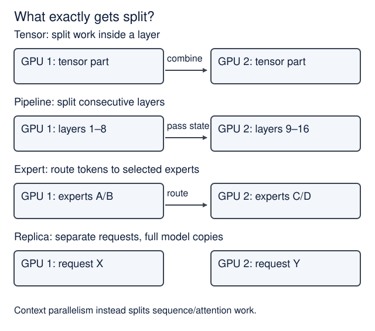
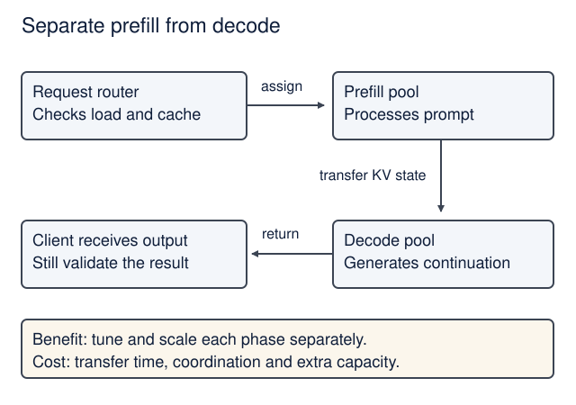
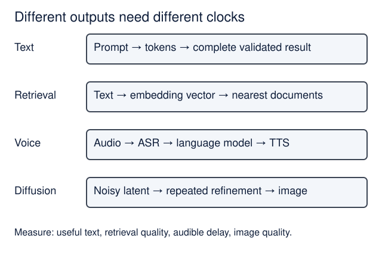
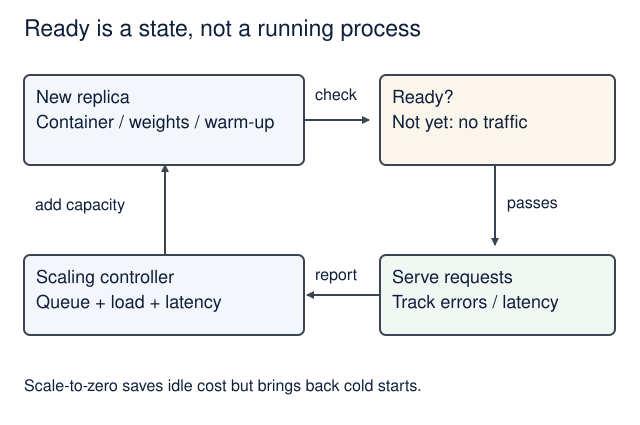

# Inference engineering: a visual field guide

<!--  -->

[Course home](../README.md) · [Local inference](local-inference.md) · [Lecture 9](../lectures/09-failures-evals-costs.md)

**Optional depth, alongside Lectures 6–10.** This guide connects Philip Kiely's [*Inference Engineering*](https://www.baseten.co/inference-engineering/book/) to Recipe Box, our course application. It adds no assessment requirements. All numerical examples are invented teaching examples; no GPU, model download or paid account is needed.

**Before you start:** know what an HTTP request and a model token are. Read [What inference actually does](local-inference.md#what-inference-actually-does) if prefill and decode are new. Allow 45–60 minutes for a first pass through the core path (estimate); the prediction exercises and book reading take extra time. Use the advanced sections as a reference.

**You will be able to:** identify the resource a method saves, explain its tradeoff, and propose a measurement that could show it failed. Recognizing a technique is enough here; implementing GPU kernels is not a course requirement.

On this page

- [Start with the book](#start-with-the-book)
- [Choose the outcome before the model](#choose-the-outcome-before-the-model)
- [Follow one request](#follow-one-request)
- [Hardware and the software stack](#hardware-and-the-software-stack)
- [Quantization](#quantization)
- [Attention and caching](#attention-and-caching)
- [Speculative decoding](#speculative-decoding)
- [Batching and queues](#batching-and-queues)
- [Parallelism and disaggregation](#parallelism-and-disaggregation)
- [Beyond text](#beyond-text)
- [Production and measurement](#production-and-measurement)
- [Choose a method and defend it](#choose-a-method-and-defend-it)
- [Sources and book map](#sources-and-book-map)

## Start with the book

**Read online:** the [full book on Baseten's website](https://www.baseten.co/inference-engineering/book/) is publicly readable without registration (checked 18 October 2026). The [book page](https://www.baseten.co/inference-engineering/) also offers a digital download. Use the online edition for this course; no student needs to submit contact details, subscribe or create a Baseten account.

For orientation, read [*What is inference engineering?*](https://newsletter.pragmaticengineer.com/p/what-is-inference-engineering), published by Gergely Orosz on 31 March 2026 with an introduction adapted from Philip Kiely's book. The book supplies the longer technical reading; the activities and diagrams here apply selected ideas to our product. It is an industry source written from Baseten's perspective, with substantial NVIDIA/datacenter coverage. Check performance claims against your own workload, and use the primary sources below for algorithmic distinctions. EASS has no affiliation with Baseten or the newsletter.

Choose one sitting at a time. The time estimates cover this companion's core sections, with book chapters available for deeper reading.

| Sitting | Companion sections | Book reading | Explain before continuing |
|---|---|---|---|
| After Lecture 6; 15–20 min | [Outcome](#choose-the-outcome-before-the-model), [request](#follow-one-request), [resource questions](#hardware-and-the-software-stack) | Chapters 1–2; Chapters 3–4 for depth | Why a fast first token can still leave the user waiting |
| After Lecture 9; 15–20 min | [Quantization](#quantization), [caching](#attention-and-caching), [batching](#batching-and-queues) | Selected parts of Chapters 5 and 7 | Which resource is saved, and which quality or latency measure could get worse |
| With Lectures 8–10; 15–20 min | [Production](#production-and-measurement), [method clinic](#choose-a-method-and-defend-it) | Chapter 7 | One reproducible comparison and a reason to reject your proposed optimization |

Speculation, parallelism, disaggregation and other modalities are optional advanced reading. The required course still uses the same Docker Compose product and [Lecture 9 evaluation lab](../lectures/09-failures-evals-costs.md#task-evaluations).

## Choose the outcome before the model

*Core path · Lecture 6 · Book §§1.2–1.3.*

Inference runs a trained model on an input. Inference engineering makes that computation useful under constraints: correct enough, quick enough, affordable and reliable. For Recipe Box the outcome is **a correctly extracted recipe accepted by the backend**, not merely fluent text or many tokens per second.

Define representative cases before choosing a model. Include short and long recipes, Hebrew and English, missing quantities, and text that is not a recipe. Keep some cases separate from those used to tune prompts. A small model is a candidate to evaluate, not automatically the best model.

| Method | What changes? | What must you check? |
|---|---|---|
| Prompting | Instructions and examples in the input | Task results and prompt length |
| Retrieval / RAG | Relevant external information is added to context | Retrieval quality, freshness and permissions |
| Fine-tuning, including LoRA adapters | Learned parameters are adapted for a task | Held-out quality, training data and adapter compatibility |
| Distillation | A student learns from a teacher's outputs or distributions | Which abilities and mistakes transfer |
| Smaller model selection | Architecture and/or parameter count | Quality floor before latency and cost |

Distillation is a training method; it is not the same as quantization or asking a smaller model to draft tokens. Retrieval and ordinary conversation do not update model weights. Mixture-of-experts (MoE) models route tokens through selected expert networks: fewer active parameters do not mean all the other weights disappear from storage.

**Predict:** model A costs 10 invented units for 100 attempts and gets 80 correct. Model B costs 12 units and gets 96 correct. Which has lower cost per correct result?

Check your prediction

They tie: `10/80 = 12/96 = 0.125` units per correct result. B succeeds more often. Check latency and failure handling too. Count all attempted work in the numerator, including failed attempts and retries; do not divide only the cost of successful calls by successes.

## Follow one request

*Core path · Lectures 6–7 · Book §§1.4, 2.2.*

Messages, tool definitions and the recipe are serialized using a chat template, then tokenized. A conventional causal transformer uses embeddings, attention, feed-forward layers and an output projection to predict tokens. **Prefill** processes the prompt and prepares KV state; the first output token can be sampled from its final logits. **Decode** repeatedly extends the sequence. An agent may make several such model requests while calling tools or repairing an invalid result.

<figure class="course-diagram">
  

    
  

  <figcaption><strong>A token is not yet a saved recipe.</strong> On a narrow screen, scroll the diagram sideways. <a href="../assets/diagrams/inference-journey.svg">Open the diagram at full size</a>.</figcaption>
</figure>

Text version of the diagram

The first token arrives before the complete candidate. Only a candidate passing validation reaches the database; rejected candidates return an error.

**Time to first token (TTFT)** measures when the first token becomes available at a stated boundary. **Inter-token latency (ITL)** measures gaps between subsequent tokens. **End-to-end latency** measures the whole user operation, including network, queue, tools, validation and persistence. State whether timings come from the server or the client.

A fast first token is useful for streaming chat. For structured extraction, an opening `{` is not a usable recipe. Stream progress if helpful, but only validate and save the complete candidate. Streaming changes when output becomes visible; it does not automatically reduce compute or completion time.

Use the existing [latency experiment](local-inference.md#latency-experiment). It deliberately adds a first decode-step estimate to its prefill duration. That is a teaching convention, not a universal engine boundary: real engines often produce first-token logits during prefill. Do not add a separate first-token pass twice to measured server timings.

**Predict:** the first token arrives at 0.4 s, JSON completes at 2.4 s, validation takes 0.1 s and saving takes 0.2 s. When can the UI report a saved recipe?

Check your prediction

At 2.7 s, assuming these sequential times include everything else. If validation fails, it must not report success at all. The 0.4 s TTFT answers a different question.

## Hardware and the software stack

*Core path for the four resource questions; implementation details are optional · Book Chapters 3–4, §§2.4–2.5.*

<figure class="course-diagram">
  

    
  

  <figcaption><strong>Two different limits on speed.</strong> On a narrow screen, scroll the diagram sideways. <a href="../assets/diagrams/inference-roofline.svg">Open the diagram at full size</a>.</figcaption>
</figure>

Text version of the diagram

A schematic roofline rises with arithmetic intensity until compute capacity caps performance. A second panel separates memory capacity, bandwidth, compute, and interconnect.

**Capacity** is bytes available; **bandwidth** is bytes moved per second; **compute** is arithmetic per second; **interconnect** is communication between devices. A GPU's arithmetic headline alone cannot tell you whether a model fits or serves your workload well. Host RAM, storage and CPU preprocessing also matter. Local inference trades remote dependency for device capacity, heat, battery and support constraints; privacy still depends on telemetry, tools and routing.

A rough performance ceiling is `min(compute ceiling, bandwidth × operations per byte)`. This **roofline** is a bound, not a prediction. Real kernels may sit far below it. Long-prompt prefill is often compute-heavy; small-batch decode often waits on memory movement. Batch size, context, model architecture and implementation can change the bottleneck.

| Layer | Responsibility | Examples or concepts to recognize |
|---|---|---|
| Product and agent | Validation, permissions, tools, user outcome | FastAPI, Pydantic AI, our backend |
| Serving engine | Schedules requests and runs the model | vLLM, SGLang, TensorRT-LLM; local route in the existing guide |
| Framework and representation | Defines computations; stores parameters or a graph | PyTorch, Transformers, Diffusers; safetensors, GGUF, ONNX |
| Compiler and kernels | Executes efficient operations | CUDA, GEMM, fusion, compilation, CUDA graphs |
| Hardware and drivers | Supplies compatible execution resources | CPU/GPU, device memory, links, driver compatibility |

A model file format is not a server. An HTTP-compatible endpoint does not guarantee tool-use or schema compatibility. Engine choice requires the actual model/hardware/feature combination; there is no universal winner.

**Kernel fusion** keeps intermediate work close to the processor instead of writing it to device memory and immediately reading it back. For a simple elementwise `x × 2`, then `+ 1`, a fused kernel can avoid the intermediate round trip. **Compilation** specializes operations; **CUDA graphs** can reduce repeated launch overhead by replaying a captured execution graph. Neither removes the underlying arithmetic or makes every input shape equally efficient.

**Optional:** recognize hardware partitioning (MIG on supported GPUs), different GPU generations and alternative accelerators. Choose using supported precision, capacity, bandwidth, interconnect and software compatibility. This guide deliberately does not turn the book's dated hardware catalogue into a purchasing list.

## Quantization

*Core path · Local inference and Lecture 9 · Book §5.1.*

<figure class="course-diagram">
  

    
  

  <figcaption><strong>Smaller numbers, a separate quality check.</strong> On a narrow screen, scroll the diagram sideways. <a href="../assets/diagrams/inference-precision.svg">Open the diagram at full size</a>.</figcaption>
</figure>

Text version of the diagram

For one billion weights, ideal raw weight storage is 2 GB at 16 bits, 1 GB at 8 bits and 0.5 GB at 4 bits. Metadata, cache and workspace add memory. Quality must be measured again.

Quantization represents values with fewer bits. Weights, activations and KV state are separate targets; quantizing weights does not automatically quantize the cache. FP16 and BF16 both use 16 bits but allocate them differently between range and precision. INT8 and FP8 represent values differently. A bit count alone does not describe numerical behavior.

**Post-training quantization (PTQ)** converts an existing model, often using calibration examples. **Quantization-aware training (QAT)** accounts for low precision during training. Per-tensor, per-channel or per-block scales control how groups of values are represented; smaller groups add metadata and computation but can better accommodate outliers. Some components stay at higher precision.

**Predict:** raw weights shrink from 8 GB to 4 GB. The KV cache is 3 GB and other buffers are 1 GB, both unchanged. Has total memory halved?

Check your prediction

No: `8 + 3 + 1 = 12 GB` becomes `4 + 3 + 1 = 8 GB`, a one-third reduction. These invented values omit other overhead. Measure actual peak memory and repeat quality evaluations; conversion overhead or unsupported fast kernels may erase a speed benefit.

## Attention and caching

*Core path for KV and prefix caching; attention variants are optional · Book §§2.5, 5.3.*

The **KV cache** stores intermediate keys and values for past tokens, avoiding recomputing those projections at every decode step. It is neither a database of facts nor a stored final answer. For conventional full attention, each new query still reads relevant past KV state; long context can make decode slower too.

<figure class="course-diagram">
  

    
  

  <figcaption><strong>Reuse a prefix; still generate a new answer.</strong> On a narrow screen, scroll the diagram sideways. <a href="../assets/diagrams/inference-cache.svg">Open the diagram at full size</a>.</figcaption>
</figure>

Text version of the diagram

Two requests share instructions and schema before different recipe text. Prefix reuse ends at the first changed token. A response cache instead reuses an entire previous answer.

**Prefix caching** reuses eligible KV state from an identical beginning of a previous request. Stable instructions and schemas before changing recipe text can help, if that ordering preserves semantics. A changed early token prevents ordinary exact-prefix reuse beyond that point. Model, tokenization, adapters, cache layout and isolation rules must also match; implementations may reuse only complete blocks. Do not remove security checks to manufacture a cache hit.

**Response caching** reuses the answer itself. Its key and expiry must account for inputs, model/prompt version, relevant data and permissions. Semantic caching uses similarity, introducing an additional risk of returning the wrong result. Neither should leak one user's private data to another.

| Technique | Saves or changes | Important distinction |
|---|---|---|
| FlashAttention | Device-memory traffic using tiled attention computation | Exact attention algorithm, subject to floating-point differences; does not remove dense attention's quadratic prefill work |
| PagedAttention | KV allocation waste through logical-to-physical blocks | Memory management; not quantization and not a smaller context window |
| Cache offload / tiers | GPU capacity by storing some state in host memory or storage | Transfers can cost more time than they save |
| Cache-aware routing | Sends requests toward reusable state | Balance locality against overloaded replicas |
| Sliding-window attention | Limits which prior positions are attended to | Changes accessible context; architecture support matters |
| Linear, gated or compressed attention | Changes attention/state computation or representation | Families of architecture-dependent methods, not interchangeable switches |
| Multi-head / grouped-query / multi-query attention | Changes how query heads share KV heads | Sharing can reduce KV storage; depends on the trained model |
| Multi-head latent attention (MLA) | Uses a compressed latent representation for KV-related state | Architecture-specific; not simply a lower-precision full KV cache |
| State-space and hybrid models | Recurrent state updates, sometimes mixed with attention | Different state and scaling behavior; not all models use a full transformer KV cache |

**Predict:** two prompts have the same final paragraph but different first sentences. Does ordinary prefix caching reuse that final paragraph's KV state?

Check your prediction

No. Its representation depends on the earlier prefix. Specialized non-prefix reuse methods need additional handling and are outside this exercise. Prefix reuse primarily reduces repeated prefill, not the number of new output tokens.

## Speculative decoding

*Optional advanced concept · Book §5.2.*

A cheap draft proposes several tokens. The target evaluates the proposed continuation, allowing multiple positions to be checked in one target pass. Keep an accepted prefix, correct the first rejection, and discard later draft state that depended on it. The target remains authoritative.

<figure class="course-diagram">
  

    
  

  <figcaption><strong>Draft, verify, keep only a valid continuation.</strong> On a narrow screen, scroll the diagram sideways. <a href="../assets/diagrams/inference-speculation.svg">Open the diagram at full size</a>.</figcaption>
</figure>

Text version of the diagram

Greedy toy example: a draft proposes add salt now. The target agrees with add, disagrees at salt and chooses water. The following draft token now is discarded because its prefix changed.

The figure is a **greedy illustration**. Exact speculative **sampling** uses acceptance probabilities and a correction distribution, rather than merely comparing words. The original algorithm preserves the target distribution under its assumptions; this is not a blanket guarantee for every approximate variant. It also does not guarantee the model's answer is true.

| Family | Where drafts come from | Extra work |
|---|---|---|
| Draft–target | A smaller model | Draft weights, cache, computation and coordination |
| Medusa | Additional prediction heads | Trained heads and tree verification |
| EAGLE family | A trained drafter using target-model features | Compatible drafter, feature handling and verification |
| N-gram / prompt lookup | Repeated sequences in the input/history | Matching and target verification; useful repetition is needed |
| Lookahead decoding | Candidate continuations constructed during decoding | Extra parallel work and verification |

There is no universal best draft length. More proposals can mean more accepted tokens, but also more wasted work. Measure acceptance, draft/verify cost, memory and end-to-end latency under realistic concurrency. Batching and speculation can compete for the same spare compute.

**Predict:** ordinary generation takes 10 ms per token. A speculative round takes 18 ms including drafting and verification and commits three tokens on average. Is it faster? What if it commits only one?

Check your prediction

Three tokens: ordinary time is 30 ms, versus 18 ms, or about 1.67× faster. One token: 18 ms versus 10 ms, so slower. These assumed times are a cost model, not a benchmark; count every committed token consistently, including correction or bonus tokens where applicable.

## Batching and queues

*Core path · Lecture 9 · Book Chapters 1 and 7.*

**Latency** is how long one request waits. **Throughput** is work completed per unit time. Label whether tokens/second is per user or summed over the whole service. A server may improve total throughput while individual responses slow down.

<figure class="course-diagram">
  

    
  

  <figcaption><strong>Scheduling: who uses the next free slot?</strong> On a narrow screen, scroll the diagram sideways. <a href="../assets/diagrams/inference-batching.svg">Open the diagram at full size</a>.</figcaption>
</figure>

Text version of the diagram

Two slots serve A and B. A finishes after two steps, B after four. Fixed batching leaves A’s slot idle; continuous batching admits waiting request C into that slot.

**Static batching** runs a fixed group together to completion; finished sequences can leave unused slots. **Dynamic batching** collects requests until a size or waiting-time limit. **Continuous batching** changes the active group at generation-step boundaries as sequences finish. Waiting for a larger batch can hurt interactive users; batch size also consumes KV memory. Admitting a new request still requires its prefill work; the diagram's equal time steps are an abstract scheduling example.

**Chunked prefill** divides a long prompt's prefill work into pieces that can be scheduled alongside decoding requests. It can reduce interference with ongoing streams; scheduling choices may increase the new request's TTFT. This is different from splitting a long audio file or document into independent application jobs.

Bound queues and active work. If requests arrive faster than sustainable service capacity, the queue grows; retries can amplify overload. A background job with an ID and polling or callback is often suitable for importing a large recipe collection. `async` Python alone does not create GPU capacity, and an HTTP timeout does not prove remote inference stopped.

**Predict:** ten requests complete in five seconds. Is each request's latency 0.5 seconds?

Check your prediction

No. Aggregate throughput is two requests/second. If all ten arrived at time zero and completed at five seconds, each waited five seconds. Arrival and completion timestamps are needed to calculate request latency.

## Parallelism and disaggregation

*Optional advanced concept · Book §§5.4–5.5 and Chapter 6.*

<figure class="course-diagram">
  

    
  

  <figcaption><strong>What exactly gets split?</strong> On a narrow screen, scroll the diagram sideways. <a href="../assets/diagrams/inference-parallel.svg">Open the diagram at full size</a>.</figcaption>
</figure>

Text version of the diagram

Tensor parallelism divides tensors within layers; pipeline parallelism divides layers; expert parallelism places experts on devices; replicas process separate requests. Context parallelism distributes sequence work.

Tensor parallelism splits operations within layers and combines partial results. Pipeline parallelism places consecutive layers on different devices and passes activations between them; pipeline bubbles can leave devices idle. Expert parallelism places MoE experts on devices and routes tokens to them, with communication and load-balance costs. Context parallelism distributes sequence/attention work. These methods can be combined; suitability depends on topology and workload.

**Replication** gives separate requests separate full model copies. It is often simpler when the model fits and the goal is more concurrent users. Adding GPUs is not a promise of proportional speedup: communication may become the new bottleneck.

<figure class="course-diagram">
  

    
  

  <figcaption><strong>Separate prefill from decode.</strong> On a narrow screen, scroll the diagram sideways. <a href="../assets/diagrams/inference-disaggregation.svg">Open the diagram at full size</a>.</figcaption>
</figure>

Text version of the diagram

A router sends a prompt to a prefill worker. That worker transfers KV state to a decode worker which generates the continuation. Cache transfer adds network cost; the pools can scale separately.

Disaggregated serving separates prefill and decode into independently managed workers. It can isolate interference and permit different configurations, but KV state must travel between them. It is different from our backend/AI-service split: that split separates application responsibilities, not two inference phases.

**Predict:** transferring 2 GB of KV state over an effective 20 GB/s link takes at least how long? Would saving only 50 ms of computation justify it?

Check your prediction

`2/20 = 0.1 s`, or 100 ms, before coordination and contention. A 50 ms saving alone would not repay that transfer in this simple sequential example. Real systems may overlap work, so measure the full workload.

## Beyond text

*Optional breadth · Book Chapter 6.*

<figure class="course-diagram">
  

    
  

  <figcaption><strong>Different outputs need different clocks.</strong> On a narrow screen, scroll the diagram sideways. <a href="../assets/diagrams/inference-modalities.svg">Open the diagram at full size</a>.</figcaption>
</figure>

Text version of the diagram

Text generates tokens; embeddings create vectors for retrieval; speech can cascade from transcription through a language model to speech synthesis; diffusion repeatedly refines a noisy latent before decoding an image.

| Modality | Main idea and methods | Measure a useful outcome |
|---|---|---|
| Vision-language | Encode image patches or sampled video frames, then condition language generation; resolution/frame count affects work | Correct extracted fields; complete answer latency |
| Embeddings | Produce vectors for retrieval; batch documents and avoid excessive padding | Relevant results retrieved; documents/second |
| Speech recognition (ASR) | Convert audio to text; chunking and batching trade context and latency | Word error rate, partial/final transcript delay, real-time factor |
| Diarization | Identify who spoke when, often alongside ASR | Speaker attribution errors and extra latency |
| Text-to-speech (TTS) | Generate playable audio; buffer or stream it | First audible output, intelligibility, gaps and sustainable playback |
| Speech-to-speech / omni-modal | Combine modalities in one model or a coordinated pipeline | End-to-end turn delay, task success and interruption handling |
| Image diffusion | Refine a noisy latent through repeated denoising, then decode an image | Image quality, prompt adherence and time per image |
| Video generation | Model spatial and temporal structure; attention and context parallelism can be expensive | Temporal consistency, quality, clip length/resolution and total time |

For diffusion, fewer steps, distilled/few-step models, reduced precision, optimized kernels, and reusing intermediate computations can reduce work. Some classifier-free-guidance implementations evaluate conditional and unconditional branches; changing that schedule may save work but alter adherence. Cache reuse across denoising timesteps can also change quality. These are model-dependent experiments, not guaranteed lossless optimizations.

**Predict:** processing 60 seconds of audio takes 15 seconds. What is the real-time factor, and does it prove good live transcription?

Check your prediction

`15/60 = 0.25`. It processes the file four times faster than its duration. It could still wait for the entire recording before returning text, so this does not establish low live partial-transcript delay or accuracy.

## Production and measurement

*Core path · Lectures 8–10 · Book Chapter 7.*

<figure class="course-diagram">
  

    
  

  <figcaption><strong>Ready is a state, not a running process.</strong> On a narrow screen, scroll the diagram sideways. <a href="../assets/diagrams/inference-production.svg">Open the diagram at full size</a>.</figcaption>
</figure>

Text version of the diagram

A new replica starts its container, loads weights and warms the engine before readiness passes. The router sends traffic only to ready replicas. Queue and latency measurements inform scaling.

A reproducible deployment records the container image, dependencies, model revision, tokenizer/template, quantization and runtime settings. GPU drivers and hardware compatibility still matter outside the container. Readiness should describe what the service can actually handle; liveness only tells you whether a process is alive enough to recover.

Autoscaling takes time. Minimum replicas and scale-to-zero trade idle cost for cold-start delay. Scale-down delay can prevent oscillation. Queue depth, active work, sequence lengths, resource use and observed latency are complementary signals. Rate limits and admission control keep overload bounded.

For larger deployments, routing across regions/providers introduces network delay, capacity differences, failure recovery and data-location constraints. Protect inputs, outputs, model assets and credentials; log useful timings without casually retaining private recipe text. Shadow traffic must not duplicate side effects or expose private data to an unapproved destination. Canary deployment sends a small share to a candidate, observes it, then expands or rolls back.

### A small measurement clinic

Start with the existing [Lecture 9 evaluation lab](../lectures/09-failures-evals-costs.md#task-evaluations). Keep quality and performance results together. Separate fake-model contract tests from real-model quality evidence.

| Record | Why it matters |
|---|---|
| Model/runtime/configuration and hardware | A repeatable comparison |
| Input/output token counts; task categories | Long prompts and long answers are different workloads |
| Cold/warm and prefix-hit/miss conditions | Cache-friendly runs can conceal startup costs |
| Arrival pattern, concurrency and queue time | A single request cannot characterize saturation |
| TTFT, completion latency, errors and successful outcomes | Speed of useful work, including failures |
| Total cost and accepted results | Cost per correct result; include retries and idle infrastructure where relevant |

**Predict:** nineteen requests take one second each, and one takes twenty seconds. What do mean, median and nearest-rank p95 show?

Check your prediction

Mean is `39/20 = 1.95 s`; median is 1 s. Nearest-rank p95 is sorted observation `ceil(0.95 × 20) = 19`, also 1 s. The maximum is 20 s; nearest-rank p99 is that same maximum. Different percentile conventions can interpolate. Twenty samples illustrate arithmetic, not a reliable production p99 estimate. Show the raw values, sample count and errors too.

Benchmarking describes **how the system performed**. Profiling locates **where time was spent**. Hold the workload steady, change one thing, rerun, then test combinations: two individually useful optimizations may compete. Use synthetic inputs for class load experiments; repeat enough trials to see variability. A lower mean with more failures is not automatically an improvement.

## Choose a method and defend it

*Optional 20-minute paper lab or clinic; no new infrastructure required.*

| Observed problem | First candidate investigation | Evidence against your proposed fix |
|---|---|---|
| Fast tokens, slow saved recipe | Trace queue, tools, validation, network and commit | Decode was never the dominant stage |
| Out of memory with long inputs | KV growth, context limits, concurrency; then quantization | Weights shrink but KV dominates |
| Repeated long instructions | Eligible prefix caching | Prefix changes early or hits are rare |
| Slow decode at low concurrency | Model choice; supported quantization or speculation | Draft/verify overhead exceeds saved target work |
| Many users, idle generation slots | Continuous batching and admission policy | Memory pressure or worse tail latency |
| Long prompts interrupt streams | Chunked prefill; at scale consider disaggregation | Scheduling or KV transfer adds more delay |
| First request is unusually slow | Weight loading, compilation, readiness, warm capacity | Repeated warm requests are equally slow |
| High speed but bad extraction | Data, prompt, model and task evaluations | An engine speedup cannot repair task quality |

Choose two rows. For each: draw the request path, circle the suspected bottleneck, propose one change, define a success measure and a failure condition. Then explain which course service owns the change. Keep the backend's authority to validate and persist unchanged.

**Check yourself:** explain the difference between (1) quantization and distillation, (2) prefix and response caching, (3) FlashAttention and PagedAttention, (4) batching and replication, and (5) speculation and disaggregation.

Check your answers

1. Lower-precision representation versus training a student from a teacher.
2. Reuse input computation versus reuse a previous answer.
3. Efficient attention computation versus efficient allocation/access of KV blocks.
4. Share execution across requests versus serve requests on separate model copies.
5. Draft and verify continuations versus place prefill/decode on separate workers.

**Completion evidence:** one diagram annotated in your own words, a worked calculation, and one experiment whose result could make you reject your preferred optimization. This is formative practice, not an additional submission requirement.

## Sources and book map

This guide uses original explanations, examples and SVG diagrams alongside Philip Kiely's [*Inference Engineering*, online edition](https://www.baseten.co/inference-engineering/book/). The chapter map was checked on 18 October 2026. Links use chapter titles rather than edition-dependent page numbers. The book is a conceptual reading source; model, hardware and engine support still need checking in current documentation. No book pages or illustrations are redistributed here.

| Book coverage | Where this guide uses it |
|---|---|
| [Ch. 1: Prerequisites](https://www.baseten.co/inference-engineering/book/01-prerequisites/) | Outcomes, model selection, evaluations, latency and throughput |
| [Ch. 2: Models](https://www.baseten.co/inference-engineering/book/02-models/) | Transformer mechanics, bottlenecks, attention; deeper math stays in Local inference |
| [Ch. 3: Hardware](https://www.baseten.co/inference-engineering/book/03-hardware/) | Capacity, bandwidth, compute, interconnect, partitioning and local execution |
| [Ch. 4: Software](https://www.baseten.co/inference-engineering/book/04-software/) | Stack layers, formats, kernels, engines, compilation, benchmarking and profiling |
| [Ch. 5: Techniques](https://www.baseten.co/inference-engineering/book/05-techniques/), §5.1 | Quantization, formats, calibration, quality checks |
| Ch. 5, §5.2 | Draft–target, Medusa, EAGLE, n-grams and lookahead |
| Ch. 5, §5.3 | Prefix reuse, cache tiers, routing and long context |
| Ch. 5, §§5.4–5.5 | Parallelism and prefill/decode disaggregation |
| [Ch. 6: Modalities](https://www.baseten.co/inference-engineering/book/06-modalities/) | Vision, embeddings, ASR, TTS, images and video |
| [Ch. 7: Production](https://www.baseten.co/inference-engineering/book/07-production/) | Containers, scaling, reliability, deployment, cost and clients |

Primary cross-checks for the distinctions above, checked 18 October 2026. We reviewed the paper abstracts and the relevant documentation sections; these links are starting points for deeper reading, not claims of benchmark reproduction:

- [FlashAttention paper](https://arxiv.org/abs/2205.14135): exact attention with reduced memory traffic.
- [PagedAttention paper](https://arxiv.org/abs/2309.06180): KV blocks, sharing and memory management.
- [Speculative decoding paper](https://arxiv.org/abs/2211.17192): exact sampling and distribution preservation under its algorithm.
- [vLLM prefix caching](https://docs.vllm.ai/en/latest/features/automatic_prefix_caching/): repeated prefill savings and limits.
- [vLLM quantization](https://docs.vllm.ai/en/latest/features/quantization/): compatibility depends on method and hardware.
- [vLLM disaggregated-prefill design](https://github.com/vllm-project/vllm/blob/main/docs/features/disagg_prefill.md): separate instances and KV transfer.

**Instructor notes:** use the core sections as short illustrations during Lectures 6–10; reserve parallelism, speculation internals and modalities for the flexible clinics. Students should predict before opening answers, then explain why an optimization might fail. The figures encode meaning with labels as well as color and remain usable without JavaScript and in print.

<!--  -->
