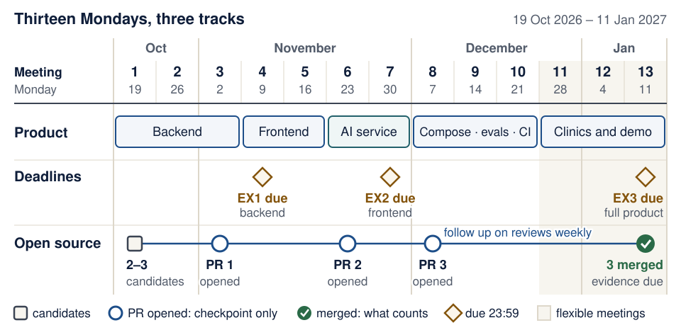

# Learning map: what to understand and demonstrate each week

<!--  -->

[Course home and deadlines](../README.md) · [Student setup](student-setup.md) · [Engineering foundations](engineering-foundations.md) · [Models and AI literacy](models-and-ai-literacy.md)

**One product, built in stages.** You enter with basic Python and leave with a reproducible three-service application, a bounded AI feature, tests, evaluation evidence, and accepted open-source contributions. This map helps you study; the README remains the authority for assignments, dates, and grading. Which guides are required and which are optional depth is in the README's [reading map](../README.md#reading-map).

**You will be able to:** find each class's question, preparation and deadline in one row, tell what is required from what is your choice, and find the earliest failing checkpoint when you fall behind.

**Not sure your basics are solid?** Take the [readiness check](engineering-foundations.md#readiness-check) before Lecture 1. Each check that fails links to a short repair section.

**Predict first:** the course runs three tracks at once: your product, the assignments, and open source. Which track has the longest lead time, and what does that mean for week 1?

<details markdown="1">
<summary>Check your prediction</summary>

**Open source.** Only *merged* PRs count, and maintainers decide when (or whether) to merge; reviews can take weeks. That is why the calendar asks for 2–3 checked candidates in week 1 and a first upstream PR by class 3. Product work you control; maintainers' timelines you do not.

</details>

<details markdown="1" class="lecture-toc">
<summary>On this page</summary>

- [How to read a lecture](#how-to-read-a-lecture)
- [The class-by-class path](#the-class-by-class-path)
- [Visual checkpoints](#visual-checkpoints)
- [What is required and what is a choice](#what-is-required-and-what-is-a-choice)
- [A repeatable study cycle](#a-repeatable-study-cycle)
- [Engineering studio and review criteria](#engineering-studio-and-review-criteria)
- [Verified reference checkpoints](#verified-reference-checkpoints)
- [Choose the smallest useful AI system](#choose-the-smallest-useful-ai-system)
- [Teaching references](#teaching-references)
- [Turn a conference idea into evidence](#turn-a-conference-idea-into-evidence)
- [When you are behind](#when-you-are-behind)
- [Individual understanding](#individual-understanding)
- [Instructor pacing and readiness review](#instructor-pacing-and-readiness-review)

</details>

## How to read a lecture

1. **Before you start:** run the previous checkpoint. Bring a precise blocker if it fails.
2. **Learning checkpoint and concepts:** predict one result before reading the implementation. Use the foundations guide when a term is unfamiliar.
3. **Live demo:** follow the request path and explain each changed file. Recipe Box is a worked example; your own product has its own domain.
4. **Hands-on lab:** make the behavior work in your product. Run the intermediate checkpoints rather than pasting a whole lecture at once.
5. **Break it on purpose:** create a controlled failure and identify the check that detects it. Restore the intended behavior afterwards.
6. **Completion check and quiz:** demonstrate the behavior and explain why it works. Reveal answers after trying the questions.
7. **Stretch goals:** explore after the core flow works. Optional infrastructure does not replace required behavior.

**The routine has a name.** Each lecture follows **Predict → Run → Investigate → Modify → Make**: you predict a result, run it, answer "Investigate" questions about why it behaved that way, change it in "Break it on purpose", and make it for your own product in the lab. Live-demo steps also carry five recurring labels, so you learn one procedure instead of ten recipes: *State the contract* · *Make the smallest change* · *Observe the real result* · *Break it and watch the check fail* · *Restore, verify, commit*.

**Hypothesis before assistant.** When something fails, write one sentence saying what you think is wrong *before* you ask a person or an assistant. The [debug log](engineering-foundations.md#debug-with-a-hypothesis) shows the seven lines to keep.

Instructions identify the directory where a command runs. Code marked "excerpt," "append," or "the parts that change" updates earlier files; it is not always a complete replacement file. Keep a working Git checkpoint so you can inspect and reverse a mistaken edit.

## The class-by-class path

<figure class="course-diagram course-diagram--wide">
  <div class="diagram-scroll" role="region" tabindex="0" aria-label="Semester tracks diagram, scroll horizontally">
    
  </div>
  <figcaption><strong>Three tracks run in parallel; the open-source one has the longest lead time.</strong> The README calendar is authoritative. <span class="screen-only">On a narrow screen, scroll the diagram sideways.</span> <a href="../assets/diagrams/home-semester-tracks.svg">Open the diagram at full size</a>.</figcaption>
</figure>

<details markdown="1">
<summary>Text version of the diagram</summary>

Thirteen Monday meetings, 19 October 2026 to 11 January 2027. Meetings 1–10 are lectures; 11–13 are flexible meetings.

- **Product:** backend (meetings 1–3), frontend (4–5), AI service (6–7), Compose, evaluations and CI (8–10), then clinics and the final demo (11–13).
- **Deadlines (23:59 Israel time):** EX1, the backend, on Monday 9 November (meeting 4); EX2, frontend plus backend, on Monday 30 November (meeting 7); EX3, the complete product, on Monday 11 January 2027 (meeting 13).
- **Open source:** 2–3 checked candidates at meeting 1; the first, second and third upstream PRs opened by meetings 3, 6 and 8; follow up on reviews every week; three merged PRs and their evidence due on Monday 11 January 2027 (meeting 13). An opened PR is a checkpoint only; only merged PRs count.

</details>

| Class | Main engineering question | Evidence you should be able to explain | Prep before class (≤30 min) | Due / open-source checkpoint (README is the authority) |
|---|---|---|---|---|
| [1 — Workbench](../lectures/01-environment-git-docker-ai.md) | Which files, interpreter, process, and Git history am I using? | `/health` response, a reviewed practice PR, narrow product sketch | [Setup Part A](student-setup.md#part-a-before-the-first-meeting); [readiness check](engineering-foundations.md#readiness-check) | 2–3 open-source candidates |
| [2 — API](../lectures/02-http-fastapi-pydantic.md) | What may clients send, and what do they receive? | CRUD contract, meaningful 422/404 cases, isolated API tests | Bridge: [HTTP, JSON, and contracts](engineering-foundations.md#http-json-and-contracts) | — |
| [3 — Persistence](../lectures/03-persistence-and-first-pr.md) | What survives a restart, and who owns that state? | Unchanged API behavior, seed/restart tests, persistent Docker data | Bridge: [Tables, rows, and SQL](engineering-foundations.md#tables-rows-and-sql) | **first upstream PR opened** |
| [4 — Frontend](../lectures/04-browser-frontend.md) | Which process handles a click and sends each request? | Create/edit/delete flows, validation feedback, persisted result | Bridge: [HTTP, JSON, and contracts](engineering-foundations.md#http-json-and-contracts) | **EX1 due** (Mon 9 Nov 2026, 23:59) |
| [5 — Reliability](../lectures/05-frontend-reliability-testing.md) | What happens while loading, empty, failed, and successful? | Controlled HTTP-failure tests and one real browser flow | Bridge: [Tests with pytest](engineering-foundations.md#tests-with-pytest) | — |
| [6 — Agent](../lectures/06-pydantic-ai-agents.md) | What does the model propose, and what does code enforce? | Typed extraction, allowed tools, a retry trace, offline tests | Bridge: [tokens and context](models-and-ai-literacy.md#tokens-context-memory-and-retrieval) | **second upstream PR opened** |
| [7 — Services](../lectures/07-third-service-contracts.md) | How do independently running components agree and fail? | Three-service flow, consumer validation, timeout/outage behavior | Bridge: [Failure, retries, and asynchronous work](engineering-foundations.md#failure-retries-and-asynchronous-work) | **EX2 due** (Mon 30 Nov 2026, 23:59) |
| [8 — Compose](../lectures/08-docker-compose.md) | Can another machine start the same system? | Clean checkout startup, service DNS, health, persistent volume | Bridge: [Containers in one page](engineering-foundations.md#containers-in-one-page); [configuration](engineering-foundations.md#configuration-and-environment-variables) | **third upstream PR opened** |
| [9 — Evals](../lectures/09-failures-evals-costs.md) | How do you measure quality and bound a bad request? | Selective retry tests, budgets, dataset/evaluators, dated results | Bridge: [Tests, evaluations, and observability](engineering-foundations.md#tests-evaluations-and-observability) | — |
| [10 — Release](../lectures/10-ci-security-release.md) | What evidence and controls make a release reviewable? | Green CI, clean-checkout run, security controls, tag and runbook | Bridge: [A release has a data lifecycle](engineering-foundations.md#a-release-has-a-data-lifecycle) | — |
| [11 — Integration clinic](../lectures/11-13-clinics-and-demos.md#meeting-11--integration-and-upstream-review-clinic) | Where is the first broken boundary? | A reproduced blocker, targeted repair, upstream-review next steps | Your earliest failing checkpoint, written as PARD | PR reviews followed up |
| [12 — Rehearsal](../lectures/11-13-clinics-and-demos.md#meeting-12--demo-rehearsal-troubleshooting-and-evidence-review) | Can someone else repeat the demonstration? | Fresh-clone rehearsal, failure recovery, checked contribution evidence | A fresh clone that starts from your README | evidence table reviewed |
| [13 — Demonstration](../lectures/11-13-clinics-and-demos.md#meeting-13--final-demos-and-individual-technical-discussion) | Can you operate and explain the product you submit? | Working user journey, individual answers, verified merged PRs | Your rehearsed demo and evidence table | **EX3 and open-source evidence due** (Mon 11 Jan 2027, 23:59) |

**Prep before class** means: run the previous lecture's completion check, read the next lecture's Mission, and write your answer to its "Predict first" question (about 10 minutes). Open the bridge section only when that lecture's prerequisite check fails.

The open-source track runs alongside every class: three qualifying **merged** PRs of your own by the README's deadline. A PR on your own product repository is practice and does not count.

## Visual checkpoints

Use a diagram to make a prediction, then follow the code and run the relevant check. The picture explains a model of the system; it is not execution evidence. Cover the caption, trace one ordinary case and one failure, and name what the diagram leaves out.

<details markdown="1">
<summary>Ten visuals to trace, one per stage of the course</summary>

| When studying | Trace this visual | Explain without the assistant |
|---|---|---|
| Before class 1: your laptop | [Where each command runs](student-setup.md#where-each-command-runs) | Which terminal runs `uv`, `git` and `docker`, and how does your browser reach the server? |
| Class 1: Git | [Commits, branches, pull requests](../lectures/01-environment-git-docker-ai.md#git-and-github-commits-branches-pull-requests) | Where does a change live after you edit, stage, commit, and push it? |
| Class 2: the API | [Status-code pipeline](../lectures/02-http-fastapi-pydantic.md#fastapi-type-hints-do-the-work) | At which stage does a failing request stop: routing, validation, or your handler? |
| Class 3: durable state | [Database commit boundary](system-walkthrough.md#follow-the-commit-boundary) | What is still only a candidate, and what has been committed? |
| Classes 4–5: a usable UI | [Four request states](../lectures/05-frontend-reliability-testing.md#four-states-every-screen-needs) | Why are an empty response and a failed request different? |
| Class 6: the runtime agent | [Model proposal, tool execution, output checks](../lectures/06-pydantic-ai-agents.md#an-agent-is-a-loop-around-a-model) | Which code executes a tool and which check accepts the output? |
| Classes 7–8: service boundaries | [Compose service map](../lectures/08-docker-compose.md#networking-where-is-localhost) | Which process sends each HTTP call, and which URL can it resolve? |
| Class 9: usage and failure | [Token threshold counterexample](../lectures/09-failures-evals-costs.md#malformed-output-and-cost-limits) | Can already processed usage cross a configured threshold? |
| Class 10 and clinics: delivery | [Factory lifecycle and evidence](software-factory-lab.md#the-instructors-airflow-factory) | Which revision was checked, and what delivery milestone was actually reached? |
| Model foundations and optional inference | [Training/runtime data map](models-and-ai-literacy.md#a-visual-data-lifecycle) and [latency experiment](local-inference.md#latency-experiment) | What changes weights, what supplies context, and where does the request spend time? |

After tracing, run the lesson's completion check. No extra submission is required.

</details>

## What is required and what is a choice

| Area | Required (README is the authority) | Your choice |
|---|---|---|
| Stack | FastAPI, Pydantic, Pydantic AI, Docker; Docker Compose runs all three services | Editor and assistant (or none); React, Streamlit, or another web framework for the frontend |
| Application services | A backend, a browser frontend (a CLI alone is not enough), and an independent AI service the backend calls over HTTP | Your domain, and what the AI service does (extraction, analysis, recommendations, or domain assistance) |
| Persistence | Persistent data that only the backend touches | SQLite or PostgreSQL |
| Evidence | Automated and failure tests, basic CI, a small AI evaluation dataset with results, a demo, and a short runbook | Which model you use for real runs: a free local model is enough; no paid account is needed |
| Open source | Three merged PRs of your own in official upstream repositories with more than 10,000 stars on the day you open each PR, evidenced by Mon 11 Jan 2027 | Which projects (the course publishes no list) and what you contribute |
| Explanation | You individually explain your own product work and each of your contributions | Building individually or in a pair |
| Infrastructure | — | Redis, Kubernetes, cloud hosting, JWT, Mastra, Airflow, RAG, multi-agent orchestration: optional exploration only |

Use the assistant and model you can access; the outcomes stay the same. The [setup guide](student-setup.md) lists routes, including a manual one, and the [model guide](models-and-ai-literacy.md) explains how to compare them.

**Check yourself:** which one of these is required: (a) Streamlit, (b) three merged upstream PRs, (c) PostgreSQL, (d) a paid model API?

<details markdown="1">
<summary>Check your answer</summary>

**(b).** Streamlit and PostgreSQL are allowed choices (React or another web framework and SQLite are fine too), and no paid account is ever required. The three merged PRs are mandatory, and only *merged* PRs count.

</details>

## A repeatable study cycle

**Before class:** run the prerequisite check, read the mission, and answer the lecture's "Predict first" question with the answer still hidden. If you have five more minutes, try two of its quiz questions the same way. Note your misses; they are what to listen for in class.

**During class:** identify the relevant process, file, boundary, and state. Run a small step, inspect its result, and compare it with your prediction.

**After class:** adapt the example to your domain, run the completion check, and explain one failure without reading an assistant's answer. Commit a working checkpoint and update your product's run instructions when they change.

Keep the required AI-use note short: tool, kind of help, and verification performed. Keep task/model settings and dated results with evaluations. Full prompt transcripts are not required.

<details markdown="1">
<summary>For difficult concepts, and why this cycle works</summary>

For difficult concepts, use a worked example, predict a small variation, then solve a fresh variation with the answer hidden. Return to it after a delay and explain the mechanism aloud. Try this with the [training/runtime data map](models-and-ai-literacy.md#a-visual-data-lifecycle) and [inference latency experiment](local-inference.md#latency-experiment), then revisit them in Lectures 6 and 9.

This routine draws on the IES guide's [worked-example, graphics and retrieval recommendations](https://ies.ed.gov/ncee/wwc/PracticeGuide/1) and CMU's [goal-directed practice and feedback principles](https://www.cmu.edu/teaching/principles/learning.html), reviewed 17 October 2026. The primary research is listed in [Further study](further-study.md#how-this-course-was-designed); this course has not run a study demonstrating a particular learning gain.

</details>

## Engineering studio and review criteria

Use this 25-minute formative routine on one small change during the existing lab: **specify, partition, implement and test, review, revise and explain**. It adds practice, not another submission or grading category.

<details markdown="1">
<summary>The five steps, with minutes</summary>

1. **Specify (4 minutes):** write the input, observable output, rejected inputs, and one invariant before asking an assistant to implement anything. An invariant is a condition that must remain true, such as "only the backend writes product records."
2. **Partition (4 minutes):** choose cases with different expected behavior. For a recipe title, consider valid text, an empty string, whitespace-only text, a missing field, `null`, and the wrong type. Derive expectations from your actual schema; do not assume whitespace is rejected unless the contract says so.
3. **Implement and test (8 minutes):** make the smallest change. Run a targeted check and the relevant regression checks. Record actual results, including failures; a generated test that was never executed is a proposal.
4. **Review (5 minutes):** a partner reads the diff and contract. Report one concrete observation with file/function, triggering input, expected and actual behavior, and a reproducer. If no defect is found, explain which property you checked and what remains uncertain. Keep review within the team's permitted collaboration rules.
5. **Revise and explain (4 minutes):** address the finding, rerun checks on the final revision, and explain one decision without the assistant. Save the commit and evidence together.

</details>

<details markdown="1">
<summary>Where to use the routine, and self-review questions</summary>

Suggested applications: class 2, API input partitions; class 3, seed/restart invariants; class 5, a loading or failure state; class 6, permitted agent tools; class 9, a held-out evaluation case; class 10, release evidence. For upstream work, follow that project's collaboration and AI policies instead of assuming this local routine is allowed.

| Self-review question | Evidence of readiness | Revise when… |
|---|---|---|
| Does it meet the contract? | Normal, boundary, and rejected-input cases have stated outcomes | Only the happy path is demonstrated |
| Can another person understand it? | Small diff, useful names, explanation of the changed behavior | The author cannot trace a request through the code |
| Do checks detect meaningful faults? | A controlled failure fails the intended check; the repair passes | Checks merely repeat implementation details or assert nothing |
| Are authority and failure bounded? | Validation, state ownership, permissions, timeouts, and user feedback are explicit | Model output is treated as permission or a timeout as proof of no effect |
| Can someone reproduce the result? | Final commit, commands, environment assumptions, and observed results are recorded | Evidence refers to an earlier revision or an unknown model configuration |

These are feedback criteria, not replacement marks. A student should be able to explain the evidence as well as produce it. An assistant can suggest cases and critique a diff; the student remains responsible for the contract and the observed result.

</details>

## Verified reference checkpoints

The complete Lecture 2, 3 and 6 examples, the Lecture 9 clinic checks and the industry-studio lab run on every change to these notes: ten API tests, twelve persistence tests, six agent tests, eight grader/gate/usage checks, and ten industry-studio checks pass (46 total). So the code you read there actually ran. It does not prove that a real model, a browser or your deployment works; each lecture's completion check covers that for your product.

<details markdown="1">
<summary>For maintainers: run the course checks</summary>

The course repository automatically executes three complete reference checkpoints and the standalone exercises below on every pull request and publication:

- **Lecture 2:** the ten API tests covering CRUD, rejected input, pagination, partial updates, and test isolation.
- **Lecture 3:** the unchanged API tests plus file-backed restart and idempotent-seed checks.
- **Lecture 6:** six deterministic agent tests covering the endpoint, validation retry, structured output, and domain tools. Real model requests are disabled by the test fixture.
- **Lecture 9:** six standard-library checks of the [evaluation clinic](../lectures/09-failures-evals-costs.md#evaluation-clinic-audit-the-score), plus two [usage-counter checks](../lectures/09-failures-evals-costs.md#malformed-output-and-cost-limits) showing a blocked next step and an observed token overrun. No provider calls are made.
- **Industry studio:** ten SQLite checks, including denied access, stale writes, inert SQL-looking input, and two concurrent writers on separate connections. This is an optional storage lab, not a new complete HTTP application.

The verifier copies code directly from the lecture text into temporary projects, follows the printed continuation/import instructions, and runs tests, lint, and formatting. It uses Python 3.14 and committed dependency versions. There is no separate example implementation to drift away from what students read. The inference visualization separately has nine Node checks covering its arithmetic, input boundaries and static worked-example consistency; it does not measure a real model.

From the root of a clone of **this course-notes repository** (not your product):

```bash
uv run --locked .github/scripts/check_examples.py
```

The first run downloads the pinned Python dependencies. Expected: ten API tests, twelve persistence tests, six agent tests, eight grader/gate/usage checks, and ten industry-studio checks pass (46 total), followed by lint/format checks. The temporary projects are removed afterwards. When reporting a problem, include the lecture link, dependency versions, exact command, and redacted error.

</details>

## Choose the smallest useful AI system

Read this after Lecture 6, when the terms below have meaning. The required project keeps its bounded AI feature and three-service architecture; the table is design literacy for choosing *how much* AI a problem needs.

<details markdown="1">
<summary>Optional design literacy, read after Lecture 6</summary>

Four terms first:

- **Abstention:** the system says "I cannot answer this" instead of guessing.
- **Retrieval recall:** of the documents that hold the answer, the share that the search step actually returns.
- **Slices:** subsets of evaluation cases (for example, Hebrew input, very long input) scored separately so an average cannot hide a failing group.
- **Handoff:** one agent passing a task to another, specialised agent.

There are several valid designs. State the user problem first, then choose a mechanism and a check.

| Your problem | A useful starting point | What to verify before adding complexity |
|---|---|---|
| Rules and fields are fully known | Ordinary Python and schema validation | Boundary cases and rejected inputs; a model may be unnecessary |
| The steps are known but text is messy | Fixed workflow with one structured model call | Field accuracy, abstention/error path, latency and budget |
| Answers need changing or private documents | Retrieval plus cited evidence | Retrieval recall, source freshness, access filtering **before** retrieval, and whether claims follow the source |
| The next action depends on intermediate results | One bounded agent with narrow tools | Allowed/denied actions, stop conditions, failures and final state |
| A single agent lacks a genuinely separate capability/context | Compare a specialist handoff with the single-agent baseline | Same tasks/budget; coordination errors, duplicated work and integration ownership |
| Repeated failures remain after fixing context/tools | Compare prompt optimization; consider training only with suitable data/resources | Separate development/check data, provenance, gains by slice, and operational cost |
| Remote inference is unavailable or unsuitable | Offline fake for control tests; optionally a local model for quality experiments | Hardware fit, license, structured output/tool support and task quality—not just tokens/second |

A framework packages choices; it does not decide the product contract. Learn the request/tool/state loop in [Lecture 6](../lectures/06-pydantic-ai-agents.md), compare [agent frameworks and harnesses](agent-driven-development.md), then measure one change in [Lecture 9's evaluation clinic](../lectures/09-failures-evals-costs.md#evaluation-clinic-audit-the-score). Do not introduce an orchestrator, vector database, queue, Kubernetes cluster, or second model merely to fill a technology checklist.

</details>

## Teaching references

The research behind this course's routines, the MIT and Stanford course sites that inspired some activities, and how their AI policies differ from ours now live in [Further study and how this course was designed](further-study.md). This course is not affiliated with MIT or Stanford, and those syllabi do not change its prerequisites, assignments, calendar, or assessment.

## Turn a conference idea into evidence

The routine for turning a conference talk or practitioner claim into one small, checkable experiment now lives in [Further study](further-study.md#turn-a-conference-idea-into-evidence); it is optional and only for after the core product works.

## When you are behind

Find the earliest broken checkpoint. A frontend error may come from an unavailable backend, which may come from a missing database directory. Adding more generated frontend code does not repair that dependency.

1. Confirm the correct folder, environment, and command.
2. Run the smallest check at that boundary, such as `/health` or one failing test.
3. Write one sentence of hypothesis in a [debug log](engineering-foundations.md#debug-with-a-hypothesis) before asking anyone. Read the relevant service's error, redact secrets, and use [PARD](../lectures/01-environment-git-docker-ai.md#asking-for-help-the-pard-template).
4. Ask a person or assistant for a targeted explanation or repair.
5. Restore the checkpoint before taking on a stretch goal.

Climb the checkpoints from the bottom; the first one that fails is where to work:

| Rung | Check | Passes when |
|---|---|---|
| 1. Tools | the [Verify](student-setup.md#verify) commands | each prints a version |
| 2. Backend | `curl http://localhost:8000/health` | `{"status":"ok"}` |
| 3. API contract | `uv run pytest` in `backend/` | all tests pass |
| 4. Durable data | Lecture 3's restart test | data survives a restart |
| 5. Frontend | open the UI and list records | records appear; failures show a message |
| 6. AI service | its tests with `TestModel` | all tests pass, no model call |
| 7. Whole stack | `docker compose up --build`, then `docker compose ps` | every service shows `healthy` |
| 8. Release | CI on your commit | green |

An unavailable model should not block ordinary API/UI work or deterministic tests. If installation rights, hardware, access, or a documented accommodation requires another route, contact the instructor early. Work with synthetic data while the environment is being resolved.

## Individual understanding

Be ready to trace one user action through your own code, explain a boundary, and defend a verification decision. You should be able to answer:

- What input caused the behavior, and where is it validated?
- Which process/function/tool ran next, with what permissions?
- Where is the authoritative state, and when is it committed?
- What can fail, and what does the user see?
- Which check detects that failure, and what does it leave unproven?
- What changed in the final diff, and why is it necessary?

Rate your own explanations with three levels. Aim for level 3 on your own code:

| Level | Your explanation… | Example: Lecture 2's `get_or_404` |
|---|---|---|
| 1. Narrates lines | reads the code aloud | "It checks if the id is in `store.rows`, raises `HTTPException`, otherwise returns the row." |
| 2. Names the purpose | says what the code is *for* | "It returns the stored recipe, or ends the request with 404." |
| 3. Purpose and the failure it prevents | adds what would go wrong without it | "…so every route answers a missing id with the same 404 and message, instead of crashing into a 500." |

These support the existing individual technical discussion. They apply whether code was typed manually, completed by an editor, or produced by a coding agent.

## Instructor pacing and readiness review

Notes for the instructor; students can skip this section.

<details markdown="1">
<summary>For instructors: pacing, peer instruction and formative check-offs</summary>

Treat each live demonstration as checkpoints with pauses, not one long paste. For each class, identify the essential user behavior, one failure to demonstrate, and one explanation to hear from students. If the setup checkpoint fails for many students, resolve it before introducing the next layer.

The lectures' core sequence is setup → API → durable state → UI → tests → agent → service boundary → Compose → evaluations → release. Each class includes a learning checkpoint and a targeted bridge back to fundamentals. Meetings 11–13 consolidate those skills through diagnosis, rehearsal, and demonstration.

**Peer instruction on Zoom** (reuse a quiz question whose wrong options encode misconceptions):

1. Individual poll, no discussion.
2. If roughly 35–70% answer correctly, two-minute breakout pairs: "convince your partner".
3. Re-vote.
4. A student explains the answer.
5. Name the misconception behind each wrong option.

Below about 35% correct, re-teach first; above about 70%, give the explanation and move on.

**Formative random check-offs (Meetings 11–12, ungraded):** a partner picks a random commit from the student's product history and asks two question-bank items from [Meetings 11–13](../lectures/11-13-clinics-and-demos.md). The student answers without an assistant and records one "could not explain" item to revisit before Meeting 13. Grading is unchanged.

Offer advanced learners the existing stretch goals while keeping the shared completion check reachable. Verify changing installer, education-benefit, and model-catalog links before teaching. Treat vendor claims as hypotheses to test; keep the course's stack, deadlines, and contribution rules explicit.

</details>

<!--  -->
