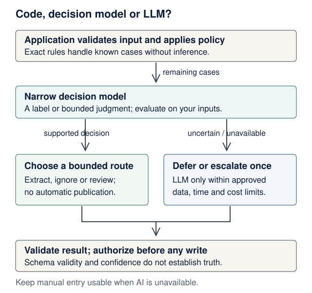

# Model APIs and decisions: code, classifier or LLM?

<!--  -->

[Course home](../README.md) · [Models and AI literacy](models-and-ai-literacy.md) · [Lecture 6](../lectures/06-pydantic-ai-agents.md) · [Local inference](local-inference.md)

**Optional reference for Lectures 2 and 6–9.** Read the vocabulary and routing diagram in 15 minutes; allow another 30–45 minutes for the offline lab. Hosted requests, Jev and GPU serving are optional comparisons, never assessment requirements. Keep the course's three-service architecture and existing deadlines.

**Learning checkpoint:** distinguish OpenAI from OpenAPI; explain where a provider adapter belongs; choose code, a narrow decision model or generation for a task; measure a mixed route against a simpler baseline.

## Read this guide by class

Learn the concept in its lecture first, then open the relevant section here. Keep the core reference service working before trying a different provider or a router.

| Place in the course | Use this part of the guide | Purpose |
|---|---|---|
| [Lecture 2: HTTP and schemas](../lectures/02-http-fastapi-pydantic.md#openapi-describes-this-api-openai-is-a-different-name) | [Vocabulary](#the-names-describe-different-layers) | Separate OpenAPI from OpenAI |
| [Lecture 6: agent and adapter](../lectures/06-pydantic-ai-agents.md#one-application-contract-several-provider-adapters) | [API examples](#the-same-task-across-apis), [System 1/System 2](#system-1-and-system-2-a-useful-analogy-with-limits) | Trace a configured provider and choose the needed capability |
| [Lecture 7: service contracts](../lectures/07-third-service-contracts.md#two-contracts-two-kinds-of-compatibility) | [Mixed-system boundaries](#a-mixed-system-has-explicit-boundaries) | Keep model changes inside your application contract |
| [Local inference / Lecture 8](local-inference.md#place-local-serving-behind-the-adapter-boundary) | [vLLM client](#vllm-compatible-transport-independently-tested-behavior), [Jev/ONNX case study](#jev-and-the-openclaw-case-study) | Distinguish runtime, model and network route; optional experiments |
| [Lecture 9: evaluate the whole system](../lectures/09-failures-evals-costs.md#evaluate-the-entire-routed-system) | [Offline policy lab](#offline-lab-confidence-is-a-routing-input-not-permission), [measure the mix](#measure-the-mix-before-keeping-it) | Separate tested routing code from measured model quality |

The two teaching diagrams in [Lecture 6](../lectures/06-pydantic-ai-agents.md#one-application-contract-several-provider-adapters) and [Lecture 9](../lectures/09-failures-evals-costs.md#evaluate-the-entire-routed-system) connect the API examples below to the product and the evaluation evidence.

**Predict first:** a model says a recipe is safe with confidence `0.99`. Does that permit your application to publish it, certify an allergen claim or bypass the owner's access check?

<details markdown="1">
<summary>Check your prediction</summary>

No. A score estimates a model decision under particular conditions. It grants no authority, and may be wrong or poorly calibrated on your inputs. Application code enforces access and invariants. For consequential food-safety claims, the course example defers to a person rather than treating a classifier or an LLM as certification.

</details>

## The names describe different layers

| Name | What it is | What it does in your product |
|---|---|---|
| **OpenAPI** | A standard describing HTTP APIs | Describes paths, inputs, responses and security schemes. Inspect FastAPI's `/openapi.json`; Lecture 7 tests a contract snapshot. A description alone does not enforce authorization. |
| **OpenAI API** | A hosted model service | Your server sends authenticated requests, for example to the Responses API. An editor subscription does not automatically supply API credits. |
| **Claude API (Anthropic)** | Another hosted model service | Its Messages API has its own request and response shapes. Use its adapter rather than assuming every OpenAI field works. |
| **Pydantic** | Python data validation | Checks the shape and selected constraints of incoming and outgoing data. It cannot establish factual truth. |
| **Pydantic AI** | An agent framework | Organizes model calls, typed outputs, tools, dependencies and limits. A provider adapter translates requests and responses. |
| **vLLM** | A model inference server | Serves model weights, often on a Linux GPU host, over supported HTTP interfaces. It is neither a model family nor an authorization layer. |
| **Jev (TypeSafe)** | A specialized decision model | Answers constrained questions, such as a Boolean or choice among labels, rather than writing arbitrary prose. A concrete example of a decision model. |
| **ONNX Runtime** | A runtime for exported models | Can execute an appropriate classifier locally. ONNX describes a model format/ecosystem, not a universal agent or a quality guarantee. |

The [OpenAPI specification](https://spec.openapis.org/oas/v3.2.1.html) describes API contracts. Use the version actually emitted by your framework; do not change a generated document's version string to claim unsupported features.

## System 1 and System 2: a useful analogy, with limits

In this lesson, **System 1** means a quick, bounded judgment and **System 2** means a more deliberative approach to a difficult task. These terms borrow from human cognition; they are not literal model anatomy or a standard API taxonomy. A small model can fail, a reasoning model can fail, and ordinary deterministic code often handles the decision best.

| Need | First implementation to consider | Why |
|---|---|---|
| Convert hours to minutes; check owner ID; enforce a limit | Python and database constraints | Explicit rules, repeatable behavior and testable boundaries |
| Label a message as recipe / unrelated / uncertain | A narrow classifier or decision model | Finite output set; measure confusion between labels |
| Extract a title and ingredients from messy prose | A general model with typed output | Requires reading and producing values absent from a fixed label list |
| Explain an ambiguous recipe or investigate conflicting evidence | A capable reasoning model or a person | More context and deliberation may help; verify the result |
| Approve a write or claim that food is safe | Application policy and appropriate human review | Neither model size nor confidence creates permission or expertise |

“Reasoning effort” or a thinking budget is a provider/model setting, where supported. It is not interchangeable across APIs, and more reasoning is not a substitute for evidence. Compare task success, latency and cost rather than awarding marks for long explanations or hidden thought traces.

### Two different API controls

For a supported model, OpenAI Responses accepts `reasoning={"effort": "low"}`; supported values depend on that exact model. See the official [reasoning guide](https://developers.openai.com/api/docs/guides/reasoning). Claude exposes effort through `output_config={"effort": "low"}` on supported models; its [thinking and cost guide](https://platform.claude.com/docs/en/build-with-claude/thinking-steering-and-cost) explains adaptive thinking and model-specific availability. These settings guide computation, not permission or a guaranteed quality level. Do not copy one provider's field into another provider's request.

**Mini-experiment:** choose one supported model and a fixed set of simple and difficult tasks. Compare its default effort with a supported lower setting. Keep prompts and output limits fixed, record completion/refusal status, usage and end-to-end latency, then grade correctness against the same rubric. Run repeats; do not interpret one fast answer as a quality result. A mixed system can combine deterministic code, a decision model and a reasoning LLM; these are complementary choices, not a requirement to call three models for every request.

## A mixed system has explicit boundaries

<figure class="course-diagram">
  <div class="diagram-scroll" role="region" tabindex="0" aria-label="Decision routing diagram, scroll horizontally">
    
  </div>
  <figcaption><strong>Spend intelligence where it helps.</strong> Every route returns through application checks. An LLM is an optional escalation, not an escape from policy. <a href="../assets/diagrams/model-decision-routing.svg">Open the diagram at full size</a>.</figcaption>
</figure>

**Text trace:** validate → use an exact rule if one applies → otherwise classify → accept a supported decision or defer/escalate once → validate the result → check authority before a write. A timeout also needs an explicit route. For Recipe Box, manual entry remains usable when AI is unavailable.

A narrow classifier can save work when many requests need only a label. It adds another failure mode and network hop if hosted. Start with one good baseline; add routing only after measurements justify it. Do not use a regex to infer an allergen guarantee or let an LLM approve its own permissions.

## The same task across APIs

These are **optional provider illustrations**, not replacements for Lecture 6's tested service. Keep keys in server-side environment variables, never browser JavaScript, committed files or logs. Configure a model ID available to your account. Pin dependency versions in your experiment's lockfile and record the returned model/version where available. Examples were checked against primary documentation on **19 October 2026**; moving aliases and model access can change.

### OpenAI: typed extraction through Responses

In a separate scratch project, install `openai` and `pydantic`. Set `OPENAI_API_KEY` privately and `OPENAI_MODEL` to an available model supporting Structured Outputs. The official [Structured Outputs guide](https://developers.openai.com/api/docs/guides/structured-outputs) documents `responses.parse` and Pydantic schemas. Handle refusal, incomplete responses and provider errors; a valid object can still contain an incorrect ingredient.

Put the shared output type in `schemas.py` (importing this file makes no request):

```python
# schemas.py
from typing import Literal

from pydantic import BaseModel, ConfigDict


class RecipeDraft(BaseModel):
    model_config = ConfigDict(extra="forbid")
    title: str
    ingredients: list[str]
    status: Literal["draft"]
```

Then create the client script beside it:

```python
# openai_example.py — optional paid/network request
import os

from openai import OpenAI

from schemas import RecipeDraft

with OpenAI(timeout=15.0, max_retries=0) as client:
    response = client.responses.parse(
        model=os.environ["OPENAI_MODEL"],
        instructions="Extract only supplied recipe facts. Return status draft.",
        input="Lentil soup: lentils, water, cumin. Simmer until cooked.",
        text_format=RecipeDraft,
        max_output_tokens=1024,
    )
    if response.status != "completed" or response.output_parsed is None:
        raise RuntimeError("No usable draft; offer manual entry")
    print(response.output_parsed.model_dump_json())
```

The request has a token ceiling and no automatic retries. The SDK timeout controls network phases; the service must also enforce its total request deadline. Do not automatically repeat writes after an unknown outcome. Use Lecture 7's timeout budget and Lecture 9's error mapping in the actual application.

### Claude: Messages is a different contract

In another scratch project, install `anthropic`. Set `ANTHROPIC_API_KEY` privately and `ANTHROPIC_MODEL` to an available model. This example deliberately asks for **plain text**, not a validated recipe. Claude's [Messages reference](https://platform.claude.com/docs/en/api/messages/create) defines a list of content blocks and a stopping reason; do not assume the first block is always text or that truncated output is complete.

```python
# claude_example.py — optional paid/network request
import os

from anthropic import Anthropic

with Anthropic(timeout=15.0, max_retries=0) as client:
    message = client.messages.create(
        model=os.environ["ANTHROPIC_MODEL"],
        max_tokens=256,
        system="Explain recipe wording. Do not certify food safety.",
        messages=[{"role": "user", "content": "What does simmer mean?"}],
    )
    if message.stop_reason != "end_turn":
        raise RuntimeError("Answer did not finish normally")
    text = "".join(b.text for b in message.content if b.type == "text")
    if not text:
        raise RuntimeError("No text answer")
    print(text)
```

For application data, use supported structured output and validation, or the Pydantic AI adapter below. A successful HTTP response does not by itself mean you received a usable answer. Rate limits, expired keys and refusals need separate handling.

### Pydantic AI: one application type, different adapters

Keep the model behind `ai-service`; the backend still consumes your own `POST /extract` contract. In an isolated experiment, install `pydantic-ai-slim[openai,anthropic]`. These dependencies include both provider clients. The [OpenAI adapter](https://pydantic.dev/docs/ai/models/openai/) supports distinct Responses and Chat model classes; the [Anthropic adapter](https://pydantic.dev/docs/ai/models/anthropic/) handles Claude's contract.

```python
# adapter_example.py — optional provider configuration; not a complete service
import os

from pydantic_ai import Agent
from pydantic_ai.models.anthropic import AnthropicModel
from pydantic_ai.models.openai import OpenAIResponsesModel
from pydantic_ai.usage import UsageLimits

from schemas import RecipeDraft

provider = os.environ["PROVIDER"]
if provider == "openai":
    model = OpenAIResponsesModel(os.environ["OPENAI_MODEL"])
elif provider == "anthropic":
    model = AnthropicModel(os.environ["ANTHROPIC_MODEL"])
else:
    raise ValueError("PROVIDER must be openai or anthropic")
agent = Agent(model, output_type=RecipeDraft, retries=0)
result = agent.run_sync(
    "Extract a draft: Lentil soup; lentils, water, cumin.",
    usage_limits=UsageLimits(request_limit=1, total_tokens_limit=2048),
)
print(result.output.model_dump_json())
```

The shared `schemas.py` keeps importing a type separate from executing a request. Usage limits bound a run; a total-token check can detect overspend after a response, so also set provider output ceilings and an overall deadline. The framework does not make all models equally good at your task.

### vLLM: compatible transport, independently tested behavior

Use the existing [local inference lab](local-inference.md#optional-local-request-lab) for the accessible Ollama route. vLLM is an optional instructor/GPU-host route. Its current [online serving documentation](https://docs.vllm.ai/en/latest/serving/online_serving/) lists supported endpoints and limitations. The server version, model, chat template, tool parser and output constraints all matter.

Illustrative command **after installing a compatible vLLM build on suitable hardware**, with a model ID/revision and memory budget chosen by the operator:

```bash
vllm serve "$LOCAL_MODEL" --host 127.0.0.1 --port 8000
```

A local scratch client can use the OpenAI SDK's Chat Completions interface:

```python
# vllm_example.py — optional local model server, no hosted OpenAI call
import os

from openai import OpenAI

with OpenAI(
    base_url="http://127.0.0.1:8000/v1",
    api_key="local-development-only",
    timeout=15.0,
    max_retries=0,
) as client:
    reply = client.chat.completions.create(
        model=os.environ["LOCAL_MODEL"],
        messages=[{"role": "user", "content": "Explain simmer in one sentence."}],
        max_tokens=128,
    )
    choice = reply.choices[0]
    if choice.finish_reason != "stop" or not choice.message.content:
        raise RuntimeError("No complete text answer")
    print(choice.message.content)
```

The dummy key does not secure that server; keep the demonstration on loopback. A production/shared endpoint needs authentication and network controls. Within Compose, `127.0.0.1` names the current container: use the model service's DNS name on a private network, or the platform-specific host route explained in [Local inference](local-inference.md#use-a-local-model-in-your-ai-service). This does not add a required fourth service. A working text request is not evidence that tools, structured outputs or reasoning controls are compatible.

## Jev and the OpenClaw case study

Pydantic AI's [decision-model guide](https://pydantic.dev/docs/ai/models/decision/) maps typed questions to constrained decisions, with an escalation route when a decision model cannot fill an output. This is useful for label selection; arbitrary recipe titles and ingredient text require a different capability.

The [TypeSafe/Jev adapter guide](https://pydantic.dev/docs/ai/models/typesafe/) documents `typesafe:jev-latest`, versioned IDs and limits. It warns about arithmetic, dates and adversarial input. Use code for exact calculations. Pin the evaluated version and re-evaluate thresholds when it changes. Optional configuration sketch for a compatible Pydantic AI release and TypeSafe account:

```python
# jev_example.py — optional hosted decision request
from typing import Literal

from pydantic_ai import Agent
from pydantic_ai.usage import UsageLimits

router = Agent(
    "typesafe:jev-latest",  # moving alias; pin the evaluated version for release
    output_type=Literal["recipe", "unrelated", "uncertain"],
    instructions="Classify supplied text. Use uncertain for ambiguous cases.",
    retries=0,
)
result = router.run_sync(
    "Lentils, water, cumin; simmer until cooked.",
    usage_limits=UsageLimits(request_limit=1),
)
print(result.output)
```

This example requires `pydantic-ai-slim[typesafe]` in a compatible version and a private `TYPESAFE_API_KEY`. It produces a label, **not a calibrated confidence score**, and does not implement the lab's scoring interface automatically. Calibration means that, on similar held-out cases receiving probability 0.8, roughly 80% should be correct; an LLM writing “80% confident” is not that evidence.

Peter Steinberger's [14 October 2025 workflow post](https://steipete.me/posts/just-talk-to-it) discusses steering versus queuing messages and choosing an effective model/harness. It is a dated practitioner account, not a decision-model benchmark. For the current implementation case study, OpenClaw's [local ONNX decision plugin](https://docs.openclaw.ai/plugins/onnx) documents local CPU classification and explicit model downloads. **As checked on 19 October 2026**, that adapter needs a matching source checkout with its V2 decision-provider API; the documented stable `2026.10.4` host exposes V1. Do not present this development integration as a one-command stable install. We could not verify the exact recent social post about automatic routing, so we do not attribute a specific claim or quote to Peter.

**Transfer the design, not the dependency:** a harness may use a narrow judgment to choose among bounded actions. The application still decides when an action can execute, how to handle uncertainty and whether new input belongs in the current task. Installing OpenClaw is not required for this course.

## Offline lab: confidence is a routing input, not permission

Create `routing.py` in an empty directory. This **synthetic policy exercise** consumes a supplied score; it does not run or emulate Jev, prove model accuracy, or claim that any provider exports this exact field. Scores and thresholds below are invented teaching inputs.

```python
# routing.py
from dataclasses import dataclass
from math import isfinite
from typing import Literal

Label = Literal["recipe", "unrelated", "uncertain"]
Route = Literal["manual", "extract", "ignore", "llm", "review"]


@dataclass(frozen=True)
class Decision:
    label: Label
    confidence: float


def route(
    decision: Decision | None,
    *,
    manual: bool = False,
    sensitive: bool = False,
    llm_allowed: bool = False,
    threshold: float = 0.90,
) -> Route:
    if not isfinite(threshold) or not 0 <= threshold <= 1:
        raise ValueError("threshold must be finite and between zero and one")
    if manual:
        return "manual"  # explicit caller choice needs no model
    if sensitive:
        return "review"  # deterministic policy overrides model confidence
    if decision is not None:
        if decision.label not in ("recipe", "unrelated", "uncertain"):
            raise ValueError("unsupported label")
        score = decision.confidence
        if not isfinite(score) or not 0 <= score <= 1:
            raise ValueError("invalid score")
        if score >= threshold and decision.label != "uncertain":
            return "extract" if decision.label == "recipe" else "ignore"
    return "llm" if llm_allowed else "review"
```

`extract` selects the extraction pipeline; it does not save or publish anything. `llm_allowed` means an application policy permits one bounded escalation within its budget and data rules. It is **not** permission to write. A missing decision (`None`), including a classifier outage, defaults to review unless escalation is explicitly enabled. In the actual service, obtain manual/sensitive/permission flags from trusted application state; do not trust user-supplied JSON to set its own authorization.

Create this test file beside it. Run `python3 -m unittest -v` with Python 3.14 (the course version). No packages, keys or model downloads are needed.

```python
# test_routing.py
import unittest

from routing import Decision, route


class RoutingTests(unittest.TestCase):
    def test_exact_manual_route(self):
        self.assertEqual(route(None, manual=True), "manual")

    def test_policy_overrides_high_score(self):
        self.assertEqual(route(Decision("recipe", 0.999), sensitive=True), "review")

    def test_boundary_and_supported_labels(self):
        self.assertEqual(route(Decision("recipe", 0.90)), "extract")
        self.assertEqual(route(Decision("unrelated", 0.95)), "ignore")
        self.assertEqual(route(Decision("recipe", 0.899)), "review")

    def test_uncertain_does_not_become_an_answer(self):
        self.assertEqual(route(Decision("uncertain", 1.0)), "review")

    def test_escalation_is_explicit(self):
        self.assertEqual(route(None), "review")
        self.assertEqual(route(None, llm_allowed=True), "llm")

    def test_invalid_decision_fails(self):
        for score in (float("nan"), float("inf"), -0.1, 1.1):
            with self.subTest(score=score), self.assertRaises(ValueError):
                route(Decision("recipe", score))
        with self.assertRaises(ValueError):
            route(Decision("invented", 0.99))

    def test_invalid_threshold_fails(self):
        for threshold in (float("nan"), -0.1, 1.1):
            with self.subTest(threshold=threshold), self.assertRaises(ValueError):
                route(None, threshold=threshold)


if __name__ == "__main__":
    unittest.main()
```

**Expected:** seven passing tests. They establish policy behavior, not classifier quality. To integrate: keep routing inside `ai-service`, preserve `/extract`'s contract, map failures deliberately, and test that CRUD still works during an AI outage. Do not silently change the required project into a multi-model deployment.

## Measure the mix before keeping it

Use a labelled development set to choose a threshold, then evaluate once on a separate held-out set. Include Hebrew/English, ambiguous prose, unrelated messages, injection attempts and missing facts. Report false acceptances, false rejections, the deferred fraction, total task success, p50/p95 latency and cost per **successful task**. Break down results by input type. A router may save cost while lowering quality.

**Worked arithmetic, not a benchmark:** suppose a router costs 1 unit per request, a subsequent general-model call costs 20 units, and 30% of requests need it. Expected cost is `1 + 0.30 × 20 = 7` units, versus 20 for the single-model baseline. At a 95% escalation rate the cost is 20, before operations and retries: the router no longer saves model spend. Include extraction calls too if accepted labels require them; the formula assumes accepted cases need no further model call. Never invent savings from provider marketing numbers.

If routing takes 40 ms and escalation takes 800 ms, those escalated requests take at least 840 ms before other work, not 40 ms. Tail latency depends on the distribution, contention and retries; do not infer p95 from an average. Measure warm and cold local inference separately, including queue time and memory. Use the [inference companion](inference-engineering.md) for KV-cache, batching and serving mechanics.

**Completion check:** explain your route table, show seven offline tests, name the exact condition under which you defer, and write a three-sentence decision record: baseline; evidence for or against adding routing; remaining uncertainty. Real-model runs, if available, need their own evidence and must never be represented by these synthetic tests.

## Discuss and verify

1. Why are OpenAPI and an OpenAI-compatible endpoint different claims?
2. Why can a valid `RecipeDraft` still be wrong, and why does it remain a draft?
3. What happens if every request escalates? Include cost and latency.
4. Should a high-confidence classification authorize a database write? Identify the enforcement layer.
5. What must you re-test when changing the model, adapter, server version or threshold?

<details markdown="1">
<summary>Answer cues</summary>

OpenAPI describes an HTTP contract; compatibility concerns supported behavior of a particular endpoint. Validation establishes shape and selected constraints, not truth. Universal escalation adds router overhead. Backend policy authorizes writes. Re-run contract checks, failure tests and held-out task evaluations, and compare cost/latency for the exact configuration. More machinery is justified only by useful measured behavior.

</details>

<!--  -->
