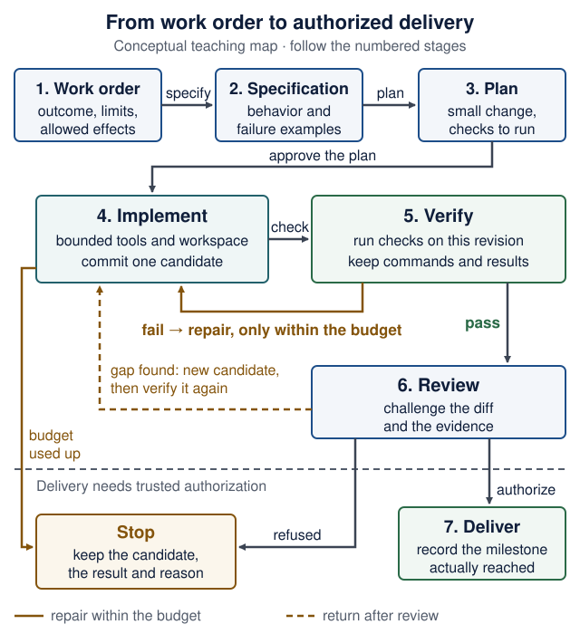
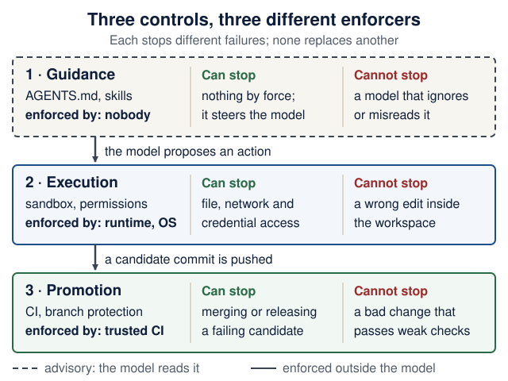

# Software factory lab: from work order to verified delivery

<!--  -->

[Course guide](../README.md) · [Agent-driven engineering](agent-driven-development.md)

**When:** Parts A and B after Lecture 2 or 3, about 45–60 minutes in total (estimate). Part C's outage drill needs the three services, so do it after Lecture 7. Revisit the delivery milestones in Lecture 10. This is formative practice with a separate demonstration repository; it adds no assignment or infrastructure requirement.

**Related:** [Engineering contracts](engineering-contracts.md) turns the same ideas into manifests, Docker reference checks and a skill-comparison exercise.

<details markdown="1" class="lecture-toc">
<summary>On this page</summary>

- [What you will learn](#what-you-will-learn)
- [The instructor's Airflow factory](#the-instructors-airflow-factory)
- [Part A — replay a complete change](#part-a--replay-a-complete-change)
- [Read the delivery milestones](#read-the-delivery-milestones)
- [Part B — commission a change in your product](#part-b--commission-a-change-in-your-product)
- [Part C — challenge the evidence](#part-c--challenge-the-evidence)
- [From a local loop to orchestration](#from-a-local-loop-to-orchestration)
- [Debrief](#debrief)
- [Sources and verification boundary](#sources-and-verification-boundary)

</details>

## What you will learn

A software factory turns a request into a candidate, checks that candidate, and moves it through an authorized delivery process. The model can help write code; the surrounding system must decide which checks run, retain the results, and enforce the allowed effects.

> **You will be able to:**
>
> - explain what a work order specifies and what remains a design decision;
> - say which evidence belongs to which source revision;
> - explain why repair attempts need a limit and an explicit failure outcome;
> - show how review can find a gap after tests pass;
> - tell a local replay, a GitHub PR, a merge, and a deployed product apart as milestones.

**Predict first:** a factory run ends with "7 tests passed" and a reviewer verdict of "approve". Name two things those two facts do *not* tell you.

<details markdown="1">
<summary>Check your prediction</summary>

Any two of: which exact revision was tested; whether the tests cover every requirement (in Part A the approving review still lists a major untested requirement); whether the agent's work was real or scripted; whether anything was published, merged or deployed; and whether the checks would fail if the behavior broke.

</details>

<details markdown="1">
<summary>Words used on this page</summary>

- **Software factory:** a system that turns a request into a checked candidate change and moves it through approval and delivery.
- **Candidate:** one identified version of the change, usually a commit, waiting for checks or review.
- **Airflow:** a scheduler that runs a fixed graph of steps and records each step's status. The instructor's factory uses it to run the lifecycle.
- **DAG** (directed acyclic graph): that graph of steps. Arrows only point forward; a retry is a new attempt of a step, not a loop in the graph.
- **Control plane:** the trusted component that decides what may be published. Agents do not hold its credentials.
- **Promotion:** moving a candidate to the next milestone: PR, merge, release.
- **`first_pass_ci=0`:** the replay's metric for "the first build did not pass its checks".
- **Local remote:** a bare Git repository on your own disk that plays the role GitHub would. Delivering to it publishes nothing.
- **MCP** (Model Context Protocol): a standard way to plug tools and data sources into an assistant. The replay does not use it.
- **Worktree:** a second checkout of the same repository in another folder; Part B uses one to rerun checks on exactly one commit.

</details>

## The instructor's Airflow factory

Yossi's [`ariflow-swfactory`](https://github.com/zozo123/ariflow-swfactory) (note the spelling: **ari**flow) is a substantial case study. Airflow schedules its lifecycle, bounded stage agents do the implementation work, and a trusted control plane keeps publication out of the agents' hands. Candidate evidence ties inputs, outputs, diffs and retained artifacts to identified revisions.

Trace one request through the numbered stages. The repair arrow has a limit; a passing check does not grant permission to publish.

<figure class="course-diagram">
  <div class="diagram-scroll" role="region" tabindex="0" aria-label="Factory lifecycle diagram, scroll horizontally">
    
  </div>
  <figcaption><strong>Follow the candidate and the authority.</strong> This teaching map simplifies the lifecycle; it is not the exact Airflow DAG or evidence that a gate was enforced. Review can reveal a missing case after checks pass; a new candidate then goes back through verification. <span class="screen-only">On a narrow screen, scroll the diagram sideways.</span> <a href="../assets/diagrams/factory-lifecycle.svg">Open the full-size lifecycle diagram</a>.</figcaption>
</figure>

<details markdown="1">
<summary>Text version of the diagram</summary>

1. **Work order:** outcome, limits, allowed effects. *Specify* →
2. **Specification:** behavior and failure examples. *Plan* →
3. **Plan:** a small change and the checks to run. *Approve the plan* →
4. **Implement:** bounded tools and workspace; commit one identified candidate. *Check* →
5. **Verify:** run the checks on this revision; keep commands and results.
   - **Fail →** back to Implement to repair, only within the budget.
   - **Budget used up →** Stop.
   - **Pass →** Review.
6. **Review:** challenge the diff and the evidence.
   - **Gap found →** a new candidate goes back to Implement and must be verified again.
   - Below a dashed line: *delivery needs trusted authorization.*
   - **Refused** (or a gap stays unresolved) **→** Stop.
   - **Authorize →** Deliver.
7. **Deliver:** record the milestone actually reached.

**Stop** means: keep the candidate, the failed result and the reason; do not bypass the gate.

</details>

The repository's [lifecycle documentation](https://github.com/zozo123/ariflow-swfactory/blob/b2de672bca6e7a8eb3cb33471396384e16eb555c/docs/lifecycle.md) separates a stable control workflow from issue-specific work. Its [candidate-evidence design](https://github.com/zozo123/ariflow-swfactory/blob/b2de672bca6e7a8eb3cb33471396384e16eb555c/docs/candidate-evidence.md) asks a precise question: which candidate bytes and procedure support this result?

You will first run a small local fixture replay. It uses scripted agent outputs; it does not start Airflow or validate a live autonomous deployment. Later, use the same reasoning with your product and chosen coding assistant.

## Part A — replay a complete change

Use a separate directory outside your product. You need Git and [uv](https://docs.astral.sh/uv/); dependency installation needs network access. The pinned example uses Python 3.12, independently of your course product's Python version; uv provisions that interpreter if needed.

### Read before you run

The replay does **not** touch Recipe Box. It adds one function, `percent_change`, to a tiny `calc` package. Spend ten minutes reading these files at the pinned commit, in order, before you run anything:

1. The [README quickstart](https://github.com/zozo123/ariflow-swfactory/blob/b2de672bca6e7a8eb3cb33471396384e16eb555c/README.md#quickstart): what the replay needs, and what it says it does not do.
2. [`demo/scripted/spec.md`](https://github.com/zozo123/ariflow-swfactory/blob/b2de672bca6e7a8eb3cb33471396384e16eb555c/demo/scripted/spec.md): requirements R1–R5. Which one fixes the sign of a decrease?
3. [`demo/scripted/build.1.patch`](https://github.com/zozo123/ariflow-swfactory/blob/b2de672bca6e7a8eb3cb33471396384e16eb555c/demo/scripted/build.1.patch): the scripted agent's first attempt. Compute `percent_change(100, 125)` by hand from the patch.
4. [`demo/scripted/fix.2.patch`](https://github.com/zozo123/ariflow-swfactory/blob/b2de672bca6e7a8eb3cb33471396384e16eb555c/demo/scripted/fix.2.patch): the repair.
5. [`demo/scripted/review.json`](https://github.com/zozo123/ariflow-swfactory/blob/b2de672bca6e7a8eb3cb33471396384e16eb555c/demo/scripted/review.json): the reviewer's verdict and findings.

Then run it:

<div markdown="1" class="factory-command">

```bash
git clone https://github.com/zozo123/ariflow-swfactory.git   # note the spelling: ariflow
cd ariflow-swfactory
git checkout b2de672bca6e7a8eb3cb33471396384e16eb555c
uv sync --locked
uv run swfactory demo
```

</div>

With the GitHub CLI, `gh repo clone zozo123/ariflow-swfactory` does the same as the first line. `git checkout` with a commit id prints a "detached HEAD" notice: that is expected, because you checked out a commit rather than a branch.

This snapshot was replayed on **16 October 2026**. It needs no model key, GitHub token, Docker, Airflow, or Rust. The replay makes local Git changes in its demonstration workspace and delivers to a local remote; it opens no GitHub PR. Its fixture approvals are automatic, not human approval evidence.

Expected observations:

1. The terminal labels the run **SCRIPTED REPLAY**.
2. Intent and plan receive fixture approvals.
3. `build_and_test` reports two iterations and `first_pass_ci=0`: the first build failed its checks and was repaired.
4. The resulting build reports seven tests (the target's three plus four new ones) and passing status.
5. Review still identifies a missing negative-baseline test among its findings.
6. Delivery prints a local `pr.md` path, with zero model spend.

Follow the printed paths to `.factory/<run_id>/report.json` and `.factory/<run_id>/pr.md`. Inspect the retained intent, plan, review, and metrics. In the replay workspace, read the test and implementation diffs too.

If installation is unavailable, inspect the pinned [`demo/scripted`](https://github.com/zozo123/ariflow-swfactory/tree/b2de672bca6e7a8eb3cb33471396384e16eb555c/demo/scripted) files instead, and label that activity **artifact inspection**, not an executed replay.

### What the replay ran on your machine

The replay uses the factory's `local` sandbox profile, which the factory's own README marks "no isolation boundary". The demo's tests and Git commands ran as you, with your files, processes and network. That is acceptable here only because the code is a tiny, pinned, known fixture.

**Map the profiles:** the factory README lists four sandbox profiles. Match each one to a row of the sandbox guide's [Choose the right boundary](agent-sandboxes.md#choose-the-right-boundary) table. Then say which profile ran your replay and what it did not isolate.

| Profile | What the factory README says | Closest row in the sandbox guide |
|---|---|---|
| `local` | scripted replay and development; no isolation boundary | ? |
| `srt` | Anthropic Sandbox Runtime: filesystem and network restrictions on the local machine | ? |
| `docker` | container execution for development and rehearsal; shares the host kernel | ? |
| `islo` | remote MicroVM execution with a configured gateway | ? |

<details markdown="1">
<summary>Check your answer</summary>

- `local` → **Python virtual environment / `uv`**: dependencies are separated, but the code runs with your OS permissions.
- `srt` → **OS process sandbox**: a policy restricts file and network operations of local processes.
- `docker` → **Restricted container** if it is started with tight flags, otherwise closer to **Development container**; either way it shares a kernel.
- `islo` → **VM / Firecracker microVM**, run remotely, so also **Managed execution sandbox**: verify tenancy, egress and retention.

Your replay used `local`. It isolated nothing: files, network, processes and any credentials in your shell were all reachable from the demo's tests.

</details>

### Discuss with a partner

Answer each question from your own run first; then compare with the fixture facts. Verify every claim in your run's files rather than trusting this page.

**Q1.** Which requirement did the initial patch fail? Find the failing check rather than guessing from the final summary.

<details markdown="1">
<summary>Check your answer</summary>

`build.1.patch` returns `(old - new) / old`, the wrong sign. So `test_increase` (R2: `percent_change(100, 125) == 0.25`) gets `-0.25`, and `test_decrease` (R4: `percent_change(200, 150) == -0.25`) gets `0.25`. `fix.2.patch` changes the line to `(new - old) / old`. Verify in your run: the first build's test output should show those two failures.

</details>

**Q2.** Does the review finding mean the implementation is wrong, the coverage is incomplete, or both? What evidence would distinguish those claims?

<details markdown="1">
<summary>Check your answer</summary>

As written, a coverage gap. The major finding says no test uses a negative `old`, although R4 allows negative values. The repaired formula gives `percent_change(-100, -50) == -0.5`, which is what R2's formula `(new - old) / old` requires. Only running that case distinguishes "untested but correct" from "wrong": write the test, run it on the candidate, and record the result.

</details>

**Q3.** Which stages were scripted, and which checks actually executed?

<details markdown="1">
<summary>Check your answer</summary>

The agent's outputs are scripted fixtures: the patches, the plan, the review JSON and the approvals. The tests, the Git commits and the delivery to the local remote really executed on your machine. The terminal banner says so: `SCRIPTED REPLAY — agent=scripted, no model calls`.

</details>

**Q4.** What would you still need before claiming that a real agent solved the task, or that a live deployment worked?

<details markdown="1">
<summary>Check your answer</summary>

For the agent: a run with a real model and its own retained evidence; the replay proves that the pipeline handles a failure and a repair, not that a model can write the patch. For deployment: a deployment record naming the running revision, plus a check of the requested user journey. Neither exists in a local replay.

</details>

> **Defend it:** the reviewer approved but listed a major gap. As release owner, would you deliver? Defend your choice in three sentences, citing R4 and the evidence you would require.

<details markdown="1">
<summary>What a strong answer mentions</summary>

A clear decision; R4 (negative values are allowed) is not covered by any test; the evidence that would change your mind: a negative-baseline test committed on a new candidate and passing from a clean checkout of that commit. "Approve" is the reviewer's opinion, not a check. A strong "deliver" answer narrows the claim ("R4 untested") and records a follow-up; a strong "do not deliver" answer names the one test that would unblock it and notes its cost is small.

</details>

<div markdown="1" class="factory-delivery-map">

## Read the delivery milestones

Here is one possible repository delivery path. Each step needs its own evidence; reaching one does not establish the next.

<ol class="factory-milestones" role="list" aria-label="Delivery milestones">
  <li><strong>Local candidate.</strong> <span>Identified source, retained checks, and a review record. The replay's local <code>pr.md</code> stops here.</span></li>
  <li><strong>Remote PR.</strong> <span>An actual PR URL and CI results for its current candidate. A local report is not a GitHub PR.</span></li>
  <li><strong>Merged.</strong> <span>A merge record identifying what reached the target branch, with the required checks satisfied.</span></li>
  <li><strong>Deployed and checked.</strong> <span>A deployment record identifying the running revision, plus a check of the requested user journey.</span></li>
</ol>

</div>

Publishing, merging, and deploying require the authority defined by the task and repository policy. **The scripted replay demonstrates local delivery only.** It does not open a GitHub PR, merge a branch, or verify a live deployment.

<details markdown="1" class="factory-check">
<summary>Predict first: the replay printed pr.md. Is the feature live?</summary>

No. Inspect what the file records and label the result **local delivery**. A real PR, merge, deployment, and working user journey each need separate observations. Do not infer them from a filename or a passing local suite.

</details>

## Part B — commission a change in your product

Use the course's worked task, the [tag filter](agent-driven-development.md#one-work-order-template): `GET /recipes?tag=<tag>` returns only recipes whose comma-separated `tags` contain the tag, ignoring case, and an unknown tag returns `200` with `[]`. Adapt the names to your own domain if your product differs. Keep this experiment on a branch in your own product repository. Use your available assistant, or implement it by hand; the verification exercise is the same.

Write the work order with all nine fields of the [one work-order template](agent-driven-development.md#one-work-order-template). For example:

```text
Outcome:      GET /recipes?tag=<tag> returns only recipes whose comma-separated tags contain
              the tag (case-insensitive); an unknown tag returns 200 with []
Files:        backend/app/main.py, backend/tests/test_tag_filter.py (new)
Non-goals:    no model, schema, dependency or other-route changes; existing tests untouched
Verify with:  cd backend && uv run pytest   (all pass, the two new tests included)
Review focus: the filter condition (whole tags, not substrings); offset and limit still apply
Acceptance:   tests/test_tag_filter.py fails first, because every recipe comes back
Stop:         two failed repair attempts, an unclear requirement, or a needed schema change
Budget:       2 repair attempts, 30 minutes
Delivery:     a local commit on this branch only; I decide about a PR, the assistant never
              pushes, merges or tags
```

**If your new test passes before any change, record *already satisfied*; never manufacture a failure.**

Then run one bounded cycle:

1. Start a branch from a clean state: `git status --short` prints nothing, then `git switch -c tag-filter`. Note the starting commit with `git rev-parse HEAD`.
2. Have the assistant inspect the code and propose a small plan. Resolve behavior ambiguities yourself.
3. Write the acceptance test and see it fail for the [right reason](agent-driven-development.md#right-reason-vs-wrong-reason).
4. Let the assistant implement and run checks within the work order. Inspect the diff yourself, starting with `tests/`.
5. At the chosen limit, either keep a verified candidate or record why it is blocked. Do not weaken the check or silently restart the repair budget.
6. Commit the candidate on the branch. Then rerun the affected checks from a clean checkout of exactly that commit, and keep the output outside your tracked source:

```bash
# (from recipe-box/, your product repository, after committing the candidate)
git status --short                        # prints nothing: no uncommitted changes
SHA=$(git rev-parse HEAD)                 # the candidate's full commit id
git worktree add ../rb-check "$SHA"       # a clean second checkout of exactly that commit
mkdir -p ../evidence
(cd ../rb-check/backend && uv sync --locked && uv run pytest; echo "exit status: $?") 2>&1 \
  | tee "../evidence/$SHA-backend.txt"
git worktree remove ../rb-check           # removes the extra folder; the commit stays
```

`git worktree add` prints `Preparing worktree (detached HEAD 1a2b3c4)` and `HEAD is now at 1a2b3c4 …` with your own short id. **Detached HEAD is expected:** the second checkout points at one commit, not at a branch, which is exactly what you want to test. The evidence file ends with your pytest summary and `exit status: 0`, and it lives in `../evidence/`, next to your repository rather than inside it.

**Checkpoint:** `ls ../evidence` shows one file named after the full commit id, and `git worktree list` shows only your main checkout again. If `git worktree remove` says the folder "contains modified or untracked files", something wrote into the clean checkout; look with `git -C ../rb-check status` before you consider `--force`. Repair if Git commands are unfamiliar: [Git you need to operate](engineering-foundations.md#git-you-need-to-operate).

Keep a small evidence record; a full chat transcript is unnecessary:

```text
Work order:  GET /recipes?tag=<tag> filter (the nine fields above)
Candidate:   full commit SHA
Environment: Python version; backend/uv.lock as committed in that SHA
Checks:      cd backend && uv run pytest; exit status; ../evidence/<sha>-backend.txt
Coverage:    matching tag, unknown tag, case; not yet covered: veg vs vegan (substring)
Review:      findings, decisions, unresolved uncertainty
Delivery:    local candidate / PR URL / merge SHA / deployed revision, as applicable
```

Record only states actually reached. If a command was unavailable or a test failed, say so. If you change the candidate after verification, rerun the affected checks and update the record. A trustworthy CI run records the revision it checked; typing a SHA into a note does not, by itself, bind evidence to those bytes.

### Evidence follows the revision

Suppose the tag-filter tests pass on candidate A. You then edit the filter to ignore spaces around tags, producing candidate B. Follow the two evidence records below: what is known about B before its checks run?

<figure class="course-diagram">
  <div class="diagram-scroll" role="region" tabindex="0" aria-label="Candidate evidence diagram, scroll horizontally">
    
  </div>
  <figcaption><strong>A result is a claim about a particular candidate.</strong> A and B are illustrative labels, not real commit ids. Retain the checked source identity, commands, environment, and output. If B fails, record the failure and use the remaining repair budget; do not copy A's passing status. <span class="screen-only">On a narrow screen, scroll the diagram sideways.</span> <a href="../assets/diagrams/factory-evidence.svg">Open the full-size evidence diagram</a>.</figcaption>
</figure>

<details markdown="1">
<summary>Text version of the diagram</summary>

1. **Candidate A** (committed source, clean checkout) → *run* → **Check A** (observed pass) → *record* → **Evidence A**, which describes A only.
2. *Edit the source* → **Candidate B**, edited but not yet committed or checked. **B has not been verified**: A's result is still about A, not B.
3. *Commit, then check out cleanly and rerun* → **Candidate B** (committed source, clean checkout) → *run* → **Check B**.
   - **Pass →** record **Evidence B**, which describes B only.
   - **Fail →** record the failure and use what is left of the repair budget. Never copy A's pass.
4. Before review, record source + procedure + environment + results.

</details>

<details markdown="1" class="factory-check">
<summary>Predict first: seven tests passed, then the reviewer requested a new failure case. What next?</summary>

Write a relevant case and inspect its result. If it exposes a defect, repair it within the budget. Commit the resulting candidate, rerun the affected checks from that revision, and retain the new evidence. Review the remaining gap before any authorized promotion. The earlier pass still describes the earlier candidate and coverage.

</details>

## Part C — challenge the evidence

Try two of these drills on the disposable experiment branch. Restore the intended behavior afterwards. Keep assignment tests and release controls intact.

| Drill | What to observe | Engineering response |
|---|---|---|
| Temporarily break the behavior protected by the new test | The test must fail for that behavior | Strengthen an irrelevant or ineffective test |
| Change source after a passing run | The earlier result describes an older candidate | Verify the changed revision |
| Introduce a controlled service outage (**after Lecture 7**) | A unit suite may stay green while the user flow fails | Add the appropriate integration/failure check |
| Add a requirement the work order left ambiguous | A plausible patch may implement the wrong interpretation | Resolve the requirement before approving the candidate |
| Ask a reviewer to challenge the happy-path coverage | A counterexample may expose a gap in passing tests | Add a justified case and rerun |

The reviewer may be a classmate or a separate assistant context. Give it the work order, diff, and evidence; ask for reproducible findings. Check its claims too. A fresh context reduces some shared assumptions, but does not guarantee independence or correctness.

## From a local loop to orchestration

Start with commands you can run and explain. A branch, test runner, and CI are enough to learn the core method. Airflow becomes useful when scheduling, concurrent work, retries, approval waits, and recovery need durable coordination.

In the instructor factory, Airflow owns the managed lifecycle. A stage agent can have its own bounded tool loop without becoming another lifecycle scheduler. This is the same separation as a **workflow** containing an **agent** in [Agent-driven engineering](agent-driven-development.md#the-product-loop): explicit outer stages can contain uncertain model-driven work.

Before adding parallel agents, define input revisions, separate workspaces, budgets, and who integrates the results. Test the combined candidate after integration. Sibling agents starting from the same code and instructions do not provide independent evidence merely because there are several of them.

**The three controls.** This is the course's single statement of them; other pages link here. When you discuss any harness, separate:

- **Guidance:** project instructions and skills describe how to work. The model reads them; nothing enforces them.
- **Execution:** runtime restrictions decide which files, commands, network destinations and credentials are reachable. The harness runtime or the operating system enforces them.
- **Promotion:** trusted CI and repository policy decide whether a candidate may be published, merged or released. CI and branch protection enforce them.

<figure class="course-diagram">
  <div class="diagram-scroll" role="region" tabindex="0" aria-label="Three controls diagram, scroll horizontally">
    
  </div>
  <figcaption><strong>Ask "who enforces this?" for every rule.</strong> A rule in <code>AGENTS.md</code> belongs to the first layer only. <span class="screen-only">On a narrow screen, scroll the diagram sideways.</span> <a href="../assets/diagrams/agent-three-controls.svg">Open the full-size controls diagram</a>.</figcaption>
</figure>

<details markdown="1">
<summary>Text version of the diagram</summary>

| Control | Examples | Enforced by | Can stop | Cannot stop |
|---|---|---|---|---|
| 1. Guidance (advisory) | `AGENTS.md`, skills, the work order | nobody: the model reads it | nothing by force; it steers the model | a model that ignores or misreads it, or injected text |
| 2. Execution | sandbox, permission rules, approvals | the harness runtime or the operating system | file, network and credential access, if configured | a wrong edit inside the allowed workspace |
| 3. Promotion | CI checks, branch protection, release rights | trusted CI and the hosting platform | merging or releasing a candidate whose required checks fail | a bad change that passes weak checks, or a secret already leaked during execution |

Between the layers: the model proposes an action (1 → 2); a candidate commit is pushed (2 → 3).

</details>

A worktree isolates source changes, not processes or credentials. A successful check supports a bounded claim, not permission. A merged PR can still await deployment. Define completion at the level the user actually requested.

## Debrief

Explain one candidate without consulting the assistant:

1. What behavior changed, and which requirement justified it?
2. Which observation showed the original failure?
3. Which revision passed which checks?
4. What did review find that those checks missed?
5. Which operations were permitted, and which component enforced that boundary?
6. What remains unknown, and what would be the next useful check?

For the product agent, ask the corresponding questions about its input, allowed tools, limits, output validation, and evaluation cases. The development process and the runtime agent share these engineering questions, even though their work and authority differ.

**Check yourself:** answer from memory, then open the answer. Ungraded.

**Q1.** Candidate B differs from candidate A only in one comment line, and A's checks passed. May your evidence record say "B passed"?

<details markdown="1">
<summary>Check your answer</summary>

No. The record may only state what was observed: A passed. A comment is unlikely to change behavior, but "unlikely" is a judgment, not an observation, and some checks do read comments (a doctest, a line-length lint rule). Rerunning the affected checks on B is cheap and makes the claim true.

</details>

**Q2.** Why does the repair loop have a budget, and what happens when it runs out?

<details markdown="1">
<summary>Check your answer</summary>

Without a limit, a failure the agent cannot fix consumes unbounded time and money, and the pressure to "get green" invites weakened checks. When the budget is used up, the run stops with an explicit failure outcome: keep the candidate, the failing output and the reason, and hand the decision to a person. A recorded failure is information; a silently restarted budget hides it.

</details>

**Q3.** Why does the factory's control plane, and not a stage agent, hold the credentials that publish?

<details markdown="1">
<summary>Check your answer</summary>

Because promotion must be enforced outside the model. A stage agent reads untrusted text (issues, code, tool output) and can be steered by it; if it held publishing rights, steering it would be enough to publish. With the credentials elsewhere, a steered agent can at worst produce a bad candidate, which the checks and the release decision can still reject. This is the promotion layer of the [three controls](#from-a-local-loop-to-orchestration).

</details>

## Sources and verification boundary

- The instructor's [factory README at the teaching snapshot](https://github.com/zozo123/ariflow-swfactory/blob/b2de672bca6e7a8eb3cb33471396384e16eb555c/README.md) describes the replay, managed architecture, sandbox profiles, alpha status, and experimental features. On 17 October 2026 the repository's `main` branch still pointed at this snapshot.
- The pinned lifecycle and candidate-evidence documents above support the architectural case study. The local replay was executed on 16 October 2026; selected demo and candidate-evidence tests were also run when preparing this lesson. On 17 October 2026 the fixture files (`spec.md`, both patches, `plan.json`, `review.json`) and the sandbox-profile table were re-read to write the answers above; the replay was not re-run that day. None of this certifies the full factory or its live Airflow, provider, or GitHub integrations.
- The Part B worktree commands were run on 17 October 2026 (Git 2.50) against a copy of the Lecture 3 backend with the tag-filter change: `14 passed`, `exit status: 0`.
- For coding-tool context and controls, use the official documentation in [Agent-driven engineering](agent-driven-development.md#sources-and-further-exploration).

Do not point this exercise at an upstream project to generate contribution traffic. Follow the course's [open-source rules and etiquette](../README.md#contribution-etiquette), including writing maintainer-facing prose yourself.

<!--  -->
