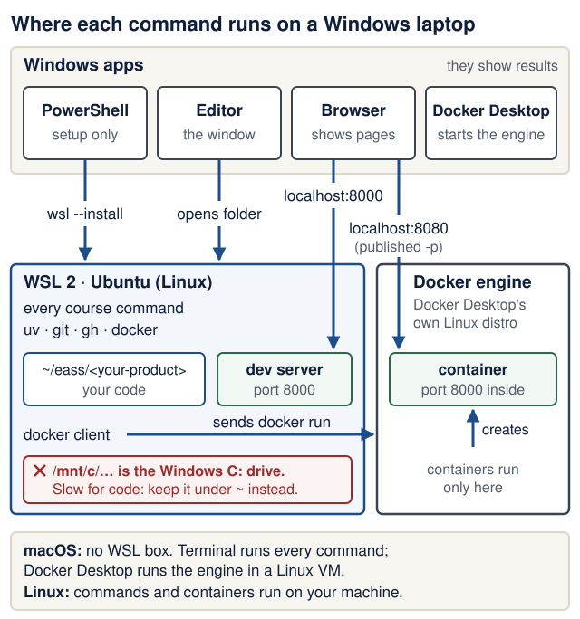

# Student setup: your laptop, GitHub, and one AI tool

<!--  -->

[Course home](../README.md) · [Learning map](learning-map.md) · [Models and AI literacy](models-and-ai-literacy.md) · [Lecture 1](../lectures/01-environment-git-docker-ai.md)

**Setup has two parts.** Do **Part A** (tools and accounts) *before* the first meeting on Monday 19 October 2026, 18:00 Israel time. Allow 1–3 hours plus download time (estimate), and finish by **Sunday 18 October in the evening**. Do **Part B** (your repository, a practice pull request, `/health`, and a first assistant task) *at the end of Lecture 1*, after the live demo shows each step. Do not try Part B alone the night before. The course requires no paid AI subscription, model API key, GPU, or particular editor.

**You will be able to:** say which terminal runs each course command, show that uv, Git, the GitHub CLI and Docker work on your laptop, and, in Part B, keep or undo an assistant's change with Git.

**Stuck in Part A?** Post the blocker before class in the channel the instructor provides, written as [PARD](../lectures/01-environment-git-docker-ai.md#asking-for-help-the-pard-template): problem, actions, result, desired. Redact secrets first.

<details markdown="1" class="lecture-toc">
<summary>On this page</summary>

- [Where each command runs](#where-each-command-runs)
- [Part A: before the first meeting](#part-a-before-the-first-meeting)
- [Part B: at the end of Lecture 1](#part-b-at-the-end-of-lecture-1)
- [When setup fails](#when-setup-fails)

</details>

## Where each command runs

Read this before you install anything (about 3 minutes). Most first-week failures are a correct command typed in the wrong place: PowerShell instead of Ubuntu, a Windows folder instead of a Linux one, or a browser address that reaches a different process from the one you just started.

**Predict first:** on Windows, you start `uv run fastapi dev` in Ubuntu, then open `http://localhost:8000/docs` in your Windows browser. Which program answers the browser, and why can a Windows program reach it?

<details markdown="1">
<summary>Check your prediction</summary>

The FastAPI development server running **inside Ubuntu (WSL 2)** answers. Ubuntu is a separate Linux environment, but by default WSL forwards `localhost` ports from Linux to Windows, so the Windows browser reaches the server in Ubuntu. If you had started a server from PowerShell instead, it would be a different Python with different files, even with the same port number.

</details>

<figure class="course-diagram">
  <div class="diagram-scroll" role="region" tabindex="0" aria-label="Where each command runs, scroll horizontally">
    
  </div>
  <figcaption><strong>Point to the box before you type the command.</strong> Everything in the course runs in the Ubuntu box; Windows only shows the results. <span class="screen-only">On a narrow screen, scroll the diagram sideways.</span> <a href="../assets/diagrams/setup-where-commands-run.svg">Open the diagram at full size</a>.</figcaption>
</figure>

<details markdown="1">
<summary>Text version of the diagram</summary>

On a Windows laptop there are three places where programs run:

1. **Windows apps.** PowerShell (as administrator, only for `wsl --install -d Ubuntu` and `wsl -l -v`), your browser, the editor window, and the Docker Desktop app.
2. **WSL 2: Ubuntu (Linux).** The Ubuntu terminal runs **every course command**: `uv`, `git`, `gh` and the `docker` client. Your code lives at `~/eass/<your-product>` in Ubuntu's own file system. `uv run fastapi dev` starts your server here, listening on port 8000.
3. **Docker engine.** Docker Desktop runs its engine in its own Linux environment (its `docker-desktop` WSL distribution). Containers run there, never in Ubuntu or Windows directly.

The arrows between them:

- PowerShell **installs and checks** WSL (`wsl --install -d Ubuntu`, `wsl -l -v`). After that you rarely need it.
- The editor window **opens** the Ubuntu folder through VS Code's WSL extension, so its terminal is an Ubuntu terminal.
- The Windows browser **opens** `localhost:8000`; WSL forwards the port to the server in Ubuntu.
- The `docker` command in Ubuntu **sends** `docker run` to the engine (Docker Desktop's WSL integration connects them), and the engine **creates** the container. Docker Desktop **starts** the engine.
- A container port published with `-p 127.0.0.1:8080:8000` **appears** on Windows as `localhost:8080`.
- Warning: `/mnt/c/...` is the Windows `C:` drive seen from Ubuntu. Code stored there is slower to install and run; keep it under `~` (your Ubuntu home).

**macOS:** there is no WSL layer. Terminal (or your editor's terminal) runs every course command; Docker Desktop runs the engine in a Linux virtual machine and forwards published ports to `localhost`.
**Linux:** every course command runs directly on your machine; Docker Engine runs containers on the same kernel.

</details>

**Optional:** your editor's terminal is sufficient. On macOS, [cmux](https://cmux.com/docs) can organize terminals into labelled workspaces and panes. Keep a service's running process visible in one pane and run tests in another; check `pwd` and the Git branch before each command. A terminal layout does not isolate an agent or preserve every running process after a restart. Use the course's [sandbox guidance](agent-sandboxes.md) for isolation. Windows students continue to run course commands in Ubuntu/WSL 2.

Four rules follow from the picture:

1. **On Windows, type course commands in Ubuntu.** An Ubuntu prompt looks like `you@laptop:~$`; PowerShell looks like `PS C:\Users\you>`. PowerShell is only for the two `wsl` commands.
2. **Keep code under your Linux home:** `~/eass/<your-product>`, never `/mnt/c/...`. Recipe Box is only the lecture demo; name the folder after your own product.
3. **`localhost` means "the machine where this request starts".** Your browser's `localhost` is Windows (or your Mac); WSL and Docker forward chosen ports to it. From Lecture 8 on, each container has its own `localhost`.
4. **The editor shows the folder it opened.** Run `pwd` in Ubuntu and in your editor's terminal: if the paths differ, the editor and your server are looking at different files.

## Part A: before the first meeting

Work through these steps in order. Each one ends with a check, and the last step is a checklist you can tick.

### Check your laptop first

Spend 5 minutes on this before you download anything.

> **You need:**
>
> - **Windows:** 64-bit Windows 10 22H2 (build 19045) or Windows 11 23H2 (build 22631) or later. Press Win+R, type `winver`, and read the version and build. Docker notes that Home editions run Linux containers only, which is all this course uses.
> - **Memory:** 8 GB RAM, Docker Desktop's minimum for Windows with WSL 2. On a Mac, Docker Desktop's minimum is 4 GB, and it supports the current and two previous major macOS releases.
> - **Disk:** about 20 GB free (a course estimate covering Docker images, Python versions, your repositories, and an optional local model).
> - **Virtualization (Windows):** hardware virtualization must be enabled in BIOS/UEFI. Task Manager → Performance → CPU shows `Virtualization: Enabled`.
> - **WSL (Windows, after installing it below):** in PowerShell, `wsl --version` shows a WSL version of 2.1.5 or later, and `wsl -l -v` lists Ubuntu with `VERSION` 2.
> - **Mac:** choose the Docker Desktop installer for your chip (Apple menu → About This Mac: "Apple M…" means Apple silicon, otherwise Intel).

Docker Desktop is free for personal and education use; its licence requires a paid subscription only for professional use in larger businesses. **If any check fails, contact the instructor through the channel the instructor provides before Monday 19 October**, so an alternative can be arranged in time.

> **Version note:** requirements from Docker's [Windows](https://docs.docker.com/desktop/setup/install/windows-install/) and [Mac](https://docs.docker.com/desktop/setup/install/mac-install/) installation pages and Microsoft's [WSL installation guide](https://learn.microsoft.com/en-us/windows/wsl/install), checked 17 October 2026.

### Choose a simple route

| Your situation | Start with | Free path? (checked 17 October 2026) |
|---|---|---|
| You want a familiar editor | VS Code with the Python extension; optionally add GitHub Copilot or the Codex extension | Yes. VS Code is free. Copilot Free and ChatGPT Free (which includes Codex) have usage limits. Copilot Student is free after GitHub verifies you. |
| You already use Cursor | Keep Cursor; open the product folder and use its integrated terminal | Limited: Cursor's Free plan includes limited agent and chat requests. |
| You prefer terminal agents | Codex CLI, Antigravity CLI, OpenCode, or Claude Code, after the basic tools work | Codex (with ChatGPT Free) and Antigravity CLI (without a paid Google AI plan) have usage-limited routes at no cost. OpenCode is a free client; you bring a model, and a free local model works. **Claude Code needs a paid Claude plan or prepaid API credits.** |
| You only have a browser assistant | ChatGPT, Gemini, Claude, or Z.ai chat, to discuss a small supplied example; you apply and test edits yourself | Free tiers exist for several; limits vary by account. |
| You have no assistant access, or your quota runs out | Follow the lecture examples manually, pair for discussion, and run the same local checks | Yes. |

> **Note:** if you are unsure, do this. Install VS Code with the Python extension (plus the WSL extension on Windows). Start with the manual route or GitHub Copilot Free. Apply for GitHub Education now, and switch to Copilot Student if and when it is approved. You can change tools later; the expected product behavior and assessment stay the same.

Five different things are often called "the AI". They can be different companies and different accounts, and signing in to one does not sign you in to the others:

| Layer | What it is | Examples | Signing in here does **not** give you |
|---|---|---|---|
| Editor | where you work with files | VS Code, Cursor | a model, or access to GitHub |
| Chat product | an interface for asking questions | ChatGPT, Gemini, Claude, Z.ai chat | API credits, or another company's coding tool |
| Coding agent | a tool that can read your workspace and run permitted commands | Copilot, Codex, Antigravity CLI, OpenCode, Claude Code | `git push` rights: GitHub uses its own login (`gh auth login`) |
| Model | the program that generates the responses | chosen inside the tool, or a local model | anything; it is what the other layers call |
| API provider | a paid or metered programmatic model service | OpenAI, Google, Anthropic or Z.ai APIs | a chat subscription; API keys are billed separately |

### Install the development tools

Install from the linked official sources. Check installer names and publishers; keep credentials out of screenshots and prompts. You do not need to install system Python separately: uv manages the project's Python.

#### Windows: one Ubuntu environment for course commands

1. Follow [Microsoft's WSL installation](https://learn.microsoft.com/en-us/windows/wsl/install). The first command runs in an administrator **PowerShell** window (right-click PowerShell → Run as administrator):

   ```powershell
   wsl --install -d Ubuntu
   ```

2. Restart if asked, open Ubuntu from the Start menu, and create its Linux username and password. Password entry shows no characters; that is normal. Then, still in PowerShell, run `wsl -l -v` and check that Ubuntu shows `VERSION 2`. From now on, run course commands in **Ubuntu**, not PowerShell.
3. Keep repositories under your Ubuntu home, such as `~/eass/<your-product>`. Do not mix a Windows Python environment with Linux files, and do not run the same project from two shells.
4. In Ubuntu, install Git and curl with `sudo apt update && sudo apt install -y git curl`. Install [uv](https://docs.astral.sh/uv/getting-started/installation/) and the [GitHub CLI](https://github.com/cli/cli/blob/trunk/docs/install_linux.md) with their Linux instructions, inside Ubuntu.
5. Install [Docker Desktop for Windows](https://docs.docker.com/desktop/setup/install/windows-install/). In Docker Desktop, open Settings → Resources → WSL Integration, turn it on for Ubuntu, and keep Docker Desktop running while you work.
6. With VS Code, install the [WSL extension](https://code.visualstudio.com/docs/remote/wsl), then open your folder from Ubuntu (`code .` inside the folder). The editor's terminal must be an Ubuntu terminal. For another editor, follow its documented WSL or remote-folder support.

#### macOS

Install [Git](https://git-scm.com/downloads/mac), [uv](https://docs.astral.sh/uv/getting-started/installation/), the [GitHub CLI](https://github.com/cli/cli#installation), and [Docker Desktop](https://docs.docker.com/desktop/setup/install/mac-install/) for your chip (Apple silicon or Intel). With Homebrew, `brew install uv gh` covers two of them. Open Docker Desktop and wait until its engine is running. Run course commands in Terminal or in your editor's terminal.

#### Linux

Install Git with your distribution's package manager, then [uv](https://docs.astral.sh/uv/getting-started/installation/) and the [GitHub CLI](https://github.com/cli/cli#installation). Follow [Docker Engine's instructions for your distribution](https://docs.docker.com/engine/install/) and install the [Compose plugin](https://docs.docker.com/compose/install/linux/). To run `docker` without `sudo`, Docker's [post-installation steps](https://docs.docker.com/engine/install/linux-postinstall/) add you to the `docker` group, which grants root-level privileges on that machine. On a shared or managed machine, ask first. Never make the Docker socket world-writable.

#### Install Python for uv

uv downloads and manages Python for each project. Install the course's Python version once:

```bash
uv python install 3.14
```

The first run prints a line such as `Installed Python 3.14.6 in 2.25s` (your patch version and time will differ). Running it again prints `Python 3.14 is already installed`.

#### Verify

Run these in the terminal you will use in class (Ubuntu on Windows):

```bash
pwd
uv --version
git --version
gh --version
docker --version
docker compose version
```

Expected output, with your own numbers (current releases checked 17 October 2026):

```text
/home/you                      (macOS: /Users/you)
uv 0.13.1 (...)                any 0.12 or newer; 0.13 recommended
git version 2.x
gh version 2.x (...)
Docker version 29.x, build ...
Docker Compose version v5.x    (v2.24 or newer is also fine)
```

`docker compose version` prints `Docker Compose version v2.24` or newer. Current Docker Desktop ships v5.x, which is the same `docker compose` plugin (Docker skipped v3 and v4). `docker-compose` with a hyphen is the retired v1; `'compose' is not a docker command` means the plugin is missing.

If uv is older than 0.12, run `uv self update` (or `brew upgrade uv` if you installed it with Homebrew). If a command prints `command not found`, restart the terminal and confirm you installed the tool in *this* environment.

**Predict first:** before you run `docker run --rm hello-world`, write down what will be downloaded, what will run, and what will be left on your laptop afterwards. Then run it, followed by `docker images` and `docker ps -a`.

<details markdown="1">
<summary>Check your prediction</summary>

The first time, Docker prints `Unable to find image 'hello-world:latest' locally` and downloads (pulls) the small `hello-world` **image**. It creates a **container** from that image, which prints `Hello from Docker!` and `This message shows that your installation appears to be working correctly.`, then exits. Because of `--rm`, Docker deletes the container as soon as it exits, so `docker ps -a` shows no `hello-world` container. The **image** stays: `docker images` lists `hello-world`, and a second run starts without downloading. Image versus container is Lecture 1's first Docker concept.

</details>

An editor launcher such as `code` is convenient, not a requirement. If it is unavailable, open the product folder through the editor's File menu. Node.js is optional unless your frontend or chosen command-line tool needs it.

### Connect Git and GitHub

Git stores history on your laptop; GitHub hosts repositories; `gh` operates GitHub from your terminal. Signing in to an AI tool does not authenticate GitHub. This is the course's one-time configuration; Lecture 1 refers to it instead of repeating it.

1. **Create your own GitHub account** with an email you will keep, and turn on the account security GitHub offers.
2. **Find your private commit email.** On GitHub, open Settings → Emails and select "Keep my email addresses private". GitHub shows an address of the form `ID+USERNAME@users.noreply.github.com`. GitHub uses a commit's email to link the commit to your account, so commits made with this address count as yours in your profile and in upstream projects, without publishing your personal address. If you also select "Block command line pushes that expose my email", a push made with your personal address is refused (see [When setup fails](#when-setup-fails)).
3. **Run the one-time configuration** in Ubuntu, Terminal or your Linux shell, replacing both example values:

   ```bash
   git config --global user.name "Your Name"
   git config --global user.email "ID+USERNAME@users.noreply.github.com"
   git config --global init.defaultBranch main
   gh auth login
   gh auth setup-git
   gh auth status
   ```

   `init.defaultBranch main` makes new repositories start on `main`, as every lecture assumes; older Git versions otherwise create `master`.

4. **Answer `gh auth login`'s questions** like this:

   | Prompt | Answer |
   |---|---|
   | Where do you use GitHub? | `GitHub.com` |
   | What is your preferred protocol for Git operations on this host? | `HTTPS` |
   | Authenticate Git with your GitHub credentials? | `Yes` |
   | How would you like to authenticate GitHub CLI? | `Login with a web browser` |

   `gh` then shows a one-time code. Press Enter, sign in to GitHub in the browser, and paste the code there. Never paste an authentication code or token into an AI chat. `gh auth setup-git` makes Git use the same login when you push; running it after answering `Yes` above does no harm.

> **Checkpoint:** `gh auth status` prints `✓ Logged in to github.com account <your-username>` and `Git operations protocol: https`, and `git config --global user.email` prints your noreply address.

For education benefits, GitHub's [student activation guide](https://docs.github.com/en/copilot/how-tos/copilot-on-github/set-up-copilot/enable-copilot/set-up-for-students) separates student verification from activating Copilot Student. Approval may take time; use another route while you wait. A payment page is never a course requirement. If you use a private product repository, arrange grader access through the instructor's submission instructions, and never grant an assistant broad access to unrelated repositories.

### Choose and configure one assistant

Documentation checked **17 October 2026**. Features, model access, eligibility, and quotas vary by account and change often. Use official installers and your own account. These are setup routes, not promises of unlimited free use. Open only the route you chose.

<details markdown="1">
<summary>Cursor</summary>

Follow the [Cursor quickstart](https://cursor.com/docs/get-started/quickstart): install, sign in, and open your product folder. Begin by asking it to explain the entry point. Inspect proposed edits in the diff and run the checks in the integrated terminal. Review [Privacy Mode and data handling](https://cursor.com/data-use) before supplying code. Cursor's [pricing page](https://cursor.com/pricing) lists a Free plan with limited agent and chat requests; check your account's current plan rather than assuming student access or every model is included.

</details>

<details markdown="1">
<summary>GitHub Copilot in VS Code</summary>

Install VS Code and its Python extension, then follow GitHub's [Copilot extension setup](https://docs.github.com/en/copilot/how-tos/copilot-in-your-ide/set-up-copilot/install-copilot-extension). Sign in to the GitHub account whose plan you intend to use. Start with an explanation in chat, and tell inline completion apart from a mode that edits files or runs commands. Review every change yourself. On the [Free and Student plans](https://docs.github.com/en/copilot/get-started/plans), models are chosen by automatic model selection, so a missing manual model picker does not mean your setup failed.

</details>

<details markdown="1">
<summary>Codex</summary>

Use the official [Codex IDE extension](https://learn.chatgpt.com/docs/codex/ide) in VS Code or a supported compatible editor, or install the [Codex CLI](https://learn.chatgpt.com/docs/codex/cli). OpenAI's [pricing page](https://learn.chatgpt.com/docs/pricing) lists Codex as included in ChatGPT Free and Go, with usage limits. Open your product folder and choose "Sign in with ChatGPT"; for the CLI, run `codex` from that folder. Inspect the workspace and permissions before your first edit. Start with an explanation, then one scoped change. Account sign-in and API-key access are different routes; API billing is not required for this course.

</details>

<details markdown="1">
<summary>ChatGPT and other browser chats</summary>

Follow the [ChatGPT quickstart](https://learn.chatgpt.com/docs/quickstart), or use the official [Gemini](https://gemini.google.com/), [Claude](https://claude.ai/), or [Z.ai](https://chat.z.ai/) chat product available to you. Supply a small code excerpt, the file path, the exact error, and the behavior you want. In a plain chat without workspace tools, the assistant has only the context you paste and cannot verify your local test run. Apply the proposal locally and run the check. A chat subscription does not automatically grant API credits or another company's coding-tool subscription.

</details>

<details markdown="1">
<summary>Antigravity CLI (Google; replaced Gemini CLI for personal accounts)</summary>

Since 18 June 2026, Gemini CLI no longer serves consumer accounts: individual users on the no-cost tier and Google AI Pro and Ultra subscribers were moved to Antigravity CLI ([Google's announcement](https://developers.googleblog.com/an-important-update-transitioning-gemini-cli-to-antigravity-cli), 19 May 2026). Gemini CLI remains for paid Gemini API keys and organization licences; the course requires neither. Antigravity's [plans page](https://antigravity.google/docs/plans/) gives accounts without a Google AI Pro or Ultra plan a quota refreshed weekly, and says every plan includes the CLI. Install it with Google's [getting-started guide](https://antigravity.google/docs/getting-started/); the command is `agy`, and `agy --version` checks the installation. On Windows, use the Linux installer inside Ubuntu: Google's page does not mention WSL, so confirm that `agy` starts in your product folder before relying on it. School-managed Google accounts can have different rules.

</details>

<details markdown="1">
<summary>OpenCode and Z.ai</summary>

OpenCode is a free, open-source client: you connect it to a model provider, and hosted models are not free just because the client is. Its [providers page](https://opencode.ai/docs/providers/) shows how to use a free local model through Ollama. Check whether you use [OpenCode V1](https://opencode.ai/docs/) or [V2](https://opencode.ai/v2/docs/): their default executable name is the same, while installation packages and permission configuration differ. Follow the matching documentation, open your project, connect a provider, and inspect the selected model before a task.

For GLM models, follow [Z.ai's OpenCode integration](https://docs.z.ai/devpack/tool/opencode). Its documented V1 route uses `opencode auth login`, the appropriate Z.ai provider, and `/models`; check compatibility before applying it to V2. Follow the [current key-management rules](https://docs.z.ai/devpack/notice/api-key-management): Standard keys and Coding Plan keys are billed differently, and a Standard key can incur API charges even when you have a Coding Plan. Do not buy a plan to complete a lab.

</details>

<details markdown="1">
<summary>Claude Code and other assistants</summary>

Claude Code's [quickstart](https://code.claude.com/docs/en/quickstart) requires a Claude Pro, Max, Team or Enterprise plan, a Claude Console account with prepaid API credits, or access through a supported cloud provider: **there is no free route**. If you already have access, open the product directory, begin with an explanation, inspect the permission mode, and review the diff of one small change. Other assistants are also fine: use the official setup, match the instructions to the version you installed, and do the same first task as everyone else (Part B).

</details>

### Permissions, privacy, and cost

- Start in your product folder with the narrowest useful access. Read approval prompts and commands before accepting them; keep control of pushing, publishing and deleting data.
- Use synthetic examples. Do not upload credentials, grades, personal records, classmates' submissions, or private upstream code without permission.
- Read the tool's data settings. A privacy option can affect training or retention while requests still leave your laptop. Running a client locally is different from running the model locally.
- Keep keys out of source code, prompts, screenshots, and shared session links. Use the tool's documented credential storage; configure application secrets separately in the service that needs them.
- Check the active account, selected model, allowance, and any overage setting. Stop at a quota message or billing prompt and switch to the manual route.
- Product tests use Pydantic AI's offline fake models (`TestModel`, `FunctionModel`), introduced in Lecture 6. They never need your editor's assistant to be signed in.

### Ready-for-class checklist

Tick these before Monday 19 October. Nothing here needs a course repository yet.

- [ ] My laptop passes the [laptop check](#check-your-laptop-first), or I have told the instructor what fails.
- [ ] In the terminal I will use in class, the [Verify](#verify) commands print versions (uv 0.12 or newer), and `uv python install 3.14` has run.
- [ ] `docker run --rm hello-world` prints `Hello from Docker!`, and I can say what `docker images` and `docker ps -a` show afterwards.
- [ ] `gh auth status` shows I am logged in, and my Git email is my noreply address.
- [ ] I can open a folder in my editor, and `pwd` in its terminal matches `pwd` in my Ubuntu or Mac terminal.
- [ ] I have one assistant route or the manual fallback, and I know which account and limits it uses.

## Part B: at the end of Lecture 1

In class, Lecture 1's [live demo](../lectures/01-environment-git-docker-ai.md#live-demo) and [lab](../lectures/01-environment-git-docker-ai.md#hands-on-lab) create everything below for your own product, one checkpoint at a time. This part collects the end state, the first assistant task, and the Git commands that let you undo an assistant's change safely. Unfinished items go to "finish before Lecture 2".

### Your repository and health check

1. A repository named after **your** product (for example `study-planner`) at `~/eass/<your-product>`, pushed to your GitHub account. Recipe Box is only the lecture demo.
2. A practice pull request on your own repository, merged. It never counts toward the three upstream PRs.
3. From `backend/`, `uv run fastapi dev` starts the server, and in a second terminal `curl http://localhost:8000/health` prints `{"status":"ok"}`.

### Do the same first task in any tool

Ask your assistant to *explain* before you ever ask it to *edit*. Paste this prompt with your product folder open:

```text
Read backend/app/main.py. Explain how GET /health reaches health().
Do not edit anything. Tell me the exact command to start this service
and the request I can send to check it. State what you have not run.
```

Write down your own answer to the same three questions first, then compare.

<details markdown="1">
<summary>Check the assistant's answer</summary>

A correct answer says, in its own words:

- **The route:** `@app.get("/health")` registers `health()` for `GET /health` on the `app` object in `app/main.py`. `fastapi dev` imports that `app` (the `[tool.fastapi]` entrypoint in `backend/pyproject.toml`), matches the request's method and path, calls `health()`, and returns its dictionary as JSON.
- **The start command:** `uv run fastapi dev`, run from `backend/`.
- **The check:** `curl http://localhost:8000/health`, which prints `{"status":"ok"}`, or <http://localhost:8000/docs> in a browser.
- **What it has not run:** a chat or an agent that only read the file should say it has not started the server or sent the request.

</details>

Red flags, in any tool:

- It claims it ran something but shows no command output, or the output does not match yours.
- It cites a file, function or setting that does not exist in your folder.
- It suggests `pip install …`, or `uvicorn main:app` from the wrong folder, instead of `uv run` from `backend/`.
- It edits a file even though you wrote "Do not edit anything".

Run the commands yourself. Then, if you want one small edit, give the assistant a short work order using the field names from the [one work-order template](agent-driven-development.md#one-work-order-template) (Outcome, Files, Non-goals, Verify with, Review focus), always on a throwaway branch:

```bash
git switch -c try-assistant              # an experiment branch; main stays safe
# ... the assistant makes its change ...
git status                               # which files changed?
git diff                                 # read every changed line
```

Keep it: `git add <file>`, `git commit -m "…"`, then `git push -u origin try-assistant` and `gh pr create --fill`, as in Lecture 1. Discard it:

```bash
git restore README.md                    # throw away uncommitted edits to one file
git switch main
git log --oneline main..try-assistant    # commits that exist only on the experiment
git branch -D try-assistant              # delete the experiment branch and those commits
```

**Predict first:** you edited `README.md` but did not commit or stage it. What does `git restore README.md` do to that edit, and can Git give it back afterwards?

<details markdown="1">
<summary>Check your prediction</summary>

It replaces your working copy of `README.md` with the last committed version, so the edit disappears. Git cannot give it back, because the edit was never committed or staged; Git only keeps what you committed. That is why you read `git diff` *before* restoring. For more undo commands (unstage, amend, revert a pushed commit), see [Git you need to operate](engineering-foundations.md#git-you-need-to-operate).

</details>

**Explain after:** which part of the assistant's answer did you verify yourself, and with which command? Write it as the first line of your product README's AI-use note.

### Optional: a five-line AGENTS.md

**Optional:** many coding assistants read a file named `AGENTS.md` at the repository root as project instructions; [Codex](https://learn.chatgpt.com/docs/agent-configuration/agents-md) and [Claude Code](https://code.claude.com/docs/en/memory) document this. Five lines save you repeating the basics in every session:

```markdown
# AGENTS.md
- Start the backend: `cd backend && uv run fastapi dev`
- Health check: `curl http://localhost:8000/health` must print `{"status":"ok"}`
- Do not edit `.env` or any file that holds secrets.
- Change only the files named in the work order.
- Say which commands you did not run.
```

> **Security:** `AGENTS.md` is guidance, not a permission boundary. An assistant can ignore it or misread it, and a file in a dependency or a pasted text can contain instructions too. Real limits come from the tool's permission settings and where it runs: read [Agent sandboxes: Week 1 minimum](agent-sandboxes.md#week-1-minimum) before your first agent session, and the [agent-driven engineering guide](agent-driven-development.md) for how instructions, tools and checks fit together.

### Ready-for-Lecture-2 checklist

- [ ] `~/eass/<your-product>` is on GitHub, and its practice PR is merged (`gh pr list --state merged` shows it).
- [ ] From `backend/`, `uv run fastapi dev` starts, and `curl http://localhost:8000/health` prints `{"status":"ok"}`.
- [ ] I compared an assistant's explanation (or a classmate's, on the manual route) with my own, and I can say which part I verified.
- [ ] I can read `git diff`, discard an edit with `git restore <file>`, and delete an experiment branch.

## When setup fails

Find your symptom, run the first check, then apply the safe fix. If it still fails, send a [PARD](../lectures/01-environment-git-docker-ai.md#asking-for-help-the-pard-template) message with the exact error line, the command you ran, and the output of the first check. Redact secrets first.

| Symptom | First check | Safe fix |
|---|---|---|
| `command not found` | Restart the terminal; check you are in the environment where you installed the tool (Ubuntu, not PowerShell) | Install the tool in the environment where you run course commands |
| WSL install fails with a virtualization error, or Docker Desktop shows "Unexpected WSL error" | Task Manager → Performance → CPU: `Virtualization` | Enable hardware virtualization in BIOS/UEFI using your laptop maker's instructions; on a managed laptop, ask the instructor |
| `wsl -l -v` shows Ubuntu with `VERSION 1` | `wsl --version` in PowerShell | `wsl --set-version Ubuntu 2` in PowerShell |
| `Cannot connect to the Docker daemon` | Is Docker Desktop running? Is Settings → Resources → WSL Integration on for Ubuntu? | Start Docker Desktop and enable the integration; on Linux, `sudo systemctl start docker` |
| Linux: `permission denied … /var/run/docker.sock` | `groups` does not list `docker` | Docker's [post-installation steps](https://docs.docker.com/engine/install/linux-postinstall/), then log out and in; the `docker` group is root-equivalent, so on a managed machine use `sudo docker …` for today and ask. Never `chmod` the socket |
| `'compose' is not a docker command` | `docker compose version` | Update Docker Desktop, or install the [Compose plugin](https://docs.docker.com/compose/install/linux/) on Linux. Do not install the retired `docker-compose` v1 |
| Push rejected with `GH007: Your push would publish a private email address` | `git config user.email` | Set your noreply address (above), run `git commit --amend --reset-author --no-edit`, then push again |
| Git asks for a username and password | `gh auth status` | `gh auth setup-git`, then push again. GitHub does not accept your account password for Git |
| Git push denied (`403`, or "permission denied") | `gh auth status` and `git remote -v` | Push to a repository you own, logged in as the right account |
| Installs are slow, or the server misses your edits | `pwd` starts with `/mnt/c` | Clone or move the project to `~/eass/<your-product>` and reopen it from Ubuntu |
| Docker Desktop on a Mac will not start, or reports the wrong architecture | Apple menu → About This Mac: chip or processor | Reinstall the Docker Desktop build for Apple silicon or Intel |
| `no space left on device` during a pull or build | `docker system df` and your free disk space | `docker system prune` removes stopped containers, unused networks, dangling images and build cache after asking; it keeps volumes. Free other disk space if needed |
| Editor shows different files from the terminal | `pwd` in both | Reopen the same Linux folder (on Windows, `code .` from Ubuntu) |
| Assistant cannot see your code | The selected workspace and attached files | Ask it to name the file it read; reopen the product folder |
| Wrong model or authentication error | Active account, provider, model ID, and key type | Sign in again with the account you intend to use; check the provider's model list |
| Quota exhausted | The tool's usage page | Pause model use; continue with the lecture examples and local tests |

On a managed laptop without installation rights, contact the instructor early to arrange an approved environment. Browser chat alone cannot run the required Docker stack.

<!--  -->
