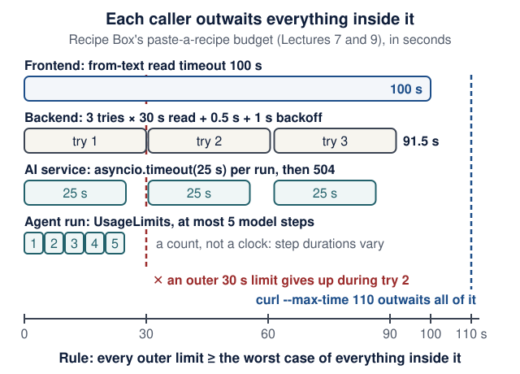
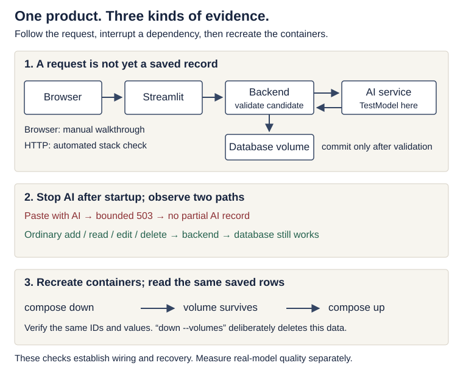

# Visual system walkthrough: one request, end to end

<!--  -->

[Course home](../README.md) · [Learning map](learning-map.md) · [Lecture 7](../lectures/07-third-service-contracts.md) · [Engineering contracts](engineering-contracts.md)

**A visual review for Lectures 3 and 7–10; optional depth.** Use it with your existing product; it adds no framework and no assignment. Follow one successful request, predict how it fails, and collect evidence at the right boundary. The diagrams describe Recipe Box's Streamlit route; a React browser client has a different first HTTP hop.

**Reading route by lecture.** Read only your lecture's row. Everything else on this page can wait until that lecture.

| Lecture | Read | Check yourself | Time (estimate) |
|---|---|---|---|
| 3 | [Follow the commit boundary](#follow-the-commit-boundary): the **Lecture 3 version** only (`POST /recipes`) | Quiz Q1 | 10 min |
| 7 | [Read the service map](#read-the-service-map), [Read code as a sequence of obligations](#read-code-as-a-sequence-of-obligations), [Evolve an API](#evolve-an-api-without-breaking-callers) | Quiz Q3 | 20 min |
| 8 | [Read the service map](#read-the-service-map) (with its prediction) and [Run the release rehearsal](#run-the-release-rehearsal) | Quiz Q2 | 25 min |
| 9 | [Budget time across the whole request](#budget-time-across-the-whole-request) and [Diagnose one failure at a time](#diagnose-one-failure-at-a-time), including the lost-reply drill | Quiz Q4 | 25 min |
| 10 | [Run the release rehearsal](#run-the-release-rehearsal) and fill its evidence table | Quiz Q5 | 20 min |

<details markdown="1" class="lecture-toc">
<summary>On this page</summary>

- [Learning checkpoint](#learning-checkpoint)
- [Specify the user outcome](#specify-the-user-outcome)
- [Read the service map](#read-the-service-map)
- [Follow the commit boundary](#follow-the-commit-boundary)
- [Read code as a sequence of obligations](#read-code-as-a-sequence-of-obligations)
- [Budget time across the whole request](#budget-time-across-the-whole-request)
- [Evolve an API without breaking callers](#evolve-an-api-without-breaking-callers)
- [Diagnose one failure at a time](#diagnose-one-failure-at-a-time)
- [Know when a new pattern earns its complexity](#know-when-a-new-pattern-earns-its-complexity)
- [Run the release rehearsal](#run-the-release-rehearsal)
- [Reproduce the integrated reference](#reproduce-the-integrated-reference)
- [Teaching references](#teaching-references)
- [Quick quiz](#quick-quiz)

</details>

## Learning checkpoint

**You will be able to:** name the one component that owns each step of "paste a recipe" and the one that owns the data; say, for any failure, whether a recipe was written and which status the user sees; check that every outer timeout outwaits the work inside it; and collect release evidence that someone else can re-run.

**Before you start:** Lecture 3's `POST /recipes` works and survives a restart (for the Lecture 3 route). From Lecture 7 on, the three services run: `docker compose ps` lists `ai-service`, `backend` and `frontend` as healthy after Lecture 8. Repair: [Containers in one page](engineering-foundations.md#containers-in-one-page), [Configuration and environment variables](engineering-foundations.md#configuration-and-environment-variables) and [Debug with a hypothesis](engineering-foundations.md#debug-with-a-hypothesis).

<details markdown="1">
<summary>Words you'll meet on this page</summary>

- **Commit:** the moment the database makes a write durable. Before it, nothing is stored; after it, the row survives a restart.
- **Idempotent:** repeating the request has the same effect as sending it once. `POST` is not idempotent by default.
- **Loopback (`localhost`, `127.0.0.1`):** an address that always means "this machine". Inside a container, "this machine" is the container.
- **Service DNS name:** inside the Compose network, `backend` and `ai-service` are host names that Docker resolves to the right container.
- **Healthcheck:** a command Docker runs inside a container to decide whether it is `healthy`.
- **Timeout budget:** how long each caller is willing to wait, from the browser down to the model.
- **Backoff:** a pause before a retry.
- **Evidence:** a command, its exact output and the revision it ran on, written down so someone else can repeat it.

</details>

**Predict first:** the AI service is stopped and you click **Paste a recipe**. Which process answers the frontend, with which status code, and is a recipe written? Can you still add a recipe by hand?

<details markdown="1">
<summary>Check your prediction</summary>

The **backend** answers, with `503 {"detail":"AI service unavailable"}`, and no recipe is written: the call to the AI service fails before `save` runs. Ordinary CRUD still works. In the course run on 18 October 2026, with `ai-service` stopped, `POST /recipes/from-text` returned `503` and a hand-written `POST /recipes` returned `201 Created` in the same second. The [release rehearsal](#run-the-release-rehearsal) repeats this check.

</details>

## Specify the user outcome

**User story:** paste recipe text, obtain one accepted recipe, and see it after restarting the application. If extraction fails before saving, show an actionable error and keep existing recipes usable.

Write the contract before asking a coding agent to implement it:

| Obligation | Observable check |
|---|---|
| Invalid input never starts extraction | Empty text → 422; dependency-call count stays zero |
| A candidate satisfies structure and domain rules before storage | Malformed JSON, invalid values, or forbidden tags cannot become an accepted recipe |
| Only the backend changes product state | The AI service has no product database mount or write tool |
| A successful response follows a successful commit | Read the returned ID and restart before reading it again |
| An extraction outage leaves CRUD available | Create/read an ordinary recipe while extraction is unavailable |
| Failure wording does not expose internals | User sees the documented error, without secrets, internal URLs, or tracebacks |

These are separate properties. One green test cannot establish all six. A deterministic `TestModel` proves wiring and selected control behavior; it does not show that a real model understood the pasted recipe.

## Read the service map

<figure class="course-diagram">
<div class="diagram-scroll" role="region" aria-label="Service map, scroll horizontally" tabindex="0">

</div>
<figcaption><strong>Who calls whom, and who owns what.</strong> Arrows show calls, not permission grants; the dashed arrow is your own curl or <code>/docs</code> check on the backend's loopback port. The model box is logical: TestModel runs inside the AI process. <span class="screen-only">On a narrow screen, scroll the diagram sideways.</span> <a href="../assets/diagrams/service-boundaries.svg">Open the diagram at full size</a>.</figcaption>
</figure>

<details markdown="1">
<summary>Text version of the diagram</summary>

1. **Browser → frontend** at `127.0.0.1:8501`, the only address a user opens.
2. **Frontend → backend** at `http://backend:8000`. Streamlit's Python makes this call on the server side, using the Compose DNS name.
3. **Backend → AI service** at `http://ai-service:8001`. Port 8001 is not published on your laptop.
4. **Only the backend** reads and writes the database file on the `backend-data` volume.
5. **Only the AI service** talks to a model. `TestModel` runs inside the AI process; a local or hosted model is a separate inference endpoint.
6. **Your terminal:** `curl` and `/docs` reach the backend on `127.0.0.1:8000`, its loopback-only published port. That is an operator's check, not part of the user's path.

</details>

In words: the browser talks to the published frontend. Streamlit's Python calls `http://backend:8000`; the backend calls `http://ai-service:8001`. Only the backend accesses the persistent database volume. The AI service owns model access and bounded domain tools. A local inference server, when used, is another dependency, not another owner of product data.

`localhost` names the **container's own** network namespace. Container callers use service DNS names and **container** ports; the host browser uses the published address. The backend's loopback port 8000 serves your own `curl` and `/docs` checks; it is not part of the user's path. An unpublished AI port reduces exposure but does not authenticate peers. Compose health ordering handles startup dependencies; application code still handles failures after startup.

**Predict:** set `AI_SERVICE_URL` to `http://localhost:8001` inside the backend. Which process receives the connection attempt, and what does the user see? Which two checks tell this mistake apart from a stopped AI service?

<details markdown="1">
<summary>Check your prediction</summary>

The connection goes to the **backend container's own loopback**, where nothing listens on 8001. httpx raises `ConnectError`, the client turns it into `AIServiceUnavailable`, and the user gets `503 {"detail":"AI service unavailable"}`. The backend log line shows only the 503, not the cause.

Run on the Lecture 8 stack, 18 October 2026, with a temporary `compose.override.yaml` that set the wrong URL (from the product root):

```text
$ docker compose exec backend printenv AI_SERVICE_URL
http://localhost:8001
$ docker compose ps --format '{{.Service}} {{.Status}}'
ai-service Up 49 seconds (healthy)
backend Up 6 seconds (healthy)
frontend Up 56 seconds (healthy)
$ docker compose exec backend python -c "import urllib.request as u; u.urlopen('http://localhost:8001/health')"
urllib.error.URLError: <urlopen error [Errno 111] Connection refused>
```

The AI service is **healthy**, yet the backend cannot reach it, so the cause is configuration, not an outage. The same probe tells three causes apart, although the user sees the same 503 for all of them:

| Cause | Probe from the backend container | `docker compose ps -a` shows `ai-service` |
|---|---|---|
| `AI_SERVICE_URL` is `http://localhost:8001` | `[Errno 111] Connection refused` | `Up … (healthy)` |
| Misspelled name, `http://ai-servce:8001` | `[Errno -2] Name or service not known` | `Up … (healthy)` |
| `docker compose stop ai-service` | `[Errno -2] Name or service not known` | `Exited (0)` |

Delete `compose.override.yaml` and run `docker compose up -d --wait` again; `printenv AI_SERVICE_URL` then prints `http://ai-service:8001`.

</details>

## Follow the commit boundary

**Lecture 3 version (CRUD only).** `POST /recipes` has two steps and one boundary. FastAPI validates the body against `RecipeCreate`; an invalid body gets `422` and the route never runs. Then `save()` adds the row and calls `session.commit()`, and the route replies `201 Created` with the stored recipe and its new `id`. Before the commit, nothing is stored. After it, the row exists, whether or not the reply reaches you.

**Predict:** you send a valid `POST /recipes` with curl. The server commits, and then your Wi-Fi drops before the `201` arrives. Does the recipe exist? What do you do before sending the same request again?

<details markdown="1">
<summary>Check your prediction</summary>

The recipe **exists**: the commit happened before the reply was lost. Look before you repeat: `curl http://localhost:8000/recipes` and search for the title. Sending the same `POST` blindly creates a second row with a new `id`, because `POST` is not idempotent ([Lecture 2](../lectures/02-http-fastapi-pydantic.md)).

</details>

**From Lecture 7 on**, the same boundary sits at the end of a longer path: three steps can fail before anything is written.

<figure class="course-diagram">
<div class="diagram-scroll" role="region" aria-label="Commit boundary diagram, scroll horizontally" tabindex="0">

</div>
<figcaption><strong>Where is the recipe written?</strong> Only below the commit line. Predict what a caller should do when the 201 never arrives. <span class="screen-only">On a narrow screen, scroll the diagram sideways.</span> <a href="../assets/diagrams/commit-boundary.svg">Open the diagram at full size</a>.</figcaption>
</figure>

<details markdown="1">
<summary>Text version of the diagram</summary>

1. **Validate the request body.** `FromTextRequest` rejects empty text: `422`, no AI call, no recipe written.
2. **Request an AI candidate.** `ai.extract_recipe()` sends `POST /extract`. If the AI service cannot be reached or fails with a 5xx: `503 AI service unavailable`, no recipe written.
3. **Check the candidate** against the contract (shape and rules). If it breaks the contract: `502 AI service returned invalid output`, no recipe written.
4. **The commit line.** `session.commit()` is the persistence boundary. Above it, no recipe row exists; below it, the row is durable.
5. **Commit the transaction:** `save()` runs add, commit, refresh.
6. **Reply `201 Created`** with the stored recipe and its new `id`.
7. **Reply lost after the commit?** The row still exists, but the caller cannot tell. Check `GET /recipes` before repeating the `POST`.

</details>

There is no distributed transaction across the frontend, backend and model provider. The backend's local transaction is authoritative for the recipe. Extraction may already have used inference resources even if no recipe was committed. Keep a slow remote call outside an active write transaction; otherwise a model delay can hold database locks and slow unrelated requests. A request-scoped session is not automatically an active write transaction.

If the reply disappears after the commit, the caller may not know whether creation succeeded. Refresh or search for the result, or use an explicitly designed idempotency protocol. Disabling a button improves the UI but does not prevent duplicate requests from a second tab, a network retry or a CLI client. The [lost-reply drill](#drill-lose-the-reply-after-the-commit) shows this on your own stack.

## Read code as a sequence of obligations

This is the **route excerpt from Lecture 7**, after its documented imports and client dependency are in place. It is not a standalone replacement file:

<figure class="file-example file-example--long" markdown="1">
<figcaption><span class="file-example-action">File example</span> <span class="file-example-path">backend/app/main.py</span></figcaption>

```python
# backend/app/main.py
@app.post(
    "/recipes/from-text",
    response_model=RecipePublic,
    status_code=status.HTTP_201_CREATED,
)
def create_recipe_from_text(
    body: FromTextRequest, session: db.SessionDep, ai: AIClientDep
) -> Recipe:
    try:
        new_recipe = ai.extract_recipe(body.text)
    except AIServiceUnavailable as exc:
        raise HTTPException(
            status.HTTP_503_SERVICE_UNAVAILABLE, detail="AI service unavailable"
        ) from exc
    except AIServiceBadOutput as exc:
        raise HTTPException(
            status.HTTP_502_BAD_GATEWAY, detail="AI service returned invalid output"
        ) from exc
    return save(session, Recipe.model_validate(new_recipe))
```

</figure>

Read the function body in order: the client calls and validates the foreign service; failures return before `save`; the backend converts the accepted candidate into its own record; `save` commits and refreshes. Request validation happens before the route body. The complete [Lecture 3 models and routes](../lectures/03-persistence-and-first-pr.md#live-demo) show the database helpers and all CRUD operations, with 12 executed contract, restart and seed tests.

**Check yourself:** which single line writes the recipe? Which parts of the code guarantee that a failed extraction writes nothing?

<details markdown="1">
<summary>Check your answer</summary>

Only `return save(...)` writes, because `save` calls `session.commit()`. FastAPI validates `body: FromTextRequest` before the function body runs (the 422 path), and both `except` blocks raise an `HTTPException` before `save` is reached (the 503 and 502 paths).

</details>

The consumer should validate what it uses, not import the provider's database objects. Length, numeric bounds, business rules, authorization and factual quality are different checks. A valid schema cannot establish that the recipe is accurate or that the caller owns an existing record. Product extraction has read-only tools; it does not receive the coding assistant's shell or release authority.

## Budget time across the whole request

A timeout on each HTTP phase is not necessarily an end-to-end deadline. Queueing, pool waits, retries, backoff, parsing, persistence and response transmission all use time.

```text
outer request budget
  ≥ local work + Σ(attempt duration) + Σ(backoff) + response margin
```

**Recipe Box's own numbers** ([Lecture 9](../lectures/09-failures-evals-costs.md#timeout-budgets-outside-in), with the client settings from [Lecture 7](../lectures/07-third-service-contracts.md)): the frontend's from-text call waits up to 100 s. Inside it, the backend makes at most three tries with a 30 s read timeout each, plus 0.5 s and 1 s of backoff: 3 × 30 + 0.5 + 1 = **91.5 s** in the worst case. Inside each try, the AI service stops its agent run after 25 s and answers 504, so it reports first (25 < 30 on purpose). Inside a run, `UsageLimits` caps the number of model steps, not their duration. Ordinary CRUD keeps Lecture 5's shorter timeout; copying that short timeout into the extraction call would cut the sequence short.

<figure class="course-diagram">
<div class="diagram-scroll" role="region" aria-label="Timeout budget diagram, scroll horizontally" tabindex="0">

</div>
<figcaption><strong>Each caller outwaits everything inside it.</strong> Find the marker where an outer limit is too short, and say what the user would see. <span class="screen-only">On a narrow screen, scroll the diagram sideways.</span> <a href="../assets/diagrams/walk-timeout-budget.svg">Open the diagram at full size</a>.</figcaption>
</figure>

<details markdown="1">
<summary>Text version of the diagram</summary>

1. **Frontend:** the from-text read timeout is 100 s.
2. **Backend:** three tries, each with a 30 s read timeout, and backoff waits of 0.5 s and 1 s: 91.5 s when the AI service stays silent.
3. **AI service:** `asyncio.timeout(25 s)` around each agent run, then `504`, before the backend's 30 s read timeout fires.
4. **Agent run:** `UsageLimits` allows at most five model steps; it counts steps and does not measure time.
5. **Marker at 110 s:** the rehearsal's `curl --max-time 110` outwaits all of it.
6. **Marker at 30 s:** an outer limit of 30 s gives up while the backend's second try is still running.
7. **Rule:** every outer limit must be at least the worst case of everything inside it.

</details>

**The silent-server caveat.** The 91.5 s assumes each try ends by its 30 s read timeout. `read` limits the gap between chunks, not the total ([Lecture 7, Q3](../lectures/07-third-service-contracts.md#quick-quiz)), so a server that trickles bytes could hold a try open longer; connect (2 s) and write (5 s) waits also add in the worst case. In practice the AI service's own 25 s cap ends each try first.

**Predict:** the [release rehearsal](#run-the-release-rehearsal) calls `from-text` with `curl --max-time 110`. Why 110, and not 30?

<details markdown="1">
<summary>Check your prediction</summary>

In the rehearsal, curl stands in for the frontend, so it must wait at least as long as the frontend does (100 s), which already covers the backend's worst case (91.5 s). With `--max-time 30`, curl would give up while the backend's second try is still running. It exits with code 28, and the backend may still save a recipe later: your own test tool would cause the lost-reply problem. With the offline `test` model the reply arrives in well under a second, so 30 would usually pass and hide the problem until a real model is slow.

</details>

> **Optional:** for a production adaptation, enforce a total deadline at the owning boundary, pass the *remaining* budget to supported downstream operations, and skip attempts that cannot fit. Avoid stacked retry loops at several layers; retry only failures the contract permits, with bounded backoff and jitter where synchronized retries would amplify load. A client timeout does not prove remote work stopped; check cancellation support and side effects separately. Phase timeouts are still not a strict whole-request deadline.

## Evolve an API without breaking callers

Independently deployed services must survive mixed versions. Ask what the old consumer does with the new response and what the new consumer does with the old response.

| Proposed change | Question before release |
|---|---|
| Add an optional response field | Does the old consumer ignore extras? Does it remain optional for new consumers? |
| Add a required request field | How will existing callers supply it? Provide a compatible default/transition or version the contract |
| Rename a response field or change its type | Which callers still rely on the old field? Support both during a measured migration or introduce a versioned contract |
| Change a database column | Can running application versions coexist with the migration? Test data, backup/restore, and rollout order |
| Change model/provider/quantization | Do output/tool semantics and held-out quality cases still pass? |

A consumer test with a fake provider establishes the consumer's assumptions; it does not prove the real provider satisfies them. Pair it with a provider schema/example check and a real integration run. Avoid a shared database schema becoming the hidden API between services. A physical database server can host multiple services' private stores; ownership and direct cross-service table access are the important boundaries.

## Diagnose one failure at a time

Inject one condition, observe one symptom, collect the evidence, then restore. Run these against the Lecture 8 stack, from your product root, unless the row says otherwise. Write a [debug log](engineering-foundations.md#debug-with-a-hypothesis) entry for any result you did not predict.

| Injected condition | How to inject | Expected user/application behavior | Evidence to collect |
|---|---|---|---|
| Empty input | `curl -i http://127.0.0.1:8000/recipes/from-text -H 'Content-Type: application/json' --data '{"text":""}'` | `422` before any dependency call | The response (`string_too_short`) plus Lecture 7's `test_invalid_text_makes_no_ai_call` (zero calls) |
| Wrong internal hostname | A temporary `compose.override.yaml` that sets the backend's `AI_SERVICE_URL` to `http://ai-servce:8001`; then `docker compose up -d --wait` | `503`; CRUD still works | `printenv AI_SERVICE_URL`, the probe in the [service-map answer](#read-the-service-map), `docker compose ps` |
| AI returns an invalid candidate | Lecture 7's `test_broken_contract_is_502`, which uses a fake transport (from `backend/`: `uv run pytest -k broken_contract`) | Documented `502`; no accepted recipe | Test output; the recipe count is unchanged |
| AI service stops after startup | `docker compose stop ai-service` | Extraction gets `503`; CRUD still works | `docker compose ps -a`, `docker compose logs backend --tail 50`, one CRUD and one extraction response |
| Containers restart with the same volume | `docker compose down`, then `docker compose up --wait` (never `-v`) | The stored recipe is still there | The ID read before and after the restart |
| Reply is lost after a committed create | The [lost-reply drill](#drill-lose-the-reply-after-the-commit) below | The caller records an unknown outcome | The stored record and the curl exit code; no blind repeated create |

Delete any `compose.override.yaml` you created and run `docker compose up -d --wait` before the next row.

For the final Lecture 9 contract, consult its retry/error table: the AI service's budget-exhaustion 429 is deliberately not retried and maps to a backend 503. Status-code policy is application-specific; "retry every 429/5xx" is not a universal rule.

### Drill: lose the reply after the commit

**Optional, about 5 minutes, after Lecture 8.** Work on a scratch branch of your product; you will throw the change away.

1. From the product root, run `git switch -c drill-lost-reply`.
2. In `backend/app/main.py`, add `import time` to the imports, and replace the last line of `create_recipe_from_text` with:

   ```python
   # backend/app/main.py (drill only: never commit this)
       recipe = save(session, Recipe.model_validate(new_recipe))
       time.sleep(5)  # the commit is done; the reply is late
       return recipe
   ```

3. Rebuild only the backend: `docker compose up -d --build --wait backend`.
4. Count the recipes: `curl -s http://127.0.0.1:8000/recipes | python3 -c "import json,sys; print(len(json.load(sys.stdin)))"`.

**Predict:** you now run the command below. What does curl print, which exit code does `echo $?` show, and how many recipes exist a few seconds later?

```bash
curl --max-time 2 http://127.0.0.1:8000/recipes/from-text \
  -H 'Content-Type: application/json' \
  --data '{"text":"Hummus: chickpeas and tahini. 15 minutes."}'
echo $?
```

<details markdown="1">
<summary>Check your prediction</summary>

From the course run on 18 October 2026:

```text
curl: (28) Operation timed out after 2011 milliseconds with 0 bytes received
28
```

Count again after five seconds: there is **one more recipe** (5 became 6 in that run). The commit happened almost at once; the reply was due after 5 s; curl gave up after 2 s. From the caller's side this looks like a failure, yet the write succeeded. Sending the request again "because it failed" would store a duplicate. Look before you repeat, or design an [idempotency key](#know-when-a-new-pattern-earns-its-complexity).

</details>

**Step 5, restore:** `git restore backend/app/main.py`, `git switch -` and `git branch -D drill-lost-reply`, then `docker compose up -d --build --wait backend`.

**Done when:** `git status` shows no change, and the same `curl` without `--max-time 2` answers `201` in under a second again.

A useful **synthetic log record**, not a claim that the course already emits these fields:

```json
{"request_id":"demo-001","service":"backend","event":"extract_unavailable","status":503,"duration_ms":27}
```

Use a bounded, validated correlation identifier when implementing cross-service logs. Do not trust arbitrary incoming header text as an identity or authorization claim, and do not log keys or full recipe or user text by default. Logs describe events, metrics aggregate behavior, and traces connect spans across calls. An `X-Request-ID` string alone is not a complete distributed trace; optional OpenTelemetry instrumentation supplies propagation and span relationships. Trace data describes observable execution, not private model reasoning.

## Know when a new pattern earns its complexity

**Optional:** read this table when you are tempted to add infrastructure. None of it is required for the course product.

| Pattern | Problem it can address | Cost or limit |
|---|---|---|
| Bounded concurrency / admission control | Slow extraction exhausts threads, connections, or memory | Queue limits and rejection policy need measurement; another container alone is not isolation |
| Circuit breaker | Repeated dependency failures waste work | State, recovery probes, and false trips; it does not replace timeouts |
| Background job + durable queue | Work takes longer than an interactive request budget | Job lifecycle, retries, visibility, cancellation, and duplicate delivery |
| Idempotency key | A client safely repeats a state-changing operation | Durable atomic deduplication, request fingerprint, retention, and concurrent-request behavior |
| Outbox + consumer deduplication | A committed change must reliably lead to an event | Store change and outbox entry atomically; relay can deliver duplicates |
| Saga / compensation | A business process spans independent service transactions | Compensations are domain actions, not a magical rollback of every external effect |

The current synchronous course product does not need Kubernetes, Kafka, a service mesh, or every pattern in this table. Begin with the simplest structure meeting measured requirements; outside the three-service assignment, a modular monolith may be the right starting point. Separate by responsibility and ownership, not by every table or function.

## Run the release rehearsal

For the release itself (a tagged commit with green CI, `scripts/clean-checkout.sh`, then a fresh clone of the tag), follow [Meeting 12's demo rehearsal checklist](../lectures/11-13-clinics-and-demos.md#demo-rehearsal-checklist). This section is the manual, service-by-service version of its steps 1–3, with the expected outputs.

From a clean checkout of **your product repository**, follow Lecture 8's configuration and use synthetic data. These commands assume the course's `backend`, `frontend` and `ai-service` names and the offline model (`AI_MODEL` unset, so it defaults to `test`):

<div class="walkthrough-command" markdown="1">

```bash
docker compose config --quiet
docker compose up --build --wait
curl --fail --max-time 5 http://127.0.0.1:8000/health
curl --fail --max-time 110 http://127.0.0.1:8000/recipes/from-text \
  -H 'Content-Type: application/json' \
  --data '{"text":"Hummus: chickpeas and tahini. 15 minutes."}'
docker compose ps --format '{{.Service}} {{.Status}}'
```

</div>

<details markdown="1">
<summary>Show the expected output</summary>

From a run of the Lecture 8 stack on 18 October 2026, on a fresh volume:

```text
$ docker compose config --quiet
$ docker compose up --build --wait
(build output, then one "Healthy" line per container)
$ curl --fail --max-time 5 http://127.0.0.1:8000/health
{"status":"ok"}
$ curl --fail --max-time 110 http://127.0.0.1:8000/recipes/from-text ...
{"title":"a","minutes":1,"servings":2,"ingredients":"a","tags":"","id":4}
$ docker compose ps --format '{{.Service}} {{.Status}}'
ai-service Up 17 seconds (healthy)
backend Up 11 seconds (healthy)
frontend Up 5 seconds (healthy)
```

- `config --quiet` prints **nothing** when the file is valid; an error message means stop and fix it.
- `up --wait` returns only when every container is healthy (37 s in that run, including the first build, with base images already downloaded).
- The from-text reply is schema-valid placeholder data from `TestModel`: it proves the wiring, not that a model understood the text. The `id` is usually `4` on a fresh volume, because the seed adds three recipes.

</details>

Then check persistence and the outage path, replacing `4` with your returned `id`:

1. Read it back: `curl --fail http://127.0.0.1:8000/recipes/4` prints the same JSON.
2. Restart without deleting data: `docker compose down`, then `docker compose up --wait`, then read the same `id` again. Same JSON. Never add `-v` here: it deletes the volume.
3. Stop the AI service: `docker compose stop ai-service`. Extraction through the UI or curl now gets `503 {"detail":"AI service unavailable"}`, while `POST /recipes` still returns `201 Created`. `docker compose ps` hides the stopped container; `docker compose ps -a` shows it as `Exited (0)`.
4. Restore: `docker compose start ai-service`, then `docker compose up --wait`. All three services are healthy again. A stopped dependency is a deliberate drill, not a healthy final submission state.

**If a step fails:** read `docker compose logs <service> --tail 50` for the service that failed (`backend`, `frontend` or `ai-service`) before changing anything, then write a [debug log](engineering-foundations.md#debug-with-a-hypothesis) entry. Inspect the browser flow too; a curl request does not establish UI usability.

**Evidence to keep** (for your PR description or EX3 notes):

| Evidence | Command | What it looked like in the course run |
|---|---|---|
| Source revision | `git rev-parse HEAD` | a 40-character commit SHA |
| Image identities | `docker compose images` | one `IMAGE ID` per service |
| Model setting | `docker compose exec ai-service printenv AI_MODEL` | `test` |
| Commands and outputs | the rehearsal block above, pasted with its real output | as shown above |
| Persistence | the same `id` read before and after `down` / `up --wait` | identical JSON |
| Outage behavior | extraction and CRUD responses while `ai-service` is stopped | `503` and `201` |

Redact keys and personal data from anything you paste.

**Explain it individually:** trace one request without an assistant; name the authoritative write, the earliest rejecting boundary, one unproven property, and the evidence that would close that gap. Ask a reviewer to propose one counterexample, reproduce it if valid, and revise the implementation or contract accordingly.

## Reproduce the integrated reference

**Optional after Lecture 9; about 15 minutes plus downloads.** This is a diagnostic reference assembled from the code printed in Lectures 2–9. It helps you distinguish a problem in your product from a problem in the notes. Keep building your own domain product; this reference does not replace your assignment or contribution work.

<figure class="course-diagram course-diagram--wide">
  <div class="diagram-scroll" role="region" tabindex="0" aria-label="Integrated product checks, scroll horizontally">
    
  </div>
  <figcaption><strong>Test each boundary with an observation.</strong> The automated check uses real HTTP and containers with TestModel; the browser walkthrough is separate. An AI outage here begins after healthy startup. <span class="screen-only">On a narrow screen, scroll the diagram sideways.</span> <a href="../assets/diagrams/integrated-checks.svg">Open the diagram at full size</a>.</figcaption>
</figure>

<details markdown="1">
<summary>Text version of the diagram</summary>

1. A browser action reaches Streamlit, which calls the backend over HTTP. The backend calls the AI service, validates its candidate, and commits to its own database. The automated check exercises HTTP; you verify the browser separately.
2. After startup, stopping the AI service makes extraction return 503 without a partial AI record. Ordinary CRUD continues through the backend and its database. This does not change Lecture 8's startup health gating.
3. `docker compose down` removes containers while the named volume remains. `up` recreates containers; the check reads the same IDs and values. Adding `--volumes` would deliberately delete the reference data.

</details>

### What the check actually proves

| Boundary | Evidence collected | What remains separate |
|---|---|---|
| Printed code → running code | The assembler copies the named snippets and applies the continuation edits taught in the lectures; 25 backend, 11 AI-service and 9 frontend tests run | Your own product's changes and dependencies |
| Containers → real HTTP | Three healthy services; frontend and backend loopback endpoints; backend calls the AI service by Compose DNS | A health check alone does not prove a user journey |
| Candidate → durable record | An AI request crosses HTTP, passes consumer validation, and becomes a readable database row | `TestModel` returns placeholders; this does not measure extraction quality |
| Restart → same data | `down` and `up` recreate containers while manual and AI-created rows remain in the named volume | Database backups, migrations and disaster recovery |
| AI outage → bounded failure | A stopped AI service produces 503 within 10 seconds, saves no partial AI row, and leaves ordinary CRUD working; the AI flow recovers after restart | Other failures, production scale, and provider behavior |
| Browser → complete journey | You add, edit, paste, reload and delete through the running interface below | The automated HTTP check does not drive a browser |

### Run it, then explain it

You need Git, Python 3, uv, Docker with Compose, and internet access for the first dependency/image downloads. No API key, paid account or GPU is needed. Run this in a **new terminal**, alongside your own product. The check uses ports **18000** and **18501** to avoid the lecture defaults; stop here if another application already uses them.

From a fresh clone of the **course notes repository**, not your product repository:

```bash
git clone https://github.com/EASS-PART-A-2026-X/lecture-notes.git eass-notes-check
cd eass-notes-check
python3 .github/scripts/assemble_stack.py ../eass-reference-check
python3 .github/scripts/check_stack.py ../eass-reference-check --project eass-check-manual --keep
```

On Windows, run these commands in WSL Ubuntu. The destination `../eass-reference-check` must not exist; the assembler refuses to overwrite your files. It copies the reference manifests and lockfiles, so `uv run --locked` and the printed Dockerfiles use the recorded dependencies. It applies Lecture 9's retry/failure edits, and leaves Lecture 10's optional service-token example out.

**Checkpoint:** the output shows **25 + 11 + 9 passing tests**, then eight `PASS:` lines for the integrated checks. `../eass-reference-check/stack-check.json` records which boundaries passed. A failure exits with an error; read the first failing command before changing anything. Containers remain running with `--keep` so you can investigate.

<div class="stepper" markdown="1">

1. **Open the running interface.** Visit <http://localhost:18501>. Expand a seed recipe. Explain why the browser uses port 18501 while Streamlit calls `backend:8000` inside the Compose network.
2. **Make a visible change.** Open “Add a recipe”, enter a unique title and save. Find it under “Recipes”, change its minutes and save again. Reload the browser: the stored value must remain.
3. **Cross the AI boundary.** Open “Paste a recipe”, supply a short recipe and choose “Extract with AI”. The default is `TestModel`, so expect schema-valid placeholder content rather than a faithful extraction. Confirm that the resulting record appears under “Recipes”.
4. **Locate the durable evidence.** Read `stack-check.json` and the earlier restart/outage results. Point to the named volume in `compose.yaml`. Explain why a picture or a green health endpoint alone would not establish persistence.
5. **Clean up deliberately.** Follow the cleanup command below. It removes only this disposable reference project's containers, network and synthetic data volume. Your product is a different Compose project.

</div>

From the course notes checkout, after the browser review:

```bash
docker compose -f ../eass-reference-check/compose.yaml -p eass-check-manual down --volumes --remove-orphans
```

**Predict first:** which evidence would still pass if the model always returned a valid but unrelated recipe? Reveal the answer after your browser run.

<details markdown="1">
<summary>Check your answer</summary>

The schema, transport, persistence, restart and outage checks can all pass. A deterministic substitute deliberately checks wiring and controls. To measure a real model, choose it explicitly using [Local inference](local-inference.md#reach-a-host-model-server-from-compose), then run Lecture 9's dataset with expected facts and failure slices. Record the model, settings and measured results separately; a successful request is not a quality evaluation. Keep secrets in the ignored `.env` of your own experiment, never in a shared report. The reference checker intentionally refuses a directory containing `.env`.

</details>

The Pages workflow repeats the 45 assembled unit checks and eight HTTP/lifecycle checks before deployment. These are additional to the existing 46 reference checks. The manual browser walkthrough remains a separate check; passing this reference does not certify every student's product.


## Teaching references

The exercises and diagrams are original course material, inspired by (not affiliated with) [MIT 6.102's specifications reading](https://web.mit.edu/6.102/www/sp26/classes/04-specifications/) for caller and implementer obligations, [MIT 6.5840's RPC notes](https://pdos.csail.mit.edu/6.824/notes/l-rpc.txt) for the lost reply, and [Stanford CS146S](https://themodernsoftware.dev/) for connecting explicit intent to a runnable product (reviewed 17 October 2026). For how these sources shaped the course, and for more to read, see [Further study and how this course was designed](further-study.md).

**Go deeper (optional):** Microsoft's [API design](https://learn.microsoft.com/en-us/azure/architecture/microservices/design/api-design) and [data considerations](https://learn.microsoft.com/en-us/azure/architecture/microservices/design/data-considerations), [AWS on timeouts, retries and backoff](https://aws.amazon.com/builders-library/timeouts-retries-and-backoff-with-jitter/), [Docker startup order](https://docs.docker.com/compose/how-tos/startup-order/), and [OpenTelemetry traces](https://opentelemetry.io/docs/concepts/signals/traces/).

<div class="walkthrough-quiz" markdown="1">

## Quick quiz

<details markdown="1">
<summary>Q1. The create request times out. Can you safely assume no recipe exists?</summary>

No. The database may have committed before the response was lost. Investigate the outcome or use a designed idempotency protocol before repeating the operation.

</details>

<details markdown="1">
<summary>Q2. Which test distinguishes good startup ordering from later outage recovery?</summary>

Start the healthy stack, stop the AI service afterwards, and exercise extraction plus ordinary CRUD. Startup checks alone do not cover that failure.

</details>

<details markdown="1">
<summary>Q3. Does a passing fake-provider test prove a real model produces accurate recipes?</summary>

No. It checks the tested consumer behavior. Real-model semantic quality needs representative evaluation cases, while the full user flow needs integration/browser checks.

</details>

**Q4. Explain it:** in one sentence, what is the AI service's 25 s cap *for*? (Not what the line does.)

<details markdown="1">
<summary>Show a model answer</summary>

Weak: "it wraps the agent run in `asyncio.timeout(25)`." Strong: "it makes the AI service give up and answer 504 *before* the backend's 30 s read timeout fires, so the inner layer reports a clear error instead of leaving every caller waiting." Purpose plus the failure it prevents.

</details>

> **Q5. Defend it:** a teammate wants the frontend to retry `POST /recipes/from-text` automatically after a timeout. Give one reason from the contract or evidence against it, and one cost of your alternative.

<details markdown="1">
<summary>What a strong answer mentions</summary>

Against: the lost-reply drill shows a timed-out request can still commit, so an automatic retry can store a duplicate, and each retry can repeat paid model work. Alternative: show "your recipe may have been saved; check the list", or design an idempotency key. The cost is one more step for the user, or a stored key with retention and concurrency rules on the server.

</details>

</div>

<!--  -->
