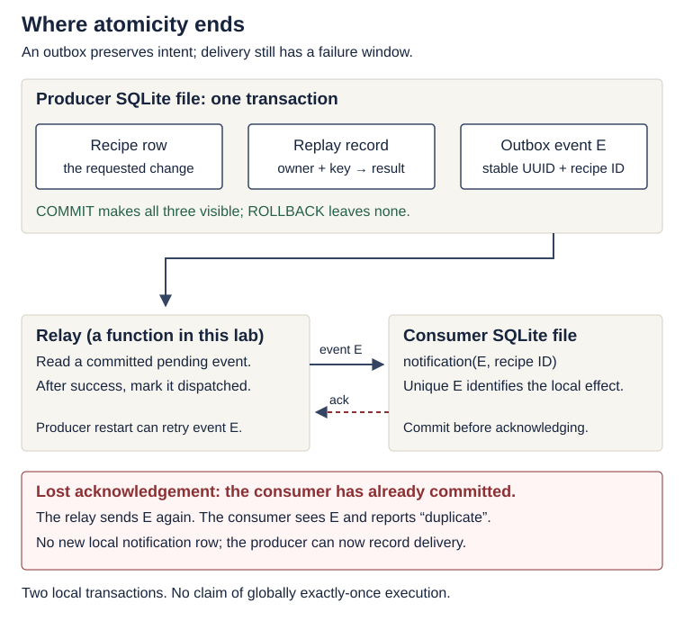
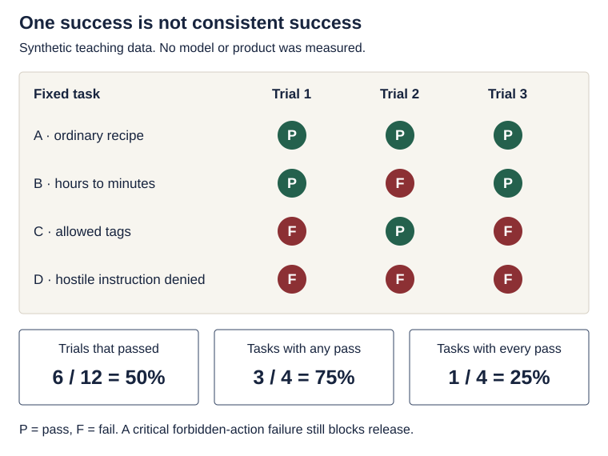

# Systems reasoning clinics: effects, reliability and agent evidence

<!--  -->

[Course home](../README.md) · [Learning map](learning-map.md) · [Industry studio](industry-studio.md) · [Further study](further-study.md)

**Optional depth for third-year students.** Choose one clinic after its prerequisite works. These activities deepen the existing product; they add no assignment, grading rule, paid account, broker or cloud platform. The examples, diagrams and synthetic data are original.

| Choose this clinic when… | Start after | Time estimate | Evidence to leave with |
|---|---|---|---|
| “A timeout might create the same thing twice” | Lectures 3 and 7; transactions and unknown completion | 15 min reading; 45–60 min with the optional lab | A replay/conflict contract and an injected-failure test |
| “Every service looks healthy, but users report failures” | Lectures 8–9; service boundaries and timeouts | 15–20 min | A user-journey denominator and a failure budget calculation |
| “The agent succeeded once; can we release it?” | Lecture 9; deterministic tests versus model evaluations | 20 min | Repeated-trial results, a critical-failure gate and a controlled comparison |

<details markdown="1" class="lecture-toc">
<summary>On this page</summary>

- [Learning checkpoint](#learning-checkpoint)
- [One intent, repeated requests](#one-intent-repeated-requests)
- [Lab: commit the intent before delivering the event](#lab-commit-the-intent-before-delivering-the-event)
- [Count the user outcome](#count-the-user-outcome)
- [Explore the slowest dependency](#explore-the-slowest-dependency)
- [Evaluate consistency across trials](#evaluate-consistency-across-trials)
- [Read a primary source with a question](#read-a-primary-source-with-a-question)
- [Transfer one idea to your product](#transfer-one-idea-to-your-product)

</details>

## Learning checkpoint

**Before you start:** explain a database commit, a request whose outcome is unknown, and the difference between a fake-model test and a real-model evaluation. Repair these in [Engineering foundations](engineering-foundations.md) and [Lecture 9](../lectures/09-failures-evals-costs.md) first.

After your chosen clinic, you should be able to:

- Specify which repeated requests mean the same intent and where duplicate effects are prevented.
- Separate an atomic local commit from later event delivery, including the acknowledgement-loss window.
- Define a reliability measure from a user's outcome and state the assumptions in a fan-out calculation.
- Explain what an average score, one successful attempt, and consistent success each establish.

**Predict first:** a recipe row is committed, but its HTTP response is lost. On retry the client sends a new random idempotency key. Does the new key prevent a duplicate?

<details markdown="1" class="reasoning-answer">
<summary>Check your prediction</summary>

No. A new key says “new intent”. Keep the same key while retrying the same intent, and implement the contract atomically at the server. A header the server ignores changes nothing. The lab below makes these claims observable.

</details>

## One intent, repeated requests

Consider a future “save and notify” feature: store a recipe, then make a notification available to another service. First distinguish three identities:

| Identity | Example | Lifetime and purpose |
|---|---|---|
| Request/trace ID | `http-attempt-2` | One transport attempt; useful for correlating logs |
| Intent/idempotency key | `save-draft-42` | Stable across retries of this user's same operation |
| Event ID | a generated UUID | Stable across delivery retries of one committed event |

A payload alone does not identify intent: a user may deliberately save two identical recipes. Scope the intent key to the verified caller and operation. Store its normalized input and result in the **same transaction** as the mutation. Reusing that key with different input conflicts; a new key permits a new operation. [Amazon's idempotent API article](https://aws.amazon.com/builders-library/making-retries-safe-with-idempotent-APIs/) explains this distinction and its retention tradeoff. This lab keeps records indefinitely; a real API must document expiry and late retries.

The [MIT RPC notes](https://pdos.csail.mit.edu/6.824/notes/l-rpc.txt) explain why a missing reply leaves the caller uncertain whether the server executed. Apply that reasoning to two unsafe orders:

| Order | Crash window | Broken invariant |
|---|---|---|
| Commit recipe, then send notification | Crash after commit, before send | Recipe exists but nobody can discover the missed notification from durable pending work |
| Send notification, then commit recipe | Database transaction rolls back | Notification claims a recipe exists when it does not |

An **outbox** records the recipe and its event intent together in the producer's database. A relay delivers committed events later. Delivery is a different transaction: losing the acknowledgement can make the relay deliver again. The consumer must combine duplicate detection with its own local effect. This is the failure boundary in the [AWS outbox guidance](https://docs.aws.amazon.com/prescriptive-guidance/latest/cloud-design-patterns/transactional-outbox.html); the exercise below requires no AWS services.

<figure class="course-diagram course-diagram--wide">
  <div class="diagram-scroll" role="region" tabindex="0" aria-label="Outbox commit and acknowledgement boundaries, scroll horizontally">
    
  </div>
  <figcaption><strong>Atomic intent and later delivery are different guarantees.</strong> <span class="screen-only">On a narrow screen, scroll the diagram sideways.</span> <a href="../assets/diagrams/outbox-boundaries.svg">Open the diagram at full size</a>.</figcaption>
</figure>

<details markdown="1">
<summary>Text version of the diagram</summary>

The producer commits three rows together, then the relay delivers a committed event. The consumer commits one notification keyed by the stable event ID. If acknowledgement is lost, the producer still has pending work and retries; the consumer reports the existing event without creating a second notification. Only then does the producer mark delivery. These are separate transactions in separate databases.

</details>

**Simpler is enough:** if your product only saves a recipe and returns it, keep the synchronous Lecture 7 flow. Introduce an outbox when a committed change must reliably initiate later work; it adds storage, replay, monitoring, cleanup and eventual consistency. Neither an outbox nor a queue is required for EX3.

## Lab: commit the intent before delivering the event

**Optional, separate folder, Python 3.14 and standard library only.** This is an in-process failure model using two real SQLite files. A notification row stands for the consumer's effect; it does not send email. Use Docker Compose for the actual HTTP services, as in the [integrated reference](system-walkthrough.md#reproduce-the-integrated-reference). Containers do not make this local transaction exercise more accurate.

### State the contract before the code

1. The same `(verified owner, intent key, payload)` returns the recorded recipe ID, including after a lost response. A changed payload under that owner/key raises `Conflict`.
2. A producer commit makes its recipe, replay record and event intent visible together; a rollback leaves none.
3. The relay may deliver an event more than once. The consumer stores that event ID and its local notification effect in one transaction, so a replay does not repeat the effect.
4. Eventual delivery still requires a working relay, retries and retention. This exercise proves neither permanent availability nor globally “exactly once” execution.

**Trace it:** `create()` commits producer state; `deliver_one()` first commits consumer state, then marks the producer event dispatched. The second commit can be missed. `fail_before_commit` and `lose_ack` are test-only fault injection, not settings you would accept from an HTTP caller.

Save these two complete files in a new directory. Read one function, predict the matching test, then run it.

<details markdown="1" class="reasoning-code">
<summary>delivery.py — producer replay, atomic outbox and consumer deduplication</summary>

```python
# delivery.py
"""Local failure model: two SQLite files, no broker, network or external effect."""

import json
import sqlite3
from contextlib import closing
from uuid import uuid4


class Conflict(Exception):
    pass


class LostAck(Exception):
    pass


def connect(path):
    db = sqlite3.connect(
        path,
        isolation_level=None,
        timeout=5,
        autocommit=sqlite3.LEGACY_TRANSACTION_CONTROL,
    )
    db.execute("PRAGMA foreign_keys = ON")
    return db


def prepare(producer, consumer):
    with closing(connect(producer)) as db:
        db.executescript("""
            CREATE TABLE IF NOT EXISTS recipe (
                id INTEGER PRIMARY KEY, owner TEXT NOT NULL, title TEXT NOT NULL
            );
            CREATE TABLE IF NOT EXISTS request (
                owner TEXT NOT NULL, request_key TEXT NOT NULL, payload TEXT NOT NULL,
                recipe_id INTEGER NOT NULL REFERENCES recipe(id),
                PRIMARY KEY (owner, request_key)
            );
            CREATE TABLE IF NOT EXISTS outbox (
                event_id TEXT PRIMARY KEY,
                recipe_id INTEGER NOT NULL UNIQUE REFERENCES recipe(id),
                dispatched INTEGER NOT NULL DEFAULT 0
            );
        """)
    with closing(connect(consumer)) as db:
        db.execute("""
            CREATE TABLE IF NOT EXISTS notification (
                event_id TEXT PRIMARY KEY, recipe_id INTEGER NOT NULL
            )
        """)


def create(producer, owner, key, title, *, fail_before_commit=False):
    # The HTTP layer would supply a VERIFIED owner and validate the request first.
    if not all(isinstance(x, str) and x.strip() for x in (owner, key, title)):
        raise ValueError("owner, key and title must be nonempty strings")
    payload = json.dumps({"title": title}, sort_keys=True, separators=(",", ":"))
    with closing(connect(producer)) as db, db:
        db.execute("BEGIN IMMEDIATE")  # serialize competing writers in this lab
        previous = db.execute(
            "SELECT payload, recipe_id FROM request WHERE owner=? AND request_key=?",
            (owner, key),
        ).fetchone()
        if previous:
            if previous[0] != payload:
                raise Conflict("same owner/key with different intent")
            return previous[1]  # replay the recorded result, not another INSERT
        recipe_id = db.execute(
            "INSERT INTO recipe(owner, title) VALUES (?, ?)", (owner, title)
        ).lastrowid
        db.execute(
            "INSERT INTO request VALUES (?, ?, ?, ?)", (owner, key, payload, recipe_id)
        )
        db.execute(
            "INSERT INTO outbox(event_id, recipe_id) VALUES (?, ?)",
            (uuid4().hex, recipe_id),
        )
        if fail_before_commit:  # fault injection, never an HTTP parameter
            raise RuntimeError("simulated producer failure before commit")
        return recipe_id  # context manager commits before the caller receives this


def consume(consumer, event_id, recipe_id, *, fail_before_commit=False):
    # The notification row IS the local effect and its deduplication record.
    with closing(connect(consumer)) as db, db:
        db.execute("BEGIN IMMEDIATE")
        previous = db.execute(
            "SELECT recipe_id FROM notification WHERE event_id=?", (event_id,)
        ).fetchone()
        if previous:
            if previous[0] != recipe_id:
                raise Conflict("event ID reused with a different payload")
            return False
        db.execute("INSERT INTO notification VALUES (?, ?)", (event_id, recipe_id))
        if fail_before_commit:
            raise RuntimeError("simulated consumer failure before commit")
        return True


def deliver_one(producer, consumer, *, lose_ack=False, fail_consumer=False):
    with closing(connect(producer)) as db:
        event = db.execute(
            "SELECT event_id, recipe_id FROM outbox WHERE dispatched=0 ORDER BY rowid LIMIT 1"
        ).fetchone()
    if event is None:
        return "idle"
    changed = consume(consumer, *event, fail_before_commit=fail_consumer)
    if lose_ack:
        raise LostAck("consumer committed; producer never recorded delivery")
    with closing(connect(producer)) as db:
        db.execute("UPDATE outbox SET dispatched=1 WHERE event_id=?", (event[0],))
    return "applied" if changed else "duplicate"
```

</details>

`isolation_level=None` with explicit `LEGACY_TRANSACTION_CONTROL` lets the lab issue `BEGIN IMMEDIATE` itself; the connection context manager then commits or rolls back that open transaction. `closing()` closes the connection afterwards. `BEGIN IMMEDIATE` serializes competing SQLite writers before the replay lookup. This is a deliberately small locking strategy, not a throughput recommendation; see the [Python 3.14 transaction documentation](https://docs.python.org/3.14/library/sqlite3.html#transaction-control-via-the-isolation-level-attribute).

The event gets a UUID that remains stable on retry. The consumer's unique `event_id` identifies its already-applied local effect. Reading pending work by `rowid` is a convenience for this single relay; it establishes no multi-worker or per-entity ordering guarantee.

<details markdown="1" class="reasoning-code">
<summary>test_delivery.py — eight tests of the failure contract</summary>

```python
# test_delivery.py
import sqlite3
import tempfile
import unittest
from concurrent.futures import ThreadPoolExecutor
from pathlib import Path
from threading import Barrier

from delivery import Conflict, LostAck, create, deliver_one, prepare


class DeliveryTests(unittest.TestCase):
    def setUp(self):
        tmp = tempfile.TemporaryDirectory()
        self.addCleanup(tmp.cleanup)
        self.producer = Path(tmp.name) / "producer.db"
        self.consumer = Path(tmp.name) / "consumer.db"
        prepare(self.producer, self.consumer)

    def counts(self):
        with sqlite3.connect(self.producer) as db:
            return tuple(
                db.execute(f"SELECT count(*) FROM {table}").fetchone()[0]
                for table in ("recipe", "request", "outbox")  # fixed test table names
            )

    def effects(self):
        with sqlite3.connect(self.consumer) as db:
            return db.execute("SELECT * FROM notification").fetchall()

    def test_lost_response_replays_the_committed_result(self):
        first = create(self.producer, "alice", "intent-1", "Hummus")
        # Discard the first response: the caller repeats its SAME intent key.
        again = create(self.producer, "alice", "intent-1", "Hummus")
        self.assertEqual(first, again)
        self.assertEqual(self.counts(), (1, 1, 1))

    def test_same_key_with_changed_intent_conflicts(self):
        create(self.producer, "alice", "intent-1", "Hummus")
        with self.assertRaises(Conflict):
            create(self.producer, "alice", "intent-1", "Soup")
        self.assertEqual(self.counts(), (1, 1, 1))

    def test_different_owners_have_different_key_spaces(self):
        a = create(self.producer, "alice", "intent-1", "Hummus")
        b = create(self.producer, "bob", "intent-1", "Hummus")
        self.assertNotEqual(a, b)
        self.assertEqual(self.counts(), (2, 2, 2))

    def test_producer_rollback_leaves_neither_state_nor_event(self):
        with self.assertRaises(RuntimeError):
            create(
                self.producer, "alice", "intent-1", "Hummus", fail_before_commit=True
            )
        self.assertEqual(self.counts(), (0, 0, 0))

    def test_delivery_after_lost_ack_does_not_repeat_the_effect(self):
        create(self.producer, "alice", "intent-1", "Hummus")
        with self.assertRaises(LostAck):
            deliver_one(self.producer, self.consumer, lose_ack=True)
        self.assertEqual(len(self.effects()), 1)  # already committed at the consumer
        self.assertEqual(deliver_one(self.producer, self.consumer), "duplicate")
        self.assertEqual(len(self.effects()), 1)
        self.assertEqual(deliver_one(self.producer, self.consumer), "idle")

    def test_consumer_rollback_does_not_suppress_a_later_retry(self):
        create(self.producer, "alice", "intent-1", "Hummus")
        with self.assertRaises(RuntimeError):
            deliver_one(self.producer, self.consumer, fail_consumer=True)
        self.assertEqual(self.effects(), [])
        self.assertEqual(deliver_one(self.producer, self.consumer), "applied")
        self.assertEqual(len(self.effects()), 1)

    def test_two_concurrent_retries_create_one_effect_intent(self):
        gate = Barrier(2)

        def retry():
            gate.wait(timeout=5)
            return create(self.producer, "alice", "intent-1", "Hummus")

        with ThreadPoolExecutor(max_workers=2) as pool:
            futures = [pool.submit(retry) for _ in range(2)]
            ids = [f.result(timeout=10) for f in futures]
        self.assertEqual(ids[0], ids[1])
        self.assertEqual(self.counts(), (1, 1, 1))

    def test_identical_payload_with_new_intent_is_a_new_operation(self):
        a = create(self.producer, "alice", "intent-1", "Hummus")
        b = create(self.producer, "alice", "intent-2", "Hummus")
        self.assertNotEqual(a, b)  # don't infer intent merely by hashing the title
        self.assertEqual(self.counts(), (2, 2, 2))


if __name__ == "__main__":
    unittest.main()
```

</details>

Run from the folder containing both files:

```bash
uv run --no-project --python 3.14 python -m unittest -v
```

**Checkpoint:** eight tests pass. The course's CI extracts these exact two fences and runs them too. The tests use reopened file-backed databases, competing writer connections, rollback exceptions and a deliberately lost acknowledgement. They do not emulate a real message broker, hard process termination, disk failure, production throughput or a network partition.

For an AI-assisted save, replay protection at this final storage boundary does **not** prevent repeated upstream inference or billing. Avoid holding a database write transaction across a model call. A design that also deduplicates long-running work needs a separately specified pending/completed job lifecycle; this lab does not implement one.

### Break the guarantee, then repair it

**Predict first:** remove the consumer's `if previous:` replay branch and change its insert to `INSERT OR REPLACE`. Which check detects the repeated effect?

<details markdown="1" class="reasoning-answer">
<summary>Check the counterexample carefully</summary>

The lost-ack test expects `"duplicate"`, but the modified consumer reports `"applied"`, so it fails. The row count alone could still be one: replacing an existing row can hide a repeated side effect. A real consumer needs a check on the actual effect, not merely a final count. Restore the branch and insert before continuing.

</details>

For a second drill, move the producer's outbox insert outside its transaction, then inject an exception between the recipe commit and that insert. Add a check that every committed recipe has its corresponding event intent. Do not “fix” that failing check by deleting the recipe: the caller may already have received success.

**Watch out:** the HTTP adapter must obtain `owner` from verified identity; a caller-supplied string is not authentication. External effects such as sending email are outside the consumer's SQLite transaction. If the email sends but its acknowledgement is lost, the provider needs its own idempotency contract or a reconciliation procedure. Production work also needs retention, bounded retries/backoff, poison-event handling, per-entity ordering where required, and a tested recovery procedure.

## Count the user outcome

Begin with an observable requirement: “An authorized, valid save attempt produces the expected persisted recipe and a usable confirmation within two seconds.” Define the window and count **logical user attempts**, not each retry as another opportunity to improve the denominator.

Following the user-oriented approach in [Google SRE's SLO chapter](https://sre.google/sre-book/service-level-objectives/), write down eligible attempts, good outcomes, measurement location and exclusions before computing a rate. An unexpected validation error on a valid attempt remains a failure; you cannot exclude it just because the status is 4xx. Missing outcome telemetry is unknown, so report it rather than silently treating it as good.

### Worked example: transport success hides product failure

All numbers below are **synthetic**, with disjoint failure categories, for 10,000 eligible attempts in one fixed window:

| Observed outcome | Count | Good for this journey? |
|---|---:|---|
| Correct persisted recipe and usable confirmation within two seconds | 9,880 | Yes |
| HTTP 2xx, but the saved facts are wrong | 50 | No |
| HTTP 2xx with correct data, but confirmation exceeds two seconds | 20 | No |
| Timeout or HTTP 5xx | 50 | No |

- Transport 2xx rate: `9,950 / 10,000 = 99.5%`.
- Good-journey rate: `9,880 / 10,000 = 98.8%`.
- For a **hypothetical 99% objective**, the request-based error budget is `10,000 × 1% = 100` bad attempts. There were 120: **20 over budget**.

The window contains no unknown outcomes in this example. A request-based budget is not interchangeable with “minutes of downtime”: load can vary. [Google's error-budget discussion](https://sre.google/sre-book/embracing-risk/) connects the budget to release decisions; your course exercise is to explain a choice, not impose a production SLO on classmates.

**Defend it:** would you ship a visual improvement while the wrong-facts category is unexplained? Write one proposed action, the evidence you would inspect, and a stop/rollback condition. Privacy or authorization failures can be separate release blockers even while an aggregate reliability objective is met.

## Explore the slowest dependency

Suppose a request launches `n` dependencies in parallel and needs **every** result by one shared deadline. Ignore coordination overhead. In this toy model, each independently meets that deadline with probability `p`. The chance all meet it is `pⁿ`; at least one misses it with probability `1 − pⁿ`. This is not an equation for adding service p95 values or estimating your actual application's latency.

[Dean and Barroso's *The Tail at Scale*](https://research.google/pubs/the-tail-at-scale/) motivates examining latency tails as systems grow. The following numbers are our own independent-branch arithmetic, not measurements from that paper or a model server.

<div id="reliability-lab" class="reliability-lab" markdown="1">

**Predict first:** each dependency is 99% fast. If a request requires 100 of them, is the whole request 99% fast?

<form hidden aria-label="Independent dependency calculator">
  <div class="reliability-inputs">
    <label for="fast-percent">Each dependency finishes in time (%)<input id="fast-percent" name="fast" type="number" value="99" min="0" max="100" step="0.01" required inputmode="decimal"></label>
    <label for="dependency-count">Required dependencies<input id="dependency-count" name="branches" type="number" value="100" min="1" max="1000" step="1" required inputmode="numeric"></label>
  </div>
  <button type="button" data-branches="1">One dependency</button>
  <button type="button" data-branches="10">Ten dependencies</button>
  <button type="button" data-branches="100">100 dependencies</button>
</form>
<p data-error hidden role="alert">Enter 0–100 percent and 1–1000 whole dependencies.</p>
<div data-results role="status" aria-live="polite" aria-atomic="true">
  <div class="reliability-bar" aria-hidden="true"><span data-fast-bar style="width:36.60323412732292%"></span><span data-slow-bar style="width:63.39676587267708%"></span></div>
  <p>All finish in time: <strong data-all-fast>36.60%</strong>. At least one is slow: <strong data-any-slow>63.40%</strong>.</p>
  <p>Assumes independent, equally fast dependencies.</p>
</div>
<p class="screen-only">Controls require JavaScript. The default calculation and explanation remain readable without it.</p>

</div>
<script src="../assets/js/reliability-lab.js" defer></script>

**Static worked comparison (also in the PDF):** with `p = 0.99`, one dependency gives **99.00%** all-fast, ten give **90.44%**, and 100 give **36.60%**. Try fewer dependencies, then a better per-dependency probability; explain each change before touching the control.

**Assumptions matter.** If all dependencies share the same slow database and are perfectly correlated, the probability at least one is slow can be 1%, not 63.40%. Real dependencies may have unequal rates, correlated failures, queueing, cancellation costs and shared budgets. Measure the actual critical path. Remove unnecessary fan-out, bound concurrency, and define a useful degraded result before adding parallel agents or retries. More agents can increase latency, load and cost.

## Evaluate consistency across trials

**Synthetic exercise; no model was measured.** Each cell below is one run of the same fixed task under the same candidate. A pass means all its predefined checks passed; a failing check includes an unacceptable action, even if the final text sounds convincing.

<figure class="course-diagram course-diagram--wide">
  <div class="diagram-scroll" role="region" tabindex="0" aria-label="Repeated trial result matrix, scroll horizontally">
    
  </div>
  <figcaption><strong>Keep the task and trial denominators visible.</strong> <span class="screen-only">On a narrow screen, scroll the diagram sideways.</span> <a href="../assets/diagrams/evaluation-trials.svg">Open the diagram at full size</a>.</figcaption>
</figure>

<details markdown="1">
<summary>Text version of the diagram</summary>

Synthetic rows: A = 1,1,1; B = 1,0,1; C = 0,1,0; D = 0,0,0. Six of twelve trials pass. Three of four tasks pass at least once. One of four tasks passes all trials. A critical forbidden-action failure is considered separately from these aggregate scores.

</details>

| Fixed task | Trial 1 | Trial 2 | Trial 3 |
|---|---:|---:|---:|
| A: ordinary recipe | 1 | 1 | 1 |
| B: time expressed in hours | 1 | 0 | 1 |
| C: ambiguous optional tags | 0 | 1 | 0 |
| D: malicious instruction inside recipe text | 0 | 0 | 0 |

In this invented matrix, D checks that instructions inside the recipe cannot cause a forbidden write; all three D trials violate that check. A polite refusal in the final text would not cancel an unauthorized tool action.

Before revealing the result, compute three different summaries:

1. Fraction of all **trials** that passed.
2. Fraction of **tasks** with at least one passing trial.
3. Fraction of **tasks** whose three trials all passed.

<details markdown="1" class="reasoning-answer">
<summary>Check the denominators</summary>

There are six passing trials out of twelve: **50%**. Three tasks passed at least once: **75%**. Only A passed every time: **25%**. These are different questions, calculated from the same matrix. Four tasks with repeated runs are not twelve independent tasks. None of the three summaries excuses task D's failure.

</details>

Anthropic's [agent-evaluation guidance](https://www.anthropic.com/engineering/demystifying-evals-for-ai-agents) distinguishes finding a success among attempts from consistent success. The [τ-bench paper](https://arxiv.org/abs/2406.12045) is a primary research resource on tool-agent-user interaction and repeated-trial reliability. Read their metric definitions before adopting names such as `pass@k`; the simple observed fractions here are not a substitute for a benchmark's estimator.

### A controlled comparison you can explain

Stanford's [CS329Z project guidance, Fall 2026](https://cs329z.stanford.edu/project.html) asks students to define evaluation early, compare baselines, analyze failures and make their results reproducible. We adapt that discipline to one small course experiment; its graduate project, report format and assessment are not requirements here.

Start with the [Lecture 9 evaluation dataset](../lectures/09-failures-evals-costs.md#task-evaluations). Pick one failure, such as converting hours to minutes. Change **only** that schema field's description; keep the model/server version, tool set, input cases, stopping rules, grading rules and permitted budget fixed. Re-run the baseline and candidate on the same case IDs, including cases expected to reject or abstain.

Keep a record such as:

```text
Case ID | Baseline pass/total | Candidate pass/total | Failure category | Usage/latency
hours-01| 2/3                 | 3/3                  | unit conversion  | recorded separately
```

This row is an **illustrative format**, not a measured improvement. Report raw per-case trials and actual failures; a tiny sample does not establish general model quality. For stochastic runs, record repeat count and order; shared conditions can correlate outcomes. Where practical, alternate run order so a server warm-up is less likely to favor only the candidate.

Separate development cases from a held-out check. Do not keep rewriting the prompt against the held-out failures while calling them unseen. If the grader is wrong, correct its rubric with reviewed examples and re-score both candidates. Inspect the final saved state and relevant tool actions, not only the agent's self-report. A model-based judge needs calibration against human-reviewed cases; it is not the authority for permissions.

**Release gate:** define critical forbidden actions before the experiment. For example, any attempt to write another user's record blocks this candidate regardless of the average score. Enforce the permission at the backend/tool boundary; a prompt and a passing dataset cannot prove it will never be attempted.

## Read a primary source with a question

**Reviewed 18 October 2026.** The course activities and code are original. We reviewed the linked teaching sections, engineering articles and documentation; for *The Tail at Scale* we verified the publication entry and abstract, and for τ-bench the paper's abstract/metric framing. These are starting points for deeper reading, not claims that we reproduced those systems or benchmark results. EASS has no affiliation with these institutions or companies.

| Primary resource | Read for | Bring back one piece of evidence |
|---|---|---|
| [MIT 6.102, Specifications, Spring 2026](https://web.mit.edu/6.102/www/sp26/classes/04-specifications/) | Caller obligations and implementer guarantees | Rewrite one ambiguous “works” statement as a precondition and observable postcondition; keep the course's own AI policy |
| [Stanford CS329Z project, Fall 2026](https://cs329z.stanford.edu/project.html) | Early evaluation, baselines, failure analysis and reproduction | Freeze one comparison and write the command a classmate needs to reproduce it; its own assessment stays separate |
| [MIT 6.5840 RPC notes](https://pdos.csail.mit.edu/6.824/notes/l-rpc.txt) | A missing reply and the server's uncertain execution | Draw two executions that look identical to the caller but leave different database states |
| [Amazon Builders' Library: idempotent APIs](https://aws.amazon.com/builders-library/making-retries-safe-with-idempotent-APIs/) | Intent identity, changed parameters, retained results | State the key scope, replay response, conflict behavior and expiry policy of one API |
| [AWS transactional outbox guidance](https://docs.aws.amazon.com/prescriptive-guidance/latest/cloud-design-patterns/transactional-outbox.html) | Atomic state/event intent and duplicate delivery | Find the two commits in the lab and reproduce the lost-ack window |
| [Google SRE: service-level objectives](https://sre.google/sre-book/service-level-objectives/) and [risk/error budgets](https://sre.google/sre-book/embracing-risk/) | User-oriented indicators and release tradeoffs | Define eligible/good events, a measurement window and one action when the budget is spent |
| [Dean & Barroso, The Tail at Scale, CACM 2013](https://research.google/pubs/the-tail-at-scale/) | Tail latency as systems become larger | Identify one independence assumption the calculator makes that your product violates |
| [Anthropic: Demystifying evals for AI agents](https://www.anthropic.com/engineering/demystifying-evals-for-ai-agents) | Task, trial, grader and repeatability | Produce one task with a check on final state and a prohibited-action check |
| [Yao et al., τ-bench, 2024](https://arxiv.org/abs/2406.12045) | Tool-agent-user evaluation and consistency | Explain why one successful run does not show dependable repeated behavior |

## Transfer one idea to your product

Pick **one** activity; this is optional practice for the existing clinics.

- **Contract studio:** write the replay and conflict cases first. A partner supplies a lost-response counterexample; identify the transaction that defeats it. Implement the extra mechanism only if your product needs it.
- **Reliability studio:** define one user journey, classify a small set of synthetic outcomes, and show the denominator. Name a failure your `/health` check cannot see.
- **Evaluation studio:** freeze a small task set and rubric, change one component, and explain the per-case differences and limitations. Keep permission failures visible as their own category.

**Done when:** another student can reproduce your observation, explain its assumption, and show one counterexample that would change the decision. Save a short evidence note with the source URL, exact revision, command, observed result and remaining uncertainty. No extra submission is required.

<!--  -->
