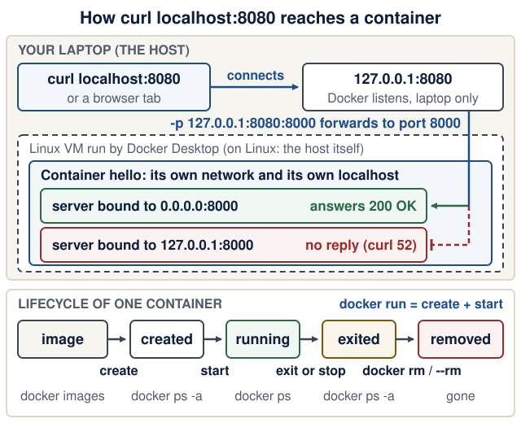

# Lecture 1 · Environment, Git, Docker and AI-assisted coding

<!--  -->
[← Course home](../README.md) · [Next: Lecture 2 →](02-http-fastapi-pydantic.md)

> **At a glance**
>
> - **When:** Monday 19 October 2026, 18:00 Israel time (after HIT's opening-event break), on Zoom ([calendar notes](../README.md#calendar-and-13-meeting-schedule))
> - **You leave with:** a working environment, a one-page product sketch, and 2–3 open-source candidates you checked yourself
> - **Goals:** say where a command runs and where a change lives, explain image versus container and host versus container port, and review one assistant change ([details](#learning-checkpoint))
> - **Prerequisites:** [Student setup, Part A](../guides/student-setup.md#part-a-before-the-first-meeting) is done; repair: [readiness check](../guides/engineering-foundations.md#readiness-check)
> - **Product milestone:** the start of EX1 (due Mon 9 Nov 2026, 23:59): a repo, `/health`, and a product sketch
> - **Time:** prerequisite check about 10 min the night before; lab about 2 h in and after class; Git undo drill about 10 min before Lecture 2 (estimates)
> - **Done when:** `curl http://localhost:8000/health` prints `{"status":"ok"}` from code you committed and pushed, and your README has an `## AI use` note

<details markdown="1" class="lecture-toc">
<summary>On this page</summary>

- [Mission](#mission)
- [Before you start](#before-you-start)
- [Learning checkpoint](#learning-checkpoint)
- [Concepts](#concepts)
- [Live demo](#live-demo)
- [Hands-on lab](#hands-on-lab)
- [Break it on purpose](#break-it-on-purpose)
- [Open-source track](#open-source-track)
- [Working with AI assistants](#working-with-ai-assistants)
- [Completion check](#completion-check)
- [Quick quiz](#quick-quiz)
- [Stretch goals](#stretch-goals)
- [Common pitfalls](#common-pitfalls)
- [Instructor notes](#instructor-notes)
- [Read more](#read-more)

</details>

## Mission

Today you build the workbench for the whole semester: a tiny FastAPI app on your laptop, a container running Python 3.14, a one-page product idea, and 2–3 checked open-source projects. The win you can show: `curl http://localhost:8000/health` prints `{"status":"ok"}` from code you committed and pushed.

## Before you start

You need Python basics, a terminal, your own free GitHub account with a verified email, and admin rights on your laptop. **Windows:** use WSL2 (Ubuntu); every command on these pages runs *inside* Ubuntu, not PowerShell. Installation steps are in [Student setup, Part A](../guides/student-setup.md#part-a-before-the-first-meeting), which also helps you choose one assistant route or the manual fallback; your editor and model do not change the course requirements.

> **Prerequisite check:** about one minute each, the night before. If a check fails, follow its repair link, then ask for help with the [PARD template](#asking-for-help-the-pard-template) in the channel the instructor provides.
>
> | Check | Pass when | Repair |
> |---|---|---|
> | Run `pwd`, then `cd ..`, then `pwd` again | You can say which folder you were in before and after | [Readiness check](../guides/engineering-foundations.md#readiness-check) |
> | Open a second terminal tab. In the first, run `sleep 60`, then press Ctrl+C | The prompt comes back at once: you stopped a running process | [Files, environments, and processes](../guides/engineering-foundations.md#files-environments-and-processes) |
> | `which uv` and `echo $PATH` | `which uv` prints a path in one of the folders `$PATH` lists | [Readiness check](../guides/engineering-foundations.md#readiness-check) |
> | `uv --version`, `git --version`, `gh --version`, `docker --version`, `curl --version` | Each prints a version: uv 0.12 or newer (0.13 recommended); curl 7.82 or newer, or note that you will use Lecture 2's fallback | [Student setup, Part A](../guides/student-setup.md#part-a-before-the-first-meeting) |
> | `docker compose version` | See the version note below | [Common pitfalls](#common-pitfalls) |
> | `gh auth status`, then `docker run --rm hello-world` | `Logged in to github.com`, then `Hello from Docker!` | [Student setup, Part A](../guides/student-setup.md#part-a-before-the-first-meeting) · [Common pitfalls](#common-pitfalls) |

**Version note:** `docker compose version` prints `Docker Compose version v2.24` or newer. Current Docker Desktop ships v5.x, which is the same `docker compose` plugin (Docker skipped v3 and v4). `docker-compose` with a hyphen is the retired v1; `'compose' is not a docker command` means the plugin is missing. (Checked 17 October 2026: Docker Desktop 4.95.0 bundles Compose v5.6.0; [why v5](https://github.com/docker/compose/releases/tag/v5.0.0).)

<details markdown="1">
<summary>Words you'll meet today</summary>

- **Interface, loopback:** a network interface is one way into a machine (Wi-Fi, a cable, a virtual network). *Loopback* is the private one that reaches only the same machine: `127.0.0.1`, also called `localhost`.
- **Bind:** a server *binds* to an address and port to listen there. Bound to `127.0.0.1`, it hears only its own machine; bound to `0.0.0.0`, it hears every interface.
- **Daemon:** a background program that waits for work. The Docker daemon (engine) runs containers; the `docker` command only sends it requests.
- **Lockfile:** `uv.lock`, the exact version of every installed package, so every machine installs the same set.
- **Virtual environment:** `.venv/`, a project-private folder of installed packages, so projects do not share or break each other's libraries.
- **Fork:** your own copy of someone else's GitHub repository. Upstream PRs usually go from a branch in your fork to the original project.
- **Squash merge:** merging a PR as one new commit that contains all of its changes.
- **Slim image:** a smaller variant of an image (for example `python:3.14-slim`) with fewer system tools; it has no `curl`.
- **Tag versus digest:** a tag (`3.14-slim`) is a movable name that can point to a newer build tomorrow; a digest (`sha256:…`) names one exact build forever. Lecture 10 uses digests.
- **Import string:** `app.main:app` means "import the module `app/main.py` and use the object named `app` in it".

</details>

## Learning checkpoint

By the end, you should be able to:

- Identify the working directory, uv project, running server, and Git branch before changing code.
- Explain image versus container, host versus container port, and commit versus push versus merge.
- Give an assistant one bounded task, inspect its diff, and demonstrate the actual result.

**Predict first:** If an editor says a file was saved but the server still shows old behavior, which directory and process would you inspect first?

<details markdown="1">
<summary>Check your prediction</summary>

Look at the terminal where the server runs. Run `pwd` there and compare it with the folder your editor saved into. `fastapi dev` prints `Will watch for changes in these directories: [...]` at startup and `WatchFiles detected changes in 'app/main.py'. Reloading...` when it sees your save. If that line never appears, the server was started from another folder or another clone, or it runs in a container, which sees its own copy of the files rather than your edit. Stop it with Ctrl+C and start it again from `backend/`.

</details>

**Bridge if needed:** [Student setup](../guides/student-setup.md) for installs; [Files, environments, and processes](../guides/engineering-foundations.md#files-environments-and-processes) for terminals and processes; [Git you need to operate](../guides/engineering-foundations.md#git-you-need-to-operate) for Git.

## Concepts

### Your toolchain

| Tool | What it does for you | Check |
|---|---|---|
| WSL2 (Windows) | A real Ubuntu inside Windows | `wsl --status` in PowerShell |
| uv | Installs Python, manages environments and dependencies | `uv --version` |
| Git and gh | Version history; the GitHub CLI for repos and PRs | `gh --version` |
| Docker and the Compose plugin | Runs software in isolated containers | `docker compose version` |
| curl | Sends HTTP requests from the terminal | `curl --version` |
| Editor | VS Code, Cursor, or any editor with Python support | Open the product folder and its terminal; `code --version` is optional |

### uv: one tool for Python and dependencies

- `pyproject.toml` is the **recipe card**: "this project needs FastAPI".
- `uv.lock` is the **receipt**: the exact version of every installed package. Commit it, so graders get what you tested.
- `.python-version` pins Python (`3.14`), and uv downloads it for you.
- `.venv/` is the **kitchen**: disposable, git-ignored, rebuilt from the lockfile.

The habit: run everything through `uv run …`. It syncs the environment first, so you never activate a virtual environment or `pip install` into system Python. `uv run` looks for the nearest `pyproject.toml` in the current folder or above it, so *where* you type the command decides which project, and which `.venv`, it uses.

### Git and GitHub: commits, branches, pull requests

A **commit** is a snapshot plus a message saying why. A **branch** is a movable label on a line of commits; `main` must always work. **Push** uploads commits to GitHub. A **pull request (PR)** asks to merge one branch into another and shows the diff for review. You use PRs on your own repo and upstream, meaning in the original open-source projects you contribute to. The habit for both: **read `git diff --staged` before every commit**, especially when an AI assistant wrote the change.

**Where does my change live?** A change moves through four places. Each command moves it one step, and each place has its own way to look at it:

| Area | How a change gets there | How to inspect it | Safe undo |
|---|---|---|---|
| Working tree (your files) | You edit and save | `git status`, `git diff` | `git restore <file>` discards the edit (it cannot be recovered) |
| Staging area (the next commit) | `git add <file>` | `git diff --staged` | `git restore --staged <file>` unstages; the edit stays in your file |
| Local commits (history on your laptop) | `git commit` | `git log --oneline`, `git show` | `git revert <commit>` adds a new commit that undoes it |
| GitHub (`origin`) | `git push`, then a PR merge | `gh pr list --state merged`, the web page | `git revert`, then push; never rewrite pushed `main` |

<figure class="course-diagram">
  <div class="diagram-scroll" role="region" tabindex="0" aria-label="Where a Git change lives, scroll horizontally">
    
  </div>
  <figcaption><strong>Where does my change live?</strong> Before you run a Git command, point at the box your change is in and the box it will reach. <span class="screen-only">On a narrow screen, scroll the diagram sideways.</span> <a href="../assets/diagrams/l01-git-areas.svg">Open the diagram at full size</a>.</figcaption>
</figure>

<details markdown="1">
<summary>Text version of the diagram</summary>

Four boxes from left to right: working tree, staging area, local commits, GitHub (`origin`).

1. **Forward:** `git add` moves an edit from the working tree to the staging area; `git commit` records the staged snapshot in local history; `git push` copies local commits to GitHub.
2. **Back:** `git pull` brings commits from GitHub (for example a merged PR) into your local branch and files. `git restore --staged <file>` takes a file out of the staging area and keeps your edit. `git restore <file>` overwrites the working-tree file with the staged or committed version, so the edit is lost; it is drawn in the danger colour.
3. **What the two diffs compare:** `git diff` compares the working tree with the staging area (changes you have not added yet). `git diff --staged` compares the staging area with your last commit (exactly what `git commit` would record).
4. **Inspect:** `git status` reports the three local boxes; `git log --oneline` lists local commits; `gh pr list --state merged` lists what reached GitHub's `main`.

</details>

**Check yourself:** you edited `README.md` and ran `git add README.md`, then edited it again. What does `git diff` show now, and what does `git diff --staged` show?

<details markdown="1">
<summary>Check your answer</summary>

`git diff` shows only the second edit (working tree versus staging area). `git diff --staged` shows only the first edit, which is what `git commit` would record right now. Run `git add README.md` again to stage both. The full set of safe undo moves is in [Git you need to operate](../guides/engineering-foundations.md#git-you-need-to-operate).

</details>

### Docker: images and containers

- An **image** is a frozen filesystem plus a default command, such as "Debian + Python 3.14". Think of it as a class.
- A **container** is a running instance of an image, like an object. It is a process with its own filesystem and network. Deleting it leaves the image untouched.
- **Port mapping** `-p 8080:8000` forwards *host* port 8080 to *container* port 8000. It works like a phone extension: callers dial the building (8080), and reception forwards them to extension 8000.
- **The container has its own `localhost`.** Inside the container, `127.0.0.1` means the container itself, not your laptop. So the server inside must listen on all of the container's interfaces (`0.0.0.0`); a server bound to `127.0.0.1` there answers only callers inside the same container, and the forwarded request gets no answer. `python -m http.server` binds `0.0.0.0` by default. `fastapi dev` binds `127.0.0.1`, which is right on your laptop; `fastapi run` binds `0.0.0.0`, which is why Lecture 3's Dockerfile uses it.

For a local-only demo, `-p 127.0.0.1:8080:8000` also selects the host interface. The runnable examples use loopback so the demo is not intentionally published to other machines on your network. The two-field form normally binds all host interfaces.

<figure class="course-diagram">
  <div class="diagram-scroll" role="region" tabindex="0" aria-label="Port publishing and container lifecycle, scroll horizontally">
    
  </div>
  <figcaption><strong>Which address does each program listen on?</strong> Trace <code>curl localhost:8080</code> from your laptop to the server, then predict what happens if the server binds <code>127.0.0.1</code>. <span class="screen-only">On a narrow screen, scroll the diagram sideways.</span> <a href="../assets/diagrams/l01-port-mapping.svg">Open the diagram at full size</a>.</figcaption>
</figure>

<details markdown="1">
<summary>Text version of the diagram</summary>

Top panel, from left to right:

1. **Your laptop (the host).** `curl localhost:8080` or a browser connects to `127.0.0.1:8080`. Because of `-p 127.0.0.1:8080:8000`, Docker listens there, on loopback only, so other machines on your network cannot connect.
2. **Docker's Linux VM.** On macOS and Windows, Docker Desktop runs containers inside a small Linux virtual machine; on Linux the host runs them directly. Docker forwards the connection to port 8000 of the container.
3. **The container** has its own network and its own `localhost`. A server bound to `0.0.0.0:8000` receives the forwarded request and answers `200 OK`. A server bound to `127.0.0.1:8000` accepts only connections from inside the container, so the forwarded request fails; on Docker Desktop curl reports `curl: (52) Empty reply from server`.

Bottom panel, the lifecycle of one container from one image: `docker run` creates a container from the image and starts it (**running**). When its main process ends, or after `docker stop`, it is **exited** and still listed by `docker ps -a`. `docker rm` deletes it, and `--rm` deletes it automatically when it exits (**removed**). The image stays in `docker images` and can start many more containers.

</details>

### AI-assisted coding: brief, diff, verify, note

AI tools are allowed from week 1 ([rules](../README.md#working-method-ai-use-assessment-and-reproducibility)). The bottleneck has moved from writing code to verifying it: treat AI output like a PR from a stranger.

1. **Brief: a five-line work order.** Write it before you ask. The whole course uses these field names; Lecture 2 adds two more.

   ```text
   Outcome:      GET /health returns {"status": "ok"}
   Files:        backend/app/main.py only
   Non-goals:    no database, no new dependencies
   Verify with:  uv run fastapi dev in backend/, then
                 curl http://localhost:8000/health prints {"status":"ok"}
   Review focus: the path is /health (not /healthz); return type annotated
   ```

2. **Small diff.** One change at a time. Reject a diff that touches files outside "Files".
3. **Verify.** Run it, read `git diff --staged`, and check unfamiliar calls in the official docs. From Lecture 2 on, also break the code and confirm that a test goes red.
4. **Note.** Keep a short AI-use note in your product README, under `## AI use`: tools used, help received, checks you ran. Lab step 7 writes the first one.

Optional: FastAPI, Streamlit and Pydantic AI ship agent "skills" inside their packages. A skill is a folder of instructions an agent can load. Read its `SKILL.md` before enabling it: it is text from a dependency, not permission. In a service folder, `uvx library-skills scan` lists them (in today's `backend/` only FastAPI's appears), and `uvx library-skills --claude` links them for your agent ([library-skills.io](https://library-skills.io/)).

### Product scoping: one narrow domain, three services

You grow one product all semester ([requirements](../README.md#three-service-product-requirements)). Narrow beats ambitious: "save and adapt recipes" is buildable; "a food platform" is not. The demo product is **Recipe Box**, and you pick your own domain. A good sketch answers:

1. **Why does it exist?** The **purpose**: the need, and the bad situation it prevents. Recipe Box: "recipes saved as screenshots and chat messages get lost and cannot be searched or scaled."
2. **Who uses it, and for what?** Three user stories: "As a *user*, I can *action* so that *benefit*."
3. **How does it work, in one scenario?** The **operational principle**: "after X does A, then B; afterwards C holds". Recipe Box: "after I paste a messy recipe and press Extract, the form fills in; after I save it, it appears in my list and is still there tomorrow." Lecture 5's end-to-end test and your final demo replay this sentence.
4. **What data does it keep?** One main record, 4–6 fields, each with a type and a limit.
5. **What does the AI service do?** One job with a structured output, such as messy text in and a record out.
6. **How does data flow?** Read the sketch below top to bottom: the browser talks only to the frontend, the frontend only to the backend, and only the backend touches SQLite and calls the AI service.

```text
browser
  -> frontend    (Streamlit or React)      :8501
  -> backend     (FastAPI)                 :8000  -> SQLite (only the backend)
  -> ai-service  (FastAPI + Pydantic AI)   :8001  (called only by the backend)
```

Purpose and operational principle are inspired by concept design in MIT's [6.1040 Software Design (Fall 2026)](https://61040.github.io/fa26/); see [Further study](../guides/further-study.md). EASS is not affiliated with MIT.

### Asking for help: the PARD template

Send all four parts to whoever you ask, human or AI. It is also the skeleton of a good upstream bug report.

```text
Problem:   one sentence
Action(s): the exact commands you ran
Result:    the full output, pasted as text (not a screenshot)
Desired:   what you expected
```

Before asking, write one sentence saying what you think is wrong, and why: see the [debug log](../guides/engineering-foundations.md#debug-with-a-hypothesis). A wrong guess is fine; it tells the helper where your picture differs from reality.

### Open source: choose before you code

You need three PRs **merged** into qualifying projects ([rules](../README.md#open-source-contribution-rule-and-evidence); three per student). Reviews take weeks, and some projects restrict outside or AI-assisted PRs: as of October 2026, Streamlit's CONTRIBUTING says it has paused pull requests from outside its maintainer team. So you check projects before writing code for them.

## Live demo

<aside class="example-key" aria-label="How to read course examples">
<p><strong>Choose the action from the example's label</strong></p>
<ul>
<li><strong>File + path</strong><span>Create or edit that file. Copy its contents, not a terminal command.</span></li>
<li><strong>Run in terminal</strong><span>Check the stated folder, then execute the command.</span></li>
<li><strong>Example terminal output</strong><span>Compare with what you observe. Do not run the output as a command.</span></li>
</ul>
</aside>

**1. Check the tools** (macOS, Linux, WSL; any folder). *Observe the real result.*

```bash
uv --version
git --version
gh --version
docker --version
docker compose version
curl --version
```

**2. Create the repo and the backend** (from the folder that holds your projects, for example `~/eass`). *Make the smallest change.* Run `git init` first: `uv init` outside a Git repo creates a nested `backend/.git`.

```bash
mkdir recipe-box
cd recipe-box
git init
uv init --app --no-package --python 3.14 backend
cd backend
uv add "fastapi[standard]"
mkdir app
touch app/__init__.py
rm main.py
```

**Version note:** since uv 0.12, `uv init --app` creates a packaged `src/` layout; `--no-package` keeps the flat `app/` layout used all semester. uv 0.13 downloads Python 3.15 by default, so we pin `--python 3.14`. (Checked 17 October 2026 with uv 0.13.1: [uv 0.12.0](https://github.com/astral-sh/uv/releases/tag/0.12.0), [uv 0.13.0](https://github.com/astral-sh/uv/releases/tag/0.13.0).)

<figure class="file-example" markdown="1">
<figcaption><span class="file-example-action">Create file</span> <span class="file-example-path">backend/app/main.py</span></figcaption>

```python
# backend/app/main.py
from fastapi import FastAPI

app = FastAPI(title="Recipe Box API")


@app.get("/health")
def health() -> dict[str, str]:
    return {"status": "ok"}
```

</figure>

Append to `backend/pyproject.toml`, so `fastapi dev` and later `fastapi run` (Docker) use an explicit entrypoint instead of guessing. Without it, the CLI auto-discovers `app/main.py` and suggests this exact table.

<figure class="file-example" markdown="1">
<figcaption><span class="file-example-action">Append to file</span> <span class="file-example-path">backend/pyproject.toml</span></figcaption>

```toml
[tool.fastapi]
entrypoint = "app.main:app"
```

</figure>

Start the server from `backend/`, and leave it running. Then open a second terminal.

```bash
uv run fastapi dev
```

**Predict:** you are about to run `curl http://localhost:8000/health` in the second terminal. Which terminal prints a new line, and what does that line say?

<details markdown="1">
<summary>Check your prediction</summary>

Both. The second terminal prints the response, `{"status":"ok"}`. The server terminal prints an access-log line such as `INFO:     127.0.0.1:63209 - "GET /health HTTP/1.1" 200 OK`: who called, which method and path, and the status code. The port after `127.0.0.1:` is curl's own random port, so yours differs.

</details>

```bash
curl http://localhost:8000/health
```

Also open <http://localhost:8000/docs>.

> **Investigate:**
>
> 1. In the server terminal, find the line that says which import string `fastapi dev` used. Where did it come from?
> 2. The server says `Uvicorn running on http://127.0.0.1:8000`. Could a phone on the same Wi-Fi open your `/docs`?

<details markdown="1">
<summary>Show model answers</summary>

1. `Using import string: app.main:app`, read from `[tool.fastapi]` in `pyproject.toml`. Without the table the line ends with `(auto-discovered, ...)`.
2. No. The server is bound to `127.0.0.1`, the loopback interface, so only programs on your laptop can connect. That is the safe default for development.

</details>

**3. Commit, push, and practice a PR.** *Restore, verify, commit.* Go back to the repo root first; every command in this step runs there:

```bash
cd ..     # back to recipe-box/, the repo root
pwd       # must end in /recipe-box
```

### Keep local files out of Git with .gitignore

Create `.gitignore` at the repo root (`recipe-box/.gitignore`):

<figure class="file-example" markdown="1">
<figcaption><span class="file-example-action">Create at repository root</span> <span class="file-example-path">recipe-box/.gitignore</span></figcaption>

```text
.env
.venv/
__pycache__/
.pytest_cache/
.ruff_cache/
data/
*.db
```

</figure>

<figure class="repo-map" aria-label="What the root gitignore keeps local">
<figcaption><strong>One working folder. Two different destinations.</strong><span>For new, untracked files, these root rules apply to matching paths below the repository root.</span></figcaption>
<div class="repo-map-columns">
<section class="repo-map-share" aria-label="Files to review and commit">
<h4 id="files-to-review-and-commit">Review and commit</h4>
<p>Source and reproducible setup</p>
<ul>
<li><code>.gitignore</code><span>The team's shared ignore rules</span></li>
<li><code>backend/app/*.py</code><span>The code you write</span></li>
<li><code>backend/pyproject.toml</code> + <code>backend/uv.lock</code><span>Dependencies and resolved versions</span></li>
<li><code>backend/.python-version</code> + <code>backend/README.md</code><span>Runtime choice and instructions</span></li>
</ul>
</section>
<section class="repo-map-local" aria-label="Files kept on your machine">
<h4 id="files-to-keep-local">Keep local</h4>
<p>Secrets, generated files and runtime data</p>
<ul>
<li><code>.env</code><span>Local settings and real API keys</span></li>
<li><code>.venv/</code><span>Rebuild from the lockfile</span></li>
<li><code>__pycache__/</code> and test/lint caches<span>Generated, disposable output</span></li>
<li><code>data/</code> and <code>*.db</code><span>Runtime data, not source code</span></li>
</ul>
</section>
</div>
<p class="repo-map-rule"><strong>Already tracked?</strong> Adding an ignore rule does not remove a file from Git's index or past commits.</p>
</figure>

**Check the boundary:** from the repository root, run `git check-ignore -v backend/.venv/` to see the matching rule. After staging, `git ls-files .env` must print nothing; it checks whether that path is tracked, which is a different question. These rules do not prevent a deliberate `git add -f`. If a real credential was committed or pushed, stop using it and revoke/rotate it; adding `.env` here does not erase history. See the [Git ignore reference](https://git-scm.com/docs/gitignore).

**Predict:** after `git add .`, which seven files will `git diff --staged --stat` list, and which folder must *not* appear?

<details markdown="1">
<summary>Check your prediction</summary>

The seven paths below. The line counts on the right differ on your machine; the paths must match. If you see `.venv/` (or `backend/.venv/...`), stop: check that `.gitignore` is at the repo root and the rule matches. Also check whether the path was already staged/tracked or added with `-f`; ignore rules do not undo those states. Before your first commit, unstage a wrong path with `git rm -r --cached <path>` (that is what `git status` suggests then); after it, use `git restore --staged <path>`.

```console
 .gitignore              |    7 +
 backend/.python-version |    1 +
 backend/README.md       |    0
 backend/app/__init__.py |    0
 backend/app/main.py     |    8 +
 backend/pyproject.toml  |   12 +
 backend/uv.lock         | 1256 ++++++++++++++++++++
 7 files changed, 1284 insertions(+)
```

</details>

```bash
git status                 # before: .gitignore and backend/ are "Untracked files"
git add .
git status                 # after: seven paths under "Changes to be committed"
git diff --staged --stat
git commit -m "Add backend skeleton with /health"
```

Publish to **EASS-PART-A-2026-X**, the course organization. The instructor uses `recipe-box` for the demo; students replace it with their agreed, unique product name. Confirm [organization access](../guides/student-setup.md#join-the-course-organization) first. Choose **one** route:

- **You have permission to create the project repository:**

  ```bash
  gh repo create EASS-PART-A-2026-X/recipe-box --private --source=. --remote=origin --push
  ```

- **The instructor already created an empty project repository for you:** connect to that repository instead of running `gh repo create`. Replace the demo name below. If it already contains commits, ask the instructor how to preserve both histories before pushing.

  ```bash
  git remote add origin https://github.com/EASS-PART-A-2026-X/recipe-box.git
  git push -u origin main
  ```

Then check the owner and continue:

```bash
gh repo view --json nameWithOwner,url
git switch -c add-product-sketch
```

Write the product sketch in `README.md` at the repo root (template in the lab), then, still from `recipe-box/`:

```bash
git add README.md
git commit -m "Add product sketch"
git push -u origin add-product-sketch
gh pr create --fill
gh pr merge --squash --delete-branch
git switch main
git pull
```

`gh pr merge` merges on GitHub; `git pull` brings that merge back to your laptop. The repository owner must be `EASS-PART-A-2026-X`. Keep the visibility and contributor/grader access agreed with the instructor; organization ownership does not automatically grant every student access. A PR on your course product repository never counts toward the three upstream PRs.

**4. Docker in four commands** (any folder). *Observe the real result.*

**Predict:** the last command is `docker stop hello`. Afterwards, will `docker ps -a` still list `hello`? Will `docker images` still list `python:3.14-slim`?

<details markdown="1">
<summary>Check your prediction</summary>

`hello` is gone from `docker ps -a`: `--rm` deletes the container as soon as it stops. `python:3.14-slim` is still in `docker images`: the image is the template, and it stays for the next run.

</details>

```bash
docker run --rm hello-world
docker run --rm python:3.14-slim python -c "import sys; print(sys.version)"
docker run -d --rm --name hello -p 127.0.0.1:8080:8000 python:3.14-slim python -m http.server 8000
docker stop hello
```

Line 2 prints a `3.14.x` version even without Python 3.14 on your laptop. While `hello` runs, <http://localhost:8080> shows a directory listing served from inside the container, and `docker ps` lists it with `127.0.0.1:8080->8000/tcp`. Select the `python:3.14-slim` line: `python:3-slim` now means Python 3.15. Tags can receive updates; Lecture 10 explains exact image digests.

**5. Check an open-source candidate** (any folder). *Observe the real result.* FastAPI is used only to show the commands; it is not a recommendation.

```bash
gh repo view fastapi/fastapi \
  --json nameWithOwner,stargazerCount,licenseInfo,isFork,isArchived,pushedAt
gh api repos/fastapi/fastapi/community/profile --jq '.files.contributing.html_url'
gh pr list -R fastapi/fastapi --state merged --limit 10
```

On 17 October 2026 the first reported 103,177 stars, MIT, `isFork: false`, and a push the same day. The second command shows that FastAPI's CONTRIBUTING lives in the organization's `.github` repo: never assume it sits at the root.

## Hands-on lab

Do every step for **your own** domain. Steps 1–7 are **core today**. Drill 4 in [Break it on purpose](#break-it-on-purpose) is **finish before Lecture 2**. [Stretch goals](#stretch-goals) are the **extension**.

1. **Install** (skip what [Student setup, Part A](../guides/student-setup.md#part-a-before-the-first-meeting) already did).
   - **Windows:** in an admin PowerShell run `wsl --install`, reboot, and create your Ubuntu user. In Docker Desktop, enable WSL integration for Ubuntu (Settings → Resources). Keep code under `~` in Ubuntu, never `/mnt/c`. Open projects with `code .` from Ubuntu (VS Code's WSL extension).
   - **macOS:** Docker Desktop, an editor, and `brew install uv gh` (or the official installers).
   - **Linux:** Docker Engine and the Compose plugin, from [Docker's docs](https://docs.docker.com/engine/install/).
   - **Everyone** (skip the first line if you used Homebrew; on Ubuntu, install gh with the [apt steps](https://github.com/cli/cli/blob/trunk/docs/install_linux.md)). These are the same lines as setup's [Connect Git and GitHub](../guides/student-setup.md#connect-git-and-github) block; use the email address you chose there:

     ```bash
     curl -LsSf https://astral.sh/uv/install.sh | sh
     uv python install 3.14
     git config --global user.name "Your Name"
     git config --global user.email "you@example.com"
     git config --global init.defaultBranch main
     gh auth login
     gh auth setup-git
     ```

     `gh auth login` asks four questions. Answer: **GitHub.com** → **HTTPS** → **Yes** (authenticate Git with your GitHub credentials) → **Login with a web browser**.

   **Checkpoint:** demo step 1 prints six versions, with uv 0.12 or newer (0.13 recommended; else run `uv self update` or `brew upgrade uv`) and `gh auth status` says `Logged in to github.com`.

2. **Create your repo and `/health`** with demo step 2, named after your product (for example `study-planner`). **Checkpoint:** the curl prints `{"status":"ok"}`, and `/docs` opens.

3. **Publish, branch, then write your product sketch.** Run demo step 3 up to `git switch -c add-product-sketch`, using your agreed product name and retaining the `EASS-PART-A-2026-X/` owner prefix. Use the existing-repository route if the instructor created it. Check the organization owner with `gh repo view --json nameWithOwner,url`, then write the sketch in `README.md` at the repo root on that branch:

   ```markdown
   # <Product name>
   One sentence: who it is for and what problem it solves.

   **Purpose:** the need, and the bad situation it prevents.
   **Operational principle:** after <someone> does <A>, then <B>; afterwards <C> holds.

   ## User stories
   1. As a <user>, I can <action> so that <benefit>.

   ## Data sketch
   <Record>: field (type, limits), ...

   ## The AI service
   Input: ... Structured output: ...

   ## Data flow
   browser -> frontend -> backend -> ai-service (only the backend touches the database)

   ## AI use
   Tools: ... · Help received: ... · Checks I ran: ...

   ## Open-source shortlist
   | Repository | Stars (date checked) | License | Why it fits me |
   |---|---|---|---|
   ```

   Recipe Box: save a recipe; browse, edit or delete; paste messy text and get a structured recipe saved. Record: `title` (text, 1–200 chars), `minutes` (integer, 1–1440), `servings` (integer, 1–50, default 2), `ingredients` (text, at most 5000 chars, one per line), `tags` (text, at most 500 chars, comma-separated). **Checkpoint:** a classmate reads it in two minutes and can say what the AI service does and repeat your operational principle.

4. **Merge the sketch through a PR** with the rest of demo step 3. **Checkpoint:** `gh pr list --state merged` shows your PR, and `git log --oneline` on `main` shows it after `git pull`.

5. **Docker missions** (any folder).
   1. Start `hello` again (demo step 4, third command) and run `docker ps` while it runs: one line, status `Up …`, ports `127.0.0.1:8080->8000/tcp`.
   2. Run a container **without** `--rm`: `docker run --name keep python:3.14-slim python -c "print(1)"`. It prints `1` and exits.
   3. Run `docker ps -a`: `keep` shows `Exited (0) …` and `hello` shows `Up …`.
   4. Run `docker stop hello` and `docker rm keep`, then `docker ps -a` (neither is listed) and `docker images` (`python:3.14-slim` is still there).

   **Checkpoint:** you can point at the running container, the exited one, and the image they share, and say why `hello` vanished after `docker stop` while `keep` needed `docker rm`.

6. **Open-source shortlist.** Pick 2–3 projects you use or care about and work through the [open-source track](#open-source-track). **Checkpoint:** each table row has a dated star count, a license, and the CONTRIBUTING link you read.

7. **Give an assistant one bounded task** (about 15 min, from `recipe-box/` on an up-to-date `main` with a clean `git status`). No assistant yet? Do the task by hand and write `Tools: none` in the note. Before your first agent session, read [Week 1 minimum](../guides/agent-sandboxes.md#week-1-minimum); [Student setup, Part B](../guides/student-setup.md#part-b-at-the-end-of-lecture-1) has an explain-first prompt to try before this edit and the red flags to watch for.
   1. `git switch -c add-run-section`
   2. Write a three-line forecast in your own notes, not the README: minutes by hand versus with the assistant; your chance (0–100%) that the first try passes "Verify with"; the exact verify command.
   3. Give the assistant this work order:

      ```text
      Outcome:      README.md gains a "## How to run" section: the exact commands
                    to start the backend and to check /health
      Files:        README.md only
      Non-goals:    no code changes, no new dependencies,
                    no other README section changed
      Verify with:  follow the new section in a fresh terminal;
                    curl http://localhost:8000/health prints {"status":"ok"}
      Review focus: the folder each command runs in (cd backend);
                    uv run, not pip or a bare uvicorn
      ```

   4. Run `git status` and `git diff`. Keep the change only if it touches `README.md` alone and you ran its commands yourself: `git add README.md`, then `git commit -m "Add How to run"`. Otherwise discard it with `git restore README.md` (and `git restore .` for any other file it touched), and write the section by hand. If the assistant committed on its own, `git log --oneline` shows it; undo it with `git revert HEAD`.
   5. Under `## AI use`, write two lines: what the tool did, and the check you ran. Compare the result with your forecast in one sentence.
   6. Push, open a PR and merge it as in demo step 3.

   **Checkpoint:** before merging, `git diff main --stat` lists only `README.md`; after merging, your README on GitHub has `## How to run` and an `## AI use` note naming the tool, the help and the check you ran. A red flag to reject: the assistant says it "ran" or "tested" something you did not see run, or suggests `pip install`.

> **EX1 progress:** today you have the repo, `/health`, and the first run instructions (`## How to run`). Lecture 2 adds CRUD, validation and tests; Lecture 3 adds persistent data and a backend Dockerfile. EX1 is due Mon 9 Nov 2026, 23:59 ([assignments](../README.md#assignments-and-deadlines)).

## Break it on purpose

Make it fail, read the exact error, fix it, and note the fix in your README. For each drill, predict first, then run, then explain.

**Drill 1 · Wrong folder.** From the repo root (`recipe-box/`), run `uv run fastapi dev`. Predict the first line of output before you press Enter.

<details markdown="1">
<summary>Check your prediction</summary>

`error: Failed to spawn: fastapi`, followed by `No such file or directory`. `uv run` looks for the nearest `pyproject.toml` in this folder or above it. The repo root has none, so `backend/.venv`, where `fastapi` is installed, is never used. Fix: `cd backend`.

</details>

**Drill 2 · Port collision.** With one server running in `backend/`, start a second `uv run fastapi dev` in another terminal. Predict the error, and which program owns port 8000.

<details markdown="1">
<summary>Check your prediction</summary>

`ERROR:    [Errno 48] Address already in use` on macOS (`[Errno 98]` on Linux and WSL). Find the owner with `lsof -nP -iTCP:8000 -sTCP:LISTEN`. It lists **two** Python processes with different PIDs: the `fastapi dev` reloader and the worker it started, sharing one listening socket. The simplest fix: find the other terminal and press Ctrl+C, which stops both. Killing only the worker's PID is a trap: the reloader still holds port 8000, so the port stays busy and requests hang. To keep both servers, start the second one with `uv run fastapi dev --port 8002`.

</details>

**Drill 3 · The container is not your laptop.** Run `docker run --rm python:3.14-slim python -c "import fastapi"`. Predict whether it works, given that FastAPI is installed in your project.

<details markdown="1">
<summary>Check your prediction</summary>

`ModuleNotFoundError: No module named 'fastapi'`. FastAPI lives in your project's `.venv`, not in the image; a container sees only the image's files. Lecture 3 builds an image that installs your dependencies.

</details>

**Debug log:** pick one drill and write the seven-line [debug log](../guides/engineering-foundations.md#debug-with-a-hypothesis) entry for it in your notes, with the hypothesis written *before* you ran the fix.

**Drill 4 · Undo without panic** (about 10 min; finish before Lecture 2). Practise on a throwaway branch, so `main` is never at risk. Every command runs from `recipe-box/` with the server stopped.

1. **A wrong commit.** `git switch -c practice-undo`. In your editor, change `"ok"` to `"okay"` in `backend/app/main.py`, then `git commit -am "Change health text"`. Run `git log --oneline --graph` and `git show HEAD`: the top commit and its one-line diff.
2. **Undo it without rewriting history.** Predict what `git log --oneline` shows after `git revert HEAD --no-edit`, then run both.
3. **Discard an uncommitted edit.** Add a scratch line to the end of `README.md`. `git status` shows `modified: README.md`. Run `git restore README.md`, then `git status` again.
4. **Make and resolve a conflict.** `git switch -c tagline-a`, change your README's one-sentence description (line 2) and `git commit -am "Tagline A"`. Then `git switch practice-undo`, `git switch -c tagline-b`, change the **same line** differently and `git commit -am "Tagline B"`. Back on `practice-undo`, run `git merge tagline-a`, then predict what `git merge tagline-b` prints, and run it.
5. **Resolve.** Open `README.md`, keep the line you want, and delete the three marker lines. Then `git add README.md`, `git commit -m "Merge tagline-b"`, and `grep -n '<<<<<<<' README.md`, which must print nothing.
6. **Clean up.** `git switch main` and `git branch -D practice-undo tagline-a tagline-b`. Nothing reached GitHub, so `main` is unchanged.

<details markdown="1">
<summary>Check your predictions</summary>

- **Step 2:** a new top commit, `Revert "Change health text"`, above the one it undoes. The bad commit stays in history and the file says `"ok"` again. This is the safe undo for anything already pushed, because nobody else's copy of history changes.
- **Step 3:** `git status` reports `nothing to commit, working tree clean`. The scratch line is gone for good; `git restore` cannot be undone.
- **Step 4:** the first merge is a fast-forward. The second prints `CONFLICT (content): Merge conflict in README.md` and `Automatic merge failed; fix conflicts and then commit the result.` The file now holds both versions between `<<<<<<< HEAD`, `=======` and `>>>>>>> tagline-b`. `git merge --abort` would return to the state before the merge.

</details>

**Done when:** you have seen the `Revert "Change health text"` line in `git log --oneline`, resolved a conflict so that `grep -n '<<<<<<<' README.md` prints nothing, and can say in one sentence what `HEAD` and a branch point to. The rule to remember: **never rewrite pushed `main`**; use `git revert`. This drill is inspired by MIT's [6.102 "Git 2: disaster recovery"](https://web.mit.edu/6.102/www/sp26/tools/git-2-disaster-recovery/) and [Missing Semester 2026, version control](https://missing.csail.mit.edu/2026/version-control/); the scenario is our own.

## Open-source track

This week: **choose 2–3 candidates and verify each one yourself.** The course publishes no eligible list ([qualifying rules](../README.md#qualifying-repositories)). For each candidate:

- [ ] **Official upstream:** `isFork: false`, and the project's website links here. Use the `nameWithOwner` gh prints (renamed repos redirect).
- [ ] **More than 10,000 stars:** record `stargazerCount` *and the date* in your shortlist. Re-check and record it again on the day you open each PR; that count goes in your evidence table.
- [ ] **Open-source license:** save the license file's URL.
- [ ] **Maintainers merge outside work:** recent merges, some by authors labeled `CONTRIBUTOR` or `FIRST_TIME_CONTRIBUTOR` (`MEMBER` means the team). Two ways to check:
  - **In the browser:** open the repository's Pull requests tab, filter by `is:pr is:merged`, open the last 10, and look for authors without a `Member` (or `Owner` or `Collaborator`) badge.
  - **One way with the shell:** this pipeline counts merged PRs by author type among the last 100 closed PRs, without bots.

    ```bash
    gh api "repos/OWNER/REPO/pulls?state=closed&per_page=100" \
      --jq '.[] | select(.merged_at) | [.author_association, .user.login] | @tsv' \
      | grep -v "\[bot\]" | sort | uniq -c
    ```

- [ ] **CONTRIBUTING read in full, including any AI policy.** Some ban autonomous agents, require human-written PR text, or want an issue first. Numbers are signals; CONTRIBUTING is the rule.
- [ ] **Tests run locally, for your best candidate, before Lecture 3.** Follow CONTRIBUTING. For a uv-based Python project it often looks like the generic pattern below; FastAPI's own script also sets `PYTHONPATH=./docs_src`, so its last line is `PYTHONPATH=./docs_src uv run pytest tests/some_small_folder` (verified 16 October 2026).

  ```bash
  gh repo clone OWNER/REPO -- --depth 1
  cd REPO
  uv sync
  uv run pytest tests/some_small_folder
  ```

<details markdown="1">
<summary>Read one result: FastAPI on 17 October 2026</summary>

The pipeline printed two lines: `16 MEMBER tiangolo` and `4 MEMBER YuriiMotov`. Of the last 100 closed PRs, 66 were merged; 46 of those were bot PRs (filtered out), and the remaining 20 all came from two team members. In this window there is **no** merged PR from an outside author, so FastAPI is a weak candidate for your first PR right now, whatever its star count. A wider window or next month may look different: re-check on the day you choose.

What each stage does: `gh api` fetches the last 100 closed PRs as JSON; `--jq` keeps the merged ones and prints the author type and login; `grep -v "\[bot\]"` drops bots; `sort | uniq -c` counts identical lines.

</details>

Next week you look for a real issue or documentation gap in your best candidate.

## Working with AI assistants

Read [the development loop](../guides/agent-driven-development.md#the-development-loop): turn a request into acceptance criteria, a small candidate change, and evidence. Use the five-line work order from Concepts now; the longer one, with `Acceptance` and `Stop`, starts in Lecture 2, once you have tests: [one work-order template](../guides/agent-driven-development.md#one-work-order-template). Distinguish repository guidance from enforced permissions, and read [Week 1 minimum](../guides/agent-sandboxes.md#week-1-minimum) before you let an agent run commands.

1. **Explain an error.** Paste a PARD, then add: "Explain the cause in two sentences and give the smallest fix. Don't touch unrelated files."
2. **Predict, then run.** "Explain each flag of `docker run -d --rm -p 127.0.0.1:8080:8000 python:3.14-slim`, without showing output." Predict what `docker ps` and `curl localhost:8080` will show, then run all three.
3. **Scope review.** "Here is my product sketch. Which user story is too big for ten weeks? Suggest a narrower one."

<details markdown="1">
<summary>Check your prediction (prompt 2)</summary>

It prints a container ID and seems to vanish: `docker ps` is empty and curl says `Failed to connect to localhost port 8080`. The command has no program to run, so the image's default command runs: `python3`, an interactive shell. In detached mode it gets no input, so it exits at once, and `--rm` deletes the container. Nothing is broken. Add a command that keeps running, such as `python -m http.server 8000` after the image name, and the same curl gets a directory listing.

</details>

Verify by running it and checking flags in the official docs. **Spot the outdated suggestion:**

- `pip install fastapi uvicorn` with a `requirements.txt`, where the course uses `uv add` and commits `uv.lock`;
- `uv init --app backend` without `--no-package`, which creates a `src/` layout;
- `FROM python:3-slim`, which is now Python 3.15;
- `docker-compose` with a dash, where the Compose plugin is `docker compose`.

## Completion check

From `backend/`, with `uv run fastapi dev` running in a second terminal and `main` checked out:

```bash
uv run python --version
git pull
git log --oneline
gh pr list --state merged
docker run --rm python:3.14-slim python -c "print('container ok')"
curl http://localhost:8000/health
```

Expected: `Python 3.14.x`; three or more commits; two merged PRs (the sketch and `How to run`); `container ok`; `{"status":"ok"}`.

| Must work | Evidence you keep | If it fails, repair here |
|---|---|---|
| `curl http://localhost:8000/health` prints `{"status":"ok"}` from committed, pushed code | Your repo URL | [Drill 1](#break-it-on-purpose) · [Common pitfalls](#common-pitfalls) |
| Repo has `backend/` (`pyproject.toml`, `uv.lock`, `.python-version`, `app/main.py`) and a root `.gitignore` excluding `.venv/` and `.env` | `git diff --staged --stat` from demo step 3 | [Where does my change live?](#git-and-github-commits-branches-pull-requests) |
| README has purpose, operational principle, 3 user stories, a data sketch with types and limits, the AI service's job, and the data flow | README on GitHub | [Product scoping](#product-scoping-one-narrow-domain-three-services) |
| README has an `## AI use` note naming the tool, the help and the check you ran | README on GitHub | [Lab step 7](#hands-on-lab) |
| `docker run --rm python:3.14-slim python -c "print('container ok')"` prints `container ok` | — | [Docker concept](#docker-images-and-containers) · [Common pitfalls](#common-pitfalls) |
| Shortlist of 2–3 verified candidates with dated star counts | README shortlist table | [Open-source track](#open-source-track) |
| Before Lecture 2: drill 4 done (a revert and a resolved conflict) | One sentence in your notes on revert versus restore | [Git you need to operate](../guides/engineering-foundations.md#git-you-need-to-operate) |

**Not yet?** Repair and re-run before starting the next lecture's lab; later layers assume this one works.

## Quick quiz

<details markdown="1">
<summary>Q1. You stop a container started with <code>--rm</code>. What happens to the <code>python:3.14-slim</code> image? (a) It is deleted too (b) It stays for the next run (c) It is reset to defaults</summary>

**(b).** `--rm` deletes the *container*. The image is the template; it stays in `docker images` and can start many more containers.

</details>

<details markdown="1">
<summary>Q2. In -p 8080:8000, which port does your browser use? (a) 8000, the container port (b) Whichever is free (c) 8080, the host port</summary>

**(c).** The format is `HOST:CONTAINER`. The browser talks to the host on 8080, and Docker forwards that to 8000 inside the container, where nothing listens on 8080.

</details>

<details markdown="1">
<summary>Q3. Which file must you commit so graders get exactly the versions you tested? (a) uv.lock (b) .venv/ (c) README.md</summary>

**(a).** `pyproject.toml` states ranges such as `fastapi[standard]>=0.143.3`; `uv.lock` records the exact resolved versions. `.venv/` is machine-specific build output, so it is git-ignored.

</details>

<details markdown="1">
<summary>Q4. A project has exactly 10,000 stars and a friendly CONTRIBUTING. Does a merged PR there count? (a) Yes (b) No (c) Only with approval</summary>

**(b).** The rule is *more than* 10,000 stars, so exactly 10,000 is not enough ([qualifying rules](../README.md#qualifying-repositories)).

</details>

<details markdown="1">
<summary>Q5. An assistant's change works when you run it, but you haven't read the diff. What is missing? (a) Nothing, it works (b) Reading <code>git diff --staged</code> (c) A second AI opinion</summary>

**(b).** Running it proves one path works, not that the change stayed in scope. You must be able to explain every line you submit.

</details>

**Explain it:** in one sentence, what is the difference between an image and a container? (Not the commands that create them.)

<details markdown="1">
<summary>Show a model answer</summary>

- **Weak (narrates commands):** "You build an image with `docker build` and start a container with `docker run`."
- **Strong (purpose and consequence):** "An image is a read-only template of files plus a default command, and a container is one running (or stopped) process made from it, so deleting a container loses only that run's changes while the image can start any number of fresh copies."

</details>

> **Defend it:** the course publishes container ports as `-p 127.0.0.1:8080:8000`, not `-p 8080:8000`. Give one reason from today's material and one cost.

<details markdown="1">
<summary>What a strong answer mentions</summary>

- **Reason:** the two-field form binds every host interface, so anyone on the same café or campus network can reach a development server that has no authentication. Binding loopback keeps it on your laptop.
- **Cost:** a phone or a classmate's laptop on the same network cannot open your app for a quick test; you would publish deliberately (and briefly) or use a proper deployment.

</details>

## Stretch goals

Optional, after the core lab steps work:

- Explore a container: `docker run --rm -it python:3.14-slim bash`, then `whoami` and `cat /etc/os-release`. You are `root` inside, and slim images have no `curl`.
- See the bind address in action: run `docker run -d --rm --name lo -p 127.0.0.1:8081:8000 python:3.14-slim python -m http.server 8000 --bind 127.0.0.1`, then `curl localhost:8081`. Explain the failure with the port-mapping figure, then `docker stop lo`.
- Try the next Python without touching your project: `uv run --no-project --python 3.15 python --version`.

## Common pitfalls

- **`uv: command not found`** after installing → the shell hasn't reloaded `PATH` → open a new terminal or run `exec "$SHELL" -l`.
- **`Cannot connect to the Docker daemon`** → Docker Desktop is stopped, or WSL integration is off → start it, enable Ubuntu integration, run `docker ps`.
- **`permission denied … /var/run/docker.sock`** (Linux) → your user may not talk to the Docker daemon → follow Docker's [post-installation steps](https://docs.docker.com/engine/install/linux-postinstall/) (membership of the `docker` group is root-equivalent), or use `sudo` for today. On a managed or shared machine, ask first.
- **WSL is very slow** → the project lives under `/mnt/c/...` → move it under `~`.
- **"Please tell me who you are"** on commit → no Git identity → run the two `git config --global` lines.
- **Push asks for a password** → Git isn't using your GitHub login → `gh auth login`, then `gh auth setup-git`. Never paste a password or token into a chat or a file.
- **`Permission denied (publickey)`** on push → you chose SSH in `gh auth login` without a working key → rerun `gh auth login` and choose **HTTPS**.
- **`backend/.git` appeared** → `uv init` ran before `git init` → delete `backend/.git`, run `git init` at the root.
- **`README.md` or `.gitignore` ended up in `backend/`** → you ran demo step 3 inside `backend/` → from `recipe-box/`, move it with `git mv backend/.gitignore .gitignore` (or `git mv backend/README.md README.md`); use plain `mv` if you have not run `git add` yet.
- **Staged the wrong file** → `git add .` picked up more than you meant → `git restore --staged <file>`; before your very first commit that prints `fatal: could not resolve HEAD`, so use `git rm --cached <file>` instead.

## Instructor notes

Today's meeting starts at 18:00, after HIT's 17:00–18:00 opening-event break ([calendar notes](../README.md#calendar-and-13-meeting-schedule)).

Suggested flow, with a minute budget per segment (estimates):

1. Introductions: name plus one thing you'd like to build (5 min).
2. Mission and the three-service picture; link the README rules, don't read them out (5 min).
3. Version check; collect failures as PARD posts and fix them during the lab (10 min).
4. Demo step 2 with a student narrating each command before you run it (15 min).
5. Git areas: walk one edit through the figure, then demo step 3 with the two `git status` calls (15 min).
6. Docker demo with the port-mapping figure. **Peer-instruction vote on quiz Q2** (`HOST:CONTAINER`): individual poll; if 35–70% are right, two minutes in pairs, then re-vote, and a student explains (10 min).
7. AI workflow: write the work order live, let an assistant make the change, review the diff out loud (10 min).
8. Scoping in pairs: each partner reads the other's sketch and names its riskiest story and its operational principle (10 min).
9. Open-source checklist live on one repo; students check their own candidates (10 min).
10. Exit ticket: one thing learned, one thing confusing, your first open-source candidate (5 min).

**Core path if time runs short:** segments 3, 4, 5 and 7, so everyone leaves with a pushed `/health` and has seen one reviewed assistant diff; Docker missions, scoping and the shortlist move to the lab. Drill 4 is homework before Lecture 2.

Emphasize `git init` before `uv init`, `--no-package`, WSL, `cd ..` before demo step 3, and that *merged* is what counts upstream. Students get stuck on Docker's WSL integration, `PATH` after installing uv, the wrong folder, and domains that are too broad: push for one record type and one AI job.

## Read more

**Before the lab (≤15 min):** [Docker: publishing ports](https://docs.docker.com/get-started/docker-concepts/running-containers/publishing-ports/). Read with two questions: what does the host side of `-p` control, and what does the two-field form expose that `127.0.0.1:` does not?

**Go deeper (optional):**

- [uv: installation](https://docs.astral.sh/uv/getting-started/installation/) and [working on projects](https://docs.astral.sh/uv/guides/projects/)
- [Install WSL](https://learn.microsoft.com/en-us/windows/wsl/install) and [Docker Desktop's WSL 2 backend](https://docs.docker.com/desktop/features/wsl/)
- [Docker: what is a container?](https://docs.docker.com/get-started/docker-concepts/the-basics/what-is-a-container/)
- [GitHub CLI manual](https://cli.github.com/manual/) and [Contributing to a project](https://docs.github.com/en/get-started/exploring-projects-on-github/contributing-to-a-project)
- [FastAPI: first steps](https://fastapi.tiangolo.com/tutorial/first-steps/) and [FastAPI CLI](https://fastapi.tiangolo.com/fastapi-cli/)
- Course sites that go further on tools and Git: [Further study](../guides/further-study.md)

---

[← Course home](../README.md) · [Next: Lecture 2 →](02-http-fastapi-pydantic.md)

<!--  -->
