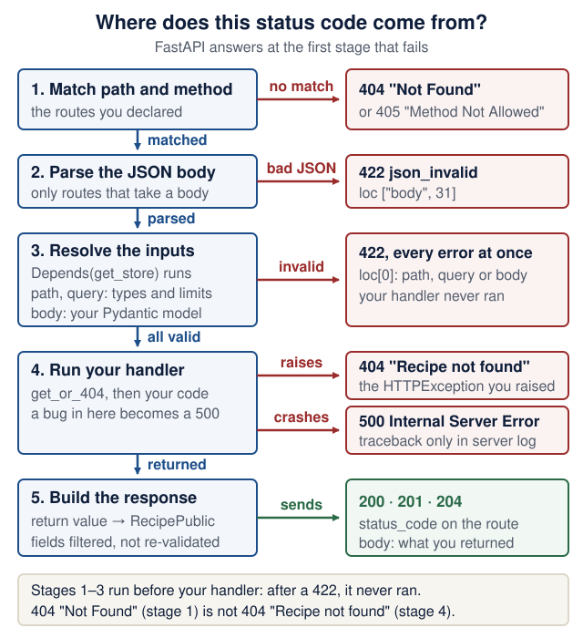

# Lecture 2 · HTTP, FastAPI and Pydantic

<!--  -->
[← Course home](../README.md) · [← Previous: Lecture 1](01-environment-git-docker-ai.md) · [Next: Lecture 3 →](03-persistence-and-first-pr.md)

> **At a glance**
>
> - **When:** Monday 26 October 2026, 16:00 Israel time, on Zoom (clocks changed on 25 October; see the [calendar notes](../README.md#calendar-and-13-meeting-schedule))
> - **You leave with:** a tested CRUD API for your own domain
> - **Goals:** define a contract with Pydantic, explain where each status code comes from, and test the API in isolation ([details](#learning-checkpoint))
> - **Prerequisites:** Lecture 1 works (`curl http://localhost:8000/health` prints `{"status":"ok"}`); repair: [Lecture 1 completion check](01-environment-git-docker-ai.md#completion-check) and [Python you need to read](../guides/engineering-foundations.md#python-you-need-to-read)
> - **Product milestone:** EX1 (due Mon 9 Nov 2026, 23:59): CRUD, validation and tests today; persistence and the Dockerfile next week
> - **Time:** prerequisite check about 10 min before class; lab about 2 h after class (estimate)
> - **Done when:** `uv run pytest` prints `10 passed` for the demo, and 8 or more tests pass for your own record type

<details markdown="1" class="lecture-toc">
<summary>On this page</summary>

- [Mission](#mission)
- [Before you start](#before-you-start)
- [Learning checkpoint](#learning-checkpoint)
- [Concepts](#concepts)
- [Live demo](#live-demo)
- [Hands-on lab](#hands-on-lab)
- [Break it on purpose](#break-it-on-purpose)
- [Open-source track](#open-source-track)
- [Working with AI assistants](#working-with-ai-assistants)
- [Completion check](#completion-check)
- [Quick quiz](#quick-quiz)
- [Stretch goals](#stretch-goals)
- [Common pitfalls](#common-pitfalls)
- [Instructor notes](#instructor-notes)
- [Read more](#read-more)

</details>

## Mission

Turn last week's `/health` skeleton into a real API: create, list, read, update and delete your records. Bad input bounces off with a precise `422`, and ten tests prove it in under a second. Storage is a Python dict for now; next week it becomes a database, and `tests/test_recipes.py` stays exactly the same.

## Before you start

You need Lecture 1's `backend/` uv project with `/health`, pushed to GitHub; your product sketch's **data sketch**, which becomes today's Pydantic model; and your open-source shortlist.

> **Prerequisite check:** about ten minutes in total, before class.
>
> | Check | Pass when | Repair |
> |---|---|---|
> | From `backend/`: `uv run fastapi dev`; in a second terminal, `curl http://localhost:8000/health` | `{"status":"ok"}` | [Lecture 1 completion check](01-environment-git-docker-ai.md#completion-check) |
> | `git status` in your repo | `On branch main` and `nothing to commit, working tree clean` | [Git you need to operate](../guides/engineering-foundations.md#git-you-need-to-operate) |
> | `curl --version` | 7.82 or newer; otherwise you will use the fallback in [demo step 4](#live-demo) | [Common pitfalls](#common-pitfalls) |
> | Your README's data sketch | Every field has a type and a limit | [Lecture 1 lab step 3](01-environment-git-docker-ai.md#hands-on-lab) |
> | "Python you will read today" (below) | You answer five of the six before opening the answers | [Python you need to read](../guides/engineering-foundations.md#python-you-need-to-read) |

<details markdown="1">
<summary>Python you will read today</summary>

Each line comes from today's code. Say what it does in one sentence, then check.

1. `@app.get("/health")` written on the line above `def health():`. What does the decorator do to `health`?
2. `rows: dict[int, RecipePublic] = field(default_factory=dict)` inside a `@dataclass`. Why not `rows: dict = {}`?
3. `limit: Annotated[int, Query(ge=1, le=100)] = 50`. What is the type of `limit`, and who reads `Query(ge=1, le=100)`?
4. `RecipePublic(id=3, **{"title": "Soup", "minutes": 40})`. Rewrite the call without `**`.
5. A fixture: `yield TestClient(app)` followed by `app.dependency_overrides.clear()`. When does the second line run?
6. `list(store.rows.values())[offset : offset + limit]` with 5 recipes. How many items for `offset=4, limit=50`, and for `offset=10`?

<details markdown="1">
<summary>Check your answers</summary>

1. It registers `health` with the app as the handler for `GET /health` and returns the function unchanged. Nothing runs until a request arrives.
2. `default_factory=dict` gives every new `RecipeStore()` its own empty dict. A plain `{}` default would be one dict shared by all instances, so `@dataclass` refuses it with `ValueError: mutable default <class 'dict'> for field rows is not allowed: use default_factory`.
3. `limit` is an `int` with default 50. Python ignores the extra `Query(...)` metadata; FastAPI reads it: take `limit` from the query string and answer 422 for values outside 1–100.
4. `RecipePublic(id=3, title="Soup", minutes=40)`: `**` spreads a dict into keyword arguments.
5. After the test that used the fixture finishes, pass or fail. pytest runs the fixture up to `yield`, gives the yielded value to the test, then runs the rest as clean-up. (In the course fixture, `lambda: store` is a function with no parameters that returns `store`.)
6. One item (index 4 only), then zero. Slicing past the end returns an empty list, not an error.

</details>

</details>

<details markdown="1">
<summary>Words you'll meet today</summary>

Every term here is also in the course [glossary](../guides/engineering-foundations.md#glossary), next to the terms from the other lectures.

- **Fixture:** a pytest function that prepares something a test needs (here, a `client`) and cleans up afterwards.
- **Dependency injection:** the framework hands your route the things it needs (`store: StoreDep`) instead of the route creating them, so a test can hand in a different one.
- **In-process:** `TestClient` calls your app as a Python function in the same process; no server, no network, no port.
- **Lint, format:** `ruff check` flags suspicious or outdated code; `ruff format` rewrites layout (quotes, spacing) the same way for everyone.
- **Deprecation warning:** a library telling you a feature still works but will be removed. Our tests turn warnings into failures, so you notice early.
- **Regression test:** a test written for a bug you found, so the same bug cannot come back unnoticed.
- **Lax versus strict:** Pydantic's default *lax* mode converts obvious cases (`"40"` to `40`); *strict* mode rejects any value of the wrong type.

</details>

## Learning checkpoint

By the end, you should be able to:

- Read a request's method, path, headers, and JSON body; predict its status and response shape.
- Explain Create, Update, and Public models, including absent fields versus explicit null values.
- Write an isolated test that checks behavior and fails when the protected rule is broken.

**Predict first:** Why can deleting a missing record return 404 while DELETE remains idempotent?

<details markdown="1">
<summary>Check your prediction</summary>

Idempotency is about the effect on server state, not about the response. After the first `DELETE /recipes/7`, recipe 7 is gone. A second identical DELETE leaves the state exactly as it was (still gone) and reports that with `404`. Same end state, different status code: the method is still idempotent, so a client may safely repeat it after a timeout.

</details>

> **Warm-up from earlier classes:** answer from memory, then check. Ungraded.
>
> 1. (Lecture 1) Which command shows what `git commit` would record right now, and which shows edits you have not added yet?
> 2. (Lecture 1) In `-p 127.0.0.1:8080:8000`, which port does your browser use, and which address must the server inside the container listen on?
> 3. (Open source) Your candidate had 10,400 stars when you shortlisted it. Which day's count goes into your evidence table?

<details markdown="1">
<summary>Check your answers</summary>

1. `git diff --staged` shows what the commit would record; `git diff` shows edits not yet added.
2. The browser uses 8080 on your laptop. The server inside must listen on `0.0.0.0:8000`; bound to `127.0.0.1`, it would answer only callers inside the container.
3. The count on the day you open the PR. Re-check it then: a project can drop below 10,000, and exactly 10,000 does not qualify.

</details>

**Bridge if needed:** [HTTP, JSON, and contracts](../guides/engineering-foundations.md#http-json-and-contracts) · [Python you need to read](../guides/engineering-foundations.md#python-you-need-to-read) · [Tests with pytest](../guides/engineering-foundations.md#tests-with-pytest)

## Concepts

### HTTP: one request, one response

The **client** (curl, a browser, later your frontend) asks, and the **server** (your FastAPI app) answers, like a kitchen that cooks only when an order arrives. HTTP is **stateless** at the protocol level: a request identifies the operation without requiring an ongoing conversation. Application code can still read database records or authenticated session state.

```http
POST /recipes HTTP/1.1
Host: localhost:8000
Content-Type: application/json

{"title": "Shakshuka", "minutes": 25}
```

```http
HTTP/1.1 201 Created
content-type: application/json

{"title":"Shakshuka","minutes":25,"servings":2,"ingredients":"","tags":"","id":1}
```

A request has a method, a path (plus an optional query, `?limit=10`), headers and an optional body; a response has a status code, headers and an optional body.

### REST: nouns in paths, verbs in methods

Paths name **things** (`/recipes/42`); methods say what to do with them. `POST /createRecipe` is a warning sign (a "code smell"): hide the methods, and the paths should still look like things, not actions. This is the backend contract for the whole course:

| Request | What it does | Success | Idempotent? |
|---|---|---|---|
| `GET /recipes?offset=0&limit=50` | List a page (limit at most 100) | 200 | Yes, and safe |
| `POST /recipes` | Create one | 201 | No |
| `GET /recipes/{recipe_id}` | Read one | 200, or 404 | Yes, and safe |
| `PATCH /recipes/{recipe_id}` | Change only the fields sent | 200, or 404 | Yes, in this API |
| `DELETE /recipes/{recipe_id}` | Delete one | 204, or 404 | Yes |

**Idempotent** means repeating a request has the same intended effect as performing it once, like `f(x) = |x|`; responses need not be identical. This API's create `POST` behaves like `f(x) = x + 1`: two POSTs create two recipes. **Safe** means the client is not requesting a business-state change, as with `GET`; the server may still log the request. `DELETE` is idempotent but not safe. These distinctions follow [HTTP semantics](https://www.rfc-editor.org/rfc/rfc9110.html#section-9.2).

### Status codes you must own

- **200 OK**, **201 Created** (the new resource in the body), **204 No Content** (empty body).
- **404 Not Found.** `{"detail": "Not Found"}` means no route matched, so check the path. `{"detail": "Recipe not found"}` means your handler ran and the id is missing.
- **405 Method Not Allowed**: the path exists, but not with that method.
- **422 Unprocessable Content**: the request broke the contract, for example a missing field, a value out of range, or (in FastAPI) invalid JSON, which many other APIs answer with 400 Bad Request.
- **500 Internal Server Error**: a bug on your side. Never let a stack trace reach the client; it belongs in the server log.

Two decisions in the Recipe Box contract: every error body uses FastAPI's default `{"detail": ...}` shape, and deleting a missing recipe always returns 404. Some argue for 204 (same end state); either is defensible if documented and tested.

### Pydantic: the contract as code

A Pydantic model declares the shape of your data, and FastAPI validates each request against it before your code runs. Each direction of traffic needs its own shape:

| Model | Direction | Has `id`? | Fields | `extra="forbid"`? | Used by |
|---|---|---|---|---|---|
| `RecipeBase` | (shared parent) | No | `title`, `minutes` required; the rest have defaults | No | Parent of Create and Public |
| `RecipeCreate` | Request in | No: the server assigns it | As in `RecipeBase` | Yes | `POST /recipes` body |
| `RecipeUpdate` | Request in | No: the id is in the path | All optional | Yes | `PATCH /recipes/{recipe_id}` body |
| `RecipePublic` | Response out | Yes, always | As in `RecipeBase`, plus `id` | No: it is never parsed from a client | Return type of every route that returns a recipe |

`extra="forbid"` turns an unknown field (a typo like `"minuts"`) into a 422 instead of silently dropping it. `str_strip_whitespace=True` trims strings first, so a title of spaces counts as empty. A 422 says exactly what broke: read `loc` (where) and `msg` (what).

```json
{"detail": [{"type": "string_too_short", "loc": ["body", "title"],
  "msg": "String should have at least 1 character", "input": "",
  "ctx": {"min_length": 1}}]}
```

`ingredients` and `tags` are plain strings (one ingredient per line; tags comma-separated), not `list[str]`. Each maps to one SQLite column in Lecture 3; the cost is that the server does not validate individual items, so an empty tag between two commas passes.

### PATCH: absent, null, or a value

A PATCH body can leave a field out, send it as `null`, or send a value. These are three different requests, and the contract must say what each one means. Suppose recipe 1 has the title `"Soup"`:

| Client sends | Dumped with `exclude_unset=True` | Also `exclude_none=True` (this API) | Title afterwards |
|---|---|---|---|
| `{}` (field absent) | `{}` | `{}` | `"Soup"` (unchanged) |
| `{"title": null}` | `{"title": None}` | `{}` | `"Soup"` (unchanged) |
| `{"title": "Stew"}` | `{"title": "Stew"}` | `{"title": "Stew"}` | `"Stew"` |

`exclude_unset=True` keeps only fields the client actually sent; `exclude_none=True` also drops the ones sent as `null`. The decision: in this API `null` means "leave unchanged", because no Recipe Box field is nullable: every stored recipe has a value for every field. Two alternatives are defensible. JSON Merge Patch ([RFC 7396](https://www.rfc-editor.org/rfc/rfc7396)) makes `null` mean "remove this field", and a stricter API rejects `null` with a 422. Note that the schema says `title: str | None`, so `/docs` advertises `null` as legal; the tests pin down what it means.

**Check yourself:** what does `PATCH /recipes/1` with `{"title": null, "minutes": 30}` return?

<details markdown="1">
<summary>Check your answer</summary>

`200` with `"title": "Soup"` and `"minutes": 30`. After `exclude_none=True`, `changes` is `{"minutes": 30}`.

</details>

### FastAPI: type hints do the work

A parameter typed as a Pydantic model is read from the JSON body and validated. `recipe_id: int` comes from the path, so `/recipes/abc` is a 422. The **return type** filters what is sent back and documents it at `/docs`. **Dependencies** (`Depends`) hand shared things such as the store to your routes, and tests can swap them.

FastAPI checks a request in a fixed order, and the first stage that fails writes the response. So the status code tells you *where* to look:

<figure class="course-diagram">
  <div class="diagram-scroll" role="region" tabindex="0" aria-label="Where status codes come from, scroll horizontally">
    
  </div>
  <figcaption><strong>Where does this status code come from?</strong> Predict the stage at which each demo curl in step 4 stops. <span class="screen-only">On a narrow screen, scroll the diagram sideways.</span> <a href="../assets/diagrams/l02-status-pipeline.svg">Open the diagram at full size</a>.</figcaption>
</figure>

<details markdown="1">
<summary>Text version of the diagram</summary>

FastAPI answers at the first stage that fails:

1. **Match the path and method** against the routes you declared. No route has this path: `404` with `{"detail": "Not Found"}`. The path exists, but not with this method: `405` with `{"detail": "Method Not Allowed"}`.
2. **Parse the JSON body**, only for routes that take a body. Invalid JSON: `422` with type `json_invalid` and a `loc` such as `["body", 31]` (the character position).
3. **Resolve the inputs.** The dependency `get_store` runs; path and query parameters are converted and checked (`recipe_id: int`, `limit` at most 100); the body is validated against your Pydantic model. Every error is collected into **one** `422`, and `loc[0]` says where: `"path"`, `"query"` or `"body"`. Your handler never ran.
4. **Run your handler.** `get_or_404` raises `HTTPException`: `404` with `{"detail": "Recipe not found"}`. Any uncaught exception becomes `500 Internal Server Error`; the client sees only that text, and the traceback appears only in the server log.
5. **Build the response.** The return value goes through the return type `RecipePublic`, which filters fields but does not re-validate a model object you return. The status is the route's `200`, `201` or `204`.

Two reading rules: after a `422`, your handler never ran; and `404 "Not Found"` (stage 1) is a different problem from `404 "Recipe not found"` (stage 4).

</details>

**Check yourself:** `PATCH /recipes/999` (no such recipe) with the body `{"minutes": 0}`. Is the answer 404 or 422?

<details markdown="1">
<summary>Check your answer</summary>

`422` with `greater_than_equal` at `["body", "minutes"]`. Validation (stage 3) runs before your handler (stage 4), so `get_or_404` never gets the chance to say the recipe is missing.

</details>

### OpenAPI describes this API; OpenAI is a different name

**OpenAPI** is the machine-readable description FastAPI publishes at `/openapi.json`; `/docs` renders an interactive view. It describes operations, inputs and responses. **OpenAI** is a company whose model API we may call later. You can build today's complete API without any model provider or model account.

**Two-minute check, after starting the demo below:** open `/openapi.json`, find `paths` → `/recipes` → `post`, and locate its request schema and declared success response. Compare those declarations with the handler and one API test. Which part describes the request, and which running code validates it? A schema snapshot is evidence of a declared contract; it does not prove the deployed service still follows it or that a caller is authorized. Lecture 7 turns this distinction into a cross-service check.

The optional [API vocabulary table](../guides/model-apis-and-decisions.md#the-names-describe-different-layers) is a reference if the similar names become confusing. No provider setup is part of this check.

## Live demo

The instructor grows Recipe Box; every command runs from `backend/` unless a step says otherwise.

**1. Add the dev tools** (from `backend/`). *State the contract.* Tests import Starlette's `TestClient`, which wants `httpx2`; with only `httpx` installed it raises a deprecation warning, and our settings below turn warnings into failures.

```bash
uv add --dev pytest ruff httpx2
```

**Version note:** FastAPI 0.143.3, the current release on 17 October 2026, installs `httpx` but not `httpx2` with `fastapi[standard]`. A change merged that day ([fastapi#16512](https://github.com/fastapi/fastapi/pull/16512)) adds `httpx2` to the `standard` extra from the next release. Listing it as a dev dependency makes the test requirement explicit either way. (Checked 17 October 2026.)

Append to `backend/pyproject.toml`:

```toml
[tool.pytest.ini_options]
pythonpath = ["."]
testpaths = ["tests"]
addopts = "-q"
filterwarnings = ["error"]

[tool.ruff.lint]
extend-select = ["I", "FAST"]
```

`pythonpath` lets tests import `app`; `filterwarnings = ["error"]` turns deprecation warnings into failures.

**2. The contract.** *State the contract.*

<figure class="file-example file-example--long" markdown="1">
<figcaption><span class="file-example-action">File example</span> <span class="file-example-path">backend/app/models.py</span></figcaption>

```python
# backend/app/models.py
from pydantic import BaseModel, ConfigDict, Field


class RecipeBase(BaseModel):
    """Fields shared by every recipe schema."""

    title: str = Field(min_length=1, max_length=200)
    minutes: int = Field(ge=1, le=24 * 60)
    servings: int = Field(default=2, ge=1, le=50)
    ingredients: str = Field(default="", max_length=5000)  # one per line
    tags: str = Field(default="", max_length=500)  # comma-separated


class RecipeCreate(RecipeBase):
    """POST body. Unknown fields -> 422 instead of being silently ignored."""

    model_config = ConfigDict(extra="forbid", str_strip_whitespace=True)


class RecipeUpdate(BaseModel):
    """PATCH body: every field optional; send only what changes."""

    model_config = ConfigDict(extra="forbid", str_strip_whitespace=True)

    title: str | None = Field(default=None, min_length=1, max_length=200)
    minutes: int | None = Field(default=None, ge=1, le=24 * 60)
    servings: int | None = Field(default=None, ge=1, le=50)
    ingredients: str | None = Field(default=None, max_length=5000)
    tags: str | None = Field(default=None, max_length=500)


class RecipePublic(RecipeBase):
    """Response body: what clients see (always has an id)."""

    id: int
```

</figure>

**3. The routes.** *Make the smallest change.* The store is a dict behind a dependency, and the routes never touch it any other way.

<figure class="file-example file-example--long" markdown="1">
<figcaption><span class="file-example-action">File example</span> <span class="file-example-path">backend/app/main.py</span></figcaption>

```python
# backend/app/main.py
from dataclasses import dataclass, field
from typing import Annotated

from fastapi import Depends, FastAPI, HTTPException, Query, status

from app.models import RecipeCreate, RecipePublic, RecipeUpdate


@dataclass
class RecipeStore:
    """A dict standing in for a database. Restart the server: data is gone."""

    rows: dict[int, RecipePublic] = field(default_factory=dict)
    last_id: int = 0


store = RecipeStore()


def get_store() -> RecipeStore:
    return store  # tests swap in a fresh store via app.dependency_overrides


StoreDep = Annotated[RecipeStore, Depends(get_store)]

app = FastAPI(title="Recipe Box API")


def get_or_404(store: RecipeStore, recipe_id: int) -> RecipePublic:
    if recipe_id not in store.rows:
        raise HTTPException(status.HTTP_404_NOT_FOUND, detail="Recipe not found")
    return store.rows[recipe_id]


@app.get("/health")
def health() -> dict[str, str]:
    return {"status": "ok"}


@app.get("/recipes")
def list_recipes(
    store: StoreDep,
    offset: Annotated[int, Query(ge=0)] = 0,
    limit: Annotated[int, Query(ge=1, le=100)] = 50,
) -> list[RecipePublic]:
    return list(store.rows.values())[offset : offset + limit]


@app.post("/recipes", status_code=status.HTTP_201_CREATED)
def create_recipe(body: RecipeCreate, store: StoreDep) -> RecipePublic:
    store.last_id += 1
    recipe = RecipePublic(id=store.last_id, **body.model_dump())
    store.rows[recipe.id] = recipe
    return recipe


@app.get("/recipes/{recipe_id}")
def get_recipe(recipe_id: int, store: StoreDep) -> RecipePublic:
    return get_or_404(store, recipe_id)


@app.patch("/recipes/{recipe_id}")
def update_recipe(recipe_id: int, body: RecipeUpdate, store: StoreDep) -> RecipePublic:
    recipe = get_or_404(store, recipe_id)
    # Only fields the client sent; null means "leave unchanged".
    changes = body.model_dump(exclude_unset=True, exclude_none=True)
    store.rows[recipe_id] = recipe.model_copy(update=changes)  # already validated
    return store.rows[recipe_id]


@app.delete("/recipes/{recipe_id}", status_code=status.HTTP_204_NO_CONTENT)
def delete_recipe(recipe_id: int, store: StoreDep) -> None:
    get_or_404(store, recipe_id)
    del store.rows[recipe_id]
```

</figure>

In PATCH, `exclude_unset=True` keeps only the fields the client sent. `model_copy(update=...)` does **not** validate; that is safe only because `RecipeUpdate` already did. This toy store is also unsafe under concurrent requests: FastAPI runs plain `def` routes in a thread pool, so two POSTs can race on `last_id += 1` and receive the same id. Next week's database assigns ids inside a transaction.

**4. Happy and error requests.** *Observe the real result.* Start `uv run fastapi dev` in `backend/`; the curls run in a second terminal, from any folder.

**Predict:** before you send each request below, write down its status code and, for an error, the stage in the figure above that answers.

```bash
curl -i --json '{"title": "Shakshuka", "minutes": 25}' localhost:8000/recipes
curl localhost:8000/recipes/1
curl localhost:8000/recipes/999
curl --json '{"title": "", "minutes": 0}' localhost:8000/recipes
curl --json '{"title": "Soup", "minutes": 40, "chef": "me"}' localhost:8000/recipes
curl -X PATCH --json '{"minutes": 30}' localhost:8000/recipes/1
curl -i -X DELETE localhost:8000/recipes/1
curl "localhost:8000/recipes?limit=101"
```

<details markdown="1">
<summary>Check your predictions</summary>

1. `201` with the new recipe and `"id":1`.
2. `200` with the same recipe.
3. `404` `{"detail":"Recipe not found"}` (stage 4: your handler ran).
4. `422` with two errors, `string_too_short` and `greater_than_equal`, both reported at once (stage 3).
5. `422` `extra_forbidden` at `["body", "chef"]` (stage 3).
6. `200` with `"minutes":30`; the title is unchanged.
7. `204` with an empty body.
8. `422` `less_than_equal` at `["query", "limit"]` (stage 3).

</details>

`--json` needs curl 7.82 or newer; Ubuntu 22.04 ships 7.81 and answers `option --json: is unknown`. `--json` is a shortcut for sending the data with the header `Content-Type: application/json` (plus `Accept: application/json`), so this works on any curl:

```bash
curl -i -X POST -H 'Content-Type: application/json' -d '{"title": "Shakshuka", "minutes": 25}' localhost:8000/recipes
curl -X PATCH -H 'Content-Type: application/json' -d '{"minutes": 30}' localhost:8000/recipes/1
```

Repeat a few in <http://localhost:8000/docs> with "Try it out".

**Explain after:** switch to the server terminal and match each curl to its access-log line, such as `INFO:     127.0.0.1:63541 - "POST /recipes HTTP/1.1" 422 Unprocessable Content`. Which of the eight requests never reached your handler code?

<details markdown="1">
<summary>Show a model answer</summary>

The three `422` requests (4, 5 and 8) stopped in stage 3, before your handler ran. Every request still gets an access-log line, which is how you can debug a client you cannot see: the log shows the method, the path, the query string and the status the server sent.

</details>

**Optional:** watch a 500 happen. Add `1 / 0` as the first line of `get_recipe` and save. `curl -i localhost:8000/recipes/1` now prints only `HTTP/1.1 500 Internal Server Error` and the body `Internal Server Error`. The server terminal shows the access-log line, `ERROR:    Exception in ASGI application`, and a traceback ending in `ZeroDivisionError: division by zero`. That split is deliberate: details stay on the server. Delete the line again.

**Predict:** create one more recipe and check that `curl localhost:8000/recipes` lists it. Then, in the second terminal, run `touch app/main.py` from `backend/` (it changes the file's timestamp, not its content). What does `curl localhost:8000/recipes` return now, and why?

<details markdown="1">
<summary>Check your prediction</summary>

`[]`. The server terminal prints `WatchFiles detected changes in 'app/main.py'. Reloading...`: `fastapi dev` started a fresh Python process, and the dict lived in the old process's memory. A restart, a crash or a redeploy loses it the same way. That is next week's problem, and a database is the fix.

</details>

**Trace it:** follow `PATCH /recipes/1` with the body `{"title": null}` through the code, assuming recipe 1 is `"Soup"`, 40 minutes. Fill in the cells marked `?` before you open the answer.

| Step | File : function | Input | State after | Next call |
|---|---|---|---|---|
| 1 | `app/models.py` : `RecipeUpdate` (stage 3) | `{"title": null}` | `body.title is None`; `"title"` is in `body.model_fields_set` | `update_recipe` |
| 2 | `app/main.py` : `get_or_404` | `store`, `1` | `recipe` is Soup, 40 minutes | `body.model_dump(...)` |
| 3 | `app/main.py` : `update_recipe` | `exclude_unset=True, exclude_none=True` | `changes` is `?` | `recipe.model_copy(update=changes)` |
| 4 | `app/main.py` : `update_recipe` | `update=changes` | stored title is `?` | `return` |
| 5 | FastAPI (stage 5) | `RecipePublic` | status `?`, `"title": ?` | — |

<details markdown="1">
<summary>Check your answer</summary>

Step 3: `changes` is `{}`, because `exclude_none=True` drops the `None`. Step 4: the stored title is still `"Soup"`. Step 5: `200` with `"title": "Soup"`. Now change one argument: without `exclude_none=True`, step 3 gives `{"title": None}`, `model_copy` copies it in **without validation**, and the response says `"title": null`. Break-it drill 2 makes exactly that change.

</details>

**5. The tests.** *State the contract.* `TestClient` calls the app in-process, with no server. The fixture gives every test a fresh store:

<figure class="file-example" markdown="1">
<figcaption><span class="file-example-action">File example</span> <span class="file-example-path">backend/tests/conftest.py</span></figcaption>

```python
# backend/tests/conftest.py
from collections.abc import Iterator

import pytest
from fastapi.testclient import TestClient

from app.main import RecipeStore, app, get_store


@pytest.fixture
def client() -> Iterator[TestClient]:
    store = RecipeStore()  # a fresh, empty store for every test
    app.dependency_overrides[get_store] = lambda: store
    yield TestClient(app)
    app.dependency_overrides.clear()
```

</figure>

Three of the ten tests in `backend/tests/test_recipes.py`. The comment at the top is the testing strategy: the partitions each input splits into, so you can see which test protects which rule. (Writing partitions down first is inspired by MIT 6.102's [reading on testing](https://web.mit.edu/6.102/www/sp26/classes/02-testing/); EASS is not affiliated with MIT.)

<figure class="file-example file-example--long" markdown="1">
<figcaption><span class="file-example-action">Partial file</span> <span class="file-example-path">backend/tests/test_recipes.py</span></figcaption>

```python
# backend/tests/test_recipes.py (excerpt)
# Testing strategy: split each input into partitions and test at least one value
# from each, especially both sides of every limit. A test counts only if it fails
# when the rule it protects is broken.
#   title: missing | "" | whitespace only | 1-200 chars | 201 chars
#   minutes: 0 | 1-1440 | 1441        servings: 1-50 | 51
#   fields: only known ones | an unknown one ("chef")
#   recipe id: exists | missing (GET, PATCH, DELETE)
from fastapi import status

SOUP = {"title": "Soup", "minutes": 40}


def test_create_returns_201_with_defaults(client):
    r = client.post("/recipes", json=SOUP)
    assert r.status_code == status.HTTP_201_CREATED
    body = r.json()
    assert body["id"] >= 1
    assert (body["title"], body["minutes"]) == ("Soup", 40)
    assert body["servings"] == 2  # defaults
    assert body["ingredients"] == body["tags"] == ""


def test_unknown_field_is_rejected(client):
    r = client.post("/recipes", json={**SOUP, "chef": "me"})
    assert r.status_code == 422
    assert r.json()["detail"][0]["type"] == "extra_forbidden"


def test_missing_recipe_is_404(client):
    for method in ("GET", "PATCH", "DELETE"):
        body = {} if method == "PATCH" else None  # PATCH must pass validation first
        r = client.request(method, "/recipes/999", json=body)
        assert r.status_code == 404, method
        assert r.json() == {"detail": "Recipe not found"}
```

</figure>

The other seven cover health, read-after-create, pagination (`limit=101` is a 422), seven invalid bodies, PATCH (partial, `null`, invalid), delete-then-404, and isolation. Paste them below the excerpt to get the full file:

<details markdown="1">
<summary>Show the other seven tests</summary>

<figure class="file-example file-example--long" markdown="1">
<figcaption><span class="file-example-action">Partial file</span> <span class="file-example-path">backend/tests/test_recipes.py</span></figcaption>

```python
# backend/tests/test_recipes.py (continued)
def test_health(client):
    assert client.get("/health").json() == {"status": "ok"}


def test_get_returns_what_was_created(client):
    created = client.post("/recipes", json=SOUP).json()
    assert client.get(f"/recipes/{created['id']}").json() == created


def test_list_is_paginated(client):
    for n in range(3):
        client.post("/recipes", json={"title": f"R{n}", "minutes": 5})
    assert [r["title"] for r in client.get("/recipes").json()] == ["R0", "R1", "R2"]
    page = client.get("/recipes", params={"offset": 1, "limit": 1}).json()
    assert [r["title"] for r in page] == ["R1"]
    assert client.get("/recipes", params={"limit": 101}).status_code == 422


def test_invalid_bodies_are_422(client):
    bad_bodies = [
        {"title": "", "minutes": 20},  # too short
        {"title": "   ", "minutes": 20},  # whitespace is stripped first
        {"title": "x" * 201, "minutes": 20},  # one over the limit
        {"title": "x", "minutes": 0},  # minutes >= 1
        {"title": "x", "minutes": 24 * 60 + 1},  # minutes <= 1440
        {"title": "x", "minutes": 5, "servings": 51},  # servings <= 50
        {"minutes": 5},  # title missing
    ]
    for body in bad_bodies:
        r = client.post("/recipes", json=body)
        assert r.status_code == status.HTTP_422_UNPROCESSABLE_CONTENT, body


def test_patch_changes_only_sent_fields(client):
    rid = client.post("/recipes", json=SOUP).json()["id"]
    r = client.patch(f"/recipes/{rid}", json={"minutes": 35})
    assert r.status_code == 200
    assert (r.json()["title"], r.json()["minutes"]) == ("Soup", 35)
    # null means "leave unchanged"; a stored None would break the contract
    # (in Lecture 3 the database rejects it with a 500)
    assert client.patch(f"/recipes/{rid}", json={"title": None}).status_code == 200
    assert client.patch(f"/recipes/{rid}", json={"minutes": 0}).status_code == 422


def test_delete_then_404(client):
    rid = client.post("/recipes", json=SOUP).json()["id"]
    r = client.delete(f"/recipes/{rid}")
    assert r.status_code == status.HTTP_204_NO_CONTENT
    assert r.content == b""
    assert client.get(f"/recipes/{rid}").status_code == 404
    assert client.delete(f"/recipes/{rid}").status_code == 404


def test_each_test_starts_empty(client):
    assert client.get("/recipes").json() == []
```

</figure>

</details>

*Observe the real result* (from `backend/`):

```bash
uv run pytest
uv run ruff check .
uv run ruff format --check .
```

Expected: `10 passed`, `All checks passed!`, and all files already formatted. This test file stays unchanged through Lecture 10: storage changes, the contract does not.

> **Investigate:**
>
> 1. Which line of `conftest.py` makes each test start with an empty store, and which line undoes it?
> 2. Why does `test_missing_recipe_is_404` send a body only for PATCH? What would PATCH answer without one?
> 3. If someone changed `max_length=200` to `201` in `RecipeBase`, which test would go red, and with what message?

<details markdown="1">
<summary>Show model answers</summary>

1. `app.dependency_overrides[get_store] = lambda: store` hands every route this test's fresh `store`; `app.dependency_overrides.clear()` after `yield` removes the override, so the next test starts clean.
2. PATCH takes a body, and validation (stage 3) runs before the handler. Without a body, PATCH answers `422` with type `missing` at `["body"]`, never reaching `get_or_404`. GET and DELETE take no body, so the test sends none.
3. `test_invalid_bodies_are_422` (`1 failed, 9 passed`). pytest prints the failing body, the 201-character title, as the assertion message, then `assert 201 == 422`: the server created a recipe it should have refused. That is the partition comment at work: the `201 chars` case exists so that this mistake is caught.

</details>

## Hands-on lab

Build the same API for **your** record type, from your repo's `backend/`. Plan your time:

- **Core today:** steps 1–4
- **Before Lecture 3:** step 5
- **Extension (optional):** the [Stretch goals](#stretch-goals)

1. **Models.** Translate your data sketch into `app/models.py` with the four-model split. Give every field a type and a limit, and decide which fields have defaults. **Checkpoint:** `/docs` shows your Create, Update and Public schemas.
2. **Routes.** Add the five contract routes, renamed for your resource (for example `/tasks/{task_id}`), using the store dependency and `get_or_404`. **Checkpoint:** POST returns 201 with an `id`; a missing id returns 404 with your `detail`.
3. **Predict, then send.** In your README, write six requests (two happy, four broken) with predicted status codes and stages. Send them, then correct your predictions. **Checkpoint:** you can explain each 422 from its `loc` and `msg`, and each 404 from its `detail`.
4. **Tests.** Copy the fixture. Write the testing-strategy comment for your record first: every field's partitions, including both sides of each limit. Then write one test per partition (usually 8 or more), plus 404 on GET, PATCH and DELETE, and isolation ([tests with pytest](../guides/engineering-foundations.md#tests-with-pytest)). **Checkpoint:** every partition in your comment has a test, ruff is clean, and changing one limit in your model turns a named test red. A failure case to watch for: a test that still passes after you break the rule it names protects nothing; fix the test.
5. **Ship it** on a branch with a PR on your own repo, as in Lecture 1. Before the PR, add `## Run` and `## Test` sections to your README with the exact commands (`cd backend`, `uv run fastapi dev`; `cd backend`, `uv run pytest`, `uv run ruff check .`), and an `## AI use` line for any assistant help this week. **Checkpoint:** `gh pr list --state merged` shows it, and a classmate can follow your Run and Test sections in a fresh terminal.

**Optional:** practise the partition step of the [engineering studio routine](../guides/learning-map.md#engineering-studio-and-review-criteria) on your title field with a partner: valid, empty, whitespace only, missing, `null`, wrong type.

> **EX1 progress:** after today you have CRUD, validation, tests, and run and test instructions. Still to come next week: persistent data and a backend Dockerfile. EX1 is due Mon 9 Nov 2026, 23:59 ([assignments](../README.md#assignments-and-deadlines)).

## Break it on purpose

Break it, run `uv run pytest` from `backend/`, read the failure, then restore the code. Predict before each run.

**Drill 1 · Forget the forbid.** Remove `extra="forbid"` from both models. Which test fails, and what does its assertion line say?

<details markdown="1">
<summary>Check your prediction</summary>

`test_unknown_field_is_rejected` fails with `assert 201 == 422`: the typo field was silently dropped and the recipe was created. Use the same move to check an AI-written test: break the code it protects, and the test must go red.

</details>

**Drill 2 · A bug the tests miss.** Change the PATCH line to `body.model_dump(exclude_unset=True)`. How many of the ten tests fail? What does `PATCH {"title": null}` return now?

<details markdown="1">
<summary>Check your prediction</summary>

None: all ten tests **still pass**, yet `PATCH {"title": null}` now returns `"title": null`. `model_copy` skipped validation, and FastAPI trusts a model object you return (your trace above, step 3). The existing PATCH test checks only the status code. Add this regression test, watch it fail with `AssertionError: assert None == 'Soup'`, then restore `exclude_none=True`:

<figure class="file-example" markdown="1">
<figcaption><span class="file-example-action">File example</span> <span class="file-example-path">backend/tests/test_patch_null.py</span></figcaption>

```python
# backend/tests/test_patch_null.py
def test_patch_null_keeps_the_old_value(client):
    rid = client.post("/recipes", json={"title": "Soup", "minutes": 40}).json()["id"]
    client.patch(f"/recipes/{rid}", json={"title": None})
    assert client.get(f"/recipes/{rid}").json()["title"] == "Soup"
```

</figure>

The lesson: assert the body, not just the status code. Keep the file until Lecture 3, where the database turns this bug into a 500 that `test_patch_changes_only_sent_fields` catches.

</details>

**Optional:** look inside instead of guessing. With the broken line and the regression test in place, run `uv run pytest -x --pdb tests/test_patch_null.py`. At the `(Pdb)` prompt, type `p client.get(f"/recipes/{rid}").json()`: you see the stored recipe with `'title': None`. Type `q` to quit. The method behind this is the [debug log](../guides/engineering-foundations.md#debug-with-a-hypothesis): a hypothesis first, then one experiment.

**Drill 3 · Shared state.** Make the fixture return a plain `TestClient(app)` with no override. Which tests fail, and why might the result change if the tests ran in another order?

<details markdown="1">
<summary>Check your prediction</summary>

`test_list_is_paginated` and `test_each_test_starts_empty` fail (`Left contains … more items`; the count depends on test order): earlier tests left recipes behind in the one global store. Results that depend on test order are the definition of a flaky suite.

</details>

**Debug log:** for drill 3, write the seven-line [debug log](../guides/engineering-foundations.md#debug-with-a-hypothesis) entry in your notes. Write the hypothesis before you look at the fixture again.

## Open-source track

This week: **find one real issue or documentation gap** in your best candidate, and ask before doing anything big ([etiquette](../README.md#contribution-etiquette)).

```bash
gh label list -R OWNER/REPO --limit 100
gh issue list -R OWNER/REPO --state open --label "documentation"
gh issue view NUMBER -R OWNER/REPO
gh issue view NUMBER -R OWNER/REPO --comments
gh pr list -R OWNER/REPO --state all --search "words from the issue"
```

- **Labels differ** per project, so check the list first.
- **Read the body, who is assigned, and all comments.** If someone is assigned or an open PR already fixes it, move on. On 16 October 2026, one documentation issue in a large project already had two competing open PRs.
- **Documentation gaps count.** Follow the project's tutorial in a fresh folder; a step that fails or assumes unexplained knowledge is a candidate.
- **Ask first** for anything beyond a typo: describe what you found and propose a fix, in your own words.

**Read one real review first** (about 10 min). In your candidate, find a merged PR from an outside contributor with real review discussion, for example with `gh pr list -R OWNER/REPO --state merged --search "comments:>3" --limit 10`; a head branch shown as `user:branch` usually came from a fork. Open it with `gh pr view NUMBER -R OWNER/REPO --comments`. In your README shortlist row, note two things the reviewers asked for and three norms of the project: are tests required, is a changelog entry needed, and is there a commit-message or sign-off (DCO) rule? This step is inspired by [Missing Semester 2026, "Beyond the Code"](https://missing.csail.mit.edu/2026/beyond-code/) and Stanford's [CS146S](https://themodernsoftware.dev/); EASS is not affiliated with either.

Add the issue URL and your plan to your README. In Lecture 3 you reproduce it and open PR #1.

## Working with AI assistants

1. **Tests first.** "Here are my models and route table. Write pytest tests with a `client` fixture, including 404 and 422 cases. Don't write the routes." Run them before the routes exist: they must fail.
2. **Nasty inputs.** "List ten invalid JSON bodies for this model, each with the Pydantic v2 error `type` you expect." Send them and compare with the real `detail[0]["type"]`.
3. **Explain a 422.** Paste the full JSON and ask which field broke the contract.

From this week, use the longer [work order](../guides/agent-driven-development.md#one-work-order-template): now that you have tests, add `Acceptance` and `Stop` to Lecture 1's five lines. An example for an optional feature (it is also a fine stretch goal):

```text
Outcome:      GET /recipes?tag=vegan returns only recipes whose comma-separated
              tags contain "vegan" (case-insensitive); an unknown tag returns
              200 with []
Files:        backend/app/main.py, backend/tests/test_tag_filter.py (new)
Non-goals:    no change to the models, to other routes, or to
              tests/test_recipes.py
Verify with:  (from backend/) uv run pytest, then uv run ruff check .
Review focus: tags are split on commas and compared whole, so tag=veg
              does not match "vegan"
Acceptance:   tests/test_tag_filter.py fails before the change because
              all recipes come back
Stop:         if the change seems to need a new dependency or a model
              change, stop and report
```

Run the new test **before** the change and read why it fails. If it already passes, record *already satisfied* and stop; never manufacture a failure. Afterwards, add one line to your README's `## AI use` note: the tool, what it produced, and the command you ran to check it.

**Spot the outdated suggestion.** Each of these raises a deprecation warning, which `filterwarnings = ["error"]` turns into a failing test:

- `class Config: extra = "forbid"` inside a model. Use `model_config = ConfigDict(extra="forbid")`.
- `.dict()`. Use `.model_dump()`.
- `status.HTTP_422_UNPROCESSABLE_ENTITY`. Use `status.HTTP_422_UNPROCESSABLE_CONTENT`.

## Completion check

From `backend/`, with `uv run fastapi dev` running in a second terminal:

```bash
uv run pytest
uv run ruff check .
curl -s -o /dev/null -w "%{http_code}\n" http://localhost:8000/recipes/999
curl -s -o /dev/null -w "%{http_code}\n" --json '{}' http://localhost:8000/recipes
```

Expected: `N passed` (N is at least 8), `All checks passed!`, `404`, and `422`. Use your own resource path. On curl older than 7.82, replace `--json '{}'` with `-H 'Content-Type: application/json' -d '{}'`.

| Must work | Evidence you keep | If it fails, repair here |
|---|---|---|
| Five CRUD routes plus `/health` for your record type, with the contract's status codes | The four commands above, pasted in your PR description | [Status codes you must own](#status-codes-you-must-own) · [the status-code figure](#fastapi-type-hints-do-the-work) |
| Separate Create, Update and Public models, with `extra="forbid"` and a limit on every field | `/docs` screenshot or the schemas in your PR | [Pydantic: the contract as code](#pydantic-the-contract-as-code) |
| `uv run pytest` prints `N passed` (N at least 8); tests assert status codes **and** bodies, with a fresh store per test | Terminal output in your PR description | [Break it on purpose](#break-it-on-purpose) · [Tests with pytest](../guides/engineering-foundations.md#tests-with-pytest) |
| README has `## Run` and `## Test` sections that a classmate followed | README on GitHub | [Lab step 5](#hands-on-lab) |
| One issue or documentation gap noted for your open-source candidate, plus the review norms you read | README shortlist row | [Open-source track](#open-source-track) |

**Not yet?** Repair and re-run before starting the next lecture's lab; later layers assume this one works.

## Quick quiz

<details markdown="1">
<summary>Q1. A client retries POST /recipes after a timeout, and both requests arrive. What happens? (a) One recipe, since POST is idempotent (b) Two recipes with two different ids (c) A 409 Conflict for the retry</summary>

**(b).** Each POST creates a new resource with a new id, like `f(x) = x + 1`: POST is not idempotent. Nothing in this API looks for duplicates, so no 409 comes back either. Retrying a POST needs care, which Lecture 9 returns to.

</details>

<details markdown="1">
<summary>Q2. A client sends "minutes": "40" (a string) to POST /recipes. What does this API return? (a) 422, because "40" is a string (b) 500, because the handler gets text (c) 201, with minutes stored as 40</summary>

**(c).** Pydantic's default *lax* mode converts a numeric string to an int. `"forty"` cannot convert, so it gets 422 `int_parsing`. Strict mode rejects any string. Either way, validation runs before your handler (stage 3), so the handler never receives text.

</details>

<details markdown="1">
<summary>Q3. GET /recipe/1 (no "s") returns {"detail": "Not Found"}. What does that tell you? (a) No route matched the request path (b) The handler found no recipe 1 (c) The store has no recipes yet</summary>

**(a).** Your handler would have said `"Recipe not found"`, whether recipe 1 was deleted or the store is empty. The generic `"Not Found"` means no route matched, so check the path.

</details>

<details markdown="1">
<summary>Q4. Why does the client fixture override get_store? (a) Tests can run without a live server (b) Each test gets its own empty store (c) The suite runs faster with fewer rows</summary>

**(b).** Shared state makes tests depend on each other's leftovers (drill 3), so results change with test order. `TestClient` is what removes the server, with or without the override. Next week the same override swaps in a test database.

</details>

<details markdown="1">
<summary>Q5. (Lecture 1) At the repo root, <code>uv run pytest</code> says "Failed to spawn: pytest". Why? (a) No uv project at the root (b) A syntax error in a test (c) FastAPI is missing from global Python</summary>

**(a).** `uv run` uses the nearest `pyproject.toml`; the root has none, so `backend/.venv` is never used. "Failed to spawn" means uv found no `pytest` program to start, so no test file was read and a syntax error cannot be the cause. With a global pytest you get `No module named 'fastapi'` instead, for the same reason. Run `cd backend` first.

</details>

**Explain it:** in one sentence, what is `get_or_404` *for*? (Not what each line does.)

<details markdown="1">
<summary>Show a model answer</summary>

- **Weak (narrates lines):** "It checks whether the id is in `store.rows`, raises an `HTTPException` if not, and returns the row."
- **Strong (purpose and the failure it prevents):** "It gives every route one shared way to turn 'no such recipe' into the contract's `404 Recipe not found`, so no route can forget the check and crash with a `KeyError` that the client would see as a 500."

</details>

> **Defend it:** the Recipe Box contract answers `404` when a client deletes a recipe that does not exist; some APIs answer `204`. Defend the course's choice with one reason from the contract or the tests, and name one cost.

<details markdown="1">
<summary>What a strong answer mentions</summary>

- **Reason:** `404` tells the client something true and useful (this id does not exist, perhaps a typo or a stale list), it matches what GET and PATCH say for the same id, and `test_delete_then_404` pins it down. DELETE stays idempotent because the server state is the same either way.
- **Cost:** a client that retries a DELETE after a timeout may see `404` for a delete that actually succeeded the first time, so it must treat `404` as "already gone" rather than as an error. A `204` answer avoids that special case at the price of hiding typos.

</details>

## Stretch goals

Optional, after your tests pass:

- Add `PUT /recipes/{recipe_id}` that replaces the whole record (a `RecipeCreate` body), and test that two identical PUTs leave the same state.
- Add the `?tag=` filter from the work order above, or a `q` query parameter that filters titles case-insensitively, each with a test that fails first.
- In your own product, convert an invalid-bodies loop to `@pytest.mark.parametrize`, so each bad body is reported as its own test. **Simpler is enough:** the loop is fine for the course demo, whose checker expects exactly ten tests; parametrizing changes that count, so do it only in your own repo.
- Try HTTPie: `uvx --from httpie http POST :8000/recipes title=Soup minutes:=40` (`:=` sends a JSON number).

## Common pitfalls

- **`option --json: is unknown`** from curl → your curl is older than 7.82 (Ubuntu 22.04 ships 7.81) → use `-H 'Content-Type: application/json' -d '{...}'`, as in demo step 4, or upgrade.
- **422 `model_attributes_type` from curl** → `-d` without a JSON content type sends form data → use `--json`, or add `-H "Content-Type: application/json"`.
- **422 `missing` at `["body"]`** on PATCH or POST → you sent no body → send JSON, even if it is only `{}`.
- **`ModuleNotFoundError: No module named 'app'`** in tests → missing `pythonpath = ["."]` → add it to `[tool.pytest.ini_options]`.
- **`StarletteDeprecationWarning: Using httpx with starlette.testclient is deprecated`** → `httpx2` is not installed → `uv add --dev httpx2`.
- **Data vanishes while coding** → `fastapi dev` restarts on save → expected until Lecture 3.
- **A test passes alone but fails in the full run** → shared state → use the fixture override.

## Instructor notes

Suggested flow, with a minute budget per segment (estimates):

1. Warm-up: the three warm-up questions, then students label every part of the raw request and response (10 min).
2. REST smell test on five URLs; idempotency with `|x|` versus `x + 1` (10 min).
3. Live: models, then routes, with `/docs` open throughout; the absent, `null` and value table (20 min).
4. Prediction round with the status-code figure: students call each status code and stage before you run each curl; then match the access log (15 min).
5. Write `conftest.py` and two tests live, then reveal the rest; read the partition comment together (15 min).
6. Drill 2 live: ten green tests hide a real bug until you add the regression test. **Peer-instruction vote** before you run it: "how many of the ten tests fail?" (10 min).
7. Lab: circulate and read 422 bodies with students (rest of the meeting).
8. Open-source step: `gh issue list` and `gh pr list --search` on one repo (5 min).
9. Exit ticket: a status code you used to confuse; the issue you found (5 min).

**Core path if time runs short:** segments 3, 4 and 6, so everyone has seen the contract, the stage order and a test that misses a bug; the warm-up and the open-source step move to the lab.

Emphasize that the contract is the product and storage is a detail; keep the 204-versus-404 debate short. Students get stuck on the JSON content type, PATCH semantics (unset versus `null`), and tests that only check status codes.

## Read more

**Before the lab (≤15 min):** [FastAPI: testing](https://fastapi.tiangolo.com/tutorial/testing/). Read with two questions: what does `TestClient` replace, and what can it not tell you about a real server? How do you send a JSON body from a test?

**Go deeper (optional):**

- [FastAPI: request body](https://fastapi.tiangolo.com/tutorial/body/) and [handling errors](https://fastapi.tiangolo.com/tutorial/handling-errors/)
- [FastAPI: partial updates with PATCH](https://fastapi.tiangolo.com/tutorial/body-updates/) and [overriding dependencies in tests](https://fastapi.tiangolo.com/advanced/testing-dependencies/)
- [Pydantic: models](https://pydantic.dev/docs/validation/latest/concepts/models/) and [fields](https://pydantic.dev/docs/validation/latest/concepts/fields/)
- [MDN: HTTP request methods](https://developer.mozilla.org/en-US/docs/Web/HTTP/Reference/Methods) and [status codes](https://developer.mozilla.org/en-US/docs/Web/HTTP/Reference/Status)
- [pytest: fixtures](https://docs.pytest.org/en/stable/how-to/fixtures.html)
- [RFC 7396: JSON Merge Patch](https://www.rfc-editor.org/rfc/rfc7396), the alternative meaning of `null` in a PATCH
- Course sites that go further on testing and API design: [Further study](../guides/further-study.md)

---

[← Course home](../README.md) · [← Previous: Lecture 1](01-environment-git-docker-ai.md) · [Next: Lecture 3 →](03-persistence-and-first-pr.md)

<!--  -->
