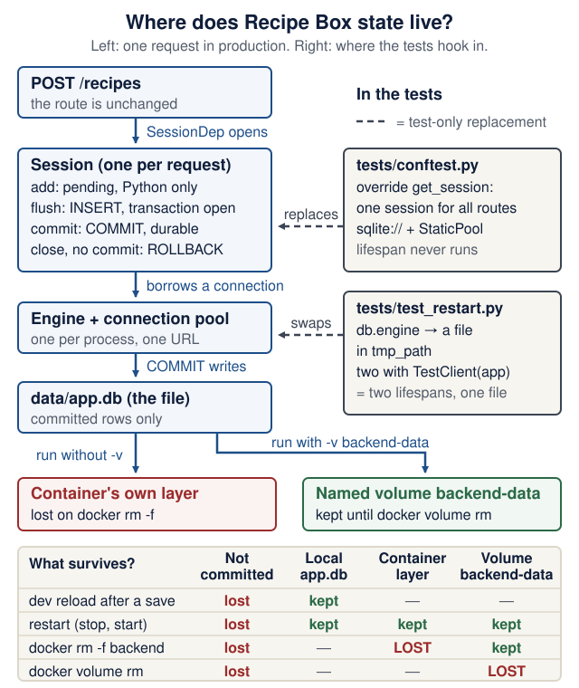
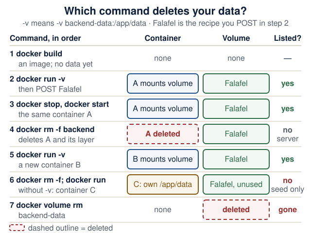

# Lecture 3 · Persistence and your first upstream PR

<!--  -->
[← Course home](../README.md) · [← Previous: Lecture 2](02-http-fastapi-pydantic.md) · [Next: Lecture 4 →](04-browser-frontend.md)

> **At a glance**
>
> - **When:** Monday 2 November 2026, 16:00 Israel time, on Zoom
> - **You leave with:** a backend whose data survives restarts, locally and in Docker, and your first upstream PR opened
> - **Goals:** trace a request to a committed row, swap the storage without touching the contract, and tell a seed, a migration, a volume and a backup apart ([details](#learning-checkpoint))
> - **Prerequisites:** Lecture 2 works (`uv run pytest` prints `10 passed`) and `docker run --rm hello-world` prints a greeting; repair: [Lecture 2 completion check](02-http-fastapi-pydantic.md#completion-check) and [Containers in one page](../guides/engineering-foundations.md#containers-in-one-page)
> - **Product milestone:** EX1 due next Monday, 9 Nov 2026, 23:59: today's persistence, Dockerfile and README instructions complete it
> - **Time:** prerequisite check about 10 min before class; lab about 3 h after class, plus the upstream PR (estimate)
> - **Done when:** `uv run pytest` prints `12 passed` for the demo, and a record survives `docker rm -f backend` plus a new `docker run` with the same volume

<details markdown="1" class="lecture-toc">
<summary>On this page</summary>

- [Mission](#mission)
- [Before you start](#before-you-start)
- [Learning checkpoint](#learning-checkpoint)
- [Concepts](#concepts)
- [Live demo](#live-demo)
- [Hands-on lab](#hands-on-lab)
- [Break it on purpose](#break-it-on-purpose)
- [Open-source track](#open-source-track)
- [Working with AI assistants](#working-with-ai-assistants)
- [Completion check](#completion-check)
- [Quick quiz](#quick-quiz)
- [Stretch goals](#stretch-goals)
- [Common pitfalls](#common-pitfalls)
- [Instructor notes](#instructor-notes)
- [Read more](#read-more)

</details>

## Mission

Restart your Lecture 2 API and every record is gone. Today you give it a real memory, SQLite through SQLModel, without changing the HTTP contract or `tests/test_recipes.py`. Then you ship it as a Docker image whose data survives the container being deleted. Upstream, last week's issue becomes a reproduced bug, a focused change and an opened PR.

## Before you start

You need the tested CRUD API from [Lecture 2](02-http-fastapi-pydantic.md), your Lecture 2 open-source issue or documentation gap (plus any maintainer replies), and Docker running (Docker Desktop, or Docker Engine on Linux; on Windows, work inside WSL2 Ubuntu). In `backend/`, run `uv add sqlmodel` before class.

> **Prerequisite check:** about ten minutes in total, before class.
>
> | Check | Pass when | Repair |
> |---|---|---|
> | From `backend/`: `uv run pytest` | `10 passed` (or all of your own Lecture 2 tests pass) | [Lecture 2 completion check](02-http-fastapi-pydantic.md#completion-check) |
> | `docker run --rm hello-world` | It prints `Hello from Docker!` | [Containers in one page](../guides/engineering-foundations.md#containers-in-one-page) · [Lecture 1](01-environment-git-docker-ai.md) |
> | `git status` in your product repository | `nothing to commit, working tree clean`, and your `.gitignore` lists `.venv/` | [Git you need to operate](../guides/engineering-foundations.md#git-you-need-to-operate) |
> | `curl --version` | 7.82 or newer; otherwise use the `-H 'Content-Type: application/json' -d '…'` form from Lecture 2 wherever this page writes `--json` | [Lecture 2 common pitfalls](02-http-fastapi-pydantic.md#common-pitfalls) |
> | "New tools in today's code" (below) | You can say what four of the six do before opening the answers | [Python you need to read](../guides/engineering-foundations.md#python-you-need-to-read) · [Tests with pytest](../guides/engineering-foundations.md#tests-with-pytest) |

<details markdown="1">
<summary>New tools in today's code</summary>

Each tool appears in today's demo code. Say what it does *here*, then check.

| Tool | Where you meet it | Question |
|---|---|---|
| `@asynccontextmanager` on `async def lifespan(app)` | `app/main.py` | What runs before `yield`, and what after? |
| A fixture that `yield`s | `tests/conftest.py` | When does the code after `yield` run? |
| `monkeypatch.setattr(db, "engine", …)` | `tests/test_restart.py` | What is replaced, and for how long? |
| `tmp_path` | `tests/test_restart.py` | Where is the file, and who deletes it? |
| `app.dependency_overrides[get_session] = lambda: session` | `tests/conftest.py` | What does every route receive instead of a fresh session? |
| `-> Iterator[Session]` | `app/db.py`, `tests/conftest.py` | Why `Iterator`, not `Session`? |

<details markdown="1">
<summary>Check your answers</summary>

1. FastAPI enters the context when the server starts: the code before `yield` (create tables, seed) runs once at startup, the code after `yield` (`engine.dispose()`) once at shutdown. [FastAPI: lifespan events](https://fastapi.tiangolo.com/advanced/events/).
2. After the test that used the fixture finishes, pass or fail: pytest runs the fixture up to `yield`, hands the value to the test, then runs the rest as clean-up.
3. The module attribute `app.db.engine` is replaced by an engine for a temporary file, and pytest puts the original back when the test ends. It works only because `main.py` looks up `db.engine` at call time.
4. A fresh, empty directory unique to this test run; pytest creates it and cleans old ones up. Nothing touches your real `data/app.db`.
5. The test's one session, the same object for every request. `lambda: session` is a function with no parameters that returns that session.
6. `get_session` is a generator: it `yield`s a session and resumes afterwards to close it. A function that yields is annotated with the type of what it produces, `Iterator[Session]`.

</details>

**Explain after:** why would `from app.db import engine` in `main.py` make the restart test write to the real `data/app.db`? Answer it after demo step 5 (the [Investigate](#live-demo) prompt there has a model answer).

</details>

**Professional practice:** [Explore authorization and concurrent edits at the storage boundary](../guides/industry-studio.md#lab-private-records-and-concurrent-edits) in the industry studio. This optional activity deepens today's checkpoint without changing the assignment.

## Learning checkpoint

By the end, you should be able to:

- Trace one request through its session to a committed row, and explain what survives a restart.
- Change persistence while preserving the API contract and its existing tests.
- Distinguish an idempotent seed, a schema migration, a persistent volume, and a backup.

**Predict first:** Why can a response look correct after `flush()` yet fail the restart test without `commit()`?

<details markdown="1">
<summary>Check your prediction</summary>

`flush()` sends the `INSERT` inside a transaction that is still open. The database assigns the `id`, and the same session can read its own unfinished row, so the `201` body looks perfect. When the session closes without `commit()`, SQLAlchemy sends `ROLLBACK` and the row never reaches the file. The restart test starts a second "process" on the same file and finds only the seed rows. [Unit of work](#unit-of-work-add-flush-commit) shows the exact SQL.

</details>

> **Warm-up from earlier classes:** answer from memory, then check. Ungraded.
>
> 1. (Lecture 2) What does `PATCH {"title": null}` mean in the Recipe Box contract, and which `model_dump` arguments implement it?
> 2. (Lecture 2) Your fixture sets `app.dependency_overrides[get_store] = lambda: store`. What does that line change, and when is it undone?
> 3. (Lecture 1) What does `--rm` do in `docker run --rm hello-world`, and what would `docker ps -a` show without it?

<details markdown="1">
<summary>Check your answers</summary>

1. `null` means "leave this field unchanged". `body.model_dump(exclude_unset=True, exclude_none=True)` keeps only the fields the client sent with a real value.
2. Every route that depends on `get_store` receives the test's own store, so each test starts empty. The fixture clears the override after `yield`, when the test ends. Today the same mechanism swaps in a test database.
3. `--rm` deletes the container when it exits. Without it, `docker ps -a` still lists the stopped container as `Exited (0)`. Today you will see what else disappears when a container is deleted: every file it wrote, unless the file lives in a volume.

</details>

**Bridge if needed:** [Tables, rows, and SQL](../guides/engineering-foundations.md#tables-rows-and-sql) · [State, transactions, and ownership](../guides/engineering-foundations.md#state-transactions-and-ownership) · [Containers in one page](../guides/engineering-foundations.md#containers-in-one-page)

## Concepts

### Same contract, new storage

Routes keep their URLs, bodies and status codes; only the storage behind them changes, so last week's tests must pass untouched. The figure is the map for the whole lecture: the production path on the left, the two test paths on the right, and what survives which event.

<figure class="course-diagram">
  <div class="diagram-scroll" role="region" tabindex="0" aria-label="Where Recipe Box state lives diagram, scroll horizontally">
    
  </div>
  <figcaption><strong>Where does Recipe Box state live?</strong> Predict which boxes are empty after a dev reload, a restart, and <code>docker rm</code>. <span class="screen-only">On a narrow screen, scroll the diagram sideways.</span> <a href="../assets/diagrams/l03-state-lives.svg">Open the diagram at full size</a>.</figcaption>
</figure>

<details markdown="1">
<summary>Text version of the diagram</summary>

**Production path** (one request, top to bottom):

1. **Request** `POST /recipes` reaches the unchanged route.
2. **`SessionDep`** calls `get_session()`, which opens one **Session** for this request.
3. The **Session** holds pending objects in Python, flushes SQL inside an open transaction, and commits.
4. The **Engine** (one per process) keeps a pool of connections to one database URL.
5. The **file** `data/app.db` holds committed rows only.
6. In Docker, `/app/data` is either inside the **container's writable layer** (deleted by `docker rm`) or a **named volume `backend-data`** mounted there (kept until `docker volume rm`).

**Test paths:**

- `tests/conftest.py`: `app.dependency_overrides[get_session]` hands every route one session on an **in-memory database** (`sqlite://` with `StaticPool`); the lifespan never runs, so `data/app.db` is never touched.
- `tests/test_restart.py`: `monkeypatch` points `db.engine` at a **temporary file** in `tmp_path`, and two `with TestClient(app)` blocks run the lifespan twice on that one file.

**What survives:**

| Event | Pending or flushed, not committed | Committed row in `data/app.db` (local) | Row in the container layer | Row in the named volume |
|---|---|---|---|---|
| `fastapi dev` reloads after a save | lost | kept | — | — |
| Process or container restart (`docker stop`/`start`) | lost | kept | kept | kept |
| `docker rm -f backend` | lost | — | **lost** | kept |
| `docker volume rm backend-data` | lost | — | — | **lost** |

</details>

### Bridge: SQL in ten minutes

Skip this if you have written `SELECT … WHERE` and `INSERT` before. An ORM writes SQL for you, so you need just enough SQL to read what it sends.

| Word | Meaning | In Recipe Box |
|---|---|---|
| Table, row, column | A table is a named grid. Each row is one record; each column has a name and a type | Table `recipe`; one row per recipe; columns `id`, `title`, `minutes`, … |
| Primary key | A column whose value identifies exactly one row and is never repeated | `id`; SQLite assigns 1, 2, 3, … on `INSERT` |
| `NOT NULL` | A rule that the column must have a value | `title VARCHAR(200) NOT NULL` |
| Index | A sorted lookup structure that makes searches by a column fast; it never changes results | `ix_recipe_title` on `title` |
| Transaction | Statements that take effect together at `COMMIT`, or not at all after `ROLLBACK` | One request's `INSERT` and its `COMMIT` |
| ORM | Object-relational mapper: classes become tables, objects become rows, method calls become SQL | SQLModel, built on SQLAlchemy |

**Predict first:** run these four commands one at a time from `backend/` (Python 3.12 or newer includes this SQLite shell, so there is nothing to install). Before each one, write down what it prints.

```bash
uv run python -m sqlite3 scratch.db "CREATE TABLE recipe (id INTEGER PRIMARY KEY, title VARCHAR(200) NOT NULL, minutes INTEGER NOT NULL);"
uv run python -m sqlite3 scratch.db "INSERT INTO recipe (title, minutes) VALUES ('Hummus', 15);"
uv run python -m sqlite3 scratch.db "SELECT id, title, minutes FROM recipe;"
uv run python -m sqlite3 scratch.db "INSERT INTO recipe (title, minutes) VALUES (NULL, 20);"
```

<details markdown="1">
<summary>Check your prediction</summary>

1. Nothing: the table now exists in the new file `scratch.db`.
2. Nothing: one row was inserted and committed.
3. `(1, 'Hummus', 15)`: you never sent an `id`; the primary key column chose 1. Each command is a separate process, so the row was already committed to the file.
4. `IntegrityError (SQLITE_CONSTRAINT_NOTNULL): NOT NULL constraint failed: recipe.title`, with exit status 1. The database itself refused the row.

Delete the file afterwards: `rm scratch.db`.

</details>

**SQLModel classes are Pydantic models that can also be SQLAlchemy tables.** `Recipe(table=True)` maps to the `recipe` table; `RecipeCreate` is an ordinary Pydantic model with no table. Each call you write becomes SQL like this (copied from a run with `echo=True`, which logs every statement):

| You write (SQLModel) | The engine sends (SQL) |
|---|---|
| `session.add(recipe)`, then `session.commit()` | `BEGIN`, `INSERT INTO recipe (title, minutes, servings, ingredients, tags) VALUES (?, ?, ?, ?, ?)`, `COMMIT` |
| `session.get(Recipe, 1)` | `SELECT … FROM recipe WHERE recipe.id = ?` |
| `recipe.sqlmodel_update({"minutes": 35})`, then `commit()` | `UPDATE recipe SET minutes=? WHERE recipe.id = ?`, `COMMIT` |
| `session.delete(recipe)`, then `commit()` | `DELETE FROM recipe WHERE recipe.id = ?`, `COMMIT` |
| `select(Recipe).order_by(Recipe.id).offset(0).limit(50)` | `SELECT … FROM recipe ORDER BY recipe.id LIMIT ? OFFSET ?` |

Each `?` is a placeholder: the values travel separately from the SQL text, so a title such as `'); DROP TABLE recipe; --` is stored as data, never run. The longer ladder, with `BEGIN` and `ROLLBACK` in two terminals, is in [Tables, rows, and SQL](../guides/engineering-foundations.md#tables-rows-and-sql).

### Engine, session and the session dependency

- The **engine** opens connections to one database URL and pools them. One per process.
- A **session** is one unit of work: `add()` stages objects, `commit()` writes them together, and `refresh()` reloads the row after `commit()` expired the object's attributes. The engine is the library; a session is one visit with a borrowing slip.
- Each request gets a session from the `yield` dependency `get_session()`; tests replace it. `check_same_thread=False` is needed because FastAPI runs `def` endpoints in a thread pool.

SQLite URLs: `sqlite:///./data/app.db` is relative to the current directory, `sqlite:////app/data/app.db` (four slashes) is absolute, and `sqlite://` is in memory.

### Unit of work: add, flush, commit

| Call | What has happened | Seen by another connection? | Survives a restart? |
|---|---|---|---|
| `session.add(recipe)` | Pending in Python only; `recipe.id` is `None`; no SQL sent | No | No |
| `session.flush()` | `INSERT` sent inside the open transaction; the database assigned `id` | No | No: lost if never committed |
| `session.commit()` | Flushes anything pending, then `COMMIT`; the row is in the file | Yes | Yes |
| `session.close()` without `commit()` | `ROLLBACK`: everything since `BEGIN` is undone | — | — |

Step through the trace of one `Falafel` insert, logged with `create_engine(url, echo=True)`:

<div class="stepper" markdown="1">

1. **`session.add(recipe)`.** Pending in Python only. `recipe.id` is `None`, and the log shows no SQL at all.
2. **`session.flush()`.** The log shows `BEGIN (implicit)`, then `INSERT INTO recipe (title, minutes, servings, ingredients, tags) VALUES (?, ?, ?, ?, ?)` with `('Falafel', 60, 2, '', '')`. Now `recipe.id` is `1`, yet a second connection to the same file still counts 0 rows.
3. **`session.commit()`.** The log shows `COMMIT`. The second connection now counts 1 row. SQLAlchemy also *expires* the object's attributes, because the database may have changed them.
4. **`session.refresh(recipe)`.** A new `BEGIN (implicit)`, then `SELECT … FROM recipe WHERE recipe.id = ?` with `(1,)`: the object is reloaded from the row.
5. **`session.close()`.** `ROLLBACK`. It ends the read transaction that `refresh()` opened, and nothing is lost. Had step 3 been skipped, this same `ROLLBACK` would have erased the `INSERT`.

</div>

<details markdown="1">
<summary>Optional: reproduce the trace yourself</summary>

Save this as `trace.py` in `backend/` (after demo step 1), run `uv run python trace.py`, then delete `trace.py` and `trace.db`.

<figure class="file-example" markdown="1">
<figcaption><span class="file-example-action">Optional example</span> <span class="file-example-path">trace.py</span></figcaption>

```python
# trace.py (optional, not part of the app)
from sqlmodel import Session, SQLModel, create_engine

from app.models import Recipe

engine = create_engine("sqlite:///./trace.db", echo=True)
SQLModel.metadata.create_all(engine)
session = Session(engine)
recipe = Recipe(title="Falafel", minutes=60)
session.add(recipe)
print(">>> after add: id =", recipe.id)
session.flush()
print(">>> after flush: id =", recipe.id)
session.commit()
session.refresh(recipe)
print(">>> after refresh:", recipe.id, recipe.title)
session.close()
engine.dispose()
```

</figure>

The `>>>` lines print `None`, then `1`, then `1 Falafel`, with the SQL from the stepper in between. The "second connection" counts come from a separate check with `sqlite3.connect("trace.db")`: 0 rows after the flush, 0 after a close without commit, 1 after a commit.

</details>

**Check yourself:** `save()` in today's `main.py` calls `add`, `commit` and `refresh`, with no `flush`. At which call does the new recipe get its `id`, and at which call does it become safe from a restart?

<details markdown="1">
<summary>Check your answer</summary>

Both happen inside `commit()`: it first flushes (the `INSERT` runs and the database assigns the `id`), then sends `COMMIT`, which makes the row durable. `refresh()` only reloads the expired attributes so the route can return them.

</details>

<div class="sim" id="sim-session" role="group" aria-labelledby="sim-session-title" markdown="1">

<p class="sim-title" id="sim-session-title"><strong>Simulator: follow one session</strong> Press add, flush, commit, rollback and restart on one recipe and watch the Python object, the open transaction, what another connection sees, and what survives a restart.</p>

<div class="sim-fallback" markdown="1">

**Worked example** (one session on a `trace.db` file that starts empty):

| You run | Python object `recipe` | Open transaction | Another connection sees | After a restart |
|---|---|---|---|---|
| `session.add(recipe)` | pending; `id` is `None` | none | 0 rows | 0 rows |
| `session.flush()` | `id` is 1 | `BEGIN` and one uncommitted `INSERT` | 0 rows | 0 rows |
| `session.rollback()` | out of the session; `id` still says 1, but no row 1 exists | none (`ROLLBACK`) | 0 rows | 0 rows |
| `session.add()` a new recipe, then `session.commit()` | committed; `id` is 1 | none (`BEGIN`, `INSERT`, `COMMIT`) | 1 row | 1 row |
| `session.add()` and `session.flush()` another, then restart | gone with the process | rolled back | 1 row | 1 row |

<p class="screen-only sim-note">The interactive version of this simulator needs JavaScript; the worked example above is the same model.</p>

</div>

</div>

### Table model versus API schemas

| Class | Role | Validates input? |
|---|---|---|
| `RecipeBase` | Shared fields and limits | (base only) |
| `Recipe(table=True)` | The database table | **No**: table models skip validation in `__init__` |
| `RecipeCreate`, `RecipeUpdate` | POST and PATCH bodies, `extra="forbid"` | Yes |
| `RecipePublic` | Response body, always has `id` | Yes |

`Recipe(title="", minutes=0)` does not raise, so routes validate through `RecipeCreate` first, then convert with `Recipe.model_validate(body)`.

**Version note:** "table models skip validation in `__init__`" is true in SQLModel 0.0.48, the version in your lock (checked 17 October 2026); a future SQLModel release may validate there too. The rule that holds either way: validate at the boundary with `RecipeCreate`, and never write a table object you did not build through `model_validate`.

### Tables, migrations and seeds

`SQLModel.metadata.create_all(engine)` creates missing tables but never alters existing ones: enough for EX1, while changing columns under real data needs migrations (the Alembic stretch goal). The **lifespan** creates tables and seeds at startup, and calls `engine.dispose()` at shutdown.

A seed inserts 2–3 demo rows into an empty database and must be **idempotent**: a second run inserts nothing. Keep rows as plain dicts and build fresh `Recipe.model_validate(row)` objects per call. Re-used table objects carry SQLAlchemy state, and a later seed can silently insert nothing (Drill 1).

**Seeds are input too: validate them.** You type seed rows by hand, so they can break the limits like any request body. `Recipe(**row)` would store a row with `"minutes": 0` without complaint, and then every `GET /recipes` fails with a 500 when the response model rejects it (verified). `Recipe.model_validate(row)` refuses it at startup instead, with the field name in the error.

> **Defend it:** `seed_if_empty` re-inserts the demo rows whenever the table is empty, including after a real user deletes every recipe and restarts the server (verified). Is that acceptable for your product? Give one reason and one cost.

<details markdown="1">
<summary>What a strong answer mentions</summary>

- **Reason to keep it for EX1:** a grader who runs your image sees realistic data at once, and the rule is one line that a test pins down. It is fine if your README says "an empty database is re-seeded with demo rows on startup".
- **Cost:** a user who deliberately emptied their list gets the demo rows back, which looks like a bug.
- **Alternatives:** seed only when `create_all` has just created the table, or seed only when a setting such as `SEED_DEMO_DATA=1` is present (on for development and demos, off for real data). Each needs a test for both cases.

</details>

### Test isolation

Every test gets its own empty database, so nothing leaks between tests or into `data/app.db`.

| Strategy | Watch out for |
|---|---|
| In-memory SQLite + `StaticPool` (used here) | Without `StaticPool`, each connection sees a different, empty database |
| A temporary file per test (`tmp_path`) | Needed when a test restarts the app |
| A transaction per test, rolled back | More setup; mostly for PostgreSQL |

`app.dependency_overrides[get_session]` swaps in the test session. A plain `TestClient(app)` does **not** run the lifespan, so tests never touch the real file; `with TestClient(app)` does, which is what a restart test needs.

### Where data lives

Locally, data is `backend/data/app.db`; git-ignore `data/` and `*.db`, because a database is runtime state. In Docker, a container's filesystem disappears with `docker rm`, while a **named volume** mounted at `/app/data` outlives it. EX1 needs a backend Dockerfile, so you write one today, adapted from uv's Docker guide.

A **backup** is a separate copy you can restore somewhere else. A volume is not one: `docker volume rm`, a bad migration or a bug that deletes rows destroys the data in the volume as well. SQLite's backup API copies a consistent snapshot even while the server is running (optional [lab step 9](#hands-on-lab)).

## Live demo

The instructor converts Recipe Box to SQLite, rerunning the unchanged tests after each file. Every command runs from `backend/`.

**1. Models.** *Make the smallest change.* `Field` now comes from `sqlmodel`: Pydantic's own `Field` does not know `index=True` and emits a deprecation warning, which your `filterwarnings = ["error"]` turns into a failure. `RecipeUpdate` keeps its Lecture 2 fields but extends `SQLModel`; `RecipePublic` still adds `id`.

<figure class="file-example file-example--long" markdown="1">
<figcaption><span class="file-example-action">File example</span> <span class="file-example-path">backend/app/models.py</span></figcaption>

```python
# backend/app/models.py
from pydantic import ConfigDict
from sqlmodel import Field, SQLModel


class RecipeBase(SQLModel):
    title: str = Field(min_length=1, max_length=200, index=True)
    minutes: int = Field(ge=1, le=24 * 60)
    servings: int = Field(default=2, ge=1, le=50)
    ingredients: str = Field(default="", max_length=5000)
    tags: str = Field(default="", max_length=500)


class Recipe(RecipeBase, table=True):
    id: int | None = Field(default=None, primary_key=True)


class RecipeCreate(RecipeBase):
    model_config = ConfigDict(extra="forbid", str_strip_whitespace=True)


class RecipeUpdate(SQLModel):
    model_config = ConfigDict(extra="forbid", str_strip_whitespace=True)

    title: str | None = Field(default=None, min_length=1, max_length=200)
    minutes: int | None = Field(default=None, ge=1, le=24 * 60)
    servings: int | None = Field(default=None, ge=1, le=50)
    ingredients: str | None = Field(default=None, max_length=5000)
    tags: str | None = Field(default=None, max_length=500)


class RecipePublic(RecipeBase):
    id: int
```

</figure>

**2. Engine and session dependency.** *Make the smallest change.*

<figure class="file-example file-example--long" markdown="1">
<figcaption><span class="file-example-action">File example</span> <span class="file-example-path">backend/app/db.py</span></figcaption>

```python
# backend/app/db.py
import os
from collections.abc import Iterator
from pathlib import Path
from typing import Annotated

from fastapi import Depends
from sqlalchemy import Engine
from sqlmodel import Session, SQLModel, create_engine

DATABASE_URL = os.getenv("DATABASE_URL", "sqlite:///./data/app.db")


def make_engine(url: str) -> Engine:
    return create_engine(url, connect_args={"check_same_thread": False})


engine = make_engine(DATABASE_URL)


def create_db_and_tables() -> None:
    db_file = engine.url.database  # e.g. "./data/app.db"; None for in-memory
    if db_file:
        Path(db_file).parent.mkdir(parents=True, exist_ok=True)
    SQLModel.metadata.create_all(engine)


def get_session() -> Iterator[Session]:
    with Session(engine) as session:
        yield session


SessionDep = Annotated[Session, Depends(get_session)]
```

</figure>

**3. Lifespan, helpers and routes.** *Make the smallest change.* `main.py` always says `db.engine`, never `from app.db import engine`: the restart test below swaps `db.engine`, and a name imported once would keep pointing at the real file.

<figure class="file-example file-example--long" markdown="1">
<figcaption><span class="file-example-action">File example</span> <span class="file-example-path">backend/app/main.py</span></figcaption>

```python
# backend/app/main.py
from contextlib import asynccontextmanager
from typing import Annotated

from fastapi import FastAPI, HTTPException, Query, status
from sqlmodel import Session, select

from app import db
from app.models import Recipe, RecipeCreate, RecipePublic, RecipeUpdate
from app.seed import seed_if_empty


@asynccontextmanager
async def lifespan(app: FastAPI):
    db.create_db_and_tables()
    with Session(db.engine) as session:
        seed_if_empty(session)
    yield
    db.engine.dispose()


app = FastAPI(title="Recipe Box API", lifespan=lifespan)


def save(session: Session, recipe: Recipe) -> Recipe:
    session.add(recipe)
    session.commit()
    session.refresh(recipe)
    return recipe


def get_or_404(session: Session, recipe_id: int) -> Recipe:
    recipe = session.get(Recipe, recipe_id)
    if recipe is None:
        raise HTTPException(status.HTTP_404_NOT_FOUND, detail="Recipe not found")
    return recipe


@app.get("/health")
def health() -> dict[str, str]:
    return {"status": "ok"}


@app.get("/recipes", response_model=list[RecipePublic])
def list_recipes(
    session: db.SessionDep,
    offset: Annotated[int, Query(ge=0)] = 0,
    limit: Annotated[int, Query(ge=1, le=100)] = 50,
) -> list[Recipe]:
    query = select(Recipe).order_by(Recipe.id).offset(offset).limit(limit)
    return list(session.exec(query).all())


@app.post("/recipes", response_model=RecipePublic, status_code=status.HTTP_201_CREATED)
def create_recipe(body: RecipeCreate, session: db.SessionDep) -> Recipe:
    return save(session, Recipe.model_validate(body))


@app.get("/recipes/{recipe_id}", response_model=RecipePublic)
def get_recipe(recipe_id: int, session: db.SessionDep) -> Recipe:
    return get_or_404(session, recipe_id)


@app.patch("/recipes/{recipe_id}", response_model=RecipePublic)
def update_recipe(recipe_id: int, body: RecipeUpdate, session: db.SessionDep) -> Recipe:
    recipe = get_or_404(session, recipe_id)
    recipe.sqlmodel_update(body.model_dump(exclude_unset=True, exclude_none=True))
    return save(session, recipe)


@app.delete("/recipes/{recipe_id}", status_code=status.HTTP_204_NO_CONTENT)
def delete_recipe(recipe_id: int, session: db.SessionDep) -> None:
    session.delete(get_or_404(session, recipe_id))
    session.commit()
```

</figure>

All routes preserve Lecture 2's contract. `save()` does `add`, `commit` and `refresh`; `get_or_404()` uses `session.get(Recipe, recipe_id)`; the list runs `select(Recipe).order_by(Recipe.id).offset(offset).limit(limit)`; `DELETE` calls `session.delete()`, then `commit()`. `PATCH` calls `recipe.sqlmodel_update(body.model_dump(exclude_unset=True, exclude_none=True))`, so only the fields the client sent change.

**4. Seed.** *State the contract.* An empty table gets three demo rows; a non-empty table gets nothing; every row passes the same limits as a request body.

<figure class="file-example file-example--long" markdown="1">
<figcaption><span class="file-example-action">File example</span> <span class="file-example-path">backend/app/seed.py</span></figcaption>

```python
# backend/app/seed.py
from sqlmodel import Session, select

from app.models import Recipe

SEED: list[dict] = [
    {
        "title": "Shakshuka",
        "minutes": 25,
        "servings": 2,
        "ingredients": "4 eggs\n1 can tomatoes\n1 onion\n1 tsp paprika",
        "tags": "breakfast,vegetarian",
    },
    {
        "title": "Hummus",
        "minutes": 15,
        "servings": 4,
        "ingredients": "chickpeas\ntahini\nlemon",
        "tags": "vegan,quick",
    },
    {
        "title": "Lentil soup",
        "minutes": 40,
        "servings": 4,
        "ingredients": "lentils\ncarrot\nonion",
        "tags": "vegan",
    },
]


def seed_if_empty(session: Session) -> int:
    """Insert the demo rows only when the table is empty. Returns rows added."""
    if session.exec(select(Recipe).limit(1)).first() is not None:
        return 0
    # Seeds are input too: model_validate checks the limits; Recipe(**row) does not.
    session.add_all([Recipe.model_validate(row) for row in SEED])
    session.commit()
    return len(SEED)
```

</figure>

**5. Tests.** *Observe the real result.* You may delete Lecture 2's drill file `tests/test_patch_null.py`: `title` is now `NOT NULL` in SQLite, so if `exclude_none=True` ever goes missing, `test_patch_changes_only_sent_fields` fails with `IntegrityError: NOT NULL constraint failed: recipe.title` (TestClient re-raises the server's exception instead of returning a 500). If your own domain has nullable fields, keep a null test that asserts the body. The only existing test file you edit:

<figure class="file-example file-example--long" markdown="1">
<figcaption><span class="file-example-action">File example</span> <span class="file-example-path">backend/tests/conftest.py</span></figcaption>

```python
# backend/tests/conftest.py
from collections.abc import Iterator

import pytest
from fastapi.testclient import TestClient
from sqlmodel import Session, SQLModel, create_engine
from sqlmodel.pool import StaticPool

from app.db import get_session
from app.main import app


@pytest.fixture
def session() -> Iterator[Session]:
    engine = create_engine(
        "sqlite://", connect_args={"check_same_thread": False}, poolclass=StaticPool
    )
    SQLModel.metadata.create_all(engine)
    with Session(engine) as session:
        yield session
    engine.dispose()  # else: ResourceWarning (an error under filterwarnings)


@pytest.fixture
def client(session: Session) -> Iterator[TestClient]:
    app.dependency_overrides[get_session] = lambda: session
    yield TestClient(app)  # no `with`: the lifespan does not run
    app.dependency_overrides.clear()
```

</figure>

A new test starts the app twice on one file, and the seed test also checks every seed row against the POST rules:

<figure class="file-example file-example--long" markdown="1">
<figcaption><span class="file-example-action">File example</span> <span class="file-example-path">backend/tests/test_restart.py</span></figcaption>

```python
# backend/tests/test_restart.py
from fastapi.testclient import TestClient

from app import db
from app.main import app
from app.models import RecipeCreate
from app.seed import SEED, seed_if_empty


def test_data_survives_restart(tmp_path, monkeypatch):
    url = f"sqlite:///{tmp_path / 'app.db'}"

    monkeypatch.setattr(db, "engine", db.make_engine(url))  # "process" 1
    with TestClient(app) as client:  # `with` runs lifespan startup + shutdown
        assert len(client.get("/recipes").json()) == len(SEED)  # seeded
        client.post("/recipes", json={"title": "Falafel", "minutes": 60})

    monkeypatch.setattr(db, "engine", db.make_engine(url))  # "process" 2
    with TestClient(app) as client:
        titles = [r["title"] for r in client.get("/recipes").json()]
    assert titles == [row["title"] for row in SEED] + ["Falafel"]  # no double seed


def test_seed_is_idempotent(session):
    for row in SEED:  # same rules as a POST body, including no unknown keys
        RecipeCreate.model_validate(row)
    assert seed_if_empty(session) == len(SEED)
    assert seed_if_empty(session) == 0
```

</figure>

Run `uv run pytest`: `12 passed` (ten Lecture 2 tests plus these two).

**Predict:** in `save()`, replace `session.commit()` with `session.flush()` and run `uv run pytest` again. How many tests fail, and which?

<details markdown="1">
<summary>Check your prediction</summary>

`1 failed, 11 passed`, and the failure is `test_data_survives_restart`. Every other test reads through the same session that flushed, so it sees its own unfinished rows. Only the restart test opens the file again, after the first session closed and rolled back. Undo the change.

</details>

> **Investigate:** read `tests/test_restart.py` again, then answer.
>
> 1. Why does `test_restart.py` use `with TestClient(app)` while `conftest.py` uses a plain `TestClient(app)`?
> 2. Why would `from app.db import engine` in `main.py` make this test write to the real `data/app.db`?
> 3. Why does the second "process" not add the three seed rows again?

<details markdown="1">
<summary>Show model answers</summary>

1. `with` runs the lifespan: create tables, seed on startup, dispose on shutdown. The restart test needs exactly that, twice. The `conftest.py` client must not run it, or every test would touch the real file.
2. `from app.db import engine` copies the reference once, at import time, into `main`'s own namespace. `monkeypatch.setattr(db, "engine", …)` replaces only the attribute on the `db` module, so `main` would keep using the engine for `./data/app.db`. Looking up `db.engine` at call time sees the replacement.
3. The table already holds four rows, so `seed_if_empty` returns 0 at its first check. The assertion `titles == [seed titles] + ["Falafel"]` would fail with six or seven titles.

</details>

**Trace it:** follow `client.post("/recipes", json={"title": "Falafel", "minutes": 60})` in the first `with` block of the restart test. Fill in the "State after" column yourself before opening the answer.

| Step | File : function | Input | State after | Next call |
|---|---|---|---|---|
| 1 | `app/db.py : get_session` | — | ? | `create_recipe` |
| 2 | `app/main.py : create_recipe` | `RecipeCreate` body | ? | `save` |
| 3 | `app/main.py : save` → `session.add` | `Recipe` object | ? | `session.commit` |
| 4 | `session.commit` | — | ? | `session.refresh` |
| 5 | FastAPI, with the returned `Recipe` | `Recipe` object | ? | `get_session` resumes |
| 6 | `app/db.py : get_session` after `yield` | — | ? | — |

<details markdown="1">
<summary>Check your answer</summary>

1. A new `Session` on the engine that `monkeypatch` installed (the temporary file); no transaction yet.
2. The body has passed validation; `Recipe.model_validate(body)` builds a table object with `id=None`.
3. Pending in the session only; no SQL sent.
4. `INSERT` then `COMMIT`; the row with `id` 4 is in the temporary file (after the three seed rows); the attributes are expired, and `refresh` reloads them.
5. The object is serialized through `RecipePublic`: status `201` with `"id": 4` in the body.
6. The `with Session(...)` block exits and the session closes: a `ROLLBACK` that only ends the read transaction `refresh` opened. Nothing is lost, because the row was committed in step 4.

</details>

**6. Look inside the file.** *Observe the real result.* Start the server (`uv run fastapi dev`), add a recipe in `/docs`, stop it with Ctrl+C, start it again and list: your recipe is still there. Then read the file directly, from `backend/` in a second terminal:

```bash
uv run python -m sqlite3 data/app.db "SELECT id, title, minutes FROM recipe ORDER BY id;"
uv run python -m sqlite3 data/app.db "SELECT sql FROM sqlite_master WHERE name = 'recipe';"
```

Python's `sqlite3` shell has no `.schema` command, so the second line asks the database for the statement that created the table. It shows `title VARCHAR(200) NOT NULL` and `id INTEGER NOT NULL` with `PRIMARY KEY (id)`. If you have the standalone `sqlite3` program, `sqlite3 data/app.db ".schema recipe"` also lists the index `ix_recipe_title`.

**Predict:** the schema says `VARCHAR(200)` and the model says `minutes` is at least 1. If you insert a 300-character title and `minutes = 0` directly with `python -m sqlite3`, which rule stops it?

<details markdown="1">
<summary>Check your prediction</summary>

Neither. SQLite accepts the row (verified). Only the rules from [Drill 4](#break-it-on-purpose) explain what happens next.

</details>

> **Watch out:** SQLite ignores the 200 in `VARCHAR(200)`; here it enforces only `NOT NULL` and the primary key ([SQLite datatypes](https://www.sqlite.org/datatype3.html), checked 17 October 2026). The length and range limits live in Pydantic, which is why only the backend may write this file.

**7. Dockerfile.** *Make the smallest change.* `backend/Dockerfile` (the `# syntax` line must stay first):

```dockerfile
# syntax=docker/dockerfile:1
FROM python:3.14-slim
COPY --from=ghcr.io/astral-sh/uv:0.13.1 /uv /uvx /bin/
ENV UV_COMPILE_BYTECODE=1 \
    UV_LINK_MODE=copy \
    UV_NO_DEV=1 \
    UV_PYTHON_DOWNLOADS=0 \
    PYTHONUNBUFFERED=1
WORKDIR /app

# 1) Dependencies only: cached until uv.lock changes.
RUN --mount=type=cache,target=/root/.cache/uv \
    --mount=type=bind,source=uv.lock,target=uv.lock \
    --mount=type=bind,source=pyproject.toml,target=pyproject.toml \
    uv sync --locked --no-install-project

# 2) Application code.
COPY . /app
RUN --mount=type=cache,target=/root/.cache/uv \
    uv sync --locked

# 3) Never run as root. /app/data holds the SQLite volume.
RUN useradd --create-home --uid 10001 appuser \
    && mkdir -p /app/data && chown appuser /app/data
USER appuser
ENV PATH="/app/.venv/bin:$PATH"
EXPOSE 8000
CMD ["fastapi", "run", "app/main.py", "--host", "0.0.0.0", "--port", "8000"]
```

`backend/.dockerignore` lists, one per line: `.venv`, `__pycache__`, `.pytest_cache`, `.ruff_cache`, `.env`, `data`, `*.db`, `tests`.

<details markdown="1">
<summary>The Dockerfile line by line: why each line is there, and what breaks without it</summary>

| Line | Why it is there | Without it |
|---|---|---|
| `# syntax=docker/dockerfile:1` | Asks for the current Dockerfile syntax, which understands `RUN --mount` | Docker 29 still builds (verified); older Docker versions may reject `--mount` |
| `FROM python:3.14-slim` | A small Debian image with Python 3.14, the version in your `.python-version` | — (every image needs a base; a floating tag such as `python:3-slim` changes under you) |
| `COPY --from=ghcr.io/astral-sh/uv:0.13.1 /uv /uvx /bin/` | Copies one pinned uv binary into the image | The next `RUN` fails: `uv: not found` |
| `ENV UV_COMPILE_BYTECODE=1 …` | Compile `.pyc` files at build time (faster start); copy instead of link (the cache is another filesystem); skip the `dev` group, so `pytest` and `ruff` stay out of the image; never download a Python; print logs immediately, so `docker logs` shows them | Slower start, a bigger image with test tools in it, and log lines that may arrive late |
| `WORKDIR /app` | Every later path is relative to `/app`, so the default `./data/app.db` lands in `/app/data` | Files land in `/`, and the database is no longer in the volume |
| `RUN --mount=… uv sync --locked --no-install-project` | Installs the dependencies only, exactly as locked; this layer is reused until `uv.lock` or `pyproject.toml` changes | Every code edit reinstalls every dependency |
| `COPY . /app` | Copies your code, minus `.dockerignore` | No application in the image |
| `RUN … uv sync --locked` | Installs your own project into `.venv` | — |
| `RUN useradd … chown appuser /app/data` | Creates user 10001 and lets it write `/app/data` | Without the `chown`, the container stops as `Exited (3)` and `docker logs` shows `sqlite3.OperationalError: unable to open database file` (verified) |
| `USER appuser` | The server runs as an ordinary user | It runs as root |
| `ENV PATH="/app/.venv/bin:$PATH"` | The shell finds `fastapi` inside `.venv` | `docker run` fails: `exec: "fastapi": executable file not found in $PATH` (verified) |
| `EXPOSE 8000` | Documents the port; publishing is done by `-p` | Nothing changes |
| `CMD [… "--host", "0.0.0.0" …]` | Listens on every interface *inside* the container, so Docker's port forwarding can reach it | With `127.0.0.1`, the container is `Up` but `curl` prints `curl: (52) Empty reply from server` (verified) |

**Why a non-root user and a loopback port?** If a bug or a compromised dependency lets someone run code in your server, a non-root user limits them to what uid 10001 may do (essentially, write `/app/data`) instead of everything root may do inside the container. Publishing with `-p 127.0.0.1:8000:8000` lets only programs on your own computer reach this unauthenticated API, while `-p 8000:8000` would publish it on every network interface, for example to everyone on the same Wi-Fi.

</details>

**Version note:** this Dockerfile is adapted from [uv's Docker guide](https://docs.astral.sh/uv/guides/integration/docker/) (checked 17 October 2026). The guide bind-mounts only `uv.lock` for the first `uv sync` and uses `--frozen` there. This lecture also mounts `pyproject.toml` and uses `--locked`, so a lock that no longer matches `pyproject.toml` fails the build at step 4 instead of quietly installing the old versions.

**8. Build, run, delete, run again.** *Observe the real result.* **Stop `fastapi dev` first (Ctrl+C).** If it still holds port 8000, `docker run` cannot publish the port, and your `curl` silently reaches the dev server and its own `data/app.db` instead of the container: every check below would pass without Docker.

From `backend/`, one line at a time:

```bash
docker build -t recipe-box-backend .
docker run -d --name backend -p 127.0.0.1:8000:8000 -v backend-data:/app/data recipe-box-backend
docker ps --filter name=backend --format '{{.Names}} {{.Status}}'
curl -sS --retry 10 --retry-all-errors --retry-delay 1 localhost:8000/health
curl -sS --json '{"title": "Falafel", "minutes": 60}' localhost:8000/recipes
docker rm -f backend
docker run -d --name backend -p 127.0.0.1:8000:8000 -v backend-data:/app/data recipe-box-backend
curl -sS --retry 10 --retry-all-errors --retry-delay 1 localhost:8000/recipes
docker exec backend id
```

- `docker ps …` must print `backend Up …` (for example `backend Up Less than a second`). If it prints nothing, the container is not running: `docker ps -a --filter name=backend` shows why (`Created` means the port was taken; `Exited (…)` means it crashed), and `docker logs backend` shows the error.
- `curl -sS --retry …` waits for the server instead of guessing: `-s` hides the progress bar, `-S` still shows errors, and `--retry-all-errors` retries even an empty reply. One or two `curl: (52) Empty reply from server` lines while the server starts are normal; the last line must be `{"status":"ok"}`.
- `docker exec backend id` prints `uid=10001(appuser) gid=10001(appuser) groups=10001(appuser)`, and it fails if the container is not running.

The working directory is `/app`, so the default `./data/app.db` lands in the volume. On curl older than 7.82, replace `--json '…'` with `-H 'Content-Type: application/json' -d '…'`.

**Predict:** before each step, say whether Falafel is still listed: (a) `docker stop backend`, then `docker start backend`; (b) `docker rm -f backend`, then a new `docker run` **without** `-v`; (c) `docker rm -f backend`, then a new `docker run` **with** `-v backend-data:/app/data`.

<figure class="course-diagram">
  <div class="diagram-scroll" role="region" tabindex="0" aria-label="Container and volume lifecycle diagram, scroll horizontally">
    
  </div>
  <figcaption><strong>Which command deletes your data?</strong> Cover the right-hand column and predict it first. <span class="screen-only">On a narrow screen, scroll the diagram sideways.</span> <a href="../assets/diagrams/l03-volume-lifecycle.svg">Open the diagram at full size</a>.</figcaption>
</figure>

<details markdown="1">
<summary>Text version of the diagram</summary>

A container has its own writable layer; a named volume is stored separately by Docker and mounted at `/app/data`.

1. `docker build`: an image; no container and no data yet.
2. `docker run -v backend-data:/app/data`, then POST Falafel: the row is written to `/app/data/app.db`, which lives in the volume.
3. `docker stop backend`, then `docker start backend`: the same container restarts. Falafel is **kept**.
4. `docker rm -f backend`: the container and its writable layer are deleted. The volume is untouched.
5. `docker run -v backend-data:/app/data`: a new container mounts the same volume. Falafel is **kept**.
6. `docker run` without `-v`: `/app/data` is inside the new container's own layer, which starts empty. Falafel is **gone**; the seed adds 3 fresh rows.
7. `docker volume rm backend-data` (only after the containers using it are removed): the data is **gone** for good, which is why a volume is not a backup.

</details>

<details markdown="1">
<summary>Check your prediction</summary>

- (a) **Kept.** The container still exists, and so does everything it wrote.
- (b) **Gone**; only the 3 seed rows remain. Without `-v`, `/app/data` is part of the new container's own empty filesystem.
- (c) **Kept.** The volume outlives every container that mounts it.

</details>

**Note:** in Lecture 8, Compose prefixes volume names with the project name (`recipe-box_backend-data`), so the full stack starts from a fresh volume and a fresh seed; today's `backend-data` is not reused.

**9. Rebuild after a change.** *Break it and watch the check fail.*

**Predict:** (a) You add a comment to `app/main.py` and run `docker build -t recipe-box-backend .` again. Which of the seven numbered steps print `CACHED`? (b) You then add a dependency to the `dependencies` list in `pyproject.toml` by hand, without running `uv lock`, and build again. Which step fails, and with what message?

<details markdown="1">
<summary>Check your prediction</summary>

- (a) Steps 2/7 (copy uv), 3/7 (`WORKDIR`) and 4/7 (dependencies) print `CACHED`. Steps 5/7 (`COPY . /app`), 6/7 (install your project, under a second) and 7/7 (`useradd`) run again: every step after a changed layer reruns. That is why dependencies are installed before the code is copied.
- (b) Step 4/7 fails: ``error: The lockfile at `uv.lock` needs to be updated, but `--locked` was provided.`` followed by ``hint: To update the lockfile, run `uv lock`.`` Run `uv lock`, commit `uv.lock`, and build again.

</details>

## Hands-on lab

Apply each step to **your own domain**; Recipe Box is only the example. Plan your time:

- **Core today:** steps 1–5
- **Before Lecture 4:** steps 6–8 (EX1 is due that day, Mon 9 Nov 2026, 23:59)
- **Extension (optional):** step 9

Commands run from `backend/`.

**Core today:**

1. Turn your Lecture 2 models into SQLModel classes: a base, a `table=True` class with `id`, and the Create, Update and Public schemas.
2. Add `app/db.py` and switch every route to `db.SessionDep`, keeping the contract.
3. Replace `tests/conftest.py` with the in-memory fixtures. Delete `tests/test_patch_null.py` unless your domain has nullable fields (demo step 5 explains why). **Checkpoint:** your Lecture 2 tests pass, and `git diff --stat -- tests/test_recipes.py` (your CRUD tests) prints nothing.
4. Write `app/seed.py` with 2–3 realistic rows as dicts, built with `Recipe.model_validate(row)`, call it from the lifespan, and add `test_seed_is_idempotent` with its validation loop. **Checkpoint:** change one seed value to break a limit (for example `"minutes": 0`); `uv run pytest -k idempotent` fails with a `ValidationError` naming that field. Undo it.
5. Add `tests/test_restart.py`. **Checkpoint:** temporarily replace `session.commit()` with `session.flush()` in `save()`; the restart test must fail. Undo it.

**Before Lecture 4:**

6. Check that your Lecture 1 `.gitignore` covers `data/` and `*.db`, then create a record with `uv run fastapi dev`, restart and confirm it is still there.
7. Stop `fastapi dev` (Ctrl+C). Add the `Dockerfile` and `.dockerignore`. **Checkpoint:** `docker ps --filter name=backend --format '{{.Names}} {{.Status}}'` shows `Up`, and a record survives the build, `rm`, run sequence from demo step 8.
8. Put setup, run and test commands (local and Docker) in your README, as EX1 requires ([assignments](../README.md#assignments-and-deadlines)). Document the one setting: `DATABASE_URL` (default `sqlite:///./data/app.db`) in the README and as a line in `.env.example`.

**Extension (optional):**

9. **Make a backup and open it.** With the server stopped, from `backend/`:

   ```bash
   uv run python -c "import sqlite3; sqlite3.connect('data/app.db').backup(sqlite3.connect('backup.db'))"
   uv run python -m sqlite3 backup.db "SELECT id, title FROM recipe ORDER BY id;"
   ```

   Expected: your rows, for example `(1, 'Shakshuka')`, `(2, 'Hummus')`, `(3, 'Lentil soup')`. In Docker, run the same Python inside the container with `docker exec backend python -c "…"`, writing to `/app/data/backup.db`, then copy it out with `docker cp backend:/app/data/backup.db ./backup.db`. Delete `backup.db` afterwards, or keep it outside the repository. A full restore rehearsal is in [Evolve data without losing it](../guides/industry-studio.md#evolve-data-without-losing-it).

> **EX1 progress:** after step 8 your backend meets every EX1 item in the [README](../README.md#assignments-and-deadlines): CRUD with Pydantic validation, persistent data, tests, a backend Dockerfile, and setup, run and test instructions. Before 9 Nov, a classmate follows your README from a clean clone and reports where they got stuck.

## Break it on purpose

Make it fail, read the exact error, explain, fix, keep a test that catches it. For each drill, predict first, then run, then open the answer.

**Drill 1 · The seed that lies.** Build `SEED_RECIPES = [Recipe.model_validate(row) for row in SEED]` once at module level and call `session.add_all(SEED_RECIPES)` in `seed_if_empty`. Predict what `uv run pytest -k idempotent` prints, and then the full `uv run pytest`.

<details markdown="1">
<summary>Check your prediction</summary>

`-k idempotent` passes. The full suite fails with `assert 3 == 0`: the restart test used those objects first, and the next seed "added 3" rows that never reached the new table. Fix: fresh objects per call. Passing alone but failing in the suite means shared state.

</details>

**Drill 2 · The vanishing table.** Remove `poolclass=StaticPool` from the fixture. Predict the error.

<details markdown="1">
<summary>Check your prediction</summary>

Most tests fail with `sqlite3.OperationalError: no such table: recipe`: the endpoint runs in another thread, gets another connection, and therefore another empty in-memory database. Fix: restore `StaticPool`.

</details>

**Drill 3 · The container that forgets.** Run without `-v backend-data:/app/data`, add a record, `docker rm -f backend`, run again. Predict what `GET /recipes` lists.

<details markdown="1">
<summary>Check your prediction</summary>

Only the seed rows: the record was written to the deleted container's own layer. Fix: mount the volume, and put the exact run command in your README for the grader.

</details>

**Drill 4 (optional) · The row that breaks the list.** With `uv run fastapi dev` running, write a row that skips Pydantic, from `backend/` in a second terminal:

```bash
uv run python -m sqlite3 data/app.db "INSERT INTO recipe (title, minutes, servings, ingredients, tags) VALUES ('Toast', 0, 1, '', '');"
curl -sS -i localhost:8000/recipes
```

Predict the status line, and where the explanation will appear.

**Debug log:** before you open the answer, write the first three lines of a [debug log](../guides/engineering-foundations.md#debug-with-a-hypothesis): the symptom (exact output), the smallest reproduction, and one hypothesis.

<details markdown="1">
<summary>Check your prediction</summary>

`HTTP/1.1 500 Internal Server Error` with the body `Internal Server Error`; the client learns nothing more. The server terminal shows why: `fastapi.exceptions.ResponseValidationError: 1 validation error:` with `'loc': ('response', 3, 'minutes')` and `'msg': 'Input should be greater than or equal to 1'`. SQLite stored `minutes = 0` because it does not know the Pydantic limit, and the response model refused to send it. One bad row breaks the whole list; `GET /recipes/1` still works, `GET /recipes/4` fails the same way.

Fix: `uv run python -m sqlite3 data/app.db "DELETE FROM recipe WHERE minutes < 1;"`, and keep the rule "only the backend writes this file". If you leave out `servings`, the `INSERT` itself fails with `NOT NULL constraint failed: recipe.servings`: the model's default of 2 exists only in Python, not in the table.

</details>

## Open-source track

Last week's issue becomes PR #1. The rules live in the README's [open-source section](../README.md#open-source-contribution-rule-and-evidence) and [contribution etiquette](../README.md#contribution-etiquette).

1. **Re-check first.** Re-read CONTRIBUTING and the AI-use policy, look for duplicate work, and **on the day you open the PR** re-check and save a dated star snapshot (stars are measured when the PR is opened); it is PR #1's star evidence:

   ```bash
   gh repo view OWNER/REPO --json stargazerCount,licenseInfo,pushedAt,isFork
   gh issue view 123 --repo OWNER/REPO --comments
   gh pr list --repo OWNER/REPO --state all --search "words from the issue"
   ```

2. **Reproduce it.** Write a minimal reproduction: versions, smallest steps, expected versus actual; for a docs fix, what the page says versus what the code does. Cannot reproduce it? Say so on the issue.
3. **Investigate before you edit** (about 20 minutes; the method, with a worked example, is in [Read an unfamiliar repository](../guides/industry-studio.md#read-an-unfamiliar-repository)):
   - Find the real check commands: CONTRIBUTING's development-setup section, and the `run:` lines in `.github/workflows/*.yml`, which are what CI actually executes.
   - Find the code: `git grep -n "exact error text"`, then `git log --oneline -5 -- path/to/file` to see who changed it recently and why.
   - Run one existing test for that module **before** you edit, so you know the suite works on your machine.
4. **Make one focused change** on a fresh branch of your fork, started from the current upstream code, in the project's style:

   ```bash
   gh repo fork OWNER/REPO --clone
   cd REPO
   git fetch upstream
   git switch -c fix/short-description upstream/main
   ```

   `gh repo fork --clone` adds the original repository as the `upstream` remote. If CONTRIBUTING names another base branch (for example `develop`), start from `upstream/develop` instead and add `--base develop` to `gh pr create`.
5. **Run the project's own checks** as CONTRIBUTING describes; add a test if the project expects one.
6. **Commit and open the PR.** Follow the project's commit style (`git commit -s` if it requires a DCO, Developer Certificate of Origin, sign-off). Run `git push -u origin fix/short-description`, then `gh pr create --web`, which targets the upstream repository, and fill in its template in the browser.
7. **Write the description yourself.** Without a template, use four headings: *What* (one or two sentences), *Why* (link the issue; "Fixes #123" only if fully resolved), *How I verified* (commands and results) and *Notes for reviewers* (open questions; AI-use disclosure if the project asks). Keep it short, specific and checkable, never claiming more than the diff shows.
8. **Record it** in your [evidence table](../README.md#evidence-table). Opened is a checkpoint; only a merge counts.

**If you are blocked:**

| Situation | Next step |
|---|---|
| The issue is claimed, or a duplicate PR exists | Move to the next candidate on your shortlist; do not compete with an open PR |
| No maintainer reply to a non-trivial proposal | Keep waiting on it, and meanwhile open a small, self-evident docs or typo fix in the same or another qualifying project |
| You cannot reproduce the bug | Comment with your exact environment and steps, then pick another issue |
| A CLA bot asks you to sign an agreement | Read it; signing is your decision. If unsure, ask the instructor before signing |
| The project's checks fail before you change anything | Note the failing command and output in your PR description, or ask on the issue; do not "fix" unrelated failures in the same PR |

## Working with AI assistants

- **Contract-preserving refactor.** Give the assistant a work order in the course's [one template](../guides/agent-driven-development.md#one-work-order-template):

  ```text
  Outcome:      storage moves to SQLModel + SQLite; every URL, body and status code stays the same
  Files:        app/models.py, app/db.py, app/main.py, app/seed.py, tests/conftest.py, tests/test_restart.py
  Non-goals:    no edits to tests/test_recipes.py, no new endpoints, no Alembic
  Verify with:  uv run pytest prints 12 passed; git diff --stat -- tests/test_recipes.py prints nothing
  Review focus: every session.commit(), the seed's model_validate, the conftest overrides
  Acceptance:   tests/test_restart.py fails when commit() in save() becomes flush()
  Stop:         if any test in tests/test_recipes.py would need an edit, stop and report why
  ```

  Read the diff yourself before running it, then run the verify command.
- **Make the test prove something.** Ask for a restart test, then mutate the code: `session.commit()` becomes `session.flush()`. A test that stays green under that mutation proves nothing (demo step 5 shows the expected result).
- **Open source.** An assistant may explain unfamiliar code; you reproduce, run the checks and write every maintainer-facing word, within the project's AI policy.
- **AI-use note.** Add one line to your README's AI-use note for today: the tool, what it drafted, and the checks you ran (for example, the flush mutation).

**Spot the outdated or unpinned suggestion:**

- `@app.on_event("startup")`: deprecated; use a lifespan.
- `class Config: orm_mode = True`: Pydantic v1. The v2 name is `model_config = ConfigDict(from_attributes=True)`, which SQLModel already sets for you.
- `create_engine("sqlite:///:memory:")` in tests without `StaticPool`: Drill 2.
- `FROM python:3-slim` or `uv:latest`: floating tags that move to each new release (`python:3-slim` has meant Python 3.15 since 9 October 2026), so the same Dockerfile builds something different next month. Pin `python:3.14-slim` and a uv version.

## Completion check

From `backend/`, with `uv run fastapi dev` stopped:

```bash
uv run pytest
uv run ruff check .
uv run ruff format --check .
docker build -t recipe-box-backend .
docker rm -f backend
docker run -d --name backend -p 127.0.0.1:8000:8000 -v backend-data:/app/data recipe-box-backend
docker ps --filter name=backend --format '{{.Names}} {{.Status}}'
curl -sS --retry 10 --retry-all-errors --retry-delay 1 localhost:8000/health
docker exec backend id
```

Expected: `12 passed` for the demo (your own count for your domain), `All checks passed!`, `N files already formatted`, `backend Up …`, `{"status":"ok"}` (perhaps after one or two `curl: (52)` lines), and `uid=10001(appuser) …`. `docker rm -f backend` frees the name; if there is no container, its `No such container` message is harmless.

| Must work | Evidence you keep | If it fails, repair here |
|---|---|---|
| `uv run pytest` passes: unchanged Lecture 2 tests, idempotent and validated seed, restart test | Terminal output in your PR description | [Common pitfalls](#common-pitfalls) · [Tests with pytest](../guides/engineering-foundations.md#tests-with-pytest) |
| `git diff --stat -- tests/test_recipes.py` prints nothing | The empty output | [Live demo step 5](#live-demo) |
| `docker ps` shows `backend Up`, and `docker exec backend id` shows uid 10001 | Both outputs | [Common pitfalls](#common-pitfalls) · [Containers in one page](../guides/engineering-foundations.md#containers-in-one-page) |
| A record survives `docker rm -f backend` plus a new `docker run` with the same volume | `curl` output before and after | [Drill 3](#break-it-on-purpose) · [Where data lives](#where-data-lives) |
| `git status` shows no `.db` file and no `data/` folder | `git status` output | [Where data lives](#where-data-lives) |
| README has EX1's setup, run and test commands (local and Docker), and documents `DATABASE_URL` | README on GitHub | [Lab step 8](#hands-on-lab) · [Assignments](../README.md#assignments-and-deadlines) |
| PR #1 is open upstream and listed in your evidence table | PR link and star snapshot | [Open-source track](#open-source-track) |

**Not yet?** Repair and re-run before starting the next lecture's lab; later layers assume this one works.

## Quick quiz

<details markdown="1">
<summary>Q1. Recipe(title="", minutes=0) raises no error. Why, and how does the API still reject that input?</summary>

In SQLModel 0.0.48, the version in your lock, table models skip validation in `__init__`. The route accepts a `RecipeCreate`, which validates, and only then converts it with `Recipe.model_validate(body)`. That boundary rule stays correct even if a later SQLModel release validates table models too.

</details>

<details markdown="1">
<summary>Q2. Your Lecture 2 test file passes unchanged against SQLite. What does that tell you?</summary>

The tests pin the HTTP contract (201 on create, 404 for a missing id, 422 for invalid bodies), not the storage. Needing edits would signal a breaking change or tests coupled to the implementation.

</details>

<details markdown="1">
<summary>Q3. Why does the in-memory test database need StaticPool?</summary>

Each new connection to `sqlite://` is a new, empty database. The tables live on one connection; the endpoint's worker thread would open another. `StaticPool` shares one connection.

</details>

<details markdown="1">
<summary>Q4. Why are seed rows plain dicts rather than ready-made Recipe objects?</summary>

A used table object carries SQLAlchemy state; adding it to a session for a new database can insert nothing while the seed reports success.

</details>

<details markdown="1">
<summary>Q5. Which survives docker rm -f backend: the container's filesystem, a named volume, or both?</summary>

Only the named volume. `docker rm` deletes the container and its writable layer; the volume exists independently.

</details>

<details markdown="1">
<summary>Q6. A user deletes every recipe and restarts the backend. What does GET /recipes return, and what are two ways to change that behavior?</summary>

The three demo rows: `seed_if_empty` sees an empty table and seeds again. Either seed only when the table has just been created, or seed only when a setting such as `SEED_DEMO_DATA=1` is present. Keeping the simple version is fine for EX1 if the README says so.

</details>

<details markdown="1">
<summary>Q7. Why is a named volume not a backup?</summary>

It is the live copy, not a second one. `docker volume rm`, a bad migration, or a bug that deletes rows destroys the data in the volume itself. A backup is a separate, consistent copy (for example from SQLite's backup API) that you have actually restored once somewhere else.

</details>

**Explain it:** in one sentence, what is `session.commit()` *for*, compared with `session.flush()`? (Not what each one sends.)

<details markdown="1">
<summary>Show a model answer</summary>

- **Weak (narrates the SQL):** "`flush` sends the `INSERT`, and `commit` sends `COMMIT`."
- **Strong (purpose and the failure it prevents):** "`commit()` is the promise that the change is permanent and visible to everyone else; `flush()` only lets this session see its own unfinished work, so a route that flushes but never commits returns a believable `201` for a row that disappears when the session closes."

</details>

> **Defend it:** Recipe Box uses one SQLite file owned by the backend. A classmate says you should switch to PostgreSQL now. Defend SQLite for EX1 with one reason from the course requirements or your evidence, name one cost, and say what evidence would change your mind.

<details markdown="1">
<summary>What a strong answer mentions</summary>

- **Reason:** the README says SQLite is enough; one file needs no extra service, account or password, and only the backend touches it, so the graders' run command stays one `docker run`. The restart and volume checks already prove persistence.
- **Cost:** SQLite allows one writer at a time and has fewer migration features; scaling to several backend containers would need a different design.
- **What would change your mind:** measured `database is locked` errors or write latency under realistic concurrent use, a requirement for several backend instances, or features you need that SQLite lacks. Changing later is cheaper because the contract tests do not depend on the engine.

</details>

## Stretch goals

Optional, once the required path works; do them after EX1 is submitted.

- **Migrations with Alembic (after EX1).** `uv add alembic` and `uv run alembic init -t pyproject migrations`. In `migrations/env.py`, import `app.models`, set `target_metadata = SQLModel.metadata`, take the URL from `app.db.DATABASE_URL`, and pass `render_as_batch=True` to both `context.configure(...)` calls. Then `uv run alembic revision --autogenerate -m "create recipe table"` and `uv run alembic upgrade head`. Verified traps:
  - Without `import sqlmodel` in `migrations/script.py.mako`, upgrade fails with `NameError: name 'sqlmodel' is not defined`.
  - Autogenerate diffs against the live database: if `create_all` already made the table, the first migration is empty (`pass`). Generate the first revision against an empty database instead, for example `DATABASE_URL=sqlite:///./data/fresh.db uv run alembic revision --autogenerate -m "create recipe table"`.
  - Once migrations exist, the lifespan's `create_all` and Alembic compete for the schema: replace `create_all` with a documented `uv run alembic upgrade head` step (or run `uv run alembic stamp head` once on a database that `create_all` already built).
  - A new NOT NULL column on a table with rows fails with `Cannot add a NOT NULL column with default value NULL`; add a `server_default` in the migration.
  - On a fresh clone there is no `data/` folder until the app has started once, so autogenerate fails with `unable to open database file`: `mkdir -p data` first. Ruff also flags `migrations/`: run `uv run ruff check --fix .` and `uv run ruff format .` after each revision. The ruff `post_write_hooks` that `alembic init` left commented out in `pyproject.toml` only lint; you still need `uv run ruff format .`.

  > **Simpler is enough:** for EX1, `create_all` plus a disposable demo database is fine. Reach for Alembic when a schema change must keep real data.

- **A second table** for your domain; decide what `DELETE` does to its children.

## Common pitfalls

- **`no such table: recipe` in tests** → an in-memory database without `StaticPool` → restore the fixture.
- **`ResourceWarning: unclosed database`** (an error under `filterwarnings`, often reported in an unrelated test) → an engine was never disposed → `engine.dispose()` in teardown and lifespan.
- **`IntegrityError: NOT NULL constraint failed: recipe.title` on `PATCH {"title": null}`** → `None` copied into a required column → dump with `exclude_none=True`.
- **`docker ps` shows nothing; `docker ps -a` shows `Exited (3)`** → the server crashed at startup → read why with `docker logs backend`. With `unable to open database file`, user 10001 cannot write `/app/data`, for example a bind-mounted host folder or a volume that an older image filled as root → mount a fresh named volume (`-v backend-data:/app/data`); Docker copies the image folder's ownership into an empty volume.
- **`docker run` prints a container ID and then `ports are not available … address already in use`** → `fastapi dev` still holds 8000, and your `curl` may silently reach `fastapi dev` instead of the container (`docker ps -a` shows `Created`) → stop the dev server, `docker rm -f backend`, run again; or publish with `-p 127.0.0.1:8080:8000`.
- **`Conflict. The container name "/backend" is already in use`** → a container from an earlier run still exists → `docker rm -f backend`, then run again (a named volume keeps the data).
- **``The lockfile at `uv.lock` needs to be updated, but `--locked` was provided``** during the build → `pyproject.toml` changed without relocking → `uv lock`, commit `uv.lock`.
- **A new field is missing from the table** → `create_all` never alters tables → reset only a disposable demo database, or use Alembic. Preserve real data and test its backup and restore before migrating it.
- **A second, empty `app.db` appears elsewhere** → the relative URL follows the working directory → start from `backend/`.
- **`GET /recipes` returns 500 after you edited the database by hand** → a row breaks a Pydantic limit that SQLite does not enforce → read the server log ([Drill 4](#break-it-on-purpose)), delete or fix the row, and let only the backend write the file.

## Instructor notes

Suggested flow, with a minute budget per segment (estimates):

1. Warm-up questions; show the Lecture 2 restart losing a recipe; the SQL bridge with the four `python -m sqlite3` predictions (25 min).
2. The state figure and the unit-of-work stepper; convert `models.py`, `db.py` and `main.py` live, running the unchanged suite after each file (20 min).
3. Write `conftest.py`, then run Drill 2 live so the `StaticPool` reason sticks (15 min).
4. Seed and restart test. **Peer-instruction vote** before the flush mutation: "how many of the twelve tests fail?" Then the Investigate questions in pairs (25 min).
5. Walk the Dockerfile; the predict-then-run volume sequence with the lifecycle figure; stop `fastapi dev` first (15 min).
6. Open source: investigate a repository together, walk the "If blocked" table, and improve a PR description draft as a class (30 min).
7. Lab for the rest of the meeting; collect PR links at the end.
8. Exit ticket: "In one sentence each: what makes a row survive a restart, and what makes it survive `docker rm`?"

**Core path if time runs short:** segments 2, 4 and 5; the SQL bridge becomes pre-reading, and the open-source segment shrinks to the "If blocked" table.

**Minimum viable EX1 path:** lab steps 1–8. Alembic, the second table and the backup step are after EX1. PR #1 may be opened any time before the next meeting; the calendar is unchanged.

Emphasize: the contract is unchanged, table models do not validate, seeds are input too, and only a volume survives `docker rm`. Students get stuck on routes still calling the old store, the wrong working directory, the port clash with a running dev server (a false pass), and which tests to change (only `conftest.py`). For heavy upstream suites, running the relevant subset is fine when CONTRIBUTING allows it.

## Read more

**Before the lab (≤15 min):** [SQLModel: Test Applications with FastAPI and SQLModel](https://sqlmodel.tiangolo.com/tutorial/fastapi/tests/). Read with two questions: why does the in-memory engine need `StaticPool`, and where is the dependency override cleared?

**Go deeper (optional):**

- [FastAPI: SQL (relational) databases](https://fastapi.tiangolo.com/tutorial/sql-databases/) (its startup code still uses `@app.on_event`, checked 17 October 2026; keep this lecture's lifespan)
- [FastAPI: testing dependencies with overrides](https://fastapi.tiangolo.com/advanced/testing-dependencies/) and [lifespan events](https://fastapi.tiangolo.com/advanced/events/)
- [SQLite: datatypes](https://www.sqlite.org/datatype3.html), on what a column type does and does not enforce
- [uv: using uv in Docker](https://docs.astral.sh/uv/guides/integration/docker/)
- [Docker: volumes](https://docs.docker.com/engine/storage/volumes/)
- [GitHub: creating a pull request from a fork](https://docs.github.com/en/pull-requests/how-tos/create-pull-requests/creating-a-pull-request-from-a-fork)
- Course sites that teach SQL, storage and software design in more depth: [Further study](../guides/further-study.md)

---

[← Course home](../README.md) · [← Previous: Lecture 2](02-http-fastapi-pydantic.md) · [Next: Lecture 4 →](04-browser-frontend.md)

<!--  -->
