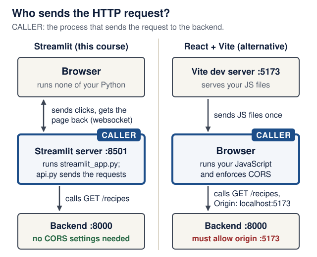
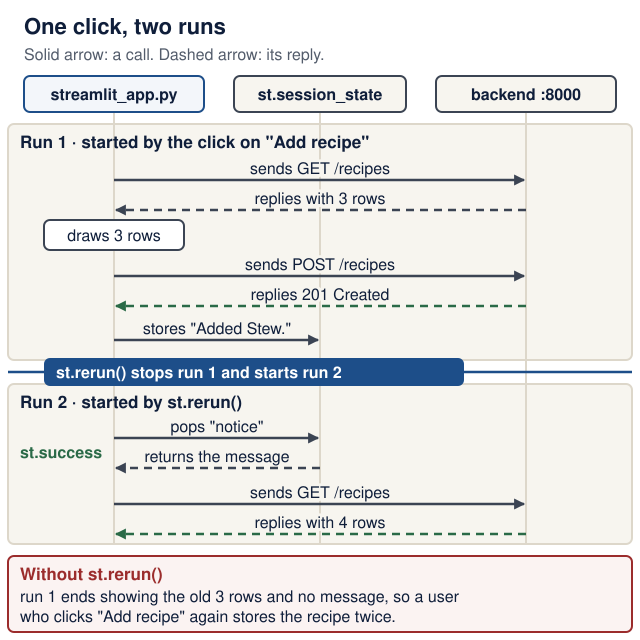

# Lecture 4 · Browser frontend

<!--  -->
[← Course home](../README.md) · [← Previous: Lecture 3](03-persistence-and-first-pr.md) · [Next: Lecture 5 →](05-frontend-reliability-testing.md)

> **At a glance**
>
> - **When:** Monday 9 November 2026, 16:00 Israel time, on Zoom
> - **You leave with:** your first working end-to-end user flow in the browser
> - **Goals:** trace a click to the backend and back, explain reruns and stable keys, and show validation feedback in words ([details](#learning-checkpoint))
> - **Prerequisites:** your Lecture 3 backend answers `curl -s http://localhost:8000/recipes` with its seed rows; repair: [Lecture 3 completion check](03-persistence-and-first-pr.md#completion-check)
> - **Product milestone:** EX1 is due tonight, 23:59; if EX1 is unfinished, submit it first
> - **Time:** prerequisite check and warm-up about 15 min; lab about 2 h in and after class (estimates)
> - **Done when:** a classmate completes list, add, edit and delete on your page in under a minute, and your `frontend/` is committed with `uv run ruff check .` clean

<details markdown="1" class="lecture-toc">
<summary>On this page</summary>

- [Mission](#mission)
- [Before you start](#before-you-start)
- [Learning checkpoint](#learning-checkpoint)
- [Concepts](#concepts)
- [Live demo](#live-demo)
- [Hands-on lab](#hands-on-lab)
- [Break it on purpose](#break-it-on-purpose)
- [Open-source track](#open-source-track)
- [Working with AI assistants](#working-with-ai-assistants)
- [Completion check](#completion-check)
- [Quick quiz](#quick-quiz)
- [Stretch goals](#stretch-goals)
- [Common pitfalls](#common-pitfalls)
- [Instructor notes](#instructor-notes)
- [Read more](#read-more)

</details>

## Mission

So far only `curl` and `/docs` can use your product. Today it gets a face: a Streamlit page where a person lists, adds, edits and deletes records, each click traveling browser → frontend → backend → SQLite. The win: on a screen share, a classmate tells you what to click and completes all four flows in under a minute, with no terminal.

> **Note:** EX1 (backend) is due tonight at 23:59 Israel time. Its requirements are in the README's [assignments table](../README.md#assignments-and-deadlines).

## Before you start

You need two terminals, one for the backend and one for the frontend. On Windows, both run inside WSL2.

> **Prerequisite check:** about one minute each, before class. If a check fails, follow its repair link first.
>
> | Check | Pass when | Repair |
> |---|---|---|
> | In `backend/`, run `uv run fastapi dev`; in the second terminal, run `curl -s http://localhost:8000/recipes` | JSON with your seed rows | [Lecture 3 completion check](03-persistence-and-first-pr.md#completion-check) |
> | `docker ps` | No container named `backend` is listed. If one is, it holds port 8000: stop it with `docker rm -f backend` (the named volume keeps its data) | [Containers in one page](../guides/engineering-foundations.md#containers-in-one-page) |
> | Open `http://localhost:8000/docs` and expand `POST /recipes` (or your resource) | You can name every field and say which ones are required | [HTTP, JSON, and contracts](../guides/engineering-foundations.md#http-json-and-contracts) |
> | `git status` in your product repository | `nothing to commit, working tree clean`: your EX1 work is committed | [Git you need to operate](../guides/engineering-foundations.md#git-you-need-to-operate) |
> | Answer the two questions in "Python you will read today" below | Both answers match | [Python you need to read](../guides/engineering-foundations.md#python-you-need-to-read) |

<details markdown="1">
<summary>Words you'll meet today</summary>

- **Frontend server:** the Streamlit process (port 8501). It runs your Python and sends the page to the browser.
- **Websocket:** a long-lived, two-way connection. Streamlit's browser page uses one to send clicks to the frontend server and receive the updated page.
- **Rerun:** Streamlit runs your whole script again, top to bottom, after every interaction.
- **Session state:** `st.session_state`, a dictionary the frontend server keeps for one browser tab.
- **Widget key:** the name Streamlit uses to remember a widget's value between reruns.
- **Form:** `st.form`, a group of inputs that is sent only when its submit button is pressed.
- **Origin:** scheme + host + port, such as `http://localhost:5173`. Browsers compare origins before letting JavaScript read another server's reply.
- **CORS:** Cross-Origin Resource Sharing, the rule by which a backend tells browsers which other origins may read its replies.
- **Timeout:** the longest a client waits for one step (connecting, or the next piece of a reply) before giving up.
- **Escaping:** marking special characters so they are shown as text instead of being interpreted, for example `\*` shows a star instead of starting bold text.

</details>

<details markdown="1">
<summary>Python you will read today</summary>

| You will see | It means | Same thing, longer |
|---|---|---|
| `if notice := st.session_state.pop("notice", None):` | Assign and test in one step (the "walrus" operator) | `notice = st.session_state.pop("notice", None)` then `if notice:` |
| `with st.expander(label), st.form("edit-3"):` | Enter two context managers; the form sits inside the expander | `with st.expander(label):` then, indented, `with st.form("edit-3"):` |
| `browse, add = st.tabs([...])` then `with add:` | Each tab is a container; `with` puts the following elements into it | — |
| `try:` … `except E:` … `else:` | `else` runs only when the `try` block raised nothing | Put the success code at the end of `try`, but then its own errors would be caught too |
| `st.session_state.setdefault("clicks", 0)` | Set the key only if it is missing; keep any existing value | `if "clicks" not in st.session_state: st.session_state["clicks"] = 0` |
| `str.maketrans({...})`, `text.translate(table)` | Build a character-replacement table once, then apply it to a string | A loop that replaces each special character |

**Check yourself:** (1) In `if notice := st.session_state.pop("notice", None):`, what is `notice` when no message was stored? (2) In the `try`/`except`/`else` of the add form, which line runs when `api.create_recipe` raises `httpx.HTTPStatusError`?

<details markdown="1">
<summary>Check your answers</summary>

1. `None`, so the `if` body (`st.success`) is skipped. `pop` also removes the message, so it shows only once.
2. `show_error(exc)` in the `except` block. The `else` block (`notify(...)`) runs only when no exception was raised.

</details>

</details>

## Learning checkpoint

By the end, you should be able to:

- Trace a click through browser, Streamlit server, HTTP client, backend, and database.
- Explain reruns, stable widget keys, session state, and why a write needs fresh displayed data.
- Show validation feedback while preserving the backend as the authority for accepted input.

**Predict first:** Where does the HTTP request originate in Streamlit, and how would that change with browser-side React?

<details markdown="1">
<summary>Check your prediction</summary>

In Streamlit, the **frontend server** sends it: your Python in `api.py` runs inside the Streamlit process, and the browser only exchanges clicks and page updates with that process over a websocket. With React, your JavaScript runs **in the user's browser**, so the browser itself sends the request. The backend must then be reachable from the user's machine, and it must allow the frontend's origin with CORS. The first figure in Concepts shows both.

</details>

> **Warm-up from earlier classes:** answer from memory, then check. Ungraded.
>
> 1. (Lecture 1) Your backend listens on `127.0.0.1:8000`. Can a classmate on the same Wi-Fi open it?
> 2. (Lecture 2) You send `POST /recipes` with an empty title. Which status code comes back, and where in the reply is the field named?
> 3. (Lecture 3) You stop `uv run fastapi dev` and start it again. What survives: the recipes, or values the server only held in memory?

<details markdown="1">
<summary>Check your answers</summary>

1. No. `127.0.0.1` is the loopback address: only programs on your own machine can reach it. Today you give the frontend the same protection.
2. `422 Unprocessable Content`. Each item in the `detail` list has a `loc` such as `["body", "title"]`; its last element names the field.
3. The recipes, committed to `data/app.db`. Memory is lost on restart. Today's `st.session_state` is memory in the frontend server, so nothing important may live only there.

</details>

**Bridge if needed:** [HTTP, JSON, and contracts](../guides/engineering-foundations.md#http-json-and-contracts) for requests and status codes; [Files, environments, and processes](../guides/engineering-foundations.md#files-environments-and-processes) for "which process runs this code?".

## Concepts

### Where the frontend sits

The frontend is its own process and reaches data **only** through the backend's API, never the database (README [product requirements](../README.md#three-service-product-requirements)). With Streamlit, your Python runs on the Streamlit server and the browser only draws the result, so the HTTP calls to the backend come from the server, not the browser. The browser and the Streamlit server talk over a **websocket**, a long-lived two-way connection that carries clicks one way and page updates the other.

<figure class="course-diagram">
  <div class="diagram-scroll" role="region" tabindex="0" aria-label="Who sends the HTTP request, scroll horizontally">
    
  </div>
  <figcaption><strong>Who sends the HTTP request?</strong> The highlighted box is the caller in each design. Predict which one needs CORS before you read the bottom notes. <span class="screen-only">On a narrow screen, scroll the diagram sideways.</span> <a href="../assets/diagrams/l04-who-sends-request.svg">Open the diagram at full size</a>.</figcaption>
</figure>

<details markdown="1">
<summary>Text version of the diagram</summary>

**Streamlit (this course).**

1. **Browser.** Draws the page and runs none of your Python. It sends clicks and widget values to the Streamlit server over a websocket and receives the page to draw.
2. **Streamlit server, port 8501 (the caller).** Runs `streamlit_app.py` and `api.py`. `api.py` sends `GET /recipes` and the other HTTP requests to the backend.
3. **Backend, port 8000.** FastAPI validates every request and is the only process that opens SQLite.

No CORS is needed: no browser JavaScript calls the backend.

**React with Vite (an alternative).**

1. **Vite dev server, port 5173.** Serves your JavaScript files to the browser once. It does not call the backend.
2. **Browser (the caller).** Runs your JavaScript, which sends `GET /recipes` to the backend with the header `Origin: http://localhost:5173`.
3. **Backend, port 8000.** Answers with `Access-Control-Allow-Origin` if that origin is allowed.

The browser enforces CORS: it lets your JavaScript read the reply only if the backend allowed that origin.

</details>

**Check yourself:** in the React design, which machine must be able to reach `http://localhost:8000`: the developer's, the Vite server's, or the user's?

<details markdown="1">
<summary>Check your answer</summary>

The **user's**, because the request leaves the user's browser. That is why a React build needs a backend URL that works from the user's machine, and why Compose's internal name `http://backend:8000` (Lecture 8) works for Streamlit but not for browser JavaScript.

</details>

### The rerun model

Every interaction (a click, a submitted form) reruns your script from top to bottom, like a spreadsheet recalculating after an edit. Ordinary variables start fresh each run; widgets remember values through their keys; `st.session_state` is a per-browser-tab dictionary that survives reruns, until the tab reloads or the server restarts.

Try it after the scaffold commands in [Live demo](#live-demo) step 1. Save this in `frontend/`, run it from `frontend/` with `uv run streamlit run rerun_demo.py`, and delete the file afterwards:

<figure class="file-example" markdown="1">
<figcaption><span class="file-example-action">Worked example</span> <span class="file-example-path">frontend/rerun_demo.py</span></figcaption>

```python
# frontend/rerun_demo.py (a throwaway file)
import streamlit as st

clicks = 0  # a normal variable: reset on every rerun
st.session_state.setdefault("clicks", 0)  # survives reruns

if st.button("Click me"):
    clicks += 1
    st.session_state["clicks"] += 1

st.write(f"Local variable: {clicks} · session_state: {st.session_state['clicks']}")
```

</figure>

**Predict:** you click the button three times. What does the last line show?

<details markdown="1">
<summary>Check your prediction</summary>

`Local variable: 1 · session_state: 3`. Each click reruns the whole file: `clicks = 0` runs again, then the `if` adds 1, so the local variable is never more than 1. The value in `st.session_state` is kept between runs, so it counts every click.

</details>

**Predict:** now reload the browser tab. What do both counters show, and why?

<details markdown="1">
<summary>Check your prediction</summary>

`Local variable: 0 · session_state: 0`. A reload opens a new session, and session state belongs to a session. Restarting the Streamlit server wipes it too ([Streamlit: session state](https://docs.streamlit.io/develop/concepts/architecture/session-state)). Verified on Streamlit 1.66.0.

</details>

The same mechanism, one step at a time:

<div class="stepper" markdown="1">

1. **Click.** The browser sends "button pressed" to the Streamlit server over the websocket.
2. **Rerun from the top.** The server runs `rerun_demo.py` again, from the first line.
3. **Local variable resets.** `clicks = 0` runs again; `if st.button(...)` is `True` for this one run, so `clicks` becomes 1.
4. **Session state persists.** `st.session_state["clicks"]` still holds the old count, so it goes from 2 to 3.
5. **Draw.** The server sends the new page; the browser shows `Local variable: 1 · session_state: 3`.
6. **Reload resets both.** A reloaded tab is a new session: both counters start at 0.

</div>

One consequence shapes the page. The recipe list is fetched at the top of the script, *before* the form handler further down saves anything. After a write, the page therefore calls `st.rerun()` to fetch fresh data, and it parks the success message in `st.session_state` so the message survives that rerun.

<figure class="course-diagram">
  <div class="diagram-scroll" role="region" tabindex="0" aria-label="Write then rerun, scroll horizontally">
    
  </div>
  <figcaption><strong>Why a write ends with <code>st.rerun()</code>.</strong> Run 1 drew the list before the save. Predict what the user sees if run 2 never happens. <span class="screen-only">On a narrow screen, scroll the diagram sideways.</span> <a href="../assets/diagrams/l04-write-then-rerun.svg">Open the diagram at full size</a>.</figcaption>
</figure>

<details markdown="1">
<summary>Text version of the diagram</summary>

**Run 1, started by the click on "Add recipe":**

1. `api.list_recipes()` sends `GET /recipes` and gets 3 rows.
2. The Recipes tab is drawn with those 3 rows.
3. The add form's handler sends `POST /recipes`; the backend answers `201 Created`.
4. `notify("Added Stew.")` stores the message in `st.session_state["notice"]`, then `st.rerun()` stops run 1 and starts run 2.

**Run 2, started by `st.rerun()`:**

1. `st.session_state.pop("notice")` returns the message, and `st.success` shows "Added Stew.".
2. `api.list_recipes()` sends `GET /recipes` again and gets 4 rows.
3. The Recipes tab is drawn with 4 rows. No button was pressed in this run, so nothing is saved again.

**Without `st.rerun()`:** run 1 ends with the old 3-row list and no message. A user who thinks the add failed submits again, and the backend stores a duplicate (Break-it drill 2).

</details>

### Forms and keys

`st.form` batches its inputs: typing does not rerun the script; only the submit button does. Every widget and form needs a **unique, stable key**. In a loop over records, derive keys from the record's id (`edit-3-title`), never from the loop position or a fixed string: a widget's remembered value follows its key, not the record, so position-based keys attach one record's edits to another (Break-it drill 4 shows the damage). `clear_on_submit=True` empties the add form after every submit, failed ones included; `required=True` on the title (lab step 6) stops the commonest failed submit, an empty title, in the browser, so the other fields keep what the user typed.

**Check yourself:** inside an edit form, you type a new title and then click the Minutes field. Does the script rerun?

<details markdown="1">
<summary>Check your answer</summary>

No. Inside `st.form`, widget changes stay in the browser until the form's submit button is pressed; then the script reruns once with all the new values.

</details>

### One module owns HTTP

`api.py` holds every call to the backend:

- **Base URL from the environment:** `BACKEND_URL`, default `http://localhost:8000`. Compose will set it to `http://backend:8000` in Lecture 8; no code changes.
- **An explicit timeout:** `httpx.Timeout(10.0, connect=2.0)` allows 2 s to open the connection and 10 s for each other wait: sending a piece of the request, receiving the next piece of the reply, or getting a pooled connection. It is not a deadline for the whole request. Writing the value down makes it a visible, reviewable decision; httpx's own default is 5 s, and `requests` has no default timeout at all. A stopped backend fails at once anyway (connection refused); timeouts matter when the backend is running but hangs.
- **`raise_for_status()`** turns 4xx and 5xx answers into `httpx.HTTPStatusError`, which the page catches.

The UI never builds URLs or sends requests itself. That pays off in Lecture 5: the error mapping moves out of the page into `api.py`, and `streamlit_app.py` only needs small changes (catch `api.BackendError` instead of httpx errors, add a spinner and an empty state).

**Version note:** the backend's tests use `httpx2` (Lecture 2), a continuation of HTTPX maintained by Pydantic. The frontend uses `httpx`, because respx, Lecture 5's mocking library, intercepts `httpx` and not `httpx2`. The calls look the same, but the import names differ: never mix the two in one file. (Checked 17 October 2026: httpx 0.28.1 and httpx2 2.13.1 on PyPI; respx 0.23.1 did not intercept an `httpx2` request in a test run. See the [HTTPX timeouts](https://www.python-httpx.org/advanced/timeouts/) page.)

**Check yourself:** the backend is stopped. How long does `api.list_recipes()` take to fail, and with which exception? And if a program accepts the connection on port 8000 but never answers?

<details markdown="1">
<summary>Check your answer</summary>

Stopped backend: at once, with `httpx.ConnectError` (`[Errno 61] Connection refused` on macOS, errno 111 on Linux). Silent program: after about 10 s, with `httpx.ReadTimeout`, because the connection opened and the read timeout ran out. Measured with httpx 0.28.1: 0.01 s and 10.09 s. The optional drill in [Break it on purpose](#break-it-on-purpose) lets you watch the second case.

</details>

### Validation in three places

The same rule ("a recipe needs a title") can be checked in three processes. Only the last one is the authority.

1. **In the browser:** widget bounds (`number_input` from 1 to 1440), `max_chars=200`, and `required=True`, which Streamlit checks in the browser before the form is sent. Instant feedback, but anyone can skip it: Streamlit's documentation says this check "can be bypassed".
2. **In the frontend server, before any request:** your own Python check, such as `if submitted and not new_recipe["title"].strip():`. It runs on the Streamlit server after the form arrives, and it saves a pointless round trip to the backend.
3. **In the backend:** Pydantic validation from [Lecture 2](02-http-fastapi-pydantic.md). This is the authority, because `curl` or any other client skips the first two.

When the backend rejects a body, FastAPI answers 422 with a `detail` list; each item has `loc` (where), `msg` (what) and `type`. Show it in words, for example `Please fix: title: String should have at least 1 character`, never as raw JSON or a traceback.

**Check yourself:** someone sends `POST /recipes` with an empty title straight to the backend with `curl`. Which of the three checks still stops it?

<details markdown="1">
<summary>Check your answer</summary>

Only the backend's Pydantic validation: `curl` never runs the browser or the frontend server. That is why the backend stays the authority even when the UI validates.

</details>

### Other frameworks, and CORS

React with Vite, or another web framework, is equally acceptable for your product. What changes is where the code runs. JavaScript runs **in the user's browser** and calls the backend directly, so:

- the backend URL must be reachable from the user's machine (for example `http://localhost:8000`), and Vite exposes it to your code as an `import.meta.env.VITE_*` variable at build time;
- the browser enforces **CORS**: the backend must name the frontend's exact **origin** (scheme + host + port, such as `http://localhost:5173`).

<figure class="file-example" markdown="1">
<figcaption><span class="file-example-action">File example</span> <span class="file-example-path">backend/app/main.py</span></figcaption>

```python
# backend/app/main.py: only if browser JavaScript calls the API
from fastapi.middleware.cors import CORSMiddleware

# after app = FastAPI(...):
app.add_middleware(
    CORSMiddleware,
    allow_origins=["http://localhost:5173"],  # your dev server's exact origin
    allow_methods=["*"],
    allow_headers=["*"],
)
```

</figure>

Streamlit's calls are server-side Python, so the Streamlit version needs no CORS settings. Whatever the framework, a CLI alone is not a frontend.

| Question | Streamlit | React with Vite |
|---|---|---|
| Where does your UI code run? | In the Streamlit server (Python) | In the user's browser (JavaScript) |
| Who sends the HTTP request to the backend? | The Streamlit server, through `api.py` | The browser |
| Does the backend need CORS settings? | No | Yes, for the frontend's exact origin |
| Control over the interface versus effort | Less control; little code, one language with the backend | Full control over layout and behavior; a second language, a build step and more code |

> **Defend it:** write one sentence for your README: why this frontend for *your* product? Name one reason from your product's needs and one cost you accept.

<details markdown="1">
<summary>What a strong answer mentions</summary>

A concrete need and a concrete cost. For example: "Streamlit, because the product is forms and lists used by one person at a time, and all our code stays in Python; we accept less control over layout." Weak answers only say a framework is "easier" or "popular". Formative only: the README's requirement is a browser frontend of any of the allowed kinds.

</details>

CORS is a browser access rule, not authentication or authorization: `curl` is not subject to that browser rule. A product with private user records must enforce ownership and access in the backend, even when its UI validates input.

### Show user text as text

Validation accepts text; the display decides how it is interpreted. Streamlit renders Markdown in expander labels and in `st.success` messages: its documentation lists bold, italics, links and images for labels. A recipe titled `[win a prize](https://example.com) **now**` would therefore show a clickable link with hidden target and bold text, and a title containing a Markdown image makes every visitor's browser fetch that image. For any product where one person's text is shown to someone else, that is a stored injection.

The page's `plain()` helper (part 1 of the [Live demo](#live-demo) code) puts a backslash before every ASCII punctuation mark. In Markdown, `\*` means "a literal star", so the title is shown exactly as typed. Call it on every user-entered (or, from Lecture 7, model-produced) text that goes into a label or a message.

**Check yourself:** a user saves the title `**Spicy** soup`. What does the expander label show without `plain()`, and with it?

<details markdown="1">
<summary>Check your answer</summary>

Without `plain()`: **Spicy** in bold, then "soup"; the stars disappear. With it: `**Spicy** soup`, stars included. Verified on Streamlit 1.66.0. One thing stays clickable even with `plain()`: a bare web address such as `https://example.com` is still turned into a link, but its visible text is its real target, so nothing is hidden.

</details>

## Live demo

The instructor builds the Recipe Box frontend next to the Lecture 3 backend.

**1. Scaffold the project** (from the repository root). *Make the smallest change.*

```bash
uv init --app --no-package --python 3.14 frontend
cd frontend
uv add streamlit httpx
uv add --dev ruff
rm main.py
mkdir .streamlit
```

**2. Streamlit settings.** *Make the smallest change.*

<figure class="file-example" markdown="1">
<figcaption><span class="file-example-action">File example</span> <span class="file-example-path">frontend/.streamlit/config.toml</span></figcaption>

```toml
# frontend/.streamlit/config.toml
[browser]
gatherUsageStats = false  # Streamlit collects usage stats unless you opt out

[server]
headless = true
address = "localhost"  # only this machine; Lecture 8's container overrides it
```

</figure>

Without `address`, `streamlit run` listens on every network interface and prints a "Network URL": anyone on the same Wi-Fi could list, edit and delete your records, although the backend itself only listens on `127.0.0.1`. With `address = "localhost"`, Streamlit listens on `127.0.0.1` only and prints just `URL: http://localhost:8501`. Lecture 8's container starts Streamlit with `--server.address 0.0.0.0`, and a command-line flag takes precedence over `config.toml` ([Streamlit configuration options](https://docs.streamlit.io/develop/concepts/configuration/options)), so Compose still works.

**Version note:** checked 17 October 2026 on Streamlit 1.66.0 (released 14 October 2026): the default listened on all interfaces (`*:8501`); with `address = "localhost"`, only on `127.0.0.1:8501`; `--server.address 0.0.0.0` overrode the file.

**Explain after:** why does the frontend container in Lecture 8 need `0.0.0.0`, while your laptop does not?

<details markdown="1">
<summary>Show a model answer</summary>

Inside a container, `127.0.0.1` is the container's own loopback: Docker's published port forwards traffic to the container's network interface, which a loopback-only server never hears. So the server inside must listen on `0.0.0.0`. Safety then comes from the *host* side: Lecture 8 publishes the port as `127.0.0.1:8501:8501`, so only your machine can reach it. On your laptop there is no such forwarding layer, so `localhost` is enough and safer.

</details>

**3. The API client.** *State the contract:* the paths, field names and timeouts the frontend relies on.

<figure class="file-example file-example--long" markdown="1">
<figcaption><span class="file-example-action">File example</span> <span class="file-example-path">frontend/api.py</span></figcaption>

```python
# frontend/api.py
"""Every HTTP call to the backend lives here."""

import os

import httpx

BACKEND_URL = os.getenv("BACKEND_URL", "http://localhost:8000")
TIMEOUT = httpx.Timeout(10.0, connect=2.0)


def list_recipes() -> list[dict]:
    r = httpx.get(f"{BACKEND_URL}/recipes", params={"limit": 100}, timeout=TIMEOUT)
    r.raise_for_status()
    return r.json()


def create_recipe(recipe: dict) -> dict:
    r = httpx.post(f"{BACKEND_URL}/recipes", json=recipe, timeout=TIMEOUT)
    r.raise_for_status()  # 422 -> httpx.HTTPStatusError
    return r.json()


def update_recipe(recipe_id: int, changes: dict) -> dict:
    r = httpx.patch(f"{BACKEND_URL}/recipes/{recipe_id}", json=changes, timeout=TIMEOUT)
    r.raise_for_status()
    return r.json()


def delete_recipe(recipe_id: int) -> None:
    r = httpx.delete(f"{BACKEND_URL}/recipes/{recipe_id}", timeout=TIMEOUT)
    r.raise_for_status()
```

</figure>

**Predict:** before any UI exists, run `uv run python -c "import api; print(len(api.list_recipes()))"` from `frontend/` with the backend running. What prints? What happens if you stop the backend and run it again?

<details markdown="1">
<summary>Check your prediction</summary>

`3` on a freshly seeded backend. With the backend stopped, a traceback that ends at once in `httpx.ConnectError: [Errno 61] Connection refused` (errno 111 on Linux). Nothing catches it yet: that is Lecture 5's first job.

</details>

**4. The page, part 1: the helpers.** *Make the smallest change.*

<figure class="file-example file-example--long" markdown="1">
<figcaption><span class="file-example-action">Partial file</span> <span class="file-example-path">frontend/streamlit_app.py</span></figcaption>

```python
# frontend/streamlit_app.py (part 1)
import string

import httpx
import streamlit as st

import api

st.set_page_config(page_title="Recipe Box")
st.title("Recipe Box")

# Every ASCII punctuation mark, prefixed with a backslash.
MARKDOWN_ESCAPES = str.maketrans({c: "\\" + c for c in string.punctuation})


def plain(text: str) -> str:
    """Escape Markdown so user or model text is shown, not interpreted."""
    return text.translate(MARKDOWN_ESCAPES)


def notify(message: str) -> None:
    """Remember a success message, then rerun so lists show fresh data."""
    st.session_state["notice"] = message
    st.rerun()


def show_error(exc: httpx.HTTPStatusError) -> None:
    """Turn the backend's 422 details into words a user can act on."""
    if exc.response.status_code == 422:
        problems = [
            f"{err['loc'][-1]}: {err['msg']}" for err in exc.response.json()["detail"]
        ]
        st.error("Please fix: " + "; ".join(problems))
    else:
        st.error(f"The backend returned {exc.response.status_code}.")
```

</figure>

**5. Part 2: one form helper for both add and edit.** The dictionary keys are the API's field names; the widget keys are built from `key`; `recipe` prefills the inputs when editing; integer bounds and defaults make `number_input` return `int`, not `float`.

<figure class="file-example file-example--long" markdown="1">
<figcaption><span class="file-example-action">Partial file</span> <span class="file-example-path">frontend/streamlit_app.py</span></figcaption>

```python
# frontend/streamlit_app.py (part 2)
def recipe_fields(key: str, recipe: dict | None = None) -> dict:
    """Draw the recipe inputs (inside a form) and return them as a request body."""
    r = recipe or {}
    return {
        "title": st.text_input(
            "Title", r.get("title", ""), max_chars=200, key=f"{key}-title"
        ),
        "minutes": st.number_input(
            "Minutes", 1, 1440, r.get("minutes", 30), key=f"{key}-minutes"
        ),
        "servings": st.number_input(
            "Servings", 1, 50, r.get("servings", 2), key=f"{key}-servings"
        ),
        "ingredients": st.text_area(
            "Ingredients, one per line",
            r.get("ingredients", ""),
            max_chars=5000,
            key=f"{key}-ingredients",
        ),
        "tags": st.text_input(
            "Tags, comma-separated", r.get("tags", ""), max_chars=500, key=f"{key}-tags"
        ),
    }
```

</figure>

**6. Part 3: the page itself.** *Make the smallest change.*

<figure class="file-example file-example--long" markdown="1">
<figcaption><span class="file-example-action">Partial file</span> <span class="file-example-path">frontend/streamlit_app.py</span></figcaption>

```python
# frontend/streamlit_app.py (part 3)
if notice := st.session_state.pop("notice", None):
    st.success(notice)

recipes = api.list_recipes()  # Lecture 5: what if the backend is down?

browse, add = st.tabs(["Recipes", "Add a recipe"])

with browse:
    for recipe in recipes:
        rid = recipe["id"]
        title = plain(recipe["title"])  # user text: show it, never interpret it
        label = f"{title} ({recipe['minutes']} min, serves {recipe['servings']})"
        with st.expander(label), st.form(f"edit-{rid}"):
            changes = recipe_fields(f"edit-{rid}", recipe)
            save_col, delete_col = st.columns(2)
            save = save_col.form_submit_button(
                "Save changes", key=f"save-{rid}", width="stretch"
            )
            delete = delete_col.form_submit_button(
                "Delete", key=f"delete-{rid}", width="stretch"
            )
            try:
                if save:
                    api.update_recipe(rid, changes)
                    notify(f"Saved {plain(changes['title'])}.")
                if delete:
                    api.delete_recipe(rid)
                    notify(f"Deleted {title}.")
            except httpx.HTTPStatusError as exc:
                show_error(exc)

with add, st.form("add", clear_on_submit=True):
    new_recipe = recipe_fields("add")
    if st.form_submit_button("Add recipe", key="add-submit", width="stretch"):
        try:
            created = api.create_recipe(new_recipe)
        except httpx.HTTPStatusError as exc:
            show_error(exc)
        else:
            notify(f"Added {plain(created['title'])}.")
```

</figure>

**7. Run both services**, each in its own terminal. *Observe the real result.*

```bash
cd backend
uv run fastapi dev
```

```bash
cd frontend
uv run streamlit run streamlit_app.py
```

Open `http://localhost:8501`. The three seed recipes appear as expanders. Edit one, save, reload the page: the change persists.

**Predict:** in the "Add a recipe" tab, leave the title empty and press "Add recipe". What does the page show, and what does the backend terminal log?

<details markdown="1">
<summary>Check your prediction</summary>

The page shows `Please fix: title: String should have at least 1 character`, and the backend logs a line ending in `"POST /recipes HTTP/1.1" 422 Unprocessable Content`. The request reached the backend, which rejected it. `clear_on_submit=True` also emptied every field you had typed; lab step 6 fixes that.

</details>

Then add a valid recipe (`201 Created` in the backend log) and delete it (`204 No Content`).

**Predict:** open the browser's developer tools, Network tab, and reload. Will you see a request to `/recipes`? Answer before you look.

<details markdown="1">
<summary>Check your prediction</summary>

No. The browser loads only Streamlit's own page, scripts, styles and fonts, plus one websocket to the Streamlit server (`ws://localhost:8501/_stcore/stream`; the Network tab's "WS" filter shows it). The `GET /recipes` lines appear in the **backend's** terminal, because `api.py` runs inside the Streamlit server. Checked on Streamlit 1.66.0.

</details>

> **Investigate:** with both services still running, answer from the code, then check against the backend log.
>
> 1. You click "Add recipe" with a valid title. In what order do the lines of part 3 run, and how many `GET /recipes` lines does the backend log?
> 2. The list is fetched *before* the form saves. Why does the new recipe still appear at once?
> 3. Between the two runs, where does the text "Added Stew." live?

<details markdown="1">
<summary>Show model answers</summary>

1. From the top: the notice check (nothing stored), `api.list_recipes()` (`GET` number 1), the tabs and every expander, then the add form, whose button is `True`, so `POST` runs and `notify()` calls `st.rerun()`. The second run fetches again: two `GET /recipes` lines around one `POST`.
2. `notify()` calls `st.rerun()`, which starts a fresh run whose `GET` already includes the new row.
3. In `st.session_state["notice"]`, in the Streamlit server's memory for your tab. The second run pops it and shows it once.

</details>

**Trace it:** you change Hummus from 15 to 20 minutes and press "Save changes". Fill in the cells marked "?" before opening the answer.

| Step | File : function | Input | State after | Next call |
|---|---|---|---|---|
| 1 | browser → Streamlit server | the form's widget values, sent over the websocket | a rerun is scheduled | `streamlit_app.py` from line 1 |
| 2 | `api.py` : `list_recipes` | `GET /recipes?limit=100` | `recipes` still says Hummus takes 15 min | the loop draws the expanders |
| 3 | `streamlit_app.py` : loop, `rid == 2` | `save` is `True` | `changes["minutes"] == 20` | ? |
| 4 | `api.py` : `update_recipe` | ? | the backend has committed the change | `notify("Saved Hummus.")` |
| 5 | `streamlit_app.py` : `notify` | the message | ? | `st.rerun()` |
| 6 | `streamlit_app.py`, second run | none | the message is shown; the list shows 20 min | wait for the next click |

<details markdown="1">
<summary>Check your answer</summary>

- Step 3, next call: `api.update_recipe(2, changes)`.
- Step 4, input: `PATCH /recipes/2` with the JSON body built by `recipe_fields` (all five fields), answered `200 OK`.
- Step 5, state after: `st.session_state["notice"] == "Saved Hummus."`; `st.rerun()` then stops the first run immediately.

</details>

## Hands-on lab

Build the same four flows for **your own domain**. Run every command from `frontend/` unless a step says otherwise.

> **EX2 progress:** the four flows you build today are the "core flows" of EX2 (due Mon 30 Nov 2026, 23:59); Lecture 5 adds the error states and the automated flow. See the README's [assignments table](../README.md#assignments-and-deadlines).

**Core today:** steps 1–6. **Finish before Lecture 5:** steps 7–9. **Extension:** the [Stretch goals](#stretch-goals), once the completion check passes.

1. Create `frontend/` with the commands in Live demo steps 1–2 (from the repository root), add `.streamlit/config.toml`, and commit `pyproject.toml`, `uv.lock` and `.python-version`.
2. Write `api.py` with list, create, update and delete for your resource. **Checkpoint:** the `uv run python -c "import api; ..."` call prints your seed count.
3. Show the list. Pick a label that identifies each record at a glance, and pass every user-entered part through `plain()`. **Checkpoint:** `uv run streamlit run streamlit_app.py` prints `URL: http://localhost:8501` and no "Network URL".
4. Add the create form with `show_error`. **Checkpoint:** submitting with a required field empty shows a sentence, not JSON or a traceback.
5. Add edit and delete inside each record's form, with keys built from the id. **Checkpoint:** an edit survives a page reload, and a deleted record is gone from `GET` on the backend too.
6. Buddy test on Zoom: share your screen (or give remote control). A classmate directs all four flows in under a minute while you only click what they say. Note where they hesitated.
7. *Before Lecture 5:* add the two front-line checks for a required field of yours. First the frontend check, so an empty request is never sent:

   ```python
   # frontend/streamlit_app.py: the "add" form with a frontend check
   with add, st.form("add", clear_on_submit=True):
       new_recipe = recipe_fields("add")
       submitted = st.form_submit_button("Add recipe", key="add-submit", width="stretch")
       # frontend check before any request
       if submitted and not new_recipe["title"].strip():
           st.warning("Give the recipe a title before saving.")
       elif submitted:
           try:
               created = api.create_recipe(new_recipe)
           except httpx.HTTPStatusError as exc:
               show_error(exc)
           else:
               notify(f"Added {plain(created['title'])}.")
   ```

   **Checkpoint:** a title of only spaces shows the warning, and the backend log shows no new `POST`. Then, in `recipe_fields`, add `required=True` to the title's `st.text_input(...)` call (after `max_chars=200`). **Checkpoint:** with an empty or all-spaces title, the field turns red with "This field is required.", the backend log shows no new `POST`, and the other fields keep what you typed. Keep both checks: the browser check is a convenience anyone can bypass, the frontend check protects the backend from pointless requests, and the backend remains the authority.
8. *Before Lecture 5:* add a "Run the frontend" section to your README: both terminals, the URL, and `BACKEND_URL`.
9. *Before Lecture 5:* commit the frontend, so Lecture 5 can compare against it: from the repository root, `git add frontend`, then `git commit -m "Frontend: list, add, edit, delete"`. **Checkpoint:** `git status` prints `nothing to commit, working tree clean`, and `git log --oneline -1` shows your commit.

## Break it on purpose

For each drill: predict, run it, then explain the result in one sentence before you open the answer. Automated UI tests arrive in Lecture 5 (AppTest); until then, keep each drill as a manual check in your README.

1. **Contract drift.** In `recipe_fields`, rename the `"minutes"` key to `"time"`, then add a recipe. Predict the message.

   <details markdown="1">
   <summary>Check your prediction</summary>

   `Please fix: minutes: Field required; time: Extra inputs are not permitted`. **Why:** your Lecture 2 `extra="forbid"` rejected the unknown field instead of silently ignoring it, so you heard about the typo at once. Fix: use the API's field names from `/docs`. The backend side is already pinned by your Lecture 2 test for unknown fields.

   </details>

2. **Forget the rerun.** Delete `st.rerun()` from `notify`, then add a recipe. Predict what the page and the backend log show.

   <details markdown="1">
   <summary>Check your prediction</summary>

   No message appears and the list looks unchanged, yet the backend logged `201 Created`. **Why:** the list was fetched before the save ran (see the write-then-rerun figure), and the message waits in `st.session_state` for a run that never comes. Both appear only on the *next* interaction, and a user who thinks the add failed types it again and creates a duplicate. Fix: restore `st.rerun()`.

   </details>

3. **Duplicate keys.** Change `st.form(f"edit-{rid}")` to `st.form("edit")`. Predict what happens when the page loads.

   <details markdown="1">
   <summary>Check your prediction</summary>

   The page stops with `StreamlitDuplicateElementKey`: "There are multiple elements with the same `key='edit'`. To fix this, please make sure that the `key` argument is unique for each element you create." **Why:** every record's form now has the same key. Fix: build every key from the record id.

   </details>

4. **Keys from the loop position.** Change the loop to `for i, recipe in enumerate(recipes):` and use `i` instead of `rid` in every key (`st.form(f"edit-{i}")`, `recipe_fields(f"edit-{i}", recipe)`, `key=f"save-{i}"`, `key=f"delete-{i}"`); keep `rid` in the `api` calls. Delete the first recipe, then open the expander that is now first. **Predict:** what does its form show, and what would "Save changes" write? Write a **Debug log** entry ([the card](../guides/engineering-foundations.md#debug-with-a-hypothesis)) with your hypothesis *before* you press Save.

   <details markdown="1">
   <summary>Check your prediction</summary>

   With the seed data: the label says `Hummus (15 min, serves 4)`, but the form shows **Shakshuka** and 25 minutes, the record you just deleted. Pressing Save sends `PATCH /recipes/2` with Shakshuka's values, so Hummus silently becomes a copy of the deleted recipe. **Why:** a widget's remembered value follows its key, not the record. After the delete, the key `edit-0-title` still holds the old first record's values, and position 0 now belongs to a different record. Verified in a real browser on Streamlit 1.66.0. Fix: build keys from the id; restore the loop.

   </details>

5. **Markdown in a title.** In part 3, change `title = plain(recipe["title"])` to `title = recipe["title"]` and remove `plain(...)` from the "Added" notice. Add a recipe titled `[win a prize](https://example.com) **now**`. **Predict:** what do the notice and the new expander's label show?

   <details markdown="1">
   <summary>Check your prediction</summary>

   `Added win a prize now.` with "win a prize" as a clickable link to `https://example.com` and "now" in bold; the label is a link too. **Why:** validation accepted the text, and Streamlit rendered it as Markdown. Restore `plain()`, reload, and the label reads `[win a prize](https://example.com) **now** (30 min, serves 2)` exactly as typed. Verified on Streamlit 1.66.0; with a Markdown image in the title, the unescaped label also made the browser request the image URL.

   </details>

> **Optional:** watch a hung backend. Stop the backend, then from any folder run `python3 -c "import socket,time; s=socket.socket(); s.bind(('127.0.0.1',8000)); s.listen(); time.sleep(600)"`: a program that accepts connections and never answers. Reload the page and predict how long it takes to fail, and with which error. (Answer: about 10 s, then a traceback ending in `httpx.ReadTimeout: timed out`; the read timeout ran out. A stopped backend, by contrast, fails at once.) Press Ctrl+C to end it.

Bonus preview: stop the backend and reload the page. You get a traceback ending in `httpx.ConnectError`. Leave it for now; handling it properly is Lecture 5's first job.

## Open-source track

This week you keep PR #1 alive. The etiquette rules are in the README's [contribution etiquette](../README.md#contribution-etiquette). In the commands below, replace `NUMBER` with your PR's number and `OWNER/REPO` with the upstream repository.

```bash
gh pr checks NUMBER --repo OWNER/REPO
gh pr view NUMBER --repo OWNER/REPO --comments
gh search prs --author=@me --state=open
```

- **CI is red?** Read the failing job, reproduce it locally, fix it on the **same branch** and push; the PR updates itself. Never open a second PR for one change.
- **A review arrived?** Reply in your own words: thank the reviewer, answer every point, say what changed in which commit, ask when unclear. If you disagree, explain once with evidence, then accept the maintainers' decision.
- **Silence?** Wait at least a week (or what CONTRIBUTING says), then post one polite follow-up. Meanwhile, start scouting the issue for PR #2, which should be opened by [Lecture 6](06-pydantic-ai-agents.md). On the day you open it, check again that the repository still has more than 10,000 stars ([qualifying repositories](../README.md#qualifying-repositories)).

## Working with AI assistants

- **Generate from the contract, not from memory.** Paste `api.py` and your backend's schema (`curl -s localhost:8000/openapi.json`) and state the rules: all HTTP in `api.py`, `st.form` with keys from ids, `plain()` on user text in labels and messages, `width="stretch"`, 422 details in words.
- **Explain before fixing.** When the list does not refresh, ask the assistant to explain the cause in terms of the rerun model, and check the explanation against Streamlit's [main concepts](https://docs.streamlit.io/get-started/fundamentals/main-concepts) before accepting a fix.

A bounded work order for this week (the field names are the course's [one work-order template](../guides/agent-driven-development.md#one-work-order-template)):

```text
Outcome:      each recipe's expander label also shows its tags, e.g.
              "Hummus (15 min, serves 4) · vegan, quick"
Files:        frontend/streamlit_app.py
Non-goals:    no change to api.py, the backend, or any widget key
Verify with:  uv run ruff check . && uv run ruff format --check .
              then reload http://localhost:8501: every seed label shows its tags
Review focus: the label line: tags pass through plain(), keys still use rid
Acceptance:   before the change, the Hummus label has no tags (write this check
              in your README; Lecture 5 turns such checks into AppTest tests)
Stop:         if the change seems to need a backend edit or a new dependency
```

Read the diff (`git diff frontend/streamlit_app.py`) before you run anything, then run the verify commands yourself. Add one line to your README's AI-use note ([what it must contain](../README.md#working-method-ai-use-assessment-and-reproducibility)): the tool, what it changed, and how you checked it.

Verify any assistant-written frontend code by clicking every flow yourself, then run this in `frontend/`; it must print nothing:

```bash
grep -nE "sqlmodel|sqlite|st\.connection|use_container_width|experimental_" *.py
```

`st.connection` is Streamlit's built-in way to open a database, so it would bypass the backend as surely as an `import sqlite3`.

> **Optional:** keep these rules in a `frontend/AGENTS.md` file (or your assistant's equivalent instruction file) so every session starts with them; see the [agent-driven development guide](../guides/agent-driven-development.md#the-development-loop). The `grep` above stays the check: an instruction file is a request, not a guarantee.

**Spot the outdated suggestion:**

- `st.experimental_rerun()`: removed. Streamlit 1.66 raises `st.experimental_rerun has been removed. Use st.rerun instead.`
- `use_container_width=True`: deprecated; use `width="stretch"`.
- `requests.get(url)` with no timeout: one slow backend freezes the page.
- A frontend that opens the SQLite file, a SQLModel session or `st.connection("sql")`: it bypasses the backend, which the product rules forbid.
- "Add `CORSMiddleware` so Streamlit can reach the API": not needed for server-side calls.

## Completion check

With both terminals running, open `http://localhost:8501`. Run the commands from `frontend/`.

| Must work | Evidence you keep | If it fails, repair here |
|---|---|---|
| The list shows your seed rows; adding a record shows a success message and the record at once | a screenshot in your PR or notes | [Common pitfalls](#common-pitfalls) · [The rerun model](#the-rerun-model) |
| An edit persists after a page reload; a delete removes the record from the backend too (`curl -s http://localhost:8000/recipes`) | the backend log lines: `POST` 201, `PATCH` 200, `DELETE` 204 | [Forms and keys](#forms-and-keys) |
| An invalid or empty required field produces a readable sentence, never raw JSON or a traceback | the sentence, copied into your README's manual checks | [Validation in three places](#validation-in-three-places) |
| <code>grep -nE "sqlmodel&#124;sqlite&#124;st\.connection" *.py</code> prints nothing | empty output | [One module owns HTTP](#one-module-owns-http) |
| `uv run ruff check . && uv run ruff format --check .` | `All checks passed!` and `… files already formatted` | run `uv run ruff format .`, then fix what `ruff check` reports |
| `git status` is clean and `git log --oneline -1` shows your frontend commit | the commit hash | [Hands-on lab](#hands-on-lab) step 9 |
| EX1 is submitted through the submission channel provided by the instructor | your submission confirmation | [Assignments and deadlines](../README.md#assignments-and-deadlines) |

**Not yet?** Repair and re-run before starting the next lecture's lab; later layers assume this one works.

## Quick quiz

<details markdown="1">
<summary>Q1. You click "Add recipe". Which code runs, and why does the page call st.rerun() after saving?</summary>

The whole script runs from the top, so `api.list_recipes()` executes *before* the form handler saves. `st.rerun()` starts a fresh run that fetches the updated list; the message survives because it waits in `st.session_state`.

</details>

<details markdown="1">
<summary>Q2. (Lecture 2) The form sends {"title": "Soup", "time": 30}. What does the backend answer?</summary>

**422.** `RecipeCreate` uses `extra="forbid"`, so `time` is rejected as an extra input, and the required `minutes` is missing. Both errors arrive in the `detail` list.

</details>

<details markdown="1">
<summary>Q3. The browser's Network tab shows no request to /recipes. Is the frontend broken?</summary>

No. In Streamlit, `api.py` runs on the Streamlit server, which calls the backend; the browser only talks to Streamlit over a websocket. Look for the requests in the backend's terminal log instead.

</details>

<details markdown="1">
<summary>Q4. Does the backend need CORSMiddleware for the Streamlit frontend? For a React frontend?</summary>

Streamlit: no, because CORS is enforced by browsers and the calls come from server-side Python. React: yes, because its JavaScript calls the API from the browser, so the backend must allow the frontend's exact origin.

</details>

<details markdown="1">
<summary>Q5. (Lecture 3) You restart the Streamlit server. What happens to the recipes, and to st.session_state?</summary>

The recipes are safe in the backend's SQLite file. `st.session_state` is lost: it lives in the Streamlit server's memory, per browser session. Nothing important may live only in the frontend.

</details>

Q6. Your recipe titles are validated by Pydantic (1 to 200 characters). Which statement is true?

- (a) Validation guarantees the title is safe to show anywhere.
- (b) A valid title can still be interpreted as Markdown when it is displayed, so the display must escape it.
- (c) Escaping is only needed for titles produced by an AI model.

<details markdown="1">
<summary>Check your answer</summary>

**Answer:** (b). Validation decides which text is *accepted*; the display decides how it is *interpreted*. `[win a prize](https://example.com)` is a valid 1–200 character title and still renders as a link unless `plain()` escapes it. (c) is wrong because any user can type Markdown; model output (Lecture 7) is one more source.

</details>

**Explain it:** in one sentence, what is `notify()` *for*? (Not what each line does.)

<details markdown="1">
<summary>Show a model answer</summary>

Weak (narrates lines): "It stores a message in session state and calls `st.rerun()`." Strong (purpose and the failure it prevents): "It makes a successful write visible: the message survives the rerun that fetches the fresh list, so the user sees both the confirmation and the new data and does not submit twice."

</details>

> **Defend it:** a teammate wants to delete the frontend check `if submitted and not new_recipe["title"].strip():`, because the backend validates titles anyway. Keep it or drop it? Give one reason from the contract or from evidence, and one cost of your choice.

<details markdown="1">
<summary>What a strong answer mentions</summary>

Either choice can be defended; the reasoning matters. Keeping it: it answers at once in words, sends nothing pointless to the backend, and still works when the browser's `required=True` is bypassed; the cost is a second copy of a rule that can drift from the backend's (for example, if the backend later allows something the frontend still blocks). Dropping it: one source of truth, fewer lines; the cost is a round trip and a 422 for a mistake the frontend could have caught. Either way, the backend stays the authority.

</details>

## Stretch goals

Optional, once the four flows work and the completion check passes.

- **Keep the user's input when a save fails** (after lab step 7). With `clear_on_submit=True`, a submit that the backend rejects still empties the form. Drop it, build the add form's widget keys from a counter in `st.session_state` (`f"add-{version}"`), and increase the counter after a successful save so Streamlit draws fresh, empty widgets. Check it in a real browser: AppTest does not reproduce `clear_on_submit`. If you adopt versioned keys, Lecture 5's tests must find widgets by label instead of key, for example `next(w for w in at.text_input if w.label == "Title")`.

  > **Simpler is enough:** `required=True` on the title already keeps the other fields for the commonest failure, an empty title. Do the versioned keys only if your users often hit other validation errors.

- **Two UIs, one API** (if you are considering React for EX2). Build a minimal React and Vite page that lists the same records, with the CORS setting above. Create in one UI and watch it appear in the other.
- **Search that scales** (once your list may exceed one page). Add a `q` query parameter to the backend's list endpoint, with a test, and a search box that sends it. Filtering only in the frontend breaks once pagination kicks in.

## Common pitfalls

- **A traceback ending in `httpx.ConnectError` (`Connection refused`).** The backend is not running, or `BACKEND_URL` points elsewhere. Start it, and check the variable with `echo $BACKEND_URL`. Lecture 5 replaces the traceback with a message.
- **The list does not update after a submit.** No `st.rerun()` after the write. Call `notify()`.
- **`There are multiple elements with the same key`.** Keys built from a fixed string. Use the record id (not the loop index either; see Break-it drill 4).
- **`AttributeError: module 'streamlit' has no attribute 'experimental_rerun'`.** Outdated code. Use `st.rerun()`.
- **422 shows up as a JSON blob.** The error was displayed raw. Format `detail` as in `show_error`.
- **A title shows up bold, as a link, or with missing characters.** User text was rendered as Markdown. Pass it through `plain()`.
- **A CORS error in the browser console (React or Vite only).** The origin is not allowed. Add your exact dev origin to `CORSMiddleware`; never `"*"` with credentials.
- **Your changes never appear.** An old Streamlit still holds 8501, so the new one quietly moved to the next free port (its terminal prints `http://localhost:8502`). Stop the old process, or open the URL the terminal prints.
- **A classmate cannot open your page at your IP address.** Expected: `address = "localhost"` keeps the frontend on your machine. Use screen sharing for the buddy test.
- **The Title field turns red with "This field is required." and nothing happens.** Expected: the browser blocked an empty title (`required=True`). Type a title.

## Instructor notes

Suggested flow (minutes are estimates; if time runs short, keep steps 2, 3, 5 and 7 and assign the rest as reading):

1. EX1 check-in (5 min): collect blockers (restart test, Dockerfile) for after class.
2. Predict-first vote (10 min): "Which process sends the HTTP request to the backend?" Run it as a peer-instruction vote: individual poll, discuss in pairs, re-vote, then a student explains ([pacing guide](../guides/learning-map.md#instructor-pacing-and-readiness-review)). Then show the who-sends-the-request figure.
3. Scaffold `frontend/` (Live demo steps 1–2) and run `rerun_demo.py` as predict-then-run (10 min); it unlocks everything else. Ask the reload prediction before reloading.
4. Build `api.py` live and call it from the terminal before any UI exists (10 min).
5. Build the page in three passes: list, add with the 422 message, then edit and delete (25 min). Do the Trace it table together.
6. Run drills 2, 4 and 5 (10 min); let students call out the fix before you type it. Drills 1 and 3 can be reading.
7. Lab: students build the four flows for their own domain; end with the Zoom buddy test.
8. React and CORS in five sentences, with the comparison table; show the middleware only if students plan a JavaScript frontend.
9. Open source: read one real review comment aloud, outline a reply together; the student writes the actual reply.
10. Exit ticket (2 min): "In your product, which process sends the HTTP request to the backend, and which one checks the title last?" Quiz Q1–Q6 for self-study; Q3 needs the Network-tab demo.

Emphasize: the frontend talks only to the API, the whole script reruns, keys come from ids, user text is shown as text. Students get stuck on field names drifting from the backend, keys inside loops, a backend that is not running (or on another port), and success messages that vanish without `st.session_state`.

## Read more

**Before the lab (≤15 min):** [Streamlit: main concepts](https://docs.streamlit.io/get-started/fundamentals/main-concepts). Read it with two questions: what triggers a rerun, and what survives one?

**Go deeper (optional):**

- [Streamlit: session state](https://docs.streamlit.io/develop/concepts/architecture/session-state)
- [Streamlit: using forms](https://docs.streamlit.io/develop/concepts/architecture/forms)
- [Streamlit: `st.text_input`](https://docs.streamlit.io/develop/api-reference/widgets/st.text_input), including `required` and which Markdown a label accepts
- [Streamlit: configuration options](https://docs.streamlit.io/develop/concepts/configuration/options)
- [HTTPX: timeouts](https://www.python-httpx.org/advanced/timeouts/)
- [FastAPI: CORS](https://fastapi.tiangolo.com/tutorial/cors/)

---

[← Course home](../README.md) · [← Previous: Lecture 3](03-persistence-and-first-pr.md) · [Next: Lecture 5 →](05-frontend-reliability-testing.md)

<!--  -->
