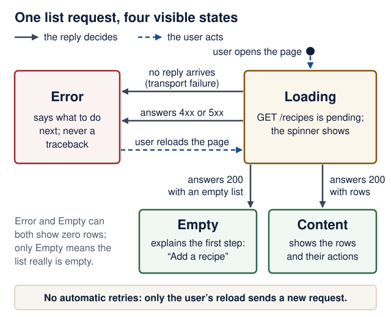
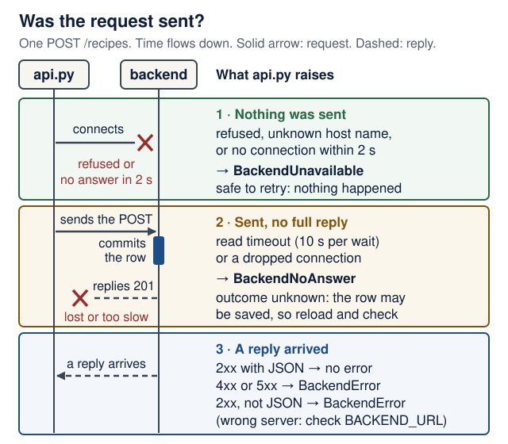
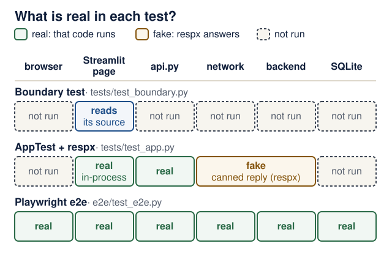

# Lecture 5 · Frontend reliability and testing

<!--  -->
[← Course home](../README.md) · [← Previous: Lecture 4](04-browser-frontend.md) · [Next: Lecture 6 →](06-pydantic-ai-agents.md)

> **At a glance**
>
> - **When:** Monday 16 November 2026, 16:00 Israel time, on Zoom
> - **You leave with:** a usable interface and one automated product flow
> - **Goals:** show loading, empty, error and success states with a next step; say what each test layer proves and what it fakes; prove a test fails when its code breaks ([details](#learning-checkpoint))
> - **Prerequisites:** your Lecture 4 frontend is committed and `git status` is clean; repair: [Lecture 4 completion check](04-browser-frontend.md#completion-check)
> - **Product milestone:** EX2 (due Mon 30 Nov 2026, 23:59) — this lecture produces most of it
> - **Time:** prerequisite check and warm-up about 15 min, plus a browser download started before class; lab about 2 h in and after class (estimates)
> - **Done when:** `uv run pytest` prints `8 passed` for Recipe Box (your count will differ) and the browser flow prints `1 passed`

<details markdown="1" class="lecture-toc">
<summary>On this page</summary>

- [Mission](#mission)
- [Before you start](#before-you-start)
- [Learning checkpoint](#learning-checkpoint)
- [Concepts](#concepts)
- [Live demo](#live-demo)
- [Hands-on lab](#hands-on-lab)
- [Break it on purpose](#break-it-on-purpose)
- [Open-source track](#open-source-track)
- [Working with AI assistants](#working-with-ai-assistants)
- [Completion check](#completion-check)
- [Quick quiz](#quick-quiz)
- [Stretch goals](#stretch-goals)
- [Common pitfalls](#common-pitfalls)
- [Instructor notes](#instructor-notes)
- [Read more](#read-more)

</details>

## Mission

Your Recipe Box works on a good day. Today it learns to behave on a bad one: an empty list, nonsense input, a backend that is switched off or stops answering. You finish with screens that always say what is happening and what to do next, and a robot that clicks through one real product flow in a real browser.

> **EX2 progress:** this lecture produces most of EX2. The README's [assignments table](../README.md#assignments-and-deadlines) row, verbatim:
>
> | Assignment | Deadline | What you hand in |
> |---|---|---|
> | EX2 — Frontend plus backend | Mon 30 Nov 2026 | Browser UI integrated with EX1: core flows, error states, one automated UI or integration flow, and reproducible run instructions |
>
> Lecture 4 built the core flows. Today adds the error states, the automated flow, and the test instructions in your README (lab step 9).

## Before you start

> **Prerequisite check:** about one minute each, before class. If a check fails, follow its repair link first.
>
> | Check | Pass when | Repair |
> |---|---|---|
> | `git status`, then `git log --oneline -3`, in your product repository | `nothing to commit, working tree clean`, and one of the commits is your Lecture 4 frontend | [Lecture 4 lab step 9](04-browser-frontend.md#hands-on-lab) · [Git you need to operate](../guides/engineering-foundations.md#git-you-need-to-operate) |
> | In `backend/`, `uv run fastapi dev`; then `curl -s http://localhost:8000/health` | `{"status":"ok"}` | [Lecture 3 completion check](03-persistence-and-first-pr.md#completion-check) |
> | In `frontend/`, `uv run streamlit run streamlit_app.py`; add one record, then delete it | Both flows work and show a success message | [Lecture 4 completion check](04-browser-frontend.md#completion-check) |
> | A 422 reply says `{"detail": [{"loc": ["body", "minutes"], "msg": "Input should be greater than or equal to 1"}]}`. What should the user fix? | The minutes field: it must be at least 1 | [Lecture 2](02-http-fastapi-pydantic.md) |
> | In `backend/`, `uv run pytest` | Your backend tests pass, and you can say what the fixture in `conftest.py` provides | [Tests with pytest](../guides/engineering-foundations.md#tests-with-pytest) |
> | Google Chrome is installed, or about half a gigabyte of disk is free | Start the Playwright download (Live demo step 2) before class if you have no Chrome | [Common pitfalls](#common-pitfalls) |

<details markdown="1">
<summary>Words you'll meet today</summary>

Every term here is also in the course [glossary](../guides/engineering-foundations.md#glossary), next to the terms from the other lectures.

- **Mock (fake):** a stand-in that answers like the real thing, for example respx answering `GET /recipes` with JSON you wrote, so no backend is needed.
- **respx route:** one faked URL, such as `backend.post("/recipes")`. It records every request it answered, so a test can read what was sent.
- **AppTest:** Streamlit's test runner. It runs `streamlit_app.py` **in-process** (inside the test's own Python process, with no server and no browser) and lets a test read and click widgets.
- **Fixture:** a pytest function that prepares something a test needs; a test asks for it by naming it as a parameter.
- **End-to-end (e2e) test:** a test that drives the real browser, the real frontend, the real backend and the real database together.
- **ARIA role:** a label such as `button`, `tab` or `alert` that tells screen readers (and Playwright) what an element is.
- **Locator:** Playwright's description of how to find an element, such as "the button named Add recipe".
- **Web-first assertion:** an `expect(...)` check that retries until it passes or a timeout runs out, instead of checking once.
- **Strict mode:** Playwright refuses to act when a locator matches more than one element.
- **Outcome unknown:** the request was sent but no reply arrived, so you cannot tell whether the backend did the work.

</details>

<details markdown="1">
<summary>Python you will read today</summary>

| You will see | It means |
|---|---|
| `match response.status_code:` with `case 422:` … `case code:` | Compare a value against patterns in order. `case code:` matches anything and names it `code`, like a final `else` that also keeps the value |
| `def _request(method, path, **kwargs)` and `kwargs.setdefault("timeout", TIMEOUT)` | Collect extra keyword arguments in a dict; add `timeout` only if the caller did not pass one |
| `raise BackendUnavailable(...) from exc` | Raise a new, friendlier exception and keep the original as its cause in the traceback |
| `except NOT_SENT as exc:` where `NOT_SENT = (A, B, C)` | Catch any exception type listed in the tuple |
| `class Recipe(TypedDict):` | Describe a dictionary's keys and value types for readers and type checkers; nothing is checked at run time |
| `with respx.mock(...) as mock:` then `yield mock` in a fixture | Set up the fake, hand it to the test, and remove it when the test ends |
| `imported_modules(UI) <= {"api", "streamlit", "string"}` | For sets, `<=` means "is a subset of" |

**Check yourself:** (1) In `_friendly`, which `case` handles a 500? (2) If a test calls `_request("GET", "/recipes", timeout=1.0)`, which timeout is used?

<details markdown="1">
<summary>Check your answers</summary>

1. `case code:`, because 500 matches neither 422 nor 404; `code` is then 500, so the message is "The backend failed (500). Check its logs."
2. `1.0`: `setdefault` adds `TIMEOUT` only when the caller did not pass `timeout`.

</details>

</details>

## Learning checkpoint

By the end, you should be able to:

- Demonstrate loading, empty, error, and success states with an actionable next step.
- Explain the HTTP boundary substitute in AppTest and what a real browser/backend test adds.
- Use accessible locators and waiting assertions; prove a relevant test detects a deliberate fault.

**Predict first:** If all mocked UI tests pass while the real backend is stopped, what has and has not been established?

<details markdown="1">
<summary>Check your prediction</summary>

**Established:** the UI's handling of the responses you faked. For each canned reply, the page shows the right state and words, and each form sends the JSON you expect. **Not established:** that the real backend still sends those shapes, that the network path works, or that the database stores anything. Only the end-to-end test touches those. The test-layers figure in Concepts marks each part as real, fake or not exercised.

</details>

> **Warm-up from earlier classes:** answer from memory, then check. Ungraded.
>
> 1. (Lecture 4) Why does the page call `st.rerun()` after a successful write?
> 2. (Lecture 2) Is it safe to send `GET /recipes` twice? `POST /recipes`?
> 3. (Lecture 4) In your Streamlit app, which process sends the HTTP request to the backend?

<details markdown="1">
<summary>Check your answers</summary>

1. The list was fetched at the top of the run, before the save. The rerun fetches it again, and the message survives in `st.session_state`.
2. `GET` reads only, so repeating it changes nothing. `POST /recipes` creates a row each time: sending it twice stores two recipes. That difference drives today's error messages.
3. The Streamlit server, through `api.py`; the browser only talks to Streamlit.

</details>

**Bridge if needed:** [Tests with pytest](../guides/engineering-foundations.md#tests-with-pytest) for fixtures and assertions; [Tests, evaluations, and observability](../guides/engineering-foundations.md#tests-evaluations-and-observability) for test layers; [Failure, retries, and asynchronous work](../guides/engineering-foundations.md#failure-retries-and-asynchronous-work) for "is it safe to repeat?".

## Concepts

### Four states every screen needs

In Lecture 4 the page handled success and a backend 422. A usable screen handles four states.

| State | What the user sees | Streamlit tool |
|---|---|---|
| Loading | "Loading recipes..." while waiting | `st.spinner` |
| Empty | What to do first, not a blank area | `st.info` |
| Error | What went wrong and the next step | `st.error`, then `st.stop()` if nothing else can work |
| Content | Returned rows and useful actions; confirmation after a successful write | Render the list; `st.success` for a completed write |

<figure class="course-diagram">
  <div class="diagram-scroll" role="region" tabindex="0" aria-label="UI request states, scroll horizontally">
    
  </div>
  <figcaption><strong>Separate an empty result from a failed request.</strong> Both can show zero rows, but only one established that the list was empty. Which test below proves each arrow? <span class="screen-only">On a narrow screen, scroll the diagram sideways.</span> <a href="../assets/diagrams/ui-request-states.svg">Open the full-size state diagram</a>.</figcaption>
</figure>

<details markdown="1">
<summary>Text version of the diagram</summary>

1. **Start or reload the page** → **Loading**: a `GET /recipes` request is pending, and the spinner shows.
2. **Loading → Error**, two ways: **no reply** (refused, DNS failure, timeout: a transport failure) or **a 4xx/5xx reply**. The page says what to do next and shows no traceback.
3. **Loading → Empty**: `200` with an empty list. The page explains the first step: "Add a recipe".
4. **Loading → Content**: `200` with rows. The page shows them with their actions.
5. **Error → Loading** (dashed): the **user reloads**. The frontend never retries on its own.

**After a write** (not drawn): show success only after the backend confirmed it (`201`, `200` or `204`), then rerun so the list is fetched again. If the reply to a write never arrived, say the outcome is unknown (see [Translating failures into words](#translating-failures-into-words)).

</details>

**Check yourself:** which test in today's suite proves each arrow of the figure? One arrow has no automated test yet.

<details markdown="1">
<summary>Check your answer</summary>

- **200 + rows → Content:** `test_list_shows_each_recipe` (lab step 4).
- **200 + empty list → Empty:** `test_empty_state`.
- **No reply → Error:** `test_backend_down_shows_next_step_not_traceback`.
- **4xx/5xx → Error, for the list:** no test yet. The 422 test covers an error status on a *write*. Adding a test where `GET /recipes` answers 500 is a good exercise.
- **User reloads → Loading:** lab step 7, by hand (stop the backend, reload, restart, reload).

</details>

By default Streamlit shows uncaught exceptions, with the full traceback, in the browser: useful to you, confusing to users. The course rule: **expected failures are handled in code, and a traceback in the browser is a bug.** `st.error` renders with the ARIA role `alert` (an ARIA role tells screen readers what an element is), so screen readers announce it. Put the meaning in words, never in the red color alone.

### The API boundary

```text
browser -> streamlit_app.py -> api.py  --HTTP-->  backend -> SQLite
           widgets and words   httpx, URLs,       the only code that
                               timeouts, errors   touches the database
```

Three rules keep this boundary clean:

1. **The frontend never touches the database**, not even for "one quick read". If the UI needs data, the backend grows an endpoint. This is a [course requirement](../README.md#three-service-product-requirements).
2. **One module owns HTTP.** `streamlit_app.py` imports `streamlit`, `api` and the standard library's `string` (for `plain()`), nothing that does I/O. A cheap test guards against the common leak, an `import httpx` in the page; code review still matters, because no test sees every way around a rule.
3. **The boundary speaks in typed values.** `api.py` returns a `Recipe` (a `TypedDict` mirroring the backend's `RecipePublic`) or raises a `BackendError` whose message is safe to show. httpx exceptions never leak out.

`api.py` is the waiter: the diner never enters the kitchen, and a kitchen fire becomes "your order will be late".

`TypedDict` helps static checking; it does not validate a received JSON body at run time. Today's AppTest tests check the UI against response shapes *you wrote by hand*; they do not prove the backend still sends them. Only the end-to-end test, or a check that validates a real `/recipes` response (the `TypeAdapter` stretch goal), touches the real contract. Break-it drill 4 shows the gap.

### Translating failures into words

The question that decides the message is: **was the request sent?** If nothing reached the backend, nothing happened, and trying again is safe. If the request was sent but no complete reply came back, the backend may have done the work: for a read that is harmless, for a write the **outcome is unknown**.

<figure class="course-diagram">
  <div class="diagram-scroll" role="region" tabindex="0" aria-label="Was the request sent, scroll horizontally">
    
  </div>
  <figcaption><strong>Where did it fail?</strong> The same "no reply" means different things before and after the request leaves the frontend. Predict which zone a read timeout falls in. <span class="screen-only">On a narrow screen, scroll the diagram sideways.</span> <a href="../assets/diagrams/l05-was-it-sent.svg">Open the diagram at full size</a>.</figcaption>
</figure>

<details markdown="1">
<summary>Text version of the diagram</summary>

One `POST /recipes`, from the frontend's `api.py` to the backend, in time order:

1. **Connect (up to 2 s).** If the connection is refused, the name does not resolve, or connecting times out, *nothing was sent*. `api.py` raises `BackendUnavailable`. Safe to retry.
2. **Send the request.** From here on, the backend may act on it.
3. **The backend validates and commits the row.**
4. **The reply travels back (each wait up to 10 s).** If it never arrives, or the connection drops, the request *was sent but the outcome is unknown*: the row may already be committed. `api.py` raises `BackendNoAnswer`: "Your change may have been saved. Reload the page and check before trying again."
5. **A reply arrives.** A 4xx or 5xx is a known outcome: `BackendError` with a message. A 2xx is success, unless the body is not JSON, which means another server answered: `BackendError` "Check BACKEND_URL".

</details>

| What happened | Was the request sent? | `api.py` raises | The user reads | Safe to retry? |
|---|---|---|---|---|
| Connection refused, DNS failure, connect timeout, or a `BACKEND_URL` without `http://` | No | `BackendUnavailable` | "Cannot reach the backend at … Start it … and reload the page." | Yes: nothing happened |
| Read timeout or dropped connection on a `GET` | Yes | `BackendNoAnswer` | "The backend took too long to answer. Reload the page to try again." | Yes: a read changes nothing |
| Read timeout or dropped connection on `POST`, `PATCH` or `DELETE` | Yes | `BackendNoAnswer` | "The backend did not answer in time. Your change may have been saved. Reload the page and check before trying again." | Not blindly: reload and check first |
| 422 from the backend | Yes, and rejected | `BackendError` | "Please fix: title: String should have at least 1 character" | Only after fixing the input |
| 404 | Yes | `BackendError` | "That recipe no longer exists. Reload the page." | No: reload instead |
| Any other error status, such as 500 | Yes | `BackendError` | "The backend failed (500). Check its logs." | Not until the cause is fixed |
| A 2xx reply whose body is not JSON | Yes, to the wrong server | `BackendError` | "The service at … did not answer like the Recipe Box API. Check BACKEND_URL." | No: fix `BACKEND_URL` |

**No automatic retries in the frontend.** The user decides after reading the message. An automatic retry of a write whose reply was lost could save the recipe twice; Lecture 9 decides retries per call, in the backend, where it is known whether a call is safe to repeat.

Every call also gets an explicit timeout: 2 seconds to connect and 10 seconds for each other wait, such as the next piece of the reply. A stopped backend fails at once anyway (connection refused). The timeouts matter when the backend is running but hangs: the Loading state shows for about 10 s, then the error.

**Check yourself:** a user presses "Add recipe". The backend commits the row, but the reply is lost and the read timeout runs out. With Lecture 4's code, what would the user probably do next, and what does today's message prevent?

<details markdown="1">
<summary>Check your answer</summary>

Lecture 4's page would show a traceback (or an older version of `api.py` would say "Cannot reach the backend"), so the user would press Add again and store a duplicate. Today's message says the change may have been saved and asks the user to reload and check first. Reloading is safe because it only reads.

</details>

### Testing a UI in layers

| Layer | Tool | What it proves |
|---|---|---|
| Boundary | a plain pytest test reading the source | the page imports nothing that does I/O |
| App | Streamlit `AppTest` with respx | each state, the exact JSON a form sends, error wording; no browser, no backend |
| End to end | Playwright | a real browser, the real frontend, the real backend and a real database agree |

`AppTest` runs `streamlit_app.py` **in-process**, inside the test's own Python process, and lets you read and click widgets. respx is a **mock** library: it intercepts httpx calls, so the backend can "be down" or "return 422" on demand. Mock at the HTTP boundary, not inside your own code, or the tests skip `api.py`.

<figure class="course-diagram">
  <div class="diagram-scroll" role="region" tabindex="0" aria-label="Test layers, scroll horizontally">
    
  </div>
  <figcaption><strong>What is real in each test?</strong> Only the bottom row exercises the backend and the database. Use it to answer this lecture's Predict-first question. <span class="screen-only">On a narrow screen, scroll the diagram sideways.</span> <a href="../assets/diagrams/l05-test-layers.svg">Open the diagram at full size</a>.</figcaption>
</figure>

<details markdown="1">
<summary>Text version of the diagram</summary>

Columns, left to right, in the order a click travels: browser, Streamlit page (`streamlit_app.py`), `api.py`, network, backend, database (SQLite).

- **Boundary test** (`test_boundary.py`): reads the source of `streamlit_app.py` (real); runs none of the six parts.
- **AppTest with respx** (`test_app.py`): Streamlit page code and `api.py` run for real, in-process; there is no browser (not exercised); respx replaces the network and the backend with canned replies (fake); the database is not exercised.
- **Playwright e2e** (`e2e/test_e2e.py`): all six are real: a real browser, the running Streamlit server, `api.py`, real HTTP, the running backend and its SQLite database.

</details>

Playwright drives a real browser. Two habits keep its tests stable:

- **Role-based locators** such as `get_by_role("button", name="Add recipe")` and `get_by_label("Title")` find elements the way users and screen readers do. They survive CSS changes.
- **Web-first assertions** such as `expect(locator).to_be_visible()` retry until a timeout. No `time.sleep()`, and no `wait_for_load_state("networkidle")`, which Playwright's own docs discourage.

Playwright also runs in **strict mode**: if a locator matches several elements, it stops instead of guessing (Break-it drill 3).

## Live demo

**1. Show the problem.** *Observe the real result.* Run the Lecture 4 app.

**Predict:** stop the backend (Ctrl+C in its terminal) and reload the page. What does the browser show?

<details markdown="1">
<summary>Check your prediction</summary>

A red box with `httpx.ConnectError: [Errno 61] Connection refused` and a traceback (errno 111 on Linux). Ask the class what a user would do with that.

</details>

**2. Add the test tools** (in `frontend/`):

```bash
uv add --dev pytest pytest-playwright respx
uv run playwright install chromium
```

The second command downloads Playwright's Chromium. On Ubuntu or WSL2, use `uv run playwright install --with-deps chromium` instead: it also installs the system libraries, using `sudo`, so it asks for your Ubuntu password. Already have Chrome (inside Ubuntu, on WSL2)? Skip the download and pass `--browser-channel chrome` to browser tests.

**Version note:** checked 17 October 2026 against PyPI: Streamlit 1.66.0, httpx 0.28.1, pytest 9.1.1, pytest-playwright 0.10.0, Playwright 1.64.0 and respx 0.23.1. Every test on this page was run with exactly these versions.

<figure class="file-example" markdown="1">
<figcaption><span class="file-example-action">Add to file</span> <span class="file-example-path">frontend/pyproject.toml</span></figcaption>

```toml
# frontend/pyproject.toml (append)
[tool.pytest.ini_options]
pythonpath = ["."]
testpaths = ["tests"]  # e2e/ needs a running app: run it explicitly
filterwarnings = ["error"]
```

</figure>

**3. Rebuild the boundary.** *State the contract:* which failures exist and what the user reads for each. This is the whole file:

<figure class="file-example file-example--long" markdown="1">
<figcaption><span class="file-example-action">File example</span> <span class="file-example-path">frontend/api.py</span></figcaption>

```python
# frontend/api.py
"""Every HTTP call to the backend lives here. The UI never sees httpx."""

import os
from typing import Any, TypedDict

import httpx

BACKEND_URL = os.getenv("BACKEND_URL", "http://localhost:8000")
TIMEOUT = httpx.Timeout(10.0, connect=2.0)
NOT_SENT = (httpx.ConnectError, httpx.ConnectTimeout, httpx.UnsupportedProtocol)


class Recipe(TypedDict):
    """One recipe as the backend returns it (RecipePublic)."""

    id: int
    title: str
    minutes: int
    servings: int
    ingredients: str
    tags: str


class BackendError(Exception):
    """Something went wrong; str(error) is a message you can show to a user."""


class BackendUnavailable(BackendError):
    """Nothing reached the backend (refused, DNS, connect timeout): safe to retry."""


class BackendNoAnswer(BackendError):
    """The request was sent but no full reply came back in time: outcome unknown."""


def _friendly(response: httpx.Response) -> str:
    match response.status_code:
        case 422:
            problems = [
                f"{err['loc'][-1]}: {err['msg']}" for err in response.json()["detail"]
            ]
            return "Please fix: " + "; ".join(problems)
        case 404:
            return "That recipe no longer exists. Reload the page."
        case code:  # any other status; the pattern names it `code`
            return f"The backend failed ({code}). Check its logs."


def _request(method: str, path: str, **kwargs) -> httpx.Response:
    kwargs.setdefault("timeout", TIMEOUT)
    try:
        response = httpx.request(method, f"{BACKEND_URL}{path}", **kwargs)
    except NOT_SENT as exc:  # refused, DNS, connect timeout, URL without http://
        raise BackendUnavailable(
            f"Cannot reach the backend at {BACKEND_URL}. "
            "Start it (uv run fastapi dev in backend/) and reload the page."
        ) from exc
    except httpx.TransportError as exc:  # sent, but no complete reply
        if method == "GET":
            raise BackendNoAnswer(
                "The backend took too long to answer. Reload the page to try again."
            ) from exc
        raise BackendNoAnswer(
            "The backend did not answer in time. Your change may have been saved. "
            "Reload the page and check before trying again."
        ) from exc
    if response.is_error:
        raise BackendError(_friendly(response))
    return response


def _json(response: httpx.Response) -> Any:
    try:
        return response.json()
    except ValueError as exc:  # not JSON, e.g. an HTML page from another server
        raise BackendError(
            f"The service at {BACKEND_URL} did not answer like the Recipe Box API. "
            "Check BACKEND_URL."
        ) from exc


def list_recipes() -> list[Recipe]:
    return _json(_request("GET", "/recipes", params={"limit": 100}))


def create_recipe(recipe: dict) -> Recipe:
    return _json(_request("POST", "/recipes", json=recipe))


def update_recipe(recipe_id: int, changes: dict) -> Recipe:
    return _json(_request("PATCH", f"/recipes/{recipe_id}", json=changes))


def delete_recipe(recipe_id: int) -> None:
    _request("DELETE", f"/recipes/{recipe_id}")
```

</figure>

The order of the two `except` clauses matters: every exception in `NOT_SENT` is also an `httpx.TransportError`, so the narrower clause must come first.

> **Investigate:** answer from the code before running anything.
>
> 1. `_request` catches `httpx.ConnectTimeout` in the first clause but `httpx.ReadTimeout` in the second. Why do they get different messages?
> 2. Why does `delete_recipe` not call `_json`?
> 3. The `GET` branch says "Reload the page to try again", the write branch says "check before trying again". What is the difference for the user?

<details markdown="1">
<summary>Show model answers</summary>

1. A connect timeout happens before the request is sent, so nothing happened. A read timeout happens after the request was sent, so the backend may have acted on it.
2. A successful `DELETE` answers `204 No Content`: there is no body to decode.
3. Repeating a read is harmless. Repeating a write whose first attempt may have succeeded can create a duplicate, so the user must look first.

</details>

**Optional:** to give the developer a record that the user never sees, add `import logging` and `log = logging.getLogger(__name__)` to `api.py`, and the line `log.warning("%s %s failed: %r", method, path, exc)` as the first line of each `except` block. The user reads a next step; the operator log keeps the technical cause. With the backend stopped, the Streamlit terminal then prints `GET /recipes failed: ConnectError('[Errno 61] Connection refused')`.

**Trace it:** the backend is running but hangs, and the user presses "Add recipe". Fill in the cells marked "?" before opening the answer.

| Step | File : function | Input | State after | Next call |
|---|---|---|---|---|
| 1 | `streamlit_app.py` : add form | the form's values | `submitted` is `True`, the title is not blank | `api.create_recipe(new_recipe)` |
| 2 | `api.py` : `_request` | `POST /recipes` | the connection opens and the request is sent | ? |
| 3 | `api.py` : `_request`, second `except` | `httpx.ReadTimeout` after about 10 s | `method` is `"POST"` | ? |
| 4 | `streamlit_app.py` : add form, `except api.BackendError` | the exception | ? | the run ends; the user decides |

<details markdown="1">
<summary>Check your answer</summary>

- Step 2, next call: `httpx.request(...)` waits for the reply until the read timeout runs out.
- Step 3, next call: `raise BackendNoAnswer("The backend did not answer in time. Your change may have been saved. …")`.
- Step 4, state after: `st.error` shows that message. No `notify()` and no automatic retry.

</details>

**4. Add the states to the UI.** *Make the smallest change.* Delete `import httpx` and `show_error()`, catch `api.BackendError` instead of `httpx.HTTPStatusError` (showing `st.error(str(exc))`), then change:

<figure class="file-example file-example--long" markdown="1">
<figcaption><span class="file-example-action">Update file</span> <span class="file-example-path">frontend/streamlit_app.py</span></figcaption>

```python
# frontend/streamlit_app.py (the parts that change)
def recipe_fields(key: str, recipe: api.Recipe | None = None) -> dict:
    """Draw the recipe inputs (inside a form) and return them as a request body."""
    r: dict = dict(recipe) if recipe else {}
    # ... the inputs stay as in Lecture 4


try:
    with st.spinner("Loading recipes..."):
        recipes = api.list_recipes()
except api.BackendError as exc:
    st.error(str(exc))
    st.stop()  # nothing else on this page works without the backend

browse, add = st.tabs(["Recipes", "Add a recipe"])

with browse:
    if not recipes:
        st.info("No recipes yet. Add one in the 'Add a recipe' tab.")
    for recipe in recipes:
        ...  # unchanged
```

</figure>

<details markdown="1">
<summary>Show the whole <code>streamlit_app.py</code> after this step</summary>

This is the file the tests below were run against (Streamlit 1.66.0), including Lecture 4's `plain()`, `required=True` and frontend check.

<figure class="file-example file-example--long" markdown="1">
<figcaption><span class="file-example-action">File example</span> <span class="file-example-path">frontend/streamlit_app.py</span></figcaption>

```python
# frontend/streamlit_app.py (after Lecture 5)
import string

import streamlit as st

import api

st.set_page_config(page_title="Recipe Box")
st.title("Recipe Box")

# Every ASCII punctuation mark, prefixed with a backslash.
MARKDOWN_ESCAPES = str.maketrans({c: "\\" + c for c in string.punctuation})


def plain(text: str) -> str:
    """Escape Markdown so user or model text is shown, not interpreted."""
    return text.translate(MARKDOWN_ESCAPES)


def notify(message: str) -> None:
    """Remember a success message, then rerun so lists show fresh data."""
    st.session_state["notice"] = message
    st.rerun()


def recipe_fields(key: str, recipe: api.Recipe | None = None) -> dict:
    """Draw the recipe inputs (inside a form) and return them as a request body."""
    r: dict = dict(recipe) if recipe else {}
    return {
        "title": st.text_input(
            "Title",
            r.get("title", ""),
            max_chars=200,
            required=True,  # checked in the browser; easy to bypass
            key=f"{key}-title",
        ),
        "minutes": st.number_input(
            "Minutes", 1, 1440, r.get("minutes", 30), key=f"{key}-minutes"
        ),
        "servings": st.number_input(
            "Servings", 1, 50, r.get("servings", 2), key=f"{key}-servings"
        ),
        "ingredients": st.text_area(
            "Ingredients, one per line",
            r.get("ingredients", ""),
            max_chars=5000,
            key=f"{key}-ingredients",
        ),
        "tags": st.text_input(
            "Tags, comma-separated", r.get("tags", ""), max_chars=500, key=f"{key}-tags"
        ),
    }


if notice := st.session_state.pop("notice", None):
    st.success(notice)

try:
    with st.spinner("Loading recipes..."):
        recipes = api.list_recipes()
except api.BackendError as exc:
    st.error(str(exc))
    st.stop()  # nothing else on this page works without the backend

browse, add = st.tabs(["Recipes", "Add a recipe"])

with browse:
    if not recipes:
        st.info("No recipes yet. Add one in the 'Add a recipe' tab.")
    for recipe in recipes:
        rid = recipe["id"]
        title = plain(recipe["title"])  # user text: show it, never interpret it
        label = f"{title} ({recipe['minutes']} min, serves {recipe['servings']})"
        with st.expander(label), st.form(f"edit-{rid}"):
            changes = recipe_fields(f"edit-{rid}", recipe)
            save_col, delete_col = st.columns(2)
            save = save_col.form_submit_button(
                "Save changes", key=f"save-{rid}", width="stretch"
            )
            delete = delete_col.form_submit_button(
                "Delete", key=f"delete-{rid}", width="stretch"
            )
            try:
                if save:
                    api.update_recipe(rid, changes)
                    notify(f"Saved {plain(changes['title'])}.")
                if delete:
                    api.delete_recipe(rid)
                    notify(f"Deleted {title}.")
            except api.BackendError as exc:
                st.error(str(exc))

with add, st.form("add", clear_on_submit=True):
    new_recipe = recipe_fields("add")
    submitted = st.form_submit_button("Add recipe", key="add-submit", width="stretch")
    # frontend check before any request
    if submitted and not new_recipe["title"].strip():
        st.warning("Give the recipe a title before saving.")
    elif submitted:
        try:
            created = api.create_recipe(new_recipe)
        except api.BackendError as exc:
            st.error(str(exc))
        else:
            notify(f"Added {plain(created['title'])}.")
```

</figure>

</details>

**5. Test the states with AppTest.** *Break it and watch the check fail.* Write the tests first, then watch them fail against the Lecture 4 code. `git stash push api.py streamlit_app.py` (run in `frontend/`) puts your uncommitted changes to those two files aside and restores the committed Lecture 4 versions; `git stash pop` brings your changes back. This only works if Lecture 4's frontend was committed (its lab step 9). Not committed? Copy the two files aside instead (`cp api.py api.py.new`, and so on), then restore them.

<figure class="file-example file-example--long" markdown="1">
<figcaption><span class="file-example-action">File example</span> <span class="file-example-path">frontend/tests/test_app.py</span></figcaption>

```python
# frontend/tests/test_app.py
"""AppTest runs streamlit_app.py in-process; respx fakes every backend call."""

import json

import httpx
import pytest
import respx
from streamlit.testing.v1 import AppTest

from api import BACKEND_URL as BASE  # the URL api.py really calls

APP = "../streamlit_app.py"  # resolved relative to THIS test file


@pytest.fixture
def backend():
    with respx.mock(base_url=BASE, assert_all_called=False) as mock:
        yield mock


def start_app(backend, recipes: list[dict]) -> AppTest:
    backend.get("/recipes").mock(return_value=httpx.Response(200, json=recipes))
    # 30 s instead of the 3 s default: a cold first run can be slow.
    return AppTest.from_file(APP, default_timeout=30).run()


def test_empty_state(backend):
    at = start_app(backend, [])
    assert "No recipes yet" in at.info[0].value


def test_backend_down_shows_next_step_not_traceback(backend):
    backend.get("/recipes").mock(side_effect=httpx.ConnectError("refused"))
    at = AppTest.from_file(APP, default_timeout=30).run()
    assert not at.exception
    assert "Cannot reach the backend" in at.error[0].value
    assert "reload the page" in at.error[0].value
    assert len(at.tabs) == 0  # st.stop(): the rest of the page is not drawn


def test_validation_errors_are_shown_in_words(backend):
    msg = "String should have at least 1 character"
    detail = [{"loc": ["body", "title"], "msg": msg}]
    reply = httpx.Response(422, json={"detail": detail})
    backend.post("/recipes").mock(return_value=reply)
    at = start_app(backend, [])
    at.text_input(key="add-title").input("Soup")  # passes the frontend title check
    at.button(key="add-submit").click().run()
    assert not at.exception
    assert at.error[0].value == f"Please fix: title: {msg}"


def test_lost_reply_after_a_write_says_outcome_unknown(backend):
    backend.post("/recipes").mock(side_effect=httpx.ReadTimeout("no reply"))
    at = start_app(backend, [])
    at.text_input(key="add-title").input("Soup")
    at.button(key="add-submit").click().run()
    assert not at.exception
    assert "may have been saved" in at.error[0].value  # not "cannot reach"


def test_add_sends_exact_json(backend):
    body = {
        "title": "Stew",
        "minutes": 30,
        "servings": 2,
        "ingredients": "",
        "tags": "",
    }
    post = backend.post("/recipes").mock(
        return_value=httpx.Response(201, json={"id": 4, **body})
    )
    at = start_app(backend, [])
    at.text_input(key="add-title").input("Stew")
    at.button(key="add-submit").click().run()
    assert json.loads(post.calls.last.request.content) == body
    assert at.success[0].value == "Added Stew."
```

</figure>

The last test is the worked example for lab step 4. Read it in three parts. **Arrange:** `post` is a respx *route* that answers `POST /recipes` with a `201` and remembers every request it answered. **Act:** type a title, click the submit button, rerun the script. **Assert:** `post.calls.last.request.content` holds the bytes the form really sent; `json.loads` turns them into a dict that must equal the API contract exactly (the number inputs kept their defaults, 30 and 2), and the success message must name the recipe.

**Predict:** with steps 3 and 4 stashed (the Lecture 4 code), how many of these five tests fail, and which?

<details markdown="1">
<summary>Check your prediction</summary>

`3 failed, 2 passed`: `test_empty_state` (Lecture 4 has no empty state: `IndexError` on `at.info[0]`), `test_backend_down_shows_next_step_not_traceback` (an uncaught `ConnectError`), and `test_lost_reply_after_a_write_says_outcome_unknown` (an uncaught `ReadTimeout`). The 422 and exact-JSON tests pass, because Lecture 4 already did those right. After `git stash pop`: `5 passed`.

</details>

**6. Enforce the boundary with a test** (extension; the `grep` in the completion check is the simple version).

<figure class="file-example file-example--long" markdown="1">
<figcaption><span class="file-example-action">File example</span> <span class="file-example-path">frontend/tests/test_boundary.py</span></figcaption>

```python
# frontend/tests/test_boundary.py
"""The UI may import Streamlit, api.py and string: nothing that does I/O."""

import ast
from pathlib import Path

UI = Path(__file__).parent.parent / "streamlit_app.py"


def imported_modules(path: Path) -> set[str]:
    names = set()
    for node in ast.walk(ast.parse(path.read_text())):
        if isinstance(node, ast.Import):
            names |= {alias.name.split(".")[0] for alias in node.names}
        elif isinstance(node, ast.ImportFrom) and node.module:
            names.add(node.module.split(".")[0])
    return names


def test_ui_reaches_the_backend_only_through_api_py():
    assert imported_modules(UI) <= {"api", "streamlit", "string"}
```

</figure>

<details markdown="1">
<summary>Read the boundary test line by line</summary>

- `UI = Path(__file__).parent.parent / "streamlit_app.py"`: the page's path, found from this test file (`tests/` → `frontend/`).
- `ast.parse(path.read_text())`: turn the source text into a syntax tree, without running it.
- `ast.walk(...)`: visit every node of that tree, at any depth.
- `isinstance(node, ast.Import)`: a line such as `import httpx` or `import os.path`; `alias.name.split(".")[0]` keeps the top-level name (`os`).
- `isinstance(node, ast.ImportFrom) and node.module`: a line such as `from httpx import get`; `node.module` is `None` for `from . import x`, so the `and` skips that case.
- `<= {"api", "streamlit", "string"}`: every imported name must be in the allowed set. Adding a harmless import means editing this set on purpose, which a reviewer will see.

**What it cannot see:** `st.connection("sql")` (reached through the allowed `streamlit`), `importlib`, or I/O in other modules. It guards against the common leak; review still matters.

</details>

**7. One real-browser flow.** *Observe the real result.* Run the backend in one terminal and the frontend (`uv run streamlit run streamlit_app.py`) in another, then:

<figure class="file-example file-example--long" markdown="1">
<figcaption><span class="file-example-action">File example</span> <span class="file-example-path">frontend/e2e/test_e2e.py</span></figcaption>

```python
# frontend/e2e/test_e2e.py
"""One real-browser flow. Start the backend (port 8000) and the frontend
(port 8501) first, then: uv run pytest e2e --base-url http://localhost:8501
"""

import uuid

from playwright.sync_api import Page, expect


def test_add_then_delete_a_recipe(page: Page):
    title = f"Falafel {uuid.uuid4().hex[:6]}"  # unique: the database persists
    page.goto("/")
    expect(page.get_by_role("heading", name="Recipe Box")).to_be_visible()

    # Add a recipe with the form (frontend -> backend -> database).
    page.get_by_role("tab", name="Add a recipe").click()
    add = page.get_by_role("tabpanel", name="Add a recipe")  # each edit form
    add.get_by_label("Title").fill(title)  # has a "Title" field too
    add.get_by_label("Minutes").fill("45")
    add.get_by_role("button", name="Add recipe").click()
    expect(page.get_by_text(f"Added {title}.")).to_be_visible()

    # After a reload it is still listed: the backend stored it.
    page.reload()
    label = f"{title} (45 min, serves 2)"
    recipes = page.get_by_role("tabpanel", name="Recipes")
    expect(recipes.get_by_text(label)).to_be_visible()

    # Clean up through the UI, which also tests delete in a real browser.
    row = recipes.get_by_role("group").filter(has_text=label)  # its expander
    row.get_by_text(label).click()  # open it
    row.get_by_role("button", name="Delete").click()
    expect(page.get_by_text(f"Deleted {title}.")).to_be_visible()
    expect(recipes.get_by_text(label)).to_have_count(0)
```

</figure>

Run it from `frontend/` with `uv run pytest e2e --base-url http://localhost:8501` (add `--browser-channel chrome` to use your installed Chrome). Expected: `1 passed`. Each expander is an element with the ARIA role `group`; `filter(has_text=label)` keeps the one whose text contains your recipe's label.

**Predict:** when the test fills in "Title", how many elements on the page have that label, with the three seed recipes in the database?

<details markdown="1">
<summary>Check your prediction</summary>

Four: one in each recipe's edit form plus the add form. That is why the test scopes its locators to the "Add a recipe" tab panel. Break-it drill 3 shows what happens without the scope.

</details>

## Hands-on lab

Apply each step to **your own domain**; Recipe Box is the pattern, not the answer. Plan your time:

- **Core today:** steps 1–3, the backend-down and 422 tests in step 4, and steps 6–8
- **Before EX2 (due Mon 30 Nov 2026, 23:59):** the rest of step 4, and step 9
- **During the lab, if time allows:** step 10
- **Extension (optional):** step 5, drills 2 and 3, the optional items, and the [Stretch goals](#stretch-goals)

Run every command from `frontend/` unless a step says otherwise.

1. Add the dev tools and the pytest config from the demo. Install a browser, or plan to use `--browser-channel chrome`.
2. Move every HTTP call into `frontend/api.py`. Add a `TypedDict` for your main resource, the three exception classes, the two-clause `_request` (not sent / sent), `_json`, and a `_friendly()` that speaks your domain ("That booking no longer exists"). **Checkpoint:** `grep -nE "httpx|sqlmodel|sqlite|st\.connection" streamlit_app.py` prints nothing.
3. Give every screen its four states. Each list needs an empty state that says what to do first.
4. Write AppTest tests. Core today: the backend-down test and the 422 test, adapted from the demo. Before EX2: the empty state, the lost reply after a write, the exact-JSON add (the worked example above), and then two you write yourself: the list (Content state) and edit-and-delete. **Checkpoint:** `uv run pytest` is green, and each test fails if you break the code it protects.

   <details markdown="1">
   <summary>Show a solution for the list and edit-and-delete tests</summary>

   Append to `frontend/tests/test_app.py`:

   ```python
   # frontend/tests/test_app.py (lab step 4: append)
   SOUP = {
       "id": 1,
       "title": "Soup",
       "minutes": 30,
       "servings": 2,
       "ingredients": "water",
       "tags": "",
   }


   def test_list_shows_each_recipe(backend):
       at = start_app(backend, [SOUP])
       assert at.expander[0].label == "Soup (30 min, serves 2)"


   def test_edit_and_delete(backend):
       edited = {**SOUP, "minutes": 45}
       patch = backend.patch("/recipes/1").mock(
           return_value=httpx.Response(200, json=edited)
       )
       delete = backend.delete("/recipes/1").mock(return_value=httpx.Response(204))
       at = start_app(backend, [SOUP])

       at.number_input(key="edit-1-minutes").set_value(45)
       at.button(key="save-1").click().run()
       assert json.loads(patch.calls.last.request.content)["minutes"] == 45
       assert at.success[0].value == "Saved Soup."

       at.button(key="delete-1").click().run()
       assert delete.called
       assert at.success[0].value == "Deleted Soup."
   ```

   **Fault to provoke:** in `streamlit_app.py`, change `api.update_recipe(rid, changes)` to `api.update_recipe(rid, recipe)`, so Save sends the old row instead of the edited values. `test_edit_and_delete` must fail with `assert 30 == 45`. Restore the line. With these two tests, the Recipe Box suite reaches `8 passed` (seven AppTest tests and the boundary test).

   </details>

5. *Extension (optional):* add the boundary test.
6. Write one Playwright flow for your product's most important job: create something, reload, check it is still there, then delete it through the UI. Give it a unique name per run. If you wrote an operational principle in Lecture 1 ("after X does A, then B"), test exactly that sentence.
7. Unplug by hand: stop the backend, reload, read the message; restart it, reload, and check that the page recovers.
8. Commit: `git add frontend`, then `git commit -m "Frontend: error states, AppTest suite, e2e flow"`.
9. *Before EX2:* add a "Test the frontend" section to your README, so a grader can repeat your checks: `uv run pytest` in `frontend/`; the browser install (`uv run playwright install chromium`, or `--browser-channel chrome`); "start the backend and the frontend first"; and the exact e2e command.
10. *During the lab, 20 minutes with a partner (formative, not graded):* review the commit that added one of your loading or failure states, using the course's [studio routine and review criteria](../guides/learning-map.md#engineering-studio-and-review-criteria) (its suggested Lecture 5 application). The reviewer reports one concrete finding (file, input, expected, actual). The author makes a "beta" commit that addresses it, or replies with a reason. This alpha → review → beta cycle is inspired by the code-review process of [MIT 6.102](https://web.mit.edu/6.102/www/sp26/general/code-review.html) (Spring 2026) and the implement → review → revise studio of [Stanford CS190](https://web.stanford.edu/~ouster/cs190-winter24/) (Winter 2024); EASS is not affiliated with either course.

> **Optional, 10 minutes:** a hallway usability check. Give a classmate (or anyone) your product's operational principle from Lecture 1 as a task, say nothing else, and watch them try it on your page. Note where they hesitate; that is your next fix.

## Break it on purpose

Break it, predict, read the exact error, fix it, keep the test that caught it.

1. **Unplug the backend.** Replace the `try:` block around `api.list_recipes()` with a bare `recipes = api.list_recipes()`, then run `uv run pytest`. **Predict:** which test fails, and on which line?

   <details markdown="1">
   <summary>Check your prediction</summary>

   `test_backend_down_shows_next_step_not_traceback` fails on `assert not at.exception`, with `Exception(message='Cannot reach the backend at http://localhost:8000. Start it (uv run fastapi dev ...`. **Why:** a friendly message nobody catches is still a traceback. Restore the block.

   </details>

2. **Leak the boundary** (needs the boundary test). Add `import httpx` at the top of `streamlit_app.py`. **Predict:** what does the boundary test report?

   <details markdown="1">
   <summary>Check your prediction</summary>

   `AssertionError`, and pytest adds `Extra items in the left set:` followed by `'httpx'`. **Why:** the page now imports a module outside the allowed set. Remove the import.

   </details>

3. **Write an ambiguous locator** (extension). In the e2e test, change `add.get_by_label("Title")` to `page.get_by_label("Title")`. **Predict:** what does Playwright do?

   <details markdown="1">
   <summary>Check your prediction</summary>

   It stops with `strict mode violation: get_by_label("Title") resolved to 4 elements` (with the three seed rows; your number depends on the rows). **Why:** it refuses to guess which field you meant. Scoping the locator to the tab panel fixes it.

   </details>

4. **Mocks do not prove the contract.** Simulate a backend teammate renaming a field in the public JSON. In `backend/app/models.py`, add one line to `RecipePublic`:

   ```python
   # backend/app/models.py (excerpt: broken on purpose, drill 4)
   class RecipePublic(RecipeBase):
       id: int
       servings: int = Field(serialization_alias="portions")
   ```

   The backend reloads, and `curl -s "http://localhost:8000/recipes?limit=1"` now shows `"portions":2` instead of `"servings":2`. **Predict:** does `uv run pytest` in `frontend/` stay green? Does the e2e test? Write a **Debug log** entry ([the card](../guides/engineering-foundations.md#debug-with-a-hypothesis)) for whichever fails, with your hypothesis before you look at the page.

   <details markdown="1">
   <summary>Check your prediction</summary>

   `uv run pytest` still prints `8 passed`: the AppTest tests feed respx the JSON *you* wrote, which still says `servings`. The e2e test fails after about 30 seconds with `Locator.fill: Timeout 30000ms exceeded`, waiting for the "Title" field in the "Add a recipe" tab. The page itself shows `KeyError: 'servings'`: the label line crashed, so the rest of the page, including the add form, was never drawn. **Why:** only the e2e test talked to the real backend. Remove the line; the `TypeAdapter` stretch goal would have turned this into a clear message instead of a crash.

   </details>

5. **Point `BACKEND_URL` at the wrong server.** With your frontend running on 8501, start a second copy pointed at itself: `BACKEND_URL=http://localhost:8501 uv run streamlit run streamlit_app.py --server.port 8502`, and open `http://localhost:8502`. **Predict:** what does the page say?

   <details markdown="1">
   <summary>Check your prediction</summary>

   `The service at http://localhost:8501 did not answer like the Recipe Box API. Check BACKEND_URL.` **Why:** Streamlit answers `/recipes` with its own HTML page and status 200 (`curl -s -o /dev/null -w "%{http_code} %{content_type}\n" http://localhost:8501/recipes` prints `200 text/html; charset=utf-8`). The status is fine, but the body is not JSON, so `_json` turns the `ValueError` into a message. Without `_json`, the user would see a `JSONDecodeError` traceback.

   </details>

> **Optional:** watch the Loading state. Stop the backend and run a program that accepts connections and never answers: `python3 -c "import socket,time; s=socket.socket(); s.bind(('127.0.0.1',8000)); s.listen(); time.sleep(600)"`. Reload the page. **Predict** what you see and for how long. (Answer: the "Loading recipes..." spinner for about 10 s, then `The backend took too long to answer. Reload the page to try again.`) Press Ctrl+C to end it.

## Open-source track

This week: [respond to review](../README.md#contribution-etiquette) on PR #1, and line up PR #2 for Lecture 6.

1. Check PR #1 (replace `NUMBER` with its number and `OWNER/REPO` with the upstream repository):

   ```bash
   gh pr view NUMBER --repo OWNER/REPO --json state,reviewDecision,mergedAt,baseRefName
   gh search prs --author=@me --state=open
   ```

2. Changes requested? Reproduce the point, push follow-up commits to the **same branch** (never a new PR), and reply in your own words: what changed and how you verified it. If CI failed, read the log before asking.
3. No response after a week? One polite ping, no more. Meanwhile, pick your PR #2 candidate. On the day you open it, check again that the repository has more than 10,000 stars ([qualifying repositories](../README.md#qualifying-repositories)).
4. Merged? Fill in its [evidence table](../README.md#evidence-table) row today.

## Working with AI assistants

**Pattern 1: tests for the states.** "Here are `streamlit_app.py` and `api.py`. Write Streamlit AppTest tests that mock HTTP with respx for: list, empty, backend down, 422, lost reply after a POST. Import `BACKEND_URL` from `api` for the respx base URL. Use `AppTest.from_file("../streamlit_app.py", default_timeout=30)`. Don't change the app." *Verify:* run them, then break the code each test protects and watch it fail. A test that passes against broken code is decoration.

**Pattern 2: locator review.** "Which locators in this test are not role- or label-based, and which could match more than one element?" *Verify:* run it with `--headed --slowmo 500` and watch.

A bounded work order for the lab's edit-and-delete test (the field names are the course's [one work-order template](../guides/agent-driven-development.md#one-work-order-template)):

```text
Outcome:      an AppTest test proves that Save sends PATCH /recipes/1 with the
              edited minutes, and that Delete sends DELETE /recipes/1
Files:        frontend/tests/test_app.py
Non-goals:    no change to streamlit_app.py or api.py
Verify with:  uv run pytest -q   (one more test passes)
Review focus: the assertions read the request body, not only "was called"
Acceptance:   the new test fails when api.update_recipe(rid, changes) is
              changed to api.update_recipe(rid, recipe), and passes again after
Stop:         if the test seems to need a change to the app code
```

Read the diff before you run it. If your new test passes before any change you expected it to catch, record *already satisfied*; never manufacture a failure. Add one line to your README's AI-use note ([what it must contain](../README.md#working-method-ai-use-assessment-and-reproducibility)): the tool, the help, and the check you ran.

**Spot the outdated suggestion.** Assistants trained on older code still produce these:

- `st.button("Save", use_container_width=True)`
- `st.experimental_rerun()`
- `page.wait_for_load_state("networkidle")`, then `time.sleep(2)`
- `page.locator("div:nth-child(3) > input")`
- `except httpx.HTTPError: st.error("Cannot reach the backend")` around a `POST`

<details markdown="1">
<summary>What is wrong with each one?</summary>

`use_container_width` is deprecated in Streamlit 1.66: use `width="stretch"`. `st.experimental_rerun` is gone ("has been removed. Use st.rerun instead."). `networkidle` and sleeps make tests slow and flaky: use web-first `expect(...)`. Positional CSS selectors break when the layout changes: use `get_by_role` or `get_by_label`. The last one tells a user "cannot reach" even when the request was sent and may have been saved, which invites a duplicate; split "not sent" from "sent, no reply" as `_request` does.

</details>

## Completion check

In `frontend/`, with the backend and frontend running locally:

```bash
uv run pytest
uv run pytest e2e --base-url http://localhost:8501 --browser-channel chrome
grep -nE "httpx|sqlmodel|sqlite|st\.connection" streamlit_app.py
uv run ruff check . && uv run ruff format --check .
```

Expected: `8 passed` for the Recipe Box suite (seven AppTest tests and the boundary test; your count will differ), `1 passed` for the browser test, no output from `grep`, and a clean `ruff`. Drop `--browser-channel chrome` if you downloaded Playwright's Chromium instead.

| Must work | Evidence you keep | If it fails, repair here |
|---|---|---|
| Every list has an empty state that says what to do first | `test_empty_state` (or yours) passes | [Four states every screen needs](#four-states-every-screen-needs) |
| With the backend stopped, the page shows a next step and no traceback; after a restart and a reload, it recovers | the message, copied into your README's manual checks | [Translating failures into words](#translating-failures-into-words) |
| A lost reply after a write says the change may have been saved | `test_lost_reply_after_a_write_says_outcome_unknown` passes | [Live demo](#live-demo) step 3 |
| A 422 appears in words that name the field | `test_validation_errors_are_shown_in_words` passes | [Common pitfalls](#common-pitfalls) |
| Both test commands pass, and each test fails when you break what it protects | the terminal output, in your PR description | [Break it on purpose](#break-it-on-purpose) |
| The README's "Test the frontend" section lists the exact commands | the README section | [Hands-on lab](#hands-on-lab) step 9 |
| PR #1's status is checked, and any review is answered | the `gh pr view` output | [Open-source track](#open-source-track) |

**Not yet?** Repair and re-run before starting the next lecture's lab; later layers assume this one works.

## Quick quiz

<details markdown="1">
<summary>Q1. The backend is stopped. Which exception does httpx raise, and what should the UI receive?</summary>

`httpx.ConnectError`, a `TransportError`. Nothing was sent, so `api.py` turns it into `BackendUnavailable` with a next step, and the UI only ever handles `BackendError`.

</details>

<details markdown="1">
<summary>Q2. (Lecture 2) Why is <code>loc[-1]</code> a good choice for building the 422 message?</summary>

`loc` is a path such as `["body", "title"]`. Its last item is the field the user can fix. A 422 means the request broke the contract, so the user fixes the input; retrying the same request would fail again.

</details>

<details markdown="1">
<summary>Q3. Why mock HTTP with respx instead of patching <code>api.list_recipes</code>?</summary>

Mocking HTTP also runs `api.py`: the status-code mapping and the friendly messages. Patching your own function skips the code most likely to be wrong.

</details>

<details markdown="1">
<summary>Q4. The e2e test fails with "strict mode violation". Is the bug in the app or in the test?</summary>

In the test. Its locator matches several elements, and Playwright refuses to pick one. Scope it, for example to `get_by_role("tabpanel", name="Add a recipe")`.

</details>

<details markdown="1">
<summary>Q5. Why does the e2e test put a random suffix in the title?</summary>

The database persists between runs (Lecture 3). With a fixed title, the second run also finds the first run's row, so "is it listed?" proves nothing, or the locator matches twice. The test also deletes its recipe at the end, so repeated runs do not pile up rows in your real database; if a run fails halfway, delete the leftover row by hand.

</details>

Q6. A teammate proposes that `_request` retry every failed request three times before showing an error. For which failure is that most dangerous?

- (a) A refused connection on `GET /recipes`
- (b) A 422 reply to `POST /recipes`
- (c) A read timeout on `POST /recipes`

<details markdown="1">
<summary>Check your answer</summary>

**Answer:** (c). The request was sent and the backend may already have stored the recipe; each retry can store another copy. (a) is harmless to repeat, because nothing was sent and a read changes nothing. (b) is pointless to repeat: the same body fails the same validation. That is why the frontend never retries automatically.

</details>

**Explain it:** in one sentence, what is `_request` *for*? (Not what each line does.)

<details markdown="1">
<summary>Show a model answer</summary>

Weak (narrates lines): "It sets a timeout, calls `httpx.request`, catches exceptions and raises `BackendError`." Strong (purpose and the failure it prevents): "It is the one place that turns every way a backend call can fail into a true, actionable message, so the page never shows a traceback and never tells the user a possibly saved change failed."

</details>

> **Defend it:** a teammate says patching `api.list_recipes` with a fake function is simpler than respx. Which would you use for the page's tests? Give one reason from evidence and one cost of your choice.

<details markdown="1">
<summary>What a strong answer mentions</summary>

**respx:** the tests also run `api.py`, so the status mapping, the not-sent/sent split and `_json` are tested (the lost-reply test exists only because of this); the cost is that tests must know URLs and JSON shapes, and they break when a path changes. **Patching:** shorter tests that do not care about URLs; the cost is that the code most likely to be wrong, `api.py`, never runs. Either way, neither layer proves the real backend's contract: that is the e2e test's job.

</details>

## Stretch goals

Optional:

- **Validate responses** (after the core tests pass). In `api.py`, check each reply with a Pydantic `TypeAdapter(list[RecipeModel])`, so a changed backend contract becomes a clear `BackendError` instead of a `KeyError` (see Break-it drill 4).

  > **Simpler is enough:** the e2e test already catches a renamed field in the flows it covers. Add runtime validation when your frontend reads many fields from many endpoints.

- **Cache the list** (only if loading feels slow). Use `st.cache_data(ttl=30)`, call `.clear()` after every write, and prove with a test that the list refreshes.
- **Headlines for alerts.** Use `st.error(message, title="Backend unavailable")`.
- **Trace a failure** (when an e2e test fails and you cannot see why). Run with `--tracing retain-on-failure`, then open the saved trace with `uv run playwright show-trace test-results/<test>/trace.zip`.
- **A test for the missing arrow.** Add an AppTest test where `GET /recipes` answers 500 (the "4xx/5xx → Error" arrow of the states figure).

## Common pitfalls

- **`FileNotFoundError: AppTest script not found at …/tests/streamlit_app.py`.** Relative paths resolve against the test file, not the working directory. Fix: use `"../streamlit_app.py"`.
- **AppTest times out on the first run.** A cold first run can exceed the 3 s default. Fix: `default_timeout=30`.
- **A form test fails with `IndexError: list index out of range` on `at.error[0]`.** The frontend check (Lecture 4) stopped the form, so the message is in `at.warning` and nothing was sent. AppTest skips the browser's `required=True` check. Fix: fill the required fields first; respx still answers 422.
- **`AllMockedAssertionError: RESPX: <Request('GET', …)> not mocked!`.** The app called a URL no route fakes: a path typo, or a test base URL that differs from `BACKEND_URL` (for example a hard-coded `http://localhost:8000` while you exported another `BACKEND_URL`). Fix: `from api import BACKEND_URL as BASE`, and check the path.
- **`error: pathspec 'api.py' did not match any file(s) known to git` from `git stash push`.** Lecture 4's frontend was never committed. Fix: copy the two files aside instead, then commit the frontend.
- **`BrowserType.launch: Executable doesn't exist at …`.** Playwright's browser isn't downloaded, or was downloaded for an older Playwright version. Fix: `uv run playwright install chromium`, or use `--browser-channel chrome`.
- **`uv run pytest` tries to open a browser.** It collected `e2e/`. Fix: `testpaths = ["tests"]`, and run e2e explicitly.
- **respx doesn't intercept a request.** respx patches httpx only, not httpx2 or `requests`. Fix: keep `api.py` on httpx.
- **Flaky e2e test.** It sleeps or waits for "network idle". Fix: web-first `expect(...)` assertions.
- **WSL2.** Run the backend, frontend and tests inside Ubuntu, and keep the repo under `~`, not `/mnt/c`. Install the browser with `uv run playwright install --with-deps chromium` (it asks for your Ubuntu password) and drop `--browser-channel chrome`, which would need Chrome installed inside Ubuntu, not in Windows. `--headed` needs WSLg (Windows 11, or Windows 10 build 19044 or later); otherwise run with `--tracing on` and open the trace with `uv run playwright show-trace`.

## Instructor notes

Suggested flow (minutes are estimates; if time runs short, teach steps 2–6 and assign the boundary test and drills 2–3 as the extension):

1. Have everyone start `uv run playwright install chromium` first (2 min); it is slow on a shared network.
2. Stop the backend under the Lecture 4 app and let the class read the traceback (5 min).
3. Peer-instruction vote on the Predict-first question (10 min): individual poll, pairs discuss, re-vote, then a student explains ([pacing guide](../guides/learning-map.md#instructor-pacing-and-readiness-review)). Show the test-layers figure only after the re-vote.
4. Refactor `api.py` live (15 min). Draw the "was it sent?" timeline and ask the Investigate questions before showing the table.
5. Add the four states (10 min).
6. Run the AppTest suite against the stashed Lecture 4 code (red), then the new code (green) (10 min). Walk through the exact-JSON test as the worked example.
7. Run the e2e flow with `--headed --slowmo 500` so the class watches the robot type and delete (5 min); then drill 4, which shows why the mocked suite is not enough.
8. Lab. Expect questions on AppTest paths, browser installs on WSL2, and locator scoping.
9. PR #1 status round; model a respectful review reply on screen.
10. Exit ticket (2 min): "Name your most important flow, and say which of your tests would notice if the backend renamed one of its fields." The flow becomes your e2e test.

Emphasize: mock at the boundary; a test counts only if it fails when the code breaks; "not sent" and "no reply" are different failures; the frontend never touches the database and never retries on its own. The `BackendUnavailable` message names today's run command, so it changes when the run procedure does (Lecture 8).

## Read more

**Before the lab (≤15 min):** [Streamlit app testing](https://docs.streamlit.io/develop/concepts/app-testing). Read it with two questions: what does `AppTest` run, and what does it never run?

**Go deeper (optional):**

- [Streamlit status elements](https://docs.streamlit.io/develop/api-reference/status)
- [Playwright locators](https://playwright.dev/python/docs/locators) and [assertions](https://playwright.dev/python/docs/test-assertions)
- [Playwright pytest plugin](https://playwright.dev/python/docs/test-runners)
- [Playwright browsers](https://playwright.dev/python/docs/browsers), including `--with-deps` and branded Chrome
- [RESPX](https://lundberg.github.io/respx/)
- [HTTPX exceptions](https://www.python-httpx.org/exceptions/), the class tree behind "not sent" versus "no reply"

---

[← Course home](../README.md) · [← Previous: Lecture 4](04-browser-frontend.md) · [Next: Lecture 6 →](06-pydantic-ai-agents.md)

<!--  -->
