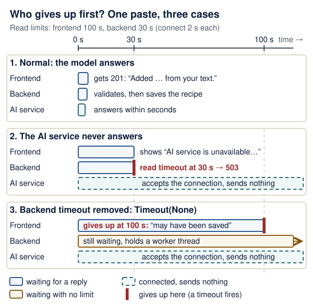
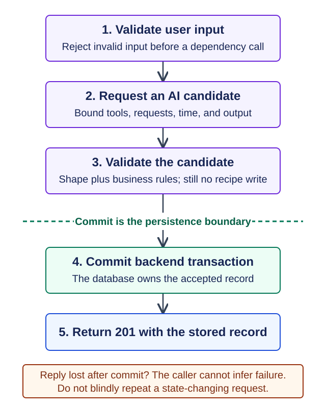
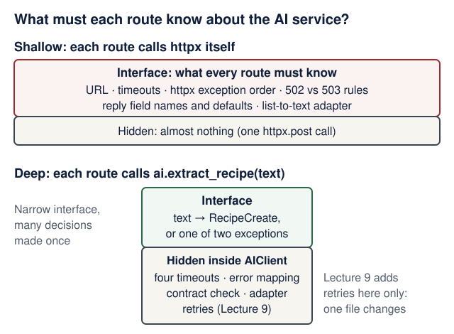

# Lecture 7 · The third service and its contract

<!--  -->
[← Course home](../README.md) · [← Previous: Lecture 6](06-pydantic-ai-agents.md) · [Next: Lecture 8 →](08-docker-compose.md)

> **At a glance**
>
> - **When:** Monday 30 November 2026, 16:00 Israel time, on Zoom
> - **You leave with:** a working frontend → backend → AI service flow, with tests for its failures
> - **Goals:** say what the service boundary buys and costs; validate both sides of the contract; follow the timeout budget across hops and show that, once the stack is up, an AI outage leaves CRUD usable ([details](#learning-checkpoint))
> - **Prerequisites:** Lecture 3's backend suite and Lecture 6's `ai-service` suite pass; repair: [Monoliths, services, and microservices](../guides/engineering-foundations.md#monoliths-services-and-microservices)
> - **Product milestone:** EX2 due tonight, 23:59; if unfinished, submit it first; today's lab is not part of EX2. The third service called over HTTP is part of EX3 (due Mon 11 Jan 2027, 23:59).
> - **Time:** prerequisite check about 10 min before class; lab about 2 h after class (estimate)
> - **Done when:** `uv run pytest` in `backend/` passes (Recipe Box: `22 passed`), and with the AI service stopped a paste shows a calm message while the Recipes tab still works

<details markdown="1" class="lecture-toc">
<summary>On this page</summary>

- [Mission](#mission)
- [Before you start](#before-you-start)
- [Learning checkpoint](#learning-checkpoint)
- [Concepts](#concepts)
- [Live demo](#live-demo)
- [Hands-on lab](#hands-on-lab)
- [Break it on purpose](#break-it-on-purpose)
- [Open-source track](#open-source-track)
- [Working with AI assistants](#working-with-ai-assistants)
- [Completion check](#completion-check)
- [Quick quiz](#quick-quiz)
- [Stretch goals](#stretch-goals)
- [Common pitfalls](#common-pitfalls)
- [Instructor notes](#instructor-notes)
- [Read more](#read-more)

</details>

## Mission

Today your three services start talking. A user pastes messy recipe text into the browser. The frontend sends it to the backend, the backend asks the AI service, checks the answer against a contract and saves a clean recipe. Then you unplug the AI service on purpose. The user should see a calm "try again in a minute", not a stack trace or a spinner that never stops.

## Before you start

> **Prerequisite check:** about 10 minutes, ungraded. Each check takes about a minute.
>
> | Check | Pass when | Repair |
> |---|---|---|
> | In `backend/`, run `uv run pytest` | it passes (Recipe Box: `12 passed`) | [Lecture 3 completion check](03-persistence-and-first-pr.md#completion-check) |
> | In `ai-service/`, run `uv run pytest` | it passes with no API key (Recipe Box: `6 passed`) | [Lecture 6 completion check](06-pydantic-ai-agents.md#completion-check) |
> | In `frontend/`, run `grep -n httpx streamlit_app.py` | it prints nothing: every HTTP call lives in `api.py` | [Lecture 5 lab](05-frontend-reliability-testing.md#hands-on-lab) |
> | Say what `app.dependency_overrides[get_session] = ...` does in Lecture 3's `conftest.py` | "routes get the test's session instead of the real one; the route code itself does not change" | [Tests with pytest](../guides/engineering-foundations.md#tests-with-pytest) |
> | Say when the frontend raises `BackendUnavailable` and when `BackendNoAnswer` | "nothing was sent" versus "sent, but the outcome is unknown" | [Lecture 5 concepts](05-frontend-reliability-testing.md#concepts) |

You need:

- A persistent, tested backend from [Lecture 3](03-persistence-and-first-pr.md).
- A frontend whose HTTP calls all live in `api.py`, from [Lecture 5](05-frontend-reliability-testing.md).
- An `ai-service/` with `POST /extract` and `TestModel` tests, from [Lecture 6](06-pydantic-ai-agents.md).
- Your EX2 work committed and submitted. Today builds on it; EX2 itself does not need the AI flow.

<details markdown="1">
<summary>Words you'll meet today</summary>

- **Contract:** everything a caller relies on: method, path, request body, response body, status codes and error shape.
- **Consumer:** the side that calls an API and depends on its contract. Here the backend consumes the AI service's `POST /extract`.
- **Schema snapshot:** a copy of the other service's published OpenAPI schema, saved in your repository so a test can compare against it.
- **Timeout phase:** one of httpx's four separate limits: connect, write, read and pool.
- **`502 Bad Gateway`:** "the service behind me answered with something I cannot use."
- **`503 Service Unavailable`:** "a service I depend on is not available right now; try later."
- **`httpx.MockTransport`:** a fake network. Each request goes to a Python function you write, and nothing leaves your machine.
- **Factory fixture:** a pytest fixture that returns a *function*, so each test decides how the fake behaves.
- **Adapter:** code that translates one service's shapes into another's, such as lists into the backend's comma-separated `tags`.
- **Worker thread:** FastAPI runs each plain `def` route in a thread from a fixed-size pool; a stuck request keeps its thread.

</details>

<details markdown="1">
<summary>Python you will read today</summary>

| You will read | What it means here | Repair |
|---|---|---|
| `def install(handler): ... return calls` inside a fixture | A function defined inside another one. `install` can still use `calls` after the fixture has returned: that is a **closure**. | [Python you need to read](../guides/engineering-foundations.md#python-you-need-to-read) |
| `raise AIServiceUnavailable(...) from exc` | Raise your own exception and keep the original one attached as its cause, for the log and the traceback. | [Python tutorial: exception chaining](https://docs.python.org/3.14/tutorial/errors.html#exception-chaining) |
| `except httpx.HTTPStatusError` **before** `except httpx.HTTPError` | Python uses the first matching `except`. `HTTPStatusError` is a subclass of `HTTPError`, so the narrow clause must come first. | [The `try` statement](https://docs.python.org/3.14/reference/compound_stmts.html#the-try-statement) |
| `yield client` then `finally: client.close()` in `get_ai_client` | A generator dependency: FastAPI runs the code before `yield` before the route, and the `finally` part after the response. | [FastAPI: dependencies with yield](https://fastapi.tiangolo.com/tutorial/dependencies/dependencies-with-yield/) |

</details>

**Check yourself:** this fixture returns `install`, not a value. What does the test get when it asks for `fake_ai`, and where does the list `calls` live?

```python
@pytest.fixture
def fake_ai(client):
    calls = []

    def install(handler):
        ...
        return calls

    return install
```

<details markdown="1">
<summary>Check your answer</summary>

The test gets the function `install`. It calls `fake_ai(handler)` to choose how the fake AI service behaves in *that* test. `calls` is created once per test, inside the fixture; `install` and the recording function inside it keep a reference to it (a closure), so the test can read how many requests were made.

</details>

## Learning checkpoint

By the end, you should be able to:

- Explain why this service boundary is useful and which network and operational costs it introduces.
- Validate the request and response contract, including compatibility and documented failures.
- Follow the timeout budget across callers and demonstrate that, once the stack is up, an AI outage leaves ordinary CRUD usable.

**Predict first:** If the caller times out, do you know whether the remote operation completed? What evidence would you seek?

<details markdown="1">
<summary>Check your prediction</summary>

No. A timeout only means the caller stopped waiting. The AI service may still finish the extraction and spend tokens; if the frontend gives up first, the backend may still save the recipe. Evidence lives on the other side: the AI service's log for the extraction, and the backend's log line plus a `GET /recipes` for the saved row. [Is it safe to repeat?](09-failures-evals-costs.md#is-it-safe-to-repeat) in Lecture 9 turns this into a retry rule.

</details>

> **Warm-up from earlier classes:** answer from memory, then check. Ungraded.
>
> 1. (Lecture 5) After a `POST`, the frontend raises `BackendNoAnswer`. Why must the user reload before trying again?
> 2. (Lecture 3) Why do the backend tests override `get_session` instead of using the real database file?
> 3. (Lecture 6) `TestModel` returns a recipe titled `a`. What does a passing `TestModel` test prove, and what does it not prove?

<details markdown="1">
<summary>Check your answers</summary>

1. The request was sent, so the backend may already have saved the recipe. Trying again blindly can create a duplicate; reloading shows whether it exists.
2. Tests must be fast, isolated and repeatable: each one gets a fresh in-memory database, and nothing touches your real `app.db`.
3. It proves the wiring: the agent, its tools, validators and the endpoint fit together and return the declared type. It says nothing about whether a real model's answers are right; that is what Lecture 9's evaluation cases measure.

</details>

**Bridge if needed:** [Monoliths, services, and microservices](../guides/engineering-foundations.md#monoliths-services-and-microservices) and [Failure, retries, and asynchronous work](../guides/engineering-foundations.md#failure-retries-and-asynchronous-work).

## Concepts

### Why a separate process

Lecture 6 put the agent in its own project; today the backend calls it over HTTP. The process boundary buys you:

- **Independent deploys:** change prompts or providers without redeploying the backend.
- **Independent scaling:** run more copies of the slow part only.
- **A separate failure domain:** bounded calls let the backend report an AI outage while ordinary CRUD remains usable. Resource exhaustion can still propagate, so separation alone is not a resilience guarantee.
- **Contained secrets:** only the AI service holds provider keys.

**How exhaustion propagates here.** The route and its dependencies are plain `def` functions, so FastAPI runs each request in a worker thread from AnyIO's pool, which holds 40 threads by default (checked 17 October 2026: [FastAPI: concurrency and async](https://fastapi.tiangolo.com/async/), [AnyIO: worker threads](https://anyio.readthedocs.io/en/stable/threads.html)). A paste that waits on a silent AI service keeps its thread until the wait ends. Explicit timeouts are what give the thread back, and so what keep the AI failure domain separate from CRUD.

**Optional:** with `TIMEOUT = httpx.Timeout(None)` and 40 pastes waiting on a silent AI service, does `GET /recipes` still answer?

<details markdown="1">
<summary>Check your prediction</summary>

No. `GET /recipes` is also a plain `def` route, so it needs a worker thread too, and all 40 are waiting for the AI service. The list request queues until a thread frees, which never happens without a timeout. Timeouts are the primary fix; an async client (a stretch goal) is a second one, because waiting on `await` holds no thread.

</details>

The backend is a reception desk. Visitors (the frontend) talk only to reception, which checks the request, calls the specialist in the back office (the AI service), checks the answer, and files the result.

This is a small service-based architecture for learning microservice boundaries. A separate service adds network, compatibility, testing, and operational work; a modular monolith can be appropriate outside this assignment. Read the [architecture tradeoffs](../guides/engineering-foundations.md#monoliths-services-and-microservices) and justify a boundary by responsibility and independent operation, rather than container count.

```text
browser -> frontend :8501 --HTTP--> backend :8000 --HTTP--> ai-service :8001
backend -> SQLite   (only the backend touches it)
```

### HTTP contracts

A contract is everything a caller relies on: method, path, request body, response body, status codes and error shape.

| Part | Recipe Box |
|---|---|
| Request | `POST /extract` with `{"text": "..."}`: 1–5000 characters after trimming spaces, no other fields |
| Success | `200` with `title`, `minutes`, `servings`, `ingredients` (a list), `tags` (a list) |
| Bad request | `422` with FastAPI's `{"detail": [...]}` |

**Both sides hold a Pydantic model of it.** The AI service owns `RecipeExtraction` in `app/schemas.py`; the backend keeps its *own copy* in `app/ai_client.py`, because the projects deploy separately. The backend uses its copy to **validate the response**: never assume another service's JSON is right.

**Versioning mindset.** Adding an optional response field is safe, because the backend's copy of `RecipeExtraction` has no `extra="forbid"`, so it ignores fields it does not know. Renaming, removing or retyping a field is a *breaking* change. Either update every consumer first, or serve the new shape at a new path (`/v2/extract`) while the old one keeps working.

**Contract tests** catch drift, each kind in its own place: *consumer tests* fake the AI service with `httpx.MockTransport`, and a *schema check* compares the backend's models with a snapshot of the AI service's published OpenAPI schema. A snapshot is only as fresh as its last regeneration: if nobody regenerates it after an AI-service change, the check compares against the past.

| Drift on the AI-service side | MockTransport consumer tests | Schema snapshot test | Live run of all three |
|---|---|---|---|
| Add an optional response field | pass (correct: it is compatible) | pass | works |
| Rename a field (`minutes` → `total_minutes`) | still pass: they fake the old shape | fail, once the snapshot is regenerated | every paste returns `502` |
| Tighten the request limit (`max_length=2000`) | still pass | fail, once regenerated (the request assertion) | `502` only for texts of 2001–5000 characters |
| Change a type (`minutes` becomes a string) | still pass | fail, once regenerated | `502` when the value is not a whole number |

The consumer tests prove *your* code handles each answer correctly; only the snapshot or a live run notices that the other side changed.

### Explicit timeouts

Lecture 4 gave the frontend timeouts. Every outbound call needs one, and httpx has four phases:

| Phase | What it limits | Recipe Box |
|---|---|---|
| `connect` | Opening the connection | 2 s: a local service that takes longer is down |
| `write` | Sending each chunk of the request | 5 s |
| `read` | Waiting for each chunk of the response | 30 s: models think slowly |
| `pool` | Waiting for a free connection in the client's pool (matters when one client is shared; ours is created per request) | 2 s |

Two traps: httpx's default (5 s per phase) is too short for a model, and `timeout=None` waits forever. Also, `read` limits the gap *between* chunks, not the total; [Lecture 9](09-failures-evals-costs.md) adds a total deadline inside the AI service. Plan a **budget across hops**: the frontend waits longer than the backend does, so the backend reports the error first.

<figure class="course-diagram">
  <div class="diagram-scroll" role="region" tabindex="0" aria-label="Timeout budget diagram, scroll horizontally">
    
  </div>
  <figcaption><strong>Who gives up first?</strong> The backend's 30 s read limit is inside the frontend's 100 s, so the backend reports a silent AI service. Remove it and the frontend gives up instead, while the backend keeps waiting. <span class="screen-only">On a narrow screen, scroll the diagram sideways.</span> <a href="../assets/diagrams/l07-timeout-budget.svg">Open the diagram at full size</a>.</figcaption>
</figure>

<details markdown="1">
<summary>Text version of the diagram</summary>

Limits: the frontend waits up to 100 s for the backend's reply; the backend waits up to 30 s between chunks of the AI service's reply; both connect within 2 s.

1. **Normal.** The AI service answers in seconds. The backend validates and saves the recipe and returns `201`; the frontend shows "Added … from your text."
2. **The AI service accepts the connection but never answers.** At about 30 s the backend's read timeout fires and it answers `503 {"detail": "AI service unavailable"}`. The frontend, still well inside its 100 s, shows "AI service is unavailable, try again in a minute."
3. **The backend's timeout is removed (`httpx.Timeout(None)`).** The backend waits with no limit and keeps one worker thread busy. At 100 s the frontend's own read timeout fires: the request was sent, so it raises `BackendNoAnswer` and shows "The backend did not answer in time. Your change may have been saved. …". The backend is still waiting after the user has been told.

</details>

The walkthrough's [Budget time across the whole request](../guides/system-walkthrough.md#budget-time-across-the-whole-request) adds retries and backoff to the same arithmetic.

### Service errors without leaking internals

| What happened | Backend answers |
|---|---|
| Refused, DNS failure, timeout, or a 5xx from the AI service | `503 {"detail": "AI service unavailable"}` |
| A 4xx from the AI service, or a `200` whose body breaks the contract | `502 {"detail": "AI service returned invalid output"}` |
| The user's text is empty, only spaces, too long or has extra fields | `422`; the AI service is never called |

`503 Service Unavailable` means "a dependency isn't available; try later". `502 Bad Gateway` means "the server behind me answered with garbage". A 4xx is a 502 too: the backend already validated the user's text, so a rejected request means the two services disagree about the contract. The contract folds timeouts into 503 instead of `504 Gateway Timeout`, because the user's next step is the same.

Keep `detail` fixed. Never send `str(exc)` to the client: it can reveal internal hostnames and URLs. Details belong in *your* log instead. `raise ... from exc` keeps the original error attached, but FastAPI doesn't log a handled `HTTPException`; add `logger.warning("AI call failed: %r", exc)` before the `raise` if you want the cause in the log. **No retries today;** Lecture 9 adds them and refines this table.

<details markdown="1">
<summary>Looking ahead to Lecture 9</summary>

Once the AI service maps its own failures, two rows change. Its `502` (output still invalid after the agent's own retries) becomes a backend `502` instead of `503`, and its `429` (the run's usage budget is spent) becomes a backend `503` instead of `502`. Retries then live in exactly one layer, the backend's `AIClient`.

</details>

**Where the outcome becomes certain.** The backend saves only after a valid extraction, in one local transaction. Before that commit nothing is stored; after it, a lost reply does not mean the save failed.

<figure class="course-diagram">
  <div class="diagram-scroll" role="region" tabindex="0" aria-label="Commit boundary diagram, scroll horizontally">
    
  </div>
  <figcaption><strong>Predict: the reply is lost after commit; what does the user know?</strong> Read the steps above the dashed commit line, then below it. <span class="screen-only">On a narrow screen, scroll the diagram sideways.</span> <a href="../assets/diagrams/commit-boundary.svg">Open the diagram at full size</a>.</figcaption>
</figure>

<details markdown="1">
<summary>Text version of the diagram</summary>

1. Validate the user's input; reject it before any dependency call. Empty text exits with `422`.
2. Ask the AI service for a candidate recipe, with bounded time. An unreachable AI service exits with `503`.
3. Validate the candidate (shape and business rules). Invalid output exits with `502`. Still nothing is written.
4. **Commit** the recipe in the backend's own transaction (the dashed `session.commit()` line). This is the commit boundary.
5. Return `201 Created` with the stored recipe.

A failure in steps 1–3 leaves no new recipe. If the reply is lost after step 4, the caller cannot tell success from failure.

</details>

<details markdown="1">
<summary>Check your prediction</summary>

Nothing certain. The recipe is stored, but the user saw a timeout. In Recipe Box the frontend says "Your change may have been saved. Reload the page and check before trying again." because a blind retry could save a second copy. [Follow the commit boundary](../guides/system-walkthrough.md#follow-the-commit-boundary) in the walkthrough draws the same line for the whole request.

</details>

## Live demo

The AI service from Lecture 6 stays as it is. All changes are in the backend and the frontend.

**1. The request model.** *State the contract.* Append to `backend/app/models.py` (`ConfigDict`, `Field` and `SQLModel` are already imported there):

```python
# backend/app/models.py (append)
class FromTextRequest(SQLModel):
    """POST /recipes/from-text body: free text for the AI service to read."""

    model_config = ConfigDict(extra="forbid", str_strip_whitespace=True)

    text: str = Field(min_length=1, max_length=5000)
```

`str_strip_whitespace=True` trims the text before the length check, as in Lecture 3's `RecipeCreate`, so a body of spaces is a `422` and never costs a model call.

**2. The client.** *Make the smallest change.* The backend now makes outbound HTTP calls, so declare what you import. From `backend/`:

```bash
uv add httpx
```

`httpx` may already be installed as a dependency of another package; relying on that breaks the day that package changes. Then create the client: one class, two exceptions, a timeout per phase, and a transport that tests can replace.

```python
# backend/app/ai_client.py
"""Backend -> ai-service client: explicit timeouts and typed errors (no retries yet)."""

import os
from collections.abc import Iterator
from typing import Annotated

import httpx
from fastapi import Depends
from pydantic import BaseModel, Field, ValidationError

from app.models import RecipeCreate

AI_SERVICE_URL = os.getenv("AI_SERVICE_URL", "http://localhost:8001")

# Every outbound call gets a timeout per phase. Connect fast; let the model think.
TIMEOUT = httpx.Timeout(connect=2.0, read=30.0, write=5.0, pool=2.0)


class RecipeExtraction(BaseModel):
    """The ai-service contract: what POST /extract must return."""

    title: str = Field(min_length=1, max_length=200)
    minutes: int = Field(ge=1, le=24 * 60)
    servings: int = Field(default=2, ge=1, le=50)
    ingredients: list[str] = Field(min_length=1)
    tags: list[str] = Field(default_factory=list)


class AIServiceUnavailable(Exception):
    """ai-service unreachable, timing out, or failing with a 5xx."""


class AIServiceBadOutput(Exception):
    """ai-service answered, but not with something we can use."""


class AIClient:
    def __init__(
        self,
        base_url: str = AI_SERVICE_URL,
        transport: httpx.BaseTransport | None = None,  # tests pass MockTransport
    ) -> None:
        self._http = httpx.Client(
            base_url=base_url, timeout=TIMEOUT, transport=transport
        )

    def close(self) -> None:
        self._http.close()

    def extract_recipe(self, text: str) -> RecipeCreate:
        try:
            response = self._http.post("/extract", json={"text": text})
            response.raise_for_status()
        except httpx.HTTPStatusError as exc:  # it answered, with an error status
            code = exc.response.status_code
            if code < 500:  # 4xx: it rejected our request, so the contract broke
                raise AIServiceBadOutput(f"ai-service returned {code}") from exc
            raise AIServiceUnavailable(f"ai-service returned {code}") from exc
        except httpx.HTTPError as exc:  # timeouts, refused connections, DNS
            raise AIServiceUnavailable(f"ai-service unreachable: {exc!r}") from exc
        try:
            extraction = RecipeExtraction.model_validate_json(response.content)
            # Translate their contract into our model (and validate it again).
            return RecipeCreate(
                title=extraction.title,
                minutes=extraction.minutes,
                servings=extraction.servings,
                ingredients="\n".join(extraction.ingredients),
                tags=",".join(extraction.tags),
            )
        except ValidationError as exc:
            raise AIServiceBadOutput("ai-service response broke the contract") from exc


def get_ai_client() -> Iterator[AIClient]:
    client = AIClient()
    try:
        yield client
    finally:
        client.close()


AIClientDep = Annotated[AIClient, Depends(get_ai_client)]
```

Point out the **adapter** at the end: the AI service speaks lists, the backend stores newline- and comma-separated strings, and the result is validated again as a `RecipeCreate`. `get_ai_client` is a dependency, like `get_session` in Lecture 3, so tests can swap it.

**3. The route.** *Make the smallest change.* Add it to `backend/app/main.py`, importing `FromTextRequest` from `app.models` and `AIClientDep`, `AIServiceBadOutput` and `AIServiceUnavailable` from `app.ai_client`:

```python
# backend/app/main.py (add the route)
@app.post(
    "/recipes/from-text",
    response_model=RecipePublic,
    status_code=status.HTTP_201_CREATED,
)
def create_recipe_from_text(
    body: FromTextRequest, session: db.SessionDep, ai: AIClientDep
) -> Recipe:
    try:
        new_recipe = ai.extract_recipe(body.text)
    except AIServiceUnavailable as exc:
        raise HTTPException(
            status.HTTP_503_SERVICE_UNAVAILABLE, detail="AI service unavailable"
        ) from exc
    except AIServiceBadOutput as exc:
        raise HTTPException(
            status.HTTP_502_BAD_GATEWAY, detail="AI service returned invalid output"
        ) from exc
    return save(session, Recipe.model_validate(new_recipe))
```

The slow AI call happens before any database write. Never hold a write transaction open across a network call: a slow model would hold the database lock and stall unrelated requests.

**4. Tests without a network.** *Break it and watch the check fail.* `httpx.MockTransport` passes each request to your function, so the "AI service" is a lambda. `fake_ai` is a *factory fixture*: it returns a function, so each test chooses how the fake AI service behaves. `calls` lives in the fixture and the inner `recording` function appends to it, so the test can count requests, and an empty list proves the AI service was never called.

```python
# backend/tests/test_from_text.py
"""POST /recipes/from-text with the ai-service faked by httpx.MockTransport."""

import json

import httpx
import pytest

from app.ai_client import TIMEOUT, AIClient, get_ai_client
from app.main import app

# The same good extraction as Lecture 6's tests: what POST /extract returns.
GOOD = {
    "title": "Hummus",
    "minutes": 15,
    "servings": 4,
    "ingredients": ["chickpeas", "tahini"],
    "tags": ["vegan"],
}


@pytest.fixture
def fake_ai(client):
    """fake_ai(handler) routes the backend's ai-service calls to handler(request)."""
    calls: list[httpx.Request] = []

    def install(handler):
        def recording(request: httpx.Request) -> httpx.Response:
            calls.append(request)
            return handler(request)

        ai = AIClient("http://ai-service", transport=httpx.MockTransport(recording))
        app.dependency_overrides[get_ai_client] = lambda: ai
        return calls

    return install


def post_text(client, text="Hummus: chickpeas, tahini. 15 min."):
    return client.post("/recipes/from-text", json={"text": text})


def test_ai_down_is_503(client, fake_ai):
    def refuse(request):
        raise httpx.ConnectError("connection refused", request=request)

    calls = fake_ai(refuse)
    r = post_text(client)
    assert r.status_code == 503
    assert r.json() == {"detail": "AI service unavailable"}
    assert len(calls) == 1  # no retries yet (Lecture 9)
    assert client.get("/recipes").json() == []  # nothing half-saved


def test_broken_contract_is_502(client, fake_ai):
    fake_ai(lambda request: httpx.Response(200, json={"name": "Hummus"}))
    r = post_text(client)
    assert r.status_code == 502
    assert r.json() == {"detail": "AI service returned invalid output"}


@pytest.mark.parametrize(
    ("ai_status", "expected"),
    [
        pytest.param(500, 503, id="crash-500"),  # its failure: unavailable
        pytest.param(422, 502, id="our-bug-422"),  # a 4xx: we broke the contract
    ],
)
def test_ai_error_status(client, fake_ai, ai_status, expected):
    fake_ai(lambda request: httpx.Response(ai_status))
    assert post_text(client).status_code == expected


def test_timeouts_are_explicit():
    phases = (TIMEOUT.connect, TIMEOUT.read, TIMEOUT.write, TIMEOUT.pool)
    assert phases == (2.0, 30.0, 5.0, 2.0)
    ai = AIClient()
    assert ai._http.timeout == TIMEOUT
    ai.close()
```

<details markdown="1">
<summary>Show the other backend tests (paste them below the excerpt)</summary>

These complete the file: success (the stored row and the exact JSON sent), a read timeout, and invalid input that never reaches the AI service. `GOOD` and `import json` at the top of the excerpt are used here.

```python
# backend/tests/test_from_text.py (continued)
def test_success_stores_the_recipe(client, fake_ai):
    calls = fake_ai(lambda request: httpx.Response(200, json=GOOD))
    r = post_text(client)
    assert r.status_code == 201
    saved = r.json()
    assert saved["ingredients"] == "chickpeas\ntahini"  # the adapter ran
    assert saved["tags"] == "vegan"
    assert client.get(f"/recipes/{saved['id']}").json() == saved  # really stored
    [sent] = calls  # exactly one call to the ai-service
    assert (sent.method, sent.url.path) == ("POST", "/extract")
    assert json.loads(sent.content) == {"text": "Hummus: chickpeas, tahini. 15 min."}


def test_ai_timeout_is_503(client, fake_ai):
    def slow(request):
        raise httpx.ReadTimeout("model took too long", request=request)

    calls = fake_ai(slow)
    r = post_text(client)
    assert r.status_code == 503
    assert r.json() == {"detail": "AI service unavailable"}
    assert len(calls) == 1
    assert client.get("/recipes").json() == []


@pytest.mark.parametrize(
    "text",
    [pytest.param("", id="empty"), pytest.param("  \n\t ", id="whitespace-only")],
)
def test_invalid_text_makes_no_ai_call(client, fake_ai, text):
    calls = fake_ai(lambda request: httpx.Response(200, json=GOOD))
    assert post_text(client, text).status_code == 422
    assert calls == []  # rejected at the edge: no model call, no cost
```

With the excerpt, `test_from_text.py` holds 9 tests.

</details>

**Predict:** before you run `uv run pytest` in `backend/`, imagine you deleted the whole `except httpx.HTTPStatusError` block from `extract_recipe`. Which of the two `test_ai_error_status` cases would still pass?

<details markdown="1">
<summary>Check your prediction</summary>

Only `crash-500`. `HTTPStatusError` is a subclass of `HTTPError`, so without its own clause the next one catches it and every error status becomes `AIServiceUnavailable`, a `503`. That is right for a 500 and wrong for a 422, so `our-bug-422` fails with `assert 503 == 502`. The order of the two `except` clauses is part of the contract.

</details>

Now run `uv run pytest` in `backend/`. With the whole file (the excerpt plus the other tests), Recipe Box prints `21 passed` at this point (10 CRUD, 2 restart, 9 from-text); lab step 6 adds the contract test.

> **Investigate:** answer from the code, then check.
>
> 1. `extract_recipe` validates the reply with `RecipeExtraction` and then builds a `RecipeCreate`. Why validate twice?
> 2. The AI service answers `200` with `"minutes": 0`. What does the backend return, and which line decides?
> 3. Why does `test_ai_down_is_503` end with `client.get("/recipes").json() == []`?

<details markdown="1">
<summary>Show model answers</summary>

1. The first check is *their* contract (lists, limits); the second is *ours* (the stored strings and the backend's own limits). The two can differ, and only the second protects the database.
2. `502 AI service returned invalid output`. `RecipeExtraction.model_validate_json` raises `ValidationError` (`minutes` must be at least 1), the client raises `AIServiceBadOutput`, and the route maps it to 502. Nothing is saved.
3. It proves the failure left nothing behind: no half-saved row. The route saves only after a successful, valid extraction.

</details>

**Trace it:** the AI service is stopped and the user presses "Extract with AI". Fill in the cells marked "?" before opening the answer.

| Step | File : function | Input | State after | Next call |
|---|---|---|---|---|
| 1 | `frontend/api.py` : `create_from_text` | the pasted text | `POST /recipes/from-text` is sent to the backend | the backend's route |
| 2 | `backend/app/main.py` : `create_recipe_from_text` | a valid `FromTextRequest` | nothing saved yet | `ai.extract_recipe(body.text)` |
| 3 | `backend/app/ai_client.py` : `extract_recipe` | `httpx.ConnectError` (refused) | ? | ? |
| 4 | `backend/app/main.py` : `create_recipe_from_text` | `AIServiceUnavailable` | ? | FastAPI sends the response |
| 5 | `frontend/api.py` : `_request` | a `503` response | ? | the paste form's `except api.BackendError` shows it |

<details markdown="1">
<summary>Check your answer</summary>

- Step 3: the second `except` catches it; next call: `raise AIServiceUnavailable("ai-service unreachable: ConnectError(...)")`.
- Step 4: `HTTPException(503, detail="AI service unavailable")` is raised; `save` never runs, so no row exists.
- Step 5: `response.is_error` is true, so `_request` raises `BackendError(_friendly(response))` with "AI service is unavailable, try again in a minute."

</details>

**5. The frontend flow.** *Make the smallest change.* In the Lecture 5 `frontend/api.py`, replace `_friendly` with the complete function below, then add `AI_TIMEOUT` and `create_from_text`. Keep the existing imports, types, exception classes, `_request`, `_json` and CRUD functions; this is a file edit, not a standalone replacement module.

```python
# frontend/api.py (replace _friendly; add AI_TIMEOUT and create_from_text)
# from-text waits for the AI: allow more than the backend's own 30 s read
# timeout, so the backend (not the browser) reports a slow AI service.
AI_TIMEOUT = httpx.Timeout(100.0, connect=2.0)


def _friendly(response: httpx.Response) -> str:
    match response.status_code:
        case 422:
            problems = [
                f"{err['loc'][-1]}: {err['msg']}" for err in response.json()["detail"]
            ]
            return "Please fix: " + "; ".join(problems)
        case 404:
            return "That recipe no longer exists. Reload the page."
        case 503:
            return "AI service is unavailable, try again in a minute."
        case 502:
            return "AI returned something unusable. Try rewording the recipe text."
        case code:  # any other status; the pattern names it `code`
            return f"The backend failed ({code}). Check its logs."


def create_from_text(text: str) -> Recipe:
    return _json(
        _request("POST", "/recipes/from-text", json={"text": text}, timeout=AI_TIMEOUT)
    )
```

In `frontend/streamlit_app.py`, replace the tabs line with the following, then append the form below:

```python
# frontend/streamlit_app.py (replace the tabs line)
browse, add, paste = st.tabs(
    ["Recipes", "Add a recipe", "Paste a recipe"],
    key="recipe-tabs",
    on_change="rerun",
)
```

The stable key and `on_change="rerun"` track the selected tab in session state. A failed submission stays on “Paste a recipe”, where the error and the user's text remain visible, instead of returning to the first tab and hiding the message. Switching tabs now reruns the script; the forms still batch input until submission. A successful save announces its result above the tabs; choose “Recipes” to inspect the fresh list. This uses the [Streamlit 1.66 tab-state API](https://docs.streamlit.io/develop/api-reference/layout/st.tabs), checked 18 October 2026.


```python
# frontend/streamlit_app.py (append)
with paste, st.form("paste"):
    text = st.text_area("Recipe text", height=200, max_chars=5000, key="paste-text")
    if st.form_submit_button("Extract with AI", key="paste-submit", width="stretch"):
        try:
            with st.spinner("Asking the AI service..."):
                created = api.create_from_text(text)
        except api.BackendError as exc:
            st.error(str(exc))
        else:
            notify(f"Added {plain(created['title'])} from your text.")
```

The title came from a model, so it goes through Lecture 4's `plain()` like any user text.

<details markdown="1">
<summary>Show the two frontend tests for the new tab</summary>

They use Lecture 5's `backend` fixture and `start_app` helper. Add them to `frontend/tests/test_app.py`:

```python
# frontend/tests/test_app.py (add)
PASTE = "Hummus: chickpeas, tahini. 15 min."
AI_ERRORS = {
    503: "AI service is unavailable, try again in a minute.",
    502: "AI returned something unusable. Try rewording the recipe text.",
}


def test_paste_success(backend):
    saved = {
        "id": 4,
        "title": "Hummus",
        "minutes": 15,
        "servings": 4,
        "ingredients": "chickpeas\ntahini",
        "tags": "vegan",
    }
    post = backend.post("/recipes/from-text").mock(
        return_value=httpx.Response(201, json=saved)
    )
    at = start_app(backend, [])
    at.session_state["recipe-tabs"] = "Paste a recipe"
    at.run()
    at.text_area(key="paste-text").input(PASTE)
    at.button(key="paste-submit").click().run()
    assert json.loads(post.calls.last.request.content) == {"text": PASTE}
    assert at.success[0].value == "Added Hummus from your text."


@pytest.mark.parametrize("status", [503, 502])
def test_paste_shows_ai_errors(backend, status):
    reply = httpx.Response(status, json={"detail": "fixed text from the backend"})
    backend.post("/recipes/from-text").mock(return_value=reply)
    at = start_app(backend, [])
    at.session_state["recipe-tabs"] = "Paste a recipe"
    at.run()
    at.text_area(key="paste-text").input(PASTE)
    at.button(key="paste-submit").click().run()
    assert not at.exception
    assert at.error[0].value == AI_ERRORS[status]
    assert at.session_state["recipe-tabs"] == "Paste a recipe"
    assert at.text_area(key="paste-text").value == PASTE
```

They add three tests to your frontend suite (one success, two parametrized error cases).

</details>

**6. Run all three**, one terminal each, starting from the repo root. *Observe the real result.*

```bash
cd ai-service
uv run fastapi dev --port 8001
```

```bash
cd backend
uv run fastapi dev
```

```bash
cd frontend
uv run streamlit run streamlit_app.py
```

Paste a recipe. With `AI_MODEL` unset, `TestModel` returns placeholder data, such as a recipe titled `a`.

**Predict:** you stop the AI service with Ctrl+C and paste again. What does the UI show, after how long, and does the Recipes tab still work?

<details markdown="1">
<summary>Check your prediction</summary>

At once, not after 30 seconds: "AI service is unavailable, try again in a minute." Nothing listens on port 8001, so the connection is refused immediately (`ConnectError`); no read timeout is involved. The Recipes tab still works, because `GET /recipes` never calls the AI service.

</details>

## Hands-on lab

Apply this to **your** domain: your names, the same shape. Run each command from the directory the step names.

> **EX3 progress:** a third service that your backend calls over HTTP, with tests for its failures, is a required part of EX3 (due Mon 11 Jan 2027, 23:59). Today's lab is not part of EX2.

**Core today**

1. **Write the contract** in your README as a three-row table. **Checkpoint:** a classmate could call your AI service from it alone.
2. **Add the request model** in `backend/app/models.py`, with length limits, `extra="forbid"` and `str_strip_whitespace=True`.
3. **Create the client.** From `backend/`, run `uv add httpx`, then create `app/ai_client.py` with your response model, a four-phase `httpx.Timeout`, two exceptions and an injectable `transport`. **Checkpoint:** `uv run python -c "from app.ai_client import TIMEOUT; print(TIMEOUT)"` prints all four phases.
4. **Add the route**, mapping the exceptions to 503 and 502 with fixed `detail` text.
5. **Write MockTransport tests.** From `backend/`, in `tests/test_from_text.py`: success (the row is stored), refused → 503, read timeout → 503, a 4xx or a broken body → 502, empty and whitespace-only input → 422 with zero calls. **Checkpoint:** `uv run pytest` passes with Wi-Fi off, and deleting the route's `except AIServiceUnavailable` makes at least one test fail.

**Finish before next meeting**

6. **Add the schema check.** Generate a snapshot of the AI service's published contract with no server running. From the repository root:

   ```bash
   cd ai-service
   uv run python -c "import json; from app.main import app; print(json.dumps(app.openapi()))" > ../backend/tests/ai_openapi.json
   ```

   **Checkpoint:** `head -c 60 ../backend/tests/ai_openapi.json` starts with `{"openapi":`. An empty file means the command failed; read its error above. (Prefer curl against a running service? Use `curl -fsS localhost:8001/openapi.json -o tests/ai_openapi.json` from `backend/`: `-f` fails loudly instead of saving an error page.)

   ```python
   # backend/tests/test_contract.py
   """The backend's copy of the contract must match what the ai-service publishes."""

   import json
   from pathlib import Path

   from app.ai_client import RecipeExtraction
   from app.models import FromTextRequest

   # A snapshot is only as fresh as its last regeneration: regenerate it after
   # every ai-service change (Lecture 7, lab step 6).
   PUBLISHED = json.loads((Path(__file__).parent / "ai_openapi.json").read_text())
   SCHEMAS = PUBLISHED["components"]["schemas"]


   def fields(schema: dict) -> dict:
       """Field names, types and limits. Titles and descriptions do not matter."""
       return {
           name: {k: v for k, v in rules.items() if k not in ("title", "description")}
           for name, rules in schema["properties"].items()
       }


   def test_backend_and_ai_service_agree():
       # Response: each field we read must exist on their side, same type and limits.
       # Extra fields on their side are fine: our model ignores unknown fields.
       ours = fields(RecipeExtraction.model_json_schema())
       theirs = fields(SCHEMAS["RecipeExtraction"])
       assert {name: theirs.get(name) for name in ours} == ours
       # Request: the text we accept must be exactly the text they accept.
       our_text = fields(FromTextRequest.model_json_schema())["text"]
       assert fields(SCHEMAS["ExtractRequest"])["text"] == our_text
   ```

   It checks *compatibility* in both directions: a new optional response field passes; a renamed, removed or retyped field fails, and so does a request limit that no longer matches. **Checkpoint:** `uv run pytest` in `backend/` prints `22 passed` for Recipe Box (yours differs; nothing fails).
7. **Wire the frontend:** the `api.py` function with a longer timeout, a form with a spinner, plain-word 503/502 messages, and the two AppTest tests. **Checkpoint:** `uv run pytest` in `frontend/` passes.
8. **Run all three**, finish the flow, then stop the AI service and retry.
9. **README:** data-flow diagram, start commands, error table, and how to regenerate `ai_openapi.json`.

**Extension:** the design studio below, then the [stretch goals](#stretch-goals).

### Design studio: deep or shallow client

In class, about 20 minutes, formative and ungraded. Inspired by the design-review practice of [Stanford CS190](https://web.stanford.edu/~ouster/cs190-winter24/) (information hiding and deep modules); the exercise is our own.

Here is a design the course does **not** use. It works, and it is shorter:

```python
# backend/app/main.py (a shallow design, for discussion only)
@app.post("/recipes/from-text", response_model=RecipePublic, status_code=201)
def create_recipe_from_text(body: FromTextRequest, session: db.SessionDep) -> Recipe:
    try:
        reply = httpx.post(f"{AI_URL}/extract", json={"text": body.text}, timeout=30)
        reply.raise_for_status()
    except httpx.HTTPStatusError as exc:
        code = 502 if exc.response.status_code < 500 else 503
        raise HTTPException(code, detail="AI service problem") from exc
    except httpx.HTTPError as exc:
        raise HTTPException(503, detail="AI service unavailable") from exc
    data = reply.json()
    recipe = Recipe(
        title=data["title"],
        minutes=data["minutes"],
        servings=data.get("servings", 2),
        ingredients="\n".join(data["ingredients"]),
        tags=",".join(data["tags"]),
    )
    return save(session, recipe)
```

1. **List the facts.** In pairs, list every fact the route must know in this design (URL, timeouts, error classes, status rules, field names, the adapter). Then list what the route must know in the course design, where it calls `ai.extract_recipe(body.text)`.
2. **Predict the change.** Lecture 9 adds bounded retries. How many files change in each design if Recipe Box gains a second AI route, such as "suggest tags"?
3. **Find what is lost.** Which check from the course design is missing here? What happens if the AI service returns `"minutes": 0`, or no `title`?
4. **Explain without the assistant.** If an assistant wrote any function in your `ai_client.py`, close the chat and explain that function to your partner: what it is *for*, and which failure it prevents.

<figure class="course-diagram">
  <div class="diagram-scroll" role="region" tabindex="0" aria-label="Deep versus shallow module diagram, scroll horizontally">
    
  </div>
  <figcaption><strong>Interface width versus hidden decisions.</strong> The top edge of each box is what a caller must know; the area below is what the module decides for it. <span class="screen-only">On a narrow screen, scroll the diagram sideways.</span> <a href="../assets/diagrams/l07-deep-vs-shallow.svg">Open the diagram at full size</a>.</figcaption>
</figure>

<details markdown="1">
<summary>Text version of the diagram</summary>

- **Shallow design:** each route calls `httpx` itself, so every route must know the URL, four timeouts, the httpx exception order, the 502-versus-503 rules, the response field names and the list-to-text adapter. The module hides almost nothing.
- **Deep design:** each route calls `ai.extract_recipe(text)` and gets a `RecipeCreate` or one of two exceptions. Timeouts, error classification, contract validation, the adapter and (from Lecture 9) retries are hidden inside `AIClient`, so a change to any of them touches one file.

</details>

<details markdown="1">
<summary>What a strong answer mentions</summary>

1. Shallow: the URL and its environment variable, the timeout, the httpx exception hierarchy and order, which statuses mean 502 or 503, the reply's field names and defaults, and the list-to-text adapter. Course design: one method, its input, its return type and two exception names.
2. Course design: one file, `ai_client.py` (plus its tests), however many routes call it; Lecture 9's retry decorator really is added there. Shallow: every route that calls `httpx`, and each route's tests, so a second AI route doubles the edit and the chance of the two drifting apart.
3. The response contract check. `Recipe(...)` is a table model, and SQLModel table models do not validate their input, so `"minutes": 0` is saved as is; a missing `title` raises `KeyError`, which the client sees as a `500`. The course design rejects both as `502` before anything is stored.
4. A purpose answer names the failure: "`extract_recipe` turns every way the AI call can go wrong into one of two exceptions, so routes never see httpx and never save unchecked data", not a line-by-line reading.

</details>

## Break it on purpose

The loop: make it fail, read the exact error, explain it, fix it, keep a test that catches it.

**Drill 1: the silent service.** Save this outside your repo and run it with `python3 silent_service.py`:

```python
# silent_service.py (a scratch file, outside your repo)
import socket
import time

server = socket.create_server(("127.0.0.1", 8009))
conn, _ = server.accept()  # keep the connection open (and never answer)
time.sleep(600)
```

From `backend/`, restart the backend with `AI_SERVICE_URL=http://localhost:8009 uv run fastapi dev`, keep the frontend running, and paste a recipe.

**Predict:** what does the UI show, and roughly when?

<details markdown="1">
<summary>Check your prediction</summary>

After about 30 seconds: "AI service is unavailable, try again in a minute." The connection opened, so the connect limit did not fire; the backend's 30 s `read` limit did, and the route answered 503 well inside the frontend's 100 s.

</details>

Now set `TIMEOUT = httpx.Timeout(None)` in `ai_client.py` (the dev server reloads), restart `silent_service.py`, and paste again.

**Predict:** who gives up first this time, what does the user read, and what is the backend doing?

<details markdown="1">
<summary>Check your prediction</summary>

The frontend gives up, after 100 s: its own read timeout fires on a `POST`, so `api.py` raises `BackendNoAnswer` and the UI says "The backend did not answer in time. Your change may have been saved. Reload the page and check before trying again." The backend is still waiting, holding one worker thread, and its terminal shows **no** `POST /recipes/from-text` line yet: the access log is written only when a response is sent. Stop `silent_service.py` with Ctrl+C; the backend's request then ends with `503` in its log. Run `uv run pytest`: `test_timeouts_are_explicit` fails with `assert (None, None, None, None) == (2.0, 30.0, 5.0, 2.0)`. Restore the timeout.

</details>

**Drill 2: the quiet rename.** In `ai-service/app/schemas.py`, rename `minutes` to `total_minutes`; `fastapi dev` reloads.

**Predict:** what does a paste return now, and do your backend tests still pass?

<details markdown="1">
<summary>Check your prediction</summary>

Pasting returns `502 AI service returned invalid output`, and your MockTransport tests **still pass**, because they fake the old shape.

</details>

Regenerate `backend/tests/ai_openapi.json` (lab step 6) and run `uv run pytest` in `backend/`.

<details markdown="1">
<summary>Show the expected output</summary>

The contract test fails, and the diff shows `{'minutes': None} != {'minutes': {'maximum': 1440, 'minimum': 1, 'type': 'integer'}}`. **Why:** the snapshot now describes the renamed field, so the backend's copy no longer matches. Rename the field back and regenerate `ai_openapi.json` again.

</details>

**Drill 3: no error mapping.** Replace the route's `try`/`except` with a direct `ai.extract_recipe(body.text)`, stop the AI service and paste. Before you look, write a **Debug log** entry for what you see, using the card in [Debug with a hypothesis](../guides/engineering-foundations.md#debug-with-a-hypothesis).

**Debug log:** fill lines 1–3 (symptom, reproduce, hypothesis) *before* you open the backend's terminal or ask anyone; then lines 4–7.

<details markdown="1">
<summary>Show the expected output</summary>

The UI says "The backend failed (500). Check its logs.", curl gets `Internal Server Error`, and the backend log ends in `AIServiceUnavailable: ai-service unreachable: ConnectError('[Errno 61] Connection refused')` (errno 111 on Linux). `test_ai_down_is_503` and its neighbors fail. **Why:** an exception that escapes a route becomes a generic 500. A good hypothesis line: "the client's exception is not mapped to an HTTP status in the route." Put the mapping back.

</details>

## Open-source track

This week is **review follow-up** on PRs #1 and #2. List them with `gh search prs --author=@me --state=open`, as in [Lecture 5](05-frontend-reliability-testing.md). Then, for each one:

```bash
gh pr checks https://github.com/OWNER/REPO/pull/NUMBER
gh pr view https://github.com/OWNER/REPO/pull/NUMBER --comments
```

1. Fix failing checks first; maintainers often skip a PR whose CI is red.
2. Answer every review comment yourself: push the change, or politely explain your alternative.
3. Silent for a week or more (or what CONTRIBUTING says), and you haven't pinged yet? One short ping, or the channel CONTRIBUTING names.
4. Pick the issue for PR #3, which you open next week, and reproduce it now. The star rule is checked again on the day you open the PR, so note the repository's current star count but re-check it then.
5. Update your [evidence table](../README.md#evidence-table). Only [merged PRs count](../README.md#what-counts-as-merged).

## Working with AI assistants

**Pattern 1: client from a contract.** Give the assistant a bounded work order in the course's [work-order format](../guides/agent-driven-development.md#one-work-order-template):

```text
Outcome:      POST /recipes/from-text returns 503 {"detail": "AI service unavailable"}
              when the ai-service refuses the connection
Files:        backend/app/ai_client.py, backend/app/main.py, backend/tests/test_from_text.py
Non-goals:    no retries; no change to ai-service/ or to the CRUD routes
Verify with:  uv run pytest (from backend/), all passing with Wi-Fi off
Review focus: the order of the except clauses, the timeout values, the fixed detail text
Acceptance:   test_ai_down_is_503 fails before the change (500 instead of 503)
Stop:         if a change outside the listed files seems necessary, stop and report
```

*Verify:* run your MockTransport tests, then search the diff for `timeout=None`, a bare `except Exception`, and `str(exc)` in a response. Read every `except` line yourself.

**Pattern 2: failure modes first.** "List every way this call can fail, from DNS to a malformed body. For each, give the status my backend should return and one MockTransport test." *Verify:* compare the list with the [error table](#service-errors-without-leaking-internals), then break the code once per test to prove each test can fail.

**Spot the outdated suggestion:**

- `requests.post(url, json=...)` with no timeout. requests waits forever by default.
- `httpx.AsyncClient(app=app)`. The `app=` argument was removed in httpx 0.28; use `transport=httpx.ASGITransport(app=app)`.
- "Just import the agent in the backend." It runs, but it is not a third service.

Note the tools and checks in your [AI-use note](../README.md#working-method-ai-use-assessment-and-reproducibility).

## Completion check

From `backend/`, run `uv run pytest`. Recipe Box shows `22 passed` (10 CRUD, 2 restart, 9 from-text, 1 contract); your count differs, but nothing fails or is skipped. With all three services running:

```bash
curl -s localhost:8000/recipes/from-text \
  -H "Content-Type: application/json" \
  -d '{"text": "Hummus: chickpeas, tahini. 15 min."}'
```

Expected: a JSON recipe with an `id`. Stop the AI service and repeat. Expected: `{"detail":"AI service unavailable"}` at once, not after 30 seconds.

| Must work | Evidence you keep | If it fails, repair here |
|---|---|---|
| `uv run pytest` in `backend/` passes with Wi-Fi off | the terminal output in your PR description | [Live demo](#live-demo), step 4 · [Tests with pytest](../guides/engineering-foundations.md#tests-with-pytest) |
| Tests cover success, 503 (refused, timeout, 5xx), 502 (4xx, broken body) and 422 with zero calls | the test names | [Hands-on lab](#hands-on-lab), step 5 |
| `test_contract.py` passes against a freshly generated `ai_openapi.json` | the regeneration command in your README | [Hands-on lab](#hands-on-lab), step 6 |
| With the AI service stopped, a paste shows a friendly message at once and the Recipes tab still works | a screenshot or a one-line note | [Common pitfalls](#common-pitfalls) |
| `uv run pytest` in `frontend/` passes, including the paste tests | the terminal output | [Live demo](#live-demo), step 5 |

**Not yet?** Repair and re-run before starting the next lecture's lab; later layers assume this one works.

- [ ] Paste, spinner, then the new recipe in the list.
- [ ] Your README has the contract table, the data flow, the run commands and the snapshot command.
- [ ] EX2 is submitted through the submission channel provided by the instructor.

## Quick quiz

<details markdown="1">
<summary>Q1. Which counts as your third service: an imported agent class, Redis, a separate FastAPI app called over HTTP, or SQLite?</summary>

The FastAPI app. An imported agent class runs inside the backend's process, so it deploys, scales and fails with the backend. Redis and SQLite are infrastructure: they store data but do no application work.

</details>

<details markdown="1">
<summary>Q2. The AI service answers 200 with {"name": "Hummus"}. What does the backend return?</summary>

**502** `{"detail": "AI service returned invalid output"}`. The service was reachable, so 503 would be wrong. Its body broke the contract: `model_validate_json` raised `ValidationError`, the client raised `AIServiceBadOutput`, and nothing was saved.

</details>

<details markdown="1">
<summary>Q3. Your read timeout is 30 s. The AI service sends one byte every 10 seconds for five minutes. When does the request fail?</summary>

It doesn't. The read timeout limits the wait for *each chunk*, and a byte arrives every 10 seconds. Capping the total time needs a separate deadline around the whole call. Lecture 9 adds one inside the AI service (25 s around the agent run); a deadline around the backend's own call is one of [Lecture 9's stretch goals](09-failures-evals-costs.md#stretch-goals).

</details>

<details markdown="1">
<summary>Q4. (Lecture 2) A user submits {"text": "   "}. What status comes back, and does the AI service see it?</summary>

**422**, and no. `str_strip_whitespace=True` trims the text to `""`, `min_length=1` rejects it, and FastAPI validates the body before your function runs. Rejecting at the edge is cheaper than a model call; `test_invalid_text_makes_no_ai_call` asserts `calls == []` for both the empty and the whitespace-only case.

</details>

<details markdown="1">
<summary>Q5. (Lecture 3) Why do backend tests override get_ai_client instead of starting the real AI service?</summary>

For the same reason they override `get_session`: tests must be fast, deterministic and free of other processes. Each service tests its own side. The AI service uses `TestModel` and `FunctionModel`, the backend uses `MockTransport`, and the schema check ties the two together.

</details>

**Explain it:** in one sentence, what is `AIClient.extract_recipe` *for*? (Not what each line does.)

<details markdown="1">
<summary>Show a model answer</summary>

Weak (line by line): "It posts the text to `/extract`, calls `raise_for_status`, catches two kinds of httpx errors, validates the JSON and builds a `RecipeCreate`."

Strong (purpose and the failure it prevents): "It is the one place that turns an unreliable remote extraction into either a validated `RecipeCreate` or one of two named failures, so routes never handle network errors or store unchecked AI output."

</details>

> **Defend it:** the contract maps an AI-service `422` to a backend `502` (not `500`), and a timeout to `503` (not `504 Gateway Timeout`). Defend one of these choices with one reason from the contract, name one cost, and say which test would change if you chose the other code.

<details markdown="1">
<summary>What a strong answer mentions</summary>

- **422 → 502:** the backend already validated the user's text, so a rejection means the two services disagree; `502` says "the service behind me answered with something unusable", while `500` would blame the backend's own code and hide where to look. Cost: the user cannot fix a `502` by rewording if the real cause is a contract bug. Switching to `500` changes the `our-bug-422` case of `test_ai_error_status`.
- **Timeout → 503:** the user's next step is the same as for a refused connection ("try again later"), so one status keeps the frontend simple. Cost: monitoring cannot tell "slow" from "down" by status code alone; the log must say which. Switching to `504` changes `test_ai_timeout_is_503` and the frontend's `_friendly`, which would need a `504` case.

</details>

## Stretch goals

Optional, after the completion check passes and EX2 is submitted.

- **Trace IDs:** generate an `X-Request-ID` in the backend, forward it, and log it in both services. Sensible once you debug across two terminals.
- **One shared client:** create one `AIClient` in the backend's lifespan and share it across requests. Now connections are reused and the `pool` timeout matters; close the client when the app shuts down. **Simpler is enough:** the per-request client is correct for the course's traffic.
- **Async client:** `httpx.AsyncClient` and an `async def` route, with the same tests passing. A waiting request then holds no worker thread. **Simpler is enough:** explicit timeouts already bound the threads a slow AI service can hold.
- **Version the contract:** serve `/v2/extract` with one renamed field, keep `/extract`, then migrate the backend.
- **Snapshot in CI:** after Lecture 10, add a CI step that regenerates `ai_openapi.json` and runs `git diff --exit-code backend/tests/ai_openapi.json`, so a stale snapshot fails the build.

## Common pitfalls

- **Every paste returns 503 at once** → the AI service is down or `AI_SERVICE_URL` has the wrong port → start it with `--port 8001`; check with `curl localhost:8001/health`.
- **A from-text test passes only while your AI service runs** → no override was installed, so the test called the real service → use `fake_ai`, and make sure `client` clears `app.dependency_overrides`.
- **`422` "Input should be a valid dictionary"** → you sent a bare string → send `{"text": "..."}`.
- **Every paste returns 502 after an AI-service change** → the contract drifted → regenerate `ai_openapi.json`, run the contract test, update one side on purpose.
- **`json.decoder.JSONDecodeError: Expecting value: line 1 column 1 (char 0)` when collecting `test_contract.py`** → `ai_openapi.json` is empty because the command that wrote it failed (for example, `curl -s` with no service running) → regenerate it with lab step 6 and check that it starts with `{"openapi":`.
- **"The backend failed (500)"** → an exception escaped the route → map it to 503 or 502.
- **"The backend did not answer in time. Your change may have been saved."** on a paste → the browser gave up first: the frontend's timeout is shorter than the backend's, or the backend has none → keep `AI_TIMEOUT` longer than the backend's read timeout, and never use `httpx.Timeout(None)`.

## Instructor notes

Suggested flow, with a minute budget (estimate):

1. (5 min) Ask Q1 cold. **Peer-instruction vote:** "Which counts as the third service?" Vote, discuss in pairs, vote again. Then the reception-desk analogy and the diagram.
2. (10 min) The contract table, then both `RecipeExtraction` models side by side: why does the backend keep a copy? The drift table: which check catches which change?
3. (20 min) Live-code `ai_client.py`. Pause at `TIMEOUT` and let students guess what each phase limits; show the timeout-budget figure.
4. (15 min) Write `test_ai_down_is_503` *before* the `except` blocks. Watch it fail, then pass. Collect predictions for the deleted-`HTTPStatusError` question before running.
5. (10 min) Add the paste tab, run all three services, collect predictions, then kill the AI service while the class watches.
6. (10 min) Drill 1 live: the 30-second wait, then (shortened by narration) the `Timeout(None)` case.
7. (20 min) Design studio in pairs, if time allows.
8. (5 min) OSS follow-up round, and a reminder of the EX2 deadline tonight.

**Core path if time runs short:** steps 2, 3, 4 and 5; assign the design studio and the drills with the lab.

**Exit ticket:** "The reply to a paste is lost after the backend committed. What does the user see, and what should they do next?"

Emphasize that the backend validates the AI service's *response*. Students get stuck on overrides leaking between tests (a missing `.clear()`), on an empty `ai_openapi.json`, and are tempted to put `str(exc)` in `detail`.

## Read more

**Before the lab (≤15 min):** [HTTPX: timeouts](https://www.python-httpx.org/advanced/timeouts/). Read it with two questions: (1) which of the four limits would fire if the AI service accepted the connection and never answered? (2) what does `timeout=None` mean, and why is it never right for a call to another service?

**Go deeper (optional):**

- [HTTPX: transports, including MockTransport](https://www.python-httpx.org/advanced/transports/)
- [FastAPI: handling errors](https://fastapi.tiangolo.com/tutorial/handling-errors/) and [testing dependencies with overrides](https://fastapi.tiangolo.com/advanced/testing-dependencies/)
- [MDN: 502 Bad Gateway](https://developer.mozilla.org/en-US/docs/Web/HTTP/Reference/Status/502) and [503 Service Unavailable](https://developer.mozilla.org/en-US/docs/Web/HTTP/Reference/Status/503)
- [Visual system walkthrough: one request, end to end](../guides/system-walkthrough.md): this checkpoint as one picture, with service ownership, validation, the commit boundary and failure evidence.
- [Further study](../guides/further-study.md): course sites on lost replies and end-to-end checks.

---

[← Course home](../README.md) · [← Previous: Lecture 6](06-pydantic-ai-agents.md) · [Next: Lecture 8 →](08-docker-compose.md)

<!--  -->
