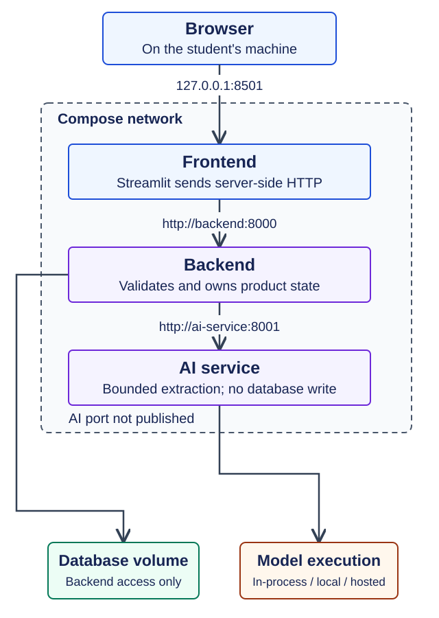
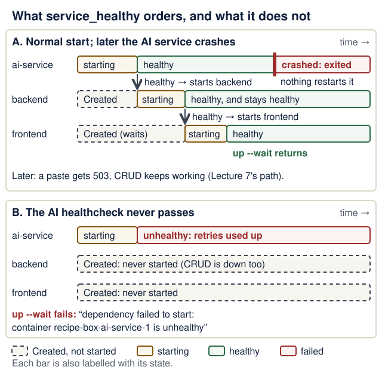

# Lecture 8 · Docker Compose

<!--  -->
[← Course home](../README.md) · [← Previous: Lecture 7](07-third-service-contracts.md) · [Next: Lecture 9 →](09-failures-evals-costs.md)

> **At a glance**
>
> - **When:** Monday 7 December 2026, 16:00 Israel time, on Zoom. HIT's Hanukkah holiday is Sunday 6 December; this class runs as normal
> - **You leave with:** the whole stack starting with one command; third upstream PR opened
> - **Goals:** locate code, configuration, addresses, credentials and data in the stack; explain service DNS, published ports and health ordering, and their limits; start from a clean checkout ([details](#learning-checkpoint))
> - **Prerequisites:** Lecture 7 works (`uv run pytest` passes in `backend/`) and Lecture 3's backend image builds; repair: [Containers in one page](../guides/engineering-foundations.md#containers-in-one-page)
> - **Product milestone:** EX3 (due Mon 11 Jan 2027, 23:59) requires Docker Compose for all three services; today's `compose.yaml` is that part
> - **Time:** prerequisite check about 10 min before class; lab about 2 h after class (estimate)
> - **Done when:** a fresh clone with no `.env` reaches three healthy services with `docker compose up --build --wait`

<details markdown="1" class="lecture-toc">
<summary>On this page</summary>

- [Mission](#mission)
- [Before you start](#before-you-start)
- [Learning checkpoint](#learning-checkpoint)
- [Concepts](#concepts)
- [Live demo](#live-demo)
- [Hands-on lab](#hands-on-lab)
- [Break it on purpose](#break-it-on-purpose)
- [Open-source track](#open-source-track)
- [Working with AI assistants](#working-with-ai-assistants)
- [Completion check](#completion-check)
- [Quick quiz](#quick-quiz)
- [Stretch goals](#stretch-goals)
- [Common pitfalls](#common-pitfalls)
- [Instructor notes](#instructor-notes)
- [Read more](#read-more)

</details>

## Mission

Lecture 7 needed three terminals and a good memory for ports. Today one file replaces all of it. A grader clones your repository, runs `docker compose up --build`, opens <http://localhost:8501> and pastes a recipe: no API keys, no setup beyond Docker. Then you delete the containers, bring them back, and your data is still there.

## Before you start

> **Prerequisite check:** about 10 minutes, ungraded. Each check takes about a minute.
>
> | Check | Pass when | Repair |
> |---|---|---|
> | Run `docker compose version` | it prints `Docker Compose version v2.24` or newer (see the note below) | [Lecture 1](01-environment-git-docker-ai.md#docker-images-and-containers) · [student setup](../guides/student-setup.md) |
> | In `backend/`, run `docker build -t recipe-box-backend .` | it ends with `naming to docker.io/library/recipe-box-backend` and no error | [Lecture 3 completion check](03-persistence-and-first-pr.md#completion-check) |
> | In `backend/`, run `uv run pytest` | it passes (Recipe Box: `22 passed`) | [Lecture 7 completion check](07-third-service-contracts.md#completion-check) |
> | Read `-p 127.0.0.1:8000:8000` aloud | "port 8000 on my laptop's loopback forwards to port 8000 in the container" | [Containers in one page](../guides/engineering-foundations.md#containers-in-one-page) |
> | Say where `AI_MODEL` comes from when the AI service starts | "from an environment variable, read with `os.getenv`; `test` when it is unset" | [Configuration and environment variables](../guides/engineering-foundations.md#configuration-and-environment-variables) |

> **Version note:** `docker compose version` prints `Docker Compose version v2.24` or newer. Current Docker Desktop ships v5.x, which is the same `docker compose` plugin (Docker skipped v3 and v4). `docker-compose` with a hyphen is the retired v1; `'compose' is not a docker command` means the plugin is missing. Checked 17 October 2026 against the [Compose releases page](https://github.com/docker/compose/releases) (latest v5.6.0).

You need:

- The backend `Dockerfile`, `.dockerignore` and named volume from [Lecture 3](03-persistence-and-first-pr.md).
- The three-service flow and its tests from [Lecture 7](07-third-service-contracts.md).
- Docker Desktop running; on Windows, inside WSL2 with Ubuntu integration on.
- Stop Lecture 7's three dev servers. They hold ports 8000, 8001 and 8501.

<details markdown="1">
<summary>Words you'll meet today</summary>

Every term here is also in the course [glossary](../guides/engineering-foundations.md#glossary), next to the terms from the other lectures.

- **Service:** one entry under `services:` in `compose.yaml`; Compose runs one container for it (or more, if scaled).
- **Project:** everything Compose creates for one `compose.yaml`: containers, a network and volumes, all prefixed with the project name (`recipe-box`).
- **Service DNS name:** inside the project's network, each service name (`backend`, `ai-service`) resolves to that service's container.
- **Published port:** a host port forwarded into a container (`ports:`). An unpublished port is reachable only from other containers.
- **Bind address:** the address a server listens on. `0.0.0.0` accepts connections from anywhere that can reach the container; `127.0.0.1` only from inside it.
- **Healthcheck:** a command Docker runs inside the container every few seconds; its result is the container's health (`starting`, `healthy`, `unhealthy`).
- **Named volume:** storage Docker keeps outside every container, mounted at a path; it survives `docker compose down`.
- **Interpolation:** Compose replacing `${NAME:-default}` in `compose.yaml` while reading the file, before any container exists.

</details>

## Learning checkpoint

By the end, you should be able to:

- Locate code, configuration, network addresses, credentials, and persistent data in the Compose stack.
- Explain service DNS, published ports, health/startup ordering, and the limits of those controls.
- Start from a clean checkout and distinguish a data-preserving restart from a deliberate reset.

**Predict first:** A service was healthy at startup and later fails. What does `depends_on` guarantee, and what must the application still handle?

<details markdown="1">
<summary>Check your prediction</summary>

`depends_on` with `condition: service_healthy` only orders **startup**: the backend's container is created and started after the AI service first reports healthy. After that, Compose does nothing: if the AI service crashes, the backend keeps running and stays healthy, and nothing restarts the AI service unless you set a `restart:` policy. The application must handle the failure at request time, which is exactly Lecture 7's `503` path: the paste fails politely and CRUD keeps working.

</details>

> **Warm-up from earlier classes:** answer from memory, then check. Ungraded.
>
> 1. (Lecture 3) What survives `docker rm -f` of the backend container: the image, the volume, or the data inside the container's own filesystem?
> 2. (Lecture 7) With the AI service stopped, what does the backend answer to `POST /recipes/from-text`, and how quickly?
> 3. (Lecture 1) Inside a container, what does `localhost` refer to?

<details markdown="1">
<summary>Check your answers</summary>

1. The image and the named volume survive; anything written inside the container's own filesystem is gone with the container. That is why the database file lives in the volume.
2. `503 {"detail": "AI service unavailable"}`, at once: the connection is refused, so no timeout is involved.
3. The container itself: its own network namespace, not your laptop and not another container.

</details>

**Bridge if needed:** [Containers in one page](../guides/engineering-foundations.md#containers-in-one-page) (images, containers, volumes, ports, bind addresses), [Configuration and environment variables](../guides/engineering-foundations.md#configuration-and-environment-variables), and Lecture 1's [images and containers](01-environment-git-docker-ai.md#docker-images-and-containers).

## Concepts

### One file instead of three terminals

Compose reads `compose.yaml` and creates a network, the volumes and one container per service. Each Lecture 7 habit has a place in the file:

| Lecture 7, by hand | `compose.yaml` |
|---|---|
| `cd ai-service && uv run fastapi dev --port 8001` | a service with `build: ./ai-service` |
| `AI_SERVICE_URL=...` in your shell | `environment:` |
| `localhost:8001` | `http://ai-service:8001` (the service name) |
| `backend/data/app.db` | the named volume `backend-data` |
| waiting for "Application startup complete" | `healthcheck:` plus `depends_on` |

`name: recipe-box` fixes the project name, so containers are called `recipe-box-backend-1` and so on. There is no `version:` key; it is obsolete.

### One Dockerfile per service

Every service reuses Lecture 3's uv pattern: a minor-version base tag (Lecture 10 pins it by digest) and a pinned uv, a cached dependency layer, `uv sync --locked` (it refuses a stale lockfile), a non-root user (uid 10001) and an exec-form `CMD`. Only the data directory, the port and the start command differ. `.dockerignore` keeps `.venv`, `.env` and `tests` out.

Two lines in each Dockerfile are easy to misread. `EXPOSE 8001` only documents a port; it publishes nothing (only `ports:` in Compose does). `--host 0.0.0.0` in the `CMD` makes the server accept connections from other containers; with `127.0.0.1`, only processes inside the same container could connect ([Dockerfile reference: `EXPOSE`](https://docs.docker.com/reference/dockerfile/#expose), checked 17 October 2026).

### Networking: where is localhost?

Every container has its **own** `localhost`: inside the backend, `localhost:8001` is the backend itself, where nothing listens. Compose puts all services on one network where **each service name is a DNS name**, so the backend calls `http://ai-service:8001`.

```text
your laptop                      compose network (one per project)
-----------                      ---------------------------------
browser -> localhost:8501 ->     frontend    :8501
                                    |  BACKEND_URL=http://backend:8000
curl    -> localhost:8000 ->     backend     :8000  -> volume backend-data (/app/data)
                                    |  AI_SERVICE_URL=http://ai-service:8001
(nothing at localhost:8001)      ai-service  :8001  (no ports: internal only)
```

`ports: ["HOST:CONTAINER"]` publishes a port on your laptop. Publish only what a person uses: the frontend, and the backend for `curl` and `/docs`. The AI service gets **no** `ports:`, so it is not published at `localhost:8001`. Other containers on the same network can still reach it; this is exposure reduction, not caller authentication. See [Docker's port-publishing rules](https://docs.docker.com/engine/network/port-publishing/) and Lecture 10's service-token example.

The file below binds the published ports to `127.0.0.1` for local demonstrations. Containers still use their service names internally. Deliberately exposing a product to other machines needs a separate deployment and access-control decision.

`BACKEND_URL` is `http://backend:8000` because Streamlit's Python runs *inside the frontend container*. A React app runs in the browser, so it would need the published `http://localhost:8000` plus CORS, or the proxy in the box below.

<figure class="course-diagram">
  <div class="diagram-scroll" role="region" tabindex="0" aria-label="Compose service boundaries, scroll horizontally">
    
  </div>
  <figcaption><strong>Choose the URL from the caller's location.</strong> Point to the caller before naming its destination. Solid arrows are the product's request path; the dashed arrow is your own curl or <code>/docs</code> check on the backend's loopback port. The model box is logical; TestModel runs inside the AI process. Predict what breaks if backend code calls localhost:8001, then use the <a href="../guides/system-walkthrough.md#read-the-service-map">walkthrough's diagnosis question</a>. <span class="screen-only">On a narrow screen, scroll the diagram sideways.</span> <a href="../assets/diagrams/service-boundaries.svg">Open the full-size service map</a>.</figcaption>
</figure>

<details markdown="1">
<summary>Text version of the diagram</summary>

1. **Browser** (on your laptop) opens `http://127.0.0.1:8501`, the frontend's published port.
2. **Frontend** container: Streamlit's Python calls `http://backend:8000` by service name, inside the Compose network.
3. **Backend** container calls `http://ai-service:8001` by service name. It alone reads and writes the database volume at `/app/data`.
4. **AI service** container: no published port, so nothing on your laptop reaches it. It runs the model: `TestModel` inside its own process, or a local or hosted model server over the network.
5. **Your terminal** (dashed, outside the network): `curl` and `/docs` reach the backend on `127.0.0.1:8000`, its loopback-only published port. This is an operator's check, not part of the product's path.

</details>

> **Optional:** a browser-side frontend (React, Vue) in Compose. A Node build stage compiles the static files; a small web server in the frontend container (for example nginx) serves them and forwards every `/api/...` request to `http://backend:8000`. The browser then talks only to the frontend's origin, so no CORS is needed, and the backend keeps its single loopback port for your own checks. Streamlit stays the worked example in this course.

**Apply the same address rule to a model endpoint.** The AI service is the caller of Ollama or another model server; a working URL from your laptop can still fail inside that container. Trace the [adapter boundary](06-pydantic-ai-agents.md#one-application-contract-several-provider-adapters), then use [the local-serving address guide](../guides/local-inference.md#place-local-serving-behind-the-adapter-boundary). The optional vLLM route is a deployment choice, not a replacement for Pydantic AI or a required fourth service. The clean-checkout demo below still uses `TestModel`.

### Volumes: where the SQLite file lives

The named volume `backend-data` is mounted at `/app/data`, and `DATABASE_URL` is `sqlite:////app/data/app.db`: `sqlite:///` plus the absolute path, four slashes. `docker compose down` removes containers and the network but **keeps volumes**; `down -v` deletes them too, and the seed runs again.

### Configuration: interpolation, `environment` and `env_file`

Two different mechanisms:

- **Interpolation:** Compose replaces `${AI_MODEL:-test}` while *reading the file*, from your shell first, then a `.env` file next to `compose.yaml`, then the default after `:-`.
- **Container variables:** `environment:` sets variables in one container; `env_file:` loads a file's lines into it, and `required: false` skips a missing file.

A clean checkout has no `.env`, so `AI_MODEL` is `test` (`TestModel`: no key, no cost). With a real model and key in `.env`, interpolation picks the model and `env_file` hands the key **only** to the AI service. Use defaults for non-secrets only.

### Health and readiness

A `healthcheck` runs a command inside the container every `interval`; after `retries` failures in a row it is `unhealthy` (failures during `start_period` don't count). `depends_on` with `condition: service_healthy` orders startup: AI service, then backend, then frontend. A bare `depends_on` waits only for *started*, not *ready*. `up --wait` blocks until all are healthy, which is what CI and graders use. The checks use Python's `urllib`, because `python:3.14-slim` has no curl.

The backend's `/health` deliberately **does not** call the AI service: an AI outage should not label otherwise usable CRUD as unhealthy. Lecture 7's 503 covers that feature failure. A stricter *readiness* check may test what the service cannot work without, such as its database. Compose startup ordering is not continuous failure recovery; an unhealthy check alone does not stop or restart this backend. The application must still handle later dependency failures.

**Restarts are a separate setting.** Without a `restart:` policy, a container whose process exits stays down. `restart: unless-stopped` restarts a process that exits, until you stop it yourself; Docker does not restart a container just because its healthcheck says `unhealthy` ([services reference: `restart`](https://docs.docker.com/reference/compose-file/services/#restart), checked 17 October 2026).

<figure class="course-diagram">
  <div class="diagram-scroll" role="region" tabindex="0" aria-label="Health gating diagram, scroll horizontally">
    
  </div>
  <figcaption><strong>Startup ordering is not failure handling.</strong> <code>service_healthy</code> decides when the next container starts; after that, the application handles failures. <span class="screen-only">On a narrow screen, scroll the diagram sideways.</span> <a href="../assets/diagrams/l08-health-gating.svg">Open the diagram at full size</a>.</figcaption>
</figure>

<details markdown="1">
<summary>Text version of the diagram</summary>

**A. Normal start, then the AI service crashes.**

1. `ai-service` starts; during `start_period` failed checks do not count; it becomes `healthy`.
2. Only then is `backend` started (`depends_on: ai-service: condition: service_healthy`); it becomes `healthy`.
3. Only then is `frontend` started; it becomes `healthy`, and `up --wait` returns.
4. Later the `ai-service` process crashes and exits. Nothing restarts it (no `restart:` policy). The backend stays `healthy`: a paste gets `503`, and CRUD keeps working.

**B. The AI healthcheck can never pass.**

1. `ai-service` starts, fails its check `retries` times in a row after `start_period`, and is marked `unhealthy`.
2. `backend` and `frontend` stay `Created`: their processes never start.
3. `up --wait` fails with `dependency failed to start: container recipe-box-ai-service-1 is unhealthy`. CRUD is unavailable too, because the backend is not running.

</details>

> **Defend it:** the course keeps `backend` → `ai-service` as `condition: service_healthy`, although Lecture 7 says an AI outage must leave CRUD usable. Startup gating fails fast on a deploy misconfiguration you want to notice at `up --wait`; after startup, an AI outage is handled at request time by the 503 path, so CRUD keeps working. Name one cost of this choice, and one situation in which you would choose differently.

<details markdown="1">
<summary>What a strong answer mentions</summary>

**Cost:** if the AI service cannot become healthy at startup (a bad image, a broken healthcheck, a wrong setting), CRUD is unavailable too, because the backend is never started (break-it drill 2). **When to choose differently:** when CRUD must start even with the AI service down, for example a demo machine with a flaky model setup: mark the dependency optional (`required: false`, see the [stretch goals](#stretch-goals)) and rely entirely on the 503 path. The course checker asserts the default, so keep `service_healthy` in your graded `compose.yaml`.

</details>

### Secrets

- Real keys live in `.env`, which is git-ignored and in every `.dockerignore`, so it reaches neither Git nor an image. Commit `.env.example` with names and placeholders only. No key ever goes in `compose.yaml` or a Dockerfile.
- `docker compose config` prints the resolved file **including values from `.env`**. Validate with `config --quiet`; never paste the full output anywhere.
- A pushed key is compromised. **Revoke and rotate it at the provider first**, then remove it; rewriting history alone is not enough ([GitHub: removing sensitive data](https://docs.github.com/en/authentication/keeping-your-account-and-data-secure/removing-sensitive-data-from-a-repository)).
- Compose `secrets:` mounts a file at `/run/secrets/<name>`. It is a stretch goal, because a missing file stops `up`.

## Live demo

**1. Two more Dockerfiles.** Copy `backend/Dockerfile` into `ai-service/` and `frontend/`. Neither needs the data directory, so drop the `mkdir`/`chown` part, then change the port. `ai-service/Dockerfile` (the `# syntax` line must stay first):

```dockerfile
# syntax=docker/dockerfile:1
FROM python:3.14-slim
COPY --from=ghcr.io/astral-sh/uv:0.13.1 /uv /uvx /bin/
ENV UV_COMPILE_BYTECODE=1 \
    UV_LINK_MODE=copy \
    UV_NO_DEV=1 \
    UV_PYTHON_DOWNLOADS=0 \
    PYTHONUNBUFFERED=1
WORKDIR /app

# 1) Dependencies only: cached until uv.lock changes.
RUN --mount=type=cache,target=/root/.cache/uv \
    --mount=type=bind,source=uv.lock,target=uv.lock \
    --mount=type=bind,source=pyproject.toml,target=pyproject.toml \
    uv sync --locked --no-install-project

# 2) Application code.
COPY . /app
RUN --mount=type=cache,target=/root/.cache/uv \
    uv sync --locked

# 3) Never run as root.
RUN useradd --create-home --uid 10001 appuser
USER appuser
ENV PATH="/app/.venv/bin:$PATH"
EXPOSE 8001
CMD ["fastapi", "run", "app/main.py", "--host", "0.0.0.0", "--port", "8001"]
```

The last lines of `frontend/Dockerfile` start Streamlit instead:

```dockerfile
EXPOSE 8501
CMD ["streamlit", "run", "streamlit_app.py", \
     "--server.address", "0.0.0.0", "--server.port", "8501"]
```

Each `.dockerignore` lists `.venv`, `__pycache__`, `.pytest_cache`, `.ruff_cache`, `.env` and `tests` (plus `e2e` for the frontend).

**2. The compose file**, at the repository root:

<figure class="file-example file-example--long" markdown="1">
<figcaption><span class="file-example-action">Create at repository root</span> <span class="file-example-path">compose.yaml</span></figcaption>

```yaml
# compose.yaml (Compose Specification: no top-level "version:" key)
name: recipe-box

services:
  ai-service:
    build: ./ai-service
    # No host port: reachable on the Compose network, not published at localhost:8001.
    env_file:
      - path: .env # your real settings and keys (git-ignored)
        required: false # a clean checkout has no .env and still starts
    environment:
      AI_MODEL: ${AI_MODEL:-test} # no key, no cost unless you choose a model
      PYDANTIC_AI_NO_BANNER: "1"
    healthcheck:
      # Slim images have no curl, so ask Python's standard library instead.
      test:
        - CMD
        - python
        - -c
        - >-
          import urllib.request;
          urllib.request.urlopen("http://localhost:8001/health", timeout=2)
      interval: 5s
      timeout: 3s
      retries: 10
      start_period: 10s

  backend:
    build: ./backend
    ports:
      - "127.0.0.1:${BACKEND_PORT:-8000}:8000" # host IP:host port:container port
    environment:
      DATABASE_URL: sqlite:////app/data/app.db # 4 slashes = absolute path
      AI_SERVICE_URL: http://ai-service:8001 # the service name is a DNS name
    volumes:
      - backend-data:/app/data # survives "down"; "down -v" deletes it
    depends_on:
      ai-service:
        condition: service_healthy
    healthcheck:
      test:
        - CMD
        - python
        - -c
        - >-
          import urllib.request;
          urllib.request.urlopen("http://localhost:8000/health", timeout=2)
      interval: 5s
      timeout: 3s
      retries: 10
      start_period: 10s

  frontend:
    build: ./frontend
    ports:
      - "127.0.0.1:${FRONTEND_PORT:-8501}:8501"
    environment:
      BACKEND_URL: http://backend:8000 # Streamlit calls the API server-side
    depends_on:
      backend:
        condition: service_healthy
    healthcheck:
      test:
        - CMD
        - python
        - -c
        - >-
          import urllib.request;
          urllib.request.urlopen("http://localhost:8501/_stcore/health", timeout=2)
      interval: 5s
      timeout: 3s
      retries: 10
      start_period: 10s

volumes:
  backend-data:
```

</figure>

`>-` is YAML for "fold these lines into one", so Compose receives one line of Python.

**3. Settings that stay out of Git:**

<figure class="file-example" markdown="1">
<figcaption><span class="file-example-action">Create template · placeholders only</span> <span class="file-example-path">.env.example</span></figcaption>

```bash
# .env.example: copy to .env (git-ignored) and edit. Never commit .env.
# "test" = Pydantic AI's TestModel: no network, no key, no cost.
AI_MODEL=test

# Optional real-model run (Lecture 6): set AI_MODEL=<provider>:<model>
# and that provider's key, e.g. OPENAI_API_KEY=... or ANTHROPIC_API_KEY=...
# Free and local: AI_MODEL=ollama:<model> and
# OLLAMA_BASE_URL=http://host.docker.internal:11434/v1

# Optional: other host ports if 8000 or 8501 are taken.
# BACKEND_PORT=8000
# FRONTEND_PORT=8501
```

</figure>

The root `.gitignore` lists `.env`; `git check-ignore .env` prints `.env` to confirm.

On Linux with Docker Engine (not Desktop), `host.docker.internal` resolves only if the ai-service also has `extra_hosts: ["host.docker.internal:host-gateway"]`, and Ollama must listen on the Docker bridge address: follow [Reach a host model server from Compose](../guides/local-inference.md#reach-a-host-model-server-from-compose). Never bind it to `0.0.0.0` on a shared network: Ollama's API has no login. A model's first answer after loading can take longer than the backend's 30 s read timeout, so send one request directly to Ollama before a demo (the [latency experiment](../guides/local-inference.md#latency-experiment) shows how slow a cold start is).

One frontend line changes too: Lecture 5's backend-down message in `frontend/api.py` still says `uv run fastapi dev in backend/`. Make it `"Start it (docker compose up) and reload the page."`, the command a grader now uses.

**4. Up.** *Observe the real result.* From the repository root, validate, then build and start. `up --build` keeps streaming logs, so leave it running:

```bash
docker compose config --quiet
docker compose up --build
```

In a second terminal, also from the repository root, look around. **Predict:** which of the two `curl` commands succeeds, and what does the other one print?

```bash
docker compose ps --format "table {{.Service}}\t{{.Status}}"
curl -s localhost:8000/health
curl -sS localhost:8001/health
```

<details markdown="1">
<summary>Check your prediction</summary>

`config --quiet` prints nothing when the file is valid, and `ps` shows `(healthy)` for all three. The first `curl` returns `{"status":"ok"}`; the second fails with `curl: (7) Failed to connect to localhost port 8001`, because the AI service is not published (`-S` makes curl show the error that `-s` alone hides). Paste a recipe at <http://localhost:8501>: it now crosses three containers.

</details>

**5. "Where is localhost?"** *Observe the real result.* **Predict:** what does each command print? Write both answers down before you run them.

```bash
docker compose exec backend python -c \
  "import urllib.request as u; print(u.urlopen('http://ai-service:8001/health').read())"
docker compose exec backend python -c \
  "import urllib.request as u; print(u.urlopen('http://localhost:8001/health').read())"
```

<details markdown="1">
<summary>Check your prediction</summary>

The first prints `b'{"status":"ok"}'`: `ai-service` is a DNS name on the Compose network. The second ends in `urllib.error.URLError: <urlopen error [Errno 111] Connection refused>`: inside the backend container, `localhost` is the backend itself, and nothing there listens on 8001.

</details>

**6. Keep or reset the data.** *Break it and watch the check fail.* Add a recipe in the browser. **Predict:** after `docker compose down` and `docker compose up -d --wait`, is it still there? And after `docker compose down -v` and `docker compose up -d --wait`?

<details markdown="1">
<summary>Check your prediction</summary>

After `down`, the recipe is still there: `down` removes containers and the network, but the named volume `backend-data` survives and is mounted again. After `down -v`, only the three seed recipes remain: the volume was deleted, so the seed ran on an empty database.

</details>

> **Investigate:** answer from `compose.yaml`, then check with a command.
>
> 1. Which line makes the backend start only after the AI service is healthy? Which command shows the order?
> 2. Which service can read `OPENAI_API_KEY` from `.env`, and which cannot?
> 3. Why does the frontend's URL use `backend:8000` and not `localhost:8000`?

<details markdown="1">
<summary>Show model answers</summary>

1. `depends_on: ai-service: condition: service_healthy` under `backend`. The `up` output shows `Waiting` and then `Healthy` for `ai-service` before the backend starts; `docker compose ps` shows how long each has been up.
2. Only `ai-service`: it alone has `env_file: .env`. Check with `docker compose exec backend printenv OPENAI_API_KEY`, which prints nothing and exits with status 1. Never print the key itself in a terminal you share or record.
3. Streamlit's Python runs inside the frontend container, where `localhost` is the frontend itself. `backend` is the service's DNS name on the Compose network.

</details>

### Commands you will use every day

| Command | What it does |
|---|---|
| `docker compose up --build` | Build images, start everything, stream logs; Ctrl+C stops |
| `docker compose up --build --wait` | Start in the background and wait until all services are healthy |
| `docker compose up --build --wait --wait-timeout 180` | The same, but give up after 180 seconds instead of waiting forever on a service that never becomes healthy; what scripts and CI use |
| `docker compose ps` | Each service with its health and ports |
| `docker compose logs -f backend` | Follow one service's logs |
| `docker compose exec backend sh` | Open a shell inside a running container |
| `docker compose stop ai-service` | Stop one service; `start` brings it back |
| `docker compose down` | Remove containers and the network; **keep** volumes |
| `docker compose down -v` | Also delete volumes, **including your data** |
| `docker compose config --quiet` | Validate the file without printing it |

**What each command destroys.** Read across before you type anything that ends in `-v` or `-f`:

| Command | Containers | Network | Named volume (your data) | Image | `.env` |
|---|---|---|---|---|---|
| `docker compose stop` | stopped, kept | kept | kept | kept | kept |
| `docker compose down` | removed | removed | **kept** | kept | kept |
| `docker compose down -v` | removed | removed | **deleted** | kept | kept |
| `docker compose up --build` | replaced if the image changed | created if missing | kept | rebuilt | read, never changed |
| `docker rm -f recipe-box-backend-1` | that one removed | kept | kept | kept | kept |

No Compose command deletes `.env`; it is a file in your repository, and Git ignores it.

## Hands-on lab

Containerize **your** product. Use your own service names, and keep the shape. Plan your time:

- **Core today:** steps 1–6
- **Before Lecture 9:** steps 7–10
- **Extension (optional):** drill 4, "healthy but unreachable", in [Break it on purpose](#break-it-on-purpose), then the [Stretch goals](#stretch-goals)

> **EX3 progress:** EX3 (due Mon 11 Jan 2027, 23:59) requires Docker Compose as the way to run all three services. A clean clone that starts with `docker compose up --build --wait` and no `.env` is the evidence.

Run every `docker compose` command from the repository root, where `compose.yaml` lives.

**Core today:**

1. **Dockerfiles:** copy the backend's into each service directory; drop the data directory; change the port and `CMD` (keep `--host 0.0.0.0`); add `.dockerignore`. **Checkpoint:** `docker compose build` succeeds.
2. **`compose.yaml`:** three services, `name:` set, no `version:`, `ports:` only for the frontend and backend, both bound to `127.0.0.1`.
3. **Networking:** the backend calls your third service by its service name; the frontend uses `http://backend:8000` (or a proxy, for a browser-side framework), and its backend-down message now says `docker compose up`.
4. **Health:** a `urllib` healthcheck per service, and `depends_on` with `service_healthy`. **Checkpoint:** `docker compose up --build --wait` returns, and `ps` shows three `(healthy)`.
5. **Data:** a named volume and a four-slash `DATABASE_URL`.
6. **Settings:** `.env.example` committed, `.env` ignored, `env_file` with `required: false`, `${AI_MODEL:-test}`. **Checkpoint:** it starts with **no** `.env`.

**Before Lecture 9:**

7. **Run the full flow** in the browser, AI feature included.
8. **Restart test:** data survives `down` and `up`; `down -v` resets to the seed. **Checkpoint:** you can say which row of the "What each command destroys" table you just used.
9. **Peer review (optional, recommended; about 10 min).** Swap `compose.yaml` with a classmate. Apply the Pattern 1 checklist from [Working with AI assistants](#working-with-ai-assistants) to *their* file, and report one concrete observation together with the command that shows it (for example: "`curl -sS localhost:8001/health` answers, so the AI port is published"). **Done when:** you have sent one observation and received one.
10. **README "Run it":** commands, ports, a `down -v` warning, and the real-model switch.

**Optional:** if you keep an `AGENTS.md` file ([student setup, Part B](../guides/student-setup.md#part-b-at-the-end-of-lecture-1)), add the line `Verify with: docker compose up --build --wait --wait-timeout 180` so an assistant runs the same check you do.

## Break it on purpose

The loop: predict, break, read the exact error, fix, and note what would have caught it.

**Drill 1: localhost again.** Set the backend's `AI_SERVICE_URL: http://localhost:8001` and run `docker compose up -d --wait`.

**Predict:** do all three services become healthy? What does a paste return?

<details markdown="1">
<summary>Check your prediction</summary>

Everything is healthy, yet pasting returns `{"detail":"AI service unavailable"}`. The backend's `/health` does not call the AI service, so nothing notices at startup. The second command from demo step 5 shows why the paste fails: inside the backend container, `localhost:8001` is refused. Fix it with the service name.

</details>

**Drill 2: the healthcheck that can't pass.** Replace the AI service's test with `["CMD", "curl", "-f", "http://localhost:8001/health"]` and run `docker compose up -d --wait`.

**Predict:** does `up --wait` succeed? Can you still list recipes with `curl -s localhost:8000/recipes`?

<details markdown="1">
<summary>Check your prediction</summary>

About a minute later it fails with `dependency failed to start: container recipe-box-ai-service-1 is unhealthy`. `docker compose ps -a` shows the AI service `(unhealthy)` and the backend `Created`: its process never started, so the `curl` fails with `curl: (7) Failed to connect to localhost port 8000` and **CRUD is unavailable too**. This is the cost named in the [Defend it](#health-and-readiness) box: startup gating is all or nothing.

</details>

Find out why the check fails:

```bash
docker inspect --format "{{json .State.Health}}" recipe-box-ai-service-1
```

The log says `exec: "curl": executable file not found in $PATH`. Restore the Python check.

**Drill 3: one slash short.** Change `DATABASE_URL` to `sqlite:///app/data/app.db` (three slashes) and run `docker compose up -d --wait`. **Debug log:** before you read any log, write lines 1–3 of the card from [Debug with a hypothesis](../guides/engineering-foundations.md#debug-with-a-hypothesis) (symptom, reproduce, hypothesis), then use `docker compose logs backend` as your experiment.

<details markdown="1">
<summary>Show the expected output</summary>

It fails with `dependency failed to start: container recipe-box-backend-1 exited (3)`, and `docker compose logs backend` shows `PermissionError: [Errno 13] Permission denied: 'app/data'`. **Why:** three slashes make the path relative to `/app`; even if writable, the database would sit outside the volume and vanish on `down`. Restore four slashes.

</details>

**Drill 4 (optional): healthy but unreachable.** Make the AI service listen only on its own loopback by adding `command: ["fastapi", "run", "app/main.py", "--host", "127.0.0.1", "--port", "8001"]` under `ai-service`, then run `docker compose up -d --wait`.

**Predict:** does `ps` show the AI service healthy? What does a paste return? Why?

<details markdown="1">
<summary>Check your prediction</summary>

`ps` shows all services `(healthy)`, yet a paste returns `{"detail":"AI service unavailable"}`, and the first command from demo step 5 now ends in `[Errno 111] Connection refused`. **Why:** the healthcheck runs *inside* the AI service's container, where `localhost:8001` reaches the server; the backend arrives from another container, which a server bound to `127.0.0.1` never accepts. A healthy container is not proof that other services can reach it. Remove the `command:` line.

</details>

## Open-source track

This week: **open PR #3**, and keep #1 and #2 moving ([rules](../README.md#open-source-contribution-rule-and-evidence)).

1. On the day you open it, re-check the repository, as in Lecture 6:

   ```bash
   gh repo view OWNER/REPO \
     --json stargazerCount,licenseInfo,pushedAt,isFork,defaultBranchRef
   ```

2. Re-read CONTRIBUTING and the AI-use policy. PR #3 is a distinct change, not a slice of an earlier one; small is fine.
3. Run the project's tests, or the subset CONTRIBUTING asks for.
4. Open the PR on GitHub (or `gh pr create` from your fork's branch), with a description you wrote: problem, change, verification.
5. Add the [evidence table](../README.md#evidence-table) row, and run Lecture 7's follow-up commands on PRs #1 and #2.

## Working with AI assistants

**Pattern 1: review against a checklist.** "Review my `compose.yaml`: no `version:` key; `ports:` only on frontend and backend; healthchecks without curl; `depends_on` with `service_healthy`; a named data volume; no secrets; `env_file` with `required: false`." *Verify:* `config --quiet`, `up --build --wait`, `ps`, and a failing `curl localhost:8001/health`.

**Pattern 2: explain a failure.** Paste `docker compose logs backend` and the failing command; ask for the likely cause and one check that confirms it. Never paste `.env` or full `docker compose config` output: both can contain keys.

**Spot the outdated suggestion:**

- `version: "3.9"` at the top. Compose warns that the `version` attribute "is obsolete, it will be ignored".
- `docker-compose` with a dash. Compose v2 and later (now v5) is `docker compose`.
- `depends_on: [ai-service]` with no condition. That waits for "started", not "healthy".
- A `curl` healthcheck on a slim image, `pip install -r requirements.txt` in a uv project, or unpinned `python:3-slim` (now Python 3.15) and `uv:latest` tags.

## Completion check

Prove a stranger can start your stack. Stop yours with `docker compose down`, commit and push today's work, then use a fresh clone of your repository:

Replace `YOUR-REPO` with your course product repository name; its owner is the course organization.

```bash
git clone https://github.com/EASS-PART-A-2026-X/YOUR-REPO.git ~/clean-check
cd ~/clean-check
docker compose -p clean-check up --build --wait
curl -s localhost:8000/health
docker compose -p clean-check down -v
```

`-p clean-check` gives the clone its own project name, so it gets a fresh volume instead of yours. Expected: `up` ends with three `Healthy` lines; `curl` prints `{"status":"ok"}`.

| Must work | Evidence you keep | If it fails, repair here |
|---|---|---|
| A clean clone with no `.env` starts three healthy services with `up --build --wait` | the terminal output of the commands above | [Common pitfalls](#common-pitfalls) · [Containers in one page](../guides/engineering-foundations.md#containers-in-one-page) |
| A recipe pasted in the browser is saved, with all three services in containers | a screenshot or a one-line note | [Break it on purpose](#break-it-on-purpose), drill 1 |
| `curl -sS localhost:8001/health` fails: the AI port is not published | the error line | [Networking](#networking-where-is-localhost) |
| Data survives `down` and `up`; `down -v` resets to the seed | the two recipe lists | [Volumes](#volumes-where-the-sqlite-file-lives) |
| `git check-ignore .env` prints `.env`, and `.env.example` is committed | the command output | [Secrets](#secrets) |

**Not yet?** Repair and re-run before starting the next lecture's lab; later layers assume this one works.

- [ ] Your README's "Run it" section matches what you just typed.
- [ ] PR #3 is opened, and the evidence table has its row.

## Quick quiz

<details markdown="1">
<summary>Q1. Inside the backend container, what does localhost port 8001 reach?</summary>

Nothing: `localhost` is the backend's own container, where nothing listens on 8001, so the connection is refused (errno 111). Use the service name, `http://ai-service:8001`, which Compose's network resolves.

</details>

<details markdown="1">
<summary>Q2. (Lecture 3) Which command keeps your recipes: docker compose down, or docker compose down -v?</summary>

`down`. It removes containers and the network, but named volumes survive, so the next `up` mounts the same `backend-data`. `down -v` deletes volumes too, and the seed runs again. As in Lecture 3, only the volume outlives containers.

</details>

<details markdown="1">
<summary>Q3. (Lecture 7) The ai-service container is stopped. What happens when a user pastes a recipe, and what does the backend's /health say?</summary>

The backend returns `503 {"detail": "AI service unavailable"}`, and the UI says "AI service is unavailable, try again in a minute." `/health` still says `{"status":"ok"}` and CRUD keeps working, by design. A dependency-sensitive probe would mark the backend unhealthy too, even though ordinary CRUD is still usable; it would not itself stop this Compose container.

</details>

<details markdown="1">
<summary>Q4. There is no .env, and you run AI_MODEL=ollama:llama3.2 docker compose up. Which model does the AI service use? And with no shell variable?</summary>

`ollama:llama3.2`: interpolation takes the shell's value first (it would even beat `.env`). With neither, the default after `:-` applies: `test`. With no `.env`, the AI service also needs `OLLAMA_BASE_URL`; otherwise the first extraction fails and the backend answers `503`.

</details>

<details markdown="1">
<summary>Q5. Why do the healthchecks run python -c "import urllib.request; ..." instead of curl?</summary>

`python:3.14-slim` has no curl, so a curl check always fails with "executable file not found", and the service never becomes healthy. Python is already in the image and can make the request itself.

</details>

**Explain it:** in one sentence, what is the backend's `healthcheck` *for*? (Not what the command does.)

<details markdown="1">
<summary>Show a model answer</summary>

Weak (what it does): "It runs Python inside the container every 5 seconds and opens `/health`."

Strong (purpose and the failure it prevents): "It tells Compose when the backend can actually answer requests, so the frontend is not started against a backend that is still booting, and `up --wait` fails loudly instead of reporting a stack that does not work."

</details>

> **Defend it:** a teammate proposes `depends_on: ai-service: condition: service_started` for the backend, "because Lecture 7 says CRUD must survive an AI outage". Agree or disagree. Give one reason from the evidence in this lecture and one cost of your choice.

<details markdown="1">
<summary>What a strong answer mentions</summary>

- **Keep `service_healthy`:** a broken AI service is noticed at `up --wait`, during deployment, not by the first user who pastes a recipe (drill 2 shows the failure in about a minute). After startup the 503 path already keeps CRUD working, as the AI-crash case in the health figure shows. Cost: at startup, an unhealthy AI service also keeps CRUD down.
- **Switch to `service_started` (with `required: false`):** CRUD starts whatever happens to the AI service. Cost: a misconfigured AI service is discovered only when someone pastes, and `up --wait` reports success for a stack whose AI feature does not work. Note that the course checker asserts `service_healthy` for the graded file.

</details>

## Stretch goals

Optional. The required path stays as above.

- **Start CRUD even when the AI service is down (after the completion check).** Make the dependency optional. The course checker asserts the default `service_healthy`, so try this in a copy, not in your graded `compose.yaml`:

  ```yaml
  # compose.yaml, under services.backend (a variant; the graded file keeps service_healthy)
      depends_on:
        ai-service:
          condition: service_started
          required: false # Compose 2.20 or later: warn instead of failing
  ```

  Repeat break-it drill 2 and compare: the backend now starts and becomes healthy, while `up --wait` still reports `container recipe-box-ai-service-1 is unhealthy`; pasting even works, because only the check is broken, not the AI process. To see the 503 path, make the AI process exit instead with `command: ["python", "-c", "raise SystemExit(1)"]` under `ai-service`: the backend is healthy, `GET /recipes` answers, and a paste returns `503`. **Simpler is enough:** the course default plus the 503 path already keeps CRUD usable once the stack is up.

- **Live reload in containers.** Add this to the backend service and run `docker compose watch`: code edits are copied in and the container restarts; a new `uv.lock` triggers a rebuild.

  ```yaml
  # compose.yaml, under services.backend
      develop: # used only by "docker compose watch"
        watch:
          - action: sync+restart # copy changed code in, restart the container
            path: ./backend/app
            target: /app/app
          - action: rebuild # dependencies changed: build a new image
            path: ./backend/uv.lock
  ```

- **Compose secrets.** Mount a key as a file. Your code must read the file itself, because provider libraries read environment variables. Git-ignore `secrets/`; a missing file makes `up` fail with `bind source path does not exist`.

  ```yaml
  # compose.yaml, under services.ai-service
      secrets: [openai_api_key] # appears as /run/secrets/openai_api_key
  # compose.yaml, at the top level
  secrets:
    openai_api_key:
      file: ./secrets/openai_api_key.txt # git-ignored, like .env
  ```

- **PostgreSQL instead of SQLite:** add a `db` service with a `pg_isready` healthcheck and its own named volume. It is infrastructure, not your third service.

## Common pitfalls

- **`Cannot connect to the Docker daemon`** → Docker Desktop isn't running → start it; on Windows, check WSL integration.
- **`docker-compose: command not found`** → the old v1 tool → type `docker compose`.
- **`env file .../.env not found`** → `env_file` lacks `required: false` → add it.
- **`The lockfile at uv.lock needs to be updated, but --locked was provided.`** → `pyproject.toml` changed without relocking → `uv lock` in that service, commit `uv.lock`.
- **`port is already allocated`, or `ports are not available: exposing port TCP 127.0.0.1:8000 ... bind: address already in use`, or the old dev server answers** → a Lecture 7 server holds the port (the wording depends on the platform) → stop it, or set `BACKEND_PORT`/`FRONTEND_PORT` in `.env`.
- **All services `(healthy)`, but every paste returns 503** → a URL uses `localhost`, or a server binds `127.0.0.1` inside its container → use the service name and `--host 0.0.0.0` (drills 1 and 4).
- **`up --wait` fails with `dependency failed to start: container recipe-box-ai-service-1 is unhealthy`, and the backend is `Created`** → the AI service's healthcheck never passed, so the backend was never started → read `docker inspect --format "{{json .State.Health}}" recipe-box-ai-service-1` (drill 2).
- **A code change doesn't show up** → the old image was reused → `docker compose up --build`.
- **503 in Compose, fine without Docker** → `localhost` in a URL → use the service name.
- **Data vanished** → someone ran `down -v` → use `down`, and warn in the README.
- **Logs full of `GET /health`** → the healthcheck, every 5 seconds → `docker compose logs backend | grep -v /health`.

## Instructor notes

Suggested flow, with a minute budget (estimate):

1. (5 min) Show Lecture 7's three terminals: "What would a grader have to type?" Then the mapping table.
2. (10 min) Copy the backend's Dockerfile for the AI service; ask what must change. Pause on `EXPOSE` and `--host 0.0.0.0`.
3. (20 min) Build `compose.yaml` in steps: AI service and backend, `config --quiet`, `up --build`, then the frontend.
4. (10 min) "Where is localhost?" predictions, then `curl localhost:8001` from the laptop. **Peer-instruction vote:** "Inside the backend container, what does `localhost:8001` reach?" Vote, discuss in pairs, vote again.
5. (10 min) Predict-then-run: `down`, then `down -v`, with the "What each command destroys" table on screen.
6. (10 min) `.env.example`, interpolation, and why plain `config` output is never pasted.
7. (10 min) Drill 2 live: the minute of waiting makes the point; then the health figure and the `service_healthy` Defend-it box.
8. (5 min) PR #3 round: each student names the repository and the change.

**Core path if time runs short:** steps 3, 4, 5 and 7; assign the configuration details and drill 4 with the lab.

**Exit ticket:** "The AI service crashes an hour after `up --wait` succeeded. What restarts it, what does the backend's `/health` say, and what does a user who pastes see?"

Emphasize: the service name is the address, `down -v` deletes data, a clean checkout starts with zero keys, and startup ordering is not failure handling. Students get stuck on dev servers holding ports, `localhost` in URLs, a forgotten `--build`, and three-slash database URLs.

## Read more

- [Visual inference engineering](../guides/inference-engineering.md): model choice, attention, quantization, caching, speculation, batching, parallelism, modalities and production, with worked visual exercises. Optional depth.

**Before the lab (≤15 min):** [Docker: control startup order](https://docs.docker.com/compose/how-tos/startup-order/). Read it with two questions: (1) what exactly does `condition: service_healthy` wait for, and what does it do after that? (2) which healthcheck settings decide how long `up --wait` waits before it gives up?

**Go deeper (optional):**

- [Docker: Compose file reference, services](https://docs.docker.com/reference/compose-file/services/) and [networking in Compose](https://docs.docker.com/compose/how-tos/networking/)
- [Docker: environment variables in Compose](https://docs.docker.com/compose/how-tos/environment-variables/) and [their precedence](https://docs.docker.com/compose/how-tos/environment-variables/envvars-precedence/)
- [uv: using uv in Docker](https://docs.astral.sh/uv/guides/integration/docker/)
- [Docker: Compose Watch](https://docs.docker.com/compose/how-tos/file-watch/) and [secrets in Compose](https://docs.docker.com/compose/how-tos/use-secrets/)
- **Execution boundaries:** [Agent sandboxes](../guides/agent-sandboxes.md) distinguishes Compose, restricted containers, OS sandboxes, gVisor and microVMs; [Local inference](../guides/local-inference.md#connect-an-agent-without-changing-its-authority) treats a model server as an optional dependency of the existing AI service.
- **Engineering practice:** [Manifests, skills and evals: engineering contracts](../guides/engineering-contracts.md) connects this lecture's files to configuration consumers, reusable procedures and evidence.
- **Visual review:** [Visual system walkthrough: one request, end to end](../guides/system-walkthrough.md) connects this checkpoint to service ownership, validation, the commit boundary and failure evidence.

---

[← Course home](../README.md) · [← Previous: Lecture 7](07-third-service-contracts.md) · [Next: Lecture 9 →](09-failures-evals-costs.md)

<!--  -->
