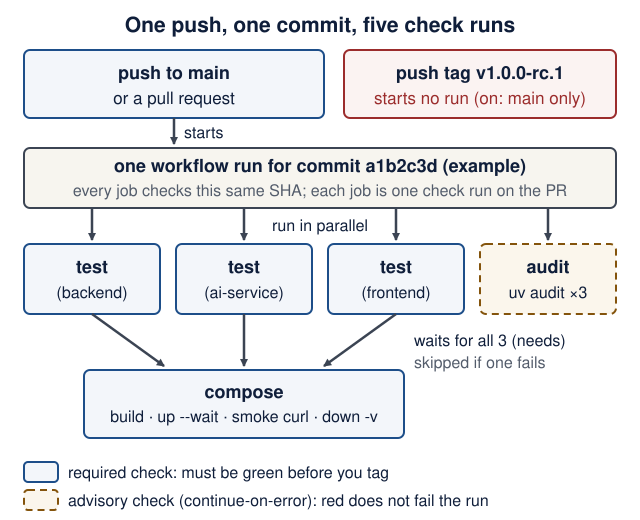
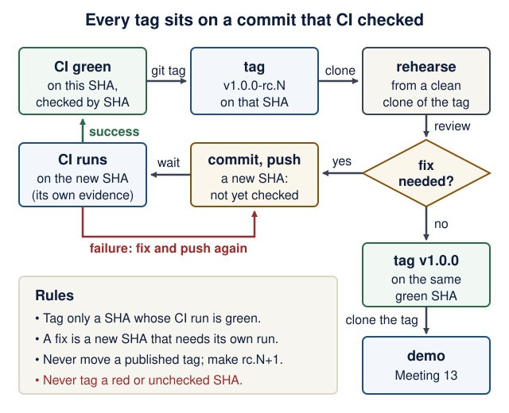
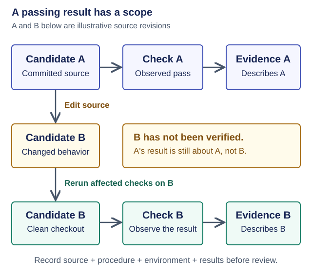

# Lecture 10 · CI, security and release

<!--  -->
[← Course home](../README.md) · [← Previous: Lecture 9](09-failures-evals-costs.md) · [Next: Meetings 11–13 →](11-13-clinics-and-demos.md)

> **At a glance**
>
> - **When:** Monday 21 December 2026, 16:00 Israel time, on Zoom
> - **You leave with:** a release candidate: green CI, a passing clean-checkout test, hardened containers, a runbook README and a `v1.0.0-rc.1` tag
> - **Goals:** read a CI workflow and say which commit it checked; play the grader on a fresh clone; tag a release candidate only on a commit with green CI ([details](#learning-checkpoint))
> - **Prerequisites:** Lecture 9 works (tests green in all three services, `docker compose up --build --wait` healthy) and `gh auth status` succeeds; repair: [Git you need to operate](../guides/engineering-foundations.md#git-you-need-to-operate)
> - **Product milestone:** EX3 (due Mon 11 Jan 2027, 23:59). The EX3 minimum from the README is basic CI and a short runbook, and the grader's path starts from a fresh clone with no real keys. Everything else on this page is recommended hardening.
> - **Time:** prerequisite check about 10 min before class; lab about 2–3 h after class; the runbook and security review may finish in Meeting 11 (estimate)
> - **Done when:** `scripts/clean-checkout.sh` prints `Clean checkout OK` and `gh run list --commit …` shows `success` for the commit you tagged

<details markdown="1" class="lecture-toc">
<summary>On this page</summary>

- [Mission](#mission)
- [Before you start](#before-you-start)
- [Learning checkpoint](#learning-checkpoint)
- [Concepts](#concepts)
- [Live demo](#live-demo)
- [Hands-on lab](#hands-on-lab)
- [Break it on purpose](#break-it-on-purpose)
- [Open-source track](#open-source-track)
- [Working with AI assistants](#working-with-ai-assistants)
- [Completion check](#completion-check)
- [Quick quiz](#quick-quiz)
- [Stretch goals](#stretch-goals)
- [Common pitfalls](#common-pitfalls)
- [Instructor notes](#instructor-notes)
- [Read more](#read-more)

</details>

## Mission

Until today, "it works" meant "on my laptop". Now a robot checks every push, a script plays the grader on a fresh clone, and your containers lose every privilege they don't need. You finish by tagging a release candidate that a stranger can start, test and break using only your README.

## Before you start

> **Prerequisite check:** one minute each, before class.
>
> | Check | Pass when | Repair |
> |---|---|---|
> | `docker compose up --build --wait`, then `docker compose ps` | all three services show `(healthy)` | [Lecture 8 completion check](08-docker-compose.md#completion-check) |
> | `uv run pytest` in each service folder | every suite passes with no API key | [Lecture 9 completion check](09-failures-evals-costs.md#completion-check) |
> | `git status --short` and `git log origin/main..main --oneline` | both print nothing: everything is committed and pushed | [Git you need to operate](../guides/engineering-foundations.md#git-you-need-to-operate) |
> | `git check-ignore -v .env` | prints the `.gitignore` rule that ignores `.env` | [Configuration and environment variables](../guides/engineering-foundations.md#configuration-and-environment-variables) |
> | `gh auth status` | says you are logged in to github.com | [Student setup](../guides/student-setup.md) |

You also need your product on GitHub with `main` as the default branch, the Lecture 8 stack (non-root containers, ai-service not published, `.env` git-ignored), and the Lecture 9 failure tests.

<details markdown="1">
<summary>Words you'll meet today</summary>

Every term here is also in the course [glossary](../guides/engineering-foundations.md#glossary), next to the terms from the other lectures.

- **Workflow:** a YAML file in `.github/workflows/` that tells GitHub what to run and when.
- **Runner:** the fresh virtual machine GitHub starts for one job and throws away afterwards.
- **Job:** a named group of steps that runs on one runner. Jobs run in parallel unless one `needs` another.
- **Step / action:** one command (`run:`) or one published, reusable piece of workflow code (`uses:`).
- **Check run:** one row in a pull request's Checks list, one per job, green or red.
- **SHA:** the 40-character hash that names exactly one commit, such as `3d3c42e5…`.
- **Release candidate (RC):** a version you believe is final, published so others can try it.
- **Linux capability:** one slice of root's power, such as changing file owners or opening raw network sockets.
- **Advisory:** a published record of a known vulnerability in a package version, with an ID such as `GHSA-…`, `PYSEC-…` or `CVE-…`.

</details>

## Learning checkpoint

By the end, you should be able to:

- Explain what the CI jobs check on which revision, and reproduce the documented clean-checkout path.
- Identify the limits of network isolation, input validation, dependency pins, and a shared service token.
- Show the runbook, release candidate, retained data, and a recovery plan appropriate to your product.

**Predict first:** If an image tag moves or a database schema changes, is reverting a Git commit enough to reproduce or recover the previous system?

<details markdown="1">
<summary>Check your prediction</summary>

No. Reverting brings back the **source**, nothing else. A moved image tag such as `python:3.14-slim` rebuilds the old source on new base-image contents unless you pinned a digest. A schema change has already been applied to the data in the volume, and the old code may not understand it. Getting the old *data* back needs a backup taken before the change: see [Rollback is not restore](#releases) below.

</details>

> **Warm-up from earlier classes:** answer from memory, then check. Ungraded.
>
> 1. (Lecture 9) Which AI-service failures does the backend retry, and which does it never retry?
> 2. (Lecture 8) Your ai-service has no `ports:`. Can the backend container reach it? Can `curl localhost:8001` on your laptop?
> 3. (Lecture 3) What survives `docker compose down` but not `docker compose down -v`?

<details markdown="1">
<summary>Check your answers</summary>

1. It retries transport failures and the ai-service's 503 and 504, at most 3 attempts with backoff. It never retries the budget-exhaustion 429, a 502, a 500 or other 4xx: repeating cannot fix them.
2. The backend can, at `http://ai-service:8001`, because Compose service names are DNS names on the shared network. Your laptop cannot: nothing is published at `localhost:8001`.
3. The named volume `backend-data`, which holds the database. `down` removes containers and the network; `-v` removes volumes too.

</details>

**Bridge if needed:** [Release and data lifecycle](../guides/engineering-foundations.md#a-release-has-a-data-lifecycle).

## Concepts

### CI: the same checks on every push

Continuous integration runs your checks on a fresh machine for every push and pull request, so "works on my laptop" becomes "works from Git". You will copy a workflow in the live demo; first, learn to read it. Nine keys carry almost all the meaning ([GitHub's overview](https://docs.github.com/en/actions/get-started/understand-github-actions) explains the same terms):

| Key | What it means | What it controls in Recipe Box's `ci.yml` |
|---|---|---|
| `on` | the events that start a run (the *trigger*) | a push to `main`, or any pull request; a pushed tag starts nothing |
| `permissions` | what the run's automatic `GITHUB_TOKEN` may do | `contents: read`: read the code, nothing else |
| `jobs` | named units of work, each on its own fresh runner | `test`, `compose` and `audit` |
| `runs-on` | which runner a job uses | `ubuntu-latest`, a GitHub-hosted Linux virtual machine |
| `strategy.matrix` | run the same job once per value | `service: [backend, ai-service, frontend]` makes three `test` jobs; `${{ matrix.service }}` is filled in per job |
| `steps`, `uses`, `with` | the job's steps, in order; `uses` runs a published action, `with` passes its inputs | `actions/checkout` with `persist-credentials: false` |
| `run` | one shell command step | `uv run pytest` |
| `needs` | start only after the named jobs succeed | `compose` needs `test` |
| `if: failure()`, `if: always()` | run a step only after an earlier failure, or no matter what | print the logs on failure; always run `down -v` |

**Predict:** you open a pull request with this workflow. How many check runs will the PR show, which one waits for others, and which one may fail without turning the whole run red?

<details markdown="1">
<summary>Check your prediction</summary>

**Five.** `test (backend)`, `test (ai-service)`, `test (frontend)` and `audit` start at the same time, each on its own runner. `compose` waits (`needs: test`) until all three test jobs succeed; if one fails, `compose` is skipped. `audit` has `continue-on-error: true`, so a new advisory does not fail the run ([why](#dependency-hygiene)). The four that must be green are the three `test` checks and `compose`.

</details>

<figure class="course-diagram">
  <div class="diagram-scroll" role="region" tabindex="0" aria-label="CI workflow anatomy diagram, scroll horizontally">
    
  </div>
  <figcaption><strong>One push, one commit, five check runs.</strong> Every job checks the same SHA. A pushed tag starts no run. <span class="screen-only">On a narrow screen, scroll the diagram sideways.</span> <a href="../assets/diagrams/l10-workflow-anatomy.svg">Open the diagram at full size</a>.</figcaption>
</figure>

<details markdown="1">
<summary>Text version of the diagram</summary>

1. **Trigger:** a push to `main` or a pull request starts **one workflow run** for one commit SHA. Pushing a tag such as `v1.0.0-rc.1` starts nothing, because `on.push` lists only the `main` branch.
2. **In parallel, each on a fresh runner:** `test (backend)`, `test (ai-service)` and `test (frontend)` each run `uv sync --locked`, ruff and pytest with `AI_MODEL=test`. `audit` runs `uv audit` for all three services; it is advisory (`continue-on-error: true`).
3. **Then:** `compose` starts only if all three test jobs succeeded (`needs: test`). It builds the stack, waits for healthy, runs the smoke `curl`s, prints logs if anything failed, and always runs `down -v`.
4. **Result:** five check runs on the pull request, all about the same SHA. Required green: the three `test` checks and `compose`.

</details>

CI never calls a paid model: `AI_MODEL=test`, and Lecture 6's conftest guard `models.ALLOW_MODEL_REQUESTS = False` turns any real request into an error.

### Reproducible means pinned

Commit enough configuration to repeat the intended environment and explain remaining moving parts:

| Layer | Selected or pinned by |
|---|---|
| Python packages | `uv.lock`, enforced by `uv sync --locked` |
| Python | `.python-version` and the `python:3.14-slim` base image select the 3.14 line; patch/base-image contents can change |
| uv itself | `uv:0.13.1` in each Dockerfile, `version: "0.13.1"` in CI |
| CI actions | a full commit SHA, with the version as a comment |
| Actions those actions use | not pinned by your SHA; GitHub's [workflow dependency lockfiles](https://docs.github.com/en/actions/reference/security/secure-use) cover them (public preview, checked 17 October 2026; optional reading) |

`--locked` fails when `uv.lock` no longer matches `pyproject.toml`; `--frozen` would quietly use the stale lock. A tag like `@v7` can be moved to new code by whoever controls the action's repository; a 40-character SHA cannot. To find the SHA for a new action, ask GitHub which commit a release tag points to:

```bash
gh api repos/actions/checkout/commits/v7.0.1 --jq .sha
```

It prints `3d3c42e5aac5ba805825da76410c181273ba90b1`, the SHA in the workflow below (checked 17 October 2026). The `commits/` endpoint always returns the commit, even for an annotated tag.

An image tag such as `python:3.14-slim` can move too. Strict image identity requires a digest and a recorded platform; update that digest deliberately for security fixes. Lockfiles improve dependency reproducibility but do not freeze external APIs, remote models, or mutable image tags. The course examples track a Python minor line rather than claiming bit-for-bit builds forever.

### Least privilege, layer by layer

Give each part only what it needs, so a bug or a stolen token can do little:

- **CI token:** `permissions: contents: read`. Also `persist-credentials: false`: otherwise checkout leaves the token on the runner for the rest of the job, so every later step, including code those steps run such as test dependencies and pytest plugins, could use it to push. The token used to sit in `.git/config`; since checkout v6 it sits in a separate file under `$RUNNER_TEMP` ([checkout README](https://github.com/actions/checkout), checked 17 October 2026). Either way, later steps can reach it, which is what [Drill 2](#break-it-on-purpose)'s `artipacked` finding reports.
- **Containers:** non-root uid 10001, `cap_drop: [ALL]` and `no-new-privileges`.
- **Network:** no host-published port for the ai-service; network peers can still reach it. Use network policy and service authentication where the deployment requires them.
- **Model:** usage limits and a timeout per request; no tool that writes, deletes or runs code.

**Capabilities in four sentences.** Linux splits root's power into about 40 *capabilities*, such as `CHOWN` (change file owners) or `NET_RAW` (craft raw network packets). Docker gives every container 14 of them by default, written as a hexadecimal bitmask in which each `1` bit is one capability. A uid-10001 process already has none in use (`CapEff` is `0`), but its *bounding set* (`CapBnd`) is the ceiling of what a setuid program or a file capability could hand it later; `cap_drop: [ALL]` sets that ceiling to zero. `no-new-privileges` (`NoNewPrivs: 1`) additionally stops setuid programs from raising privileges at all.

| Layer | Default power | What we removed | What is still possible |
|---|---|---|---|
| CI token | set by the repository's Actions settings; can include write access | `contents: read`; `persist-credentials: false` | reading your code; any step can still reach the internet |
| Container process | root, with Docker's 14 default capabilities | uid 10001; `cap_drop: [ALL]`; `no-new-privileges` | everything uid 10001 may do: read and write `/app/data`, open network connections |
| Network | every Compose service can call every other one | no `ports:` on ai-service; published ports bound to `127.0.0.1` | any container on the Compose network can call `ai-service:8001` |
| Model | anything the prompt steers it to say | no tools that write, delete or run code; `UsageLimits` and a timeout; backend validation | wrong, odd or injected output, and spending up to the limits |

### Secrets and the leaked-key procedure

Real keys live only in `.env`: git-ignored, listed in every `.dockerignore`, and documented by name in `.env.example`. If a key reaches a pushed commit, assume it is stolen; bots scan public pushes within minutes. Work in this order:

1. **Revoke and rotate it at the provider first.** Rotation makes every copy useless, including copies in forks and clones.
2. **Check usage and billing at the provider,** right away: that is where abuse shows up.
3. **Stop tracking the file:** `git rm --cached .env`, then commit. This removes it from the next commit only; the old commit still contains it.
4. **Optional, and ask first: rewrite history** ([GitHub's guide](https://docs.github.com/en/authentication/keeping-your-account-and-data-secure/removing-sensitive-data-from-a-repository)). In this course, rotation plus untracking is sufficient. Rewriting needs a force push and does not reach forks or clones that already exist.

GitHub's push protection blocks some recognized key formats when it is enabled. Never rely on it.

### Validation and access control where needed

Every input is untrusted. `extra="forbid"`, length limits and `limit` ≤ 100 reject unexpected data with 422, and SQLModel sends values as bound parameters, never pasted into SQL. The agent's instructions ask it to treat pasted text as data. That is a request, not a guarantee; Lecture 9's injection case measures it. The enforced controls are: no tools that write, delete or run code, and the backend validates every output before saving. Recipe Box has no user accounts (JWT is not required), but a third service reachable by more than your backend deserves a check. **401** means "who are you?"; **403** means "I know you, and no".

Authentication establishes identity; authorization checks whether that identity may perform this operation on this record. Neither schema validation nor CORS implements ownership checks. The shared token below authenticates a service, not a human user, and does not turn the classroom demo into a private multi-user deployment. Keep demonstrations on synthetic data; plan HTTPS and an appropriate identity/access design before exposing private records publicly.

<details markdown="1">
<summary>Optional: a shared service token (only if lab step 5 says something besides your backend can reach the AI service)</summary>

<figure class="file-example" markdown="1">
<figcaption><span class="file-example-action">Optional example</span> <span class="file-example-path">ai-service/app/security.py</span></figcaption>

```python
# ai-service/app/security.py (optional shared secret between services)
import os
import secrets
from typing import Annotated

from fastapi import Header, HTTPException, status


def require_internal_token(
    x_internal_token: Annotated[str | None, Header()] = None,
) -> None:
    expected = os.getenv("AI_SHARED_SECRET", "")
    if not expected:
        return  # classroom mode: no service-token authentication is enforced
    sent = (x_internal_token or "").encode()
    if not secrets.compare_digest(sent, expected.encode()):  # constant time
        raise HTTPException(status.HTTP_401_UNAUTHORIZED, detail="Invalid token")
```

</figure>

Attach it to the route in `ai-service/app/main.py`. Two lines change; `Depends` is already imported from Lecture 6:

```diff
 from app.agent import Deps, extract_agent
 from app.schemas import ExtractRequest, RecipeExtraction
+from app.security import require_internal_token
...
-@app.post("/extract")
+@app.post("/extract", dependencies=[Depends(require_internal_token)])
 async def extract(body: ExtractRequest, deps: DepsDep) -> RecipeExtraction:
```

The backend sends the header by passing `headers={"X-Internal-Token": token} if token else {}` to its `httpx.Client`. Unset, the check is off, so a clean checkout still needs zero secrets. `compare_digest` avoids content-dependent short-circuit comparison; it does not eliminate every possible timing side channel or replace transport security.

<figure class="file-example file-example--long" markdown="1">
<figcaption><span class="file-example-action">File example</span> <span class="file-example-path">ai-service/tests/test_security.py</span></figcaption>

```python
# ai-service/tests/test_security.py
from pydantic_ai.models.test import TestModel

from app.agent import extract_agent

BODY = {"text": "Hummus: chickpeas. 15 min."}


def test_token_required_when_configured(client, monkeypatch):
    monkeypatch.setenv("AI_SHARED_SECRET", "s3cret-for-tests")
    with extract_agent.override(model=TestModel()):
        assert client.post("/extract", json=BODY).status_code == 401
        wrong = {"X-Internal-Token": "guess"}
        assert client.post("/extract", json=BODY, headers=wrong).status_code == 401
        right = {"X-Internal-Token": "s3cret-for-tests"}
        assert client.post("/extract", json=BODY, headers=right).status_code == 200


def test_token_not_required_when_unset(client, monkeypatch):
    monkeypatch.delenv("AI_SHARED_SECRET", raising=False)
    with extract_agent.override(model=TestModel()):
        assert client.post("/extract", json=BODY).status_code == 200
```

</figure>

Your ai-service count grows by 2 (verified on the Lecture 6 code plus these two files: `8 passed`).

**Predict:** the conftest imported the app long before `monkeypatch.setenv` runs. Why does the first test still get 401? What would happen if `security.py` read the variable once, at import time?

<details markdown="1">
<summary>Check your prediction</summary>

`require_internal_token` calls `os.getenv` on **every request**, so it sees whatever the environment holds at that moment, including the value the test just set. Read once at import (`EXPECTED = os.getenv(...)` at module level), the value would be frozen as empty when pytest imported the app, so the first test would get `200` instead of `401` and fail. Configuration read per request is easy to test; configuration read at import needs a restart.

</details>

</details>

### Dependency hygiene

`uv audit` checks every locked package against the OSV vulnerability database and exits 1 on a finding. It needs network access and asks a live database, so its answer can change with no change to your code: a new advisory published on 10 January can turn it red. That is why Recipe Box runs it in its own `audit` job with `continue-on-error: true`. **EX3's basic CI does not require a clean audit**; it requires that you read the findings.

When a finding does not affect you, or no fix exists yet, record a decision instead of silencing CI blindly:

```bash
uv audit --locked --preview-features audit-command --ignore GHSA-cpwx-vrp4-4pq7
uv audit --locked --preview-features audit-command --ignore-until-fixed GHSA-cpwx-vrp4-4pq7
```

`--ignore` hides that advisory, matched by any of its IDs (GHSA, PYSEC or CVE). `--ignore-until-fixed` hides it only while no fixed version exists. For every ignored ID, add a README row: ID, package, why it is acceptable (for example "we never render untrusted templates"), and the date.

> **Version note:** `uv audit` is a preview feature in uv 0.13; `--preview-features audit-command` acknowledges that and silences the warning. The flags above were verified with uv 0.13.1's `uv audit --help` and a scratch project (checked 17 October 2026); preview flags may change. An alternative: `uv export --format requirements.txt -o req.txt`, then `uvx pip-audit -r req.txt --disable-pip`.

### Releases

A **release candidate** is a version you believe is final, published so others can try it: `v1.0.0-rc.1` ([Semantic Versioning](https://semver.org/)). The dot matters: SemVer compares `rc.2` and `rc.10` as numbers, but `rc2` and `rc10` as text, where `rc10` sorts first. Fixes after rehearsal become `v1.0.0-rc.2`; the version you demo is `v1.0.0`. Tag only a commit whose CI run is green, and check it by SHA, not by eye.

Recipe Box's CI does not run on tags, on purpose. The tag points at a commit CI already tested on `main`, so a run on the tag adds no new evidence. Release workflows that reuse build caches are also a known attack path (zizmor's cache-poisoning audit), so the course keeps tags out of CI.

<figure class="course-diagram">
  <div class="diagram-scroll" role="region" tabindex="0" aria-label="Release flow diagram, scroll horizontally">
    
  </div>
  <figcaption><strong>Every tag sits on a commit that CI checked.</strong> A fix makes a new SHA, and old evidence does not transfer to it. <span class="screen-only">On a narrow screen, scroll the diagram sideways.</span> <a href="../assets/diagrams/l10-release-flow.svg">Open the diagram at full size</a>.</figcaption>
</figure>

<details markdown="1">
<summary>Text version of the diagram</summary>

1. **CI green on SHA A** (`gh run list --commit A` shows `completed` and `success`) → *tag* → **`v1.0.0-rc.1`** points at A.
2. **Rehearse** (Meeting 12): clean clone of the tag, follow the README, demo, break one thing on purpose.
3. **Did the rehearsal need a fix?**
   - **Yes →** *commit and push* the fix → a new **SHA B**, untested so far → *wait for CI* → green on B → *tag* **`v1.0.0-rc.2`** on B → rehearse again.
   - **No →** *tag* **`v1.0.0`** on the same green SHA.
4. **Demo** (Meeting 13) from a clean clone of `v1.0.0`.
5. Red CI on a new SHA: fix, push, and wait again. Never tag a red or unchecked SHA.

</details>

The course's [factory lab](../guides/software-factory-lab.md) draws the same rule in general form: evidence belongs to the revision that was checked.

<figure class="course-diagram">
  <div class="diagram-scroll" role="region" tabindex="0" aria-label="Evidence and revision diagram, scroll horizontally">
    
  </div>
  <figcaption><strong>A green run is a claim about one commit.</strong> In this lecture, A is the SHA you tagged as <code>rc.1</code> and B is the fix you made after rehearsal. <span class="screen-only">On a narrow screen, scroll the diagram sideways.</span> <a href="../assets/diagrams/factory-evidence.svg">Open the diagram at full size</a>.</figcaption>
</figure>

<details markdown="1">
<summary>Text version of the diagram</summary>

1. **Candidate A** (committed, clean checkout) → *run* → **Check A** passes → *record* → **Evidence A**, about A only.
2. *Edit the source* → **Candidate B**, not yet verified: A's result says nothing about B.
3. *Commit, check out cleanly and rerun* → **Check B**. Pass → **Evidence B**. Fail → record the failure; never copy A's pass.

</details>

**Rollback is not restore.** Rolling back means running an older version of the *code*: you deploy or check out the previous tag. It does not bring back *data*: the database in the `backend-data` volume keeps whatever the newer version wrote, including schema changes the old code may not understand. Restoring means putting back a copy of the data taken *before* the change, which works only if you made that copy. A release plan therefore names both: the previous tag for the code, and a backup (or a change the old code tolerates) for the data.

## Live demo

**1. The workflow.** *State the contract.*

<figure class="file-example file-example--long" markdown="1">
<figcaption><span class="file-example-action">File example</span> <span class="file-example-path">.github/workflows/ci.yml</span></figcaption>

```yaml
# .github/workflows/ci.yml
name: CI

on:
  push:
    branches: [main]
  pull_request:

# Least privilege: this workflow only reads the repository.
permissions:
  contents: read

jobs:
  test:
    name: test (${{ matrix.service }})
    runs-on: ubuntu-latest
    timeout-minutes: 15
    strategy:
      fail-fast: false # show every failing service, not just the first
      matrix:
        service: [backend, ai-service, frontend]
    defaults:
      run:
        working-directory: ${{ matrix.service }}
    steps:
      # Actions are pinned by full commit SHA (a tag can be moved; a SHA cannot).
      - uses: actions/checkout@3d3c42e5aac5ba805825da76410c181273ba90b1 # v7.0.1
        with:
          persist-credentials: false
      - uses: astral-sh/setup-uv@1c37ad07a6a961277cf70c0d37d6f313000f5884 # v10.3.0
        with:
          version: "0.13.1" # pin the tool too, not just the libraries
          enable-cache: true
          working-directory: ${{ matrix.service }}
      - run: uv sync --locked # fails if uv.lock is out of date
      - run: uv run ruff check .
      - run: uv run ruff format --check .
      - run: uv run pytest
        env:
          AI_MODEL: test # never call a paid model in CI

  compose:
    needs: test
    runs-on: ubuntu-latest
    timeout-minutes: 15
    steps:
      - uses: actions/checkout@3d3c42e5aac5ba805825da76410c181273ba90b1 # v7.0.1
        with:
          persist-credentials: false
      # A clean checkout must start with zero secrets (no .env present).
      - run: docker compose config --quiet
      - run: docker compose up --build --wait --wait-timeout 180
      - name: Smoke test
        run: |
          curl --fail --silent --show-error http://localhost:8000/health
          curl --fail --silent --show-error http://localhost:8501/_stcore/health
          curl --fail --silent --show-error -X POST \
            -H "Content-Type: application/json" \
            -d '{"text": "Hummus: chickpeas, tahini. 15 min."}' \
            http://localhost:8000/recipes/from-text
      - if: failure()
        run: docker compose logs
      - if: always()
        run: docker compose down -v

  audit:
    # Advisory: a new advisory can turn this red with no code change.
    continue-on-error: true
    runs-on: ubuntu-latest
    timeout-minutes: 10
    steps:
      - uses: actions/checkout@3d3c42e5aac5ba805825da76410c181273ba90b1 # v7.0.1
        with:
          persist-credentials: false
      - uses: astral-sh/setup-uv@1c37ad07a6a961277cf70c0d37d6f313000f5884 # v10.3.0
        with:
          version: "0.13.1"
      - name: Known vulnerabilities in locked dependencies (OSV)
        run: |
          status=0
          for service in backend ai-service frontend; do
            (cd "$service" && uv audit --locked --preview-features audit-command) || status=1
          done
          exit "$status"
```

</figure>

The `audit` loop records a failure and keeps going, so one run reports all three services.

**2. Lint the workflow** before pushing it. *Observe the real result.* From the repository root:

```bash
actionlint .github/workflows/ci.yml
uvx zizmor --offline .github/workflows/ci.yml
```

Install actionlint once: `brew install actionlint` on macOS, or a release binary from [actionlint's releases](https://github.com/rhysd/actionlint/releases) on Linux and WSL; zizmor needs nothing beyond `uvx`.

**Predict:** both commands succeed. What does each one print?

<details markdown="1">
<summary>Check your prediction</summary>

actionlint checks syntax and expressions and prints **nothing** when all is well. zizmor checks security and ends with `No findings to report. Good job! (3 suppressed)` (zizmor 1.31.1 and actionlint 1.7.12, checked 17 October 2026). "Suppressed" means lower-signal findings that the default persona hides; `uvx zizmor --offline --persona=pedantic .github/workflows/ci.yml` shows them (here: two jobs without a `name:` and no `concurrency:` limit). Drill 2 shows a workflow that passes the first tool and fails the second.

</details>

**3. Harden the containers.** *Make the smallest change.* Add two lines to each service in `compose.yaml`:

<figure class="file-example" markdown="1">
<figcaption><span class="file-example-action">File example</span> <span class="file-example-path">compose.yaml</span></figcaption>

```yaml
# compose.yaml: under each of ai-service, backend and frontend
    security_opt: ["no-new-privileges:true"]
    cap_drop: [ALL]
```

</figure>

After `docker compose up --build --wait`, compare a hardened container with the same image started without the flags. **Predict** all three values for each container before you run it: `CapEff` (capabilities in use now), `CapBnd` (the ceiling) and `NoNewPrivs`.

```bash
docker compose exec backend grep -E "CapEff|CapBnd|NoNewPrivs" /proc/self/status
docker run --rm recipe-box-backend grep -E "CapEff|CapBnd|NoNewPrivs" /proc/self/status
```

<details markdown="1">
<summary>Show the expected output</summary>

```text
CapEff:	0000000000000000
CapBnd:	0000000000000000
NoNewPrivs:	1
CapEff:	0000000000000000
CapBnd:	00000000a80425fb
NoNewPrivs:	0
```

`CapEff` is `0` in **both**: uid 10001 uses no capability either way. The difference is the ceiling: Docker's default bounding set `a80425fb` holds 14 capabilities (`python3 -c "print(bin(0xa80425fb).count('1'))"` prints `14`), and the hardened one holds none. Verified with `python:3.14-slim` as uid 10001 on Docker 29.1 (checked 17 October 2026). The stack stays healthy and "Paste a recipe" still works: nothing needed those privileges.

</details>

**4. Play the grader.** *Observe the real result.* `scripts/clean-checkout.sh` checks that your work is committed, clones exactly that commit into a temporary folder, follows the README, and removes everything it created:

```bash
#!/usr/bin/env bash
# scripts/clean-checkout.sh: do what a grader does, on a fresh clone of one commit.
set -euo pipefail

if [ -n "$(git status --porcelain)" ]; then
  echo "FAIL: uncommitted changes. The grader cannot see them; commit first."
  git status --short
  exit 1
fi
sha="$(git rev-parse HEAD)"
echo "Testing commit $sha"
if [ "$sha" != "$(git rev-parse '@{u}' 2>/dev/null || true)" ]; then
  echo "WARNING: HEAD is not on GitHub yet (unpushed, or no upstream). Push it."
fi

source="$(git rev-parse --show-toplevel)"
if [ "${CLONE_FROM:-}" = "origin" ]; then
  source="$(git remote get-url origin)" # what the grader clones
fi
work="$(mktemp -d)"
project="clean-checkout-$$" # own project name: own containers, own volume
export BACKEND_PORT="${BACKEND_PORT:-8000}" FRONTEND_PORT="${FRONTEND_PORT:-8501}"

trap 'rm -rf "$work"' EXIT

git clone --quiet "$source" "$work" # committed files only: no .env, no .venv
cd "$work"
git checkout --quiet --detach "$sha" || {
  echo "FAIL: $sha is not in $source. Push it first."
  exit 1
}
if [ -e .env ]; then
  echo "FAIL: .env is committed. Rotate every key in it, then remove it."
  exit 1
fi
cp .env.example .env

cleanup() {
  status=$? # the exit status of the script, saved before anything else runs
  if [ "$status" -ne 0 ]; then
    echo "FAILED (exit $status). Last log lines from each service:"
    docker compose -p "$project" --project-directory "$work" logs --tail 80 || true
  fi
  docker compose -p "$project" --project-directory "$work" down -v --rmi local
  rm -rf "$work"
}
trap cleanup EXIT # from here on, also remove containers, volume and images

docker compose -p "$project" up --build --wait --wait-timeout 180
check() { curl --fail --silent --show-error --output /dev/null "$@"; }
check "http://localhost:$BACKEND_PORT/health"
check "http://localhost:$FRONTEND_PORT/_stcore/health"
check -X POST "http://localhost:$BACKEND_PORT/recipes/from-text" \
  -H "Content-Type: application/json" -d '{"text": "Hummus: chickpeas. 15 min."}'

for service in backend ai-service frontend; do
  (cd "$service" && uv sync --locked --quiet && uv run pytest --quiet)
done
echo "Clean checkout OK: $sha"
```

Make it executable with `chmod +x scripts/clean-checkout.sh`, then run `scripts/clean-checkout.sh` from the repo root. It prints `Testing commit <sha>`, the build output, `Clean checkout OK: <sha>`, then the cleanup's output (about 40 s for Recipe Box with a warm build cache). Ports taken? Prefix it with `BACKEND_PORT=18000 FRONTEND_PORT=18501`. To test exactly what the grader clones, run `CLONE_FROM=origin scripts/clean-checkout.sh`: it clones GitHub instead of your local folder and fails if your commit was never pushed.

<details markdown="1">
<summary>Read the script line by line</summary>

- **`set -euo pipefail`:** stop at the first failing command (`-e`), treat an unset variable as an error (`-u`), and let a failure anywhere in a pipe fail the pipe (`pipefail`). Without it, the script would print "OK" after a failed step.
- **`git status --porcelain`:** a stable, machine-readable list of uncommitted changes; empty means clean. The grader clones Git, so uncommitted work does not exist for them.
- **`git rev-parse HEAD` and `@{u}`:** the SHA you are testing, and the commit your branch's upstream (usually `origin/main`) points at. Different means unpushed work.
- **`mktemp -d`:** creates a new, empty, uniquely named folder, so nothing from your working copy leaks in.
- **`$$`:** the script's process ID. Two runs at once get different Compose project names, so different containers and volumes.
- **`trap '…' EXIT`:** run this command whenever the script exits, success or failure. A second `trap … EXIT` **replaces** the first: before the clone, only the folder needs removing; after it, the containers, volume and images do too.
- **`status=$?` inside `cleanup`:** inside an exit trap, `$?` is the script's exit status; save it before any other command overwrites it. On failure, the logs are printed *before* `down -v` deletes the containers that hold them.
- **`check() { … "$@"; }`:** a small function; `"$@"` forwards all its arguments to `curl` unchanged, quotes included.
- **`( cd "$service" && … )`:** parentheses run a subshell, so the `cd` does not change the folder for the next loop iteration.
- **`down -v --rmi local`:** remove the containers, the named volumes and the images this project built (not images pulled from a registry).

</details>

**Predict:** `docker compose up --wait` fails because one healthcheck never passes. Which lines run next, what does the trap delete, and what evidence would you have lost without the `logs` line?

<details markdown="1">
<summary>Check your prediction</summary>

`set -e` stops the script at the failed `up`, so the smoke checks and tests never run. The exit trap (`cleanup`) runs: `status` is non-zero, so it prints the last 80 log lines per service, then `down -v --rmi local` deletes the containers, the volume and the built images, and `rm -rf` deletes the clone. The container logs are the evidence: once the containers are gone, so are their logs. That is why the `logs` call comes first.

</details>

*Break it and watch the check fail.* In your copy of the script, change `/_stcore/health` to `/healthz`, commit it on a scratch branch, and run the script again. **Predict** the last lines before you look.

<details markdown="1">
<summary>Show the expected output</summary>

```text
curl: (22) The requested URL returned error: 404
FAILED (exit 22). Last log lines from each service:
```

…followed by the logs and the cleanup. `--fail` turns an HTTP error into curl's exit code 22, and `set -e` passes it on as the script's exit code. Restore `/_stcore/health`. (Script logic verified on 17 October 2026 with stub `docker`, `curl` and `uv` commands in a scratch repository: committed, dirty, unpushed, `CLONE_FROM=origin`, failed `up`, wrong URL and committed `.env` cases.)

</details>

**Investigate:** answer from the script, then check.

1. You edited `backend/app/main.py` but did not commit. What does the script print, and why is that the right behaviour for a grader simulation?
2. Your commit is local only. Which line warns you, and which run mode turns the warning into a failure?

<details markdown="1">
<summary>Show model answers</summary>

1. `FAIL: uncommitted changes…` and the changed file. The grader clones Git; a test of files they will never see proves nothing about their run.
2. The `@{u}` comparison prints the `WARNING`. With `CLONE_FROM=origin`, the clone comes from GitHub, where the SHA does not exist, so `git checkout --detach` fails and the script prints `FAIL: <sha> is not in <url>. Push it first.`

</details>

**5. Audit.** In `backend/`, `uv audit --locked --preview-features audit-command` prints `Found no known vulnerabilities and no adverse project statuses in 69 packages`.

**6. Tag the release candidate** (lab step 7). *Restore, verify, commit.*

## Hands-on lab

Apply each step to **your own** product. Plan your time:

- **Core today:** steps 1, 4 and 7
- **Before Meeting 11:** steps 2, 3 and 6
- **May finish in Meeting 11:** step 5
- **Extension (optional):** the [Stretch goals](#stretch-goals), after EX3's minimum works

1. **CI.** Copy the workflow to `.github/workflows/ci.yml`; adapt the matrix to your service folders and the smoke step to your endpoints. Open a pull request in your own repository. **Checkpoint:** the three `test` checks and `compose` are green; `audit` is advisory and may show findings.
2. **Lint it** from the repository root with actionlint and zizmor until both are clean.
3. **Harden** every service; check `id` and the three capability lines in each container, then rerun your Lecture 9 drills.
4. **Clean-checkout script:** save it as `scripts/clean-checkout.sh`, adapt the smoke URLs, commit, push, and run it from the repository root. **Checkpoint:** `Clean checkout OK: <sha>`, with the SHA that `git rev-parse origin/main` prints.
5. **Security review** in pairs. List what you protect, every entry point, and the control for each, with the file and line that implements it. A control is something that blocks or limits the harm, not a wish:

   | Asset (what you protect) | Entry point (how harm gets in) | Control, and the evidence (file:line) |
   |---|---|---|
   | API keys | a commit, a Docker image, a CI log | `.env` git-ignored and in `.dockerignore`; CI uses `AI_MODEL=test` and has no secrets (`.gitignore:1`, `ci.yml` `env:`) |
   | Model spend | the "Paste a recipe" box | `UsageLimits` plus a request timeout; the backend never retries a 429 (`ai-service/app/agent.py`, `backend/app/ai_client.py`) |
   | *(your row)* | | |

   Add the optional shared token only if something besides your backend can reach your third service.
6. **Runbook.** Give your README these sections (Recipe Box's adds one for releases):

   ```text
   Setup                 requirements and configuration
   Run                   docker compose up --build, URLs; down keeps data, down -v deletes it;
                         the data lives in the backend-data volume at /app/data;
                         optional backup: docker compose cp backend:/app/data/app.db backup.db
   Test                  the command per service, scripts/clean-checkout.sh
   Failure drills        your Lecture 9 table: what to stop, what the user sees
   Real-model run        optional: variables, cost limits, eval results table
   Troubleshooting       symptom, cause, fix for problems you actually hit
   AI-use note           tools, what they helped with, what you checked
   Open-source evidence  the evidence table
   ```

7. **Release candidate**, from your repository root, once CI on `main` is green:

   ```bash
   git switch main && git pull --ff-only
   git status --short
   gh run list --workflow ci.yml --commit "$(git rev-parse HEAD)" --json status,conclusion,headSha
   ```

   **Checkpoint:** `git status --short` prints nothing, and every run listed shows `"status": "completed"` and `"conclusion": "success"` with a `headSha` equal to `git rev-parse HEAD`. An empty list `[]` means CI never ran on this exact commit: push it, or wait. Then tag and publish, with a one-line note of what this candidate contains:

   ```bash
   git tag -a v1.0.0-rc.1 -m "Release candidate 1: three services, CI, runbook"
   git push origin v1.0.0-rc.1
   gh release create v1.0.0-rc.1 --verify-tag --prerelease --generate-notes
   ```

   `--verify-tag` refuses to create the release if the tag is not on GitHub yet. (`gh run list` flags verified with `gh` 2.83.1's `--help`, checked 17 October 2026.)

> **EX3 progress:** after this lab you have basic CI and the start of the runbook. EX3 (due Mon 11 Jan 2027, 23:59) also needs the AI evaluation results from Lecture 9 and a demo; see the [assignment table](../README.md#assignments-and-deadlines).

## Break it on purpose

Each drill: predict, run, then explain. Undo every change afterwards.

**Drill 1: a stale lockfile.** In `backend/pyproject.toml`, add `"rich>=14.0",` to `dependencies` by hand, not with `uv add`. **Predict:** which CI step fails, and does any test run?

<details markdown="1">
<summary>Show the expected output</summary>

`uv sync --locked` stops before any test runs:

```text
error: The lockfile at `uv.lock` needs to be updated, but `--locked` was provided.

hint: To update the lockfile, run `uv lock`.
```

**Why:** CI refuses to build something you never tested. Revert, or run `uv add rich` and commit `uv.lock`.

</details>

**Drill 2: unpin an action.** In a copy of the workflow, make every checkout step a plain `- uses: actions/checkout@v7` with no `with:` block. **Predict:** which tool catches it, actionlint, zizmor or both? Then also delete the `permissions:` block and predict again.

<details markdown="1">
<summary>Show the expected output</summary>

actionlint still passes: the YAML is valid. zizmor exits non-zero, once per checkout step, with `error[unpinned-uses]: unpinned action reference` and `help[artipacked]: credential persistence through GitHub Actions artifacts`. Without `permissions:` it adds `warning[excessive-permissions]: overly broad permissions` (zizmor 1.31.1, checked 17 October 2026).

**Why can't actionlint see this?** It checks that the workflow is *well-formed*; a moving tag and a persisted token are well-formed, just unsafe. Restore the original.

</details>

**Drill 3: commit the key.** In a throwaway clone, put a fake key in `.env`. **Predict:** what does `git add .env` do? Then force it with `git add -f .env`, commit, and run the script. Finally `git rm --cached .env`, commit, and run `git log --oneline --all -- .env`.

<details markdown="1">
<summary>Show the expected output</summary>

`git add .env` refuses ("The following paths are ignored by one of your .gitignore files"). After the forced commit, the script prints `FAIL: .env is committed. Rotate every key in it, then remove it.` After untracking, `git log --oneline --all -- .env` still lists the commit that added it.

**Why rotation comes first:** the old commit, and every clone of it, still contains the key. Only rotation makes those copies useless.

</details>

> **Debug log:** for Drill 1 or Drill 3, fill in the [debug log card](../guides/engineering-foundations.md#debug-with-a-hypothesis): symptom (the exact line), reproduce, a one-sentence hypothesis written before you check, experiment, result, fix and check, cause.

**Drill 4: a vulnerable pin (optional).** In a scratch uv project, `uv add "jinja2==3.1.2"`, then run `uv audit --locked --preview-features audit-command`. **Predict:** how many problems will it report, and does each count mean a different bug?

<details markdown="1">
<summary>Show the expected output</summary>

`Found 10 known vulnerabilities and no adverse project statuses in 2 packages`, each with a "Fixed in:" version, and exit code 1. That is about 10 advisory records for **5 CVEs**: each CVE is published once as a GHSA advisory and once as a PYSEC advisory. "2 packages" means two were audited (jinja2 and its dependency markupsafe), not that both are vulnerable. Counts change as advisories are published (checked 17 October 2026). `--ignore` matches any alias: ignoring one GHSA ID removes both of its records (10 → 8). `uv add "jinja2>=3.1.6"` clears it: `Found no known vulnerabilities and no adverse project statuses in 2 packages`.

</details>

**Drill 5: injection, two ways (optional).** Inspired by web-security weeks in Stanford's [CS142](https://web.stanford.edu/class/cs142/) and [CS155](https://cs155.stanford.edu/) and the agent-safety lecture in [CS329Z](https://cs329z.stanford.edu/); the exercise is original. EASS is not affiliated with Stanford.

(a) **SQL.** Save this in a scratch folder (never in your product) and **predict** how many rows each `DELETE` removes before you run `python3 sql_injection.py`:

<figure class="file-example" markdown="1">
<figcaption><span class="file-example-action">Worked example</span> <span class="file-example-path">sql_injection.py</span></figcaption>

```python
# sql_injection.py (scratch file: never in your product)
import sqlite3

db = sqlite3.connect(":memory:")
db.execute("CREATE TABLE recipe (id INTEGER PRIMARY KEY, title TEXT)")
db.executemany("INSERT INTO recipe (title) VALUES (?)", [("Soup",), ("Hummus",)])

title = "x' OR '1'='1"  # what an attacker types into a search box

pasted = db.execute(f"DELETE FROM recipe WHERE title = '{title}'")
print("formatted string deleted", pasted.rowcount, "rows")

db.executemany("INSERT INTO recipe (title) VALUES (?)", [("Soup",), ("Hummus",)])
bound = db.execute("DELETE FROM recipe WHERE title = ?", (title,))
print("bound parameter deleted", bound.rowcount, "rows")
```

</figure>

<details markdown="1">
<summary>Show the expected output</summary>

```text
formatted string deleted 2 rows
bound parameter deleted 0 rows
```

**Why:** the f-string pastes the text into the SQL, so the quote ends the string and `OR '1'='1'` becomes part of the query: true for every row. A `?` parameter sends the text separately as a value, so it can only ever be compared with titles. SQLModel always does the second. (Run on Python 3.14, 17 October 2026.)

</details>

(b) **Model output is untrusted too.** Lecture 4's `plain()` escapes titles before Streamlit renders them. A prompt-injected paste could make the model return a title such as `Soup `. In a terminal, run `python3 -m http.server 9999`; then save a recipe with that title through the UI. **Predict:** with `plain()` in place, does the server log a request for `/x.png` when the list renders? And with `plain()` removed?

<details markdown="1">
<summary>Check your prediction</summary>

With `plain()`, no request: the title is shown as typed, brackets and all. Without it, Streamlit renders the label as Markdown and the browser fetches the image, so the server log shows `"GET /x.png HTTP/1.1" 404`. Every visitor's browser would make that request. (Lecture 4's editors verified the fetch on Streamlit 1.66.0, 17 October 2026.) This is why the backend validates model output *and* the frontend escapes it: two independent controls for one untrusted value.

</details>

## Open-source track

Evidence week. Fill the [evidence table](../README.md#evidence-table) in your product README with every field the course README lists, one row per PR.

1. Merge evidence for each merged PR: `gh pr view URL --json state,mergedAt,mergeCommit,baseRefName`. `baseRefName` must be the project's main development branch (FastAPI's is `master`).
2. Star evidence, dated: the snapshot you saved the day you opened each PR (Lectures 3, 6 and 8). If one is missing, record today's `gh repo view OWNER/REPO --json stargazerCount,licenseInfo` output with today's date. A later snapshot does not prove the opening-day count: record it, mark it "taken later", and ask the instructor before relying on it, especially if the count is near 10,000. Opening a new PR this week? Re-check the star count on the day you open it.
3. Answer open reviews with Lecture 9's routine.
4. A PR silent for two weeks? Start another viable contribution now; the requirement stays three merged PRs ([what counts as merged](../README.md#what-counts-as-merged)).

> **Optional:** 10 minutes. Open `.github/workflows/` in a project you contributed to. Find its triggers (`on:`), its `permissions:`, how it pins actions (tag or SHA), and which job ran on your PR. Write two lines comparing it with your `ci.yml`. **Done when:** you can name one practice they use that you don't, or the reverse.

## Working with AI assistants

Try the [software factory lab](../guides/software-factory-lab.md): identify which revision each check covers, inspect a review finding after green tests, and explain why publishing a PR and releasing a product are separate outcomes.

A work order for today, in the course's [work-order format](../guides/agent-driven-development.md#one-work-order-template):

```text
Outcome:      CI runs ruff and pytest for ai-service with AI_MODEL=test on every PR
Files:        .github/workflows/ci.yml
Non-goals:    no change to tests/ or to any service code; no secrets; no write permissions
Verify with:  actionlint .github/workflows/ci.yml; uvx zizmor --offline .github/workflows/ci.yml; green checks on the PR
Review focus: permissions, every uses: line (full SHA plus version comment), anything that skips a check
Acceptance:   breaking one ai-service test on purpose turns the PR's test (ai-service) check red
Stop:         if the change seems to need a secret or a write permission, stop and report
```

- **You run tag and release commands; the agent may only propose them.** Do not give a coding agent a token that can push tags or run `gh release create`, and never let it read `.env`.
- **Review any diff to `.github/workflows/` or `tests/` line by line.** An agent can turn CI green by deleting an assertion, adding `continue-on-error`, or narrowing the matrix. A weakened check is a failure, not a fix ([review and release](../guides/agent-sandboxes.md#review-and-release)).
- **Name your verification commands** in your repository instructions (`AGENTS.md` or `CLAUDE.md`): `scripts/clean-checkout.sh`, `actionlint` and `uvx zizmor --offline`, so the agent runs the checks the grader's path depends on.
- **Workflow review against a checklist.** "Review my ci.yml: SHA-pinned actions with version comments, `contents: read`, `persist-credentials: false`, `uv sync --locked`, `AI_MODEL=test`, no secrets, logs on failure, `down -v` always." *Verify:* actionlint, zizmor, then a real run.
- **Threat model.** Paste your architecture diagram (never `.env`) and ask for the five likeliest risks, each with a control. *Verify:* each control exists in your code (add it to your security-review table with file:line), or goes on your list.
- **Spot the outdated suggestion:** `actions/checkout@v4` or another floating tag (setup-uv v10 has no `v10` tag at all); `pip install -r requirements.txt` in CI; `uv sync --frozen`, which skips the lock check; `permissions: write-all`.

**AI-use note line:** in your README's AI-use note, record which tool drafted `ci.yml` or the script, and which commands you ran to check it.

## Completion check

From the repository root:

```bash
scripts/clean-checkout.sh
gh run list --workflow ci.yml --commit "$(git rev-parse 'v1.0.0-rc.1^{commit}')" --json status,conclusion,headSha
git tag --list "v1.0.0*"
```

Expect `Clean checkout OK: <sha>`, `"status": "completed"` with `"conclusion": "success"` for the tagged commit, and `v1.0.0-rc.1`.

**EX3 minimum (from the README):**

| Must work | Evidence you keep | If it fails, repair here |
|---|---|---|
| CI runs each service's tests and the Compose smoke test, green on the commit you tag | the `gh run list --commit …` output | [Common pitfalls](#common-pitfalls) · lab step 1 |
| A short runbook in the README: setup, run, test, troubleshooting | the README sections | lab step 6 |
| A fresh clone starts with no real keys: `.env` never committed, `.env.example` lists every setting | `Clean checkout OK: <sha>` | lab step 4 · [Secrets](#secrets-and-the-leaked-key-procedure) |

**Not yet?** Repair and re-run before Meeting 11; the rehearsal assumes this works.

**Course-recommended hardening (formative, not separately graded):**

- [ ] Actions pinned by full SHA; `contents: read`; `persist-credentials: false`.
- [ ] actionlint and zizmor clean.
- [ ] `uv audit` read; each ignored ID has a README row.
- [ ] Containers non-root, with `cap_drop: [ALL]` and `no-new-privileges`; ai-service not published.
- [ ] The full eight-section runbook and a filled evidence table.
- [ ] `v1.0.0-rc.1` published as a GitHub pre-release.

## Quick quiz

<details markdown="1">
<summary>Q1. Why pin actions/checkout to a 40-character SHA instead of @v7?</summary>

A tag is a movable pointer: whoever controls the action's repository can point `v7` at new code that then runs with your token. A SHA names exactly one commit; the comment keeps it readable.

</details>

<details markdown="1">
<summary>Q2. (Lecture 8) Why must a clean checkout start with zero real keys?</summary>

Graders and CI have none. `env_file` with `required: false` and `AI_MODEL=${AI_MODEL:-test}` make `TestModel` the default, so the flow runs offline and free; a real model is a documented opt-in.

</details>

<details markdown="1">
<summary>Q3. You pushed a commit with a real API key an hour ago. What do you do first, and why?</summary>

**Rotate it at the provider.** Rewriting history first leaves a valid key in every clone, fork and cache made in that hour. Then check usage at the provider and stop tracking the file; rewriting history is optional and needs a force push, so ask first.

</details>

<details markdown="1">
<summary>Q4. (Lecture 9) CI runs on every push. What stops it from spending money on models?</summary>

`AI_MODEL=test` everywhere, and `models.ALLOW_MODEL_REQUESTS = False` in the ai-service conftest, which makes any real model request fail the test. `UsageLimits` is a different, weaker control: it stops a run after the counted usage crosses the threshold, so some work can already have happened. It is not a bill ceiling.

</details>

<details markdown="1">
<summary>Q5. CI fails at <code>uv sync --locked</code>, but everything passes on your laptop. What happened, and why is that useful?</summary>

`pyproject.toml` changed without `uv lock`, or `uv.lock` was not committed. CI refuses to build what you never tested: run `uv lock` and commit it.

</details>

**Q6.** Your ai-service publishes no port. Name a process that can still call it. What does the optional shared token add, and what does it not add?

<details markdown="1">
<summary>Check your answer</summary>

**Answer:** any container on the same Compose network, not only your backend (another service you add, or a compromised one). The token adds **service authentication**: a caller without the secret gets 401. It does not add authorization (which records a caller may touch), user identity, or encryption; anyone who holds the secret, including a leaked `.env`, passes.

</details>

**Q7.** Name two things that `uv.lock` does not freeze.

<details markdown="1">
<summary>Check your answer</summary>

**Answer:** any two of: the base image behind a tag such as `python:3.14-slim`; the behaviour of a remote model or external API; the actions your workflow uses (pinned separately by SHA); uv itself (pinned separately); new advisories about the locked versions.

</details>

**Explain it:** in one sentence, what is `scripts/clean-checkout.sh` *for*? (Not what each line does.)

<details markdown="1">
<summary>Show a model answer</summary>

Weak: "It clones the repo, copies `.env.example`, runs `docker compose up` and curls three URLs." Strong: "It proves that one committed SHA, with no secrets and nothing from my laptop, starts and passes its tests the way a grader will run it, so uncommitted files and hidden local state can't fool me." Purpose plus the failure it prevents.

</details>

> **Defend it:** a teammate wants CI to run on tags too, "to be safe". Defend the current design with one reason and name one cost.

<details markdown="1">
<summary>What a strong answer mentions</summary>

**Reason:** the tag points at a commit CI already checked on `main`; a tag run adds no new evidence about that SHA, and release-style workflows that reuse caches are a known attack path. **Cost:** nothing automatically stops someone from tagging an *unchecked* commit, which is why the release steps check `gh run list --commit` before tagging.

</details>

## Stretch goals

Each is optional; do them after EX3's minimum works.

- **Wire the shared secret** through Compose: `AI_SHARED_SECRET: ${AI_SHARED_SECRET:-}` under `environment:` of both backend and ai-service, and a value in `.env` from `python -c "import secrets; print(secrets.token_hex(32))"`. **Simpler is enough:** if only your backend can reach the ai-service, leave it out.
- **Pin the base image by digest:** `docker buildx imagetools inspect python:3.14-slim` prints it; write `FROM python:3.14-slim@sha256:<digest>`. Sensible once your Dockerfile is stable; you then own updating the digest for security fixes.
- **Dependabot** with `package-ecosystem: github-actions`, so SHA pins get update PRs.
- **CHANGELOG.md** in [Keep a Changelog](https://keepachangelog.com/en/1.1.0/) format. **Simpler is enough:** `gh release create --generate-notes` already lists merged PRs.

## Common pitfalls

- **`The lockfile at uv.lock needs to be updated`** → `pyproject.toml` changed without relocking → `uv lock` in that service; commit `uv.lock`.
- **The compose job fails at `up --wait`** → a healthcheck never passes → read the output of the "logs if failed" step.
- **`curl: (7) Failed to connect` in the smoke step** → that port is not published → smoke-test only the frontend and backend.
- **Passes for you, fails for the grader** → a file you never committed, or a commit you never pushed → commit and push, then run `CLONE_FROM=origin scripts/clean-checkout.sh`.
- **`gh run list --commit …` prints `[]`** → CI never ran on that exact SHA (unpushed, or you amended after pushing) → push and wait for the run.
- **Pushing the tag starts no workflow** → no tag trigger, by design → tag a commit already green on `main`.
- **The `audit` job failed, but the workflow run succeeded** → a new advisory, not your code → read it; upgrade, or `--ignore` it with a README row.

## Instructor notes

Suggested flow, with minute budgets:

1. Ask "what exactly will the grader type?" and write it down: it becomes the clean-checkout script (5 min).
2. The nine-key table and the "how many check runs?" prediction; run a peer-instruction vote on it (10 min).
3. Walk through `ci.yml` top to bottom; run actionlint and zizmor, then Drill 2 live (15 min).
4. Harden compose and run the capability prediction (10 min).
5. Start the clean-checkout script; while it builds, the leaked-key order and "rollback is not restore" (15 min).
6. Lab core: CI, script, release candidate (the rest of the meeting).
7. Release-candidate round: each student shows a green run for their SHA and a tag, or names the blocker.

**If time runs short:** keep steps 1, 3, 5 and the lab core. The security review and the runbook move to Meeting 11. **Exit ticket:** "Write the SHA your `v1.0.0-rc.1` points at, and the command that proves CI passed on it."

Emphasize: distinguish exact pins from moving version lines, apply least privilege at every layer, rotate leaked keys first, and treat the hardening list as recommended, not as extra EX3 requirements. Students get stuck on stale `uv.lock` files, wrong smoke-test ports, uncommitted or unpushed commits, and `gh auth`.

## Read more

**Before the lab (≤15 min):** [Understanding GitHub Actions](https://docs.github.com/en/actions/get-started/understand-github-actions). Guiding questions: (1) What is the difference between a job and a step? (2) Which events can start a workflow, and which one does Recipe Box leave out on purpose?

**Go deeper (optional):**

- [GitHub Actions: secure use reference](https://docs.github.com/en/actions/reference/security/secure-use)
- [uv: using uv in GitHub Actions](https://docs.astral.sh/uv/guides/integration/github/)
- [zizmor documentation](https://docs.zizmor.sh/)
- [Compose file reference: services](https://docs.docker.com/reference/compose-file/services/)
- [GitHub CLI: gh release create](https://cli.github.com/manual/gh_release_create) and [gh run list](https://cli.github.com/manual/gh_run_list)
- [Agent sandboxes: review and release](../guides/agent-sandboxes.md#review-and-release): disposable candidate execution, trusted verification, and release credentials. Container resource limits and agent budgets do not replace authorization.
- [Manifests, skills and evals: engineering contracts](../guides/engineering-contracts.md): configuration consumers, reusable procedures, evidence, and current agent-engineering guidance.
- [Visual system walkthrough: one request, end to end](../guides/system-walkthrough.md): service ownership, validation, the commit boundary, and failure evidence.
- [Count the user outcome](../guides/systems-reasoning.md#count-the-user-outcome): a release-decision exercise using reliability and critical-failure evidence.
- [Visual inference engineering](../guides/inference-engineering.md): model choice, attention, quantization, caching, speculation, batching, parallelism, modalities and production, with worked visual exercises.
- [Rehearse schema evolution, recovery and the complete change cycle](../guides/industry-studio.md#evolve-data-without-losing-it) in the industry studio. This optional activity deepens the current checkpoint without changing the assignment.

---

[← Course home](../README.md) · [← Previous: Lecture 9](09-failures-evals-costs.md) · [Next: Meetings 11–13 →](11-13-clinics-and-demos.md)

<!--  -->
