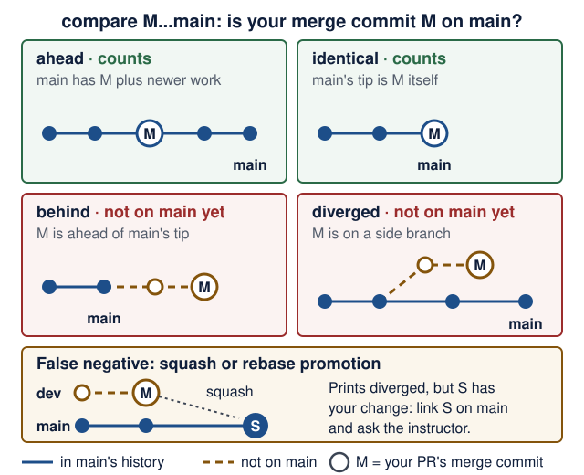

# Meetings 11–13 · Clinics, rehearsal and final demos

<!--  -->
[← Course home](../README.md) · [← Previous: Lecture 10](10-ci-security-release.md)

> **At a glance**
>
> - **When:** Mondays 28 December 2026, 4 January 2027 and 11 January 2027, 16:00 Israel time, on Zoom
> - **You leave with:** a rehearsed demo and verified PR evidence
> - **Goals:** find the first failing boundary and fix it with a check that catches it; rehearse the demo from a clean clone of a tagged commit with green CI; explain your own work without an assistant
> - **Prerequisites:** Lecture 10's release candidate: `gh run list --commit …` shows `success` for the commit `v1.0.0-rc.1` points at; repair: [Lecture 10 completion check](10-ci-security-release.md#completion-check)
> - **Product milestone:** EX3 and open-source evidence, due Mon 11 Jan 2027, 23:59 Israel time ([deadlines](../README.md#assignments-and-deadlines))
> - **Done when:** `v1.0.0` is tagged on a commit with green CI, and your demo starts from a clean clone of that tag

No new material: you work on your own product and PRs; the instructor may reorder agenda items. Rules and deadlines live in the [course README](../README.md). Commands use Recipe Box names; substitute yours, and run them from your repository root unless a step says otherwise.

<details markdown="1" class="lecture-toc">
<summary>On this page</summary>

- [Meeting 11 · Integration and upstream-review clinic](#meeting-11--integration-and-upstream-review-clinic)
- [Meeting 12 · Demo rehearsal, troubleshooting and evidence review](#meeting-12--demo-rehearsal-troubleshooting-and-evidence-review)
- [Meeting 13 · Final demos and individual technical discussion](#meeting-13--final-demos-and-individual-technical-discussion)
- [Individual technical discussion · question bank](#individual-technical-discussion--question-bank)
- [Read more](#read-more)

</details>

## Meeting 11 · Integration and upstream-review clinic

**Purpose (Monday 28 December 2026):** a stack that starts from a clean clone, and a written next step for every open upstream PR.

### Learning checkpoint

- Locate the first failing boundary using a small request, the relevant logs, and the expected contract.
- Repair a reproduced integration problem and show the check that detects it.
- Explain the next respectful action for each upstream review, with the student retaining authorship of maintainer-facing text.

Use the [learning map's recovery path](../guides/learning-map.md#when-you-are-behind) when several symptoms share one prerequisite failure.

**Optional clinic station:** use the [industry studio](../guides/industry-studio.md) for a reproduced defect, a reviewable repair and a five-minute individual explanation. Choose the station that addresses a current product gap; no extra submission is required.

### What you bring

- Your [Lecture 10](10-ci-security-release.md) release candidate, running.
- Your open PRs: `gh search prs --author=@me --state=open --json url,updatedAt,commentsCount`.
- One unanswered review comment or one quiet PR.

### Suggested agenda

1. Checklist stand-up: each student answers one [self-check](#grader-style-self-check) bullet about their own project.
2. Integration triage in pairs, using the path below.
3. [Formative check-off](#formative-check-off) in pairs (10 minutes, ungraded).
4. Ownership swap: explain your PR to a partner as if they were the maintainer; they explain it back. If they struggle, improve the PR description.
5. Review-reply workshop (playbook below): you draft replies; peers comment on tone.
6. Stalled-PR rescue: the group suggests next steps for one quiet PR.
7. Write a status, next action and date for each PR. Unfinished Lecture 10 items (the runbook, the security review) also fit here.

### Integration triage path

Walk the stack from the outside in and stop at the **first** step that does not match. Each step tests one boundary, so the first mismatch tells you where to look.

| Step | Boundary | Command | Expected | If not → next |
|---|---|---|---|---|
| 1 | containers | `docker compose ps` | all three services `(healthy)` | `docker compose logs <service>` for the first unhealthy one |
| 2 | your laptop → backend | `curl -i http://localhost:8000/health` | `200` and `{"status":"ok"}` | backend logs; `DATABASE_URL`; the backend's `ports:` |
| 3 | frontend → backend | `docker compose exec frontend printenv BACKEND_URL` | `http://backend:8000` | fix `BACKEND_URL` in `compose.yaml`; never `localhost` inside a container |
| 4 | backend → ai-service | probe 4 below | `b'{"status":"ok"}'` | `docker compose logs ai-service`; check `AI_SERVICE_URL` with `printenv` |
| 5 | the whole AI flow | probe 5 below | `201` and a recipe with an `id` | read the status in the table after the probes |

`printenv` prints one variable and nothing else, unlike `docker compose config`, which prints every resolved setting, secrets included.

```bash
# Probe 4: from inside the backend container, call the unpublished ai-service
docker compose exec backend python -c \
  "import urllib.request as u; print(u.urlopen('http://ai-service:8001/health').read())"

# Probe 5: the full AI flow through the published backend port
curl -i -X POST http://localhost:8000/recipes/from-text \
  -H "Content-Type: application/json" \
  -d '{"text": "Hummus: chickpeas, tahini. 15 min."}'
```

| Probe 5 shows | What it means | Look next |
|---|---|---|
| `201`, but the UI shows an error | the backend works; the frontend's call or its error handling does not | step 3; `docker compose logs frontend` |
| `422` | the request body failed validation, for example empty or whitespace-only text | read `detail[].loc`; fix the caller, not the backend |
| `500` | a bug in the backend: an exception nobody handled | `docker compose logs backend`; read the last line of the traceback |
| `502` | the AI service answered, but its output broke the contract after the agent's retries | ai-service logs; [Lecture 9](09-failures-evals-costs.md#malformed-output-and-cost-limits) |
| `503` | the AI service is unreachable, slow, crashed or over its budget | step 4; `docker compose logs ai-service` |

<details markdown="1">
<summary>Worked example: "AI service is unavailable" while everything is healthy</summary>

This is [Lecture 8](08-docker-compose.md#break-it-on-purpose)'s Drill 1, traced with the path above.

1. **Symptom:** pasting a recipe shows "AI service is unavailable, try again in a minute." The Recipes tab still works.
2. **Step 1:** `docker compose ps` shows all three `(healthy)`. **Step 2:** `{"status":"ok"}`. So the containers and the backend are fine.
3. **Probe 5:** `HTTP/1.1 503` with `{"detail":"AI service unavailable"}`. The backend could not get an answer from the AI service.
4. **Probe 4:** `b'{"status":"ok"}'`. The AI service is up and reachable by its service name. So the problem is the address the backend *uses*.
5. **Hypothesis, written first:** "the backend calls the wrong URL." Check: `docker compose exec backend printenv AI_SERVICE_URL` prints `http://localhost:8001`.
6. **Explain:** inside the backend container, `localhost` is the backend itself, where nothing listens on 8001. Probe 4 with `localhost` instead of `ai-service` ends in `Connection refused`, which confirms it.
7. **Fix and check:** set `AI_SERVICE_URL: http://ai-service:8001` in `compose.yaml`, run `docker compose up -d --wait`, repeat probe 5: `201`.
8. **The check that detects it:** a pytest cannot see Compose settings, but Lecture 10's CI `compose` job can: its smoke `curl --fail` on `POST /recipes/from-text` fails on the 503. Break it once on a branch and watch that check turn red before you trust it.

</details>

**Write the failing check first.** Before you repair anything, add the test (or smoke command) that fails *because of this bug*, then fix until it passes. A bug without a check comes back. Keep a [debug log](../guides/engineering-foundations.md#debug-with-a-hypothesis) entry, and write your hypothesis before you ask a person or an assistant.

### Formative check-off

Ungraded practice for Meeting 13, in Meetings 11 and 12. A partner picks any commit from your `git log --oneline` and asks you two [question bank](#individual-technical-discussion--question-bank) questions about it. You answer without an assistant and without notes. Write down one thing you could not explain, and look it up before Meeting 13. Inspired by the lab check-offs in MIT's [6.5840](https://pdos.csail.mit.edu/6.824/general.html) and the short oral quizzes in Stanford's [CS329Z](https://cs329z.stanford.edu/); EASS is not affiliated with either.

### Upstream-review clinic playbook

**Answering review comments.** Read the whole review and restate each request in your own words; ask if unclear. Make one change per request, run the project's tests, push to the same branch. Reply in each thread with what changed and how you verified it, or disagree politely with evidence. Write replies yourself, within the project's AI policy.

**Nudging a stalled PR.** First fix what is yours: failing CI, conflicts, an unsigned contributor license agreement (CLA), a missing template item. Wait as long as the project asks, or at least a week after the last activity. Then post one short comment: what is ready, what you checked, one easy question. No mass tagging, no repeated pings, no deadline pressure such as "I need this merged for a course".

**When to pivot.** Start another viable contribution in parallel when a maintainer declines the change, the issue is fixed elsewhere, or a nudge goes unanswered close to the deadline. Keep the original PR open unless asked to close it. Pivoting adds attempts; it never lowers the bar: only [merged PRs count](../README.md#what-counts-as-merged), and the [etiquette rules](../README.md#contribution-etiquette) still apply. Opening a new PR? Re-check the star count on the day you open it.

## Meeting 12 · Demo rehearsal, troubleshooting and evidence review

**Purpose (Monday 4 January 2027):** demo from a fresh clone, survive one failure on purpose, and prove every merged PR.

### Learning checkpoint

- Follow the runbook from a clean checkout, rather than relying on an existing terminal or editor session.
- Demonstrate a user flow, one controlled outage, and recovery while preserving the expected data.
- Check the model/configuration used for the demonstration and explain the limits of the evaluation evidence.

Use [engineering foundations](../guides/engineering-foundations.md#a-release-has-a-data-lifecycle) to distinguish a restart, reset, rollback, and restore. These are rehearsal questions, not additional submission requirements.

### What you bring

- Your repository URL, and a partner to clone it. If your repo is private, invite your partner beforehand with `gh api --method PUT repos/YOU/REPO/collaborators/PARTNER` (they accept the invite; on a personal repo this grants write access, so remove them afterwards), or share your screen while they dictate the steps.
- Your release candidate tag (`v1.0.0-rc.1` or later) on a commit with green CI.
- A short demo script, plus your filled-in evidence table and AI-use note. The script starts with your product's purpose in one sentence, then performs your [Lecture 1 operational principle](01-environment-git-docker-ai.md#product-scoping-one-narrow-domain-three-services) live ("after X does A, then B; afterwards C holds"), then one failure, then one test.

### Suggested agenda

1. Clean-clone dry run: your partner follows only your README.
2. Demo rehearsal, following the checklist below.
3. Break it on purpose: a peer picks a [Lecture 9](09-failures-evals-costs.md) drill; you show the graceful path live.
4. Peer feedback with the [form below](#peer-feedback-form), in words, not scores.
5. Explain one design decision and its trade-off, then a [formative check-off](#formative-check-off) with two question-bank questions.
6. Evidence review with the instructor, then a troubleshooting queue.

### Demo rehearsal checklist

**Before you start:** stop your dev stack (`docker compose stop` in your working copy) so ports 8000 and 8501 are free. If they are busy anyway, export `BACKEND_PORT` and `FRONTEND_PORT` (for example `18000` and `18501`) before `up`; the commands below follow them.

1. **Clean checkout, two ways.** First run `scripts/clean-checkout.sh` from your working copy ([Lecture 10](10-ci-security-release.md#live-demo)): it copies `.env.example`, so it tests the *documented settings*. Then clone the tag you will demo, with **no** `.env` and no `.venv`, which tests *zero secrets*. The grader may take either path, so you test both.

   ```bash
   git clone --branch v1.0.0-rc.1 <your-repo-url> fresh-check
   cd fresh-check
   export COMPOSE_PROJECT_NAME=fresh-check
   docker compose config --quiet
   docker compose up --build --wait
   ```

   `--branch` with a tag gives you exactly that commit. Git then notes a "detached HEAD", and may warn that the tag "is not a commit" (an annotated tag is a small object that points at a commit). Both are expected: a tag is not a branch. (Checked with Git 2.50, 17 October 2026.) `COMPOSE_PROJECT_NAME` overrides `name:` in `compose.yaml`, so the clone gets its own containers and an empty volume instead of joining your dev stack.

2. **Happy path** at `http://localhost:${FRONTEND_PORT:-8501}`: list, add, edit, delete, then the AI flow, following your demo script. Check the API too:

   ```bash
   curl "http://localhost:${BACKEND_PORT:-8000}/health"
   curl -i -X POST "http://localhost:${BACKEND_PORT:-8000}/recipes/from-text" \
     -H "Content-Type: application/json" \
     -d '{"text": "Hummus: chickpeas, tahini. 15 min."}'
   ```

   With `AI_MODEL=test`, expect `201` with placeholder values such as `"title":"a"`: that is TestModel, not a bug.

3. **One failure drill:** `docker compose stop ai-service`, then repeat the request: expect `503 {"detail":"AI service unavailable"}` and a friendly UI message. Restore with `docker compose up --wait`.
4. **Tests:** `uv run pytest` in each service, exactly as your README says.
5. **Evals:** `uv run python -m evals.run_evals` in `ai-service/`, then show the dated results table.
6. **Evidence:** open your README's evidence table.
7. **Clean up**, in `fresh-check` with the same shell: `docker compose down -v`, then `unset COMPOSE_PROJECT_NAME` and `cd ..`, so later `docker compose` commands in this terminal target your dev stack again.
8. **Close the loop.** If the rehearsal needed fixes: in your working copy, commit and push them, wait until `gh run list --workflow ci.yml --commit "$(git rev-parse HEAD)" --json status,conclusion` shows `completed` and `success`, then tag the next candidate (`v1.0.0-rc.2`) on that SHA and rehearse again. If nothing needed fixing, that green SHA is your `v1.0.0`.

### Peer feedback form

Ungraded and in words; copy it into a message or a shared document. Inspired by the review forms in Stanford's [CS329Z](https://cs329z.stanford.edu/) and the sprint demos in [CS224G](https://web.stanford.edu/class/cs224g/); not affiliated.

```text
1. One thing that worked, and the evidence (what you saw or ran):
2. One reproducible problem. Steps: … Expected: … Actual: …
3. One question the author could not answer:
```

### Grader-style self-check

A grader follows the path in the [README](../README.md#working-method-ai-use-assessment-and-reproducibility). Walk it yourself first:

- [ ] `.env.example` lists every setting without real values; `git check-ignore -v .env` names your ignore rule.
- [ ] `docker compose up --build` starts all three services; `docker compose ps` shows them healthy.
- [ ] Core flows work in the browser, with loading, empty and error states.
- [ ] The README's test commands pass with no key and no model calls.
- [ ] `gh run list --workflow ci.yml --commit "$(git rev-parse HEAD)" --json status,conclusion` shows `completed` and `success` for the commit you will submit.
- [ ] Failures read clearly: ai-service down, backend down, invalid input.
- [ ] Data survives `down` then `up`, and the README warns that `down -v` wipes it.
- [ ] Real-model instructions are separate and optional.
- [ ] The README's evaluation results table is dated and names the model and configuration it ran with.
- [ ] The README has the runbook sections and an AI-use note (tools, help received, checks performed).
- [ ] `git status` is still clean afterwards.

### Evidence review

For each PR in your [evidence table](../README.md#evidence-table):

```bash
gh repo view OWNER/REPO --json stargazerCount,licenseInfo,isFork,defaultBranchRef
gh pr view PR_URL --json state,mergedAt,baseRefName,mergeCommit
gh api repos/OWNER/REPO/compare/MERGE_SHA...DEFAULT_BRANCH --jq .status
```

A PR passes when `state` is `MERGED` and `baseRefName` is the project's main development branch: `main`, `master` (as in FastAPI), or a documented equivalent; the `defaultBranchRef` name is usually that branch. After a merge into another branch, the third command must print `ahead` or `identical`; `behind` or `diverged` means not on the main branch yet. Stars change: your evidence is the dated snapshot taken when you opened the PR ([qualifying repositories](../README.md#qualifying-repositories)).

**Predict:** your PR merged into a `dev` branch as commit M. Draw `main` for each answer the third command can print, and decide whether M is on `main`.

<figure class="course-diagram">
  <div class="diagram-scroll" role="region" tabindex="0" aria-label="Compare status diagram, scroll horizontally">
    
  </div>
  <figcaption><strong>Where is your merge commit M relative to the main branch?</strong> Only ahead and identical prove that M is on it. <span class="screen-only">On a narrow screen, scroll the diagram sideways.</span> <a href="../assets/diagrams/l11-compare-status.svg">Open the diagram at full size</a>.</figcaption>
</figure>

<details markdown="1">
<summary>Text version of the diagram</summary>

The command compares M (base) with the main branch (head) and says where the branch tip is relative to M.

1. **`ahead`:** the main branch contains M and newer commits. M is on it: counts.
2. **`identical`:** the main branch's tip *is* M. Counts.
3. **`behind`:** M is newer than the branch tip, on a branch that has not reached main yet. Not on main yet.
4. **`diverged`:** M sits on a side branch, and the main branch has moved on without it. Not on main yet.
5. **False negative:** the `dev` branch, M included, was later **squash-merged** (or rebase-merged) into main as a new commit S. S contains your change, but M itself is not an ancestor of main, so the command prints `diverged`.

</details>

If a squash or rebase promotion makes this print `diverged` although your change landed, link the commit on the main development branch that contains your change and ask the instructor. The README's rule is what counts: an integration-branch merge counts only after you show the change [landed on the main development branch](../README.md#what-counts-as-merged).

## Meeting 13 · Final demos and individual technical discussion

**Purpose (Monday 11 January 2027):** show it working and explain it in your own words.

### Learning checkpoint

- Trace a user action through your implementation and identify the state, tools, and checks involved.
- Explain one failure, one design tradeoff, and one limitation without repeating an assistant's summary.
- Show the existing assignment and contribution evidence, and distinguish merged, released, and deployed states.

The [individual-understanding prompts](../guides/learning-map.md#individual-understanding) are practice for this discussion; grading remains as stated in the course guide.

### What you bring

- `v1.0.0`, tagged on a SHA with green CI (`gh run list --workflow ci.yml --commit "$(git rev-parse 'v1.0.0^{commit}')" --json status,conclusion` shows `completed` and `success`), already started from a clean clone of that tag (`git clone --branch v1.0.0 <your-repo-url> demo`).
- Your README, open at the runbook and the evidence table.

### Suggested agenda

1. Final demonstrations in the announced order, following the rehearsal checklist.
2. Individual technical discussion: questions from several topics below, including your PRs. Partners answer separately.
3. Close: EX3 and open-source evidence are due at 23:59 Israel time today ([deadlines](../README.md#assignments-and-deadlines)), via the submission channel provided by the instructor.

## Individual technical discussion · question bank

For the instructor; students may practice with it. "Listen for" lists what a good answer mentions; "show me where" in the student's code is the best follow-up. No scores or weights: assessment criteria are in the README.

**Practise like this:** attempt each question out loud first, without notes or an assistant, then open it and compare. A question you could not start goes on your "look it up" list.

### HTTP and FastAPI

<details markdown="1">
<summary>Q1. Which status codes do create, delete, a missing item and bad input return?</summary>

**Listen for:** 201 with the resource; 204, no body; 404 for any missing id, DELETE included; 422 from validation.

</details>

<details markdown="1">
<summary>Q2. What happens when a client sends <code>GET /recipes?limit=101</code>?</summary>

**Listen for:** `Query(ge=1, le=100)` rejects it before the handler runs: 422, `loc` names `limit`.

</details>

<details markdown="1">
<summary>Q3. What runs when your backend starts and stops?</summary>

**Listen for:** The lifespan creates tables and seeds, yields, then disposes the engine; `TestClient` runs it only inside `with`.

</details>

### Pydantic

<details markdown="1">
<summary>Q4. Why separate Create, Update and Public models?</summary>

**Listen for:** Clients cannot set `id`; PATCH applies only sent fields; responses always include `id`.

</details>

<details markdown="1">
<summary>Q5. A client sends <code>PATCH /recipes/1</code> with <code>{"titel": "Soup"}</code>. What happens?</summary>

**Listen for:** `extra="forbid"` gives 422 `extra_forbidden`; otherwise the typo is ignored and a 200 changes nothing.

</details>

### Persistence

<details markdown="1">
<summary>Q6. Prove your data survives a restart. What would delete it?</summary>

**Listen for:** A named volume survives `down`; `down -v` deletes it and the idempotent seed reruns; a restart test proves it.

</details>

<details markdown="1">
<summary>Q7. How do your tests avoid touching your real database?</summary>

**Listen for:** A fresh database per test via `app.dependency_overrides`; engine disposed; any test order passes.

</details>

### Frontend states

<details markdown="1">
<summary>Q8. Show the loading, empty and error states. Where is each in the code?</summary>

**Listen for:** A spinner while loading, an info message when empty, and one module that turns errors into messages with a next step, never a traceback.

</details>

<details markdown="1">
<summary>Q9. How does your UI test run without a backend? What does the browser test add?</summary>

**Listen for:** `AppTest` (or equivalent) runs in-process with HTTP mocked; Playwright drives a real browser with role-based locators.

</details>

### Pydantic AI

<details markdown="1">
<summary>Q10. What does <code>output_type</code> give you, and what if the answer does not fit?</summary>

**Listen for:** Validated, typed `result.output`; failures go back to the model as retries; then `UnexpectedModelBehavior` becomes a 502.

</details>

<details markdown="1">
<summary>Q11. What are your agent's tools and dependencies for?</summary>

**Listen for:** Tools supply facts the model should not guess; `@agent.tool` gets `ctx.deps`, `tool_plain` does not; tests swap deps.

</details>

<details markdown="1">
<summary>Q12. How do you guarantee tests and CI never call a paid model?</summary>

**Listen for:** `models.ALLOW_MODEL_REQUESTS = False`; `agent.override` with `TestModel` or `FunctionModel`; `AI_MODEL` defaults to `test`.

</details>

### Service contracts

<details markdown="1">
<summary>Q13. Why is the AI a separate service? Would a Redis container count instead?</summary>

**Listen for:** Own process, contract and tests, called over HTTP; an in-backend agent class or Redis does not count ([requirements](../README.md#three-service-product-requirements)).

</details>

<details markdown="1">
<summary>Q14. Walk through your timeout values. Why that order?</summary>

**Listen for:** Explicit timeouts; the AI limit below the backend's read timeout (Recipe Box: 25 s inside 30 s); the frontend outlasting the backend's retries.

</details>

<details markdown="1">
<summary>Q15. Why does the backend answer 503 for one AI failure and 502 for another?</summary>

**Listen for:** 503: the AI service is unreachable, slow, crashed (500) or over its budget (429); 502: it answered, but its output stayed invalid after the agent's retries or broke the contract, so the fix is in the AI service, not in waiting.

</details>

### Docker Compose

<details markdown="1">
<summary>Q16. Why does the backend use the ai-service name while localhost:8001 on your laptop fails?</summary>

**Listen for:** `localhost` is the container itself; Compose DNS resolves service names; the AI service has no host-published port. Other network peers can still reach it, so that setting is not caller authentication.

</details>

<details markdown="1">
<summary>Q17. What do <code>healthcheck</code> and <code>condition: service_healthy</code> do in your stack?</summary>

**Listen for:** A `/health` probe inside the container; dependents wait for it, because started is not ready; `up --wait` blocks until healthy.

</details>

### Failures and evaluations

<details markdown="1">
<summary>Q18. Which failures do you retry, how often, and which never?</summary>

**Listen for:** The backend selectively retries transport failures and ai-service 503/504, at most 3 attempts with backoff; never its budget-exhaustion 429, 502, 500 or other 4xx. Repeating stateless extraction avoids duplicate database writes but can repeat inference work and cost. The frontend never retries `POST /recipes/from-text`; provider/transport retries also need inspection.

</details>

<details markdown="1">
<summary>Q19. What is in your evaluation dataset, and what did it tell you?</summary>

**Listen for:** Messy real inputs, including prompt injection; deterministic evaluators; dated results with the model; a drop is a regression.

</details>

<details markdown="1">
<summary>Q20. How do you stop one request from running up a model bill?</summary>

**Listen for:** `UsageLimits`, bounded HTTP attempts, and a wall-clock timeout; a budget-exhaustion 429 is not retried and becomes a backend 503. Token/cost stopping checks can observe an overrun after work occurs; counted agent steps do not cover every provider retry. Check provider controls, pricing availability, and actual usage rather than promising a hard bill ceiling.

</details>

### CI and security

<details markdown="1">
<summary>Q21. What does your CI run, and why <code>uv sync --locked</code>?</summary>

**Listen for:** Lint and tests with `AI_MODEL=test`, a Compose smoke test; `--locked` fails on a stale `uv.lock`; SHA-pinned actions.

</details>

<details markdown="1">
<summary>Q22. An API key was committed and pushed. What do you do, in order?</summary>

**Listen for:** Rotate it at the provider first; check usage; then stop tracking it and use a git-ignored `.env`; rewriting history alone is not enough, and it is optional in this course.

</details>

### Open-source contributions

<details markdown="1">
<summary>Q23. Walk me through one merged PR and how you verified it.</summary>

**Listen for:** Reproduction; why that scope; which project tests ran; what the reviewer asked. Follow up: "explain one line of the diff".

</details>

<details markdown="1">
<summary>Q24. How did you check eligibility, and that the change reached the main branch?</summary>

**Listen for:** A dated star snapshot above 10,000; license; not a fork; `MERGED` into the default branch, or its merge commit shown there.

</details>

<details markdown="1">
<summary>Q25. A review you disagreed with, or a PR that stalled: what did you do?</summary>

**Listen for:** Answered with evidence, in their own words; for a stall: fixed CI, nudged once, started another contribution in parallel.

</details>

### AI tools, models, and engineering judgment

<details markdown="1">
<summary>Q26. Which assistant and model helped you, what could they access, and what did you verify?</summary>

**Listen for:** The editor/chat/harness is distinguished from its model/provider and the product's `AI_MODEL`; relevant context and permissions are identified; actual commands, results, and the reviewed diff support the claims. A statement that the model “said it passed” is not execution evidence.

</details>

<details markdown="1">
<summary>Q27. Why is your chosen model suitable for this task, and what evidence could change your choice?</summary>

**Listen for:** Task-specific cases and capabilities, semantic quality, observed usage/latency where available, account access and cost limits; model/configuration/date recorded where exposed. A free or automatic model route is acceptable. Explain unknowns and avoid universal rankings from a few examples.

</details>

<details markdown="1">
<summary>Q28. Your fake-model tests and schema checks pass. What remains uncertain?</summary>

**Listen for:** Real-model quality, facts and domain meaning, unseen cases, real integration failures, and authorization can require different checks. A model's tool proposal is not authority to execute it. Point to the application's enforcement and a concrete evaluation or failure test.

</details>

### Release, delivery and security boundaries

<details markdown="1">
<summary>Q29. Which exact commit did your CI test, and how do you know the demo runs it?</summary>

**Listen for:** A SHA, not a branch name: `git rev-parse 'v1.0.0^{commit}'`; `gh run list --commit <sha>` shows `completed` and `success` for it; the demo started from `git clone --branch v1.0.0`. A fix after the tag is a new SHA that needs its own green run and a new tag.

</details>

<details markdown="1">
<summary>Q30. Your container already runs as uid 10001. What do <code>cap_drop: [ALL]</code> and <code>no-new-privileges</code> add?</summary>

**Listen for:** `CapEff` is already 0 for uid 10001; `cap_drop: [ALL]` sets the bounding set (`CapBnd`) to 0, so no setuid program or file capability can ever grant one; `no-new-privileges` stops setuid escalation. Defence in depth: it limits the damage if a bug lets someone run code in the container.

</details>

<details markdown="1">
<summary>Q31. The ai-service publishes no port. Who can still call it, and what would 401 versus 403 mean?</summary>

**Listen for:** Any container on the same Compose network, not only the backend. 401: the caller did not prove who it is (missing or wrong shared token). 403: the caller is known but not allowed this action. The optional shared token is service authentication only; it adds no authorization and no user identity.

</details>

<details markdown="1">
<summary>Q32. The backend saved a recipe, but the response was lost on the way back. What does the user see, and is clicking again safe?</summary>

**Listen for:** The row is committed, but the frontend got no complete reply, so the outcome is *unknown* to it: the UI says the change may have been saved and asks the user to reload and check, rather than "failed". Clicking again is not safe by default: `POST` is not idempotent, so a blind retry can create a duplicate; that is why the frontend never retries writes automatically. Reloading the list shows the truth; an idempotency key would be the stronger fix. See [the commit boundary](../guides/system-walkthrough.md#follow-the-commit-boundary).

</details>

## Read more

- [Contributing to a project](https://docs.github.com/en/get-started/exploring-projects-on-github/contributing-to-a-project) (GitHub Docs)
- [gh pr view](https://cli.github.com/manual/gh_pr_view), [gh search prs](https://cli.github.com/manual/gh_search_prs) and [gh run list](https://cli.github.com/manual/gh_run_list) (GitHub CLI manual)
- [Compare two commits](https://docs.github.com/en/rest/commits/commits#compare-two-commits) (GitHub REST API)
- [Further study](../guides/further-study.md): the course sites and research behind the check-offs and peer-feedback forms (optional)

---

[← Course home](../README.md) · [← Previous: Lecture 10](10-ci-security-release.md)

<!--  -->
